# NexArm workspace with the user arm configuration

Báo cáo tổng hợp point-cloud grounding: **[Tái tạo bề mặt vật thể theo task từ RGB và point cloud toàn cảnh](pointcloud_report/report.md)** — tài liệu độc lập theo cấu trúc paper, gồm bài toán, data, kiến trúc equivariant, training, SAM3/DINO block ablation, kết quả IID/OOD và giới hạn. [PDF](pointcloud_report/report.pdf) · [HTML](pointcloud_report/report.html). Đây là bản để đọc/chia sẻ; các mục experiment phía dưới là nhật ký và nguồn truy vết.

Current presentation report: [From Reaching to Manipulation](manipulation_slides/slides.md). An English, slide-oriented explanation from voxelized workspace coverage to reaching, visual behavior cloning, point-prompted TCOW, and joint TCOW + FM. [PowerPoint](manipulation_slides/presentation.pptx), [PDF](manipulation_slides/presentation.pdf), and [figure/code package](manipulation_slides/README.md). One idea per slide; technical detail is in speaker notes. Tracker-pilot outcomes are omitted and e105 results remain blank.

Active experiment: [e105 — official TCOW + reach FM for cover removal and grasping](e105_tcow.md). Context endpoints at stride 10 use XYZ loss only; expert endpoints at stride 3 use end-to-end training. Physical batch size four, no gradient checkpointing. Rollout results are not yet reported.

## e08_arm — complete

User requested regeneration with the actual arm configuration and deletion of
old artifacts on 2026-10-13. All old workspace_analysis/results/e01..e07 artifacts,
/workspace/datasets/e04_grid, /workspace/datasets/e06_grid and their two run logs
were deleted. RoboCore source and implementation files were retained.

clean_scene.py calls the existing OATFlow.environment.env.configure_mvp_model;
serializes shoulder +/-5 Nm, elliptic cone, Newton solver, impratio 10 and wrist
camera settings. Arm parameters are compared against the original robot model
configured by that same function. Table top and four table legs are copied from
the user OATFlow scene; objects, floor and chair are excluded. Guard permits only
robot/table bodies and colliders. Dataset/replay/render load the serialized model.

Fresh FK seeds generated from this clean, configured model in results/e08_arm/seeds.
Uniform 2 cm grid: 72,030 candidate centers above the table. EE goal is the voxel
center, unrestricted orientation. From common open home, IK + collision-checked
joint path, align within 1 mm, close in 0.6 s, hold 0.5 s with Cartesian feedback.
Reject >2 mm closing drift, >1 mm final error and physical collision beyond 0.2 mm.
50 Hz absolute commands (five radians + right-jaw metres); T commands and T+1
measured states. CPU-only, 32 workers, seed 42. No training/checkpoint/RGB export.
Fresh output: /workspace/datasets/e08_arm; full audit and 16 replays passed.
Clean visuals are in results/e08_arm/report. Smoke and slot regressions passed
before full collection. Config and exact model hashes are saved.

Preflight passed: exact user arm numeric settings validated for physics and render models. 64 near-home episodes passed audit and 8 physical replays. All four original object XY positions at TCP z=5 cm now pass reaching/closing; final errors 0.0071-0.0186 mm and no contact penetration. Results are in results/e08_arm/test_k64 and slot_checks. Full fresh 72,030-center collection runs in huy:e08_arm; log /workspace/memory_occlusion/logs/e08_arm.log.

Final: all 72,030 centers newly tested using the user configure_mvp_model; 34,451 IK-valid and 32,017 verified trajectories with 8,211,440 absolute-joint commands at 50 Hz. Mean final EE error 0.03746 mm; max 0.99847 mm. Every episode audited and 16 physically replayed, max replay EE difference 4.85e-8 m. Four original slot XY targets at TCP z=5 cm passed. Only robot/table present. Old workspace/data/report/log artifacts deleted.

Full dataset /workspace/datasets/e08_arm (approximately 1.7 GiB); report workspace_analysis/results/e08_arm/report. Current source/config/model hashes are in provenance.json. Scene validation records exact user arm parameter matching.

### Far target video replay

Physically replayed voxel 28708, the verified target farthest from the base in 3D (0.579051 m). Saved absolute commands run at 50 Hz with 500 Hz physics; MP4 renders at 25 fps (169 frames). Only robot and table participate in physics. Final EE error: 0.060294 mm; maximum saved/replayed EE difference: 3.90028e-8 m. Video and exact settings: `workspace_analysis/results/e08_arm/replay_far/replay_far.mp4`, `replay.json`, and `README.md`.

### Control rate comparison on voxel 28708

Saved absolute actions were subsampled with strides 1, 2 and 4, yielding 50, 25 and 12.5 Hz updates with zero-order hold, no interpolation or new feedback, identical initial state, 500 Hz physics and 6.74 s duration. The original terminal duration is retained (last update interval clipped). Video is synchronized at 25 fps.

| Control Hz | Final EE error mm | Max deviation from 50 Hz mm | Gripper close starts s |
|---|---|---|---|
| 50 | 0.060294 | 0.000000 | 5.64 |
| 25 | 0.053442 | 2.122523 | 5.64 |
| 12.5 | 0.039007 | 7.904098 | 5.68 |

All three meet the checked position, final gripper closure and contact penetration limits on this trajectory. The 50 Hz baseline matches recorded EE to 3.90028e-8 m. These are single-trajectory results; smaller final error at a lower rate does not establish better tracking over the path or the whole dataset. Artifacts: `workspace_analysis/results/e08_arm/test_rates/comparison.mp4`, `comparison.json`, `replay_states.npz`, `README.md`; renderer: `workspace_analysis/compare_replay_rates.py`.

### Accelerated replay (stride subsampling sent at 50 Hz)

Same voxel 28708 physically replayed using every 1st/2nd/4th saved command, each held for 20 ms, without replanning. Duration: 6.74 / 3.38 / 1.70 s. End state is frozen for video alignment, with no further simulated settling. The original 50 Hz trace still matches saved EE within 3.90028e-8 m.

| Speed | Duration s | Final EE error mm | Peak penetration mm | Position/gripper/contact limits |
|---|---|---|---|---|
| 1x | 6.74 | 0.060294 | -0.0000 | True |
| 2x | 3.38 | 0.011664 | 0.9916 | False |
| 4x | 1.70 | 0.027800 | 3.6884 | False |

Both faster runs exceed the 0.2 mm contact penetration limit; 4x also stops with right-jaw closure tracking error 0.8643 mm (tolerance 0.5 mm). Small final EE error alone does not certify these accelerated trajectories. Artifacts: `workspace_analysis/results/e08_arm/test_fast/comparison.mp4`, `comparison.json`, `replay_states.npz`, `README.md`. Reproduce using `workspace_analysis/compare_replay_rates.py --fast`.

### 25 Hz training chunks, horizon 25, chunk stride 2

Completed export from all 32,017 accepted e08_arm trajectories. Each source is independently downsampled with `action_absolute[::2]`. Chunk starts are 0,2,4,... on the 25 Hz sequence, retaining the original timestamps and observed anchor state. No new physical replay or accelerated execution is performed.

Exported 2,065,012 chunks: 1,680,808 full and 384,204 padded, containing 46,820,476 valid and 4,804,824 masked action slots. Tail padding repeats the final sampled command; boolean masks exclude all out-of-trajectory actions from loss, with no crossing between episodes. Every chunk was audited against original 50 Hz source indices, anchor states, masks and count formulas.

Dataset: `/workspace/datasets/e08_arm/chunks_25hz_h25_s2/`, about 1.3 GiB. Absolute action array `[2065012,25,6]`, mask `[2065012,25]`, anchor joints, episode IDs, chunk starts, episode target centers and offset index are saved as memory-mappable NumPy files. Exact configuration, provenance hashes and loading/reproduction examples are in `config.json`, `audit.json` and `README.md`. Exporter: `workspace_analysis/chunk_dataset.py`; log: `workspace_analysis/results/e08_arm/chunks_export.log`. No training or policy evaluation was run; source physical verification applies to the original 50 Hz episodes.

## Kinematics and oracle-coordinate policy diagnosis, 2026-10-14

Read-only investigation of the recorded experiment chain, especially e64–e80,
the e08 generator, FM objective and physical execution. No new training was
launched. This is a diagnosis with testable hypotheses, not a causal attribution
of every previous experiment's failures.

### What the existing controls establish

| Evidence | Result | Scope of conclusion |
|---|---|---|
| e66 single-scene FM overfit | 4/4 targets succeed for each of two noise seeds after 250 updates | This architecture can control this arm on a small fixed scene. |
| e68 vs e70 counterfactual data | Final train success 13/32 vs 23/32; selected e70 checkpoint 28/32; held-out 7/16 for both | Broader shared-state target/recovery coverage helped train rollouts, although data size and phase proportions were not isolated. |
| e73 color permutations | Seen-composition train 117/128, spatial 52/64; unseen composition 0/128, combined 0/64 | Visual grounding has a separate compositional failure. |
| e78 oracle XYZ + measured joints, 60k updates, K15 | Selected step 60k: test median EE error 29.07/31.43 mm, stable 5 mm success 1/128 and 4/128; train median 26.61 mm | Failure remains without vision and on training goals. |
| e79 added exact current EE XYZ, 60k updates, K15 | Selected step 50k: test median 43.53/47.64 mm; train median 42.60 mm | Appending EE XYZ did not improve this run. |
| e80 measured joint trajectory to consecutive EE displacement | 299,139 parameters; FP32 held-out displacement RMSE 0.06727 mm, moving-only 0.07484 mm; integrated final median 2.09195 mm | Forward geometry along expert trajectories is learnable with direct supervision. |

The policy comparisons above use the saved validation-selected checkpoints;
they do not establish a significant causal disadvantage of the EE feature from
one training seed. e80 sees the entire measured joint trajectory, including the
next state, with noncausal attention. It neither predicts future physical states
from commands nor proves correct geometry/Jacobians away from expert paths.

Sources: `/workspace/checkpoints/e66_fmfit/README.md`,
`e68_spatial/README.md`, `e70_cf10/README.md`, `e73_perm/README.md`,
`e78_xyz/resume60k/test_k15_2/summary.json`, `e79_eexyz/summary.json`, and
`e80_kin/heldout_fp32.json`, all under `/workspace/checkpoints`.

### New data audit: neighboring Cartesian goals have different joint solutions

All 32,017 accepted e08 trajectories share a settled home. Enumerating unordered
goal pairs with `scipy.spatial.cKDTree(target_world_m).query_pairs(0.020001)`
gives 90,597 adjacent 20 mm pairs. Endpoints below are measured joint states,
not actuator commands: row `lengths[i]` of e80's `joint_states.npy`, where
`lengths.npy` counts transitions. Voxel order comes from the chunk export.
Rows 0, 100, 1000, 10000 and 30000 were checked against complete original
`state_joint_position[::2]` sequences, with exactly zero discrepancy.

For every joint use the shortest circular difference
`abs(atan2(sin(q_a-q_b), cos(q_a-q_b)))`, then the maximum over the named joints:

| Joints compared | Median maximum difference | Pairs with maximum >30 degrees | Pairs with maximum >60 degrees |
|---|---:|---:|---:|
| All five arm joints | 57.37465 degrees | 72.4472% | 48.2510% |
| First four, excluding wrist roll | 25.36581 degrees | 44.7576% | 24.5152% |
| First three | 10.98027 degrees | 18.5834% | 13.1064% |

The discontinuity therefore survives removing wrist roll and wrapping angular
coordinates. This is a property of recorded endpoint choices, not proof of
online switching between IK branches. The generator uses independent multistart
position-only IK, selects a successful candidate near home, and does not enforce
joint-solution continuity across neighboring voxels. Of accepted paths, 32,015
have two planned waypoints and only two require three. RRT detours are therefore
not a widespread explanation in this dataset. Both nearby endpoints can be
valid; a learner is being asked to imitate these particular, sometimes very
different, joint solutions rather than merely reach a nearby XYZ.

### Physical command semantics and execution check

In `workspace_analysis/grid_dataset.py`, the expert command is
`clip(joint_reference + qfrc_bias / actuator_gain)`; it is not the measured next
joint state. The reference follows a timed quintic joint path, then maintains a
persistent desired joint vector updated by Cartesian Jacobian feedback during
alignment, closing and holding. e78/e79 observe goal XYZ and current joint
positions (plus redundant FK XYZ in e79), without joint velocity, previous
command or the expert's internal reference/phase.

The saved e78 expert control has 128/128 stable 1 mm successes through the 25 Hz
command interface. To verify that this is the same implementation as learned
rollouts, saved trace indices 0,16,32,48,64,80,96,112 were replayed through
`fm_xyz_eval.advance`: midpoint(previous command, next command) for 20 ms, then
next command for 20 ms, with 500 Hz physics. Their commands exactly match clipped
original `action_absolute[::2]`. All eight again pass stable 1 mm success;
maximum saved/replayed EE discrepancy is 0.000040 mm. This rules against a gross
execution/replay mismatch on these controls; it does not assert that original
50 Hz training states exactly equal every 25 Hz interpolated replay state.

### Interpretation and decisive follow-ups (not run)

For a fixed robot, EE position is a deterministic function `p=f(q)`; providing
both does not add physical information. Local reaching needs the relation
`delta_p approximately J(q) delta_q`, plus a controller that chooses a useful
change and handles tracking dynamics. Concatenating EE XYZ does not impose that
relation or ensure stable feedback. Position-only input can support a suitable
kinematic controller, but does not in general identify the full state or hidden
reference of this particular dynamic expert.

Goal-space coverage is not coverage of joint/velocity/goal combinations or
recovery directions. Most current states in nominal demonstrations already
identify a route and phase, which can permit continuation without learning
robust goal-dependent correction. e78's expert-state chunk arm MAE is about
0.327 degrees, versus 1.368 degrees for initial H25 chunks; this is consistent
with uneven difficulty but does not by itself prove a conditioning shortcut.
FM's denoising-vector loss has no explicit physical goal-progress constraint.
Its generative-time velocity is not robot velocity. A generative policy can
represent multiple valid joint routes; the audit does not show FM must average
them or that this architecture is inherently incapable.

The standard imitation-learning distinction between expert-state prediction and
performance under states induced by the learned policy is directly relevant;
see [Ross, Gordon and Bagnell, 2011](https://proceedings.mlr.press/v15/ross11a.html).
The leading hypotheses are irregular inverse-kinematics labels, insufficient
recovery supervision, and missing geometric structure in the learning objective,
with hidden dynamic state and chunk consistency as additional factors. Their
relative causal contributions remain unmeasured.

Prioritize small controlled tests: (1) local `q, delta_q -> delta_EE` and Jacobian
accuracy with independent joint perturbations, comparing learned geometry with
exact FK in the same local controller; (2) original versus more continuous
expert joint-solution selection, holding training budget and execution fixed;
(3) unchanged FM with versus without shared-encoder kinematic supervision, using
the same fixed perturbed-state recovery benchmark. Add velocity/previous-command
conditioning as a separate ablation, not simultaneously with all other changes.
Any EE loss on generated commands must account for the servo/dynamics: applying
e80 or FK directly to actuator setpoints as if they were measured joint states
would supervise the wrong physical quantity.

## e81_ik: multiple solutions for identical EE XYZ

Completed position-only multistart IK and physical verification using the exact
e08 model and common settled home. Sixteen accepted goals were selected by a
workspace median anchor followed by farthest-point sampling; this deliberately
includes workspace extremes and is not a prevalence estimate over all voxels.
Each goal used128starts (seed81). Endpoint tolerance0.5mm; collision checks at
nine gripper closure settings. Greedy diverse selection requires a15degree
shortest-angle difference in at least one of the first4arm joints, excluding
wrist roll. Orientation is unconstrained. Counts are separated solutions under
this threshold, not a topological count of IK branches.

Nine of16goals have multiple diverse IK solutions; counts range1–15, median2.
The seven remaining goals only yielded one under this search budget; uniqueness
is not established. From up to8solutions per goal,43trajectories passed the
original e08 physical reaching/closing/holding criteria. All nine goals with
multiple IK solutions also have multiple physically verified trajectories.
Maximum final EE error across43trajectories:0.125125mm; maximum closing/holding
drift:0.853542mm. All trajectories share exactly the same initial joint state.
An independent saved-state FK audit agrees with recorded EE within0.0000289mm.
Minimum actual final separation across within-goal solution pairs:15.1477degrees
in the maximum over the first4joint differences.

Example voxel24452, XYZ=[0.379369023,0.203972763,0.05]m:15diverse collision-free
IK solutions,7physically verified trajectories; the remaining8selected
configurations did not obtain a path with the configured planner budget.
The seven verified final configurations differ by at least21.7875degrees in
the first4joint maximum-distance metric. This confirms multiple usable arm
configurations for exactly the same position, beyond wrist-roll variation.
It does not establish that adding all such trajectories improves FM training.

Actual settings, results and trajectories: `/workspace/checkpoints/e81_ik/`;
`config.json`, `summary.json`, `verification.json`, and per-goal `v*/t*.npz`.
Six actual final configurations for voxel24452: `same_goal_side.png`, with
coordinates/joints in `example.json` and render checks in `render_checks.json`.
Source/run instructions and limitations: [e81_ik.md](e81_ik.md);
solver: `workspace_analysis/multi_ik.py`. No model training or GPU learning.

## e82_mm: multimodal trajectory dataset preflight

Completed64randomly selected accepted e08 goals (seed82), with the original
trajectory preserved byte-exact as mode0 and up to7new physically verified modes.
At most128IK starts per goal, stopping after8accepted modes. Final measured
solutions must differ by>=15degrees in at least one of first4arm joints.
Same home, position-only goals, unconstrained orientation, original50Hz
controller/500Hz physics and acceptance criteria. No model training.

Results:437trajectories,63of64goals with multiple modes,35,003H25chunks at25Hz
with chunk-start stride2. Every trajectory/chunk audited;32new modes physically
replayed independently. Maximum final EE error0.123983mm, maximum replay
discrepancy0.0000531mm. Goal-disjoint train/val/test preserve original e78
membership:46/9/9goals,301/71/65trajectories,24,493/5,448/5,062chunks.

Complete small dataset: `/workspace/checkpoints/e82_mm/test_64/`.
Full32,017goal generation at `/workspace/datasets/e82_mm` is planned but has not
been launched, following the user's question about whether this expansion is
necessary. Multiple solutions at neighboring but different exact goals can
make inverse labels discontinuous; that is distinct from multiple outcomes
conditioned on the same goal and initial state. Multi-solution data is an
optional diagnostic, not a prerequisite for reaching.

Source: `workspace_analysis/multimodal_dataset.py`; chunk exporter now permits
repeated voxel IDs while keeping trajectory files and (voxel,mode) pairs unique.
Mode IDs are metadata, not model inputs. Specification/results: [e82_mm.md](e82_mm.md).

## e90_cam3: three-camera e55 expert previews

Completed rerender of g000/p00_t0,g011/p14_t1,g036/p11_t2,g039/p12_t3:4colors,
slots0/1/2/3,2train+2held-out test layouts;563original frames. No new trajectories,
policy rollouts or data edits. RGB320x320,25Hz, original OATFlow2lights/headlight.
Top camera height85cm/FOV55deg; oblique left/right height65cm/FOV65deg,
51.224deg from vertical. All three cover design world boxX[.29,.79],Y[-.37,.13],
Z[0,.30]. Export pinhole intrinsics and OpenCV extrinsics to world and workspace
base.9rendered fiducials/camera; max reprojection0.437259px. Source normalized
joints match qpos exactly; frame-count/FPS/resolution/MP4 decode checks pass.
Artifacts:workspace_analysis/results/e90_cam3/, per-case raw3RGB streams and
combined video. Camera layout/calibration/preview images included.
Specification:[e90_cam3.md](e90_cam3.md). Code:workspace_analysis/rerender_cam3.py.

## e91_cam3 / e92_xyz: complete RGB export and frozen ViT localization subset

e91 renders all3,840 e55 episodes through the calibrated e90 rig, preserving
robot, original OATFlow lighting, 320x320/25Hz and saved full simulation states.
Each episode has three raw RGB streams and measured centers of all4 objects
in world/workspace-base frames. Every stream undergoes full MP4 decoding,
frame-count/FPS/resolution checks. Complete:544,324synchronized frames,
11,520streams (~1.59GiB compressed video). Full source-state SHA256 and
XYZ/ID/timestamp audit passes for all3,840episodes; maximum label rounding
error1.49011e-8m. Artifacts `/workspace/datasets/e91_cam3/`, including
preview.mp4 and audit.json. Logs workspace_analysis/logs/e91_cam3.log and
e91_audit.log. [e91_cam3.md](e91_cam3.md).

e92 learns RGB+objectID -> actual base XYZ, independent of expert target ID.
Subset8train/2val/2test layouts, 768/192/192episodes, all24 permutations;
5Hz sampled states22,475/5,730/5,674, with all4 labeled objects per state.
Frozen shared torchvision ImageNet1K_V1 ViT-B/16,320px, pool20x20 to8x8:
64tokens/view,192total. Head1,091,331trainable parameters: width192 projection,
view/spatial embeddings,2cross-attention blocks with independent object ID
queries, XYZMLP. RGB ImageNet normalization and train-only XYZ mean/std.
AdamW3e-4, batch128states(512object labels),10,000updates,200warmup/cosine,
validation every500, best by mean XYZ error. Features cached in RAM, then GPU;
no full-dataset feature export to disk. Completed10,000updates; best step9,500,
validation8.908mm. Checkpoint/result path `/workspace/checkpoints/e92_xyz`.
Tests: head shapes/finite gradients and single-vs-parallel ID equivalence pass;
data/layout/permutation audit and frozen backbone checksum pass, including
the final assertion after qualitative video generation. Test:2independent
layouts,192episodes,5,674states/22,696object labels. Mean13.908mm, median9.862mm,
p90 30.728mm; success1/2/5/10/20mm =1.30/5.56/23.73/50.40/72.99%.
Baseline(train mean perID)98.035mm; shuffled images123.529mm. Axis MAE
XYZ8.637/8.065/0.896mm. Four prediction-overlay videos and a combined montage
in test_videos/. These are localization predictions on recorded expert
trajectories, not learned grasp rollouts. [e92_xyz.md](e92_xyz.md).

## e93_ft: same XYZ experiment, full ViT finetuning

Stopped by user at~2,150updates: controlled e92 comparison, identical source weights, seed92,
initial head, exact sampled RGB states/splits and normalization,64tokens/view,
same1,091,331parameter fusion head,10,000updates, effective batch128, AdamW3e-4
for both backbone and head, WD1e-4, warmup200/cosine, grad clip1 and validation
every500updates. All ViT weights including position/CLS embeddings are trainable.
Microbatch32 and accumulate4 for VRAM; cache RGB in RAM, recompute features
with gradients on every update. Preflight proves gradients reach patch/position/
last transformer block and weights change. Frozen e92 architecture/state remain
valid.87,046,659trainable parameters total. Exact frame/normalization checks
pass. First real update has nonzero patch/position/last-block/head gradients,
changes backbone SHA256 and saves a reloadable backbone+head checkpoint.
Both frozen and finetuned inference paths pass. Observed~1.26s/update,
latest saved step2,000; best step1,500 val11.774mm. Final test not run.
Artifacts `/workspace/checkpoints/e93_ft`, live progress.json;
log workspace_analysis/logs/e93_ft.log. [e93_ft.md](e93_ft.md).

## e94_full: frozen ViT, every original episode

Completed10,000updates of full-data frozen training after user stopped e93. Original group-
disjoint splits3,072train/384val/384test episodes (32/4/4layout groups), same
frame sampling stride5plus final as e92:90,433/11,513/11,374states. All24
permutations and all4labels/state. Same seed92, ImageNetViT-B/16 frozen,
64tokens/view/192total,1,091,331parameter fusion head, random head initialization,
AdamW3e-4/WD1e-4, batch128,10,000updates,200warmup/cosine, validationevery500.
Train-only full-split XYZ normalization. Feature cache~31.12GiB in host RAM;
copy only head batches to GPU. Best by full validation; also score original
e92 val/test subsets for matched comparison. [e94_full.md](e94_full.md).

At10k: best step10,000, full val4.924mm, full test5.552mm/median4.793mm;
test success5/10mm52.46/88.11%. Matched e92 test5.127mm vs13.908mm, success10mm
90.71% vs50.40%. Saved predictions, matched indices, full split coverage and
frozen-backbone final checksum checks pass. Four videos + combined montage
in test_videos/. Initial full-data budget10k corresponds to14.15epochs,
versus e92 subset56.95epochs.

User requested longer full-data training: resume original weights AND AdamW
moments from step10k to total40k (~56.62epochs), keep original10k artifacts.
Continuation LR3e-5 ->3e-6 cosine over30knewupdates. Same data, normalization,
architecture, batch128, frozen ViT and500update full-validation selection.
Original10k best retained as candidate. Completed40ktotal, best39k, artifacts
`/workspace/checkpoints/e94_full/resume40k`; exact config/progress beside run.
[e94_full_resume40k.md](e94_full_resume40k.md).

40k result: best full validation4.614mm at39k (last40k4.646mm). Full test
mean4.981mm, median4.210mm, p90 9.795mm; success1/2/5/10/20mm =
5.34/18.96/58.95/90.75/99.87%. Compared with10k mean5.552mm, a10.29% reduction.
Matched e92 test mean4.656mm, median3.903mm, success10mm92.18%.
Entire-run frozen-backbone checksum and saved-prediction metric reconstruction
pass. Four prediction videos in resume40k/test_videos/; GPU idle after completion.

## e95_e2e: frozen vision XYZ → joint-input delta-EE reach

Completed8 original e55 scenes (4train/4test, all4IDs/slots), frozen e94
best39k vision → e88_joint best115k. Retained rollout uses exact dynamically
settled e86 common robot home, original e55 object states/scene/lights, original
e91 frame0 RGB3views and a fixed predicted baseXYZ goal. H25/K15, flow10,
noise0,300actions at25Hz,50Hz midpoint servo,500Hz physics, original pose IK.
Original input RGB precedes the robot reset; object positions stay unchanged.
No expert actions, GT goals or hand-coded grasp/lift controller.

Artifacts `/workspace/checkpoints/e95_e2e/test_home`:8individual videos,
train/test montages, trajectories PNG/PDF, full states/commands/plans/contacts,
config and metrics. Vision mean train0.750mm/test4.755mm; final EE to true
initial object center train49.534mm/test66.096mm. Bilateral contacts held
>=10frames in1/4train and1/4test; no lifted successes. These are localization
and reach rollouts; grasp behavior has not been trained end to end.

Strict e88 adapter load and4prior initial chunks match bit-exactly. Controller
and model source hashes match checkpoint metadata; robot dynamics/base origin
checks pass. All8saved command replays are exact; all10videos decode301frames.
User selected the home-reset rollout and requested cleanup: original e55-start
and temporary diagnostic artifacts/code deleted; retained8trace/10video files
verified unchanged by SHA256. Default rollout script now resets to home and
does not depend on the deleted runs. [e95_e2e.md](e95_e2e.md).

## e96_shuffle: context, 24 compositions and three-view masks

Generation complete and audited:40layouts,16train permutations/8unseen,
unseen layouts sampled from the same spatial range. Actual3,712query episodes
with928shared contexts:2,048train,256val,1,024composition,256spatial,128combined.
Initial/final compositions both balanced and partition-disjoint, including
odd cover swaps. Common settled home; no expert state perturbation. Full contact
expert opens/deposits cover then grasps/lifts target. Query ID only; no cover/
task/hidden state labels in policy inputs. Same320px top/left/right rig at25Hz,
original robot/scene/lights; no calibration export. Save all6entity centers/
rotations, full dynamics, measured joints/EE pose and physical servo commands,
phase/timestamps/validity. Raw rad/metres; normalization deferred to training.

One shared RGB/mask context feeds4query-specific mask labels and4distinct expert
continuations. Full-resolution visible instance masks and TCOW target-amodal,
frontmost-cover/containing-cover labels on all3views; lossless compressed arrays.
Pilot1context/4queries passes exact physical command replay, full video decode,
multiview occlusion/containment and visible/amodal checks. Four overlay previews
in workspace_analysis/results/e96_shuffle/pilot/preview. Pilot13.09MB suggests
full12.15GB before allowance; launch guard reserves2GiB. Tiny settled-home IK
seed fixed in oracle; ordinary seeds unchanged. CPU mask comparison optimized
with bit-exact labels. Full pipeline collect→render→audit in huy:e96_shuffle,
log workspace_analysis/logs/e96_shuffle.log, output /workspace/datasets/e96_shuffle.
No training launched. Actual progress/status in run JSON. [e96_shuffle.md](e96_shuffle.md).
All4,640segments rendered,1,546,042unique frames,12.27GB actual dataset;
160physical command replays have exactly0qpos error. Full audit passed.

Native `OATFlow.tracking.AmodalXYZ` predicts only amodal target baseXYZ from
three-camera RGB history, target ID and timestamps. Shared temporal/spatial
weights, causal CLS and per-time cross-view fusion; no mask/action outputs.
The retired third-party source, old TCOW trainers/rollout/cache wrappers and
obsolete TCOW experiment artifacts were deleted. Shared FM remains for prior
and reach; its keys and forward output match the original exactly. Pretrained
RGB backbone is now a compact485MB native tensor artifact; the original1.47GB
TCOW training checkpoint was removed after exact conversion verification.
Eleven native model/data tests pass, including future RGB/timestamp/label
isolation. Both frozen and upper4 optimizer smoke tests pass on actual e96 clips.
[Native implementation](tracking_xyz.md); cleanup paths in tracking_cleanup.json.

## e97_xyz: subset amodal center regression

Native model on e96:512train,32val,64composition/32spatial/64combined held-out
query episodes. Partial freeze/upper4 run interrupted after~1090updates
(last saved1000), then1500additional updates with all125,313,539parameters
trainable. Fresh AdamW, logical batch2/BF16, LRbackbone3e-5/head3e-4, normalized
XYZ endpoint/all-prefix loss. Same30past/current sampled frames, target ID,
three RGB views and timestamps; no GT centers/masks/states/calibration input.

User requested validation when cover is removed. best.pt is full-stage1250,
chosen by minimum exposed validation mean across six saved evaluation steps;
exposed uses first cached raw frame>=t_obj, before grasp (stride3, <=2frame delay).
Original source/config preserved in full/source_train.py and config.json;
current trainer uses exposed-only validation. Correct test outputs are in
/workspace/checkpoints/e97_xyz/full/test_open; original hidden-selected test
was interrupted and produced no retained result.

Opening mean error: val 106.233mm, composition 101.168mm, spatial 107.162mm, combined 107.133mm. All groups have0% within20mm.
The run failed to learn useful localization: predictions remain near a constant
center with little response to image/ID changes. This is not three independent
per-view coordinates being averaged: attention fuses patch evidence and one
shared target token outputs XYZ. No diagnosis of the optimization failure has
been established. Trained-checkpoint future RGB gradients and future image/time
perturbation effects are exactly zero for the tested prefix. Four opened-target
validation examples with projected GT/predicted centers in opening_examples.png.
[e97_xyz_full.md](e97_xyz_full.md); [e97_open.md](e97_open.md).

## e97 debug: query binding and spatial readout

Original XYZ model nearly ignores target ID:0.270mm Red/Blue prediction gap on
identical RGB versus82.614mm true gap. Data/units/timestamps and gradients pass.
New native RGB ImageNet init/zero temporal residuals preserve current evidence
under30frame input; geometric attention readout and training-only amodal mask CE
teach target binding. No mask/calibration/GT coordinates as inference inputs.
Matched no-aux geometry control20.736mm vs masked11.857mm opening T30validation.
Debug model uses1000head-only control updates (best600) followed by50all-parameter
full-finetune updates,125,314,374parameters; not a fresh1500full-finetune run.
Held-out opening means:composition7.927mm/spatial18.156mm/combined18.401mm.
Checkpoint/work:/workspace/checkpoints/e97_xyz/test_debug/mask/full.pt.
15native tests and actualT30finite-gradient preflight pass. Trained future pixel
gradients/prefix perturbation effects exactly0. Four before/after query overlays
and ID intervention recorded. Failed gate/loss-ramp/position controls removed
from implementation; failed/duplicate weights removed, metrics retained.
Hidden tracking remains untested;30frame whole-prefix sampling is only~1.46Hz,
22.75%ofswap motion cores have<=1sample. Future full e98recipe prepared, not run.
[e97_debug.md](e97_debug.md); [e98_hist.md](e98_hist.md).

### Mask-free requirement

User rejected mask supervision after the diagnostic. The11.857mm opening result
is historical and mask-assisted. Current training loads no mask files, uses XYZ
loss only and samples by phase/ID without occlusion labels. Evaluation alone
loads occlusion fractions to report hidden/visible metrics. ID is embedded256D
and becomes the target query at fusion blocks4/8/12; blocks1--4 are not conditioned
on ID. No architecture change or new optimizer run was made for this correction.
The historical matched XYZ-only control reached20.736mm validation opening error;
its weights were deleted previously. The new full mask-free run is not launched.

### Point-prompt tracking survey

The user clarified that target selection should not use color ID or initial GT
XYZ. Surveyed TAPIR, CoTracker3, SAM2/SAM-PT, TAPNext/TAPNext++, MV-TAP and
MVTracker. Feature extraction details, causal pitfalls, native-code adaptation
and experimental limits: [prompt_tracking_survey.md](prompt_tracking_survey.md).
Research only; no point-prompt architecture or new training run implemented.

### e99_top: one-camera frozen localization

Launched a top-camera-only ablation of e94 on the full e55/e91 layout splits.
Same seed92 random head, frozen ImageNet ViT,64tokens per input view, batch128,
XYZ normalization, frame sampling and two-stage40000update LR schedule. Only top
video is decoded/encoded; other-camera embeddings remain unused to preserve the
exact e94 head initialization and parameter count. Preflight confirms frozen
backbone SHA, exact e94 head SHA, single/parallel-ID consistency, one-view gradients
and unchanged three-view outputs. Completed40000updates; best27000, val5.697mm.
Full test mean5.876mm/median4.899mm/p9011.465mm; within5/10mm51.10/85.46%.
Three-view mean4.981mm, so one view increases mean0.894mm (+17.96%).
Batch-one GPU inference mean5.984ms vs9.139ms (1.53x), excluding camera capture
and video decode. Four top-only videos and comparison plots saved. Frozen
backbone, exact labels/order, LR schedule and metrics checks passed.
Actual settings/results: [e99_top.md](e99_top.md).
Artifacts:/workspace/checkpoints/e99_top, tmux huy:e99_top,
log workspace_analysis/logs/e99_top.log.

### e100_point: TCOW one-camera dot query

Launched1500full-finetune updates on the e97/e96 subset, replacing TCOW's initial
query mask with a radius3dot and its mask/flag decoder with an XYZ readout.
One top view,30past/current frames, no object-ID/GTXYZ/mask input. Backbone,
query-channel initialization, causal first-frame CLS and drop-path0..0.1 follow
official TCOW. Native implementation has no third-party runtime. Official
RGB tensors match the retained compact backbone exactly; only0.795MBof query
extras were retained after downloading/extracting the original archive in RAM.
Upstream/native block equivalence max7.16e-7,23focused tests pass; actual T30
full-finetune microbatch2 preflight peaks9.21GiB and reaches all121751048parameters.
Completed1500updates; best1250, opening val23.099mm. Held-out opening means
unseen-permutation19.254mm/unseen-layout29.336mm/both-unseen28.748mm. Hidden
means31.544/35.754/36.516mm; lift103.988/102.291/100.679mm remains a major failure.
Same-RGB queries select distinct targets, but precise3D tracking is not achieved.
Trained causal future-gradient/value effects are0; prefix difference1.67e-6.
Two videos fully decoded, metric reconstruction/source hashes/best selection pass.
Settings/status:[e100_point.md](e100_point.md). Artifacts:/workspace/checkpoints/e100_point,
tmux huy:e100_point, log workspace_analysis/logs/e100_point.log.

### e101_local: initial local appearance reference

User requested a small feature-neighborhood improvement to the point query.
Added a frame0 3x3-patch appearance reference and shared128D cosine matching
to spatial scores, keeping one-camera TCOW/XYZ output and causal semantics.
Same e100 subset,seed,initialization and1500update full-finetune recipe.
Completed GPU preflight/training/testing; [e101_local.md](e101_local.md).
Obsolete e92/e93/e97 multiview weights and redundant e94/e100 checkpoints
removed per user instruction:13files,6.170GiB reclaimed. Kept working e94
resume40k/best, e99/e100 best, metrics/predictions/videos and all source data.
Exact inventory:checkpoint_cleanup_20261015.json.

Completed e101_local1500updates, best1250, valopening25.411mm.

Matched e100/e101 comparison (same GT, episode order, normalization and seed):
val: opening 23.099->25.411mm; hidden 36.335->36.835mm; lift 99.142->96.902mm.
composition: opening 19.254->24.799mm; hidden 31.544->29.196mm; lift 103.988->101.463mm.
spatial: opening 29.336->34.260mm; hidden 35.754->32.748mm; lift 102.291->95.859mm.
combined: opening 28.748->33.839mm; hidden 36.516->32.333mm; lift 100.679->96.033mm.
Exact metrics/comparison in test.json and comparison.json; comparison.png/PDF. All24focused tests, actualGPUgradient preflight, trained causal checks, prediction reconstruction/source hashes/best-step checks passed. Two videos fully decoded. No claim of reliable tracking follows from opening error alone.

### e101_local/test_e2e: tracker -> e88 live visual reach/grip

Three preselected held-out cases; recorded shuffle/expert cover opening through t_obj, exact robot-home reset, live causal tracker goals each15actions,FM H25/K15 flow10 seed0/300actions, then separate80mm IK lift/hold probe100actions with final FM gripper command. No GT goals, mask/ID input or forced gripper.

Results (3fixedcases):
- g000/p01/t0 (RedCube): opening/live-reset tracking 32.89/26.03mm; FM final EE-to-current-center 66.97mm; contacts 0/2; probe lift 0.00mm; secure lift False.
- g036/p00/t1 (BlueCube): opening/live-reset tracking 2.68/13.20mm; FM final EE-to-current-center 25.34mm; contacts 0/2; probe lift 0.00mm; secure lift False.
- g036/p01/t2 (GreenCube): opening/live-reset tracking 32.55/29.37mm; FM final EE-to-current-center 37.82mm; contacts 2/2; probe lift 79.67mm; secure lift True.
All3command replays exact; all3videos fully decoded. FM goals equal saved causal tracker outputs;300IK targets exactly compose saved chunks/anchors; gripper matches FM predictions without override; probe holds last FM jaw command. See verification.json and metrics.json. EE-site distance alone is not a grasp metric; use bilateral contact and physical object lift. Only GreenCube succeeds on this3case demonstration; this is not a success-rate estimate.

Configuration: [e101_e2e.md](e101_e2e.md). Code OATFlow/tracking/pick_video.py; artifacts /workspace/checkpoints/e101_local/test_e2e.

### e86 dataset consolidation

Measured6D joint-state chunk inputs moved from /workspace/datasets/e88_joint into e86_grid/ee_delta_25hz_h25_s2/joint_states. Keep the original four files and audit/provenance; no array contents or chunk indices changed. Legacy path is a symlink for stored checkpoint configuration. Exporter and explicit caller use the new path. SHA256,2065104chunk alignment,all measured-jaw values and legacy-path reads verified. No training run.

### Reusable asset catalog,2026-10-16

User discarded e94. Selected reach/shuffle datasets,reach FM,top-view static localizer,point/local-point trackers,vision initialization and robot dependencies moved to /workspace/robotics_assets with functional names. See [reusable_assets.md](reusable_assets.md). Preserve all originalmetadata and resumable state;old paths are symlink aliases;source snapshot retained before path edits.82516file SHA256manifest,4model load/inference checks,exact saved tracker predictions,robot rendering and24focused tests passed. Two identical reach evaluation checkpoint copies hardlinked to best (~800.75MiB saved). Unrelated old experiments not deleted. Full disk inventory in robotics_assets/metadata/disk_usage.json.

### External experiment checkpoint/data cleanup

User explicitly requested deleting all checkpoint/dataset payloads outside robotics_assets. Completed; 58.397GiB reclaimed, 63.819GiB free. Curated payload inode/size/mtime unchanged; old roots contain only aliases. Current catalog marks e55/e91 training data deleted. Source code, environments and original robot assets preserved. Details [cleanup_external_assets.md](cleanup_external_assets.md), robotics_assets/metadata/cleanup_external.json.

### Code reuse audit after external artifact cleanup

Read-only review found obsolete4D FM wrappers,old RGB3+ID tracker branch and deleted-data camera pipelines. Shared causal backbone,train utilities and rendering/servo helpers must be extracted before removing enclosing historical files. Confirmed10D FM trainer mismatch,shuffle generator scene dependency on deleted e91,and3view CLI mismatch for retained e99. Current tested inference remains valid. Details [code_reuse_audit.md](code_reuse_audit.md).

### Minimal runnable code extraction

Completed at user request; oldworkspace_analysis/RGB3ID/FM4Dwrappers and historical source snapshot removed. Native modules under OATFlow/{tracking,reach,localization,simulation,data_tools}. Four prediction regressions exact;189FMparameter order preserved;new10Dresume two-step equivalence,point full-gradient,400action live rollout equivalence,8voxel/190chunk export and4query shuffle/RGB3/mask audit all passed. Temporary artifacts deleted. [minimal_code_cleanup.md](minimal_code_cleanup.md).

## e102_top — home-start four-visible-object top-only pick

Complete separate dataset and frozen-ViT/reach-FM pilot.3712expert successes,
40layouts,16seen/8unseen permutations,home start,four visible cubes,top-only RGB.
Physical replay/query/home/balance/visibility checks passed; controller-only EE
oracle4/4,not a learned result. Train3000updates,batch128,1.344passes;best2500,
validation loss0.01140. Exact frozen-ViT and FM-update verification passed.
LearnedH25/K10/Euler10 rollouts:train1/32,composition0/32,spatial0/32,combined0/32.
Poor competence already on train prevents an isolated generalization conclusion.
Initial train/test images and measured new-layout separation are available.
See [e102_top.md](e102_top.md); artifacts `/workspace/robotics_assets/experiments/e102_top`.

### e102 target conditioning probe

Controlled target-ID intervention on928home scenes,four queries and three shared noise seeds.
ActionH25pair separation0.293mm versusexpert12.180mm;correct branch retrieval~25%ontrain
andunseen permutations(chance25%). WrongtargetnormalizedMSEratio1.00006(train),1.00007(composition).
Visual-goal linear slot probe:train53.47%,composition27.34%,spatial26.95%,combined28.12%,
image-only25%. The current checkpoint's initial action conditioning is very weak,not just
an unseen-permutation issue. See [e102_probe_task.md](e102_probe_task.md),artifacts e102_top/probe_task.

## e103_center — auxiliary object center at target decoder hidden

Matched e102 initialization/data/RNG/training,with normalized current-target XYZ
MSE(weight1) from hidden256 before goal projection960. Original FM input path
retained,no GT XYZ policy input. Shared parameters/RNG/initialactionloss exactly
match; auxiliary gradient reaches visual target decoder,not FM directly or ViT.
3000updates,batch128,ViT frozen,reach115000. Same probe/rollout planned.
See [e103_center.md](e103_center.md);artifacts e103_center. Status: complete.

Best step2500,both runs3000updates/seed102. Added center loss raises unseen-permutation
goal linear slot probe27.34%->99.90%,actionbranch25.03%->53.91%,queryactionseparation
0.293->8.295mm. Same learned rollouts:train1/32->5/32,composition0/32->4/32,
spatial0/32->6/32,combined0/32->7/32,total1/128->22/128. Conditioning improves;
physical success remains17.19%. Directhome center error33–46mm highlights remaining
precision limits;linear readout accuracy is not grasp accuracy.

### e103 K1 temporal ensemble

Completed same128cases with the same best2500checkpoint,no retraining. H25/K1,
Euler10,ACT exponential coefficient0.01(oldest valid plan preferred),absolute
world XYZ/physical jaw means and SO(3)-projected rotation mean. Buffers cover up
to25overlapping chunks. All initial states/order and first commands verified.
K10 -> K1+TE:train5/32->5/32,composition4/32->3/32,spatial6/32->0/32,
combined7/32->0/32,total22/128(17.19%)->8/128(6.25%). One new success,
15regressions. This cadence-plus-aggregation configuration worsens results;
no K1-without-TE control was run. Runtime1205.56s. Same six previous red-target
scenes shown side by side in test_k1_te/comparison.mp4. See [e103_te.md](e103_te.md).

### e103 continued to10epochs,K10

Resumed all weights,AdamW moments,RNG,order and cursor from global3000;trained
19320additional updates to22320,2856000samples/exact10total epochs. Same frozen
ViT,data,center loss and constant LR. Frozen150ViT tensors and eight normalization
buffers unchanged,185FM tensors updated;resume/final/epoch checks passed.
Final22320 K10 test on identical128cases:train32/32,unseen order32/32,new positions
26/32,both new28/32,total118/128(92.19%),old best2500 22/128(17.19%).97new
successes,1regression,10timeouts,zero wrong lifts. Best FM validation is step10000,
retained separately and not tested. Training2716.57s,test176.11s. Small preselected
split subsets/one seed;no new conditioning probe. Seven paired videos include
one remaining failure. Artifacts e103_center/train_2,test_k10_2;[e103_10ep.md](e103_10ep.md).

### e104_scratch — random FM with matched e10310epoch training

Changed only learned FM initialization:all185parameter tensors freshly random
seed102,including proprio/state/context projections;normalization buffers and
frozen ImageNet ViT retained. All non-FM initial tensors,RNG,first batch/auxiliary
loss match e103. Same data,center loss weight1,LR/optimizer,22320steps/10epochs.
Final sampler order and CPU/CUDA/NumPy RNG match e103 exactly. All150ViT tensors
and normalization buffers unchanged. No weights from trained e103 initialize e104.
Final K10 same128cases:21/32train,21/32unseen order,21/32new positions,17/32both,
total80/128(62.5%) versus pretrained118/128(92.19%).48timeouts,zero wrong lifts.
Paired71both succeed,9random-only,47pretrained-only,1both fail. Fixed single-seed
recipe favors pretrained by29.69percentage points;not a tuned scratch convergence
comparison. Best validation14750 retained,primary test final22320. Train3235.54s,
test234.86s. Seven paired videos;live output moved to ssh_tmux:1. Details
[e104_scratch.md](e104_scratch.md),artifacts e104_scratch/train and test_k10.

### e106_track: train TCOW before action learning

User requested stopping e105 and trying tracker-only pretraining first. e105 was stopped at logged38455 (0.5179epoch), with resumable latest38250 and best36000 retained. The interim best36000 test was interrupted:0/48 completed cases, not a128-case result. e106 starts from the original TCOW RGB/query weights, trains all tracker/pooling/XYZ parameters on all2,048train query episodes, stride10 through both context and expert segments, without instantiating FM. One epoch has134,726clips /33,682updates atbatch4. Batch4 GPU preflight passed; batch5OOM. Validation selects by equal-weight visible/shuffle/post-shuffle/exposed/lift XYZ error. Frozen-feature FM training is a subsequent planned stage. [Exact setup and architecture](e106_track.md).

### Visuomotor decoder architecture survey

Checked original ACT, Diffusion Policy CNN/Transformer, Octo, OpenVLA, pi0 and SmolVLA papers/official code. Action decoding and observation fusion are separate architectural roles; a standalone visual TransformerDecoder before a generative action policy is not universal. Our e105 already has a16block SA/CA FM action decoder; its visual conditioning is one pooled goal token plus state. Richer projected TCOW/wrist token memory versus an additional observation-fusion transformer is an ablation proposal, not a demonstrated improvement. [Survey, sources and architecture mapping](visuomotor_decoder_survey.md).

### e108_context: shared context XYZ pretraining with a second camera

Implemented user's ContextDecoder proposal: original frozen TCOW300tokens, frozen ViT64tokens from cam-left as a temporary wrist substitute, and measured-state token enter four trainable365token/960Dcontext blocks. Auxiliary XYZ reads this same output context; reach-trained10DEE-delta FM can attend to it but remains entirely frozen during XYZ-only pretraining. Reuse e107part1top caches;412train episodes/11,568stride25points and184validation endpoints. Completed30epochs/2730updates,batch128 in18.3min,peak17.30GiB; no gradient checkpointing. Best epoch27/step2457: train mean3.85mm, validation41.64mm. Held-out96episodes/540phase endpoints: mean53.66mm,median19.04mm,31.9%within10mm; shuffle97.85mm/post-shuffle99.80mm versus lift8.49mm. Target-swap probe confirms prompt sensitivity but post-shuffle nearest-object binding is28.1% (chance25%). Train fit is strong; tracking does not generalize well through shuffle. Raw/cache parity passed; no action-control test. [Architecture, results and video details](e108_context.md).

### e107_linear: frozen TCOW with a spatial linear XYZ readout

User requested a linear-head experiment after questioning attention pooling. e106 stopped near907, latest resumable/best500 preserved. e107 starts from original TCOW and freezes the entire backbone in eval/no-grad. User then requested stride25 and five data parts; full-data stride10/25cache attempts were interrupted before any head updates. Five context-disjoint train parts retain all32train layouts/all16seen permutations/all4targets each; union exactly2,048episodes. Current train_3 caches part1:412episodes/103contexts/11,568stride25endpoints. Validation keeps stride10/the same184phase endpoints. Train only Linear(230400,3),691,203parameters; fixed train-part-only normalization folds into exported affine head. Part1cache~4.96GiB persists on disk and, per user request, the complete part's train/validation features and train labels reside on GPU during head optimization. Head budget30epochs ×46updates,batch256,currentXYZ MSE,validation each epoch. Other four parts partitioned, not queued. Results pending; no action-policy or held-out tracker test result yet. [Setup and architecture](e107_linear.md).

Part1 completed:30epochs/1380updates, best epoch28/step1288; GPU-resident head phase7.52s after950.72s train feature extraction. Validation184points: macro phase71.56mm, mean78.31mm, median83.35mm; shuffle123.28mm/post-shuffle109.74mm remain poor. These results concern the linear probe, not the proposed ContextDecoder+wrist architecture. Other four parts unrun. See e107_linear.md and train_3/summary.json.

### e109_joint — full-data shared-context FM behavior cloning

User approved full2,048train episodes and the original temporal schedule: context/shuffle stride10 trains decoder/projections/XYZ only; expert stride3 jointly trains the shared decoder/projections, XYZ and FM. Initialize context/readout from e108best epoch27/step2457 and FM exactly from reach115000. TCOW and ImageNet ViT frozen; cam-left remains a temporary wrist substitute. Full epoch296,122points (61,688context/234,434expert),512shared contexts. Full FP16top cache exceeds container memory, so only the current group's frozen features reside on GPU. No gradient checkpointing. Budget30epochs, physical batch selected by preflight. Validation184XYZpoints+64fixed action chunks; manipulation results pending. [Architecture and exact setup](e109_joint.md).

Batch128preflight passed19.81GiB (batch64:11.41GiB); action gradients reach decoder/projections, XYZ readout stays outside the action path, frozen vision unchanged, and FM remains unchanged on context-only AdamW steps even after expert momentum. Ten unit tests passed; new action batching matches old e105 exactly on representative context/expert/terminal-horizon cases. Main launched with full data, batch128,2752updates/epoch,30epochs; provisional7–8h/epoch dominated by repeated frozen-vision encoding. Results remain pending.

Epoch1 best step2752: validation FMloss0.025109 from2.65120, but XYZmean53.40mm from42.50mm. First closed-loop smoke test:16fixed cases (four targets in one context per train/new-order/new-layout/both group), H25/K10/Euler10,noise0,900frames;0/16complete successes,16timeouts. Two cases deposited the correct cover, none achieved target bilateral lift. This is not the full128case benchmark; low BC validation loss did not establish task success.16individual top/left/GT-prediction videos plus four-group preview fully decoded. Test459.24s,checkpoint fixed/hash retained in e109_joint/test_k10. Train temporarily stopped after epoch2/group10/step2805, then resumed into train_2 with optimizer/RNG/sampler, no completed updates lost. [Detailed rollout settings](e109_rollout_README.md).

### Tracking architecture survey for faster point-conditioned perception

Reviewed official TCOW, Track-On2/Track-On-R, TAPNext++, causal BootsTAPIR, CoTracker3 online, TAPTRv3 and SAM2/3.1 sources. Current TCOW repeats30frame prefix computation per endpoint; causal recurrent alternatives can avoid that pattern. Track-On2-DINOv2 and TAPNext++ are the first candidates for a recorded-video comparison, not verified replacements. TAPNext++'s own cup-game example fails to track under the cup and only re-detects after exposure. Native query tokens can greatly reduce policy-cache size, but replacing dense tokens changes representation and requires an ablation; streaming alone does not shrink a dense all-frame cache. No alternative model was installed, no3090benchmark was run, and e109 training was unchanged. [Source-linked survey, architecture diagrams and evaluation plan](tracking_architecture_survey.md).

### e110_trackon — frozen latest Track-On-R and shared-context XYZ pretraining

User selected full data and latest Track-On-R, and configured access to official DINOv3 weights. Implemented frozen causal target-query memory plus frozen cam-left ViT, measured state and a trainable four-block66token context decoder/XYZ head. Only XYZ supervision initially; reach-trained FM is frozen and retained for later BC. Full stride1 training has1,292,550points/2,048queryepisodes; deduplicated850,602side frames keep the FP16CPUcache at78.54GiB including aligned query/state/labels. Official source/checkpoints downloaded; CUDA operator build and real-data preflight in progress. No training/evaluation result yet. [Architecture and protocol](e110_trackon.md).

Before optimization, user changed e110to stride10and CPU RAM cache. Final full-data counts:134,726query endpoints,88,460deduplicated side frames,8.17GiB total feature/state/label/index storage. Tracker updates on the sampled stride10stream, preserving frame0and segment terminals. Batch1280planned after19.46GiB synthetic memory preflight;106updates/epoch,10epochs. Real-data preflight pending; stride1preparation interrupted, no learned results claimed.

E110stride10preflight passed8real-data updates:19.34GiB peak,~0.75s/update, frozen weights unchanged, XYZ gradients reach all trainable projection/context/readout parameters. The full-data run is launched and caching in CPU RAM; no main accuracy result yet. At106updates/epoch,10epochs require1,060updates; training-only estimate~13min plus validation/checkpoint overhead, excluding cache. Native output/hidden exact parity with official predictor passed12sampled frames.

## Completed main run

Full2,048train episodes, stride10,134,726points per epoch;10epochs/1,060updates/1,347,260samples, batch1280. Optimization completed in813.14s (13.55min), excluding initial cache. Peak19.338GiB; all frozen weights unchanged. Best checkpoint: epoch10,step1060, train/best.pt.

Validation32episodes/184fixed phase points: mean38.17mm,median16.06mm,p90 117.87mm,macro phase31.38mm;30.98%within10mm,61.41%within20mm. Phase means: visible13.20mm,shuffle83.41mm,post-shuffle38.97mm,exposed13.77mm,lift7.56mm. Post-shuffle nearest-target accuracy23/32=71.875% on8contexts, versus chance25%; frozen side/state inputs verified identical across the four prompt choices. Swapped-query accuracy is the same reordered cases, not independent evidence.

E108TCOW validation mean41.64mm/median16.64mm/within10mm29.9%, post-shuffle nearest-target accuracy9/32=28.1%. E110uses full data/stride10/10epochs versus E108one412episode part/stride25/30epochs; architecture, token count and training budget differ. The target-binding improvement is encouraging but this comparison does not isolate the tracker effect. Shuffle mean error still83mm and p90~118mm. E110has no96episode held-out evaluation, no FM behavior-cloning updates, and no manipulation rollouts. XYZ validation does not establish manipulation success. Last epochs improved; additional training is not guaranteed to improve held-out accuracy. Exact results: train/summary.json,best_validation.json,target_probe.json,validation.jsonl.

User requested e110resume to100total epochs. Continuation train_2 restores epoch10/step1060checkpoint plus optimizer/RNG and keeps checkpoint LR1e-5/1e-6constant. Full data/stride10/batch1280/XYZ-only architecture unchanged; add90epochs/9,540updates. Reuse73MiB persisted Track-On queries and rebuild only cam-left features in RAM. Source targets and normalization independently matched exactly. Resume is launched at side-cache rebuild stage; extended-run accuracy pending. See e110_resume_README.md and train_2/progress.json.

## Completed100epoch training

The continuation finished at epoch100/step10,600/13,472,600samples. Additional90epochs/9,540updates took7,341.11s (122.35min), excluding side-cache reconstruction. All frozen weights unchanged; peak19.334GiB. Best validation checkpoint is epoch79/step8374. On184validation points: mean21.89mm,median11.21mm,p90 23.35mm,44.57%within10mm,82.61%within20mm; macro19.64mm. Phase means: visible12.77mm,shuffle36.88mm,post-shuffle29.81mm,exposed12.68mm,lift6.07mm. Post-shuffle nearest-target binding29/32=90.625%.

Fixed held-out evaluation now running on96episodes/540phase endpoints, using selected79epoch checkpoint as primary and original10epoch checkpoint as a fixed baseline. Both use identical freshly recomputed frozen features; compare full XYZ trajectories in five fixed train/val/new-order/new-layout/both videos. Recorded expert motion only; no action control. Test results pending. Protocol: e110_test_README.md, code evaluate_trackon_xyz.py, artifacts e110_trackon/test_xyz.

## Held-out XYZ test after100epochs

Primary checkpoint selected before this test on validation: epoch79/step8374. Fixed baseline: epoch10/step1060. Tested96held-out episodes/24shared contexts/540fixed phase endpoints (32new-order,32new-layout,32both), identical frozen features and measured states for both readouts. Initial click is the only GT-derived policy input; current XYZ is supervision/overlay only. Frozen perception hashes unchanged. Recomputed selected-checkpoint validation case matched stored predictions within0.214mm on6points (mean0.117mm). Native feature extraction323.06s; no action control.

| Metric | 10epochs | Best after100epochs (79) |
|---|---:|---:|
| Mean XYZ error |41.03mm|33.51mm|
| Median |15.75mm|8.50mm|
| P90 |124.63mm|115.40mm|
| Within10mm |35.56%|56.48%|
| Within20mm |57.59%|75.74%|
| Shuffle mean |88.01mm|62.98mm|
| Post-shuffle mean |56.53mm|60.99mm|
| Post-shuffle nearest-target binding |62/96=64.58%|68/96=70.83%|

By-split mean errors: new-order45.07to39.62mm (172points), new-layout32.94to29.38mm (176points), both44.83to31.82mm (192points). Selected79epoch post-shuffle binding is19/32=59.38% new-order,23/32=71.88% new-layout,26/32=81.25% both. These case sets differ; the both condition being numerically higher is not evidence that combined novelty is easier in general.

Extra training improves median/threshold rates and overall/shuffle mean error, but does not solve hidden-object identity. Mean post-shuffle error worsens even while nearest-target binding improves: among correct bindings mean error27.21to11.35mm; among wrong bindings109.98to181.56mm. Selected79epoch model still has28/96wrong post-shuffle bindings. New-order post-shuffle mean80.90mm and overall new-orderP90201.95mm indicate severe outliers. This is recorded XYZ inference; manipulation success remains untested.

Five video cases were fixed before looking at results: train g000/p00/t0, validation g032/p00/t0, new-order g000/p01/t0, new-layout g036/p00/t0, both g036/p01/t0. Left panel10epochs/orange; right selected79epoch/pink;GTgreen. Camera-left is a static wrist substitute. Predictions update at stride10plus terminals and are held causally at25FPS, with prediction age displayed. Fixed videos total2,996frames/119.84s; every individual and comparison.mp4 fully decoded. Also render a clearly labeled diagnostic video of the largest selected-checkpoint post-shuffle error: g039/p08/t0,251.30mm. This diagnostic does not change metrics/checkpoint selection. Dense video-hold errors are distinct from fixed-endpoint test metrics. Temporary native features removed; compact prediction trajectories retained. Artifacts: e110_trackon/test_xyz/summary.json and videos/, failure/.

## E111: frozen Track-On with context-decoder and FM behavior cloning

The XYZ experiments show useful localization but residual object-identity failures after unseen shuffles. Keep this as an improvement point and test action learning with the current representation. The user confirmed that only Track-On and ViT are frozen; context projections/decoder and FM train jointly. Initialize context/XYZ from e110 best epoch79/step8374 and FM/state encoder from the reach task checkpoint at step115000. Camera left is still a static surrogate for a wrist camera.

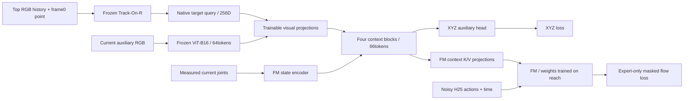

Full2,048 training query episodes/512contexts, context stride10 and expert stride3:61,688shuffle +234,434expert endpoints per epoch. Within each shuffled context: chronological XYZ-only updates, then expert FM+XYZ updates. All FM/state parameters receive no update on context-only batches, including momentum/decay. Both losses have coefficient1. Current XYZ and future expert actions are supervision, never observation inputs. Preserve source normalization and H25/25Hz fixed-current-anchor EE deltaXYZ/relative rotation6D/absolute jaw actions.

Budget30epochs, maximum batch512,1,024updates/epoch,30,720total updates. Actual group batches68–180shuffle/447–465expert. AdamW context1e-4/XYZ head1e-5/FM2e-5,100-update warmup; no gradient checkpointing. Frozen native tracker processes context stride10 and expert stride3 once, without interpolation; full deduplicated side/query RAM cache23.31GiB. Compact native queries persisted for restart; dense side tokens stay in RAM. This avoids the repeated frozen-vision encoding cost of e109.

Preflight: full512 stress peak19.79GiB. Action/mask labels match previous batching bit-for-bit at five representative endpoints, and native context vectors match e110 bit-for-bit for four targets/124frames. Verify exact initial weights, frozen vision hashes, action gradients through both visual branches/context/state, FM unchanged on masked context after optimizer momentum, finite H25 inference and checkpoint model/optimizer serialization. Completed preflight artifacts removed after recording evidence in e111_*checks.json.

Main run launched in ssh_tmux:1 at one-time frozen-feature cache stage. Validation uses32held-out episodes/184XYZ endpoints +64fixed expert chunks; fixed noise/time seed109000; select best by flow loss. Validation tracker additionally visits exact XYZ endpoints, so its cadence differs from e110. Actual cache/training time, validation results and closed-loop manipulation success are pending. See e111_README.md/e111_bc.md and e111_bc/train/config.json,progress.json. No manipulation-success claim.

Near-ten-epoch closed-loop videos: exact epoch10 weights were no longer retained when requested (trainer already in epoch11); selected available best step10600, samples3065405=10.351831full epochs before seeing outcomes. Snapshot fixed in e111_bc/test_k10/checkpoint.pt with hash/config/source capture. Four preselected red-target cases: g000/p00/t0(train), g000/p01/t0(new-order), g036/p00/t0(new-layout), g036/p01/t0(both). H25/K10/Euler10/noise0/900frames. Replay only past context into frozen native tracker, then live RGB+joint control; no future expert data. Live tracker stride3, causal query hold up to2frames at intermediate K10 replans. Static left camera substitutes for wrist.

Result:0/4complete successes, all900frame timeouts, no target bilateral lift streak. Train and new-layout cases correctly deposit cover but fail target grasp. New-order and combined cases move the other cover (~341/322mm), exposing wrong pair. Mean live XYZ errors60.67/199.56/59.05/206.77mm respectively. Four cases are qualitative diagnostics, not a general success-rate estimate; all use RedCube. Training continues independently toward30epochs. Each individual video fully decoded900frames/36s/25FPS; top/side RGB, initial point and GT/predictedXYZ overlays. Four-panel comparison included. Code evaluate_trackon_bc.py; shared video renderer evaluate_context_bc.py accepts experiment-specific title. Original sources snapshotted. No conclusion that extra training will necessarily solve these failures.

EE-shortcut probe completed: reconstruct360K10 endpoints across the4fixed recorded rollouts and evaluate e110/e111 readouts on identical native top queries, side tokens and measured state. All296,122persistent training XYZ labels match the selected object centers exactly after the same FP32 conversion used by the trainer; labels are not EE positions. Native frame0prompts also match exactly. Reconstructed e111 XYZ differs from stored rollout predictions by per-case means0.146/0.129/0.561/0.192mm, maxima1.072/0.543/4.769/1.709mm. Reconstruction is approximate because perception is re-encoded; these residual differences are explicitly retained.

Holding visual inputs fixed, circularly swapping actual joint states changes XYZ by mean33.58mm before BC and42.14mm after BC (per-case e11149.36/29.90/52.68/36.62mm). Replacing joint input with episode-initial joints changes e111 XYZ by66.10/35.69/55.89/49.32mm. Joint-only replacement does not consistently move XY in the same direction as the EE (median follow gains near0 to0.053), so these data do not establish literal coordinate copying of the EE.

A clearer failure is false object elevation. At20s in train g000/p00/t0 the actual target center remains15.89mm high while predictedZ=131.67mm; fixed vision plus initial joints lowers predictedZ to40.32mm. At20s in new-layout g036/p00/t0 actualZ=15.89mm, prediction116.46mm, fixed vision plus initial joints22.06mm. Initial prediction was near16mm in both, then rose after the attempted grasp despite no target lift. This supports excessive dependence on robot state/phase and is consistent with a learned held-object assumption from successful expert demonstrations; the precise learned mechanism is not uniquely established. The EE reference is grasp_site, not the object center, and has a physical offset when grasping.

This is not solely a state-decoder problem: native Track-On point error also averages58.15/58.27pixels on the two unseen-permutation rollouts. State sensitivity and native identity failures coexist. Counterfactual images/joints are mismatched inputs, a diagnostic rather than an alternative deployment policy. Four red-target cases only; no manipulation improvement experiment was run. Existing30epoch training remains unchanged. Possible next ablation: infer XYZ from visual context without joints and introduce joint state on the action-conditioning path; not implemented here.

Artifacts e111_bc/probe_ee_4:summary.json,point_metrics.json,inputs.npz,diagnostic.png/pdf,height_bias.png/pdf/json. Code probe_trackon_ee.py; command `.venv/bin/python -m OATFlow.shuffle_bc.probe_trackon_ee --output <fresh-output>` with MUJOCO_GL=egl. Original failed probe attempts were caused by an overly strict2mm reconstruction maximum; batch1 vision/context checks reduced some differences but residual4.77mm remained. The final check records actual residuals and requires mean<1mm/max<10mm. Failed intermediate folders and duplicate inputs were deleted after the final result/evidence were retained.

## E114: native TCOW target-mask fine-tuning

Replace the XYZ localization objective with amodal target-mask supervision before
learning the next action policy. Use one top camera and a visible target mask at
frame0; all later GT masks are supervision only. Retain the official pretrained
causal TCOW backbone and the original target-channel patch readout weights.
Remove the occluder/container output channels and unused flag head. There is no
XYZ head, attention pooling, context decoder, joint input, auxiliary camera or
FM in this stage. All121.75Mbackbone/readout parameters are fine-tuned.

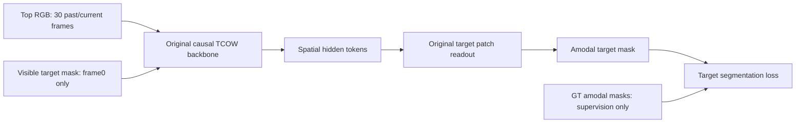

Full2048train query episodes/512shared contexts,32layouts/16seen permutations.
One newly sampled causal prefix per episode per epoch;30frames uniformly sampled
within that prefix with frame0 retained. This is2048clips/epoch, not every dense
endpoint. Ten epochs,5120updates, batch4. AdamW backboneLR1e-5/headLR1e-4,
50update warmup, weight decay1e-4, clip norm0.3, BF16, no gradient checkpointing.
Retain original TCOW target loss0.2weighted BCE +0.4bootstrapped BCE +0.4soft
Jaccard with original occlusion/hard-negative weighting; fix upstream frame0
weight indexing for every batch example. Initial weights/readout forward and
loss were independently checked against official equations; future-frame
perturbations change past outputs by exactly0.

RGBuint8 and packed masks are cached in host RAM, not hidden features. Every
training batch recomputes TCOW and backpropagates through it. Train+val cache
70.24GiB took358.53s. Disabling NumPy huge-page advice for this process avoids
measured kernel allocation overhead; no kernel-global setting changed. Actual
training+validation80.36min,0.90175s/update,18.533GiB peak allocated VRAM.

Best selected on32validation episodes/184fixed phase endpoints at epoch9,
step4608; epoch10completed5120updates. Validation meanIoU38.90%pretrained to
75.53%fine-tuned; hidden0%to65.11%, visible74.55%to85.07%. Best checkpoint is
fixed before held-out tests.

| Held-out subset | Episodes | Endpoint probes | Mean IoU | Hidden mean IoU | Exposed mean IoU |
|---|---:|---:|---:|---:|---:|
| Unseen permutation |64|384|83.17%|79.67%|90.75%|
| Unseen layout |32|184|76.23%|67.76%|86.69%|
| Both unseen |64|384|75.63%|66.87%|87.30%|

Evaluation covers visible/shuffle/post-shuffle/exposed/lift probes in fixed
subsets, not entire held-out splits. Metric is amodal segmentation IoU at0.5,
not manipulation success. Independent replay reproduced the selected-checkpoint
validation mean exactly. Five recorded full-trajectory videos compare GT/original/
fine-tuned masks: predetermined train/red, unseen-permutation/blue, unseen-layout/
green, both-unseen/yellow, plus the lowest hidden-probe-IoU episode among the64
combined tests. The last case is intentionally a failure diagnostic. Prediction
updates at stride3plus segment terminals and is held causally during25FPS
playback; no future interpolation. All arm motion is recorded expert motion.

This establishes useful target-mask localization/permanence on these subsets.
It does not yet establish improved FM grasping or superiority to XYZ auxiliary
supervision: no matched downstream action-policy ablation has been run. The
proposed next policy feeds projected TCOW spatial hidden tokens, auxiliary-camera
ViT tokens and measured joint embeddings directly to FM initialized from weights
trained on the reach task, without an intermediate context decoder. That policy
is not trained in e114.

Artifacts: e114_mask/train_3/{best.pt,summary.json,test_*.json};
e114_mask/test_videos/{config.json,validation_replay.json,summary.json,*.mp4}.
Details: e114_mask_README.md and e114_test_README.md. Video production status is
recorded in test_videos/progress.json; five-case dense video metrics differ from
the fixed endpoint-probe metrics above.

E114 video tests complete: all five MP4s plus combined comparison fully decoded;2948frames/117.92s, checkpoint unchanged, validation replay difference0. Dense hidden meanIoU original to fine-tuned: train9.47%to78.45%, fixed unseen-permutation8.80%to80.85%, fixed unseen-layout8.16%to37.80%, fixed both-unseen8.26%to57.74%, deliberately hard combined8.42%to38.38%. These are five selected video trajectories, distinct from the160episode probe table. The fixed new-layout/hard-combined videos show an offset mask under the cover (post-shuffle IoU~0.30) and better visible-target recovery after opening. No FM control or grasp-success result.

E114 full held-out cover-identity probe: evaluate all1408held-out episodes
(1024unseen permutation,256unseen layout,128both),352shared contexts, using the
same fixed epoch9checkpoint. Assign the binary predicted target mask to the
unique GT amodal cover silhouette containing>50%of its area; GT container ID is
physical ownership, independently checked against selected_cover after shuffle.
GT cover geometry is evaluation-only and never model input. No nearest-cover
fallback; empty/tied/unsupported predictions would count unresolved.

After shuffle:1408/1408correct cover (100%), including all1024/256/128in each
split. Correct one-of-four object-silhouette binding is also1408/1408. During
shuffle,2942/2944midpoint probes select the correct cover (99.93%):2142/2144new
permutation,544/544new layout,256/256both. Two transient errors are g025/p08/t0
and g025/p08/t3 at raw frame294, both in the same context; true cover_b, predicted
cover_a, then correct post-shuffle recovery. Oracle GT-mask cover assignment is
4352/4352, so these failures are not ambiguity in the evaluation projection.
1406/1408episodes are correct at every sampled probe; this is not dense-frame
continuous accuracy. Four-object binding during shuffle is2936/2944. Prior160
post-shuffle IoUs reproduced within2.964e-8, checkpoint unchanged. This supports
100%final cover localization on this held-out dataset, not100%tracking at all
times or successful FM manipulation. Details: e114_cover_README.md; artifacts
 e114_mask/test_cover/{summary.json,records.json,wrong_cover_records.json,predictions.npz}.

## E115: frozen mask-trained TCOW directly conditions FM

Transfer the E114 mask representation to action learning. Freeze the complete
epoch-9 TCOW and the auxiliary-camera ImageNet ViT-B16. Feed the current TCOW
spatial hidden tokens, auxiliary image tokens and measured joint embedding
directly to FM, initialized from weights trained on the reach task at step
115,000. Train only FM, including its existing joint encoder and context K/V
projections. Remove the separate context decoder and XYZ head/loss.

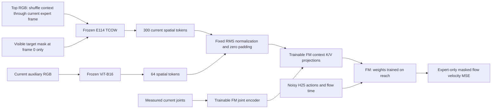

Full 2,048 training query episodes, 512 shared contexts. Expert starts at stride
3 give 234,434 chunks per epoch. Shuffle context produces no action-loss sample;
it remains part of each expert observation's causal history. The history is
identical to E114: 30 uniformly selected past/current frames from the concatenated
context and expert prefix, retaining frame 0. Only the initial visible target
mask is a query. No future frames, later GT masks, object XYZ or task ID are
policy inputs. The auxiliary view is static left, substituting for a wrist
camera; it is not a moving wrist camera.

All 300 TCOW spatial tokens are retained. Auxiliary ViT tokens use the existing
fixed 8×8 pooling. Parameter-free token RMS normalization and padding from 768
to 960 dimensions adapt image features to the existing FM projections. FM attends
to 365 tokens, including one joint token. There is no learned visual projection
outside FM and no intermediate attention/context decoder.

Frozen visual features are cached in RAM. Full FP16 features would exceed the
120.7 GiB process limit, so TCOW features use int8 with one FP16 scale per 16
coordinates; auxiliary tokens use FP16. This preserves all spatial tokens and
feature coordinates. Total cache is 78.37 GiB including validation and labels.
Online inference must apply the same quantization and FP16 boundaries. Preflight
relative latent RMSE was 0.7355%; quantized versus unquantized mask-readout IoU
was 99.861%, and relative FM velocity RMSE was 0.2597%. These are numerical
comparisons, not segmentation accuracy or grasp success. Cached and online
codes/scales/auxiliary features matched exactly.

Initial budget: 10 epochs, batch cap 256, AdamW LR 2e-5, 100-update warmup,
weight decay 1e-4, gradient clip 1, BF16, no gradient checkpointing. Keep reach
normalizers and H25/25 Hz actions: future EE delta XYZ and relative rotation 6D
anchored at the current measured EE pose, plus absolute jaw command. The sole
objective is expert-only masked flow velocity MSE. All 104,814,314 trainable
parameters belong to FM, including its existing joint encoder.

Epoch 1 caches each shuffled context group and immediately trains its expert
chunks. Epochs 2 onward globally shuffle all cached chunks. Every epoch visits
each expert chunk once. Native encoding batch 4 measured 13.54 clips/s; larger
batches were slower. FM batch 256 measured 0.544 s/update and 15.72 GiB peak
allocated VRAM in preflight. Early main-run group timing suggests 6–7 hours for
the first encoding/training epoch, then about 8–10 minutes per cached epoch.
Actual full-pass timing is pending. RAM features must be rebuilt after process
restart; resumable checkpoints preserve completed FM updates and optimizer/RNG.

Verification: initial FM weights/buffers matched the reach source exactly;
expert action labels/masks matched the previous BC label builder bit-for-bit;
history/query matched native E114 clips at first, middle and last expert probes.
Joint and both visual feature boundaries received action gradients, while frozen
vision gradients remained absent and weight fingerprints unchanged. Finite H25
sampling was checked. Main run completed all 10 epochs, 9,268 updates and
2,344,340 expert chunks; every epoch visited all 234,434 chunks exactly once.
Best/latest checkpoint parameters are finite and both correspond to epoch 10,
step 9,268. Validation uses 32 fixed held-out episodes, eight expert endpoints
each, fixed flow noise/time seed 115000. Select best by validation flow loss.

Validation flow loss: 1.768738 before training, 0.033112 at epoch 1, 0.013981 at
epoch 5 and best 0.009139 at epoch 10. Mean training flow loss was 0.184020,
0.011560 and 0.008145 at epochs 1, 5 and 10 respectively. Validation briefly
worsened at epochs 8–9, then improved at epoch 10. Actual elapsed time after
initial validation was 7 h 2 min 15 s; first cache/training epoch 5 h 48 min,
later epochs approximately 8.2 min. Median update 0.5281 s, peak allocated VRAM
15.780 GiB. Frozen vision fingerprints remained unchanged; process exited 0.
RAM features were released on exit. These are supervised flow-loss results;
closed-loop outcomes are reported below; no population success rate is claimed.
See e115_README.md, e115_results.json, e115_preflight_summary.json and
e115_quantization_check.json. Code: OATFlow/shuffle_bc/direct_model.py,
direct_data.py and train_direct.py. Artifacts: e115_direct/train; live log in
e115_direct/train.log, tmux ssh_tmux:1 (e115).

E115 closed-loop diagnostic completed with the fixed best epoch-10 / step-9268
checkpoint: four predetermined RedCube cases (train, unseen permutation, unseen
layout, both unseen), H25/K10, Euler10, noise seed0 reset per case, maximum900
frames. TCOW retains context history and the initial visible mask prompt; only
live images and measured joints are available during policy control. Numeric
cache boundaries are reproduced online. Video overlays show predicted masks
and a display-only GT center; there is no predicted XYZ head.

Results: 1/4 complete successes. Train g000/p00/t0 deposits the correct cover
but fails the target pick (maximum lift 5.95 mm). Unseen-permutation g000/p01/t0
raises the correct cover but fails to complete deposit/pick (target 6.28 mm).
Unseen-layout g036/p00/t0 opens the wrong cover (other cover shift 296.8 mm)
and never lifts the target. Both-unseen g036/p01/t0 succeeds in 337 frames,
lifting RedCube 117.32 mm with bilateral contact for 10 frames and the correct
cover deposited. All failures time out at 900 frames. These four fixed red-target
cases are qualitative diagnostics, not a reliable success-rate estimate.

The train and wrong-cover new-layout end frames still show predicted mask
support near the true target. This suggests action-conditioning/control failures
can occur alongside useful mask localization, but does not establish the cause
or measure dense tracking accuracy. Five H264 videos (four cases + montage)
fully decoded; individual frame counts 900/900/900/337, montage 900. Elapsed
149.85 s, peak allocated VRAM 1.442 GiB. Frozen vision/checkpoint hashes unchanged,
process exit 0. Local results: e115_rollout_results.json.
Code evaluate_direct.py; details e115_rollout_README.md; artifacts
e115_direct/test_k10 and test_k10.log.

E115 initial-state query probe: fix context/current RGB, auxiliary RGB, measured
joints and FM noise, varying only the initial visible target mask across all
four targets in each of the same four contexts. Initial physical qpos/joints
match exactly across query demonstrations. Use one shared decoded RGB input to
remove small per-video compression differences. Native history/quantization,
H25/Euler10, four common noise seeds; no policy motion. Expert future trajectories
and GT masks are scoring labels only.

TCOW correctly binds 16/16 masks, mean IoU79.32%. Correct-query sampled XYZ
trajectory RMSE is8.365mm; replacing the query with an opposite-cover target
increases it to16.746mm. Thus FM does use query information. Its opposite-cover
trajectory separation is7.638mm versus16.255mm for experts; nearest-expert cover
agreement is46/64 query/seed combinations. These are correlated diagnostic
samples from four states, not64rollouts or a task success rate. Train GreenCube
has94.51%maskIoU but favors the wrong cover expert at all four seeds; unseen-layout
RedCube has77.84%maskIoU and the same wrong-cover preference at all four seeds.
This supports incomplete target-conditioned action learning even with useful
mask localization. It does not identify a unique mechanism or prove that more
epochs will fix it. Frozen fingerprints/checkpoint unchanged. First attempt's
overly strict decoded-RGB equality check was corrected to fixed common RGB after
recording codec differences; no model outcome was discarded. Details
e115_query_README.md, e115_query_results.json; code probe_direct_query.py;
artifacts e115_direct/probe_query_2.

E115 continuation requested: resume latest epoch10/step9268 for30additional
epochs (11–40), same full data, architecture, expertstride3, batch256,
encodingbatch4, LR2e-5 and optimizer/RNG state. No extra warmup. Read-only
verification loaded weights and185optimizer slots bit-for-bit; exact source
hashes match. Expected final step36748 and9,377,360total expert chunks. Cache
rebuild uses78.37GiB RAM, then approximately8.2min/epoch; estimated total9–10h.
No disk feature export (only~35GiB free); RAM cache released when process exits.
Previous10epoch outputs/tests remain intact. New artifacts e115_direct/train_2,
log train_2.log, tmux ssh_tmux:1(e115_40). Status: cache/retraining startup;
continuation validation and rollouts were pending at launch. Details e115_resume_README.md,
e115_resume_check.json.

E115 continuation completed all30additional epochs, total40epochs/step36748,
9,377,360expert chunks. All epochs11–40 visited234434chunks exactly once. Best
selected by validation: epoch32/step29420, flow0.0053752917 (41.18%below epoch10).
Latest epoch40 flow0.0065012885; train mean0.0042530543. Training mean at epoch32
was0.0046412907. Total continuation elapsed9h51min14s, including5h43min37s
rebuilding the RAM cache; median update0.52853s, peak allocated15.029GiB.
Frozen vision unchanged, best/latest finite, exit0; RAM cache released. No
architecture/optimizer/source changes during continuation. Per-epoch results
in e115_resume_results.json.

Matched four-case closed-loop test of the validation-selected epoch32checkpoint
completed in e115_direct/test_k10_2. Same RedCube scenes, initial physical
states, H25/K10/Euler10/noise0/900frame limit as the epoch10test. Evaluator changes
only remove the epoch10assertion and derive the video title/protocol README from
test metadata. Policy computations and scoring unchanged. Results follow;
details e115_rollout_2_README.md.

Epoch32best matched rollout:2/4 successes versus1/4 at epoch10. Train and unseen
permutation now succeed in329/324frames, target lifts120.95/123.22mm. Unseen layout
still times out without selected-cover opening or target lift. Combined case
regresses from success to timeout: correct cover deposited, target lift19.38mm,
no qualifying bilateral streak. Both failures run900frames. Paired outcomes:
two gains, one regression, one persistent failure. Initial qpos/qvel/ctrl and
prompt masks bit-identical; H/K/flowsteps/noise/cases/history/numeric boundaries/
frozen hashes/scoring match. Four red-target cases, not a success-rate estimate.
These results show some benefit from further training but no uniform improvement.

Four case videos plus montage fully decoded (329/324/900/900frames, montage900),
additional epoch10-versus32side-by-side montage also900frames. Runtime126.30s,
peak allocated1.442GiB, frozen/checkpoint hashes unchanged, exit0. Latest epoch40
was not tested; epoch32selection was based only on validation before testing.
Artifacts e115_direct/test_k10_2; local e115_rollout_2_results.json and
e115_rollout_2_paired_check.json. Documentation e115_rollout_2_README.md.

E115 full-test request: all1408held-out episodes (1024composition,256spatial,
128combined),352queries per target, same fixed epoch32best/H25/K10/Euler10/
noise0/900frame protocol. The user subsequently requested faster execution and
no videos. Sequential test_full was interrupted after3committed cases; these
are retained and imported into test_full_2after checkpoint/protocol/physics/
manifest checks. Full case set excludes train/validation and the old128case subset
is not used.

Four-process independent-case execution benchmark: all four known epoch32
reference traces/outcomes reproduced bit-for-bit, including both900frame failures.
2453frames/42.453s compute versus sequential1224frames/42.348s, approximately2×
aggregate throughput. No model batching or camera-render cadence changes.
Observed GPU total~8.5GiB/100%utilization;4×4torch threads fit23.04CPU cores.
Initial full-run estimate4–6h. State/action/mask/history traces and atomic JSON
completion records for every case; no video exports. Resume skips committed
episodes. Results per split/target and failure reasons pending completion.
Code evaluate_direct_parallel.py; docs e115_parallel_README.md,
e115_parallel_check.json. Tmux ssh_tmux:1(e115_full), log test_full_2.log.

E115 runtime probe while the four-process full test continues: fixed B1 initial
observation, two warmup and five measured repetitions, native BF16/int8/FP16
boundaries. CUDA-event intervals averaged TCOW30frame312.09ms, quantization
0.058ms, auxiliaryViT20.35ms, FM10Eulersteps210.22ms. These intervals include
scheduling contention with the active full-test workers; they are not isolated
kernel runtimes or a direct whole-rollout attribution. TCOW is the largest of
these model stages, with FM also substantial. A separate recorded-state probe
over120frames measured approximately50.70msrendering,23.90msIK and13.52msphysics
per10control frames. Different probes/load windows should not be combined into
an exact whole-rollout time percentage. No test inputs/actions/protocol or
weights changed; no videos exported. Detailed records e115_runtime_profile.json.

User reduced the E115 full-test frame budget from900to400(16s). Stop the prior
test_full_2after130committed cases; preserve all originals. New test_full_3uses
the same1408cases/checkpoint/seed/H25/K10/Euler10/observations and4independent
workers, no videos. Re-score saved prefixes at min(original_stop,400): endpoint
cover/contact/displacement via MuJoCo, prefix lift maxima/streak, and all state/
action/mask/history arrays clipped consistently. Events after400become timeout,
because the original loop would have stopped at an earlier qualifying event.
Audit:47prior successes remain47; wrong-object lift at575in g000/p11/t1becomes
timeout400. Remaining1278cases queued; full results pending.

Four fresh400frame rollouts match every clipped reference array and all physical
metrics/outcomes bit-for-bit; compute23.572s. Evidence e115_400_preflight_check.json
and e115_400_migration_check.json. Added explicit frame-budget/import controls
and prefix re-scoring helper truncate_direct.py; model/data/physics hashes
unchanged. Queue shutdown now cancels unused feeder joins to avoid hanging on
interruption with pending episodes. Source snapshots distinguish both horizon
protocols. Original900frame artifacts retained; no mixed-horizon headline rate.
Docs e115_400_README.md; log test_full_3.log, tmux ssh_tmux:1(e115_f400).

### E114 RGB-D surface replay diagnostic

Two existing causal TCOW mask videos were reconstructed from frame0 through
covering, shuffle, expert uncovering and lifting: g000/p01/t1 (unseen permutation,
621 frames) and g036/p01/t3 (both unseen,606 frames). No training or FM inference.
Ideal simulated top depth is rendered at the recorded state and backprojected
using calibrated camera geometry. Initial visible-mask prompt supplies a surface
template and appearance reference. Current predicted mask plus an RGB chromaticity
gate selects observed target depth. With insufficient visible support, translate
the initial template using the amodal-mask centroid ray intersected with the
initial surface-height plane. This explicitly assumes tabletop translation.
No later GT masks, object poses or visibility labels enter this estimator.
GT is used for sensor rendering and subsequent evaluation only.

The naive amodal-mask-times-current-depth cloud follows the occluding cover.
Across114/112 fully occluded prediction endpoints, naive median surface-reference
errors are48.61/48.23mm; template/plane estimates are1.19/6.22mm. Reference is the
initial observed surface center attached to the object, not its volume center
or an EE grasp target. Two clips, ideal depth and hand-designed color filtering
do not establish general localization accuracy or real-world performance.
No full-shape completion or hidden rotation/lifting inference is performed.
Both videos decoded fully; backprojection/projection roundtrip below0.001pixel.
Artifacts: e114_mask/test_pointcloud; code OATFlow/tracking/pointcloud_video.py;
protocol and limitations: e114_pointcloud_README.md.

User subsequently requested changing the source RGB-D camera, not the point-cloud
display angle. Added a fixed frontal camera at(0.54,-0.66,0.60)m aimed at
(0.54,-0.12,0.035)m, FOV55deg (~46deg downward). Re-rendered RGB/depth and reran
the unchanged top-trained TCOW with a new frame0 visible-mask prompt from this
camera. Both 621/606-frame videos fully decoded; checkpoint hash unchanged.
Front surface templates include side faces (201/234 points). Mean mask IoU
60.43/66.88%, hidden31.64/56.52%; hidden surface-reference median error22.66/2.09mm.
The blue case demonstrates substantial viewpoint sensitivity under occlusion.
Visibility strata are camera-dependent, so these are not identical subsets to
the top-camera numbers. All reconstruction priors and ideal-depth limitations
remain. Artifacts e114_mask/test_pointcloud_3, protocol e114_front_README.md.

Display follow-up: test_pointcloud_4 removes the naive-cloud comparison and uses
two matching672x504 panels (RGB+mask, target cloud). Cloud rendering uses the exact
RGB perspective camera intrinsics/extrinsics, center crop and scale2.1. No arbitrary
3D display angle. Reuses test_pointcloud_3 masks/clouds without inference or changes;
source hashes verified. Both621/606-frame videos decoded; full-scene camera
roundtrip1.14e-13pixels. Protocol e114_camera_view_README.md.

Depth-color follow-up: test_pointcloud_5 colors scene points by axial camera
depth using turbo_r and a fixed0.5--1.25m scale with colorbar, dark background
and denser stride2 points. Near is warm, far cool; out-of-range values clip.
Target cyan/orange measured/inferred colors and all saved TCOW/cloud estimates
remain unchanged. Same camera projection, no naive panel. Both621/606-frame
videos decoded; original mask/cloud/metric hashes unchanged. Initial screenshot
inspected for robot/table visibility. Protocol e114_depth_view_README.md.

Native-depth follow-up: test_pointcloud_6 replaces point drawing with the dense
original axial depth raster, mapped directly through the same fixed turbo_r
0.5--1.25m scale. All native pixels included; nearest display resizing preserves
depth boundaries. Paired RGB+TCOW-mask / native-depth panels share camera/crop.
No target-geometry overlay on depth: occluders retain their measured surface.
Both621/606-frame videos decoded; source mask/cloud/metric hashes unchanged;
initial screenshot inspected for removal of dot lattice. No training/inference.
Protocol e114_raw_depth_README.md.

Combined display: test_pointcloud_7 keeps the dense native-depth background and
restores only the target's saved 3D cloud, projected through the same camera.
Cyan measured/orange inferred, white silhouette halo for contrast; inferred
surface intentionally visible through cover. No scene-point lattice or naive
panel. Both621/606-frame videos decoded, source mask/cloud/metric hashes unchanged,
camera roundtrip1.14e-13pixels. Hidden screenshot inspected. Display-only change,
no training/inference; protocol e114_depth_target_README.md.

Depth storage measurement: e114_mask/test_depth_compress encodes actual621-frame
320x240 front-depth sequence g000/p01/t1 (24.84s). Rawfloat32=190.77MB,
zlib=12.64MB(15.1x), decoded bit-exact all pixels. Rawuint16=95.39MB;
0.1mm-unit FFV1=3.17MB(30.1x), PNG16=4.70MB(20.3x);1mm-unit FFV1=2.22MB
(43.0x). Every uint16 code survives full decode exactly. Quantization error
vs float32:0.1mm depth MAE0.0251/max0.0501mm,XYZ max0.0582mm;
1mm depth MAE0.2568/max0.5001mm,XYZ max0.5870mm. Uint16 variants share
valid range(0,6.5535]m;~3.28% far-plane pixels become invalid0 and are excluded
from geometric error, explicitly reported. Float32 zlib preserves those too.
This is ideal simulated depth without sensor noise, not a measured real-sensor
compression ratio. No training/inference. Protocol e114_depth_compress_README.md.

Decoded-uint16 preview: test_depth_compress/view_uint16 reads the actual
3.17MB0.1mm-unit FFV1 file (gray16le), converts codes to metres and colorizes
with fixed0.5--1.25m scale. Invalid0 background dark. Paired RGB+saved TCOW mask
and decoded depth+original saved target cloud; overlay is reused geometry,
not newly reconstructed from quantized input.621frames fully decoded; original
FFV1 and mask/cloud/metric hashes unchanged. Valid-pixel camera roundtrip
1.14e-13pixels; initial screenshot inspected. Protocol e114_uint16_view_README.md.

2mm follow-up: test_depth_compress_2 quantizes the identical bit-exact float32
reference with the same valid mask and FFV1 flags. Payload1.892269MB,14.68%
smaller than1mm and40.30% smaller than0.1mm;50.41x vs rawuint16. Integer codec
error0. Quantization depth MAE0.51436mm/max1.00006mm;XYZ mean0.54790mm/
max1.16828mm. Invalid pixels unchanged. Decoded-file preview fully verified621
frames; original target overlay reused, not recomputed from quantized input.
No training/inference. Protocol e114_2mm_README.md; results.json in artifact folder.

### E116: regenerate shuffle with real object dynamics and two RGB-D cameras

Original shuffle_pick_multiview context was kinematic: object qpos translated
exactly with assigned cover, mj_forward only, relative offsets constant to about
1e-13mm. Its expert continuation uses physics, but old shuffle/tracking results
must not be interpreted as robustness to free object/cover contact dynamics.

New collection is authorized: four free cubes, two externally mocap-weld-driven
covers,500Hz MuJoCo dynamics,25Hz recorded state. Only setup assigns cube poses;
shuffle motion comes from contact. Welds released and covers settle before four
expert continuations. Original masses/friction/contact softness retained. Finite
successful-orientation search lets the contact oracle grasp crowded cubes; failed
orientations/plans/layout seeds recorded. Shared context and full integration/drive
state permit exact replay. Split remains INITIAL-permutation/layout based; final
within-cover object order is continuous and is not asserted to remain unseen.

Exactly two cameras: front-oblique and actual robot-mounted wrist; both RGB and
uint16 depth2mm/unit+FFV1,320x240. No top/left/right. Intrinsics and framewise
camera-to-world/base matrices retained for both, including moving wrist. Masks,
visible/amodal/occluder/container labels, FOV validity, measured joint observations,
timestamps and frame0-only query-mask prompts included; later GT not policy input.

Pilot4contexts/16expert demos passed. Full context+expert command replay qpos/qvel
error0; RGB decoded completely and both depth streams decoded bit-exact. Wrist
camera position range0.544m; all target/cover contacts occur, relative motion up
to115mm. Sampled contact penetration reported (up to a few mm during shuffle,
about12mm dropped-cover/table impacts under original soft contact model); no real
contact calibration claim. More rigid-contact exploratory test was not adopted.
Pilot6853unique frames,~102.7MB; extrapolated production23.8GB, leaving margin on
~31GiB available. Renderer stops below3GiB free and can resume completed segments.

Production RUNNING at /workspace/robotics_assets/datasets/shuffle_pick_rgbd_dynamic;
928contexts/3712queries planned (train2048,val256,composition1024,spatial256,
combined128). Automatic collect8workers -> render8workers -> audit; config marks
complete only after final audit. Log e116_dynamic/full.log,tmux ssh_tmux:1
(e116_full). No model training. New dataset is not yet complete. Protocol
e116_README.md; pilot validation/configs and two preview videos retained under
e116_dynamic; finished preflight payloads removed after recording evidence.

Wrist camera correction: user reports fisheye hardware (model not yet identified).
The initial pilot used pinhole RGB and ideal depth; default near clipping was80mm
because MuJoCo multiplies znear by scene extent8m. Close occluders could disappear,
revealing the target behind them. Renderer now uses absolute geometric clip planes
1mm/10m; four-frame RGB/depth/mask/codec check passed (exact uint16 codec, <=1.001mm
quantization). At g001/p00/t0 frame300 all corrected wrist pixels are below80mm:
the close cover occludes the view, whereas the old clip falsely exposed objects.
Initial pilot movies retain this known optical artifact. They validate replay/codec,
not real camera fidelity. Full physics continues; automatic full rendering is held
by RENDER_HOLD.json pending wrist fisheye/RGB-D assumptions. No physical min range
or focus model is claimed. Survey: e116_camera.md.

E116 camera update: user dropped wrist depth. Current planned outputs are front
RGB-D and wrist RGB only, with masks/calibration for both. Wrist projection is
synthetic equidistant175deg diagonal, nominal Arducam B0261 reference (not measured
real-lens calibration). Five cubemap views provide correct wide-angle geometry;
RGB and labels share their pixel mapping. Calibration stores projection types,
K/distortion and framewise poses; raw wrist orientation is retained. Viewer rotates
wrist RGB and visible-mask panel180deg for readability. Front depth remains2mm
uint16 FFV1. Independent geometric ray/segmentation check:575/576 semantic IDs
match across three expert states, with one raster boundary discrepancy. No focus
simulation or wrist depth is claimed. Paired preflight and updated videos running;
full physics uninterrupted. New renderer will supersede the original pilot visuals.

E116 current-camera preflight PASSED: front RGB-D+wrist fisheye RGB only,2contexts,
8expert continuations,3391unique frames. Both RGB streams fully decoded, front
FFV1 depth bit-exact, no depth_wrist.mkv, updated model/K/pose metadata verified.
All10sequence command/dynamics replays have qpos/qvel error0. Fisheye575/576 ray
semantic IDs match exactly;576/576 within1pixel boundary tolerance; OpenCV
projection roundtrip error<6e-14pixels.39.56MB gives a small-sample full-size
estimate18.36GB. Full render hold released after validation; physics uninterrupted.
Updated upright wrist previews: e116_dynamic/preview_rgb/train.mp4 and composition.mp4.
Canonical protocol e116_README.md describes the current camera schema; original
pilot clips remain historical and contain the old pinhole/clipping artifact.

E116 one-video sphere variant: all four targets become32mm-diameter spheres in
both visual and collision geometry, same30g mass and original friction; spherical
inertia updated to3.072e-6kg*m^2 per axis. Same g001/p00 layout and existing shuffle
retry/oracle protocol. Four context attempts rejected, accepted fifth; seven
wrist attempts rejected before[0.8,pi/2] securely lifts Red sphere117.6mm with
21-frame bilateral streak.250context+348expert frames; single23.92s video at
25FPS, decoded completely. Front RGB-D+wrist fisheye RGB with display-only180deg
rotation. Full physical replay errors0, front FFV1 codec bit-exact, no wrist depth.
Same original soft contacts yield sampled penetration15.36mm context/10.01mm
expert; no real-dynamics claim or success-rate inference from this selected demo.
Video:e116_dynamic/test_sphere/preview/sphere.mp4. Protocol:e116_sphere_README.md.
Heavy finished test payloads removed after retaining scene/metrics/plans/calibration.

E116 full-run recovery (2026-10-21): status check found no active collection/render
process. Original main process failed because layout_spec seeds960009/960018 raised
GraspFailure outside the layout retry handler. Its executor still committed38other
layouts:880contexts,3520expert demos. No full-render output/audit yet. Move layout
sampling into the existing retry handler and log the attempted seed independently
of spec construction. Verified bad original seeds, valid next seeds, mocked retry
and early reuse of committed groups. Archived original collector/config, verified
all original source/scene hashes and recorded a single collector hash transition
with38committed-group row hashes in collection_resume_fix.json. Resume preserves
completed groups; remaining9/18 then front RGB-D+wrist fisheye RGB render and audit.
This run must not be reported complete until final audit exists and passes.

### E117: stronger randomization, trial only

User requested a trial and comparison images, not full generation/training. Replace
E102's four fixed spawn neighborhoods with four uniform XY points in proposed
[0.30,0.78]x[-0.42,-0.10]m, minimum55mm pair separation, sorted by X for consistent
color-permutation ranks. Four32mm cubes, mass/contact settings, top camera and
home-start physical pick oracle unchanged. Two accepted layouts with two color
permutations and four targets each yield16successful expert demos. Independent
saved-state contact/height checks confirm all16stable target lifts, no distractor
lift, initial all-object visibility, and query-independent initial states.

New layouts are99.47mm and71.10mm from the nearest of32old training layouts,
using average Euclidean displacement of four ordered slots; old spatial holdout
average18.77mm. This compares two trial examples, not generalization benchmarks.
Accepted eight-point extents X0.3009..0.7785m,Y-0.3458..-0.1528m.59whole-layout
proposals rejected:17separation,25IK,17physical pick. The broad rectangle therefore
includes infeasible/difficult positions for this fixed oracle and accepted data are
selection-biased. No claim that the full proposed rectangle is grasp-feasible.

Figures:e117_wide/samples/comparison.png and spawn_positions.png/.svg; verification
and initial images retained. Both old/new image sets rerendered with identical
current visual model/camera and square pixels. Finished pilot payloads removed after
preserving config/audit/manifest/scene/layouts. Protocol:e117_README.md.

E117 camera-view follow-up: four accepted wide-pick cases rendered with exact E116
front-oblique RGB-D and mounted175deg synthetic fisheye wrist RGB. Wrist displayed
180deg rotated; front depth2mm/unit. Camera XML copied, physics/inertia/geometry/
friction/actuator arrays checked unchanged. Four deterministic expert frame counts
and bilateral-hold metrics match original pilot exactly.580frames/23.2s video fully
decoded; both cameras show all four targets initially (front257..379px,wrist159..239px).
Per-frame native calibration/model metadata verified; front-depth quantization max
1.000065mm. Samples and combined video:e117_wide/camera_samples; exact protocol
in e117_camera_README.md. No full wide-pick generation or learning performed.

E117 full generation/rendering now authorized; user also requested removal of the
old pick dataset. Current full pipeline uses40wide XY layouts/3712episodes, front
RGB-D2mm FFV1 plus mounted175deg synthetic fisheye wrist RGB, with masks and native
per-frame calibration. Full integration-state recording added for exact replay.
Original physical oracle, home, object/contact parameters and proposal distribution
retained; up to1000deterministic layout rejections to handle broad-range feasibility.
Atomic layout commits and per-episode render markers support resume. Sources frozen.

Final-format preflight16episodes/2330frames PASSED: exact replay, stable bilateral
lifts, paired starts, RGB decode, bit-exact uint16 depth, masks/prompts/calibration.
4-worker render33.45s, audit3.97s. Guard test confirms a16-episode replacement cannot
retire old data. Full job: wide -> wide_render -> wide_finish --retire-old in
ssh_tmux:e117_full, tee e117_wide/full.log. Only after new full audit passes, archive
and remove e102_top/data and e102_top/cache (~1.8GiB); retain checkpoints/results.
New data path:robotics_assets/datasets/pick_wide_rgbd. Completion/deletion pending.

User explicitly paused E116 full for later: physical collection complete;304render
markers retained, no executing E116 workers/GPU allocation. Status rendering_paused;
remaining render/audit deferred. This pause does not cancel E117 full work.

E117 completion verified (2026-10-21): all 40 layouts/3712 episodes rendered,
536888 frames, 5,731,436,026 bytes of episode payload (5.73 GB). Collection168.45s,
render5194.19s, final audit248.63s. Final audit PASSED including every terminal
bilateral lift, query-independent initial states, replay, media and calibration
checks. Authorized E102 pick data/cache deletion completed after audit; old metadata
archived as retired_data_* and receipt e102_top/data_retired.json. Checkpoints and
results retained. Dataset:robotics_assets/datasets/pick_wide_rgbd. E116 remains
paused. This is expert dataset completion, not a learned-policy result.

### E118: depth-cloud-conditioned reach from scratch

User requested full120k scratch reach budget replacing goalXYZ with visible cloud
of a2cm voxel from one front depth camera. Retain original voxel-disjoint splits,
action labels, joint inputs, H25/K15 and learning-rate schedule; train point encoder
and FM jointly, no auxiliaryXYZ loss. Protocol/architecture: e118_cloud_README.md.
Preparation and CUDA/depth preflight underway; no main training result yet.

E118 preparation PASSED:32,017single-view voxel depth clouds,128points/goal,
49.18MB;15..77unique depth pixels (median39) after2mm quantization. MuJoCo CPU-ray
check64goals agrees within quantization; raster edge differences explicitly recorded.
B256scratch preflight0.2148s/update,5.33GiB; all gradients/absolute position/order
invariance and bit-exact resume checks passed. Estimated7.16h training-only.
No main policy result yet; originalXYZ32goal reference evaluated with rebuilt
rollout protocol to avoid conflating historical evaluator differences.

E118 main launched in ssh_tmux:e118, latest checkpoint100verified with optimizer
step100/25,600samples, all105,102,634parameters train, source_weights=null, explicit
XYZencoder absent. First100mean loss0.833686,0.2491s/update,5.326GiB peak; estimate
~8.30h training-only, validation/checkpoint overhead additional. Reference E88XYZ
best115k under rebuilt32goal evaluator gives21/32stable5mm,median3.915mm,2collisions;
this is a separate baseline, not an E118result. E118 validation starts at5k.

E118 voxel-split visualization: real robot home mesh plus actual2cm cubes,
interactive local viewer and six exact XY/XZslices. Splits disjoint/complete:
25613train/3202val/3202test, spatially interleaved. 3198/3202test centers have
nearest training center20mm away; max34.641mm. This evaluates interpolation
within the feasible workspace, not a held-out spatial region. Source split hash
and browser control checks retained in e118_cloud/voxel_split.

E118 current-best smoke rollout: immutable checkpoint75000 SHA256
26334230a3a5cb13d1c0fcb2e9f2bc7150e7eba06e9d6316a46996066a036559.
First16of128fixed held-out goals, H25/K15/Euler10,noise0,300frames.
Stable5mm6/16(37.5%),10mm13/16(81.25%),2mm2/16; median5.180mm,mean6.535mm,
p90 12.466mm,zero collisions. Small subset, not full test or object grasp.
First6cases selected before outcomes; RGB replay uses saved qpos with unchanged
physics, real arm lighting, target voxel/cloud overlays and measured EE paths.
Artifacts:e118_cloud/test_k15; detailed protocol:e118_rollout_README.md.
Main120ktraining continues.

E118 COMPLETE:120000updates/30,720,000samples/~18.599passes; training with periodic
validation/checkpointing6.81h. Selected best120000,validation14/32stable5mm.
Full128held-out goals,H25/K15/Euler10,300frames: noise0/noise1 stable5mm54/128
(42.19%)/63/128(49.22%);10mm103/128(80.47%)/110/128(85.94%);1mm3/128each.
Final median5.508/4.967mm,mean8.906/6.874mm; collisions9/128and6/128.
Same128goals across two noises give117/256stable5mm(45.70%),213/256stable10mm
(83.20%); not256independent goals. Recorded-EE poseIK oracle128/128at1mm,
median0.023mm/no collisions. On matched rebuilt32goal validation, retainedXYZ
checkpoint21/32at5mm versus cloud14/32: cloud has not matched XYZ precision in
this run. Historical E88full-test evaluator differs; avoid a controlled full-test
claim. Details:e118_cloud_README.md; final summary:e118_cloud/train/summary.json.
Earlier test_k15videos show75k, not final120k. No final videos made in this check.

### E119: subset visual picking with cloud auxiliary supervision

User requested8balanced parts of E117train; train part1(4layouts/256demos) with
frozen ViT, E118best120k FM, E103target-query hidden conditioned directly into FM.
Replace auxiliaryXYZ with unordered target-cloud Chamfer(weight1), GT front depth/
mask/calibration for labels only.10epochs planned; full3200remaining test episodes
queued afterward. Setup/architecture:e119_README.md. No result yet.

E119 launch verified: selected layouts0/8/10/11,256demos/37,536stride1train chunks,
2940updates planned for10epochs. Front frozen-ViT features3.624GiB cached in GPU RAM;
no disk feature cache. All37,536train+2,048sampled validation frames yield valid
cloud labels;zero frames lose cloud supervision. No cover/shuffle segment here.
Initial geometry audit found one spurious foreground depth pixel, solved by
60mm target-mask median depth filtering without GT center; all sampled cloud
geometry audits pass. Exact E118FM transfer/frozen ViT/aux gradient routing,
Chamfer order invariance and real B128update passed; main starts with fresh
unmodified initial model/optimizer. Online four-color300frame camera/control
wiring passed, early checkpoint250; no learned accuracy claim. Main step550
(~1.87epochs),mean recent FM0.0236/cloud0.0628,peak7.37GiB incl feature cache.
Full3200episode final-checkpoint test queued automatically after10epochs.

E119 K10 video: first completed case g000/p01/t0(RedCube),unseen permutation on
training layout, final2940after10epochs. Saved physical trajectory timed out at300
frames,max target lift7.81mm,no bilateral streak. Rendered301frames/25FPS with
front policy view and oblique overview; cyan auxiliary predicted cloud recomputed
from RGB,targetID for diagnostics only. Full video decode and original trace hash
verified. Artifacts:e119_pick/test_k10/video_1; full evaluation still running.

E119 budget correction: user requested eight times more subset epochs (80total).
The original10epoch full test was interrupted after160/3200cases (0successes);
this is a partial result only. Before extending, user changed the architecture to
feed geometry alongside RGB. No80epoch continuation of the old architecture ran.

### E120: dense RGB and calibrated XYZ-map fusion

User approved full-resolution RGB–depth–calibration input. Back-project front
depth into an organized XYZ map in robot coordinates; a fresh Conv3→256 patch16
embedding processes all pixels. RGB remains a frozen ImageNet ViT. Both branches
use identical40pixel top/bottom letterboxing,20×20patch layout and adaptive8×8
pooling. Concatenate corresponding256D features and project512→256, preserving64
spatial tokens before the E103-style target-query decoder. Thus full input
resolution does not create one attention token per pixel. No point sampling,
target mask input or GT target coordinate; GT masks supply auxiliary labels only.

Use the same E119256demo subset/37,536stride1chunks,80epochs/23,520updates,B128,
FM LR2e-5/other LR1e-4,warmup100,FM+weight1 target-cloud Chamfer. Initialize all FM
weights/state path from E118best120k; the old point MLP is not transferred because
the geometry representation is now patch-based. Keep ViT frozen; train geometry,
fusion,decoder,projections,cloud head and FM. RGB feature cache is GPU RAM only,
raw uint16 depth/calibration is CPU RAM only; compute XYZ per batch, no dense disk
feature cache. Planned final test is all3200held-out episodes,H25/K10/Euler10,
noise0,300frames,no videos. Native four-frame data/model smoke check passed;
full cache/B128/online preflight pending. Learned results blank.
Architecture and exact protocol: e120_README.md and e120_test_README.md.

E120 launch verified: all39,584frames cached in118.83s; RGB3.624GiB GPU RAM, raw depth5.663GiB CPU RAM, calibration3.96MB. E119 labels bit-exact. Source FM transfer/aux gradient routing/frozen ViT/FP32 geometry checks passed. Four20frame online H25/K10 rollouts passed, initial depth pixel-exact and calibration matched to dataset. B128 preflight0.1290s/update,9.69GiB peak; normal train7.51GiB. Main80epoch/23,520update run active in ssh_tmux:1(e120); full final K10 test queued. Results pending.

E120 training COMPLETE: 80epochs, 23520updates, 3,002,880samples in 56.91min. Best validation FM loss0.022049 at step1250; current full test explicitly uses final23520, not best1250. User requested outcome videos while full3200case evaluation continues. Render first completed success/failure in each held-out group; selected videos are diagnostic examples, not a representative success-rate estimate.

E120 outcome videos COMPLETE: three successes and three timeouts, one pair each for composition/spatial/combined. First completed outcome per group from fixed256case/13success snapshot; not a success-rate estimate. Final23520/80epochs,H25/K10/Euler10/noise0,actual saved qpos replay with native front + oblique views, no policy/physics rerun. All six full-decode and original-trace hash checks passed. Artifacts:e120_fusion/test_k10/videos_1; protocol:e120_video_README.md.

E120 cloud diagnosis COMPLETE: same six final23520 K10 saved trajectories, with full actual depth cloud, GT visible target surface, recomputed auxiliary128point prediction and target zoom. No new actions or physics. Every video fully decoded and source hashes unchanged. Failed composition g000/p01/t1 has initial surface Chamfer2.342mm, final41.259mm, median7.863mm; EE-to-target grows375.9→522.5mm. This shows a failure with initially accurate auxiliary localization and subsequent drift, but does not by itself establish causal responsibility of the FM/decoder. Metrics are unsquared visible-surface distances; centroid is not object center. Artifacts:e120_fusion/test_k10/cloud_1; method:e120_cloud_video_README.md.

E118 direct object-cloud diagnostic COMPLETE (user clarification: original reach architecture, not E120). Strict entire best120k pointMLP/maxpool/goal_projection/FM/state path, no finetune or E120 weight. Eight predefined E117episodes:g000/p01 andg001/p00,4colors each. All199–318frame0 eroded target-mask depth points retained in base coordinates; static goal, duplicate pad only, padded/unpadded context verified. H25/K10/Euler10/noise0/300frames. Final position-only10mm0/8,median60.646mm,min-error33.0–54.3mm across cases;zero bilateral contact/pick successes. Physical cubes32mm/table/new camera differ from isolated20mm voxel training; cannot attribute failure solely to point encoder/FM without controls. Every8video full-decode/source-hash check passed, plus two4target overviews. Artifacts:e118_cloud/test_pick_k10; method:e118_object_README.md.

E118 matched-camera size control COMPLETE: first fixed held-out goal trajectory12662/voxel30254 at[0.459369,0.143973,0.29]m;original air-reach scene/home/checkpoint120k/camera,128points,H25/K15/Euler10/300frames,paired identical noise0 each replan. Only cube extent20/32/48mm varies. Recovered original sampler state;20mm input bit-exact to cache. Native visible pixels29/80/192. Final EE errors6.166/10.295/15.847mm;stable10mm pass/fail/fail,stable5mm allfail;zero collisions. Single goal/seed,not overall size robustness. Larger extent reduces precision in this control; does not establish cause of earlier pick-scene60.6mm median. Input/display camera pose verified;151frame comparison video with same-scale cloud insets,main2.67x display crop and full uncropped version. Physical trace/checkpoint integrity and full video decode passed. Artifacts:e118_cloud/test_size_k15;protocol:e118_size_README.md.

E120 review: final training cloud error2.145mm vs final validation28.390mm (minimum21.945mm at3750); FM best1250/4.25epochs vs final80epochs loss0.07557. Clear train/validation gap; pooling as a causal explanation remains unproven. User objected to unrequested20×20→8×8 pooling inherited from old code. E121 removes that pooling in BOTH branches, retains400spatial patches and existing feature projections/query latent/FM, same subset/80epoch budget/loss/initial shared weights. CPU native-data shape/equivalence/backprop checks passed. GPU became inaccessible during preparation (NVML Unknown Error/CUDA init failure), so no E121 training ran. Queue waits for real CUDA before cache/B128preflight/train. E120 full test interrupted at2464cases,415successes/16.84% ordered partial; resume queued,not a full benchmark. Setup:e121_README.md;verification:e121_verification.json.

E121 continuation after user restored GPU: NVML and CUDA matmul passed. No E121checkpoint/output existed before restoration; fresh planned80epoch run launched in ssh_tmux:1 with400native spatial tokens, CPU RAM feature/depth cache. E120test resumed from2,464saved cases in ssh_tmux:2; no completed cases rerun. GPU B128preflight and main checkpoint verification pending cache completion.

E121 actual GPU launch PASSED:400RGB/XYZspatial tokens,bit-exact labels and E118FM transfer,B128gradient/frozen-ViT checks and four short onlinecamera/control rollouts. Raw features22.65GiB/depth5.66GiB in CPU RAM,no disk feature cache. Preflight0.1378s/update,6.53GiB peak; main~0.2s/update,4.34GiB allocated peak excluding E120eval. Resumable initial checkpoint optimizer steps/position400 and code hashes verified. Planned80epochs/23,520updates remain unchanged; full final K10 evaluation queued. No E121accuracy result yet.

Interim matched-step review at7750updates (~26.36epochs): E120 validation FM0.057975/cloud22.924mm; E121 FM0.045929/cloud47.183mm. E121 best FM so far0.020430 at2750 versus E120best0.022049; E121 train cloud~3mm while current validation~47mm. More spatial patches have not improved cloud generalization in this run; no E121 rollout result yet. Continue authorized80epoch budget; do not infer grasp success from FM loss.

E120 final80epoch full K10 test COMPLETE:443/3200successes (13.84375%);composition62/128(48.4375%),spatial251/2048(12.2559%),combined130/1024(12.6953%). Failures2713timeouts,44wrong-object lifts. Complete baseline, not directly comparable to E121success until its rollout. Exact source:e120_fusion/test_k10/summary.json.

Data diversity audit:256train demos comprise4layouts×16permutations×4queries, with only16distinct initial target spawn positions at0.1mm precision. This does not mean all moving-object coordinates are limited to16values. Stride1 clips and80epoch repetitions add correlated observations without new spawn layouts. Validation has4different layouts/16different initial positions. This provides a concrete shortcut/memorization opportunity; representation compression was not the only issue. E121 best FM2750(~9.35epochs),latest10250(~34.87epochs)FM0.05569/cloud48.65mm; overfit persists. Audit:e121_patches/data_diversity.json.

E121 interrupted by user full-data revision at latest saved step12000 (40.818414 subset epochs). Best checkpoint2750 retained; no final checkpoint or E121 rollout. Next run E122 starts fresh on full original training split with23520updates.

### E122: full-data RGB/XYZ patch fusion

Keep E121400native spatial tokens/latent-to-FM architecture, loss, source weights and23520update/B128budget; replace four training layouts/256demos with original32layouts/2048demos,294640stride1chunks. Fresh FM from reachE118best120k and frozen ImageNet ViT, no overfit E121weight transfer. Budget approximately10.217full-data epochs. Original1408held-out episodes only; the1792former subset-test episodes entering training are excluded. Full CPU RAM cache169.77GiBRGBfeatures+42.44GiBdepth; per-batch finite checks avoid a huge temporary allocation. Prepared, results pending. Protocol:e122_README.md.

E122 preparation revision: B128passed but initial raw-depth RAM plan rejected at213.64GiBavailable/220.66GiBrequired. No main cache or training began. Lossless per-frame zlib keeps exact uint16depth values and all400tokens;128frame benchmark19.66→0.895MB,42ms/B128decode,bit-exact. Full cache now reserves8GiBcompressed depth plus8GiB working headroom. Original preparation artifacts removed after essential JSON recorded:e122_preparation.json.

E122 revised launch PASSED: actual B128core update0.1383s,peak6.526GiB; gradient/geometry/FM/frozen-ViT checks pass with lossless RAM depth. Available213.49GiB versus186.22GiBconservative plan. Full296688frame cache active at~220frames/s,main training pending. E120baseline reclassified on original1408cases:196/1408=13.9205%,composition189/1024,spatial4/256,combined3/128. E122learned results remain blank.

E122 cache interrupted at9904frames by g001/p00/t3frame110 geometry audit, before any main update/checkpoint. One isolated depth pixel produced39.94mm local object-axis error on a32mmcube. Add10mm local3×3median depth-spike rejection only for auxiliary label pixels; preserve all policy input depth values and retain GTpose-independent point selection. Real Clips regression reproduces old error, passes entire138frame expert episode and checks input bit-exact. Cloud labels may differ; action/state/sampling labels must remain bit-exact. Restart full23520update pipeline. Details:e122_depth_fix.json.

E122 depth-fix restart verified: real B128GPUchecks passed again,0.1371s/coreupdate,6.526GiBpeak; RAM guard passed224.02GiBavailable versus186.22GiBrequired. Full cache active~220frames/s,main updates0 pending cache completion. Live log:e122.log,tmux ssh_tmux:1.

E122 resource correction: feature-cache attempt killed at198732/296688frames before any main training; cgroupv1 memory limit129642790912bytes (~120.74GiB), max usage hit that limit and oom_kill counter2. Previous host251GiB reading did not represent container entitlement. Switch to native uint8RGBcache63.66GiB plus lossless compressed depth, frozen ViT encoded online in each batch (400tokens retained). Memory guard now takes min(host available,cgroup limit-current usage). Same architecture/full data/23520update budget. Earlier cache ETAs were preparation, not train progress. Will verify actual main updates/checkpoint before reporting training active.

E122 native-cache restart passed real B128with online frozen ViT,0.45985s/update including RGB encoding/depth decoding,peak6.532GiB. Required80.116GiB versus115.515GiBavailable under120.739GiBcgroup cap. Native cache~440frames/s; initial measured process/container usage~14GiB. Full23520updates estimated3.0h before checkpoint/validation overhead; main not started yet.

E122 ACTUAL MAIN TRAINING VERIFIED: step100/23520,first resumable latest checkpoint1 with optimizer counters matching; full294640training indices/2048demos,512validation indices,400spatial tokens. Cache completed296688frames in707.23s,RGB63.662GiB/depth1.864GiBlossless RAM,container76.70/120.739GiB. Steady~0.48s/update (~3.1h plus validation/checkpoints); final1408case K10test queued. E122learned results remain pending. Source:e122_launch_verification.json.

### E122 completed results

E122 TRAIN AND FULL TEST COMPLETE. Final23520updates/10.217214effective epochs,
3,010,400samples; training11277.68s(3.133h), full1408case test1421.39s(23.69min).
H25/K10/Euler10/noise0/300frames, original held-out paths verified unique and
strictly disjoint from training. Final-checkpoint successes1028/1408=73.0114%:
composition699/1024=68.2617%,spatial218/256=85.1563%,combined111/128=86.7188%.
Failures380timeouts,zero wrong-object lifts. Colors:Blue260/352,Green262/352,
Red259/352,Yellow247/352 (70.17–74.43%).

Matched E120original1408case baseline196/1408=13.9205%; improvement59.0909percentage
points. E120also used64pooled tokens, so this is not a pure data-size-only rollout
ablation. E121400token subset run had no rollout. Overlap audit now confirms
all39584old-subset/validation action AND cloud labels bit-exact despite the extra
cleanup rule (changed cloud frames0). Final E122validation cloud Chamfer3.3935mm
versus E121subset's48.65mm at10250; same fixed validation frames but full-train
normalization changes. This supports layout-diversity shortage as an important
previous limitation; it does not prove every architectural choice optimal.

Final validation FM0.0146143,cloud squared normalized loss0.00370209; best-FM
checkpoint12250 had0.0104041 and cloud3.4533mm. Best-cloud validation3.2446mm at20750.
Only final23520 was rolled out here; best12250 remains untested. Cloud Chamfer is
visible-surface distance, not 3Dobject-center error. Current task is home-start
four-cube picking without shuffle/occlusion. Verification:train/verification.json
and test_k10/config.json,summary.json,results.jsonl.

E122 outcome videos requested: render first success/failure in each completed original test group (six clips) from final23520 saved physical traces, with frontRGB,oblique robot/EEpath,target visible/predicted cloud zoom and contact/lift/localization diagnostics. No new actions or physics; auxiliary inference only at actual replan frames from rerendered states. Prepare e122_video_README.md before launch; outputs test_k10/videos_1. Results pending.

E122 outcome videos COMPLETE: six143/301/132/301/129/301frame clips (three successes/three timeouts), first outcome per original held-out group, final23520/H25/K10. Native frontRGB,physical oblique/EEpath,target GT/pred cloud zoom and metrics. All six videos fully decoded and selected trace/checkpoint/results hashes unchanged;16.62MB total. Cloud refreshed at actual replans only. Success_combinedterminal cloud error51.29mm is held8frames after last fresh3.55mm prediction; avoid mistaking temporal lag for fresh localization error. Three failure last-replan290Chamfers82.98/52.33/66.74mm are genuine rerendered diagnostic drift, not merely terminal prediction age; no causal responsibility inferred. Artifacts:e122_full/test_k10/videos_1;protocol:e122_video_README.md.

E122 K8 requested: fresh test_k8 on same original1408episodes and final23520checkpoint, changing only action execution prefix10→8. H25/Euler10/noise0/300frames and success criteria remain. First8recorded actions will be compared with originalK10as a cadence regression; full paired1408case comparison generated automatically at completion. No videos during full test. Setup:e122_k8_README.md; results pending.

E122 K8 actual launch verified:

LAUNCH VERIFIED/RUNNING: first32episodes saved. Across all32cases, first8commands and resulting qpos are bit-exact to K10; action index8changes in all32cases, confirming the new replan cadence. Same checkpoint/manifest/H25/Euler10/seed0/300frame budget verified. First ordered composition-only batch:K8=15/32,K10=18/32; not a full-test estimate. Full1408case run continues,approximately30minutes. Verification:launch_verification.json. Initial parameter-shadowing bug fixed before any episode was recorded.

E122 K8 interrupted before K15 request:1120/1408saved cases,651successes;58.125%ordered partial,not complete global benchmark. Composition1024complete:588/1024=57.4219% versus K10699/1024=68.2617%. No K8full summary. Artifacts retained,status corrected to interrupted. K15requested next: same final23520/original1408cases,H25/Euler10/noise0/300frames,only execution prefix15instead of10. Automatic paired comparison to completedK10. Setup:e122_k15_README.md;pending.

E122 K15 actual rollout launch:

LAUNCH VERIFIED: completed64ordered cases,K15successes57,same-caseK10successes49;not an overall test estimate. First10commands/qpos bit-exact for first32cases,then commands differ in32cases at K10replan frame10. Same checkpoint/manifest/H/Euler/seed/budget verified. Full test continues in ssh_tmux:3; exact verification:launch_verification.json.

E122 K15 versus K10:

COMPLETE: K15 1144/1408 (81.250%) versus K10 1028/1408 (73.011%),delta+8.239percentage points. Same checkpoint/manifest/protocol verified. Paired outcomes:{'both_success': 979, 'K15_only': 165, 'both_failure': 215, 'K10_only': 49}. Exact comparison:test_k15/comparison_k10.json.

E122 K15 final verified:1144/1408=81.25%,K10 1028/1408=73.0114%,+116successes/+8.2386percentage points. Composition811/1024=79.1992% versus699/1024=68.2617%;spatial220/256=85.9375% versus218/256=85.1563%;combined113/128=88.2813% versus111/128=86.7188%. All264failures timeout,no wrong-object lift. Paired outcomes:979both-success,165K15-only,49K10-only,215both-failure. K15test1207.22s(20.12min). Same final23520/H25/Euler10/noise0/300frames/original1408paths verified; K8remains interrupted. Exact source:e122_full/test_k15/comparison_k10.json.

E122 K15failure videos requested: first timeout per original held-out group (composition g000/p01/t2,spatial g036/p00/t0,combined g036/p01/t0),final23520/H25/K15. Replay saved traces with frontRGB,oblique robot/EEpath,target GT/pred cloud and metrics. Cloud recomputed at actual K15replans;display prediction age to distinguish held outputs from fresh inference. No new actions/physics. Protocol:e122_k15_video_README.md,artifacts:test_k15/videos_1;planned.

K15video preparation: CUDA initialization unavailable (NVML visible; torchCUDAFalse),before any clip. EGLbox-render check passed. Explicitly switch diagnostic cloud inference to CPU/FP32,keep EGLgraphics and saved physical motion. Recomputed clouds can differ numerically from original CUDA/BF16policy; no new rollout/actions. Empty failed render preparation removed after essential record saved:e122_k15_video_preparation.json.

E122 K15failure videos COMPLETE:3timeout clips,one per test group,301frames/12.04s each,full decode/hash verification passed. Cloud recomputed CPU/FP32at20actual K15replans with displayed prediction age; original robot motion/actions/traces/checkpoint/results unchanged. EGLrendering works despite CUDA init failure. Source: test_k15/videos_1/verification.json.

E122 XY extrapolation pilot:
COMPLETE. Exact paired pilot results:
{"cases": 16, "successes": 2, "success_rate": 0.125, "elapsed_s": 253.32912939900416, "reasons": {"timeout": 14, "success": 2}, "by_group": {"inside": {"cases": 8, "successes": 2, "success_rate": 0.25}, "outside": {"cases": 8, "successes": 0, "success_rate": 0.0}}, "by_target": {"BlueCube": {"cases": 4, "successes": 1, "success_rate": 0.25}, "GreenCube": {"cases": 4, "successes": 1, "success_rate": 0.25}, "RedCube": {"cases": 4, "successes": 0, "success_rate": 0.0}, "YellowCube": {"cases": 4, "successes": 0, "success_rate": 0.0}}, "status": "complete", "by_edge": {"x_high": {"inside": {"cases": 4, "successes": 0, "success_rate": 0.0, "elapsed_s": 0, "reasons": {"timeout": 4}, "by_group": {"inside": {"cases": 4, "successes": 0, "success_rate": 0.0}}, "by_target": {"BlueCube": {"cases": 1, "successes": 0, "success_rate": 0.0}, "GreenCube": {"cases": 1, "successes": 0, "success_rate": 0.0}, "RedCube": {"cases": 1, "successes": 0, "success_rate": 0.0}, "YellowCube": {"cases": 1, "successes": 0, "success_rate": 0.0}}}, "outside": {"cases": 4, "successes": 0, "success_rate": 0.0, "elapsed_s": 0, "reasons": {"timeout": 4}, "by_group": {"outside": {"cases": 4, "successes": 0, "success_rate": 0.0}}, "by_target": {"BlueCube": {"cases": 1, "successes": 0, "success_rate": 0.0}, "GreenCube": {"cases": 1, "successes": 0, "success_rate": 0.0}, "RedCube": {"cases": 1, "successes": 0, "success_rate": 0.0}, "YellowCube": {"cases": 1, "successes": 0, "success_rate": 0.0}}}}, "x_low": {"inside": {"cases": 4, "successes": 2, "success_rate": 0.5, "elapsed_s": 0, "reasons": {"timeout": 2, "success": 2}, "by_group": {"inside": {"cases": 4, "successes": 2, "success_rate": 0.5}}, "by_target": {"BlueCube": {"cases": 1, "successes": 1, "success_rate": 1.0}, "GreenCube": {"cases": 1, "successes": 1, "success_rate": 1.0}, "RedCube": {"cases": 1, "successes": 0, "success_rate": 0.0}, "YellowCube": {"cases": 1, "successes": 0, "success_rate": 0.0}}}, "outside": {"cases": 4, "successes": 0, "success_rate": 0.0, "elapsed_s": 0, "reasons": {"timeout": 4}, "by_group": {"outside": {"cases": 4, "successes": 0, "success_rate": 0.0}}, "by_target": {"BlueCube": {"cases": 1, "successes": 0, "success_rate": 0.0}, "GreenCube": {"cases": 1, "successes": 0, "success_rate": 0.0}, "RedCube": {"cases": 1, "successes": 0, "success_rate": 0.0}, "YellowCube": {"cases": 1, "successes": 0, "success_rate": 0.0}}}}}, "paired": {"both_failure": 6, "inside_only": 2}}

E122 XY CPU reference:
{"cases": 4, "successes": 2, "success_rate": 0.5, "elapsed_s": 50.67204111498722, "reasons": {"success": 2, "timeout": 2}, "by_group": {"composition": {"cases": 4, "successes": 2, "success_rate": 0.5}}, "by_target": {"BlueCube": {"cases": 1, "successes": 1, "success_rate": 1.0}, "GreenCube": {"cases": 1, "successes": 0, "success_rate": 0.0}, "RedCube": {"cases": 1, "successes": 1, "success_rate": 1.0}, "YellowCube": {"cases": 1, "successes": 0, "success_rate": 0.0}}, "status": "complete", "historical_cuda_successes": 3, "matched_outcomes": 3}

Interpretation: outside0/8 versus paired near-boundary inside2/8. Both X edges show weak near-boundary control performance, so this pilot does not isolate a population-level extrapolation penalty. First4 original held-out episodes rerun on CPU succeeded2/4 versus historical CUDA3/4 (3/4 outcome agreement); CPU noise/precision differ, so historical81.25% is not a direct comparator. Tested only X-boundary extrapolation of pick finetuning, not the reach-pretraining workspace. Reference files:reference/summary.json and reference/README.md. Verification:verification.json.

E122 outside-X failure videos: test_xy/videos_1/fail_x_low.mp4 and fail_x_high.mp4. Saved physical trajectories replayed unchanged, CPU FP32 auxiliary cloud at K15, both clips verified301frames.

## E123 — learned-task MobileSAM segmentation

Goal: obtain the target's visible mask from front RGB and task ID, before using depth to recover its observed surface geometry. This is a standalone segmentation experiment; no FM or BC policy is trained.

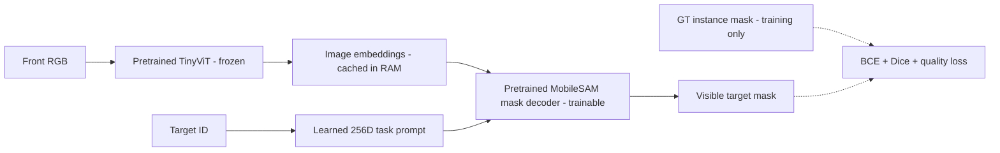

Official source: https://github.com/ChaoningZhang/MobileSAM at f706ad9c4eb7f219c00d9050e46328518ffb65d2. Frozen encoder and original positional/no-mask encodings; train task prompts and the active single-mask decoder,3.64Mparameters. No point,box,GTmask,depth or XYZ is an inference input.

Training covers frame0of all2048original training episode queries (32layouts,16seen permutations,4targets). Four task queries share one canonical RGB per scene, yielding512train images. Train5epochs/1280updates,batch8,AdamW,prompt LR1e-3/decoder LR1e-4,CPU FP32,1.29GiB RAM cache. Best validation checkpoint: epoch5,IoU49.31%,identity78.13%. Validation IoU increased at every epoch; convergence is not established.

| Evaluation | Queries | Mean mask IoU | Target identity accuracy |
|---|---:|---:|---:|
| Original held-out home observations | 1408 | 52.43% | 77.84% |
| Manipulated target, later expert observations | 72 | 26.76% | 37.50% |
| Paired inside-X original target | 8 | 35.41% | 37.50% |
| Outside-X original target | 8 | 30.09% | 50.00% |

The full later-frame diagnostic contains288queries and the full XYdiagnostic64queries, including static/in-domain distractors. The focused rows above evaluate the source trajectory's original target. These small diagnostic subsets are not population estimates. All focused targets had at least8visible pixels. Home mask precision averages60.21%,with leaks into other objects;blue/green confusion accounts for230of312wrong home-target selections. Learned fixed task tokens are effective but insufficiently reliable at this budget. This result does not rule out improvement with additional training or temporal-frame coverage.

Artifacts: `/workspace/robotics_assets/experiments/e123_mask`; exact configuration,history,packed predictions,verification and focused summaries are retained there. Examples: `test/home/samples.png`, `test/home/worst.png`, `test/dynamic/samples.png`, `test/xy/samples.png`. Original encoder hash and pretrained checkpoint hash were verified unchanged; best checkpoint selection used validation only.

## E124 — full temporal coverage for task-conditioned masks

Status: running; results pending. Continue E123's best learned task prompts and
mask decoder with every frame of all2048original training trajectories (stride1,
296688images). Query all four task IDs on every image, including distractors,
so target selection must follow the task prompt even while the robot handles
another object. The original train/validation/test partitions are unchanged.

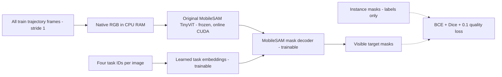

Train5additional epochs, batch64images/256queries,23180updates, AdamW task
LR1e-3/decoder LR1e-4,CUDA BF16. Native RGB and instance labels use84.88GiB RAM;
a full FP16 feature cache would require579.47GiB, so frozen features are computed
online. Best model selection uses8192fixed temporal validation queries from the
original256validation episodes. The original E123 held-out home/later-frame/XY
protocol runs automatically after training. This is visible segmentation only;
no FM, tracking memory, amodal prediction or manipulation success is established.

Detailed protocol: `e124_README.md`. Output:
`/workspace/robotics_assets/experiments/e124_mask_full`. Results remain pending.

E124 launch verified: step25/23180; original preprocessing/paired decoder equivalence and frozen-encoder hash checks passed. Full raw cache84.88GiB, container RAM~98.7GiB, peak allocated VRAM20.12GiB. Initial full-data speed estimate~8.3h for5epochs plus validation/testing. Launch evidence:e124_mask_full/launch_verification.json. Results pending.

E124 interruption: process disappeared around epoch2/step5925, with no traceback
and current cgroup OOM counter0; cause remains unconfirmed. Latest resumable
checkpoint is step5750/cursor71296; restart preserves the original5epoch budget,
model/optimizer/RNG/order/cursor and rebuilds only RAM caches. First completed
epoch temporal validation: IoU71.0173%,task identity82.1324%. Resume metadata:
`e124_mask_full/resume_1.json` and `resume_verification.json`. The original
checkpoint did not store the interrupted epoch's loss sum, so its full training
mean is left unavailable; the resumed suffix mean is reported explicitly.

## E125 — original MobileSAM with a visible-object point prompt

Status: complete. Evaluate the unmodified official MobileSAM
checkpoint with one positive point inside each target's visible mask, using
exactly the E124 epoch1 temporal validation images and queries. This isolates
segmentation with oracle location from RGB/task-token localization.

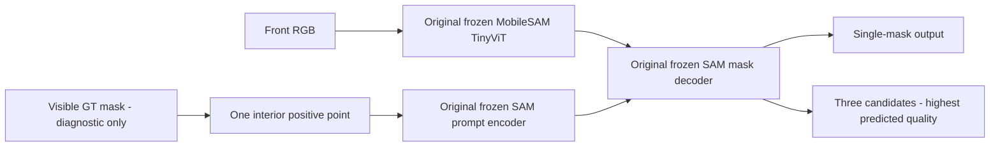

All model parameters retain their original pretrained values; no training or
E123/E124 weights are used. Compare both original single-mask head0 and the
standard three-candidate mode selected by predicted quality, never GT IoU.
One fresh GT-derived point is given at each frame; no tracking or automatic
localization is claimed. The32queries with fewer than8visible GTpixels are
skipped consistently; all comparisons cover the same8160visible queries.
Run on CPU so E124's GPU training continues. Protocol: `e125_README.md`.
Artifacts: `/workspace/robotics_assets/experiments/e125_point`.

| Configuration | Mean mask IoU | Identity accuracy | IoU >= 0.5 |
|---|---:|---:|---:|
| E124 learned task token, epoch1 | 71.02% | 82.13% | 77.67% |
| Original MobileSAM + positive point, single mask | 87.44% | 99.88% | 98.06% |
| Original MobileSAM + positive point, quality-selected multimask | 77.31% | 99.60% | 98.64% |

On the same8160visible queries, original single-mask point prompting corrects1449/1458task-token identity errors. All original model weights remain unchanged; source/API/hash checks pass. Mean precision88.15%,recall98.95%;158single-mask predictions remain below IoU0.5 despite only10identity errors. Home identity100%,later99.86%. These results support adequate original segmentation with known location; task-conditioned localization/decoding is still the weaker pipeline at epoch1. Fresh GT-derived points per frame supply oracle location and do not demonstrate tracking or autonomous localization. Multimask quality selection sometimes chooses a cube face instead of the full object. See e125_README.md and saved comparison/failure sheets. E124 training continued throughout.

## E126 — unprompted MobileSAM proposal coverage

Status: complete. Test whether the original automatic generator
produces distinct complete object masks before a semantic task selector is added.
Use RGB only and a fixed32x32prompt grid; no GT-derived points, boxes or masks.
Original pretrained weights and generator defaults remain unchanged.

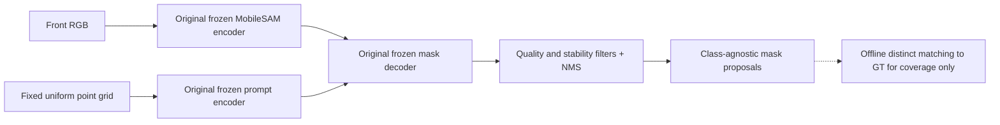

Balanced pilot:4validation layouts x4source trajectory targets x2permutations,
4frames/episode(home,last approach,last engage,last lift)=128images. Measure
one-to-one proposal recall at IoU0.5/0.75 and full-four-object coverage, plus best
proposal IoU and proposal counts. GT matching measures a proposal upper bound;
it does not demonstrate task selection or persistent instance identity.
Protocol: `e126_README.md`; outputs: `e126_auto`.

| Phase | Images | Visible objects | Distinct recall IoU >=0.5 | Distinct recall IoU >=0.75 |
|---|---:|---:|---:|---:|
| home | 32 | 128 | 100.00% | 78.12% |
| approach | 32 | 128 | 97.66% | 87.50% |
| engage | 32 | 128 | 97.66% | 82.81% |
| lift | 32 | 126 | 95.24% | 84.92% |
| All | 128 | 510 | 97.65% | 83.33% |

Mean best proposal IoU85.50%;31.13proposals/image(range20–39). All-four coverage on126fully visible scenes:117/126(92.86%)atIoU0.5,54/126(42.86%)atIoU0.75. Dense default generation takes1.685s/image on RTX3090. Source/model hashes and all packed proposal areas verified. Useful proposals are usually present, but masks can be object parts and some occluded objects are missed. GT only measures proposal coverage; task selection and tracking remain untested. See e126_README.md,figure_selection.json and saved raw/matched/failure galleries.

## E127 — second fixed rear RGB-D camera

Replay one original pick episode,g000/p00/t0(RedCube),138frames/5.52s. Add a
fixed camera at world[0.54,0.42,0.60]m,180degree yaw around the front camera's
look-at[0.54,-0.12,0.035]m. Retain the front lens intrinsics,FOV,height and
pitch. Source states and dataset files remain unchanged; no new control rollout.

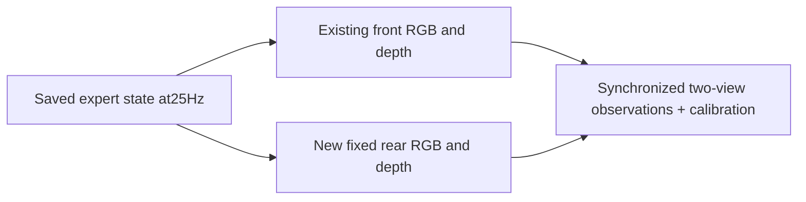

Metric depth is optical Z,uint16,2mm/unit,FFV1; per-frame camera-to-world/base
calibration and visible instance masks are retained. Full video decode checks,
lossless decoded-depth hashing and unchanged source-file hashes pass. Rear
quantization MAE0.523mm,max1.00006mm. The rear view is naturally occluded by the
robot:Red/Blueare visible in116/110of138frames versus138/138in front. This is a
camera-placement visualization, not evidence of localization or policy gains.
See e127_README.md and e127_back/comparison.mp4.

### E127 rear-camera height comparison

Replay the same 138 expert states at rear heights 0.6, 0.8 and 1.0 m. Keep
XY, FOV, resolution and look-at fixed; only height and look-at pitch vary.
Object-alone segmentation provides the unoccluded projected area, separating
occlusion from the smaller object image at greater distance.

| Height | Frames with all four objects visible (>=8 pixels each) | Mean visible fraction | Mean unoccluded object area |
|---|---:|---:|---:|
| 0.6 m | 88/138 | 70.01% | 227.49 pixels |
| 0.8 m | 70/138 | 83.23% | 158.96 pixels |
| 1.0 m | 104/138 | 86.52% | 113.79 pixels |

The 1.0 m view has the best overall visibility among these three candidates,
but object projected area is approximately halved. The 0.8 m camera improves
blue-object visibility while hiding the red grasp target more frequently;
height does not monotonically resolve gripper occlusion. No objects leave the
field of view. This is one episode, with RGB/visibility diagnostics only;
no candidate depth dataset, localization gain or policy gain is measured.
All source hashes, segmentation subset checks and full video decoding pass.
See e127_height_README.md and e127_back/height_1/comparison.png.

## E128 — vertically downward top RGB-D camera

Replay the same E127 episode with a camera at world [0.54, -0.10, 1.20] m,
looking vertically down at the table center. Keep front intrinsics/FOV and
320x240 resolution. Save synchronized front/top RGB, optical-Z uint16 depth
(2 mm/unit, FFV1), visible instance masks and camera-to-world/base calibration.
All four objects have >=8 visible pixels in all 138 top-view frames. Initial
object areas are 80/86/86/85 pixels, versus 257/379/282/277 in the front view.
Top depth quantization MAE 0.1950 mm, maximum 1.00011 mm. Full decoding and
depth hashing, unchanged source hashes, downward optical axis, extrinsics
and tabletop coverage checks pass. This one-episode visualization does not
measure localization/policy gains; the top view has fewer object pixels and
less side-surface geometry. No training or dataset replacement was performed.
See e128_README.md and e128_top/comparison.mp4.

## E129 — calibrated front/top voxel point-cloud fusion

Back-project synchronized E128 optical-Z depth using each camera's intrinsics,
transform to the common robot-base frame, concatenate, and average XYZ/RGB
inside fixed 3 mm voxels. Retain per-view voxel observation counts. No masks
are needed by fusion; GT masks only isolate objects for visualization and
surface diagnostics. No training, ICP, TSDF or temporal accumulation.

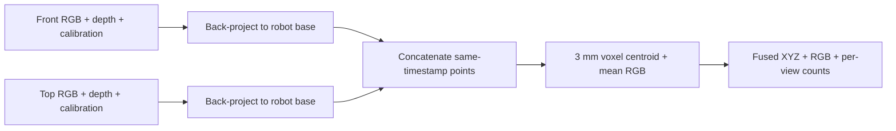

Mean full-scene counts: front 65,774, top 62,040, fused 87,862 points/frame.
GT object-surface MAE: front 0.559 mm, top 0.450 mm, fused 0.576 mm; these are
surface distances, not object-center errors. On average 10.32% of top-view
red-target samples are farther than 3 mm from the front target samples.
NumPy voxel aggregation takes 141.83 ms/frame, excluding backprojection,
decode and visualization. The 138-frame archive occupies 74.78 MiB; full
run with visualization/compression takes 74.14 s. Source hashes, geometry
checks, projection round trips, provenance conservation, NPZ/PLY round trips
and full video decoding pass. Single-view raw counts and voxel-averaged
counts are not directly comparable density measures. This adds observations
without demonstrating lower surface error, better centers or policy gains.
See e129_README.md and e129_fuse/comparison.mp4.

## E130 — read-only probes of E122 spatial extrapolation

Use unchanged E122 final23520 with the existing single-front RGB-D interface.
Reuse 8 physical inside/outside pairs from test_xy (4 colors x2X edges),
75 saved snapshots, 96 controlled RGB token-position trials and 576
fixed-feature XYZ translations. No training, architecture change or FM rollout.

At initialization, layer-1 mean-attention peak and object rank identify the
target in 8/8 inside and 8/8 outside scenes. Its fourth head has approximately
99% target-patch mass; averaging all4heads gives approximately25%. Layer2
mainly attends to context and retains the layer1 residual query. Cloud
surface Chamfer is 3.058 mm inside versus13.554 mm outside; outside surface
centroid error is25.783 mm. All8outside predictions shift inward alongX
(mean25.035mm). Paired physical cloud displacement gain alongX is0.625.
These are visible-surface statistics, not object-center accuracy.

Same-object physical-pair RGB feature cosine averages0.8958 versus0.5758
for different objects. Identical pre-position token rolls give final cosine
0.9812 with fixed positional embeddings and approximately1.0 when positions
co-move. Absolute-position sensitivity exists, but its downstream causal
importance is not established by these feature similarities alone.

Hold exact RGB features fixed; translate camera_to_base at the existing
depth/calibration interface. Input+10mmX produces median output shift
[5.232,0.843,0.035]mm; +10mmY gives[0.337,7.992,-0.016]mm; +10mmZ gives
[0.054,-9.138,0.021]mm. Median local same-axis gain is0.491/0.774/0.00258
forX/Y/Z. This modified-extrinsic probe exhibits strong Z-to-Y coupling,
but the full-scene geometry translation with fixed RGB/joints is not a
consistent physical scene or coordinate-frame change. It should not be
used alone to conclude a physical translation-equivariance failure.

The evidence favors a reconstruction/coordinate-generalization problem
after target-selective attention. It does not isolate the geometry embedding,
fusion, decoder or cloud head individually, nor establish a proposed fix.
All checkpoint/model/source hashes, attention-output parity, co-moving
position controls and prescribed XYZ changes pass. See e130_README.md and
e130_probe/{target_attention_x_low,rgb_features,xyz_response,geometry_bias}.png.

### E130 oracle centroid alignment — localization versus shape

Use the exact saved predictions and measured GT target-surface clouds.
Compute aligned_pred=pred-mean(pred)+mean(GT), then the same symmetric
unsquared Euclidean Chamfer in mm. No model inference, rotation, scale,
resampling, architecture change or new training.

| Samples | N | Original Chamfer | Oracle centroid-aligned Chamfer |
|---|---:|---:|---:|
| Initial ID / inside | 8 | 3.058 mm | 3.382 mm |
| Initial OOD / outside | 8 | 13.554 mm | 3.600 mm |
| Later ID / inside | 27 | 25.989 mm | 3.800 mm |
| Later OOD / outside | 32 | 39.417 mm | 3.601 mm |

All 8 initial OOD residuals lie in [3.228,3.911] mm. The paired mean OOD-ID
residual gap is only 0.217 mm after alignment. This supports prioritizing
localization and pausing additional shape-decoder work for the current
fixed-size cube task. It does not establish arbitrary-object shape recovery
or accuracy of the physical object center: GT is a partially observed surface.
Later trajectories/occlusion/counts differ and are reported descriptively.

Centroid alignment is not an optimizer of Chamfer with unequal sampling;
ID Chamfer can slightly increase. Chamfer reduction is not an additive
localization/shape error budget. Original score parity is exact, aligned
centroid coordinate error <1e-15 m and pairwise-distance preservation error
<4e-17 m. Source and checkpoint hashes are unchanged.
See e130_center_README.md and e130_probe/test_center/chamfer_comparison.png.

### E130 gripper occlusion — cloud persistence versus real localization

Replay 6 held-out K15 outcome examples (first success/failure per group)
and all16XY boundary controls:22traces,714snapshots. Recompute fresh clouds
from unchanged E122final23520 and separately evaluate the last K15-held
cloud. Render the actual target pose alone to obtain an oracle unoccluded
front-visible surface; score centroid error and distance to the real box
surface even when the target is hidden by the robot. No GT enters prediction.

In the first15frames after closing starts, the3held-out success clips have
median fresh/held centroid errors6.85/8.12mm (22samples,median93.5%visible).
The3failure clips have42.86/43.74mm (24samples,median77.84%visible). These
are selected, correlated outcome groups and do not isolate occlusion causally.
The successful examples retain90.1-93.2%visibility even at their most occluded
closing-window sample. Thus they do not establish robust hidden-object tracking.

A boundary-control example at12.5%visibility has55.51mm fresh centroid error
and43.22mm held error; fresh points are39.41mm on average from the real box
surface. None of the714samples is fully hidden (<8visible pixels). All
6heavy-occlusion samples in2inside-boundary cases have median fresh error
52.56mm. The head always emits128points and has no confidence/visibility
output or temporal visual memory, so a persistent plausible cloud is not
evidence of correct hidden-object localization.

A lift example has fresh error10.87mm versus held46.20mm at age5frames;
the real object rose51.39mm since the last replan. K15held overlays can be
stale for up to0.56s. All hashes, segmentation-subset and held-cadence checks
pass; oracle GT point-to-box distance averages0.275mm. See
e130_occlusion_README.md and e130_probe/test_occlusion/{sample_03,sample_15,timeline_11}.png.

## E131 — direct GT-visible target cloud to BC policy

Status: complete. Remove the RGB localization pathway from this new baseline.
Task ID selects the target's GT visible mask outside the network. Actual front
2 mm depth and calibration provide 128 partial-surface XYZ points in robot
base coordinates; the model also receives measured joints. No RGB, task-ID
embedding, GT object center, object pose or hidden surface enters the policy.

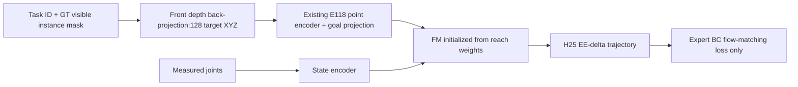

Initialize the complete PointCloudReach model from E118best120000, including
its point encoder/goal projection and FM/state encoder. Train all parameters
on all 2048 original E117 train demos (32 layouts,294640 stride1 chunks),
with23520updates,B128,~10.217epochs, matching E122update budget. FM LR2e-5,
point/goal LR1e-4,warmup100,AdamW(.9,.95),wd1e-4,clip1,BF16. Preserve E118
normalization. No auxiliary reconstruction/mask/XYZ loss. Existing verified
GT clouds/action labels fit in under1GiB GPU RAM; no visual-feature cache.

Validation uses the same512E122chunks/noise. Automatic final-checkpoint
K15test covers all1408original held-out episodes, followed by16paired XY
boundary cases, with Euler10/seed0/300frames. Online GT segmentation is an
oracle target selector; this baseline isolates policy learning with measured
target geometry, not autonomous perception. Missing<8filtered pixels fails
explicitly without hidden-pose substitution. See e131_README.md.

Training completed23520updates/10.217214epochs in45.67minutes. Final
validation FM0.011272;best0.007618 at17250. Test uses fixed final23520;best
has not been rolled out. All learned modules train with BC only and all
E118normalization buffers stay unchanged.

| Group | E131 successes | E131 rate | E122 K15 rate |
|---|---:|---:|---:|
| Composition | 960/1024 | 93.750% | 79.199% |
| Spatial | 245/256 | 95.703% | 85.938% |
| Combined | 120/128 | 93.750% | 88.281% |
| All | 1325/1408 | 94.105% | 81.250% |

The main comparison uses identical paths and matching H25/K15/Euler10/seed0/
300frame/control-rate settings. Gain:+181successes,+12.855percentage points.
Paired outcomes:1128both-success,197E131-only,16E122-only,67both-failure.
GT segmentation, conditioning architecture, encoder initialization and loss
differ; this is not a single-module causal localization ablation. E131has
82timeouts,1wrong-object lift and0missing-cloud failures. Full test17.08min.

The original physical XY pairs give inside8/8,outside7/8 (15/16overall).
Only the x_low GreenCube outside case times out. This small pilot exceeds
pick-training X bounds, not necessarily reach-pretraining support. E122's
historical XY run used CPU FP32 versus E131CUDA BF16; do not treat that
comparison as a precision/noise-controlled causal ablation.

All1424records/traces and hashes pass completion verification. The result
shows that one-camera partial target geometry plus joints can support strong
BC on this cube task with oracle segmentation; full-shape completion is not
required by this baseline. It does not establish autonomous target selection
or manipulation of arbitrary shapes. See e131_README.md and
e131_object/test_k15/{summary,comparison_e122}.json.

E131 non-target-lift audit:g028/p04/t3,target Yellow,disturbed Blue. All
recorded input clouds lie on Yellow (max surface distance1.395mm). Blue rises
41.33mm after contact with one jaw/gripper base;max jaw count1/2,zero bilateral
frames,and no terminal contact. This is collision-induced non-target lift,
not a demonstrated stable two-finger wrong-object grasp. The original
wrong_object outcome remains unchanged. Saved144states replay at0.4x in
e131_object/test_k15/wrong_1/wrong_object.mp4;all source hashes and decoding
checks pass. See e131_wrong_README.md.

E131 extended OOD completed:{"inside": {"cases": 197, "successes": 196, "success_rate": 0.9949238578680203}, "outside": {"cases": 197, "successes": 188, "success_rate": 0.9543147208121827}}. Details:e131_ood_README.md.

### E131 broader spatial OOD distributions

Frozen final23520,K15,GT-visible target clouds. Sample uniform outward
offsets2-4/4-6/6-8cm on4edges and4corners relative to pick-training rectangle;
reflect target coordinates inside for matched controls. Same distractors,
yaw,home,camera; accept only front-visible pairs where the original physical
expert succeeds in both scenes, before loading learned weights.2830candidates
yield197pairs/394episodes. Rejected/unavailable cells remain explicit.

| Outside offset band | OOD success | Inside control success |
|---|---:|---:|
| 2-4 cm | 69/69 (100%) | 69/69 (100%) |
| 4-6 cm | 64/64 (100%) | 63/64 (98.438%) |
| 6-8 cm | 55/64 (85.938%) | 64/64 (100%) |
| All accepted | 188/197 (95.431%) | 196/197 (99.492%) |

BothXedges achieve48/48 each across all offsets. Upper-left corner
(x_low+y_high) achieves40/48,including only8/16at6-8cm; upper-right47/48,
including15/16at6-8cm. All9OODfailures occur in these far upper corners.
Physical experts succeed there, so feasibility filtering does not explain
the learned failures. No missing target clouds or non-target lifts occur.
All10total failures are300frame timeouts. Paired outcomes187both-success,
9inside-only,1outside-only. Preparation54.70s,rollout280.27s,total337.00s.

All y_low cells lack usable front visibility; y_high4-8cm has no accepted
expert-feasible pair,while y_high2-4cm has only5pairs. Thus the aggregate is
conditional on expert-feasible visible scenes and is not a full-workspace
success estimate. This is OOD relative to pick finetuning,not reach
pretraining,with GT segmentation,fixed cube geometry/camera and noise seed0.
All394traces,success contact/lift streaks,cloud cadence,scene pairing and
checkpoint hashes pass. See e131_ood_README.md and test_ood/{xy_results,
success_by_region,coverage}.png.

## E132 — original SAM 3 with text prompts, BF16

Status: inputs and isolated environment prepared; inference NOT RUN, waiting
for authorized official model weights. Existing HF credential lacks approval
for facebook/sam3; the user will report when model access is granted.

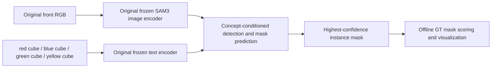

Use official facebook/sam3 revision3c879f39826c281e95690f02c7821c4de09afae7
through its documented Transformers implementation. All weights remain
pretrained; BF16 parameters and CUDA autocast, no quantization or finetuning.
Python3.11/Transformers5.20.2 run in .venv-sam3, sharing existing torch2.7cu128
without altering the original project environment. Imports and CUDA BF16
support pass. Download only the official safetensors/config/tokenizer files
when access is approved; no unofficial substitute is used.

Pilot inputs:16native320x240RGB images,4validation layouts32-35,4phases each,
64fixed color+noun text queries. No input GT point/box/mask/depth/joints.
GT masks only measure visible-target IoU,identity,missing/multiple detections.
Confidence/mask thresholds0.5; instance selection uses highest model score,
never GT. Offline data/metric/interface checks pass. No segmentation result
is available yet. See e132_README.md and e132_sam/input_samples.png.

E132 SAM3 BF16 text-prompt pilot:{"status": "complete", "images": 16, "queries": 64, "visible_queries": 64, "mean_IoU": 0.9301741664290225, "identity_accuracy": 0.984375, "IoU_ge50": 0.984375, "IoU_ge75": 0.984375, "no_detections": 1, "multiple_detections": 1, "peak_allocated_GiB": 2.1928982734680176, "vision_dtype": ["torch.bfloat16"], "mask_logits_dtype": ["torch.bfloat16"], "mean_vision_ms": 151.64125646697357, "mean_prompt_head_ms": 34.07886583299842, "by_stage": {"home": {"queries": 16, "mean_IoU": 0.9483170568102768, "identity_accuracy": 1.0}, "approach": {"queries": 16, "mean_IoU": 0.9484511403404444, "identity_accuracy": 1.0}, "engage": {"queries": 16, "mean_IoU": 0.882317329550208, "identity_accuracy": 0.9375}, "lift": {"queries": 16, "mean_IoU": 0.9416111390151609, "identity_accuracy": 1.0}}, "by_prompt": {"red cube": {"queries": 16, "mean_IoU": 0.9577050493274248, "identity_accuracy": 1.0}, "blue cube": {"queries": 16, "mean_IoU": 0.8906067817820347, "identity_accuracy": 0.9375}, "green cube": {"queries": 16, "mean_IoU": 0.9386066166915722, "identity_accuracy": 1.0}, "yellow cube": {"queries": 16, "mean_IoU": 0.9337782179150582, "identity_accuracy": 1.0}}}

## E133 — Text-selected two-view target geometry and frozen point-cloud policy

Official SAM3 BF16 uses task-to-color text to segment front and left RGB independently. Back-project each predicted mask with its optical-Z depth and calibration into robot-base XYZ, fuse with 3 mm voxel centroids and sample 128 points. Feed only this fused cloud plus measured joint state to the frozen E131 final step23520 point encoder and FM. No fine-tuning, GT-mask instance selection, raw target center or missing-cloud substitution.

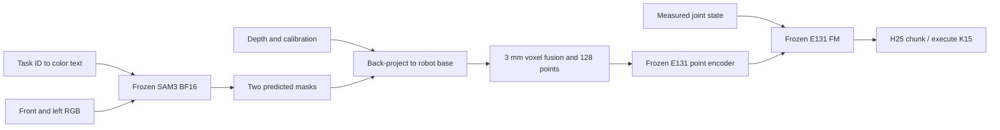

Geometry/controller preparation passed: original front RGB/depth unchanged, target-surface P95 error1.371mm, camera backprojection roundtrip below1e-6m, four disposable20frame controller checks; these use explicit GT masks and are not SAM3 rollout results. Official gated weights now downloaded; original SAM3 pilot E132 passed BF16/cached-feature parity (max mask-logit difference0) and got63/64 correct identities, meanIoU93.017%. E133 learned-mask rollout is running: XY16, heldout1408 and expanded paired spatial ID/OOD394, total1818cases, K15/Euler10/seed0/300frames. Full results pending. Fusion also changes partial-view geometry relative to E131 training. See [E133](e133_README.md) for exact protocol and artifact paths.

E133 xy complete:{"cases": 16, "successes": 15, "success_rate": 0.9375, "elapsed_s": 86.74248128700128, "reasons": {"success": 15, "timeout": 1}, "by_group": {"inside": {"cases": 8, "successes": 8, "success_rate": 1.0}, "outside": {"cases": 8, "successes": 7, "success_rate": 0.875}}, "by_target": {"BlueCube": {"cases": 4, "successes": 4, "success_rate": 1.0}, "GreenCube": {"cases": 4, "successes": 3, "success_rate": 0.75}, "RedCube": {"cases": 4, "successes": 4, "success_rate": 1.0}, "YellowCube": {"cases": 4, "successes": 4, "success_rate": 1.0}}, "status": "complete", "SAM3_pair_calls": 172, "SAM3_mean_pair_seconds": 0.38311147393603256, "one_view_observations": 11, "two_view_observations": 161}

E133 isolated robot-batch1 visuomotor latency (20calls,3warmups), RGB-D/calibration/joints already available; excludes capture,IK/network: {"sam3_ms": {"mean": 371.54454039919074, "median": 371.97887198999524, "p95": 372.7652418507205}, "cloud_and_input_ms": {"mean": 9.793611248460365, "median": 9.792722499696538, "p95": 9.941787461866625}, "conditioning_ms": {"mean": 4.601827050646534, "median": 4.580321001412813, "p95": 4.694728987669805}, "FM10_and_output_ms": {"mean": 167.45788545158575, "median": 167.50151199812535, "p95": 168.44908680795925}, "total_ms": {"mean": 553.3978641498834, "median": 553.3994965007878, "p95": 555.6598399460199}, "status": "complete", "calls": 20, "warmup_calls": 3, "robot_batch": 1, "image_batch": 2, "H": 25, "flow_steps": 10, "precision": "SAM3 BF16 weights;policy FP32 weights with BF16 autocast", "CUDA_timers_synchronized": true, "model_startup_and_capture_excluded": true, "cached_text_verification": {"status": "passed", "two_view_batch": 2, "cached_text_max_logit_difference": 0.0, "parameter_dtype": "torch.bfloat16", "mask_logits_dtype": "torch.bfloat16", "GT_used_as_input": false}, "device": "NVIDIA GeForce RTX 3090"}

E133 heldout complete:{"cases": 1408, "successes": 1314, "success_rate": 0.9332386363636364, "elapsed_s": 6545.438290553007, "reasons": {"success": 1314, "timeout": 91, "wrong_object": 3}, "by_group": {"combined": {"cases": 128, "successes": 120, "success_rate": 0.9375}, "composition": {"cases": 1024, "successes": 955, "success_rate": 0.9326171875}, "spatial": {"cases": 256, "successes": 239, "success_rate": 0.93359375}}, "by_target": {"BlueCube": {"cases": 352, "successes": 329, "success_rate": 0.9346590909090909}, "GreenCube": {"cases": 352, "successes": 325, "success_rate": 0.9232954545454546}, "RedCube": {"cases": 352, "successes": 331, "success_rate": 0.9403409090909091}, "YellowCube": {"cases": 352, "successes": 329, "success_rate": 0.9346590909090909}}, "status": "complete", "SAM3_pair_calls": 14398, "SAM3_mean_pair_seconds": 0.37542043096038896, "one_view_observations": 356, "two_view_observations": 14042}

E133 ood complete:{"cases": 394, "successes": 377, "success_rate": 0.9568527918781726, "elapsed_s": 1772.3649533139978, "reasons": {"success": 377, "timeout": 16, "wrong_object": 1}, "by_group": {"inside": {"cases": 197, "successes": 194, "success_rate": 0.9847715736040609}, "outside": {"cases": 197, "successes": 183, "success_rate": 0.9289340101522843}}, "by_target": {"BlueCube": {"cases": 96, "successes": 90, "success_rate": 0.9375}, "GreenCube": {"cases": 102, "successes": 99, "success_rate": 0.9705882352941176}, "RedCube": {"cases": 98, "successes": 96, "success_rate": 0.9795918367346939}, "YellowCube": {"cases": 98, "successes": 92, "success_rate": 0.9387755102040817}}, "status": "complete", "SAM3_pair_calls": 3891, "SAM3_mean_pair_seconds": 0.3744101803368144, "one_view_observations": 521, "two_view_observations": 3370, "distributions": {"band_index": {"0": {"inside": {"cases": 69, "successes": 69, "success_rate": 1.0, "elapsed_s": 0, "reasons": {"success": 69}, "by_group": {"inside": {"cases": 69, "successes": 69, "success_rate": 1.0}}, "by_target": {"BlueCube": {"cases": 16, "successes": 16, "success_rate": 1.0}, "GreenCube": {"cases": 19, "successes": 19, "success_rate": 1.0}, "RedCube": {"cases": 17, "successes": 17, "success_rate": 1.0}, "YellowCube": {"cases": 17, "successes": 17, "success_rate": 1.0}}}, "outside": {"cases": 69, "successes": 66, "success_rate": 0.9565217391304348, "elapsed_s": 0, "reasons": {"success": 66, "timeout": 3}, "by_group": {"outside": {"cases": 69, "successes": 66, "success_rate": 0.9565217391304348}}, "by_target": {"BlueCube": {"cases": 16, "successes": 16, "success_rate": 1.0}, "GreenCube": {"cases": 19, "successes": 18, "success_rate": 0.9473684210526315}, "RedCube": {"cases": 17, "successes": 17, "success_rate": 1.0}, "YellowCube": {"cases": 17, "successes": 15, "success_rate": 0.8823529411764706}}}}, "1": {"inside": {"cases": 64, "successes": 61, "success_rate": 0.953125, "elapsed_s": 0, "reasons": {"success": 61, "timeout": 2, "wrong_object": 1}, "by_group": {"inside": {"cases": 64, "successes": 61, "success_rate": 0.953125}}, "by_target": {"BlueCube": {"cases": 16, "successes": 14, "success_rate": 0.875}, "GreenCube": {"cases": 16, "successes": 16, "success_rate": 1.0}, "RedCube": {"cases": 16, "successes": 16, "success_rate": 1.0}, "YellowCube": {"cases": 16, "successes": 15, "success_rate": 0.9375}}}, "outside": {"cases": 64, "successes": 63, "success_rate": 0.984375, "elapsed_s": 0, "reasons": {"success": 63, "timeout": 1}, "by_group": {"outside": {"cases": 64, "successes": 63, "success_rate": 0.984375}}, "by_target": {"BlueCube": {"cases": 16, "successes": 16, "success_rate": 1.0}, "GreenCube": {"cases": 16, "successes": 15, "success_rate": 0.9375}, "RedCube": {"cases": 16, "successes": 16, "success_rate": 1.0}, "YellowCube": {"cases": 16, "successes": 16, "success_rate": 1.0}}}}, "2": {"inside": {"cases": 64, "successes": 64, "success_rate": 1.0, "elapsed_s": 0, "reasons": {"success": 64}, "by_group": {"inside": {"cases": 64, "successes": 64, "success_rate": 1.0}}, "by_target": {"BlueCube": {"cases": 16, "successes": 16, "success_rate": 1.0}, "GreenCube": {"cases": 16, "successes": 16, "success_rate": 1.0}, "RedCube": {"cases": 16, "successes": 16, "success_rate": 1.0}, "YellowCube": {"cases": 16, "successes": 16, "success_rate": 1.0}}}, "outside": {"cases": 64, "successes": 54, "success_rate": 0.84375, "elapsed_s": 0, "reasons": {"success": 54, "timeout": 10}, "by_group": {"outside": {"cases": 64, "successes": 54, "success_rate": 0.84375}}, "by_target": {"BlueCube": {"cases": 16, "successes": 12, "success_rate": 0.75}, "GreenCube": {"cases": 16, "successes": 15, "success_rate": 0.9375}, "RedCube": {"cases": 16, "successes": 14, "success_rate": 0.875}, "YellowCube": {"cases": 16, "successes": 13, "success_rate": 0.8125}}}}}, "edge": {"x_high": {"inside": {"cases": 48, "successes": 47, "success_rate": 0.9791666666666666, "elapsed_s": 0, "reasons": {"success": 47, "timeout": 1}, "by_group": {"inside": {"cases": 48, "successes": 47, "success_rate": 0.9791666666666666}}, "by_target": {"BlueCube": {"cases": 12, "successes": 11, "success_rate": 0.9166666666666666}, "GreenCube": {"cases": 12, "successes": 12, "success_rate": 1.0}, "RedCube": {"cases": 12, "successes": 12, "success_rate": 1.0}, "YellowCube": {"cases": 12, "successes": 12, "success_rate": 1.0}}}, "outside": {"cases": 48, "successes": 47, "success_rate": 0.9791666666666666, "elapsed_s": 0, "reasons": {"success": 47, "timeout": 1}, "by_group": {"outside": {"cases": 48, "successes": 47, "success_rate": 0.9791666666666666}}, "by_target": {"BlueCube": {"cases": 12, "successes": 12, "success_rate": 1.0}, "GreenCube": {"cases": 12, "successes": 12, "success_rate": 1.0}, "RedCube": {"cases": 12, "successes": 12, "success_rate": 1.0}, "YellowCube": {"cases": 12, "successes": 11, "success_rate": 0.9166666666666666}}}}, "x_high_y_high": {"inside": {"cases": 48, "successes": 48, "success_rate": 1.0, "elapsed_s": 0, "reasons": {"success": 48}, "by_group": {"inside": {"cases": 48, "successes": 48, "success_rate": 1.0}}, "by_target": {"BlueCube": {"cases": 12, "successes": 12, "success_rate": 1.0}, "GreenCube": {"cases": 12, "successes": 12, "success_rate": 1.0}, "RedCube": {"cases": 12, "successes": 12, "success_rate": 1.0}, "YellowCube": {"cases": 12, "successes": 12, "success_rate": 1.0}}}, "outside": {"cases": 48, "successes": 47, "success_rate": 0.9791666666666666, "elapsed_s": 0, "reasons": {"success": 47, "timeout": 1}, "by_group": {"outside": {"cases": 48, "successes": 47, "success_rate": 0.9791666666666666}}, "by_target": {"BlueCube": {"cases": 12, "successes": 12, "success_rate": 1.0}, "GreenCube": {"cases": 12, "successes": 11, "success_rate": 0.9166666666666666}, "RedCube": {"cases": 12, "successes": 12, "success_rate": 1.0}, "YellowCube": {"cases": 12, "successes": 12, "success_rate": 1.0}}}}, "x_low": {"inside": {"cases": 48, "successes": 47, "success_rate": 0.9791666666666666, "elapsed_s": 0, "reasons": {"success": 47, "timeout": 1}, "by_group": {"inside": {"cases": 48, "successes": 47, "success_rate": 0.9791666666666666}}, "by_target": {"BlueCube": {"cases": 12, "successes": 12, "success_rate": 1.0}, "GreenCube": {"cases": 12, "successes": 12, "success_rate": 1.0}, "RedCube": {"cases": 12, "successes": 12, "success_rate": 1.0}, "YellowCube": {"cases": 12, "successes": 11, "success_rate": 0.9166666666666666}}}, "outside": {"cases": 48, "successes": 46, "success_rate": 0.9583333333333334, "elapsed_s": 0, "reasons": {"success": 46, "timeout": 2}, "by_group": {"outside": {"cases": 48, "successes": 46, "success_rate": 0.9583333333333334}}, "by_target": {"BlueCube": {"cases": 12, "successes": 12, "success_rate": 1.0}, "GreenCube": {"cases": 12, "successes": 11, "success_rate": 0.9166666666666666}, "RedCube": {"cases": 12, "successes": 12, "success_rate": 1.0}, "YellowCube": {"cases": 12, "successes": 11, "success_rate": 0.9166666666666666}}}}, "x_low_y_high": {"inside": {"cases": 48, "successes": 47, "success_rate": 0.9791666666666666, "elapsed_s": 0, "reasons": {"success": 47, "wrong_object": 1}, "by_group": {"inside": {"cases": 48, "successes": 47, "success_rate": 0.9791666666666666}}, "by_target": {"BlueCube": {"cases": 12, "successes": 11, "success_rate": 0.9166666666666666}, "GreenCube": {"cases": 12, "successes": 12, "success_rate": 1.0}, "RedCube": {"cases": 12, "successes": 12, "success_rate": 1.0}, "YellowCube": {"cases": 12, "successes": 12, "success_rate": 1.0}}}, "outside": {"cases": 48, "successes": 38, "success_rate": 0.7916666666666666, "elapsed_s": 0, "reasons": {"success": 38, "timeout": 10}, "by_group": {"outside": {"cases": 48, "successes": 38, "success_rate": 0.7916666666666666}}, "by_target": {"BlueCube": {"cases": 12, "successes": 8, "success_rate": 0.6666666666666666}, "GreenCube": {"cases": 12, "successes": 11, "success_rate": 0.9166666666666666}, "RedCube": {"cases": 12, "successes": 10, "success_rate": 0.8333333333333334}, "YellowCube": {"cases": 12, "successes": 9, "success_rate": 0.75}}}}, "y_high": {"inside": {"cases": 5, "successes": 5, "success_rate": 1.0, "elapsed_s": 0, "reasons": {"success": 5}, "by_group": {"inside": {"cases": 5, "successes": 5, "success_rate": 1.0}}, "by_target": {"GreenCube": {"cases": 3, "successes": 3, "success_rate": 1.0}, "RedCube": {"cases": 1, "successes": 1, "success_rate": 1.0}, "YellowCube": {"cases": 1, "successes": 1, "success_rate": 1.0}}}, "outside": {"cases": 5, "successes": 5, "success_rate": 1.0, "elapsed_s": 0, "reasons": {"success": 5}, "by_group": {"outside": {"cases": 5, "successes": 5, "success_rate": 1.0}}, "by_target": {"GreenCube": {"cases": 3, "successes": 3, "success_rate": 1.0}, "RedCube": {"cases": 1, "successes": 1, "success_rate": 1.0}, "YellowCube": {"cases": 1, "successes": 1, "success_rate": 1.0}}}}}, "cells": [{"cell": 0, "edge": "x_low", "band_index": 0, "inside": {"cases": 16, "successes": 16, "success_rate": 1.0, "elapsed_s": 0, "reasons": {"success": 16}, "by_group": {"inside": {"cases": 16, "successes": 16, "success_rate": 1.0}}, "by_target": {"BlueCube": {"cases": 4, "successes": 4, "success_rate": 1.0}, "GreenCube": {"cases": 4, "successes": 4, "success_rate": 1.0}, "RedCube": {"cases": 4, "successes": 4, "success_rate": 1.0}, "YellowCube": {"cases": 4, "successes": 4, "success_rate": 1.0}}}, "outside": {"cases": 16, "successes": 14, "success_rate": 0.875, "elapsed_s": 0, "reasons": {"success": 14, "timeout": 2}, "by_group": {"outside": {"cases": 16, "successes": 14, "success_rate": 0.875}}, "by_target": {"BlueCube": {"cases": 4, "successes": 4, "success_rate": 1.0}, "GreenCube": {"cases": 4, "successes": 3, "success_rate": 0.75}, "RedCube": {"cases": 4, "successes": 4, "success_rate": 1.0}, "YellowCube": {"cases": 4, "successes": 3, "success_rate": 0.75}}}}, {"cell": 1, "edge": "x_low", "band_index": 1, "inside": {"cases": 16, "successes": 15, "success_rate": 0.9375, "elapsed_s": 0, "reasons": {"success": 15, "timeout": 1}, "by_group": {"inside": {"cases": 16, "successes": 15, "success_rate": 0.9375}}, "by_target": {"BlueCube": {"cases": 4, "successes": 4, "success_rate": 1.0}, "GreenCube": {"cases": 4, "successes": 4, "success_rate": 1.0}, "RedCube": {"cases": 4, "successes": 4, "success_rate": 1.0}, "YellowCube": {"cases": 4, "successes": 3, "success_rate": 0.75}}}, "outside": {"cases": 16, "successes": 16, "success_rate": 1.0, "elapsed_s": 0, "reasons": {"success": 16}, "by_group": {"outside": {"cases": 16, "successes": 16, "success_rate": 1.0}}, "by_target": {"BlueCube": {"cases": 4, "successes": 4, "success_rate": 1.0}, "GreenCube": {"cases": 4, "successes": 4, "success_rate": 1.0}, "RedCube": {"cases": 4, "successes": 4, "success_rate": 1.0}, "YellowCube": {"cases": 4, "successes": 4, "success_rate": 1.0}}}}, {"cell": 2, "edge": "x_low", "band_index": 2, "inside": {"cases": 16, "successes": 16, "success_rate": 1.0, "elapsed_s": 0, "reasons": {"success": 16}, "by_group": {"inside": {"cases": 16, "successes": 16, "success_rate": 1.0}}, "by_target": {"BlueCube": {"cases": 4, "successes": 4, "success_rate": 1.0}, "GreenCube": {"cases": 4, "successes": 4, "success_rate": 1.0}, "RedCube": {"cases": 4, "successes": 4, "success_rate": 1.0}, "YellowCube": {"cases": 4, "successes": 4, "success_rate": 1.0}}}, "outside": {"cases": 16, "successes": 16, "success_rate": 1.0, "elapsed_s": 0, "reasons": {"success": 16}, "by_group": {"outside": {"cases": 16, "successes": 16, "success_rate": 1.0}}, "by_target": {"BlueCube": {"cases": 4, "successes": 4, "success_rate": 1.0}, "GreenCube": {"cases": 4, "successes": 4, "success_rate": 1.0}, "RedCube": {"cases": 4, "successes": 4, "success_rate": 1.0}, "YellowCube": {"cases": 4, "successes": 4, "success_rate": 1.0}}}}, {"cell": 3, "edge": "x_high", "band_index": 0, "inside": {"cases": 16, "successes": 16, "success_rate": 1.0, "elapsed_s": 0, "reasons": {"success": 16}, "by_group": {"inside": {"cases": 16, "successes": 16, "success_rate": 1.0}}, "by_target": {"BlueCube": {"cases": 4, "successes": 4, "success_rate": 1.0}, "GreenCube": {"cases": 4, "successes": 4, "success_rate": 1.0}, "RedCube": {"cases": 4, "successes": 4, "success_rate": 1.0}, "YellowCube": {"cases": 4, "successes": 4, "success_rate": 1.0}}}, "outside": {"cases": 16, "successes": 15, "success_rate": 0.9375, "elapsed_s": 0, "reasons": {"success": 15, "timeout": 1}, "by_group": {"outside": {"cases": 16, "successes": 15, "success_rate": 0.9375}}, "by_target": {"BlueCube": {"cases": 4, "successes": 4, "success_rate": 1.0}, "GreenCube": {"cases": 4, "successes": 4, "success_rate": 1.0}, "RedCube": {"cases": 4, "successes": 4, "success_rate": 1.0}, "YellowCube": {"cases": 4, "successes": 3, "success_rate": 0.75}}}}, {"cell": 4, "edge": "x_high", "band_index": 1, "inside": {"cases": 16, "successes": 15, "success_rate": 0.9375, "elapsed_s": 0, "reasons": {"success": 15, "timeout": 1}, "by_group": {"inside": {"cases": 16, "successes": 15, "success_rate": 0.9375}}, "by_target": {"BlueCube": {"cases": 4, "successes": 3, "success_rate": 0.75}, "GreenCube": {"cases": 4, "successes": 4, "success_rate": 1.0}, "RedCube": {"cases": 4, "successes": 4, "success_rate": 1.0}, "YellowCube": {"cases": 4, "successes": 4, "success_rate": 1.0}}}, "outside": {"cases": 16, "successes": 16, "success_rate": 1.0, "elapsed_s": 0, "reasons": {"success": 16}, "by_group": {"outside": {"cases": 16, "successes": 16, "success_rate": 1.0}}, "by_target": {"BlueCube": {"cases": 4, "successes": 4, "success_rate": 1.0}, "GreenCube": {"cases": 4, "successes": 4, "success_rate": 1.0}, "RedCube": {"cases": 4, "successes": 4, "success_rate": 1.0}, "YellowCube": {"cases": 4, "successes": 4, "success_rate": 1.0}}}}, {"cell": 5, "edge": "x_high", "band_index": 2, "inside": {"cases": 16, "successes": 16, "success_rate": 1.0, "elapsed_s": 0, "reasons": {"success": 16}, "by_group": {"inside": {"cases": 16, "successes": 16, "success_rate": 1.0}}, "by_target": {"BlueCube": {"cases": 4, "successes": 4, "success_rate": 1.0}, "GreenCube": {"cases": 4, "successes": 4, "success_rate": 1.0}, "RedCube": {"cases": 4, "successes": 4, "success_rate": 1.0}, "YellowCube": {"cases": 4, "successes": 4, "success_rate": 1.0}}}, "outside": {"cases": 16, "successes": 16, "success_rate": 1.0, "elapsed_s": 0, "reasons": {"success": 16}, "by_group": {"outside": {"cases": 16, "successes": 16, "success_rate": 1.0}}, "by_target": {"BlueCube": {"cases": 4, "successes": 4, "success_rate": 1.0}, "GreenCube": {"cases": 4, "successes": 4, "success_rate": 1.0}, "RedCube": {"cases": 4, "successes": 4, "success_rate": 1.0}, "YellowCube": {"cases": 4, "successes": 4, "success_rate": 1.0}}}}, {"cell": 9, "edge": "y_high", "band_index": 0, "inside": {"cases": 5, "successes": 5, "success_rate": 1.0, "elapsed_s": 0, "reasons": {"success": 5}, "by_group": {"inside": {"cases": 5, "successes": 5, "success_rate": 1.0}}, "by_target": {"GreenCube": {"cases": 3, "successes": 3, "success_rate": 1.0}, "RedCube": {"cases": 1, "successes": 1, "success_rate": 1.0}, "YellowCube": {"cases": 1, "successes": 1, "success_rate": 1.0}}}, "outside": {"cases": 5, "successes": 5, "success_rate": 1.0, "elapsed_s": 0, "reasons": {"success": 5}, "by_group": {"outside": {"cases": 5, "successes": 5, "success_rate": 1.0}}, "by_target": {"GreenCube": {"cases": 3, "successes": 3, "success_rate": 1.0}, "RedCube": {"cases": 1, "successes": 1, "success_rate": 1.0}, "YellowCube": {"cases": 1, "successes": 1, "success_rate": 1.0}}}}, {"cell": 15, "edge": "x_low_y_high", "band_index": 0, "inside": {"cases": 16, "successes": 16, "success_rate": 1.0, "elapsed_s": 0, "reasons": {"success": 16}, "by_group": {"inside": {"cases": 16, "successes": 16, "success_rate": 1.0}}, "by_target": {"BlueCube": {"cases": 4, "successes": 4, "success_rate": 1.0}, "GreenCube": {"cases": 4, "successes": 4, "success_rate": 1.0}, "RedCube": {"cases": 4, "successes": 4, "success_rate": 1.0}, "YellowCube": {"cases": 4, "successes": 4, "success_rate": 1.0}}}, "outside": {"cases": 16, "successes": 16, "success_rate": 1.0, "elapsed_s": 0, "reasons": {"success": 16}, "by_group": {"outside": {"cases": 16, "successes": 16, "success_rate": 1.0}}, "by_target": {"BlueCube": {"cases": 4, "successes": 4, "success_rate": 1.0}, "GreenCube": {"cases": 4, "successes": 4, "success_rate": 1.0}, "RedCube": {"cases": 4, "successes": 4, "success_rate": 1.0}, "YellowCube": {"cases": 4, "successes": 4, "success_rate": 1.0}}}}, {"cell": 16, "edge": "x_low_y_high", "band_index": 1, "inside": {"cases": 16, "successes": 15, "success_rate": 0.9375, "elapsed_s": 0, "reasons": {"success": 15, "wrong_object": 1}, "by_group": {"inside": {"cases": 16, "successes": 15, "success_rate": 0.9375}}, "by_target": {"BlueCube": {"cases": 4, "successes": 3, "success_rate": 0.75}, "GreenCube": {"cases": 4, "successes": 4, "success_rate": 1.0}, "RedCube": {"cases": 4, "successes": 4, "success_rate": 1.0}, "YellowCube": {"cases": 4, "successes": 4, "success_rate": 1.0}}}, "outside": {"cases": 16, "successes": 16, "success_rate": 1.0, "elapsed_s": 0, "reasons": {"success": 16}, "by_group": {"outside": {"cases": 16, "successes": 16, "success_rate": 1.0}}, "by_target": {"BlueCube": {"cases": 4, "successes": 4, "success_rate": 1.0}, "GreenCube": {"cases": 4, "successes": 4, "success_rate": 1.0}, "RedCube": {"cases": 4, "successes": 4, "success_rate": 1.0}, "YellowCube": {"cases": 4, "successes": 4, "success_rate": 1.0}}}}, {"cell": 17, "edge": "x_low_y_high", "band_index": 2, "inside": {"cases": 16, "successes": 16, "success_rate": 1.0, "elapsed_s": 0, "reasons": {"success": 16}, "by_group": {"inside": {"cases": 16, "successes": 16, "success_rate": 1.0}}, "by_target": {"BlueCube": {"cases": 4, "successes": 4, "success_rate": 1.0}, "GreenCube": {"cases": 4, "successes": 4, "success_rate": 1.0}, "RedCube": {"cases": 4, "successes": 4, "success_rate": 1.0}, "YellowCube": {"cases": 4, "successes": 4, "success_rate": 1.0}}}, "outside": {"cases": 16, "successes": 6, "success_rate": 0.375, "elapsed_s": 0, "reasons": {"timeout": 10, "success": 6}, "by_group": {"outside": {"cases": 16, "successes": 6, "success_rate": 0.375}}, "by_target": {"BlueCube": {"cases": 4, "successes": 0, "success_rate": 0.0}, "GreenCube": {"cases": 4, "successes": 3, "success_rate": 0.75}, "RedCube": {"cases": 4, "successes": 2, "success_rate": 0.5}, "YellowCube": {"cases": 4, "successes": 1, "success_rate": 0.25}}}}, {"cell": 21, "edge": "x_high_y_high", "band_index": 0, "inside": {"cases": 16, "successes": 16, "success_rate": 1.0, "elapsed_s": 0, "reasons": {"success": 16}, "by_group": {"inside": {"cases": 16, "successes": 16, "success_rate": 1.0}}, "by_target": {"BlueCube": {"cases": 4, "successes": 4, "success_rate": 1.0}, "GreenCube": {"cases": 4, "successes": 4, "success_rate": 1.0}, "RedCube": {"cases": 4, "successes": 4, "success_rate": 1.0}, "YellowCube": {"cases": 4, "successes": 4, "success_rate": 1.0}}}, "outside": {"cases": 16, "successes": 16, "success_rate": 1.0, "elapsed_s": 0, "reasons": {"success": 16}, "by_group": {"outside": {"cases": 16, "successes": 16, "success_rate": 1.0}}, "by_target": {"BlueCube": {"cases": 4, "successes": 4, "success_rate": 1.0}, "GreenCube": {"cases": 4, "successes": 4, "success_rate": 1.0}, "RedCube": {"cases": 4, "successes": 4, "success_rate": 1.0}, "YellowCube": {"cases": 4, "successes": 4, "success_rate": 1.0}}}}, {"cell": 22, "edge": "x_high_y_high", "band_index": 1, "inside": {"cases": 16, "successes": 16, "success_rate": 1.0, "elapsed_s": 0, "reasons": {"success": 16}, "by_group": {"inside": {"cases": 16, "successes": 16, "success_rate": 1.0}}, "by_target": {"BlueCube": {"cases": 4, "successes": 4, "success_rate": 1.0}, "GreenCube": {"cases": 4, "successes": 4, "success_rate": 1.0}, "RedCube": {"cases": 4, "successes": 4, "success_rate": 1.0}, "YellowCube": {"cases": 4, "successes": 4, "success_rate": 1.0}}}, "outside": {"cases": 16, "successes": 15, "success_rate": 0.9375, "elapsed_s": 0, "reasons": {"success": 15, "timeout": 1}, "by_group": {"outside": {"cases": 16, "successes": 15, "success_rate": 0.9375}}, "by_target": {"BlueCube": {"cases": 4, "successes": 4, "success_rate": 1.0}, "GreenCube": {"cases": 4, "successes": 3, "success_rate": 0.75}, "RedCube": {"cases": 4, "successes": 4, "success_rate": 1.0}, "YellowCube": {"cases": 4, "successes": 4, "success_rate": 1.0}}}}, {"cell": 23, "edge": "x_high_y_high", "band_index": 2, "inside": {"cases": 16, "successes": 16, "success_rate": 1.0, "elapsed_s": 0, "reasons": {"success": 16}, "by_group": {"inside": {"cases": 16, "successes": 16, "success_rate": 1.0}}, "by_target": {"BlueCube": {"cases": 4, "successes": 4, "success_rate": 1.0}, "GreenCube": {"cases": 4, "successes": 4, "success_rate": 1.0}, "RedCube": {"cases": 4, "successes": 4, "success_rate": 1.0}, "YellowCube": {"cases": 4, "successes": 4, "success_rate": 1.0}}}, "outside": {"cases": 16, "successes": 16, "success_rate": 1.0, "elapsed_s": 0, "reasons": {"success": 16}, "by_group": {"outside": {"cases": 16, "successes": 16, "success_rate": 1.0}}, "by_target": {"BlueCube": {"cases": 4, "successes": 4, "success_rate": 1.0}, "GreenCube": {"cases": 4, "successes": 4, "success_rate": 1.0}, "RedCube": {"cases": 4, "successes": 4, "success_rate": 1.0}, "YellowCube": {"cases": 4, "successes": 4, "success_rate": 1.0}}}}], "paired": {"both_success": 180, "inside_only": 14, "outside_only": 3}}}

### E133 final verified results

All1,818episodes complete, checkpoint/SAM3 hashes unchanged and every saved trajectory audited (`e133_fuse/completion_audit.json`). Original SAM3 BF16, fixed color-text prompts, front/left masks -> calibrated target clouds ->3mm voxel fusion ->128points -> frozen E131 final23520. No retraining or GTmask input.

| Suite | GT front baseline | SAM3 two-view fusion |
|---|---:|---:|
| Full held-out |1325/1408 (94.11%)|1314/1408 (93.32%)|
| Spatial ID control |196/197 (99.49%)|194/197 (98.48%)|
| Spatial OOD |188/197 (95.43%)|183/197 (92.89%)|
| Original XY |15/16|15/16|

Failures across1818cases:108timeouts,4non-target lifts,0missingclouds. The4non-target lifts have at most1jaw contact on the wrong object; no confirmed bilateral wrong-object grasp. OOD6–8cm54/64; difficult x_low/y_high corner6/16. Same four cubes and fixed cameras, ideal2mmdepth, one noise seed, fixed expert/front-visibility-selected OOD suite. Mask source and partial-view geometry both change; this comparison does not isolate perception from fusion. See [E133 full record](e133_README.md).

Four selected saved-trace videos rendered and fully decoded: heldout RedCube success, GreenCube OOD6–8cm success, BlueCube OOD6–8cm timeout, YellowCube non-target-lift. Exact saved masks/clouds, two camera views, GT cube diagnostic wireframe,25FPS simulated playback excluding inference waits. Gallery: /workspace/robotics_assets/experiments/e133_fuse/videos; code OATFlow/top_pick/sam3_video.py; details e133_video_README.md. All source hashes and physical object poses verified unchanged.

### E134 — ManiSkill 3 task inventory and rendering

Installed official ManiSkill3.0.1/SAPIEN3.0.3 in isolated environment sharing the existing PyTorch2.7.0+cu128. Cataloged74registeredenvironmentIDs and rendered24seed0reset scenes with default robot embodiments,CPUphysics and NVIDIA Vulkan640x480. Five contact sheets and a searchable HTML gallery are available at /workspace/robotics_assets/experiments/e134_mani. All24images and sheets verified; no policy training or E131 transfer evaluation performed. Four extra-asset tasks (PickClutterYCB,AssemblingKits,TurnFaucet,OpenCabinetDrawer) are cataloged but not rendered because officialUCSDstorage is unreachable. See [E134](e134_README.md).

### E148 — PTv3 BF16 full-cloud 18k

Launched two-example 20/80mm cube overfit from scratch, full74,356 input points per scene, unchanged official PTv3 U-Net +128-query decoder, one unsquared Chamfer loss. BF16 attention/MLP, explicit FP32 sparse conv and XYZ head. Full forward/backward benchmark passed:0.578s/update vs E147 FP32 1.060s, peak15.52 vs20.23GiB; estimated18k ~2.9h before evaluation/checkpoint overhead. This is a launch/benchmark record, not a completed18k result. See [E148](e148_README.md) and artifact train/progress.json. Freed33.70GiB of recomputable caches and extra checkpoints before the run; original data, active caches, pretrained weights and baseline best checkpoints preserved.

E148 completed18k: 10,461.8s (2h54m), best16600, mean trainingCD1.354mm. BF16 rawCD small/large0.678/2.030mm; centroid-aligned3.415/12.226mm, centroiderror4.063/15.512mm. Large Z extent61.50mm vsGT79.34mm; full-cloud PTv3 still under-reconstructs shape in this two-example diagnostic. Same-checkpoint FP32 inference agrees closely; CPU float64 CD and checkpoint hash audit passed. See [E148 results](e148_README.md).

E148 directional/coverage audit (raw best16600, no alignment): prediction→full-visibleGT0.102/0.135mm, full-visibleGT→prediction1.518/7.550mm for20/80mm cubes. Z Q95−Q5 prediction6.347/18.160mm vs visibleGT20.299/68.446mm; quantiles remain sensitive to point distribution. Equal occupied4mm-voxel representative coverage at tau5mm is100.0%/30.09%, compared with same128-point GT-label reference100.0%/55.31%; tau2mm60.0%/5.76% vs98.0%/14.21%. Large lowest-Z-bin coverage3.70% at tau5mm. Only camera-visible surface evaluated; finite-output density calibrated by GT128 reference, no claim of amodal reconstruction. See E148 README, coverage_metrics.json and coverage.html.

### E149 — exact EMD instead of Chamfer

Launched same full74356-point,128-output,2-example PTv3 BF1618k from scratch seed135. Only training objective and its best-checkpoint criterion change: exact equal-mass1-to-1 mean unsquared Euclidean assignment via SciPy; no Sinkhorn regularization or auxiliary loss. Exact5-point brute-force and float64 gradient checks pass, full forward/backward0.570s/update,15.52GiB peak. Estimated~2.85h before eval/checkpoint overhead; result pending. Automatically evaluate raw directional Chamfer, robust extents and visible-surface coverage with the identical E148 implementation. See [E149](e149_README.md).

E149 exact EMD completed18k, best17200, elapsed2.93h. Full raw-coordinate directional CD, robust extent and coverage comparison vs E148 generated; see [E149](e149_README.md).

E149 viewer: original Plotly comparison/coverage pages restored at user request; lightweight viewer code and generated assets removed. Evaluation/metric JSON hashes unchanged.

### E150 / E151 — RSP full dataset, FPS preview before training

E150 uses original1024-scene/4-task E140 dataset with full74356-point PTv3 and exactEMD/RSP(.6–1.4 independent scales, HaarSO3,±.5m translation). Frozen SAM3 spatial-map cache1792 scenes completed; train stopped around625(last logged600,best500) at user request to preview FPS. No completed18k result. E151 previews exact XYZ-only globalFPS16384 on train/00000, no model training: red/blue/green/yellow57/27/72/88 points vs uniform16384 100/76/130/160; FPS8192 30/20/33/49. CPU KDTree verified GPU cover radius6.109mm. See [E151](e151_README.md). Stable private viewer root restored under experiments/web on forwarded17070.

### E152 — radius-filtered FPS preview

At user request, drop distant background before FPS: canonical robot-base Euclidean radius≤1.2m, before RSP. Full74356→69155 retained points in every scene; audit all1792 scenes removed0 target points. Example train/00000 exactFPS16384 now red/blue/green/yellow74/47/91/99 vs globalFPS57/27/72/88; retained-region cover radius5.129mm. FPS8192 after filtering44/23/53/68. Geometry/pixel correspondence preserved; no GT-guided selection, no source data/GT/RGB rewrite, no new training. See [E152](e152_README.md), preview on localhost17070/fps-near/viewer.html.

### E153 — train FPS16k coordinate RSP + EMD

Launched18k from scratch with original1024-scene/4-task E140 data, canonical radius1.2m→exactFPS16384→coordinateRSP, no simulator/RGB/depth changes. PTv3 official U-Net47.68M trainable, frozenSAM3, sole exactEMD. Batch2scenes8queries, benchmark0.419s/update/7.21GiB (max-scale sample8.73GiB); first400updates~0.43s/update. Prepared all1792FPS maps with no missing target objects; training min10/median70 target points. Fixed128sceneRSP validation every500, same E140 transforms/local shape cases queued after train. Result pending; log ssh_tmux:5:e153-log. See [E153](e153_README.md).

E153 completed18k/eval, best17500, coordinateRSP only, radius1.2m+FPS16k, PTv3/EMD; see [E153](e153_README.md).

E153 final outcome: completed18k in2h24m, eval34m, best17500. IID EMD116.34mm/selection27.73%/coverage5mm0.101%; combinedRSP EMD131.43mm/selection28.81%/coverage0.142%. Global-scale extentgain0.0314, target-onlyaxisgain−0.0001135. This configuration fails basic heldout grounding; local-shape results do not establish a clean causal geometry diagnosis. Independent CPUfloat64/selection/checkpoint/source audit passed. Report-only Path import error fixed; original train/test results retained. See E153 README.

### E154 — remove scale; SE3-only control

Launched18k PTv3+EMD from scratch seed135 on identical1024-scene/4-task E153 radius1.2m/FPS16384 inputs and frozenSAM3. S=I in training/validation, HaarSO3+translation±.5m unchanged, pairedR/t RNG stream/data draws match E153. Batch2scene/8query, AdamW/BF16/schedule/model all held fixed. Select best by fixedSE3-valEMD, compare trajectories using samecanonicalval and heldoutSE3. Benchmark0.430s/update/7.25GiB; training ongoing, convergence unknown. No newFPS/feature caches. Log ssh_tmux:6:e154-log; see [E154](e154_README.md).

E155 launched from scratch18k: matched E154 PTv3/FPS16k/SE3/batch2/seed135, training loss Chamfer instead of EMD. Same EMD checkpoint selection, fixed validation transforms. E154 remains running; shared GPU invalidates standalone wall-clock comparison. See [E155](e155_README.md).

E154 stopped_by_user after last logged5300; E155 stopped_by_user after950; checkpoints/logs preserved. E156 launched original878979-param encoder, original4096point rows, batch8, exactEMD+fullRSP,18k from scratch. See [E156](e156_README.md).

E156 completed18k/eval, best17500: original878979-param encoder/4096points/batch8, sole exactEMD, fullRSP. See [E156](e156_README.md).

E156 completion audited: original4k encoder EMD/RSP18k, best17500; train29.77min/eval6.53min. IID canonical/RSP EMD10.94/12.11mm, accuracy100/99.95%. Canonical coverage5mm52.91% vsE14037.70%; global-scale extentgain0.021 and target-onlyscale gains≈0: shape grounding still fails these tests. See [E156](e156_README.md).

E156 rotation-only audit complete, fixed checkpoint17500; BF16+FP32,3584rotatedqueries perprecision, s=1/t=0. See [rotation audit](e156_rotation.md).

E156 rotation audit verified: FP32 centererror7.08mm vsno-rotation462.55mm; rawEqCD4.18mm; shapeCD2.71mm vsstatic2.91mm, only6.7%improvement. Shapecloserto rotatedreference6.3%; BF16 agrees. Whole-scene coordinate rotation, not physical or target-only pose; no angularaccuracy claim.

E157 launched:1792fresh simulator physically resized RGBD scenes +new frozenSAM3features; original878979-param encoder/4096points/batch8/exactEMD18k, coordinateSE3 only, no XYZscaleaugmentation. Separate freshphysical-scale pairs aftertrain; stalefeature failures do not prove missing geometry encoding. See [E157](e157_README.md).

E157 completed18k/evaluation, best16500: freshphysicalcube sizes +SAM3features, SE3only coordinateaugmentation, original4k encoder/EMD. See [E157](e157_README.md).

E157 completion audited: freshphysicalscale dataset +newSAM3features, SE3only/EMD/original4k encoder18k; best16500, train29.67min/eval6.89min. FreshIID/SE3 EMD11.63/12.80mm, selection100%. Physicaltarget-only extentgain0.00796/robust0.00710: size tracking still weak despite consistent fresh observations. +40% localXYZ axes cause~12–13mm GTrobustextent change but only~0.07–0.25mm correspondingprediction change. See [E157](e157_README.md).

E158 continuation launched: fullstate resume E15718000→total40000, additional22000updates atconstantLR3e-5, samephysicaldata/features/original4kencoder/batch8/EMD/SE3. Parent18kresults preserved; best selection keeps inherited16500 until validation improves. See [E158](e158_README.md).

E158 completed40k/evaluation, best36500: fullstate resume18k→40k, sharedE157physicaldata/features, constantLR3e-5, original4kencoder/EMD/SE3. See [E158](e158_README.md).

E158 completion audited: fullstateE15718000→40000 LR3e-5, best36500. IID/SE3 EMD10.67/11.01mm vs18k11.63/12.80; physicaltarget-only extentgain0.0481 vs0.0080, still far below1. Samephysicalcases/GT/18kbaseline predictions bit-identical. Extra26.32min+eval6.80min. See [E158](e158_README.md).

E159 frozen size-probe complete: E158best36500, exact memory/preXYZ taps, small ridge linearheads, canonical+SE3, scene-disjoint train/val/IID/sizes. See [E159](e159_README.md).

E159 frozen-sizeprobe audited: targethidden afterTransformerDecoder/beforeXYZ,903-paramstrictlinearhead. SE3 train/val/IID RgR²0.884/0.881/0.888, IIDRgMAE1.278mm; localdimsMAE4.555mm/R²0.732; originalXYZ8.726mm/R²0.122. Size information survives fusion; nativegeometry readout weak. Memorymeanprobe0.129 is pooling-dependent, not evidence geometry absent. CalibratedoutputstatsRgR²0.582 shows weak outputvariations still carrysome sizeinfo. See [E159](e159_README.md).

E160 inference-only Rg rescale complete: fixed E158best36500 +E159SE3_target_mean probe, no refit, predictedcentroid preserved. Val/IID canonical+SE3 pairedEMD/coverage/size metrics. See [E160](e160_README.md).

E160 audited result: frozenRg-rescale fixes scalarRgR²(~0.888IIDSE3) but EMD11.033→11.040mm, pairedCIincludes0; coverage5mm52.79→50.92%. Valagrees; canonicalIID EMD10.671→10.663mm alsoinsignificant. LocalextentR²notimproved; covarianceanisotropy ratios unchanged. Singleuniformsizefactor insufficient. See [E160](e160_README.md).

E161 launched from scratch18k: unchanged E156 original4k encoder, E157 physical RGBD/SAM3 data and SE3, EMD + matched all-pairs distance lambda1. Exact loss/gradient/CPU metric and matched-budget config checks passed; best selection remains validation EMD. tmux `ssh_tmux:e161-log`. See [E161](e161_README.md).

E161 complete18k/evaluation, best18000: original4k encoder EMD+matched pairwise lambda1, same physical data/SE3/18k budget as E157. See [E161](e161_README.md).

E161 completion audited:18k best18000, original4k EMD+pair lambda1, matched E157 data/SE3/seed/budget. IID/SE3 EMD11.574/12.073mm vs11.631/12.798; IIDpair8.438→6.555mm, alignedCD6.628→6.210. Physicaltarget-only extentgain0.008→0.321/robust0.007→0.306, still below1. CoverageIID52.47→51.01% and OODsizes51.81→42.94%; shape remains imperfect. Baseline/cases/GT bit-identical, independent losses/gains/hash checks passed. Train31.61min+eval7.28min. See [E161](e161_README.md).

E161 resize gallery added:10 fixed scene/task triplets x0.6/1/1.4,8target-only+2allobjects; actualRGB/crops and GT128/best18000, rawbaseXYZ, sharedlimits and synchronized3D. RerenderGT matches cached eval, no retraining. See [gallery configuration](e161_resize_README.md).

E162 launched: target-conditioned8x16 surface folding, unchanged encoder+128decoderqueries, 964236params(+9.7%). Same E161 exactEMD+pair1/data/SE3/seed/batch/18k schedule; upstream init bit-identical, algebra/permutation/gradient and matched-budget audits passed. Actual RGB320x240/cache unchanged. Log ssh_tmux:e162-log. See [E162](e162_README.md).

E162 complete18k/evaluation, best18000: 8x16 surface folding, unchanged upstream encoder/128queries, EMD+pair lambda1, same physical data/SE3/18k budget as E161. See [E162](e161_README.md).

E162 completion audited:18k best18000, train31.29min+eval7.27min. Surface8x16 vs E161 IID/SE3 EMD11.598/12.182 vs11.574/12.073mm (pairedCI include0), IIDpair6.900 vs6.555, alignedCD6.476 vs6.210, coverage50.76 vs51.01%. Target-only extentgain0.236 vs0.321. OODsizes EMD14.746 vs15.316/coverage44.53 vs42.94%; no overall surface-folding improvement at18k. Best at finalstep; loss still trending down. Sources/checkpoints/metrics audited; one physical baseline rerun differs1/2021scoredqueries, meanabsEMDdifference0.000066mm, documented. Patch-color viewer verified. See [E162](e162_README.md).

E163 launched fullstate resume E16218000→total40000 (+22000 updates), same surface8x16/EMD+pair1/SE3/data, constantLR3e-5. Exactmodel/AdamW/RNG/nextdraw and fixedvalidation/sourcehash audits passed; first150 updates finite. Parent18kartifacts preserved, automatic E163vsE162 evaluation/patchviewer/report configured. Log ssh_tmux:e163-log. See [E163](e163_README.md).

E163 complete40k/evaluation, best38000: 8x16 surface folding, unchanged upstream encoder/128queries, EMD+pair lambda1, fullstate18k->40k constantLR3e-5, same physical data/SE3/loss/architecture as E162. See [E163](e163_README.md).

E163 completion audited: total40k,best38000,extra27.17min+eval7.27min. IID/SE3 EMD10.260/10.764 vs18k11.598/12.182mm, pairedCI improvement positive. IIDcoverage54.57 vs50.76%, centroiderror4.917 vs6.541mm, alignedCD6.173 vs6.476mm. Physicaltarget extentgain0.372 vs0.236,robust0.307 vs0.277; shape still imperfect. Latevalidationmeans11.261→11.222mm over last2k windows, nearplateau. Parentdata/baselines/GT/checkpoints/sources audited; tiny one-queryphysicalrerunvariation recorded. Top-levelrunlabel fixed toE163 only. See [E163](e163_README.md).

E164 launched: E162 surface8x16 + explicit4head8x8patchself-attention/residualLayerNorm beforefolding.1030540params(+66304,+6.88%). Fresh18k matched-budget E162, same exactEMD+pair1/data/SE3/seed/schedule; all original weights initbitidentical. Off-diagonal all7latentgradients, full8keys attention, GPUmodulegradients and config/data audits pass. Log ssh_tmux:e164-log. See [E164](e164_README.md).

E164 complete18k/evaluation, best18000: 8x16 surface folding +8patch self-attention, unchanged original E162 modules, EMD+pair lambda1, same physical data/SE3/18k budget as E162. See [E164](e164_README.md).

E164 completion audited:18k,best18000, explicit8patchSA vs E162 matched18k. IID/SE3 EMD11.678/12.328 vs11.598/12.182mm (pairedCI include0); IIDalignedCD6.591 vs6.476,coverage50.71 vs50.76%. Target-onlyextentgain0.308 vs0.236,robust0.286 vs0.277; OODsizesEMD15.692 vs14.746,coverage40.79 vs44.53%. No overall reconstruction improvement at18k; training/val still trending down. All hashes/metrics and baselinecases/GT checked, tiny one-queryphysicalbaseline rerunvariation documented. Viewerpatchcolors verified. See [E164](e164_README.md).

Point-cloud code cleanup:21 OATFlow experiment packages moved to29 owning experiment code directories (E135–E164, excluding previously deleted E146 architecture). Local run.py entrypoints/private helpers replace cross-experiment code imports. E161–E164 full4096 BF16 predictions bit-identical; controlled FP32 gradients identical;21 tests passed,826 checkpoint/result artifacts hash unchanged. See [code directory index and verification](pointcloud_code_cleanup.md).

Final user-directed curation afterE134: keep E135/E137/E149/E157/E158/E161 core and E138/E139/E159/E160 diagnostics; preserve fullSE3 plus EMD, correspondence/FPS/coverage tests.19 failed/redundant code bundles and private checkpoint/cache artifacts discarded, summaries/results kept. Shared E135/E157 data and E146/E143 fixtures protected; freed7.53GiB,792 retained artifact hashes verified. See [retained code and lessons](pointcloud_retained.md).

Final post-purge verification passed:154 retained runtime modules, fullSE3, EMD/FPS/correspondence and shared fixtures present; failed code/checkpoints/unfiltered backups absent;7 saved-result viewers HTTP200. See [retained source and lessons](pointcloud_retained.md).

E165 launched: original SAM3+4096-point encoder+128-query task decoder retained as Z; replace XYZ MLP with 2-layer128-wide4-head point SA+Z CA velocity head (1,376,003 trainable). User-selected exact Euclidean Hungarian noise-to-GT pairing, velocity MSE only; unchanged E157 data/fullSE3/18k/seed135/batch8. Fresh scratch, onlySAM frozen. Euler20 fixedseed165, best selected by fixedSE3val EMD500. Init/path/permutation/gradient/Euler/SE3 checks passed. Branch exp/e165-fm commit 51a4a493b9fc14833b2e09d61a581ba61ea68078. Log ssh_tmux:e165-log. See [E165](e165_README.md).

E165 complete18k, best17000: original SAM3/4096-point grounding +128-point SA/CA conditional velocity FM; exact unsquared Euclidean Hungarian coupling, velocityMSE only; same E157/fullSE3/18k budget. Euler20 fixednoise165. IID/SE3 EMD15.588/16.348mm vsE16111.574/12.073; alignedCD7.577/7.627 vs6.210/6.323; coverage5mm30.42/28.58% vs51.01/49.96. Selection100/99.85%. TrainMSE1.4605 initial50→0.003894 final50; shape/center/coverage worse, no improvement with this setup. Train33.53min. All5heldout splits worse EMD. Paired-scene EMD95CIpositive; hashes/metrics/GT/SE3/source clean/viewer audited. Code and objective both changed, one fixed sampling-noise bank; no physical-targetscale paired intervention. Viewer localhost:17070/e165.html4.84MB. See [E165 results](e165_README.md).

E166 launched: full-state E165last18000→total40000 (+22000 updates), constantLR3e-5/no restart. Same1.376M point-flow/SAM3/OT-Hungarian unsquared cost/velocityMSE/dataE157/fullSE3/batch8. Exactmodel+AdamW+data/augmentation/noise/timestep RNG and nextbatch/path/loss audits passed; actualstep18001 MSE0.00475352 matchespreflight. Inheritbest17000 val16.6054mm; validate500, Euler20 seed165, autoevalbest vsE165/E161. Parentcheckpoints immutable. Branch exp/e166-fm40k commit3475bc210d97d0cd21674895d37215476b159dc8. Log ssh_tmux:e166-log. See [E166](e166_README.md).

E167 launched from scratch at user request: frozenSAM3 +original4k point/task decoder Z, new centroidMLP and positiveRg head define128 antipodal sphere points at predictedcentroid/radius; same2-layerSA+CA FM refines. ExactHungarian W1 path, prior detached during path/target creation, jointvelocityMSE+centroidMSE+RgMSE1/1/1 in fixedXYZ*2 units. No E158/E159 checkpoint/probe warmstart.1393031trainable;18k/batch8/cos3e-4→3e-5/fullSE3/E157 unchanged. GT128mean+Rg labels only, visible-surface centroid not physicalcube center. Prior/head/OT/gradient/Euler/algebra and6fullGPUupdates passed. Ownbranch exp/e167-sphere commitf09089542910679b89adef3029951ce2cad49459. CompareFM output withsamecheckpoint prior andmatched18k E165/E161. Logssh_tmux:e167-log. See [E167](e167_README.md).

E168 launched scratch18k: strict output factorization c_pred+r_pred*Yunit. FM labels use GT128 unitshape(G-cGT)/rGT, only supervision; no GT parameters as input. Unit-sphere→unit-oriented-shape exactHungarian/W1 FM, endpoint-only mean0/Rg1 projection; no rotation canonicalization. SameE1671393031params and allinitialstates, E157/fullSE3/batch8/cos3e-4→3e-5. JointdimensionlessvelocityMSE+centroid/RgMSE normalizedbyfixed20mm, weights1/1/1. Testsinit/math/SE3/OT/Euler/projection/gradient/fullGPU pass. FM cannot repair centroid/size by globaloutputshift/scale. E167worldrun stillactive; compareactualsnapshot/budget, E165/E161 andsamecheckpoint sphereprior. Code ownbranch exp/e168-normfm commit6487c2c314ca7933fd0521f6330b65961c41f24a. Log ssh_tmux:e168-log. See [E168](e168_README.md).

E168 complete18k/evaluation, best16500: strict centroid/Rg/unit-shape factorization, scratch1.393M/E157/fullSE3/20Euler. IID/SE3 EMD12.749/12.701mm vsown sphereprior12.589/12.724; IIDshapeEMD0.4977vs0.4908, no shape benefit. IIDcentroid7.284mm/RgMAE0.969mm/R²0.934; coverage31.94%vsE16151.01%. E167snapshot partial14900(best14500), not matched18k. Hashes/means/independentEMD/outputfactorization checks passed. Particlebranch has no learnedindexembedding; bestcheckpointFP32permutation test8queries/20steps maxdrift0.000156mm, BF16max1.089mm numericalorder sensitivity, rawRMS~1.005. Training24.58min. ViewerHTTP200. See [E168](e168_README.md), [particle test](../..//../robotics_assets/experiments/e168_normfm/test_perm/README.md).

E169 launched oracle diagnostic: GT128centroid/Rg, all1792E157scenes×5canonical/fullSE3views×4tasks frozenZ cachedFP32(2.281GiB); sourceE168best16500/65527d66, encoder862080params stateunchanged. Fresh513923paramPointFlow FP32only, no center/size/encoder losses/optimizer, velocityMSEwithW1Hungarian.18k/B8scenes/32tasks/cos3e-4→3e-5. Cache/hash/alignment/sixgradientupdates/particlepermutation/oracle-output identities pass. Train-only vsheldout andsphere/oldE168flow/same-task shuffledZcontrols configured. Commit907e501265502fac07d7d9554453ca8d8cdc182d. Logssh_tmux:e169-log. See [E169](e169_README.md).

E169 complete18k, best14500: oracleGTcentroid/Rg +frozenE168Z/all1792scenes×5views, freshFP32flow-only. CanonicalIID unitEMD0.49079→0.37865/world9.936→7.642mm/coverage38.58→56.90%; shuffledZ0.38025 nearlysame. SE3unit0.49079→0.49721/world9.936→10.060mm. FM learns canonicalshapeprior but weak targetorientation grounding. Last18kvelocityt0MSE0.0965 vszero0.1035; t.1MSE0.01387, shuffled0.01398. Teacher samplerGTunitEMD1.5e-6. PooledMLPgeometryprobe IIDcovR²0.053/extents0.077, not proof fullZgeometryabsent. Cache/source/checkpoint/metrics audited; originalcacheunchanged. See [E169 diagnosis](e169_diagnosis.md).

### E170 — Gaussian FM conditioned on frozen Z + full memory (2026-10-27)

Prepared, results pending. User replaced oracle sphere experiment before launch: Gaussian N(0,I)128×3 → GT world XYZ; only Hungarian-coupled velocity MSE. Frozen E168best16500 produces task Z128×128 + memory4096×128; train only fresh FM/adapters, no GT centroid/Rg/XYZ bypass or particle-index embedding. E157 data and exact five SE3 views retained;18ksteps,B8scenes×4tasks,FP32,20Eulersteps. See [E170 configuration](e170_README.md). Code commit `b449074087e643ec367cec5fb79596c8a3ed09cd`, branch exp/e170-memory. Cache→verify→train in ssh_tmux:e170-log, log /workspace/robotics_assets/experiments/e170_memory/run.log.

E170 launch verified: cache complete9.844GiB; all hashes/source checks, cached-KV forward+gradients, particle permutation and no-normalization transport checks passed. B8scenes×4tasks fullFP32 median0.1237s/update, peak allocated7.445GiB. Trainable580483 parameters; frozen grounding862080. 18k training started; result pending.

E170 complete18k, best17500 (fixed SE3 validation), training39.223min. Frozen E168 Z+full memory, fresh580483param Gaussian-world FM/adapters, Hungarian+velocityMSE only, no oracleGTcenter/Rg. Best IID/SE3 EMD12.713/14.140mm, centroid9.242/9.988mm, RgMAE2.332/2.519mm, coverage5mm42.41/36.50%, nearest-centroidselection100/99.95%. geometry/coverage remain limited despite near-perfect target selection. Last18k improves canonicalIID12.320mm but worsensSE314.637mm; best remains17500. Independent exact Hungarian on512IID, centroid, both checkpoint hashes and viewerHTTP200 passed. Finite5cachedSE3views and standardGaussian/GT-free world output differ from E169 oracle setup, no isolated memory-ablation claim. Viewer localhost:17070/e170.html4.865MB. See [E170 results](e170_results.md).

E171 prepared: matched E170 control, canonical view0 only during fresh FM/adapters18k training. Same580483params/initialstate/model/data seed170/noise167/scene-ID stream/timestep RNG/fullsceneE157/FP32/AdamW/budget; consume view RNG draws then force0. Frozen E168Z+memory source unchanged; reuse E170cache read-only without copies. Best by canonicalval; primary comparison last18000 vsE170last18000, SE3 only validationdiagnostic/OODtest. Model/flow source byte-identical to E170. Commit `2a157f1162e04d8ea9f36209dd2b8a29609717c6`, ownbranch exp/e171-nose3. Verify→train18k→evaluate in ssh_tmux:e171-log; [config](e171_README.md).

E171 launched after verification passed: E170 initialstate exact, canonical R=I/t=0, matched scene RNG draws, full cache hashes/source/FP32gradient/particle/KV tests passed.580483trainable/862080frozen, B8scene median0.1250s/update, peak7.445GiB. Training18k underway in ssh_tmux:e171-log, autoevaluation/pairedlast18kcomparison configured; no result yet.

E171 complete18k, best17500 bycanonicalval, train39.129min. Fresh GaussianFM on canonicalview0 only, sameE170initialstate/model/sourcecache/RNG/budget, source encoder remains pretrainedwithSE3. Primary fixedlast18k IID EMD12.320→11.266mm, alignedCD5.824→5.066mm, unitshapeEMD0.4242→0.3564, coverage5mm43.00→45.16%. OODcoordinateSE3 EMD14.637→312.990mm, centroid312.437mm, coverage1.57%, nearestcentroidselection43.99%. Best17500 IID10.883mm, SE3312.919mm. Removingaugmentation improvescanonicalgeometry moderately within18k but loses coordinate robustness; singlematchedseed and morecanonicalrepetition, not evidence augmentation is sole bottleneck. ExactGT/checkpointhashes/independent512IIDHungarian and viewerHTTP200 passed. Viewer localhost:17070/e171.html4.865MB. See [E171 results](e171_results.md).

E172 prepared: full E171last18000 model+AdamW+data/noise/CPU/CUDA RNG continuation to50000total(+32000), noSE3, unchanged580483params/frozenE168Z+4096memory/E157/fullscene/B8/FP32/HungarianvelocityMSE. User requested more training and queried lowLR. NewLR ramps3e-5→1e-4 over500steps then cosine→1e-5 at50k; retain optimizer moments. Inheritbest17500/canonicalval10.5048mm, validate500, autoeval againstE17118k/E17018k andbest-vs-GT. Budget andLR both change; no LR-only causal claim. Ownbranch exp/e172-fm50k commit `ab8dab28b404dcfea1f456f245bd93b8166cd310`, attachedssh_tmux:e172-log, same run.log stream. See [E172 configuration](e172_README.md).

E172 launch verified: exact E171 model/AdamW counters/moments, allRNG, next scene/noise/timestep/OTpath repeat checks passed; actualstep18001 velocityMSE0.0020140258129686117 matchespreflight exactly. Parentlastcanonicalval reproduced; inheritedbest17500/10.5048248mm preserved. At18050 phaseMSE0.00097764/LR3.7e-5, peak7.445GiB. 32000additionalupdates running in ssh_tmux:e172-log; no50kresult yet.

E171last18000 centroid-only oracle diagnostic complete (test_align18k,commit2cfc0bc). Same stored128point predictions/Euler20/noise167,512IID+2048SE3queries; shift p by GT128mean−pmean, no rotation/scale. IID EMD11.266→7.499mm, CD6.719→5.066mm, centroid8.382→0mm, coverage5mm45.16→61.12%. SE3OOD EMD312.990→13.857mm, CD291.878→9.150mm, centroid312.437→0mm, coverage1.57→31.10%. Translation is a substantial error source; aligned residual retains shape/size/orientation errors. Output-centered geometry/extents unchanged; rawEMD/alignedCD match saved evaluation; checkpoint/GT/hash checks passed. Viewer localhost:17070/e171_align18k.html4.939MB defaults aligned with raw toggle; IIDPNG visually inspected. No model/code/cache changes to activeE172 or completedE171. See [alignment results](e171_align18k.md).

E172 paused explicitly by user while inspecting Euler-centroid diagnostic. Process/window already absent on inspection; log ended in step26000 validation, full-state resume checkpoint is step25000 (not necessarily last loggedstep). User chose keep stopped; no automatic resume.

E171last18000 centroidtrajectory diagnostic complete:128IIDscenes×4tasks, original20Euler/noise167/FP32, rawunalignedstates0..20; GT onlymetrics. Meanerror342.381→8.382mm; step10=169.798,15=84.278,18=33.073,19=16.891,20=8.382. Medianfinal7.824mm,Q25–Q755.504–10.559mm. No late aggregateerrorincrease; trajectory alone does not establish inadequateintegrationresolution. Final128points reproduce savedprediction bit-exact(maxdrift0mm). Own test_centroid20/diagworktreecommitc121095, isolatedfromtraining. PNG/SVG/CSV/perqueryNPZ andHTMLHTTP200 at localhost:17070/e171_centroid20.html. See [centroidtrajectory](e171_centroid20.md).

E171last18000 Eulerresolution test complete,test_euler80/commite4d18c2. All512IIDqueries, same initialGaussian/noise167/condition/weights/FP32, t0→1 withdt1/N. N20/40/80 centroid8.3816/8.7125/8.7548mm, EMD11.2656/11.5302/11.7094mm, coverage5mm45.16/43.39/42.85%, alignedCD5.0657/5.0686/5.2029mm. Higherresolution shows no endpoint improvement in this run;20slightlybetter, does not support inadequate20-step resolution as a fix for residual translation. Original20endpoint reproduced bit-exact and baselineEMD/coverage validated. Meantrajectories/PNG/SVG/CSV/perqueryNPZ/HTMLHTTP200 at localhost:17070/e171_euler80.html. Singlecheckpoint/fixednoise; E172 remainspaused. See [Euler20/40/80](e171_euler80.md).

E173 prepared at user request: scratch E17118k with Lnew=LFM+mean-velocity-errorMSE=2translation+1relative-deformation. User corrected earlier1:1/log-only choice before any run. Per-coordinate averaging retained (vectornormloss/3), no hidden3x scaling. Same580483params/exactE171init/model/data/cache/canonical/noSE3/FP32/HungarianCFM/seeds170,167/B8/LR3e-4→3e-5/18k; only translation-velocity weight changes. Log allcomponents50steps, select canonicalval500, autoevaluate againstE17118k. Source exp/e173-trans2 commit `d06e77d9874480ec8d898bd6451ee3231c988ebb`, own source, E172 remainspaused. Verify→train in ssh_tmux:e173-log; [config](e173_README.md).

E173 launched after allchecks passed: loss and gradients exactly2translation+1relative withinFP32 tolerance, addedglobal gradientuniformperparticle; E171initialstate/canonicaldata/cache/source/KV/permutation/fullGPU checks pass. B8median0.11835s/update,peak7.445GiB. Step100 total0.439629=FM0.420293+translation0.0193355; relative0.400958, effective2:1. Logssh_tmux:e173-log,18k underway; E172 remainspaused.

E174 prepared in parallel at user request: fresh groundingTransformerDecoder128queries+taskIDembedding → sharedXYZMLP128points, only frozen fullmemory4096×128, noZ/noFM/noise/timestep.497411trainableparams,2layers/width128/4heads/FF384. E170canonicalcache read-only, trainview0only1GiBloaded; sameE157fullscene/noSE3/18k/B8/FP32/seed170/LR3e-4→3e-5, loss exactHungarianunsquaredEMD(m). Newdecoder+taskembedding+head trainfromscratch, sourcepointencoder/SAMfreeze. Compare E171 andE173 whencomplete, noting architecture/conditioning andobjective both differ. Ownbranch exp/e174-direct commit `a4fe7f3cc1270809e6c8bbf43f4549d342612498`, attachedssh_tmux:e174-log. E173 continues, E172 remainspaused. See [config](e174_README.md).

E174 launch verified:497411freshdecoder/head/task/queryparams, sourcecache/GT/taskwiring/memorypermutation/EMDvsSciPy/GTorder/fullB8gradientchecks allpass. E174 peakallocated1.936GiB, training~0.20s/update under E173jointGPUload; combinedphysicalVRAM~10.3GiB. Bothtrainingactive, E174past400steps andE173past4200. No result yet; E172 remains explicitlypaused.

E174 complete18k,best15500,training33.329min (initiallysharedGPU). Frozenfullmemory+freshgroundingdecoder/XYZMLP/497411params,EMDonly,noSE3. Primary IIDlast18k vsE171FM:EMD11.266→7.766mm,centroid8.382→5.999mm,alignedCD5.066→3.446mm,unitshapeEMD0.3564→0.2360,coverage5mm45.16→62.83%. TrainEMD5.768mm/coverage77.38%,all5heldoutcanonicalEMDbetter. BestIIDEMD7.682mm/centroid5.913mm/coverage62.87%. GlobalSE3OOD remainsbad:EMD345.555mm,selection38.82%,noSE3training. Decoder/conditioning andobjective differ fromFM; not an isolatedarchitecture-lossablation. Bothcheckpointhashes/independent512IIDHungarian/exactGT/viewerHTTP200 passed. Viewer localhost:17070/e174.html4.866MB; [results](e174_results.md).

E173 explicitlypaused by user after process/window absent oninspection. Loglast~9122/progress9100,fullstatecheckpoint9000verified; bestcanonicalval14.9948mm at4000. No18kresults, not comparable to completed18kE174. User chose keepstopped; noautomaticresume.

E175 prepared: userrequested noFM, both3Dencoder/directdecoderSE3equivariant,50kscratchcanonicalsceneupdates/noSE3augmentation. FrozenoriginalSAM3features only; fresh2localscalar-vectorblocks(width128,Cv8,kpixel16) and128queryscalarTransformerdecoder with equivariantweightedXYZ+vectorcoordinatehead. PixelgraphderivedfromobservationUV, canonicalsorttiehandling, fixedwithRGBpointcorrespondence under3Dframechanges; noGT/cameraextrinsics inmodel. EMDonly,B8,FP32,3e-4→3e-5cos50k,seed170,18kmilestone. Verifyencoder/decoder/composedSO3+translation/permutation/GT-free/realGPU beforelaunch; runtimeunknownuntilbenchmark. Ownbranch exp/e175-equiv commit `552a2a353aaae14f3b2e8faa90fb6a20d5781a41`, attachedssh_tmux:e175-log. E172/E173 remainpaused. [configuration](e175_README.md).

E175 launchverified andtraining50k underway:772018trainableparams,onlySAM3frozen; pixelgraphs~224MiBderivedwithoutGT andpoint-orderindependent. Encoderhscalarinvariance(max9.54e-7),Vrotation, coordinatehead/composedSE3/EMDinvariance/permutation/task/finitefullB8gradchecks pass before/after6updates. Afterupdate maxcomposedpointdrift0.001757mm,RMS~0.00049mm; permutationmax0.001431mm. B8median0.22333s/update,peakallocated5.435GiB; train~5.439GiB,ETA~3h+validation/eval. InitialcanonicalEMD371.926mm; earlytrain150~21.29mm/300~19.47mm, no qualityconclusion. Logssh_tmux:e175-log, originalscene-onlyupdates, noSE3train. E172/E173 remainpaused.

E175 first1000step validation: canonicalEMD9.911054mm vs fixedSE3EMD9.911038mm, centroid4.102774vs4.102820mm. Trainedpointwiseequivariance monitorRMS0.000997mm,max0.003276mm. At1500trainEMD6.521mm. These are earlychecks, not final50kresults.

E175 currentbest preview snapshottedstep12000(valEMD4.373554mm), SHAaebc05fc6e3afff34d28fd283b12a65e1ca97f82666c6fbcfe5d56affd206a52; active50ktraining continues past29k. Exactmodelsource matchescheckpointprovenance. Independentall512IIDqueries:EMD4.418514mm,centroid2.046729mm,alignedCD2.778516mm,coverage5mm91.7539%. Rawprediction, noGTalignment/rescale/rotation. Fixedvisual4train/4IIDscenes,tasks0..3; sourcecheckpoint retained3MiBforrepro afterbestoverwrite. FourIIDsceneSO3+translation spotcheckRMS0.0011365mm,max0.0041035mm. PNGinspected,HTMLHTTP200at localhost:17070/e175_best.html4.865MB. Sourceisolateddiag/e175-bestcommitce23966. See [bestpreview](e175_best.md).

E175 same-scene all4task3Dvisualization complete: IID00000, immutablebest12000snapshot, single fullscene/alltaskscall→4×128rawXYZ; noGTalignment. Textured originalRGB-D surface18588vertices/35337faces,stride2/depth-edge filtering, robot/mat/background preserved, visiblegeometry only. Actualcamera pose/FOV fromcalibration, orbit/zoom/pan and native/focus/overview, tasktoggles andXray option. Three.js0.160.1/OrbitControls vendoredMIT/hashchecked, allassetslocal~1.55MB. Calibreprojectionmax1.086e-5px, browser3Dcentroidprojectmax0.01872px, predictiondriftvsprior0.000152mm. ChromiumsoftwareWebGLrender/controls/screenshots passed,no pageerrors. Viewer localhost:17070/e175_scene3d/ HTTP200. Own isolateddiag/e175-scene3dcommit0692a11, active training untouched. [rendernotes](e175_scene3d.md).

E175 complete50k/119.358min andfulltestaudit passed. Best remains12000,val4.3736mm; IIDbestEMD4.4185mm/centroid2.0467/alignedCD2.7785/coverage91.75%,targetselection100%; last50kIID4.7914mm despite lowertrain2.3328mm vsbesttrain3.4756, so extra training does not improve generalization. Bestheldout positions4.962mm/88.996%coverage,physicalrotations6.320mm/69.809%,sizes5.624mm/84.265%,combinations4.597mm/91.144%. GlobalSE3EMD4.4185mm unchangedfromIID; pointwiseRMS0.001178mm,max0.005779mm over2048queries, noSE3training. E17518kmilestoneIID4.451mm/91.94% vsE174last18k7.766mm/62.83%, witharchitecture/pretraining/LRhorizon differences. All3checkpointresults27,648queryrecordsvalidated; independent15,360EMD/centroid+336coverage checks,rawGT/checkpointhashes/allaggregates passed. Existingbestpreviewbitexact. Fullreport [E175full](e175_full.md), viewerlocalhost:17070/e175.html and /e175_scene3d/. E172/E173 remainpaused.

## E175 — Feature swap diagnostic

Best12k frozen, 128 IID scenes ×4tasks, 64 donor/recipient pairs evaluated bidirectionally. Keep recipient XYZ/task/UV graph. Baseline EMD4.419mm, centroid2.047mm, coverage91.75%, selection100%. Swap donor features by index: EMD410.983mm/coverage0.012%/selection24.61%; transfer donor features by nearest image pixel: EMD181.209mm/coverage0.951%/selection31.84%. All512queries >2×baseline EMD. Own-scene feature shuffle EMD396.582mm. Baseline bit-exact to audited full eval. Strong dependence on visual-feature/XYZ correspondence; conflicting-input OOD failure alone does not prove target-specific shape grounding. Details [e175_swap.md](e175_swap.md). Codecommit `0212ee7419d261c3958a6f7795409d31a088c1d1`; artifacts `/workspace/robotics_assets/experiments/e175_equiv/test_swap`; viewer http://localhost:17070/e175_swap.html .

E175 saved-cloud extent readout (best12k,512queries/split): IID robust extent MAE XYZ2.264/1.793/1.944mm, RgR².9536; sizes3.116/2.862/2.655mm,RgR².9540; rotations4.332/3.921/5.203mm,RgR².8079. See e175_full.md. Sizes is a distribution shift within anisotropically resized cuboids; physical dimension supports overlap due U(.6,1.4) in all splits. Novel shape families/extreme aspect-ratio holdout not tested. No new training/inference.

## E175 — Unseen target shapes, frozen best12k

128pairedIIDscenes/family,4tasks; replace4cuboids by sphere/ellipsoid/cylinder/capsule withinoriginalbounds, samecenters/poses/colors/camera/clutter/4096pixelrays, freshRGB-D/GT/SAM3features. No training/GTinputs. All-queryEMDmm/coverage5%: cuboid4.419/91.75,sphere5.948/80.97,ellipsoid5.248/81.73,cylinder4.220/90.22,capsule8.427/79.82. RobustextentMAEXYZmm respectively2.26/1.79/1.94;3.58/4.38/3.60;3.34/3.43/4.07;2.63/1.99/2.99;4.04/8.03/5.73. Zero-target-inputqueries8/2/0/18of512. ≥1targetpoint subsetEMD4.431/4.680/4.220/4.796mm; fullscores remainprimary. Cylinder generalizes well; othercurvedfamilies partlygeneralize, with pointdensity/outliers important. No arbitrary/nonconvexshapeclaim. Fourcontrolrenders/SAMfeatures exact; independent2560queryaudit passed. Sourcecommit 79720c7ce61690f8634a700aa8ce52b031a60107. [Report](e175_shapes.md), viewer http://localhost:17070/e175_shapes.html .

## E175 — Báo cáo kết quả cuối cùng

[e175_final.md](e175_final.md) tổng hợp data E157, frozen SAM3 + 772018tham số scalar/vector encoder và equivariant grounded decoder, EMDonly50ksteps/best12k, đầy đủ IID/OOD/SE3/feature-swap/new-shape tests, extent/Rg/coverage và density diagnostics. IID EMD4.42mm/centroid2.05mm/coverage91.75%; SE3driftRMS0.00118mm. Newshape cylinder4.22mm/90.22%; sphere/ellipsoid/capsule5.95/5.25/8.43mm, giữ zero-pointqueries trong kếtquảchính. Ghi rõ size-support overlap, physicalpose khác coordinate equivariance, fixedclutter, visible-surface supervision và giới hạn oneseed. Báo cáo dựa trên rawresults đã audit; không train/test lại hoặc thay đổi code/checkpoints.

## E175 — Physical camera OOD

Frozenbest12k,128pairedIIDscenes×4tasks/view, originalresampledcontrol vàyaw±15/±30/elevation+15. Preservephysicalobjects/robot/clutter, freshRGB-D/SAM3/4096uniformpoints/rebuiltUVgraph, XYZrobotbase. EMDmm/coverage%: original4.422/91.49;−15=4.796/89.78;+15=4.851/88.40;−30=10.550/74.38;+30=19.802/68.01;up15=5.084/84.19. All3072queriesvisiblewithtargetinputpoints. ±30error concentratedblue(task1)26.29/63.55mm; othercolors~5mm. Matched≥8targetpoint subsets stillbad, so notsolelymissingpoints. CoordinateSE3equivariance differs from viewpointrobustness. Independent3072queryEMD/extentcheck passed; sourcecommit 584340436f02ed6520c5955c934888923ad9f01b. [Camera report](e175_camera.md), [updated final report](e175_final.md), http://localhost:17070/e175_camera.html .

## E176 — Official GVP modules reused, not trained

Vendored unmodified MITcore fromdrorlab/gvp-pytorch upstream316eea7cd6446dd928e5975634152ec3b28e65f5,core/licenseSHA256 recorded. SeparateSAM3scalar/centeredXYZvector adapter +3DkNN16/twoGVPConvLayers→h128/V8×3. Encoder490626params, first2E157IIDscenes×4096actualpoints verified shape/finiteness/SE3/permutation/batchisolation/finitegradients. Scalar/vectormaxerrors1.67e-6/7.75e-7; rebuiltkNN1.91e-6/7.75e-7. GPUencoderforwardB2~15.96ms,backwardpeak1.977GiB, excludesSAM3/decoder/loss. No fullmodel/training/checkpoints yet. Owncommit 7aa46bb60f1c59f0cb9fe5e5a6cbf254fa89abdd, [note](e176_gvp.md), artifactroot /workspace/robotics_assets/experiments/e176_gvp.

## E176 — 30k training started

User authorized trainandtest30k. IntegratedscratchGVP3DkNNencoder+E175groundeddecoder/readout,1021450trainableparams,onlySAM3frozen,sameE157data/4096points/128targets,B8×4tasks,FP32,EMDonly,noSE3augment,AdamW3e-4→3e-5/30k. FullB8preflight/SE3/gradients+OODsmokepassed;0.336s/update,10.403GiBpreflightpeak. Sourcecommit 5178f29f03c9fe33a6189e7444b0f603e03299c3. Runningattachedtmuxssh_tmux:e176-train,run.log. Automaticcanonical/SE3/shapes/camera/featureswaptests andreport follow30k. Statusrunning,not complete. [Currentnotes](e176_gvp.md).

Stopped by user. Lastloggedstep14600,fullresumestep14000,beststep9000/valEMD4.3885mm. No30kcompletion or fulltests; switching to E175+DINOv3. Checkpoints/logs preserved.

## E177 — DINOv3/E175 BF16 30k started

UserstoppedE176GVP14.6k,resume14k/best9kval4.3885, nofulltests. RestoredE175architecture/UVgraph,SAM3→frozenDINOv3ViTL16,1024Dinput,871858trainableparams. Hiddenblock6selectedby64train/32valbalancedforegroundlinearprobe:72.54%mIoUvsfinal24=70.09%,meanlast4=71.45%;proxycolorgrounding,notuniversalrichest.30kB8BF16scalar/transformers,FP32geometry/readout/EMD/optimizer/eval,noaugmentation,sameE157data. Fullpreflight/OODsmokepassed;~0.16s/step/11.22GiBinitial. Trainingrunning,validationstep4000EMD5.419mm. Sourcecommit 02b6078df115c69d2a46f02bffe9b8731150e8a0. Autoallcanonical/SE3/shapes/camera/featureswaptests+reportafter30k. [Notes](e177_dino.md),livewindowssh_tmux:e177-dino.

## E177 — DINO/E17530k complete

Selectedblock6,BF16train/FP32geometryloss/eval,E175architecture/UVgraph,onlyDINOv3frozen. Beststep11000,IIDEMD4.656mm/coverage89.7%. Canonical/SE3/shapes/camera/featureswaptestscomplete. [Results](e177_results.md),http://localhost:17070/e177.html .

## E177 — Final audit/comparison complete

30kBF16trained36.72min,best11k. IIDEMD4.656mm/centroid2.259mm/coverage89.70% vsSAM3E1754.419mm/91.75%:slightlyworseIIDgeometry. Strongcamera-yawOODgain:−30/+30DINO5.506/5.488mm vsSAM310.550/19.802;blue26.291/63.549→5.710/5.361,zeroqueries>20mm(DINO)vs73/105(SAM3). Up15andmanygeometrytestsremainworse;shapeEMDnotimproved. FixedobservationSE3RMS0.001135mm. Independent34816recordrawGT/EMD/CD/centroid/extent/hash/driftauditpassed. ViewersHTTP200/WebGLpassed. [Finalreport](e177_full.md),[allmetrics](e177_results.md).

## E178 — Block24 controlled comparison (preparing)

User requested DINOv3 hidden after block24. Same E177 model/data/seeds/BF16/EMD/LR/30k; fixed user-selected layer, no probe. Cache extraction started in ssh_tmux:e178-dino24, then full-B8 preflight, training and matched tests automatically. No E178 result yet. [Configuration](e178_dino24.md). Source ed39d076aa330262ed0df6a91ce2ec5c60262886.

E178 update: train/val block24 cache complete; full-B8 gradient/SE(3)/permutation preflight passed (871858 params, peak 11.219 GiB). OOD smoke passed. Main fresh BF16 run active; automatic full tests pending. Exact source ed39d076aa330262ed0df6a91ce2ec5c60262886.

## E178 — DINO/E17530k complete

Selectedblock24,BF16train/FP32geometryloss/eval,E175architecture/UVgraph,onlyDINOv3frozen. Beststep12000,IIDEMD4.574mm/coverage90.36%. Canonical/SE3/shapes/camera/featureswaptestscomplete. [Results](e178_results.md),http://localhost:17070/e178.html .

## E178 — Block24 complete and checked

30k BF16/EMD,35.85min,best12k. Controlled against E177block6:IIDEMD4.656→4.574mm,rotation7.124→6.735,size6.158→5.858; physical shapeOOD worsens(cylinder4.293→9.173,capsule9.743→15.092mm). Camera±30worse,up15better. SE3RMS.001020mm. 34816records finite; independentEMD recomputation5632bestIID/OODqueries matches. Source/checkpoint/config hashes match. Single seed. [Final report](e178_dino24.md),[all metrics](e178_results.md).

## So sánh hidden DINOv3: block 6 và block 24

Đã bổ sung mục đối chiếu có kiểm soát vào [báo cáo cuối E177](e177_full.md#so-sánh-các-block-dinov3--e177-và-e178): cùng frozen DINOv3 ViT-L/16, normalized 1024D patch features, E175 encoder/grounded decoder/equivariant head, E157 data, seed170, BF16/FP32 policy, EMD và30ksteps; chỉ đổi block6(E177)→24(E178). Best theo canonical val:11k và12k, không theo OOD.

| EMD mm ↓ | Block 6 | Block 24 |
|---|---:|---:|
| IID | 4.656 | 4.574 |
| Physical rotations | 7.124 | 6.735 |
| Sizes | 6.158 | 5.858 |
| Sphere mới | 6.143 | 9.045 |
| Ellipsoid mới | 5.274 | 7.252 |
| Cylinder mới | 4.293 | 9.173 |
| Capsule mới | 9.743 | 15.092 |
| Camera yaw −30° | 5.506 | 6.024 |
| Camera yaw +30° | 5.488 | 6.145 |
| Camera elevation +15° | 6.363 | 5.483 |

Block24 cải thiện nhỏ cuboid reconstruction; block6 robust hơn trên cả4shape families mới vàyaw±30° trong lượt này. Cylinder coverage90.33%→65.41% khi chuyển sangblock24. CoordinateSE3RMS vẫn~0.001mm ở cảhai. Ưu tiênDINO block6 cho pipeline cần cân bằng shape/camera robustness; SAM3 vẫn tốt hơn vềEMD trên camera gốc/shape families đã test nhưng kém ởyaw±30°. Không suy ra một layer tốt nhất toàn diện.

Probe64train/32val:foregroundmIoU block6/12/18/24/mean-last4=72.54/71.10/70.68/70.09/71.45%; chỉ block6 và24 đã trainreconstruction. Probe đo màu/foreground, không trực tiếp đo geometry. Một shared seed; chưa có multi-seed significance; không gán semantic/geometry độc quyền cho block nào. [Kết quả E178](e178_dino24.md).

## E178 standalone regeneration bundle

Code-only reproduction now lives in `unified_geometry_semantic/`: seeded E135 poses → E157 physical RGB-D data → E175 shape/camera OOD and UV/SE3 fixtures → pinned DINOv3 → E178 training/evaluation. All3072 regenerated observations were compared: depth/XYZ/GT/labels/UV and fixed SE3 poses exact; RGB differs by at most1uint8level. Independent data-consistency audit and scratch-model BF16/SE3/permutation smoke passed. No new30k training result is claimed. Dataset/weights/checkpoints are excluded from the portable source archive. [Details](e178_standalone.md).

## E118→E131→E133 independent bundle

Code-based pipeline restored under sam3_reach_pick; includes procedural data generation and a direct point-cloud cache builder removing the E122 RGB/ViT dependency. E118weights/data retained, SAM3 redownloaded; E131 final weights remain missing after the earlier cleanup and require retraining. Historical experiments before E133 reduced to Markdown; E178 unchanged. Reconstructed reach splits/evaluation IDs/statistics match, pick labels match on8jobs, BF16/model/fusion tests pass, real SAM3 two-view segmentation and action-plumbing smoke pass with E118 initialization only. No new E131training/pick-accuracy result claimed.
