# Lịch sử trò chuyện — arm-manipulation

Xuất lúc: 2026-10-22T10:13:03.181037+00:00

Phạm vi: toàn bộ tin nhắn người dùng, câu trả lời và tiến độ hiển thị trong log của phiên trò chuyện này, theo thứ tự thời gian. Không xuất suy luận nội bộ, tool logs, chỉ dẫn hệ thống/developer hoặc context môi trường được chèn tự động. Các câu hỏi xác nhận được giữ lại; ảnh/video giữ dưới dạng liên kết có trong tin nhắn.

Thông tin xác thực được che: private key và các token nhận diện được. Nội dung còn lại giữ nguyên cách viết và Markdown. Bản xuất dừng tại thời điểm tạo file, trước tin nhắn gửi liên kết tải cuối lượt.

Số mục: 1109; user: 280; assistant: 814; câu hỏi xác nhận: 15.

Khoảng thời gian: 2026-10-16T13:35:23.998Z → 2026-10-22T10:11:14.301Z.

---

## 0001 · User · 2026-10-16T13:35:23.998Z

có một ckpt train reach rồi đấy, thử train trên một bộ dữ liệu với random spawn 4 object với vit base freeze, FM pretrained như checkpoint reach, test trên hoán vị chưa thấy thứ tự sắp xếp các vật, vị trí spawn vật trên mặt bàn) , cho t xem vài ảnh sample train và ảnh sample test xem đủ khác không

---

## 0002 · Assistant — tiến độ · 2026-10-16T13:35:28.112Z

Mình sẽ kiểm tra checkpoint reach và pipeline dữ liệu/train hiện có, rồi dựng bộ train/test 4 vật với ViT-Base đóng băng và FM khởi tạo từ checkpoint đó. Mình cũng sẽ lấy ảnh mẫu hai tập để bạn xem độ khác biệt về thứ tự vật và vị trí spawn trên bàn.

---

## 0003 · Assistant · 2026-10-16T13:35:48.545Z

Mình đang bị chặn ở môi trường thực thi: cả hai lần gọi terminal đều lỗi ngay trước khi chạy lệnh:

```text
bwrap: No permissions to create a new namespace
```

Vì vậy **chưa đọc được checkpoint reach, chưa train và chưa xuất được ảnh sample**. Cần sửa sandbox/launcher của phiên này để terminal chạy được; không thể sửa giới hạn kernel từ trong container.

Thiết lập thí nghiệm mình dự định dùng:

- Random spawn **4 vật** trên bàn.
- **Freeze ViT-Base**, khởi tạo FM từ checkpoint reach.
- Chia train/test theo **hoán vị bố trí vật**, giữ các hoán vị test hoàn toàn ngoài train.
- Đánh giá riêng vị trí spawn mới và trường hợp **cả hoán vị lẫn vị trí đều mới**, tránh gộp hai yếu tố.
- Xuất vài ảnh train/test kèm hoán vị và tọa độ spawn để bạn kiểm tra độ khác biệt.

---

## 0004 · User · 2026-10-16T13:37:08.380Z

nếu t không nhầm thì bộ shuffle pick multiview cũng dùng được luôn, chỉ cần cắt từ khi tay trở về home và gắp vật là được, dùng view top thôi

---

## 0005 · Assistant — tiến độ · 2026-10-16T13:37:12.258Z

Ừ, mình sẽ kiểm tra bộ shuffle pick multiview để tận dụng dữ liệu đó: chỉ lấy view top và cắt từng đoạn từ lúc tay về home đến khi gắp vật. Mình sẽ kiểm tra các hoán vị và vị trí spawn có sẵn trước khi chia train/test.

---

## 0006 · Assistant — tiến độ · 2026-10-16T13:37:59.757Z

Bộ này dùng lại được và đã có sẵn split: 16 hoán vị train, 8 hoán vị chưa thấy, cùng các layout bàn tách riêng. Có một điểm cần lưu ý: tại mốc bắt đầu gắp vật, cover vừa được đặt xuống nhưng tay chưa về home; cover còn lại vẫn che hai vật. Mình đang kiểm tra frame thực tế để cắt đúng đoạn, đồng thời khôi phục Python của repo vì interpreter cũ bị mất sau khi chuyển instance.

---

## 0007 · Assistant — câu hỏi · 2026-10-16T13:38:24.063Z

Dữ liệu không có bước về home giữa đặt cover và gắp vật; một cover vẫn che hai vật. Mình đề xuất chạy thử bằng đoạn gắp có sẵn (t_obj → gắp/nâng), chỉ view top. Bạn muốn giữ cách này hay cần đúng tay ở home và cả 4 vật lộ rõ?

- Dùng đoạn gắp có sẵn
- Cần home và cả 4 vật lộ rõ

---

## 0008 · User · 2026-10-16T13:39:16.293Z

<send_user_message_question_reply>
[{"answer":"cần home và vật lộ rõ, t nghĩ nên copy 1 phần code để tạo riêng 1 bộ data","question":"Dữ liệu không có bước về home giữa đặt cover và gắp vật; một cover vẫn che hai vật. Mình đề xuất chạy thử bằng đoạn gắp có sẵn (t_obj → gắp/nâng), chỉ view top. Bạn muốn giữ cách này hay cần đúng tay ở home và cả 4 vật lộ rõ?","questionItemId":"[\"request_user_input_async\",\"call_371261e99c294b77b53449f9adfd3cd8\",0]"}]
</send_user_message_question_reply>

---

## 0009 · Assistant — tiến độ · 2026-10-16T13:39:22.012Z

Rõ rồi, mình sẽ tạo bộ riêng: mỗi episode bắt đầu ở home, cả 4 vật đều lộ rõ và chỉ ghi camera top. Mình sẽ tái dùng code scene/expert hiện có, giữ split 16/8 hoán vị và layout test riêng; không dùng đoạn gắp còn cover để train.

---

## 0010 · Assistant — tiến độ · 2026-10-16T13:41:41.403Z

Pilot đã gắp thành công cả 4 mục tiêu từ home. Mình giữ hình học và góc xoay cố định trong mỗi layout rồi đổi màu theo hoán vị, để phép test hoán vị không bị lẫn với thay đổi vị trí. Bộ mới sẽ có 32 layout train, 4 validation, 4 test; FM lấy đúng checkpoint reach bước 115.000 và giữ biểu diễn action EE-delta 10D.

---

## 0011 · Assistant — tiến độ · 2026-10-16T13:45:55.120Z

Đã tạo xong 3.712 trajectory expert thành công. Ảnh đầu episode xác nhận tay ở home và cả 4 vật đều lộ rõ.

Split test tách được hai yếu tố: hoán vị chưa thấy dùng lại vị trí train, còn layout test có vị trí mới nhưng cùng phạm vi random. Layout test gần train nhất vẫn lệch trung bình khoảng 15,6–24,2 mm mỗi vật, nên đây là test vị trí mới trong cùng phân bố, chưa phải ngoài vùng train. Mình đang render RGB và kiểm tra controller trước khi train.

---

## 0012 · Assistant — tiến độ · 2026-10-16T13:47:38.581Z

Kiểm tra dữ liệu đã qua: bốn query trong mỗi scene có trạng thái đầu giống hệt nhau, màu/vị trí cân bằng ở từng split, và replay lệnh expert khớp trạng thái lưu với sai số dưới \(10^{-9}\). Controller EE-delta cũng gắp thành công 4/4 ca pilot khi dùng quỹ đạo expert; kết quả này mới xác nhận controller, chưa phải kết quả model học.

---

## 0013 · Assistant — tiến độ · 2026-10-16T13:49:13.104Z

Ảnh train và test cho thấy thứ tự màu lẫn vị trí vật đã thay đổi, còn camera và tư thế home giữ nguyên. Mình đã xác nhận toàn bộ trọng số FM khớp checkpoint reach, ViT không nhận gradient, và phần visual mới cùng FM đều nhận gradient. Render đã qua khoảng 75%; tiếp theo là cache đặc trưng ViT và chạy thử 3.000 update.

---

## 0014 · Assistant — tiến độ · 2026-10-16T13:50:58.232Z

RGB đã render xong toàn bộ. Bộ train có 285.600 điểm bắt đầu chunk hợp lệ; mình đang cache ViT một lần để bước train chỉ cập nhật FM và phần đọc ảnh theo màu mục tiêu. Lượt thử sẽ chạy 3.000 update, sau đó rollout riêng 32 ca cho mỗi nhóm train, hoán vị mới, vị trí mới và cả hai cùng mới.

---

## 0015 · Assistant — tiến độ · 2026-10-16T13:52:03.554Z

Ảnh mẫu đầu episode — phía trên là train, phía dưới là test đồng thời hoán vị mới và vị trí mới. Cả hai đều bắt đầu ở home với 4 vật lộ rõ.


Cache đang chạy khoảng 380 frame/giây, còn khoảng 11 phút trước khi bắt đầu train.

---

## 0016 · Assistant — tiến độ · 2026-10-16T13:53:19.435Z

Cache vẫn chạy ổn định. ViT sẽ được giữ nguyên trong cả lượt thử; chỉ FM và phần visual theo mục tiêu được cập nhật. Phần test sẽ báo tỷ lệ gắp thành công theo từng nhóm, tách khỏi loss validation dùng để chọn checkpoint.

---

## 0017 · Assistant — tiến độ · 2026-10-16T13:54:37.781Z

Cache đã qua hơn một phần tư, tốc độ vẫn khoảng 380 frame/giây. Chưa có kết quả học ở bước này; ảnh mẫu, split và kiểm tra vật lý đã xong, còn chờ cache hoàn tất để bắt đầu train.

---

## 0018 · User · 2026-10-16T13:55:12.963Z

ckpt đó chạy bao nhiêu step vậy

---

## 0019 · Assistant — tiến độ · 2026-10-16T13:55:21.329Z

Checkpoint reach đang dùng là **`best.pt` ở step 115.000**; run reach gốc đã train đến **120.000 step**.

Lượt mới `e102_top` dự kiến fine-tune thêm **3.000 step**. Hiện vẫn đang cache ViT, chưa bắt đầu fine-tune.

---

## 0020 · User · 2026-10-16T13:55:51.211Z

ý t là excute bao nhiêu trong chunk

---

## 0021 · Assistant — tiến độ · 2026-10-16T13:56:00.988Z

À, checkpoint reach xuất **chunk 25 action (H25)**; rollout reach gốc **execute 15 action rồi replan (K15)**.

Lượt pick mới mình đang đặt **K10/H25**: thực thi 10 action, tức **0,4 giây ở 25 Hz**, rồi lấy ảnh top mới và dự đoán chunk tiếp.

---

## 0022 · Assistant — tiến độ · 2026-10-16T13:57:02.837Z

Cache ViT đã gần 50%, còn khoảng 6–7 phút. Thiết lập rollout hiện tại vẫn là H25/K10; số action thực thi mỗi lần chỉ ảnh hưởng bước test, không làm thay đổi chunk H25 dùng để train.

---

## 0023 · Assistant — tiến độ · 2026-10-16T13:58:18.511Z

Cache đã qua 57%, còn khoảng 5 phút rưỡi. Toàn bộ dữ liệu có 521.752 frame top RGB; cache chỉ lấy frame train và một tập validation cố định, không lấy frame test để train.

---

## 0024 · Assistant — tiến độ · 2026-10-16T13:59:43.375Z

Cache đã gần 70%, còn khoảng 4 phút. Việc tạo dữ liệu và kiểm tra đã hoàn tất; phần còn lại là train và đo success bằng rollout từ home trên các scene đã chọn.

---

## 0025 · Assistant — tiến độ · 2026-10-16T14:01:07.183Z

Cache đã đạt khoảng 78%, còn gần 3 phút. Sau đó mình sẽ chạy 3.000 update theo cấu hình hiện tại và lấy checkpoint tốt nhất trên validation để test bốn nhóm scene.

---

## 0026 · Assistant — tiến độ · 2026-10-16T14:02:22.059Z

Cache đã đạt 91%, còn khoảng một phút. Pipeline sẽ tự chuyển sang train khi cache hoàn tất.

---

## 0027 · Assistant — tiến độ · 2026-10-16T14:04:11.328Z

Đã bắt đầu train từ checkpoint reach. Batch 128 chạy ổn; loss validation ban đầu là 0,9324, hiện tốc độ khoảng 5 update/giây. Nếu giữ tốc độ này, lượt 3.000 update sẽ mất khoảng 10 phút, rồi chuyển sang rollout test H25/K10.

---

## 0028 · Assistant — tiến độ · 2026-10-16T14:05:47.170Z

Train đã qua 750 update. Loss validation giảm từ **0,9324 xuống 0,0179** trên cùng tập và cùng noise kiểm tra. Đây là tín hiệu model đang học được dữ liệu; mình vẫn chờ rollout để biết có gắp thành công từ home hay không.

---

## 0029 · Assistant — tiến độ · 2026-10-16T14:07:06.054Z

Đã qua 1.250/3.000 update, loss validation còn **0,0141**. Tốc độ đã tăng lên khoảng 7 update/giây, nên phần train còn khoảng 4 phút.

---

## 0030 · Assistant — tiến độ · 2026-10-16T14:08:34.004Z

Đã qua 1.750 update; loss validation tốt nhất hiện là **0,0140**. Mình giữ nguyên cấu hình và sẽ dùng tiêu chí validation đã đặt trước để chọn checkpoint cho rollout.

---

## 0031 · Assistant — tiến độ · 2026-10-16T14:09:46.651Z

Train đã qua 2.250 update, loss validation tốt nhất còn **0,0127**. Còn khoảng một phút để kết thúc lượt thử; sau đó pipeline sẽ nạp checkpoint được chọn và chạy test thực thi 10 action mỗi chunk.

---

## 0032 · Assistant — tiến độ · 2026-10-16T14:11:24.667Z

Train đã xong **3.000 update**. Checkpoint được chọn là **step 2.500**, có loss validation **0,0114**. Mình đang chạy 128 ca rollout, chia đều cho bốn nhóm, với **H25/K10**, 10 bước flow và tối đa 300 frame mỗi ca.

---

## 0033 · Assistant — tiến độ · 2026-10-16T14:12:45.672Z

Kết quả rollout đầu tiên chưa tốt: **train thành công 1/32 ca**, dù loss validation đã giảm mạnh. Phần lớn ca hết thời gian mà chưa gắp được, có 2 ca nhấc nhầm vật. Mình đang chạy tiếp các nhóm test để xem mức tổng quát hóa; kiểm tra checkpoint cũng xác nhận ViT giữ nguyên hoàn toàn và FM đã được cập nhật.

---

## 0034 · Assistant — tiến độ · 2026-10-16T14:13:56.429Z

Nhóm hoán vị chưa thấy đạt **0/32**. Kiểm tra thêm trên 64 trajectory train cho thấy sai số EE dự đoán từ home trung bình khoảng **11,5 mm**, còn tại các trạng thái expert trung bình khoảng **3,1 mm**. Với success trên train cũng thấp, lượt thử này chưa đủ để kết luận riêng về khả năng tổng quát hóa; model hiện còn yếu khi tự chạy từ home.

---

## 0035 · Assistant — tiến độ · 2026-10-16T14:15:44.335Z

Nhóm vị trí mới cũng đạt **0/32**; còn 8 ca cuối của nhóm vừa đổi vị trí vừa đổi hoán vị. Lượt 3.000 update này chưa cho policy gắp ổn ngay cả trên train, nên mình sẽ ghi rõ đây là kết quả thử ban đầu và không dùng loss thấp để kết luận model đã học tốt.

---

## 0036 · Assistant · 2026-10-16T14:17:30.469Z

Đã tạo bộ riêng **3.712 episode**: tay ở home, **4 vật lộ rõ, chỉ view top**. Train **3.000 update**, ViT-B/16 freeze, FM từ checkpoint reach step 115.000; chọn best step 2.500.

Test **H25/K10 — execute 10 action rồi replan**:

| Nhóm | Gắp thành công |
|---|---:|
| Train | 1/32 |
| Hoán vị mới | 0/32 |
| Vị trí mới | 0/32 |
| Cả hai mới | 0/32 |

Policy hiện **chưa gắp ổn ngay trên train**. Lượt này mới khoảng 1,34 vòng dữ liệu, chưa đủ kết luận về khả năng tổng quát hóa.

Ảnh **train**:


Ảnh **test: hoán vị và vị trí đều mới**:


Hoán vị train/test tách hoàn toàn. Spawn test mới nhưng cùng phạm vi random; layout test gần train nhất vẫn lệch trung bình **15,6–24,2 mm mỗi vật**.

[Mã và cách chạy](/workspace/arm-manipulation/OATFlow/top_pick/README.md) · [Cấu hình, checkpoint và kết quả](/workspace/robotics_assets/experiments/e102_top/README.md)

---

## 0037 · User · 2026-10-16T14:27:57.456Z

cho t xem video train và test

---

## 0038 · Assistant — tiến độ · 2026-10-16T14:28:00.771Z

Mình sẽ lấy video rollout trên scene train và test từ lượt vừa chạy, kèm kết quả từng ca để bạn dễ so sánh.

---

## 0039 · Assistant · 2026-10-16T14:28:17.133Z

Đây là video **policy rollout**, đều yêu cầu gắp **vật đỏ**, checkpoint step 2.500, **H25/K10**:

- Train: [gắp thành công](/workspace/robotics_assets/experiments/e102_top/test_k10/train_g000_p14_t0.mp4) · [gắp thất bại](/workspace/robotics_assets/experiments/e102_top/test_k10/train_g000_p00_t0.mp4).
- Test **hoán vị mới**: [xem video](/workspace/robotics_assets/experiments/e102_top/test_k10/composition_g000_p01_t0.mp4).
- Test **vị trí mới**: [xem video](/workspace/robotics_assets/experiments/e102_top/test_k10/spatial_g036_p00_t0.mp4).
- Test **cả hoán vị và vị trí mới**: [xem video](/workspace/robotics_assets/experiments/e102_top/test_k10/combined_g036_p01_t0.mp4).

---

## 0040 · User · 2026-10-16T14:30:47.647Z

goal conditioned có mạnh đối với hoán vị mới không

---

## 0041 · Assistant · 2026-10-16T14:31:11.431Z

**Có lợi thế rõ nếu goal là tọa độ XYZ của vật cần gắp.** Khi đổi hoán vị, vision tìm vị trí mới của vật; policy nhận `(goal XYZ, joints)` nên không cần học quy tắc “màu đỏ thường nằm ở slot nào”.

Nhưng cần tách hai phần:

- **Tìm đúng goal:** vision phải nhận đúng vật khi đổi thứ tự và vị trí.
- **Đi đến/gắp goal:** FM phải điều khiển chính xác; reach chỉ nhận XYZ và joints nên không tự biết vị trí các vật cản.

**e102 vừa chạy chưa có bottleneck XYZ này.** Nó đưa ảnh + màu mục tiêu thành token 960D rồi condition FM trực tiếp, nên vẫn phải tự học cách liên kết màu, vị trí và action.

Để kiểm tra rõ, nên so trên cùng scene:
1. **XYZ thật → FM:** đo khả năng điều khiển.
2. **XYZ dự đoán từ top-view → FM:** đo toàn pipeline.

Nếu cách 1 tốt mà cách 2 kém thì nút thắt nằm ở định vị. Reach gốc cũng cần học thêm pha nâng để hoàn thành pick.

---

## 0042 · User · 2026-10-16T14:32:11.020Z

vẽ kiến trúc và luông dữ liệu feedforward cho t

---

## 0043 · Assistant — tiến độ · 2026-10-16T14:32:29.057Z

Mình sẽ vẽ cả kiến trúc e102 đang chạy và phương án condition bằng XYZ vừa nói, kèm shape tensor và luồng từ ảnh top đến action.

---

## 0044 · Assistant · 2026-10-16T14:33:11.556Z

**e102 hiện tại condition bằng token ảnh + màu mục tiêu.** Bản goal-XYZ vừa nói là phương án khác, chưa chạy.

Bỏ chiều batch `B` cho dễ đọc.

**1. Kiến trúc e102 hiện tại**

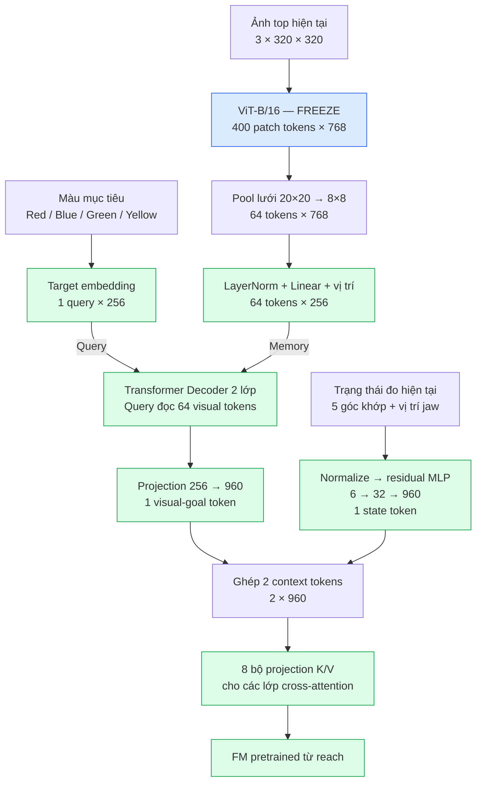

**2. Feedforward khi inference: từ context đến robot**

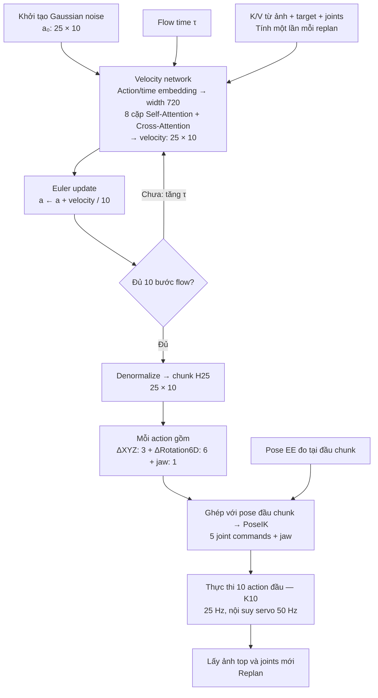

Hai số **10** có ý nghĩa riêng:

- **10 bước flow:** gọi velocity network 10 lần để sinh một chunk.
- **K10:** thực thi 10 trong 25 action, tức **0,4 giây**, rồi replan.

Các delta trong chunk đều tính từ **cùng pose EE đầu chunk**, không cộng dồn từng action.

**3. Phương án goal-XYZ đề xuất**

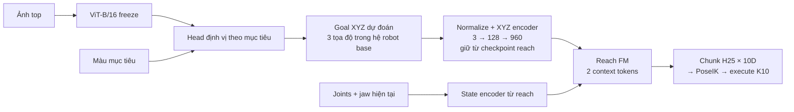

Khác biệt chính: **bản XYZ buộc vision xuất vị trí vật rõ ràng trước khi điều khiển**. Vì vậy có thể đo riêng lỗi định vị và lỗi điều khiển. Với e102 hiện tại, việc tìm vật và ánh xạ sang hành động nằm chung trong token 960D.

---

## 0045 · User · 2026-10-16T14:34:54.319Z

t đang hỏi kiến trúc hiện tại có conditioned on task tốt không mà, probe đi

---

## 0046 · Assistant — tiến độ · 2026-10-16T14:34:59.180Z

Đúng, mình đã hiểu lệch sang goal-XYZ. Mình sẽ probe checkpoint hiện tại: giữ nguyên ảnh, joints và noise rồi đổi target ID, đo action thay đổi thế nào và có hướng về đúng vật không. Mình cũng sẽ so với trường hợp tráo hoặc cố định target để kiểm tra model có thực sự dùng điều kiện mục tiêu.

---

## 0047 · Assistant — tiến độ · 2026-10-16T14:37:17.683Z

Trong e102, task là “pick” cố định; điều kiện cần probe là **target ID của 4 màu**. Mình sẽ kiểm tra toàn bộ scene từ home bằng ba phép đo: action có đổi khi đổi target không, đổi có khớp nhánh expert đúng vật không, và token visual-goal có chứa thông tin vị trí mục tiêu đủ để một linear probe đọc ra trên hoán vị mới không.

---

## 0048 · Assistant — tiến độ · 2026-10-16T14:40:49.879Z

Probe cho thấy conditioning hiện **rất yếu ngay trên train**: giữ nguyên ảnh/joints/noise rồi đổi target chỉ làm quỹ đạo H25 lệch trung bình khoảng **0,29 mm**, trong khi bốn nhánh expert lệch khoảng **12,18 mm**. Tráo target cũng gần như không làm tăng lỗi dự đoán. Mình đang lưu biểu đồ và kết quả theo từng split để bạn kiểm tra.

---

## 0049 · Assistant · 2026-10-16T14:42:09.560Z

**Đã probe: checkpoint hiện tại condition theo target rất yếu, gần như bỏ qua màu mục tiêu khi xuất action từ home.**

Đo trên **928 scene × 4 target × 3 seed**, giữ nguyên ảnh, joints và noise, chỉ đổi target ID:

| Phép đo H25 | Train | Hoán vị mới |
|---|---:|---:|
| Quỹ đạo model thay đổi khi đổi target | **0,293 mm** | **0,293 mm** |
| Khác biệt giữa các nhánh expert | 12,18 mm | 12,18 mm |
| Chọn đúng nhánh expert gần nhất | **25,03%** | **25,03%** |
| Linear probe đọc đúng slot từ goal token | 53,5% | **27,3%** |

Mức ngẫu nhiên là **25%**. Tráo target cũng chỉ làm lỗi action tăng **dưới 0,01%**.

Ảnh dưới: **nét liền là model** — bốn target gần như chung một đường; **nét đứt là expert**.


Kiến trúc **có đường condition**, nhưng checkpoint này chưa học tốt liên kết **target ↔ vị trí**, và ảnh hưởng của target xuống action rất nhỏ. Vấn đề xuất hiện ngay trên train, không riêng hoán vị mới. Kết luận này áp dụng cho trạng thái home đã probe.

[Báo cáo và cách chạy](/workspace/robotics_assets/experiments/e102_top/probe_task/README.md) · [Mã probe](/workspace/arm-manipulation/OATFlow/top_pick/probe.py)

---

## 0050 · User · 2026-10-16T15:27:10.739Z

train y het nhung voi loss phu la tam vat , them o doan hidden state cua tracker

---

## 0051 · Assistant — tiến độ · 2026-10-16T15:27:16.824Z

Mình hiểu là giữ nguyên recipe e102 và thêm head dự đoán tâm XYZ của vật mục tiêu từ hidden state của khối đọc ảnh theo target, trước khi đưa sang FM. Mình sẽ kiểm tra đúng vị trí hidden state đó trong code, rồi train một run mới với loss action và loss phụ tâm vật.

---

## 0052 · Assistant — tiến độ · 2026-10-16T15:29:06.288Z

Trong e102, mình sẽ gắn head tâm vật vào **hidden 256D sau target decoder, trước projection 960D sang FM** — đây là khối đang liên kết ảnh với target, không phải tracker TCOW riêng.

Run mới giữ nguyên dữ liệu, seed, khởi tạo và 3.000 update như e102. Loss thêm là MSE của XYZ đã chuẩn hóa bằng thống kê train, trọng số 1; XYZ thật chỉ dùng làm nhãn cho loss phụ.

---

## 0053 · Assistant — tiến độ · 2026-10-16T15:33:19.531Z

Kiểm tra trước train đã qua: trọng số chung, RNG và action loss ban đầu khớp e102 chính xác. Loss tâm vật truyền gradient vào visual/target decoder và head mới; không truyền trực tiếp vào FM hay ViT. Mình bắt đầu `e103_center`, rồi sẽ chạy lại cùng probe và rollout để so với baseline.

---

## 0054 · Assistant — tiến độ · 2026-10-16T15:35:10.895Z

Nhãn tâm vật đã khớp đúng toàn bộ frame cache theo timestamp, joints và target ID. Batch train đầu cũng cho action loss giống hệt e102: **1,3317**, nên thay đổi của run này nằm ở gradient từ loss phụ. Mình đang theo dõi cả sai số tâm vật và action loss; checkpoint vẫn được chọn bằng action loss như baseline.

---

## 0055 · Assistant — tiến độ · 2026-10-16T15:37:44.541Z

Đã qua 1.000/3.000 update. Sai số tâm vật trên validation giảm từ **110 mm xuống 18 mm**, action loss còn **0,0148**. Mình sẽ chờ probe đổi target từ cùng trạng thái home để xác định loss phụ có giúp model chọn đúng vật hay chỉ dự đoán tốt hơn ở các trạng thái giữa trajectory.

---

## 0056 · Assistant — tiến độ · 2026-10-16T15:38:34.282Z

Đã qua nửa lượt train: **1.500 update**, sai số tâm vật validation khoảng **16,3 mm**, action loss **0,0130**. Mình cũng đã kiểm tra việc tách hidden state ra hàm riêng: dự đoán của checkpoint e102 cũ vẫn khớp bit-for-bit, và danh sách 128 ca rollout giữ nguyên.

---

## 0057 · Assistant — tiến độ · 2026-10-16T15:40:39.732Z

Đã qua 2.250 update. Sai số tâm vật validation còn **11,9 mm**; action loss **0,0109**, thấp hơn mức tốt nhất của baseline e102 là 0,0114. Còn khoảng hai phút train, sau đó pipeline sẽ chạy probe trước rồi rollout K10.

---

## 0058 · Assistant — tiến độ · 2026-10-16T15:41:54.541Z

Đã qua 2.750 update. Checkpoint tốt nhất hiện ở step 2.500, với action loss **0,01034** và sai số tâm vật validation khoảng **10,4 mm**. Mình vẫn giữ đủ 3.000 update và chọn checkpoint theo tiêu chí action loss đã dùng cho e102.

---

## 0059 · Assistant — tiến độ · 2026-10-16T15:43:14.446Z

Train đã xong 3.000 update. Cả e102 và run thêm loss tâm vật đều chọn **checkpoint step 2.500**, nên có thể so trực tiếp ở cùng số update. Probe đang chạy để đo xem đổi target có làm action tách ra đúng hướng hơn không.

---

## 0060 · Assistant — tiến độ · 2026-10-16T15:43:50.077Z

Probe đã cho thấy cải thiện rõ: trên hoán vị chưa thấy, linear probe đọc đúng slot từ goal token tăng **27,3% → 99,9%**. Đổi target làm quỹ đạo H25 tách khoảng **8,3 mm**, so với **0,29 mm** trước đây; tráo target làm lỗi action tăng khoảng **4,3 lần**.

Đây là bằng chứng conditioning đã mạnh hơn. Rollout vật lý đang chạy để kiểm tra mức cải thiện khi gắp thật.

---

## 0061 · Assistant — tiến độ · 2026-10-16T15:46:02.347Z

Rollout trên train đạt **5/32**, so với **1/32** của baseline. Nhóm hoán vị mới hiện đạt **4/24** và vẫn đang chạy. Loss phụ đã cải thiện conditioning rõ trong probe, nhưng tỷ lệ gắp còn thấp; mình đang hoàn tất hai nhóm vị trí mới.

---

## 0062 · Assistant — tiến độ · 2026-10-16T15:46:59.246Z

Đã xong ba nhóm: **train 5/32**, **hoán vị mới 4/32**, **vị trí mới 6/32**; baseline tương ứng là **1/32, 0/32, 0/32**. Còn nhóm vừa đổi hoán vị vừa đổi vị trí. Mình cũng đã xác nhận probe hai run dùng cùng toàn bộ scene và nhánh expert tham chiếu.

---

## 0063 · Assistant — tiến độ · 2026-10-16T15:48:55.859Z

Đã test xong: run thêm loss tâm vật đạt **22/128 ca gắp thành công**, so với **1/128** của baseline. Riêng nhóm đổi cả hoán vị và vị trí đạt **7/32**; số ca nhấc nhầm vật giảm từ **6 xuống 1**. Mình đang lưu bảng so sánh và checkpoint; conditioning đã tốt hơn rõ, còn tỷ lệ gắp tổng thể vẫn thấp.

---

## 0064 · Assistant · 2026-10-16T15:50:34.712Z

Đã train xong **e103_center**, giữ nguyên data, seed, khởi tạo, ViT freeze và **3.000 update** như e102.

Thêm head XYZ ở **hidden 256D sau target decoder**, với:
`L = L_FM + MSE(XYZ chuẩn hóa)`.
Tâm vật chỉ làm nhãn phụ, không đưa vào FM.

| Gắp thành công — H25/K10 | Baseline | + Loss tâm vật |
|---|---:|---:|
| Train | 1/32 | **5/32** |
| Hoán vị mới | 0/32 | **4/32** |
| Vị trí mới | 0/32 | **6/32** |
| Cả hai mới | 0/32 | **7/32** |
| Tổng | 1/128 | **22/128** |

Probe trên hoán vị mới:

- Linear probe đọc đúng slot từ goal token: **27,3% → 99,9%**.
- Action gần đúng nhánh expert: **25,0% → 53,9%**.
- Tráo target làm lỗi action tăng **4,33 lần**, trước đây gần như không đổi.

**Loss phụ giúp conditioning mạnh hơn rõ**, nhưng gắp vẫn chưa ổn: tổng success **17,2%**. Cả hai run chọn checkpoint step **2.500**.

[Kết quả, checkpoint và cách chạy](/workspace/robotics_assets/experiments/e103_center/README.md) · [Biểu đồ probe](/workspace/robotics_assets/experiments/e103_center/conditioning_comparison.png)

---

## 0065 · User · 2026-10-16T16:34:25.435Z

cho t xem video comparision

---

## 0066 · Assistant — tiến độ · 2026-10-16T16:34:30.027Z

Mình sẽ ghép video baseline và bản thêm loss tâm vật cạnh nhau trên cùng scene, cùng target và cùng tốc độ, để bạn so trực tiếp.

---

## 0067 · Assistant — tiến độ · 2026-10-16T16:36:10.412Z

Mình đã tìm đủ video cùng scene để ghép. Mình sẽ đưa 4 ví dụ ở train và các nhóm test, kèm 2 ca thất bại để thấy cả hạn chế. Bên trái là baseline, bên phải là bản thêm loss tâm vật; bên kết thúc sớm sẽ giữ khung hình cuối để hai bên chạy cùng tốc độ.

---

## 0068 · Assistant · 2026-10-16T16:37:26.413Z

[▶ Video so sánh tổng hợp — 72 giây](/workspace/robotics_assets/experiments/e103_center/video_comparison/overview.mp4)

**Trái: baseline e102 · Phải: thêm loss tâm vật e103.** Cùng scene, target đỏ, checkpoint step 2500, execute K10/H25 và tốc độ 1×. Bên kết thúc sớm giữ khung hình cuối.

Xem riêng từng ca:

- [Train](/workspace/robotics_assets/experiments/e103_center/video_comparison/01_train.mp4)
- [Test hoán vị mới](/workspace/robotics_assets/experiments/e103_center/video_comparison/02_unseen_order.mp4)
- [Test vị trí spawn mới](/workspace/robotics_assets/experiments/e103_center/video_comparison/03_new_positions.mp4)
- [Test cả hoán vị và vị trí mới](/workspace/robotics_assets/experiments/e103_center/video_comparison/04_both_new.mp4)

Video tổng hợp có **4 ca cải thiện và 2 ca thất bại**. Đây là ví dụ được chọn; kết quả toàn bộ 128 ca là **baseline 1/128 → thêm loss tâm vật 22/128**.

---

## 0069 · User · 2026-10-16T17:02:16.625Z

thử temporal ensemble 1 step xem

---

## 0070 · Assistant — tiến độ · 2026-10-16T17:02:21.085Z

Mình sẽ thử chạy K=1: mỗi bước dự đoán lại chunk, rồi temporal ensemble các dự đoán chồng lên cùng thời điểm. Mình dùng checkpoint e103 và cùng bộ scene test để so với K10 vừa rồi.

---

## 0071 · Assistant — tiến độ · 2026-10-16T17:02:57.453Z

Action hiện tại là độ lệch so với vị trí tay lúc tạo chunk, nên mình cần đổi từng dự đoán về tọa độ tuyệt đối trước khi ensemble. Mình sẽ dùng hệ số 0.01 như pipeline ACT sẵn trong repo và giữ nguyên checkpoint, controller, tiêu chí thành công cùng 128 ca đánh giá.

---

## 0072 · Assistant — tiến độ · 2026-10-16T17:05:26.773Z

Test K1 + temporal ensemble đã bắt đầu. Mình đã kiểm tra việc căn đúng timestep, đổi anchor và trung bình rotation hợp lệ. Cấu hình này gọi model nhiều hơn khoảng 10 lần so với K10, nên lượt đánh giá sẽ lâu hơn; mình cũng sẽ ghép video K10/K1 trên các scene vừa xem.

---

## 0073 · Assistant — tiến độ · 2026-10-16T17:06:36.995Z

8 ca đầu đã xong: cả K10 và K1 + ensemble đều thành công 2/8. Lệnh điều khiển bước đầu trùng khớp hoàn toàn với K10; số dự đoán được ensemble cũng tăng đúng từ 1 lên tối đa 25. Mình đang chạy tiếp các nhóm hoán vị và vị trí mới.

---

## 0074 · Assistant — tiến độ · 2026-10-16T17:08:17.514Z

16 ca đầu vẫn giữ nguyên kết quả: 4/16 cho cả hai cấu hình, chưa có ca nào đổi thành công/thất bại. Tốc độ hiện tại khoảng 75 giây mỗi batch 8 ca; toàn bộ lượt test dự kiến mất khoảng 20 phút.

---

## 0075 · Assistant — tiến độ · 2026-10-16T17:09:40.381Z

Đã xong 24/128 ca, hiện vẫn là 4 thành công cho cả hai. Trên 4 ca cùng thành công, K1 + ensemble đều hoàn tất chậm hơn K10; mình chưa thấy lợi ích về tỉ lệ gắp ở phần train đã chạy.

---

## 0076 · Assistant — tiến độ · 2026-10-16T17:10:51.186Z

Nhóm train đã xong: **K10 5/32, K1 + ensemble 5/32**, cùng các ca thành công. Lượt chạy đang chuyển sang hoán vị chưa thấy; phần này sẽ cho biết cấu hình mới có giúp khi đổi thứ tự vật hay không.

---

## 0077 · Assistant — tiến độ · 2026-10-16T17:11:33.440Z

Có [video train K10 so với K1 + ensemble](/workspace/robotics_assets/experiments/e103_center/test_k1_te/compare_01_train.mp4) để bạn xem trước: trái K10, phải K1 + ensemble. Ca này gần như ngang nhau, hoàn tất ở 5.76 giây và 5.72 giây.

---

## 0078 · Assistant — tiến độ · 2026-10-16T17:12:49.170Z

16 ca hoán vị mới đầu tiên cho kết quả K10 **4/16**, K1 + ensemble **3/16**. Có 1 ca mới thành công nhưng 2 ca từng thành công chuyển thành timeout, nên hiện chưa thấy cải thiện ổn định.

---

## 0079 · Assistant — tiến độ · 2026-10-16T17:13:54.768Z

Đã xong 56/128 ca: K1 + ensemble có 8 thành công, K10 có 9 trên đúng các ca đó. Mình đang chạy nốt nhóm hoán vị trước khi chuyển sang vị trí spawn mới.

---

## 0080 · Assistant — tiến độ · 2026-10-16T17:14:21.734Z

Đã có [video trên hoán vị mới](/workspace/robotics_assets/experiments/e103_center/test_k1_te/compare_02_unseen_order.mp4): ca này K10 gắp thành công, còn K1 + ensemble timeout. Mình sẽ giữ ca này trong video tổng hợp cùng kết quả đầy đủ.

---

## 0081 · Assistant — tiến độ · 2026-10-16T17:15:29.671Z

Đã xong nửa bộ test. Kết quả đầy đủ nhóm hoán vị mới là **K10 4/32 → K1 + ensemble 3/32**; nhóm train giữ nguyên 5/32. Còn hai nhóm vị trí mới và cả vị trí lẫn hoán vị mới đang chạy.

---

## 0082 · Assistant — tiến độ · 2026-10-16T17:16:43.460Z

Đã hoàn tất 72/128 ca. Batch đầu ở vị trí spawn mới chưa có ca thành công; mình đang chạy tiếp các layout còn lại để lấy đủ kết quả nhóm này.

---

## 0083 · Assistant — tiến độ · 2026-10-16T17:17:59.418Z

Ở 16 ca vị trí mới đã xong, K1 + ensemble đang giảm rõ: **0/16**, so với **4/16** của K10. Tổng 80 ca hiện là 8 so với 13 thành công. Mình sẽ chạy đủ phần còn lại để chốt mức chênh lệch.

---

## 0084 · Assistant — tiến độ · 2026-10-16T17:19:19.761Z

Đã xong 88/128 ca. Video tổng hợp sẽ dùng đúng 6 scene của lần so sánh trước, để bạn nhìn trực tiếp thay đổi do K1 + ensemble; bảng kết quả sẽ tính trên toàn bộ 128 ca.

---

## 0085 · Assistant — tiến độ · 2026-10-16T17:20:49.180Z

Nhóm vị trí mới đã xong: **K10 6/32 → K1 + ensemble 0/32**. Còn 32 ca vừa đổi hoán vị vừa đổi vị trí; đến đây cấu hình K1 + ensemble 0.01 đang kém hơn K10 khá rõ.

---

## 0086 · Assistant — tiến độ · 2026-10-16T17:22:05.074Z

Đã xong 104/128 ca, còn 3 batch. Mình đang giữ nguyên frame budget 300 bước cho mọi ca, nên các kết quả timeout đều được chấm với cùng giới hạn như K10.

---

## 0087 · Assistant — tiến độ · 2026-10-16T17:23:08.596Z

112/128 ca đã xong. Trong 16 ca vừa đổi hoán vị vừa đổi vị trí, K1 + ensemble hiện là **0/16**, K10 là **4/16**. Đã đủ dữ liệu để ghép cả 6 video đối chiếu; mình đang hoàn tất 16 ca cuối và kiểm tra kết quả.

---

## 0088 · Assistant — tiến độ · 2026-10-16T17:24:34.880Z

Đang chạy batch cuối, 120/128 ca đã hoàn tất. Video đối chiếu 6 scene đã ghép xong; mình sẽ chốt bảng kết quả sau khi kiểm tra các trace và trạng thái khởi tạo.

---

## 0089 · Assistant — tiến độ · 2026-10-16T17:25:12.057Z

Đã chạy xong: **K1 + ensemble đạt 8/128 (6.25%)**, thấp hơn K10 **22/128 (17.19%)**. Kiểm tra xác nhận 128 ca có cùng trạng thái khởi tạo, ensemble căn đúng timestep và rotation hợp lệ. Trong lượt này có 1 ca mới thành công nhưng 15 ca từng thành công bị mất.

---

## 0090 · Assistant · 2026-10-16T17:26:13.110Z

Đã thử **H25/K1 + temporal ensemble 0.01**, checkpoint e103 step 2500, cùng 128 ca. **Kết quả kém hơn K10**:

| Nhóm | K10 | K1 + ensemble |
|---|---:|---:|
| Train | 5/32 | 5/32 |
| Hoán vị mới | 4/32 | 3/32 |
| Vị trí mới | 6/32 | 0/32 |
| Cả hai mới | 7/32 | 0/32 |
| **Tổng** | **22/128 — 17.19%** | **8/128 — 6.25%** |

Có **1 ca mới thành công nhưng mất 15 ca thành công cũ**. Kiểm tra anchor, timestep và rotation đều pass.

[▶ Video so sánh — 66 giây](/workspace/robotics_assets/experiments/e103_center/test_k1_te/comparison.mp4): **trái K10, phải K1 + ensemble**, đúng 6 scene trước, cùng tốc độ.

Lượt này đổi đồng thời K và ensemble; chưa có đối chứng K1 không ensemble.

---

## 0091 · User · 2026-10-16T17:56:07.748Z

thoi duoc , train them du 10 epoch di roi test k10

---

## 0092 · Assistant — tiến độ · 2026-10-16T17:56:14.012Z

Mình sẽ train tiếp e103 đến đủ tổng cộng 10 epoch, giữ nguyên cấu hình và loss tâm vật, rồi test lại K10 trên cùng 128 ca. Mình sẽ kiểm tra checkpoint resume để tiếp tục cả optimizer và lịch train.

---

## 0093 · Assistant — tiến độ · 2026-10-16T17:57:38.496Z

Checkpoint `latest` có đủ optimizer, RNG và thứ tự dữ liệu để resume từ step 3000 — hiện đã chạy khoảng 1.344 epoch. Đủ 10 epoch sẽ là **step 22320** (2.856 triệu mẫu). Mình sẽ test K10 bản cuối ở mốc này và lưu riêng best theo validation, giữ nguyên kết quả cũ.

---

## 0094 · Assistant — tiến độ · 2026-10-16T18:00:11.427Z

Training tiếp đã chạy, và kiểm tra resume đều pass: trọng số, 235 trạng thái optimizer, RNG và batch kế tiếp được khôi phục đúng. Tốc độ hiện khoảng 7 update/giây; dự kiến còn khoảng 50 phút train, rồi khoảng 5 phút test K10.

---

## 0095 · User · 2026-10-16T18:01:10.039Z

codex wait 50p moi xem log tiep duoc khong

---

## 0096 · Assistant — tiến độ · 2026-10-16T18:01:32.239Z

Được. Job vẫn tự train rồi test K10; mình sẽ chờ 50 phút rồi mới đọc log tiếp. Bạn nhắn thêm thì mình có thể phản hồi sớm hơn.

---

## 0097 · Assistant — tiến độ · 2026-10-16T18:51:55.819Z

Đã chờ đủ 50 phút rồi kiểm tra: train và test K10 đều hoàn tất. Bản **đủ 10 epoch, step 22320 đạt 118/128 ca (92.19%)**; hoán vị mới 32/32, vị trí mới 26/32, cả hai mới 28/32. Mình đang kiểm tra checkpoint và ghép video đối chiếu với bản cũ.

---

## 0098 · Assistant · 2026-10-16T18:54:48.266Z

Đã train đủ **10 epoch — step 22320**, giữ ViT frozen và loss tâm vật. Test **K10**, cùng 128 ca:

| Nhóm | Bản cũ | Đủ 10 epoch |
|---|---:|---:|
| Train | 5/32 | **32/32** |
| Hoán vị mới | 4/32 | **32/32** |
| Vị trí mới | 6/32 | **26/32** |
| Cả hai mới | 7/32 | **28/32** |
| **Tổng** | **17.19%** | **92.19%** |

Còn **10 ca timeout, không gắp nhầm vật**. Kiểm tra resume, ViT frozen và trạng thái khởi tạo đều pass.

[▶ Video so sánh — 55 giây](/workspace/robotics_assets/experiments/e103_center/test_k10_2/comparison.mp4): trái bản cũ, phải đủ 10 epoch, có cả ca thất bại.

Checkpoint: [final.pt](/workspace/robotics_assets/experiments/e103_center/train_2/final.pt).

---

## 0099 · User · 2026-10-17T03:57:44.784Z

ngon =)), thành công mỹ mãn, loss phụ trọng số bao nhiêu

---

## 0100 · Assistant · 2026-10-17T03:57:52.896Z

Trọng số loss phụ là **λ = 1.0**:

\[
L = L_{\mathrm{FM}} + 1.0\,L_{\mathrm{center}}
\]

`L_center` là **MSE của XYZ đã chuẩn hóa bằng mean/std tập train**, dự đoán từ hidden 256D của target decoder. Giữ nguyên trọng số này suốt 10 epoch.

---

## 0101 · User · 2026-10-17T03:58:24.910Z

mỗi loss 1 nửa cơ à

---

## 0102 · Assistant · 2026-10-17T03:58:38.105Z

**Hệ số hai loss ngang nhau**, còn đóng góp thực tế tùy độ lớn của chúng.

Ví dụ batch train cuối:
- FM: `0.001365`
- Tâm vật: `0.000524`

→ Khoảng **72% FM / 28% tâm vật** trong tổng loss. Tỷ lệ giá trị loss này cũng chưa phản ánh tỷ lệ gradient tác động lên model.

---

## 0103 · User · 2026-10-17T03:59:01.116Z

tại sao batch cuối lại khác

---

## 0104 · Assistant · 2026-10-17T03:59:14.720Z

Mình chỉ lấy **batch cuối làm ví dụ**; tỷ lệ đó thay đổi ở mọi batch.

Hai loss đo hai lỗi khác nhau: FM đo lỗi dự đoán action, còn loss phụ đo lỗi tâm vật. Dữ liệu và noise/time của FM cũng đổi theo batch nên giá trị hai loss khác nhau.

**λ = 1 chỉ là cùng hệ số nhân**, không ép hai loss có cùng giá trị hay luôn đóng góp 50–50.

---

## 0105 · User · 2026-10-17T04:00:41.726Z

có target nào được gắp thành công nhiều hơn không

---

## 0106 · Assistant — tiến độ · 2026-10-17T04:00:45.445Z

Mình sẽ xem kết quả theo từng màu target của bản 10 epoch, rồi tách theo nhóm test để xem chênh lệch nằm ở đâu.

---

## 0107 · Assistant · 2026-10-17T04:00:56.993Z

Có, **target vàng thành công nhiều nhất** trên bản 10 epoch, K10. Mỗi màu được thử đúng 32 ca:

| Target | Thành công | Tỷ lệ |
|---|---:|---:|
| 🟨 Vàng | **32/32** | **100%** |
| 🟥 Đỏ | 29/32 | 90.6% |
| 🟦 Xanh dương | 29/32 | 90.6% |
| 🟩 Xanh lá | 28/32 | 87.5% |

Ở nhóm train và hoán vị mới, **mọi màu đều đạt 8/8**. Chênh lệch chỉ xuất hiện khi đổi vị trí spawn; chưa thể quy hoàn toàn cho màu vật.

---

## 0108 · User · 2026-10-17T04:01:24.154Z

có thể xem là thành công mỹ mãn chưa ?

---

## 0109 · Assistant · 2026-10-17T04:01:46.779Z

**Có, với mục tiêu thí nghiệm này thì mình coi là thành công rất tốt.** Model gắp đúng theo target, đạt **32/32 trên hoán vị mới**, **28/32 khi cả hoán vị và vị trí đều mới**, và không có ca gắp nhầm vật.

Có hai giới hạn cần giữ rõ:

- Kết quả mới trên một seed và tập đánh giá nhỏ. Riêng **96 ca ngoài train đạt 86/96 ≈ 89.6%**.
- Để khẳng định mức cải thiện đến từ **loss phụ**, cần baseline không loss phụ cũng train đủ 10 epoch.

Tức là mục tiêu xây được policy hoạt động tốt đã đạt; phần chứng minh đóng góp riêng của loss phụ còn thiếu đối chứng.

---

## 0110 · User · 2026-10-17T04:08:30.190Z

t định bổ sung toạ độ vào conditioned của FM nhưn giờ chắc không cần nữa rồi, t nghĩ như này còn sạch hơn vì toạ độ trong thực tế có thể không chuẩn

---

## 0111 · Assistant · 2026-10-17T04:08:51.520Z

Ừ, mình cũng nghiêng về **giữ kiến trúc hiện tại**. Kết quả này đủ tốt để chưa cần thêm XYZ vào conditioning.

Loss phụ giúp hidden học liên kết **target với vị trí vật**, còn FM nhận embedding có thể giữ nhiều thông tin hơn ba tọa độ: hình dạng, hướng và quan hệ giữa tay với vật. Lúc chạy chỉ cần **ảnh + target ID + trạng thái khớp**, tránh thêm một nguồn XYZ riêng cùng sai số định vị và chuyển hệ tọa độ.

Điểm cần phân biệt là model vẫn phải ước lượng vị trí từ ảnh, nên sai số định vị vẫn tồn tại. Cách hiện tại cho phép FM học dùng thông tin thị giác trực tiếp, thay vì phải tin vào một giá trị XYZ đã được chốt trước.

---

## 0112 · User · 2026-10-17T04:11:45.202Z

ê t có ý này, thậm chí không cần toạ độ mà chỉ cần chấm 1 điểm lên ảnh (mà t nghĩ là cần thêm độ sâu) thay cho supervised toạ độ, vì như thế thực tế hoàn toàn làm được mà không cần sim

---

## 0113 · Assistant · 2026-10-17T04:12:26.773Z

Đúng, **nhãn điểm trên ảnh là một hướng hợp lý để thay supervision XYZ**, và có thể thu trực tiếp từ dữ liệu thật.

Giữ kiến trúc hiện tại, chỉ đổi nhánh phụ:

```text
hidden 256 ──→ head dự đoán (u, v) ──→ loss với điểm được chấm
     │
     └──────→ goal embedding ──→ FM như hiện tại
```

Nếu có camera RGB-D, lấy thêm depth tại điểm được chấm để supervise **`(u, v, d)`**. Nhãn này ở hệ ảnh/camera, **không cần chuyển sang tọa độ robot**. Nên chọn điểm nhất quán, chẳng hạn giữa mặt trên của vật.

**Depth chưa chắc bắt buộc** với bài gắp trên cùng mặt bàn: điểm 2D giúp hidden xác định đúng target, còn policy học chuyển động từ ảnh và trạng thái khớp. Depth đáng thử thêm khi chiều cao vật thay đổi, có xếp chồng hoặc cần phân biệt các vị trí theo chiều sâu. Hiệu quả của 2D so với XYZ hiện tại vẫn cần ablation.

Và đúng là có thể train hoàn toàn bằng dữ liệu thật, miễn có **demo gồm ảnh, trạng thái khớp và action**. Điểm chấm thay nhãn của loss phụ; demo vẫn cung cấp supervision cho FM. Có thể chấm một số frame rồi dùng tracker lan truyền nhãn để giảm công annotate.

---

## 0114 · User · 2026-10-17T04:32:34.256Z

có decoder trước FM không

---

## 0115 · Assistant · 2026-10-17T04:32:47.311Z

**Có**, trước FM là một **Transformer decoder 2 layer, 4 attention head**.

Nó nhận:

- **Memory:** 64 token ảnh từ ViT frozen, chiếu `768 → 256`.
- **Query:** embedding của target ID, chiều 256.

Luồng chính:

```text
Decoder → hidden 256 → LayerNorm + Linear → goal token 960 → FM
                └──→ head XYZ → loss phụ
```

FM còn nhận **token trạng thái khớp** riêng. Như vậy decoder đang học trích thông tin liên quan đến target từ ảnh; loss tâm vật supervise chính hidden đó.

---

## 0116 · User · 2026-10-17T05:12:32.367Z

m thử train y hệt e103 nhưng khởi tạo từ FM rỗng xem

---

## 0117 · Assistant — tiến độ · 2026-10-17T05:12:36.085Z

Mình sẽ làm một run mới cùng cấu hình e103 đủ 10 epoch và loss tâm vật, nhưng khởi tạo ngẫu nhiên phần FM. ViT vẫn dùng pretrained và freeze. Sau đó mình test K10 trên cùng 128 ca để so trực tiếp với e103.

---

## 0118 · Assistant — tiến độ · 2026-10-17T05:13:25.423Z

Mình sẽ dùng e104 cho thử nghiệm này. Phần FM sẽ random toàn bộ, gồm cả nhánh trạng thái khớp và các projection conditioning. Dữ liệu, chuẩn hóa, seed, khởi tạo visual decoder, loss phụ trọng số 1 và lịch train sẽ giữ như e103.

---

## 0119 · Assistant — tiến độ · 2026-10-17T05:16:43.033Z

e104 đã bắt đầu train. Kiểm tra xác nhận cả 185 tensor tham số FM đều khởi tạo mới; các tensor ngoài FM và RNG ban đầu khớp e103. Loss tâm vật ở batch đầu cũng trùng hoàn toàn.

Train và test K10 đã được nối tự động. Mình sẽ kiểm tra lại log sau khoảng 50 phút như lần trước.

---

## 0120 · User · 2026-10-17T05:28:54.827Z

m xuất log ra window 1 của tmux rồi chờ tiếp 
ssh tmux ấy

---

## 0121 · Assistant — tiến độ · 2026-10-17T05:28:57.490Z

Mình sẽ đưa log e104 vào window 1 của session `ssh_tmux`, rồi chờ tiếp.

---

## 0122 · Assistant — tiến độ · 2026-10-17T05:29:30.466Z

Đã chuyển pane đang train sang **`ssh_tmux:1`**, tên window là `e104`. Log train và test K10 sẽ hiện trực tiếp ở đó. Mình chờ tiếp.

---

## 0123 · Assistant — tiến độ · 2026-10-17T06:06:49.998Z

e104 đang ở khoảng **9.3/10 epoch**, còn khoảng 4 phút train rồi sẽ tự test K10. Log vẫn chạy trực tiếp tại `ssh_tmux:1`. Mình chờ nốt để lấy kết quả đầy đủ.

---

## 0124 · Assistant — tiến độ · 2026-10-17T06:12:52.589Z

Training đã xong đủ **10 epoch / step 22320**. Test K10 đang chạy, còn khoảng 2 phút; log train và test đều đã hiện trong `ssh_tmux:1` như bạn yêu cầu.

---

## 0125 · Assistant — tiến độ · 2026-10-17T06:15:11.783Z

e104 đã test xong: **FM random đạt 80/128 (62.5%)**, so với **118/128 (92.19%)** của e103 dùng FM pretrained. Cả hai đều train 10 epoch và test K10; e104 có 48 timeout, không gắp nhầm vật.

Mình đang kiểm tra việc giữ nguyên dữ liệu/RNG giữa hai run và ghép video so sánh. Kết quả cuối vẫn hiển thị ở `ssh_tmux:1`.

---

## 0126 · Assistant — tiến độ · 2026-10-17T06:16:16.782Z

Kiểm tra đã pass: hai run dùng cùng thứ tự dữ liệu và RNG xuyên suốt 10 epoch; ViT vẫn freeze và trạng thái khởi tạo của 128 ca test khớp hoàn toàn. Như vậy, trong cấu hình cố định này, FM pretrained tốt hơn khoảng **29.7 điểm phần trăm**. Video đối chiếu cũng đã ghép xong.

---

## 0127 · Assistant · 2026-10-17T06:17:23.447Z

Đã xong **e104: FM random**, cùng **10 epoch / step 22320**, test K10:

| Nhóm | FM pretrained | FM random |
|---|---:|---:|
| Train | 32/32 | 21/32 |
| Hoán vị mới | 32/32 | 21/32 |
| Vị trí mới | 26/32 | 21/32 |
| Cả hai mới | 28/32 | 17/32 |
| **Tổng** | **92.19%** | **62.5%** |

Dữ liệu, RNG, ViT frozen, loss phụ và lịch train đều khớp. **Với cùng budget này, FM pretrained tốt hơn khoảng 29.7 điểm phần trăm.** Bản random có 48 timeout, không gắp nhầm vật.

[▶ Video so sánh — 69 giây](/workspace/robotics_assets/experiments/e104_scratch/test_k10/comparison.mp4): trái pretrained, phải random.

[Checkpoint e104](/workspace/robotics_assets/experiments/e104_scratch/train/final.pt). Log cuối vẫn ở **`ssh_tmux:1`**.

---

## 0128 · User · 2026-10-17T06:43:48.651Z

rút ra gì

---

## 0129 · Assistant · 2026-10-17T06:44:22.649Z

Mình rút ra 4 ý:

1. **Khởi tạo FM từ reach có ích rõ rệt.** Cùng dữ liệu, seed, LR và 10 epoch: **92.2% so với 62.5%**. Đây là đối chứng khá sạch cho lợi ích của pretrained FM trong budget hiện tại.

2. **FM random vẫn học được pick.** Pretraining không phải điều kiện bắt buộc để mô hình hoạt động; chưa biết bản random có đuổi kịp nếu train lâu hơn hoặc chỉnh LR riêng hay không.

3. **Khoảng cách nằm cả ở năng lực gắp cơ bản.** Random chỉ đạt **21/32 trên train**, bằng nhóm hoán vị mới. Vì vậy lỗi của nó không thể quy riêng cho khả năng hiểu hoán vị chưa thấy.

4. **Loss định vị tốt chưa đủ bảo đảm gắp tốt.** Sai số center trên validation của hai bản gần như nhau, khoảng **7.6 mm**, nhưng rollout chênh rất lớn. Cần tiếp tục dùng thành công vật lý làm thước đo chính.

Đối chứng còn thiếu để chốt vai trò của **loss phụ** là: **FM pretrained, bỏ center loss, cũng train đủ 10 epoch**. Hiện mình chốt được lợi ích của pretrained FM; chưa tách riêng được đóng góp của center loss vào mức 92.2%.

---

## 0130 · User · 2026-10-17T06:45:23.233Z

m phải viết 1 báo cáo từ đầu, ngắn gọn đầy đủ cho người chưa biết gì về dự án cũng hiểu được

---

## 0131 · Assistant — tiến độ · 2026-10-17T06:45:26.259Z

Mình sẽ viết báo cáo từ bài toán và kiến trúc đến dữ liệu, các thử nghiệm và kết luận, để người chưa biết dự án vẫn theo được. Mình sẽ đối chiếu số liệu và ghi rõ những kết luận còn thiếu đối chứng.

---

## 0132 · Assistant — tiến độ · 2026-10-17T06:47:31.544Z

Có hai điểm cần làm rõ trong báo cáo: 92.2% là trên 128 ca gồm cả 32 ca train; riêng 96 ca ngoài train đạt 89.6%. Thử K1 + temporal ensemble cũng chỉ được chạy trên checkpoint ngắn ban đầu. Mình sẽ giữ các phạm vi này rõ ràng, đồng thời giải thích “hoán vị mới” và H/K bằng ví dụ dễ hiểu.

---

## 0133 · Assistant · 2026-10-17T06:49:28.253Z

[Bản báo cáo đầy đủ, có sơ đồ kiến trúc và liên kết số liệu]( /workspace/arm-manipulation/docs/research/top_pick_report_vi.md)

**Báo cáo: Robot gắp vật theo mục tiêu từ ảnh — e102 đến e104**

Dự án nghiên cứu cách cho robot nhìn một bàn có bốn khối màu và gắp đúng vật được chỉ định, ví dụ “gắp khối vàng”. Mỗi lượt bắt đầu với tay ở vị trí home, cả bốn vật nhìn thấy rõ qua camera từ trên xuống. Đầu vào của policy gồm **ảnh RGB, ID màu mục tiêu và trạng thái khớp/kẹp**.

Mục tiêu đánh giá là robot có tiếp tục gắp đúng khi đổi màu nào nằm ở vị trí nào — gọi là **hoán vị mới** — hoặc thay đổi vị trí spawn trên bàn. Đây là bài gắp một vật mỗi lượt, không phải thực hiện một chuỗi gắp theo thứ tự.

**Dữ liệu và đánh giá.** Bộ dữ liệu trong mô phỏng MuJoCo gồm 3.712 lượt expert gắp thành công, trong đó 2.048 lượt dùng để train. Có 40 bố trí vị trí: 32 train, 4 validation và 4 test. Trong 24 hoán vị bốn màu, train sử dụng 16 và giữ lại 8 hoán vị chưa thấy.

Các model được đánh giá trên cùng **128 ca cố định**, chia đều cho bốn nhóm: điều kiện train, hoán vị mới, vị trí mới và cả hai cùng mới. Thành công yêu cầu đúng vật được nâng trên 4 cm, có tiếp xúc hai má kẹp trong 10 frame liên tiếp. Gắp nhầm vật hoặc hết giới hạn 12 giây đều là thất bại.

**Kiến trúc và cách học.** Ảnh được đưa qua **ViT-B/16 pretrained và frozen**, nghĩa là giữ nguyên trọng số bộ trích đặc trưng ảnh. Một Transformer decoder hai layer dùng ID màu để trích thông tin liên quan đến mục tiêu:

```text
Ảnh → ViT frozen ──┐
                   ├→ Decoder → hidden 256 → goal embedding ──┐
ID màu mục tiêu ────┘                                        ├→ FM → action
Trạng thái khớp/kẹp → encoder trạng thái ─────────────────────┘
                             
hidden 256 → head dự đoán tâm XYZ → loss phụ khi train
```

FM, viết tắt của **Flow Matching**, là mạng sinh một đoạn hành động từ quan sát. Phiên bản chính khởi tạo FM từ checkpoint đã học nhiệm vụ **reach**: đưa đầu kẹp đến tọa độ đích.

Loss phụ giúp hidden liên kết mục tiêu với vị trí vật:

`L = L_FM + 1.0 × L_center`

`L_center` đo sai số XYZ đã chuẩn hóa bằng thống kê tập train. **Tọa độ vật chỉ dùng làm nhãn huấn luyện; không được đưa trực tiếp vào FM khi chạy.**

Model dự đoán **H=25 action**, thực hiện **K=10 action** rồi lấy ảnh mới và dự đoán lại. Ở tần số 25 Hz, tương ứng nhìn trước một giây và cập nhật kế hoạch sau mỗi 0,4 giây. Bộ giải động học ngược chuyển action của đầu kẹp thành lệnh motor.

**Các thử nghiệm và kết quả.** Cấu hình chính dùng batch 128, learning rate FM `2e-5`, các phần mới `1e-4`, seed 102. Đủ 10 epoch tương ứng **22.320 update**.

| Cấu hình | Train /32 | Hoán vị mới /32 | Vị trí mới /32 | Cả hai mới /32 | Tổng /128 |
|---|---:|---:|---:|---:|---:|
| e102: FM pretrained, không loss phụ; train ngắn | 1 | 0 | 0 | 0 | **1 — 0,8%** |
| e103: thêm loss tâm vật; train ngắn | 5 | 4 | 6 | 7 | **22 — 17,2%** |
| e103 ngắn: K1 + temporal ensemble | 5 | 3 | 0 | 0 | **8 — 6,25%** |
| e103: đủ 10 epoch, K10 | 32 | 32 | 26 | 28 | **118 — 92,2%** |
| e104: FM random, đủ 10 epoch, K10 | 21 | 21 | 21 | 17 | **80 — 62,5%** |

Các run ngắn train 3.000 update, khoảng 1,34 epoch, và test checkpoint validation tốt nhất ở step 2.500. Hai run 10 epoch đều test **checkpoint cuối step 22.320**.

Kiểm tra thay đổi riêng ID màu cho thấy phiên bản đầu gần như không thay đổi action theo mục tiêu. Loss tâm vật cải thiện rõ khả năng liên kết target với vị trí. Tuy nhiên, kiểm tra thông tin trong embedding không tương đương với gắp thành công.

Thử K1 kết hợp temporal ensemble chỉ được chạy trên checkpoint ngắn. Nó giảm kết quả từ 22 xuống 8 ca; chưa thử trên bản 10 epoch và chưa có đối chứng K1 không ensemble.

**Kết luận.** Kiến trúc dùng embedding thị giác cùng loss phụ đã đạt kết quả tốt trong phạm vi mô phỏng đã đánh giá, dù không nhận trực tiếp XYZ của vật. Bản e103 đủ 10 epoch đạt 118/128, còn 10 timeout và không gắp nhầm vật. Riêng **96 ca ngoài train đạt 86/96, tương đương 89,6%**.

Đối chứng e104 giữ nguyên dữ liệu, RNG, ViT, loss phụ và lịch train, chỉ thay khởi tạo FM. Kết quả cho thấy **FM pretrained tốt hơn 29,7 điểm phần trăm trong cùng budget**, trong khi FM random vẫn học được bài gắp.

Chưa thể quy toàn bộ mức 92,2% cho loss phụ. Đối chứng còn thiếu là **FM pretrained, không loss phụ, cũng train đủ 10 epoch**. Hiện kết quả mới trên một seed, một camera và bốn vật đã biết; chưa kiểm chứng trên robot thật. Ý tưởng thay nhãn XYZ bằng điểm ảnh, có thể thêm depth, vẫn là hướng thử nghiệm tiếp theo.

---

## 0134 · User · 2026-10-17T07:36:39.016Z

ptrained không loss phụ cùng số epoch đã thấy ngu rồi, còn phải train . thêm à , nói kỹ về phần FM pretrained nữa là đủ báo cáo

---

## 0135 · Assistant — tiến độ · 2026-10-17T07:36:45.259Z

Ừ, đối chứng train ngắn đã cho thấy bản không loss phụ gần như không dùng target và gắp rất kém. Mình sẽ giữ đúng kết luận đó, bỏ phần đề xuất train thêm khỏi báo cáo, và bổ sung rõ FM đã pretrained trên bài reach thế nào, chuyển những trọng số nào sang pick.

---

## 0136 · Assistant — tiến độ · 2026-10-17T07:38:27.939Z

Nguồn FM đã được xác minh: đây là model khởi tạo random rồi train trên dữ liệu reach của chính robot, dùng checkpoint step 115.000. Khi chuyển sang pick, ta giữ FM và nhánh trạng thái khớp, thay encoder mục tiêu XYZ bằng goal token từ ảnh. Mình sẽ bổ sung cả cách train reach và ranh giới chuyển giao này vào báo cáo.

---

## 0137 · Assistant · 2026-10-17T07:39:23.208Z

Không cần mở thêm run để hoàn thiện báo cáo này. Mình đã bỏ phần đề xuất train thêm và bổ sung chi tiết FM trong [bản báo cáo cập nhật](/workspace/arm-manipulation/docs/research/top_pick_report_vi.md).

Phần FM giờ giải thích rõ:

- **Nguồn pretrain:** FM khởi tạo random, rồi học trên **32.017 quỹ đạo reach của chính robot**: đi từ home đến đích, đóng và giữ kẹp. Cảnh chỉ có robot và bàn.
- **Đầu vào/đầu ra:** nhận XYZ đích cùng trạng thái khớp/kẹp; sinh đoạn **25 action**, mỗi action gồm dịch chuyển, hướng và độ mở kẹp.
- **Cách học:** trộn action expert với nhiễu, học vận tốc biến nhiễu thành action bằng flow-matching loss.
- **Checkpoint:** train reach đến 120.000 update, chọn **best step 115.000** theo validation.
- **Chuyển sang pick:** giữ toàn bộ FM và encoder trạng thái khớp; thay encoder mục tiêu XYZ bằng **goal token từ ảnh và target ID**. FM tiếp tục được fine-tune, ViT giữ frozen.

Báo cáo cũng phân biệt rõ: **reach cung cấp khởi tạo kỹ năng chuyển động; liên kết màu–vật và tương tác gắp/nâng được học ở giai đoạn pick.**

---

## 0138 · User · 2026-10-17T07:44:55.742Z

ô thiếu rồi, phải bắt đầu từ fomulate bài toán là chia workspace thành các voxel

---

## 0139 · Assistant — tiến độ · 2026-10-17T07:45:01.682Z

Đúng, bản vừa rồi bắt đầu quá muộn ở bài pick. Mình sẽ viết lại từ cách chia workspace thành voxel, kiểm tra đích nào robot tới được, tạo dữ liệu reach rồi pretrain FM, sau đó mới đến bài pick từ ảnh.

---

## 0140 · Assistant — tiến độ · 2026-10-17T07:46:33.705Z

Phần formulation sẽ nêu rõ: voxel dùng để lấy mẫu và kiểm chứng các đích reach. FM vẫn nhận tọa độ đích liên tục, không phân loại voxel. Cũng cần tách “tìm được nghiệm IK” khỏi “robot thực sự chạy được tới đích”: đã thử 72.030 tâm voxel, nhưng chỉ giữ 32.017 quỹ đạo qua kiểm tra vật lý.

---

## 0141 · Assistant · 2026-10-17T07:48:18.480Z

Đã viết lại [báo cáo từ gốc](/workspace/arm-manipulation/docs/research/top_pick_report_vi.md), bắt đầu bằng **formulation workspace dạng voxel**, theo mạch:

1. **Chia workspace thành voxel cạnh 2 cm.** Lấy tâm mỗi ô làm đích đầu kẹp; tổng cộng **49 × 49 × 30 = 72.030 đích ứng viên**.

2. **Kiểm chứng khả thi.** Giải IK, kiểm tra va chạm, lập đường từ home và chạy mô phỏng động lực học. Thu được **34.452 đích có nghiệm IK hợp lệ**, giữ **32.017 quỹ đạo đạt yêu cầu vật lý**.

3. **Formulate bài học reach:**
   \[
   \pi_{\mathrm{reach}}(A_t\mid q_t,g)
   \]
   Biết trạng thái khớp và tọa độ đích, sinh đoạn chuyển động tới đích. Từ dữ liệu này pretrain FM, chọn checkpoint step 115.000.

4. **Mở rộng sang bài pick từ ảnh:**
   \[
   \pi_{\mathrm{pick}}(A_t\mid I_t,c,q_t)
   \]
   Thay encoder đích XYZ bằng goal embedding từ ảnh và màu mục tiêu, giữ FM rồi fine-tune với loss phụ.

5. **Trình bày kiến trúc, dữ liệu pick, các thử nghiệm và kết quả.**

Báo cáo cũng ghi rõ: **voxel dùng để bao phủ workspace và tạo dữ liệu; FM sinh chuyển động liên tục, không phân loại ID voxel.**

---

## 0142 · User · 2026-10-17T08:31:02.780Z

experiment tiep theo la tu data shuffle (top cam), train behavior cloning voi tcow khoi tao tu original ckpoint, khong can head mask, chi can xyz head lamf aux loss, ghep vao ckpt FM reach

---

## 0143 · Assistant — tiến độ · 2026-10-17T08:31:05.237Z

Mình sẽ kiểm tra checkpoint TCOW gốc và luồng dữ liệu shuffle từ camera top, rồi ghép TCOW có head XYZ phụ với FM reach để chạy thí nghiệm behavior cloning tiếp theo.

---

## 0144 · Assistant — câu hỏi · 2026-10-17T08:31:14.722Z

Mình hiểu lần này dùng chuỗi shuffle gốc: chấm điểm vật ở frame đầu, TCOW nhớ vật qua lúc bị che/đảo vị trí, rồi BC điều khiển cả mở cover và gắp/nâng. Đúng ý bạn chứ?

- Đúng, mở cover rồi gắp/nâng
- Chỉ đoạn gắp/nâng sau mở cover

---

## 0145 · Assistant — tiến độ · 2026-10-17T08:31:33.659Z

Checkpoint TCOW gốc đã có sẵn, gồm cả kênh nhận điểm chấm ban đầu. Mình sẽ fine-tune TCOW cùng FM reach; hidden state của tracker đi qua projection thành token condition cho FM, còn head XYZ chỉ nhận loss phụ với trọng số 1 như e103. Không dùng head mask hay đưa tọa độ GT vào policy.

Chuỗi shuffle cần xử lý nhiều frame nên mình sẽ đo tốc độ và bộ nhớ trên batch thật trước khi chốt lượt train đầu.

---

## 0146 · User · 2026-10-17T08:32:17.625Z

<send_user_message_question_reply>
[{"answer":"Đúng, mở cover rồi gắp/nâng","question":"Mình hiểu lần này dùng chuỗi shuffle gốc: chấm điểm vật ở frame đầu, TCOW nhớ vật qua lúc bị che/đảo vị trí, rồi BC điều khiển cả mở cover và gắp/nâng. Đúng ý bạn chứ?","questionItemId":"[\"request_user_input_async\",\"call_3dbac5b01d1a440b9796de47ba649367\",0]"}]
</send_user_message_question_reply>

---

## 0147 · Assistant — tiến độ · 2026-10-17T08:32:22.341Z

Chốt dùng đầy đủ: TCOW xem shuffle từ điểm chấm ban đầu, sau đó policy tự mở cover, đặt cover xuống và gắp/nâng vật. Mình chỉ tính loss hành động trên đoạn expert; các frame shuffle trước đó dùng làm lịch sử quan sát. Test sẽ bắt đầu ngay sau shuffle, không dùng expert mở cover hộ.

---

## 0148 · Assistant — tiến độ · 2026-10-17T08:34:07.673Z

Preflight đã chạy được trên dữ liệu thật: khoảng 2 giây/update, bộ nhớ GPU khoảng 3,5 GiB. Các tensor TCOW khớp checkpoint gốc và FM khớp reach step 115000; gradient đi được về kênh điểm chấm.

Mình sẽ chạy pilot `e105_tcow` với 3.000 updates, batch 4 trên toàn bộ 2.048 episode train, dự kiến gần 2 giờ rồi test K10. Đây là lượt thử kiến trúc, chưa phải so sánh cùng 10 epoch với e103. Log sẽ ở window 1 của `ssh_tmux`.

---

## 0149 · User · 2026-10-17T08:35:18.032Z

co full finetune ca pipeline khong, sao it vram the

---

## 0150 · Assistant — tiến độ · 2026-10-17T08:35:32.654Z

Có, **fine-tune toàn bộ TCOW + projection + FM + head XYZ**, không freeze phần nào và không cache feature TCOW.

VRAM ít vì batch 4 đang chia thành **4 microbatch, mỗi lần 1 clip**, đồng thời dùng **gradient checkpointing** để tính lại activation khi backward. Tổng khoảng **226,8 triệu tham số**; preflight đạt đỉnh **4,2 GiB VRAM**. Đây là số đo lượt kiểm tra nhỏ; lượt train chính chưa khởi chạy.

---

## 0151 · User · 2026-10-17T08:36:00.952Z

bo grad checkpoiting, full data ma mat ck 2h thoi a

---

## 0152 · Assistant — tiến độ · 2026-10-17T08:36:11.238Z

Mình sẽ bỏ gradient checkpointing.

**Gần 2 giờ chỉ là 3.000 updates × batch 4 = 12.000 clip**, chưa phải đi hết dữ liệu. “Full data” ở đây mới là lấy mẫu từ cả 2.048 episode; cách mình nói trước đó dễ gây hiểu nhầm. Mình sẽ đếm chính xác số clip của một epoch và đo lại tốc độ khi bỏ checkpointing để báo thời gian train đủ lượt.

---

## 0153 · Assistant — câu hỏi · 2026-10-17T08:37:09.115Z

Đã bỏ gradient checkpointing. Bộ train có 234.434 clip (stride 3), nên 1 epoch là 58.609 updates với batch 4; 3.000 updates chỉ bằng 0,051 epoch. Đo hiện tại cho thấy 1 epoch khoảng một ngày trên RTX 3090. Bạn muốn ngân sách lượt chính bao nhiêu?

- Chạy đủ 1 epoch trước
- Chạy đủ 10 epoch
- Pilot 3.000 updates trước

---

## 0154 · Assistant — tiến độ · 2026-10-17T08:38:42.837Z

Đã bỏ checkpointing và thử **batch 4 trực tiếp**, không chia microbatch: chạy được, đỉnh VRAM **19,9 GiB**. Mình cũng kiểm tra đường gradient: loss hành động cập nhật TCOW và projection, còn head XYZ không nằm trên đường sinh action.

Đếm chính xác có **234.434 clip train**, nên con số gần 2 giờ trước đó chỉ tương ứng khoảng **5,1% một epoch**. Mình đang đo thêm vài chục updates để ước lượng thời gian đủ một epoch cho chắc.

---

## 0155 · Assistant — tiến độ · 2026-10-17T08:40:01.376Z

Đo 20 updates cho tốc độ ổn định khoảng **0,96 giây/update**, batch 4 trực tiếp, VRAM **19,9 GiB**. Với 234.434 clip ở stride 3, **một epoch dự kiến 16–18 giờ**; 10 epoch khoảng một tuần.

Mình lấy mốc **1 epoch đầy đủ trước**, rồi tự chạy test K10 để đánh giá khả năng mở cover và gắp/nâng.

---

## 0156 · Assistant — tiến độ · 2026-10-17T08:41:43.043Z

Lượt chính đã khởi chạy trong **`ssh_tmux`, window 1** và đang nạp RGB top của toàn bộ tập train vào RAM. Cấu hình là **1 epoch, 58.609 updates, batch 4 trực tiếp, không gradient checkpointing**, fine-tune cả TCOW lẫn FM. Test K10 sẽ tự chạy sau khi train xong.

---

## 0157 · Assistant — tiến độ · 2026-10-17T08:43:39.335Z

RGB top cần khoảng **62 GiB RAM** vì TCOW phải chạy lại và nhận gradient ở mỗi update. Hiện đã nạp khoảng 87%; GPU sẽ bắt đầu train sau bước này. Kiểm tra controller trên bốn ca mở cover rồi gắp/nâng đã qua 4/4, nhưng đó chưa phải kết quả của policy học được.

---

## 0158 · User · 2026-10-17T08:44:30.305Z

<send_user_message_question_reply>
[{"answer":"cho batch to len, tcow train stride 10, FM stride 3, tuc la train tcow truoc (luc do action label duoc mask nen khong train), sau do moi train end to end tcow+FM khi den doan data co expert demo","question":"Đã bỏ gradient checkpointing. Bộ train có 234.434 clip (stride 3), nên 1 epoch là 58.609 updates với batch 4; 3.000 updates chỉ bằng 0,051 epoch. Đo hiện tại cho thấy 1 epoch khoảng một ngày trên RTX 3090. Bạn muốn ngân sách lượt chính bao nhiêu?","questionItemId":"[\"request_user_input_async\",\"call_5def9b948ed4498ca429e2de17074dee\",0]"}]
</send_user_message_question_reply>

---

## 0159 · Assistant — tiến độ · 2026-10-17T08:44:44.710Z

Mình hiểu theo timeline của mỗi episode: **đoạn trước expert lấy endpoint stride 10, chỉ train TCOW bằng loss XYZ**; đến đoạn expert thì **endpoint stride 3, train end-to-end TCOW + FM**. Frame lịch sử đưa vào TCOW vẫn giữ như hiện tại.

Mình sẽ chuyển sang cách đó và tăng **batch hiệu dụng lên 128**, tích lũy gradient từ microbatch 4 để vừa VRAM; vẫn bỏ gradient checkpointing. Mình dừng lượt vừa khởi chạy để sửa sampler và mask loss trước.

---

## 0160 · User · 2026-10-17T08:45:33.617Z

khong can batch 128, vua vrama duoc

---

## 0161 · Assistant — tiến độ · 2026-10-17T08:45:56.186Z

Ừ, giữ **batch thực 4**, vừa VRAM khoảng 20 GiB, không tích lũy lên 128. Mình chỉ đổi sampler: trước expert stride 10 với loss XYZ; đoạn expert stride 3 với cả loss XYZ và FM.

---

## 0162 · User · 2026-10-17T08:47:03.761Z

1 epoch mat bao lau, ti uoc tinh xong thi bao t

---

## 0163 · Assistant — tiến độ · 2026-10-17T08:47:09.292Z

Mình sẽ đo riêng tốc độ batch chỉ TCOW và batch TCOW + FM, rồi nhân với số batch thực của một epoch để báo bạn. Ước lượng này sẽ tính cả hai đoạn theo sampler mới.

---

## 0164 · Assistant — tiến độ · 2026-10-17T08:49:49.391Z

Đo xong rồi: **1 epoch theo sampler mới khoảng 20–22 giờ** trên RTX 3090, batch thực 4, không checkpointing.

- TCOW-only, stride 10: **15.422 batch × 0,88 giây**.
- TCOW + FM, stride 3: **58.808 batch × 0,97 giây**.

Tổng tính toán khoảng **19,6 giờ**; cộng nạp dữ liệu, validation và lưu checkpoint thành 20–22 giờ. VRAM đỉnh **19,9 GiB**. Mình cũng kiểm tra được FM giữ nguyên trọng số ở batch chỉ TCOW, kể cả sau khi đã có momentum từ batch expert.

---

## 0165 · Assistant · 2026-10-17T08:51:29.578Z

**1 epoch khoảng 20–22 giờ** với sampler mới:

- TCOW stride 10: 15.422 batch, ~0,88 giây/batch.
- TCOW + FM stride 3: 58.808 batch, ~0,97 giây/batch.

Batch thực **4**, VRAM ~**19,9 GiB**, không gradient checkpointing. Đã khởi chạy trong **`ssh_tmux:1`**; xong sẽ tự test K10.

---

## 0166 · User · 2026-10-17T10:37:36.194Z

sao m không log ra tí loss nào vậy

---

## 0167 · Assistant — tiến độ · 2026-10-17T10:37:39.611Z

Mình sẽ kiểm tra tiến trình và chỉnh log để hiện loss thường xuyên ngay trong window 1 của `ssh_tmux`.

---

## 0168 · Assistant — tiến độ · 2026-10-17T10:38:07.670Z

Có lưu loss mỗi step, nhưng mình để console chỉ in mỗi 250 step nên khó theo dõi. Mình sẽ thêm pane hiển thị loss liên tục trong window 1, giữ nguyên lượt train đang chạy.

---

## 0169 · Assistant · 2026-10-17T10:38:48.594Z

Đã thêm **pane dưới trong `ssh_tmux:1`**, hiện mỗi **10 step**: tổng loss, FM loss, XYZ loss và sai số XYZ (mm).

Trước đó console chỉ in mỗi 250 step. Lượt train vẫn tiếp tục, hiện khoảng step **6.250**.

---

## 0170 · User · 2026-10-17T10:59:49.134Z

thêm cái này vào báo cáo đi, với mỗi thí nghiệm khác nhau về mặt kiến trúc thì nên vẽ sơ đồ mermaid vào , kết quả của thí nghiệm này cứ để trống

---

## 0171 · Assistant — tiến độ · 2026-10-17T10:59:54.059Z

Mình sẽ bổ sung thí nghiệm TCOW + FM vào báo cáo, để trống kết quả và thêm sơ đồ Mermaid cho từng cấu hình kiến trúc khác nhau.

---

## 0172 · Assistant — tiến độ · 2026-10-17T11:01:47.940Z

Mình đã thêm e105 với cách train hai đoạn và bảng kết quả để trống. Báo cáo cũng đã có sơ đồ riêng cho FM reach, e102, e103, e104 và TCOW + FM; bản 3.000 update và 10 epoch dùng chung sơ đồ vì kiến trúc giống nhau. K1 + temporal ensemble có sơ đồ luồng thực thi riêng.

---

## 0173 · Assistant · 2026-10-17T11:02:08.276Z

Đã cập nhật [báo cáo](/workspace/arm-manipulation/docs/research/top_pick_report_vi.md):

- Thêm e105 TCOW + FM, đầy đủ kiến trúc và cách train hai đoạn.
- Thêm sơ đồ Mermaid cho từng cấu hình, cùng luồng temporal ensemble.
- **Để trống toàn bộ kết quả e105** chờ train/test xong.

---

## 0174 · User · 2026-10-17T11:02:39.368Z

tiếng anh đi cho chuẩn thuật ngữ =))

---

## 0175 · Assistant — tiến độ · 2026-10-17T11:02:42.523Z

Mình sẽ chuyển báo cáo sang tiếng Anh, giữ nguyên số liệu, sơ đồ Mermaid và phần kết quả e105 đang để trống.

---

## 0176 · Assistant — tiến độ · 2026-10-17T11:05:06.180Z

Bản tiếng Anh đã có đầy đủ nội dung và nhãn Mermaid. Mình đang kiểm tra lại thuật ngữ, số liệu và các liên kết; bảng kết quả e105 vẫn để trống.

---

## 0177 · Assistant · 2026-10-17T11:05:15.771Z

Đã chuyển sang [báo cáo tiếng Anh](/workspace/arm-manipulation/docs/research/top_pick_report.md), gồm toàn bộ nhãn Mermaid và thuật ngữ kỹ thuật. Kết quả e105 vẫn để trống.

---

## 0178 · User · 2026-10-17T12:10:17.200Z

t dùng kỹ thuật gì để đo workspace khả thi vậy

---

## 0179 · Assistant · 2026-10-17T12:10:34.255Z

Bạn dùng **voxel-based reachability mapping**, kết hợp **collision-aware motion planning** và **dynamic rollout validation**:

1. **Voxelization:** chia workspace thành ô lập phương cạnh **2 cm**, lấy tâm mỗi ô làm đích đầu kẹp.
2. **Inverse kinematics (IK):** tìm cấu hình khớp tới đích, thỏa giới hạn khớp và kiểm tra va chạm. Chỉ ràng buộc vị trí, cho phép hướng đầu kẹp tự do.
3. **Motion planning từ home:** thử đường thẳng trong không gian khớp; dùng **RRT-Connect** khi cần.
4. **Dynamic validation:** chạy quỹ đạo trong MuJoCo, tới đích, đóng kẹp rồi giữ; kiểm tra sai số vị trí, độ trôi và va chạm.

Kết quả: **72.030 tâm → 34.452 nghiệm IK hợp lệ → 32.017 quỹ đạo được xác nhận bằng mô phỏng vật lý**.

Tên đầy đủ phù hợp cho báo cáo là **“Voxel-based workspace feasibility mapping with IK, collision-aware planning, and dynamic validation.”**

Đây là khả năng tới **tâm voxel từ home** trong cảnh robot–bàn đã xét. Nó chưa chứng nhận mọi điểm trong voxel; IK thất bại cũng chưa chứng minh đích không thể tới.

---

## 0180 · User · 2026-10-17T12:11:40.817Z

ý là t lấy code ở đâu , nguồn gốc nào

---

## 0181 · Assistant — tiến độ · 2026-10-17T12:11:43.777Z

Mình sẽ lần lại code tạo workspace để xác định phần nào tự viết, phần nào dùng thư viện hay thuật toán có sẵn.

---

## 0182 · Assistant · 2026-10-17T12:12:30.790Z

À, **phần đo workspace là code riêng trong project, xây trên SciPy và MuJoCo**:

| Thành phần | Nguồn triển khai |
|---|---|
| Chia voxel, chạy toàn bộ pipeline | [voxel_grid.py](/workspace/arm-manipulation/OATFlow/data_tools/voxel_grid.py) |
| Giải IK | **SciPy `least_squares`**, dùng Jacobian từ **MuJoCo `mj_jacSite`** — [đoạn code](/workspace/arm-manipulation/OATFlow/data_tools/voxel_grid.py:282) |
| Lập đường tránh va chạm | **RRT-Connect được triển khai trực tiếp trong project**, không gọi OMPL/MoveIt — [plan_path](/workspace/arm-manipulation/OATFlow/data_tools/voxel_grid.py:82) |
| FK, kiểm tra collision và mô phỏng động lực học | Các API của **MuJoCo**, với logic kiểm chứng tự viết |

Code cũ mang tên `grid_dataset.py`, sau cleanup được gom vào `OATFlow/data_tools/voxel_grid.py`. Robot và bàn lấy từ cấu hình mô phỏng của bạn đã lưu.

Vậy nguồn gốc cần ghi là **custom implementation using SciPy and MuJoCo, with a local implementation of the standard RRT-Connect algorithm**. Các thuật toán nền là có sẵn; phần ghép thành pipeline đo workspace và kiểm chứng cho robot này là code của dự án.

---

## 0183 · User · 2026-10-17T12:15:10.270Z

có kết quả reach FM không

---

## 0184 · Assistant — tiến độ · 2026-10-17T12:15:13.390Z

Mình sẽ kiểm tra lại kết quả đánh giá riêng của FM reach, tách khỏi các thí nghiệm gắp vật.

---

## 0185 · Assistant — tiến độ · 2026-10-17T12:15:44.999Z

Có kết quả trên 128 đích held-out với hai noise seed. Checkpoint reach step 115.000 đạt success ở ngưỡng 10 mm là **83,6% và 88,3%**; ở ngưỡng 5 mm là **53,9% và 63,3%**. Mình sẽ bổ sung bảng đánh giá riêng này vào báo cáo tiếng Anh.

---

## 0186 · Assistant · 2026-10-17T12:16:04.178Z

Có. **FM reach checkpoint step 115.000**, test trên cùng **128 đích held-out**, H25/K15:

| Chỉ số | Noise seed 0 | Noise seed 1 |
|---|---:|---:|
| Success ngưỡng 1 mm | 3,9% | 1,6% |
| Success ngưỡng 5 mm | 53,9% | 63,3% |
| Success ngưỡng 10 mm | 83,6% | 88,3% |
| Sai số cuối trung vị | 4,62 mm | 4,20 mm |
| Có va chạm | 5,5% | 3,1% |

Đây là **reach và đóng kẹp trong không khí**, chưa phải gắp vật.

Đã bổ sung vào [báo cáo tiếng Anh](/workspace/arm-manipulation/docs/research/top_pick_report.md). Có [video rollout reach](/workspace/robotics_assets/models/reach_joint_delta_ee/test_video/comparison.mp4) nữa.

---

## 0187 · User · 2026-10-17T12:39:32.970Z

trong báo cáo có trình bàydùng tcow để nhận vào obs và prompt để track object không, kết quả như nào

---

## 0188 · Assistant — tiến độ · 2026-10-17T12:39:36.454Z

Mình sẽ kiểm tra báo cáo đang mô tả TCOW nhận observation và point prompt ra sao, rồi đối chiếu kết quả tracker riêng với thí nghiệm TCOW + FM đang train.

---

## 0189 · Assistant — tiến độ · 2026-10-17T12:40:51.897Z

Báo cáo đã mô tả đầu vào observation + point prompt ở e105, nhưng còn thiếu các thử nghiệm tracker riêng e100/e101 đã có kết quả. Mình đang bổ sung phần đó.

Các tracker có phản ứng theo điểm chấm, nhưng tracking 3D chưa đủ chính xác: trên nhóm cả hoán vị và vị trí mới, sai số sau shuffle khoảng **47,7 mm ở e100** và **31,5 mm ở e101**; khi vật được nâng, sai số vẫn khoảng **96–101 mm**. e105 đang train và chưa có kết quả rollout.

---

## 0190 · Assistant · 2026-10-17T12:42:04.027Z

Đã bổ sung vào [báo cáo tiếng Anh](/workspace/arm-manipulation/docs/research/top_pick_report.md): **RGB observation history + điểm chấm ở frame đầu → TCOW → XYZ của vật mục tiêu**, kèm Mermaid và kết quả e100/e101.

Sai số XYZ trung bình trên nhóm **cả hoán vị và vị trí mới**:

| Tracker | Sau shuffle | Khi bị che | Khi nâng vật |
|---|---:|---:|---:|
| e100: point prompt | 47,69 mm | 36,52 mm | 100,68 mm |
| e101: thêm appearance reference | 31,53 mm | 32,33 mm | 96,03 mm |

**Point prompt ảnh hưởng tới dự đoán mục tiêu, nhưng tracking 3D chưa đáng tin cậy**, đặc biệt khi nâng vật.

Đây là kết quả tracker riêng. **e105 train chung TCOW + FM vẫn chưa có kết quả rollout**, bảng đó tiếp tục để trống.

---

## 0191 · User · 2026-10-17T12:44:44.480Z

train bao nhiêu epoch, data nào, hay chỉ subset nên tệ

---

## 0192 · Assistant — tiến độ · 2026-10-17T12:44:48.356Z

Mình sẽ kiểm tra số mẫu thực sự đã dùng của e100/e101 để quy đổi ra mức bao phủ dữ liệu, rồi phân biệt giới hạn của subset với các nguyên nhân chưa được kiểm chứng.

---

## 0193 · Assistant — tiến độ · 2026-10-17T12:46:21.340Z

Đúng là hai kết quả đó chỉ từ **pilot trên 25% tập train**: 512/2.048 episode, thuộc 8/32 layout.

Cả hai chạy 1.500 updates, batch 4; checkpoint được đánh giá ở step 1.250 mới nhận **5.000 clip**. Mình replay sampler và khớp RNG của checkpoint: chỉ **4.703 endpoint khác nhau trên 92.234 endpoint có thể lấy** trong subset. Đây chưa phải một epoch quét hết các endpoint.

Vì vậy cần ghi rõ giới hạn budget; chưa có đối chứng full-data để kết luận kết quả kém chủ yếu do subset hay do kiến trúc.

---

## 0194 · Assistant · 2026-10-17T12:47:02.285Z

**Đúng, e100/e101 chỉ là pilot trên subset và budget nhỏ**, chưa đủ để kết luận TCOW không phù hợp.

- **Data:** `shuffle_pick_multiview`, chỉ top camera; dùng **512/2.048 episode train**, thuộc **8/32 layout**.
- **Train:** 1.500 updates, batch 4; đánh giá checkpoint **step 1.250**, tức **5.000 clip**.
- **Epoch:** sampler chọn ngẫu nhiên prefix có lặp, chưa quét hết một epoch. Checkpoint best mới gặp **4.703/92.234 endpoint khác nhau ≈ 5,1%** trong subset. Mỗi clip chứa 30 frame nên đây không phải tỷ lệ ảnh đã xem.
- Chỉ **129 endpoint** được lấy ở giai đoạn nâng/giữ vật mục tiêu.

Subset và mức train ít có thể góp phần làm kết quả kém, nhưng **chưa có đối chứng full-data để xác định nguyên nhân chính**.

**e105 hiện dùng toàn bộ 2.048 episode**, quét một epoch theo stride context 10/expert 3. Mình đã bổ sung giới hạn budget của e100/e101 vào báo cáo.

---

## 0195 · User · 2026-10-17T12:59:33.572Z

viết lại báo cáo kiểu slide trình bày đơn giản dễ hiểu, từ cơ bản đến nâng cao, đừng nhét một đống thông tin vào với , thêm vài hình minh hoạ có khi dễ hơn, ví dụ như feasible workspace được voxelize bằng cụm voxel bao quanh robot, tương tự với những cái khác reach-initialize FM nghe quê quá, cứ nói FM là được, giải thích nó được initialize từ weight được train trên task reach. tóm lại ý tưởng của t là như này: muốn robot manipulate được thì nó phải biết reach đến 1 toạ độ bất kỳ trong workspace của nó, vậy bài toán cơ bản nhất của nó là nhận input à toạ độ 3D, output trajectory EE delta đến điểm đó, còn lại IK sẽ tính trong joint space, t không thể train vô hạn điểm trong continuos workspace được nên t sẽ disceretize bằng cách voxelize feasible workspace, t sẽ dùng kỹ thuật voxel-based reachability mapping, kết hợp collision-aware motion planning và dynamic rollout validation:

1. Voxelization: chia workspace thành ô lập phương cạnh 2 cm, lấy tâm mỗi ô làm đích đầu kẹp.
2. Inverse kinematics (IK): tìm cấu hình khớp tới đích, thỏa giới hạn khớp và kiểm tra va chạm. Chỉ ràng buộc vị trí, cho phép hướng đầu kẹp tự do.
3. Motion planning từ home: thử đường thẳng trong không gian khớp; dùng RRT-Connect khi cần.
4. Dynamic validation: chạy quỹ đạo trong MuJoCo, tới đích, đóng kẹp rồi giữ; kiểm tra sai số vị trí, độ trôi và va chạm.

Kết quả: 72.030 tâm → 34.452 nghiệm IK hợp lệ → 32.017 quỹ đạo được xác nhận bằng mô phỏng vật lý.

sau đó train 1 policy FM và đạt được kết quả :
FM reach checkpoint step 115.000, test trên cùng 128 đích held-out, H25/K15:

| Chỉ số | Noise seed 0 | Noise seed 1 |
|---|---:|---:|
| Success ngưỡng 1 mm | 3,9% | 1,6% |
| Success ngưỡng 5 mm | 53,9% | 63,3% |
| Success ngưỡng 10 mm | 83,6% | 88,3% |
| Sai số cuối trung vị | 4,62 mm | 4,20 mm |
| Có va chạm | 5,5% | 3,1% |

Đây là reach và đóng kẹp trong không khí, chưa phải gắp vật.
Tiếp theo là làm thế nào để transfer kiến thức học từ reach sang gắp vật (gắp vật gốm 2 kỹ năng là định vị và manipulate, muốn manipulate thì phải có behavior cloning, muốn định vị thì phải xác định được toạ độ trong không gian) vậy nên t train visuomotor gồm ViT và FM nhận obs và task id (để nói gắp vật nào) với loss phụ là predict toạ độ để shape latent (cùng với các thí nghiệm xung quanh) và đạt được kết quả: ... 
tiếp theo dùng tcow (nói qua về tcow) nhận 1 prompt là 1 điểm chấm vào giữa object và nó phải nhớ qua shuffle, dự đoán toạ độ của vật đó (không cần nói kết quả)
cuối cùng là ghép vào end to end, train tcow và FM (initialized từ FM được train từ reach vì kết quả bên trên đã chỉ ra hiệu quả), kết quả để rỗng  dùng để phục vụ làm slide, dùng code tạo ra các hình minh hoạ (sau này sẽ trình bày trong paper nên làm chuyên nghiệp vào)rồi đóng gói vào 1 foldercác tài liệu cần để làm slide

---

## 0196 · Assistant — tiến độ · 2026-10-17T12:59:38.131Z

Mình sẽ viết lại thành một bộ tài liệu làm slide bằng tiếng Anh, đi từ voxel hóa workspace → học reach bằng FM → chuyển sang gắp vật → tracking bằng point prompt → TCOW + FM end-to-end. Mỗi slide sẽ có một ý chính, lời dẫn ngắn và hình minh họa tạo bằng code, xuất cả SVG/PDF để dùng lại trong paper.

---

## 0197 · Assistant — tiến độ · 2026-10-17T13:01:43.312Z

Mình sẽ giữ phần chính khoảng 17–18 slide, chuyển bảng số liệu và cấu hình chi tiết xuống phụ lục. Hình voxel và quỹ đạo sẽ dựng từ dữ liệu thật; sơ đồ mạng dùng vector với các block ghi đơn giản là **FM**, còn nguồn trọng số được giải thích trong lời dẫn.

Mình cũng sẽ đóng gói thành PPTX chỉnh sửa được, PDF xem nhanh, Markdown lời dẫn, cùng code và hình SVG/PDF/PNG. Phần TCOW chỉ trình bày ý tưởng và đầu vào/đầu ra; kết quả end-to-end giữ trống.

---

## 0198 · Assistant — tiến độ · 2026-10-17T13:06:42.637Z

Mình đã tách nội dung thành ba phần: **học reach**, **chuyển sang gắp**, rồi **tracking và manipulation qua che khuất**. Ảnh minh họa cảnh train/test và chuỗi shuffle được lấy trực tiếp từ dữ liệu đã ghi; hình voxel dùng các tâm đã được kiểm chứng vật lý. Mình sẽ ghi rõ đâu là dữ liệu thật, đâu là sơ đồ giải thích.

---

## 0199 · Assistant — tiến độ · 2026-10-17T13:13:18.925Z

Bản nháp đã có **18 slide chính và 3 slide phụ lục**, gồm hình workspace voxel, quỹ đạo mẫu, sơ đồ FM/ViT/TCOW và các biểu đồ ablation. Mình đang rà bố cục, độ dễ đọc và chú thích, nhất là để không nhầm ảnh demo với dự đoán của model hay kết quả TCOW cũ với thí nghiệm end-to-end đang chạy.

---

## 0200 · Assistant — tiến độ · 2026-10-17T13:16:50.243Z

Bố cục slide và hình minh hoạ đã xong. Mình đang kiểm tra bản PDF/PPTX lần cuối, chỉnh chú thích và đóng gói cả mã vẽ, hình vector, số liệu nguồn; bảng kết quả TCOW + FM sẽ để trống như bạn yêu cầu.

---

## 0201 · Assistant — tiến độ · 2026-10-17T13:18:35.482Z

Đã kiểm tra đủ 21 trang PDF/PPTX và 16 hình có bản SVG/PDF để dùng lại trong paper. Phần kết quả tách rõ ablation 3.000 updates với thí nghiệm 10 epoch; nguồn weight của FM được giải thích riêng. Bảng kết quả end-to-end vẫn trống.

---

## 0202 · Assistant · 2026-10-17T13:18:47.156Z

Đã đóng gói bản tiếng Anh: **18 slide chính + 3 phụ lục**, mỗi slide một ý, đi từ voxel workspace → FM → visual BC → TCOW → end-to-end.

- [Tải toàn bộ folder ZIP](/workspace/arm-manipulation/docs/research/manipulation_slides.zip)
- [Xem PDF](/workspace/arm-manipulation/docs/research/manipulation_slides/presentation.pdf)
- [PowerPoint để chỉnh sửa](/workspace/arm-manipulation/docs/research/manipulation_slides/presentation.pptx)
- [Xem nhanh toàn bộ slide](/workspace/arm-manipulation/docs/research/manipulation_slides/overview.png)

Có **16 hình minh hoạ SVG/PDF/PNG**, code Python, số liệu nguồn, Mermaid và speaker notes. Hình voxel dùng dữ liệu workspace thực quanh robot. Kết quả TCOW + FM để trống đúng yêu cầu.

---

## 0203 · User · 2026-10-17T14:11:00.033Z

cái hình visualize voẽlize trông đểu thế, cái đấy hoàn toàn sinh bằng code với model arm , làm mờ voxel được mà, sau đó xuất asset để t import 3d model lên web

---

## 0204 · Assistant — tiến độ · 2026-10-17T14:11:03.691Z

Mình sẽ dựng lại cảnh 3D bằng model arm thật, cho voxel bán trong suốt và xuất GLB để bạn import lên web. Mình cũng sẽ render lại hình workspace cho slide từ cảnh này.

---

## 0205 · Assistant — tiến độ · 2026-10-17T14:13:04.187Z

Hình cũ dùng khối va chạm giản lược nên mất hết chi tiết arm. Mình đã tìm thấy mesh STL gốc và pose home đã ghi; bản mới sẽ dùng chúng cùng đúng 32.017 voxel hợp lệ. Asset sẽ tách riêng robot và voxel để bạn chỉnh độ trong suốt trên web.

---

## 0206 · Assistant — tiến độ · 2026-10-17T14:15:28.767Z

Đã xuất xong GLB ghép robot + workspace, khoảng 3,7 MB, kèm các file robot và voxel riêng. Bản web có thể xoay, zoom và chỉnh opacity. Mình đang kiểm tra render trong trình duyệt rồi thay hình cũ trong slide.

---

## 0207 · Assistant — tiến độ · 2026-10-17T14:19:08.602Z

Bản mới đã chạy được trong trình duyệt: arm hiện rõ hơn, voxel mờ ở opacity 8% và chỉnh được bằng thanh trượt. Mình cũng đã đưa đường viền ô voxel vào GLB để khi import sang web khác vẫn thấy cấu trúc lưới. Đang đóng gói asset riêng và cập nhật bộ slide.

---

## 0208 · Assistant · 2026-10-17T14:20:38.952Z

Đã dựng lại bằng **mesh arm gốc**, đúng pose home, voxel bán trong suốt **8%** và chỉnh được opacity.

- [GLB để import lên web — 4,2 MB](/workspace/arm-manipulation/docs/research/manipulation_slides/assets3d/models/workspace.glb)
- [Folder 3D đầy đủ: models, viewer, code và dữ liệu](/workspace/arm-manipulation/docs/research/workspace_3d.zip)
- [Xem ảnh render mới](/workspace/arm-manipulation/docs/research/manipulation_slides/assets3d/previews/workspace.png)

Robot và voxel tách node riêng; viewer hỗ trợ xoay, zoom, ẩn/hiện và chỉnh độ mờ. Đã kiểm tra trên trình duyệt và cập nhật hình vào [bộ slide](/workspace/arm-manipulation/docs/research/manipulation_slides.zip).

---

## 0209 · User · 2026-10-17T14:35:41.109Z

thêm video demo quá trình tracking tâm vật gốm GT và predict nữa

---

## 0210 · Assistant — tiến độ · 2026-10-17T14:35:47.465Z

Mình sẽ thêm video tracking, vẽ tâm GT và tâm model dự đoán bằng hai màu trên cùng khung hình, rồi đưa vào folder tài liệu slide. Mình sẽ kiểm tra checkpoint tracker và dữ liệu test hiện có trước.

---

## 0211 · Assistant — tiến độ · 2026-10-17T14:37:58.122Z

Mình tìm được dự đoán đã lưu của TCOW point-prompt ở **step 1.250**, cho hai clip: validation và test có cả hoán vị lẫn vị trí mới. Mình sẽ render lại từ RGB gốc, với **GT xanh lá, prediction tím**, và ghi rõ đây là tracking pilot. Video cũng sẽ được nhúng vào PowerPoint để bấm phát trực tiếp.

---

## 0212 · Assistant — tiến độ · 2026-10-17T14:41:27.845Z

Video đã xong, có cả đoạn bị che, shuffle, mở cover và nâng vật. Ngoài hai dấu tâm trên ảnh, mình thêm đồ thị XYZ để thấy sai số theo chiều sâu; giữ nguyên cả đoạn tracker lệch khi vật được nâng. Mình đang kiểm tra video nhúng trong PPTX và cập nhật file ZIP.

---

## 0213 · Assistant · 2026-10-17T14:42:22.646Z

Đã thêm video **48 giây**, gồm validation và test hoán vị + vị trí mới: **GT xanh lá, prediction tím**, kèm đồ thị XYZ.

- [Xem video demo](/workspace/arm-manipulation/docs/research/manipulation_slides/videos/tracking_demo.mp4)
- [PPTX đã nhúng video ở slide 16](/workspace/arm-manipulation/docs/research/manipulation_slides/presentation.pptx)
- [Folder đầy đủ đã cập nhật](/workspace/arm-manipulation/docs/research/manipulation_slides.zip)

Video dùng **tracking pilot, checkpoint step 1.250**; bảng kết quả e105 vẫn để trống.

---

## 0214 · User · 2026-10-17T19:17:58.093Z

latest ckpt của e105 là gì

---

## 0215 · Assistant — tiến độ · 2026-10-17T19:18:06.132Z

Mình kiểm tra checkpoint và log mới nhất của e105.

---

## 0216 · Assistant · 2026-10-17T19:18:14.660Z

E105, run `train_2` hiện có:

- **Latest:** [latest.pt](/workspace/robotics_assets/experiments/e105_tcow/train_2/latest.pt), **step 36.750**.
- **Best:** [best.pt](/workspace/robotics_assets/experiments/e105_tcow/train_2/best.pt), **step 36.000**, validation FM loss **0,03860**.

Training đang ở step **36.953**, khoảng **0,498 epoch**, vẫn chạy.

---

## 0217 · User · 2026-10-17T19:20:08.299Z

test luôn ckpt best đi

---

## 0218 · Assistant — tiến độ · 2026-10-17T19:20:12.570Z

Mình sẽ chụp lại checkpoint best hiện tại để cố định step 36.000, rồi chạy test e105 H25/K10 trên 128 case. Mình kiểm tra VRAM trước để bố trí lượt test mà không làm gián đoạn training.

---

## 0219 · Assistant — tiến độ · 2026-10-17T19:21:27.687Z

Đã cố định bản **best step 36.000** (khoảng 0,485 epoch). GPU còn khoảng 2,3 GB VRAM; mình sẽ kiểm tra một lượt inference với giới hạn bộ nhớ riêng trước, rồi chạy đủ 128 case nếu vừa. Training vẫn tiếp tục.

---

## 0220 · Assistant — tiến độ · 2026-10-17T19:23:42.623Z

Lượt kiểm tra bộ nhớ đã qua: inference dùng đỉnh khoảng **1,40 GiB**, nên test đầy đủ đang chạy song song với training trong tmux `ssh_tmux:testbest`. Tốc độ batch đầu cho thấy toàn bộ 128 case có thể mất khoảng **70–80 phút**; cần xong batch đầu để ước lượng chắc hơn.

---

## 0221 · Assistant — tiến độ · 2026-10-17T19:25:41.677Z

4 case đầu đã xong: **0/4 thành công**, đều timeout trước khi đặt được cover. Đây mới là nhóm train đầu tiên, chưa đủ để kết luận toàn bộ checkpoint. Lượt test vẫn tiếp tục đủ 128 case; training vẫn chạy song song.

---

## 0222 · Assistant · 2026-10-17T19:26:52.415Z

Đang test **best step 36.000**, đủ **128 case, H25/K10**.

- 4 case train đầu: **0/4**, đều timeout trước khi đặt được cover.
- Còn khoảng **70 phút**; training vẫn chạy song song.
- Log trực tiếp: tmux `ssh_tmux:testbest`.
- Kết quả sẽ tự lưu vào [test_k10_2](/workspace/robotics_assets/experiments/e105_tcow/test_k10_2/README.md).

---

## 0223 · User · 2026-10-17T19:48:10.263Z

cho t xem video

---

## 0224 · Assistant — tiến độ · 2026-10-17T19:48:15.857Z

Mình lấy video rollout đã test xong của best step 36.000 cho bạn xem.

---

## 0225 · Assistant · 2026-10-17T19:48:32.215Z

Video **best step 36.000, K10**, mỗi clip 36 giây:

- [Scene train](/workspace/robotics_assets/experiments/e105_tcow/test_k10_2/g000_p00_t0.mp4)
- [Hoán vị mới](/workspace/robotics_assets/experiments/e105_tcow/test_k10_2/g000_p01_t0.mp4)

Cả hai đều timeout trước khi đặt được cover.

---

## 0226 · User · 2026-10-17T19:50:17.900Z

ô nhưng sao train lâu thế nhỉ, t train trên data pick vật cũng nhanh mà, hay là do cache feature trước

---

## 0227 · Assistant — tiến độ · 2026-10-17T19:50:22.506Z

Mình sẽ đối chiếu code và log của lượt pick trước với e105 để xem chênh lệch nằm ở cache feature, số mẫu hay phần TCOW được fine-tune.

---

## 0228 · Assistant · 2026-10-17T19:51:09.785Z

**Đúng, lượt pick e103 đã cache feature ViT trước**, nên vòng train nhanh hơn rất nhiều. Mình vừa đối chiếu code:

| | Pick e103 | Shuffle e105 |
|---|---|---|
| Input lúc train | Feature ViT đã lưu | RGB của **30 frame** |
| Visual backbone | ViT frozen, không chạy lại | **TCOW forward + backward mỗi update** |
| Module được train | Decoder + FM + XYZ head | TCOW + decoder/head; thêm FM ở đoạn expert |
| Batch | **128** | **4** |
| Updates/epoch | **2.232** | **74.230** |

Số clip thực ra gần nhau: **285.600 và 296.122**. Nhưng e105 cần khoảng **33 lần số update mỗi epoch**, và mỗi update còn nặng hơn do train cả tracker trên chuỗi ảnh.

Log e103 cho khoảng **5,2 phút/epoch**, **chưa tính bước tạo cache feature ban đầu**. E105 được ước lượng **20–22 giờ/epoch** trước khi chạy test song song; hiện test cũng đang chia GPU nên train chậm thêm.

E105 hiện **chỉ cache RGB vào RAM**, không cache feature. Muốn cache feature TCOW cố định như e103 thì phải **freeze TCOW**; full fine-tune khiến weights thay đổi nên feature phải tính lại mỗi update.

---

## 0229 · User · 2026-10-17T19:52:09.729Z

dm nghe không hiệu quả, hay là train tcow trước nhỉ, dừng train đi, thử train tcow trước

---

## 0230 · Assistant — tiến độ · 2026-10-17T19:52:13.342Z

Mình sẽ dừng lượt end-to-end hiện tại và chuyển sang train riêng TCOW bằng loss XYZ trước. Mình sẽ kiểm tra checkpoint để giữ trạng thái có thể resume; lượt test best đang chạy cũng sẽ dừng để giải phóng GPU cho lượt mới.

---

## 0231 · Assistant — tiến độ · 2026-10-17T19:54:04.656Z

Đã dừng cả training và test e105; GPU đã được giải phóng. Checkpoint có thể resume ở **step 38.250** và best **36.000** vẫn giữ nguyên.

Lượt mới sẽ train **TCOW + XYZ head từ checkpoint TCOW gốc**, dùng full dữ liệu, top view và stride 10. Mình sẽ chọn batch theo VRAM đo được. TCOW-only vẫn phải xử lý chuỗi ảnh; lợi ích là sau khi tracker ổn, ta có thể freeze, cache feature rồi train FM nhanh hơn.

---

## 0232 · Assistant — tiến độ · 2026-10-17T19:59:32.870Z

Preflight đã qua với **batch 4**, dùng đỉnh khoảng **18,6 GiB**; batch 5 bị hết VRAM nên mình giữ batch 4.

Lượt **e106 TCOW-only** đã bắt đầu nạp full data: **134.726 clip, 33.682 updates cho 1 epoch**. Mình cũng cho validation đánh giá cả shuffle và nâng vật để chọn checkpoint, thay vì chỉ nhìn sai số lúc mở cover.

---

## 0233 · Assistant · 2026-10-17T20:02:15.907Z

Đã dừng e105 và lượt test, giữ **latest 38.250 / best 36.000**.

**e106 TCOW-only đang chạy**:

- TCOW gốc + XYZ head, full **2.048 episode**, top view.
- Stride **10**, batch **4**, **1 epoch = 33.682 updates**.
- Đo thực tế **0,88 giây/update**, dự kiến **8,5–9 giờ**.
- Log loss trực tiếp tại **tmux window 1**.

Preflight và 9 test đã qua. Sau khi tracker ổn, có thể freeze/cache hidden feature để train FM nhanh.

[Thiết lập và code chạy](/workspace/arm-manipulation/docs/research/e106_track.md)

---

## 0234 · User · 2026-10-17T20:02:44.386Z

vẫn lâu thế nhỉ, t không nghĩ module này cần train nhiều vậy, có đề xuất gì không

---

## 0235 · Assistant — tiến độ · 2026-10-17T20:02:49.348Z

Mình sẽ xem loss và validation đầu của e106 để đề xuất một lượt thử ngắn hơn. Lượt hiện tại vẫn chạy; mình chưa đổi ngân sách train.

---

## 0236 · Assistant · 2026-10-17T20:04:57.693Z

Có. **33.682 updates là ngân sách “1 epoch” mình đặt; chưa có bằng chứng TCOW cần train đến đó.**

Mình ưu tiên thử cách nhẹ hơn:

1. **Freeze backbone TCOW, chỉ train pooling + XYZ head trước.** Chọn khoảng **6–8 mốc mỗi episode**: lộ vật, đang shuffle, sau shuffle, mở cover và nâng vật. Vẫn giữ đủ scene/hoán vị, giảm nhiều prefix gần giống nhau.

2. **Cache feature của backbone một lần.** Cần cache **patch tokens trước pooling**, vì pooling/head vẫn đang học. Sau đó thử nhiều epoch cho head sẽ rẻ hơn nhiều. Hướng train head trước rồi mới fine-tune backbone có cơ sở từ [LP-FT](https://arxiv.org/abs/2202.10054), nhưng cần kiểm chứng trên task này.

3. **Nếu head-only chưa đủ, mở 2 block cuối**, chạy thử **1.000–2.000 updates**, kiểm tra validation mỗi 250 updates rồi quyết định tiếp. Với tốc độ full fine-tune hiện tại, budget đó khoảng **15–30 phút train**, thay vì cam kết 9 giờ ngay.

Mình chọn **head-only probe trước**. Nó trả lời trực tiếp câu hỏi: *feature TCOW gốc đã đủ để định vị vật chưa?* Đánh giá phải gồm cả **shuffle và nâng vật**, tránh chỉ thấy XY tốt nhưng Z vẫn sai.

---

## 0237 · User · 2026-10-17T20:07:18.893Z

ê t nghĩ train mỗi head là được mà ??< thay từ mask sang point thôi mà

---

## 0238 · Assistant — tiến độ · 2026-10-17T20:07:21.660Z

Ừ, nên thử đóng băng TCOW và train head trước. Nhưng mình cần kiểm tra lại: đổi mask prompt thành point có đụng vào backbone không, và head hiện tại đang lấy feature nào.

---

## 0239 · Assistant · 2026-10-17T20:07:37.868Z

Ừ, **train mỗi head là baseline nên thử trước**. Mình đã chọn full fine-tune quá sớm.

Kiểm tra code hiện tại thì TCOW đã nhận **RGB + một kênh query**. Thay mask bằng chấm điểm vẫn dùng cùng kênh đó, không cần đổi kiến trúc backbone. Có thể đóng băng toàn bộ TCOW, chỉ train **spatial pooling + XYZ head**, khoảng **200 nghìn tham số** thay vì 121,75 triệu.

Có một điểm cần phân biệt: mình còn đổi **đầu ra từ mask sang tọa độ XYZ**. Backbone pretrained có thể đã giữ đủ thông tin để head đọc ra, nhưng khả năng nhớ vật khi prompt chỉ là một chấm vẫn cần kiểm chứng, nhất là qua che khuất và lúc nâng vật.

Nếu head-only làm tốt thì giữ backbone frozen, cache feature để train nhanh. Chỉ cân nhắc mở backbone khi kết quả cho thấy cần. **e106 hiện vẫn đang chạy cấu hình cũ; mình chưa đổi run.**

---

## 0240 · User · 2026-10-17T20:08:29.594Z

tại sao phải train pooling

---

## 0241 · Assistant · 2026-10-17T20:08:36.961Z

**Không bắt buộc phải train pooling.** Mình nói vậy vì code hiện tại dùng *attention pooling*: một lớp `Linear(768 → 1)` chấm điểm từng patch rồi lấy tổng feature có trọng số. Lớp này được thêm mới, khởi tạo ngẫu nhiên, không thuộc checkpoint TCOW.

Có hai lựa chọn:

- **Giữ attention pooling hiện tại:** train nó cùng XYZ head, vì đóng băng trọng số ngẫu nhiên không có lý do hợp lý.
- **Thay bằng average pooling cố định:** chỉ train XYZ head. Feature đã được conditioned bằng point prompt trong TCOW, nên hoàn toàn đáng thử xem head đọc được tọa độ không.

Vậy ý bạn là hợp lý: **frozen TCOW → pooling cố định → XYZ head** là baseline đơn giản hơn. Chưa có kết quả nào chứng minh cần attention pooling học được.

---

## 0242 · User · 2026-10-17T20:09:13.987Z

sao m phải thêm pooling vào

---

## 0243 · Assistant · 2026-10-17T20:09:21.851Z

Vì TCOW trả về **một lưới feature theo từng patch**, còn XYZ head mình viết nhận **một vector cho mỗi frame**. Mình thêm pooling để gom lưới đó thành vector.

**Đó là lựa chọn thiết kế của mình, không phải yêu cầu của TCOW.** Mình còn bỏ mask decoder pretrained và thay bằng attention pooling khởi tạo ngẫu nhiên, nên đã thay nhiều hơn mức “mask prompt → point prompt” mà bạn đang nghĩ.

Pooling cũng không bắt buộc: có thể giữ cấu trúc không gian của feature để head đọc trực tiếp, hoặc tận dụng decoder pretrained. Mình chưa làm ablation để có cơ sở chọn thiết kế hiện tại.

---

## 0244 · User · 2026-10-17T20:09:50.126Z

mask decoder của nó là gì

---

## 0245 · Assistant — tiến độ · 2026-10-17T20:09:52.869Z

Mình sẽ kiểm tra code TCOW gốc để nói chính xác decoder của nó và phần mình đã thay.

---

## 0246 · Assistant · 2026-10-17T20:10:27.287Z

**“Mask decoder” của TCOW thực ra chỉ là một lớp Linear áp dụng riêng cho từng patch**, rất nhẹ.

Với checkpoint đang dùng:

```text
RGB + query mask
       ↓
TimeSformer backbone
       ↓
Lưới 15 × 20 patch, mỗi patch có feature 768 chiều
       ↓
Linear(768 → 3 × 16 × 16)
       ↓
Ghép các patch thành 3 bản đồ mask 240 × 320
       ↓
Average pool stride 4 → resize bilinear về kích thước gốc
```

Đây là cách triển khai trong [code TCOW gốc](https://github.com/basilevh/tcow/blob/main/model/mask_tracker.py#L75-L120). Ba kênh tương ứng với **vật mục tiêu, vật che khuất và vật chứa**. [Loss gốc](https://github.com/basilevh/tcow/blob/main/loss.py#L236-L277)

**Nó giữ cấu trúc không gian để dự đoán mask**, không gom toàn bộ ảnh thành một vector như attention pooling mình thêm. Gọi nó là “decoder” ở câu trước dễ khiến bạn hình dung một module phức tạp; chính xác hơn là **linear mask head + thao tác ghép/resize**.

---

## 0247 · User · 2026-10-17T20:11:54.338Z

sao m không dùng kiểu thế mà lại attention

---

## 0248 · Assistant · 2026-10-17T20:12:02.769Z

Mình chọn attention pooling để **chọn các patch liên quan đến vật được prompt**, rồi gom thành latent 256 chiều vừa dự đoán XYZ vừa condition FM.

Nhưng **đó là giả định thiết kế, chưa được kiểm chứng bằng ablation**. TCOW đã xử lý query trong backbone rồi; mình chưa có bằng chứng cần thêm attention để chọn vật lần nữa.

Cách gần thiết kế gốc hơn là giữ lưới feature, dùng head theo từng patch để dự đoán heatmap tâm vật. Riêng **XYZ 3D** vẫn cần cách đọc tọa độ và suy ra độ sâu; thay mask head bằng `Linear(768 → 3)` trên mỗi patch sẽ cho ba giá trị **mỗi patch**, chưa tự thành một XYZ cho cả vật.

Mình đã nhảy sang attention pooling quá sớm, thay vì thử head đơn giản trên backbone frozen trước.

---

## 0249 · User · 2026-10-17T20:12:52.538Z

head đơn giản thì như nào

---

## 0250 · Assistant · 2026-10-17T20:13:03.979Z

Đơn giản nhất và **giữ nguyên thông tin không gian** là flatten lưới feature rồi dùng một lớp Linear dự đoán XYZ:

```text
Video + point prompt
         ↓
TCOW backbone — frozen
         ↓
Feature mỗi frame: [15, 20, 768]
         ↓
Flatten: [230400]
         ↓
Linear(230400 → 3) — train
         ↓
        XYZ
```

Head này khoảng **691 nghìn tham số**, chưa tới 0,6% backbone. Mỗi vị trí patch có trọng số riêng nên head vẫn phân biệt được vật ở đâu trên ảnh.

Có thể cache feature TCOW rồi train lớp Linear rất nhanh. Đây là **linear probe**: kiểm tra xem feature pretrained đã chứa đủ thông tin để đọc ra tọa độ vật được chấm chưa. Nếu làm tốt thì chưa cần thêm attention hay fine-tune backbone.

---

## 0251 · User · 2026-10-17T20:13:56.067Z

đó cache rồi train kiểu thế đi

---

## 0252 · Assistant — tiến độ · 2026-10-17T20:13:58.864Z

Mình sẽ dừng e106, giữ checkpoint đã lưu, rồi chạy thí nghiệm mới: TCOW gốc frozen → cache feature từng frame → train Linear dự đoán XYZ. Mình sẽ kiểm tra lỗi qua shuffle và lúc nâng vật, đồng thời log loss ra window 1 của tmux.

---

## 0253 · Assistant — tiến độ · 2026-10-17T20:14:39.810Z

e106 đã nhận lệnh dừng; checkpoint gần nhất đã lưu ở step 500. Lượt mới sẽ giữ toàn bộ 2.048 episode và các mốc stride 10 như e106 để so sánh. Feature cache khoảng 58 GiB, nên mình sẽ giữ trong RAM vì ổ đĩa chỉ còn khoảng 20 GiB; bước chạy TCOW để cache vẫn tốn thời gian một lần, sau đó mỗi lượt train chỉ chạy Linear.

---

## 0254 · Assistant — tiến độ · 2026-10-17T20:17:07.908Z

Head mới giữ nguyên thứ tự lưới patch và chỉ có 691.203 tham số. Mình thêm chuẩn hóa feature cố định để tối ưu ổn định hơn; khi xuất checkpoint, phép chuẩn hóa sẽ được gộp vào trọng số, nên lúc inference vẫn chỉ là một lớp Linear. Mình đang kiểm tra VRAM cho bước cache và xác nhận backbone không nhận gradient.

---

## 0255 · Assistant — tiến độ · 2026-10-17T20:18:03.839Z

Preflight đã qua: backbone giữ nguyên trọng số, không có gradient; head train được và bản Linear đã gộp chuẩn hóa cho kết quả khớp.

Điểm tốn thời gian vẫn là chạy TCOW trên đủ 134.726 clip để cache: đo ban đầu khoảng 3 giờ. Đây là chi phí một lần; 30 epoch sau chỉ train head từ cache. Mình sẽ chạy lượt chính với batch cache 64 sau khi kiểm tra mức VRAM.

---

## 0256 · Assistant — tiến độ · 2026-10-17T20:19:33.029Z

Lượt chính đã chạy trong `ssh_tmux:1`. Batch cache 64 bị OOM nên mình dùng batch 32 đã qua kiểm tra; batch train head là 256. Bộ dữ liệu vẫn đầy đủ, gồm cả đoạn shuffle, mở cover và nâng vật; validation theo từng pha sẽ chạy sau mỗi epoch.

---

## 0257 · Assistant · 2026-10-17T20:20:34.695Z

Đã dừng e106 và khởi chạy **e107_linear**:

- TCOW gốc frozen → flatten feature → **Linear(230400 → 3)**.
- Đủ **2.048 episode, 134.726 clip**.
- Đang cache trong RAM, tốc độ thực đo khoảng **3 giờ cho bước cache**; xong tự train head 30 epoch, batch 256.
- Log ở **`ssh_tmux:1`**, validation sau mỗi epoch.

Preflight và 9 unit test đã qua. Cache RAM sẽ mất khi process kết thúc; checkpoint head được lưu trên đĩa.

[Cấu hình thí nghiệm](/workspace/arm-manipulation/docs/research/e107_linear.md)

---

## 0258 · User · 2026-10-17T20:21:14.990Z

khiếp nhỉ, lấy stride 25 đi

---

## 0259 · Assistant — tiến độ · 2026-10-17T20:21:18.169Z

Mình sẽ đổi stride từ 10 lên 25 cho cả context và expert, vẫn giữ frame cuối mỗi đoạn. Mình sẽ dừng lượt cache hiện tại, chạy lại và đo ETA mới.

---

## 0260 · Assistant — tiến độ · 2026-10-17T20:22:29.993Z

Stride 25 còn **57.580 clip**, giảm từ 134.726; vẫn đủ 2.048 episode. Lượt mới đã chạy, dự kiến cache khoảng **75–80 phút** theo tốc độ vừa đo. Validation giữ stride 10 để kết quả so sánh được với trước.

---

## 0261 · Assistant · 2026-10-17T20:23:47.100Z

Đã đổi **stride train = 25** và chạy lại:

- **57.580 clip**, vẫn đủ 2.048 episode.
- ETA cache thực đo còn khoảng **77 phút**; xong tự train Linear head 30 epoch.
- Validation giữ stride 10 để so sánh.
- Log ở **`ssh_tmux:1`**.

---

## 0262 · User · 2026-10-17T20:24:31.900Z

vẫn lâu vc =)), hay là chia 5 bộ dữ liệu ra đi

---

## 0263 · Assistant — tiến độ · 2026-10-17T20:24:35.042Z

Mình hiểu là chia train thành 5 phần, cache và train thử phần đầu trước; mỗi phần vẫn trải đều layout, hoán vị và vật mục tiêu. Cách này cho kết quả sớm hơn, còn tổng thời gian chạy đủ cả 5 phần vẫn gần như cũ. Mình sẽ dừng cache hiện tại và chia lại.

---

## 0264 · Assistant — tiến độ · 2026-10-17T20:25:42.550Z

Đã chia xong 5 phần không trùng context. Mỗi phần có đủ 32 layout, 16 hoán vị train và 4 vật mục tiêu. Phần 1 có **412 episode / 11.568 clip**, ước khoảng **16 phút cache**; cache này gần 5 GiB nên mình sẽ lưu được xuống đĩa để tái sử dụng.

---

## 0265 · User · 2026-10-17T20:26:28.761Z

vãi, load lên gpu cho nhanh

---

## 0266 · Assistant — tiến độ · 2026-10-17T20:26:40.941Z

Ừ, cache xong mình sẽ nạp toàn bộ feature của phần đang train lên GPU, khoảng 5 GiB, rồi train head trực tiếp trên đó. TCOW hiện đã chạy trên GPU; khoảng 16 phút là bước forward để tạo feature cache, nên thay đổi này chủ yếu làm phần train head nhanh hơn.

---

## 0267 · Assistant — tiến độ · 2026-10-17T20:29:01.344Z

Preflight đã qua: toàn bộ feature và target của bộ thử đều nằm trên `cuda:0`, train bằng index trên GPU. Mình đã khởi chạy phần 1 với cấu hình này; sau bước cache sẽ tự nạp gần 5 GiB feature lên GPU để train head.

---

## 0268 · Assistant · 2026-10-17T20:29:36.988Z

Đã đổi: cache xong sẽ **nạp toàn bộ feature và target của bộ 1 lên GPU**, train head trực tiếp; preflight đã qua.

Đã chia đủ 5 bộ, đang chạy bộ 1. **Còn khoảng 15 phút tạo cache bằng TCOW**, rồi tự train head 30 epoch. Log ở `ssh_tmux:1`.

---

## 0269 · User · 2026-10-17T20:30:34.692Z

khi train end to end thì nên đặt loss xyz trước hay sau decoder, t còn muốn thêm 1 vit base freeze camers wrist nữa cơ

---

## 0270 · Assistant — tiến độ · 2026-10-17T20:30:40.073Z

Mình sẽ kiểm tra đường latent hiện tại đi vào FM để xác định chỗ đặt XYZ head, rồi đối chiếu cách ghép thêm feature từ camera cổ tay.

---

## 0271 · Assistant · 2026-10-17T20:31:33.886Z

**Nếu decoder là module gom feature trước FM, mình nghiêng về đặt XYZ head sau decoder**, để loss shape đúng latent mà FM sử dụng. Với camera wrist, sơ đồ đề xuất là:

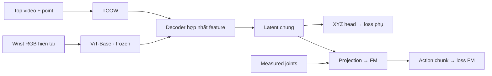

Hai vị trí phục vụ hai mục đích:

- **Trước decoder, trên feature TCOW:** buộc riêng nhánh tracking giữ thông tin vị trí qua shuffle/che khuất. Loss này không trực tiếp huấn luyện decoder hợp nhất.
- **Sau decoder:** buộc latent kết hợp top và wrist giữ thông tin vị trí. Gradient XYZ cập nhật decoder, projection của hai nhánh và TCOW nếu được unfreeze; ViT wrist vẫn frozen.

Vì vậy, **pretrain tracking thì đặt trên TCOW như đang thử; khi train policy thì thử XYZ trên latent sau fusion decoder trước**. Có thể giữ head trước decoder làm probe kiểm tra TCOW còn nhớ vật không, chưa cần cộng hai loss XYZ ngay.

Wrist bổ sung góc nhìn gần đầu kẹp, còn top/TCOW cung cấp lịch sử vật qua shuffle. Đây cũng là hướng kết hợp góc nhìn được nghiên cứu trong [Look Closer](https://arxiv.org/abs/2201.07779); hiệu quả với pipeline mình vẫn cần đo.

Hai điểm thực tế:

- **Code e105 hiện chỉ có projection trước FM**, chưa có fusion decoder như hình; e107 đang chạy chỉ là linear probe.
- Dataset shuffle hiện có **top/left/right, chưa có wrist**. Cần bổ sung ảnh wrist đồng bộ. ViT wrist frozen nên cache feature được; TCOW nếu fine-tune end to end thì phải chạy forward lại.

XYZ vẫn chỉ là **supervision phụ**, không đưa tọa độ dự đoán trực tiếp vào FM.

---

## 0272 · User · 2026-10-17T20:33:38.363Z

ô là kiến trúc E2E chưa có decoder à

---

## 0273 · Assistant · 2026-10-17T20:33:48.852Z

**Đúng, e105 chưa có một Transformer decoder riêng để gom feature thị giác trước FM.** Mình đã nói chưa rõ chỗ này.

Kiến trúc E2E e105 thực tế là:

```text
Top video + point
        ↓
TCOW backbone
        ↓
Attention pooling + MLP → hidden 256
                           ├→ Linear → XYZ aux loss
                           └→ LN + Linear → goal token 960
                                                 ↓
                                    FM + measured joints
                                                 ↓
                                           Action chunk
```

**FM vẫn có các Transformer block để sinh action**; phần chưa có là *visual/fusion decoder* đứng trước FM.

Để phân biệt:

- **e103, ViT + task ID:** có Transformer decoder 2 lớp để đọc visual tokens.
- **e105, TCOW + FM:** dùng attention pooling + MLP thay phần đó.
- **e107 đang chạy:** chỉ frozen TCOW + Linear XYZ, chưa ghép FM.

Decoder hợp nhất top và wrist trong hình trước là **kiến trúc mình đề xuất thêm**, chưa được triển khai.

---

## 0274 · User · 2026-10-17T20:34:22.282Z

m survey xem kiến trúc visuomotor khác có decoder không

---

## 0275 · Assistant — tiến độ · 2026-10-17T20:34:24.903Z

Mình sẽ xem paper và code gốc của các kiến trúc như ACT, Diffusion Policy, Octo, OpenVLA và π₀, rồi phân biệt decoder đọc feature thị giác với phần sinh action để đối chiếu với pipeline hiện tại.

---

## 0276 · Assistant — tiến độ · 2026-10-17T20:35:01.433Z

Điểm chung đang rõ hơn: nhiều model có decoder để sinh action, nhưng không nhất thiết có thêm một decoder gom ảnh trước nó. ACT và Diffusion Policy bản Transformer cho action queries đọc feature quan sát; π₀ và SmolVLA cũng đưa việc đọc feature vào phần sinh action. Mình đang đối chiếu chỗ này với FM của mình.

---

## 0277 · Assistant · 2026-10-17T20:36:50.757Z

**Có nhiều kiến trúc dùng decoder, nhưng thường đó là phần sinh action; không phải một decoder thị giác riêng rồi mới đưa vào policy.** Mình đã đối chiếu paper và code gốc của các model sau:

| Kiến trúc | Xử lý observation | Decoder sinh action |
|---|---|---|
| **[ACT](https://github.com/tonyzhaozh/act/blob/main/detr/models/transformer.py)** | CNN lấy spatial feature từ các camera → Transformer encoder | **Transformer decoder:** action queries cross-attend vào observation memory, rồi dự đoán action chunk |
| **[Diffusion Policy — CNN](https://diffusion-policy.cs.columbia.edu/diffusion_policy_ijrr.pdf)** | Visual encoder tạo feature conditioning | **Conditional 1D U-Net** khử nhiễu action; không dùng Transformer decoder |
| **[Diffusion Policy — Transformer](https://github.com/real-stanford/diffusion_policy/blob/main/diffusion_policy/model/diffusion/transformer_for_diffusion.py)** | Observation embeddings làm memory | **Transformer decoder:** noisy action tokens cross-attend vào memory |
| **[Octo](https://octo-models.github.io/paper.pdf)** | Transformer xử lý task, camera, history và các readout token | Readout đưa sang **diffusion head nhẹ**; không cần Transformer decoder riêng. Code có head dùng residual MLP và mean/attention pooling |
| **[OpenVLA gốc](https://openvla.github.io/)** | DINOv2 + SigLIP → projector → Llama 2 | **Decoder-only LLM** dự đoán action tokens |
| **[π₀ gốc](https://www.physicalintelligence.company/download/pi0.pdf)** | VLM và action expert dùng hai bộ trọng số, trao đổi qua attention | **Flow-matching action expert**, trong Transformer chung với attention mask theo block |
| **[SmolVLA](https://huggingface.co/blog/smolvla)** | VLM xử lý observation prefix | **FM action expert** xen kẽ cross-attention đọc feature VLM và self-attention giữa action tokens |

**Đối chiếu lại thì FM của mình đã đóng vai trò action decoder rồi:** có 16 block, xen kẽ 8 self-attention và 8 cross-attention. [Code hiện tại](/workspace/arm-manipulation/OATFlow/reach/flow.py:126)

Điểm đáng thử nghiệm ở e105 là **TCOW bị gom thành một vector 256 chiều, rồi thành đúng một goal token trước khi FM đọc**. Chưa có bằng chứng rằng cách nén này đủ hay thiếu; cũng chưa có bằng chứng phải bổ sung decoder mới.

Với wrist camera, một phương án đáng thử trước là:

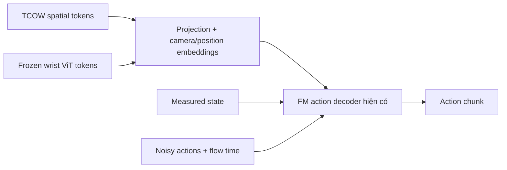

Ở đây **FM tự đọc thông tin từ cả hai camera qua cross-attention**. Phương án đối chiếu là thêm một fusion Transformer trước FM, rồi đo xem có cải thiện không.

Vì vậy mình điều chỉnh đề xuất trước: **chưa nên mặc định thêm fusion decoder.** Nên so sánh giữ spatial tokens cho FM đọc với cách nén hiện tại trước. Attention pooling cũng là lựa chọn hợp lệ—Octo có hỗ trợ—nhưng hiệu quả trên bài toán mình phải được đo.

Mình đã lưu [survey và nguồn chi tiết](/workspace/arm-manipulation/docs/research/visuomotor_decoder_survey.md).

---

## 0278 · User · 2026-10-17T20:38:36.885Z

sao m nén tcow, sao không cho attend đến hết token

---

## 0279 · Assistant · 2026-10-17T20:38:55.916Z

Mình nén để giữ cách condition giống FM lúc train reach: **một goal token + một state token**. Nhưng **đó là lựa chọn đơn giản hóa của mình, không phải giới hạn của FM**. Code cross-attention hiện tại nhận được nhiều context token.

Cho FM attend trực tiếp vào spatial tokens hoàn toàn hợp lý:

```text
TCOW: 300 spatial tokens ─→ projection 768→960 ─┐
Wrist ViT: patch tokens ──→ projection 768→960 ─┼→ FM cross-attention
Measured state: 1 token ──────────────────────┘
```

Thêm camera/position embeddings để phân biệt vị trí và góc nhìn. Cách này giữ thông tin không gian, cho từng action token tự chọn phần observation cần đọc, thay vì bắt mọi action dùng chung một vector đã gom.

**300 token của frame hiện tại đã được TCOW xử lý cùng lịch sử 30 frame.** Có thể bắt đầu bằng toàn bộ 300 token này; đưa cả 9.000 token của 30 frame là một lựa chọn khác, tốn hơn và chưa chắc cần.

TCOW chạy **một lần mỗi observation**; K/V của visual tokens cũng có thể tính một lần rồi dùng lại qua các bước flow. Phần tăng chi phí là cross-attention trong FM.

Mình nên thử cách này trước khi thêm attention pooling. **Lượt e107 đang chạy vẫn giữ toàn bộ spatial feature cho linear probe**, nên không bị bước nén đó.

---

## 0280 · User · 2026-10-17T20:39:33.772Z

e102 có nén không

---

## 0281 · Assistant — tiến độ · 2026-10-17T20:39:39.302Z

Mình sẽ kiểm tra lại config và code e102 để xác nhận nó gom visual tokens ở bước nào.

---

## 0282 · Assistant · 2026-10-17T20:39:50.182Z

**Có, e102 cũng nén**, qua hai bước:

```text
ViT-B/16: 400 patch tokens × 768
              ↓ Average pooling lưới 20×20 → 8×8
          64 tokens × 768
              ↓ Projection
          64 tokens × 256
              ↓ Transformer decoder 2 lớp
                dùng 1 query từ task ID
           1 vector × 256
              ↓ Projection
           1 goal token × 960
              ↓ Ghép 1 state token
                  FM
```

Vậy **decoder thị giác của e102 đọc đủ 64 token, nhưng FM chỉ đọc một goal token đã gom**, cùng state token. E103 giữ kiến trúc này và thêm XYZ auxiliary loss.

Khác với e105 ở cách gom: **e102 dùng target-query Transformer decoder; e105 dùng attention pooling + MLP**. Cả hai đều nén thành một visual goal token trước FM.

Đã xác nhận từ [code snapshot e102](/workspace/robotics_assets/experiments/e102_top/source/model.py:48).

---

## 0283 · User · 2026-10-17T20:40:42.548Z

hmmm, thôi cứ tạm vậy, thế nếu thêm wrist cam thì như nào, có nên nén cùng không

---

## 0284 · Assistant · 2026-10-17T20:41:08.911Z

**Mình chưa nên nén chung top và wrist thành một vector.** Hai nhánh cung cấp thông tin khác nhau: TCOW giữ lịch sử vật qua shuffle, còn wrist cho góc nhìn gần đầu kẹp.

Giữ kiến trúc hiện tại, mình đề xuất:

```text
TCOW → nén như hiện tại → 1 target token ──┐
Wrist → ViT frozen → 64 spatial tokens ───┼→ FM → actions
Measured state → 1 state token ──────────┘
```

Tức là **66 context tokens**, thêm projection về cùng chiều và camera/position embeddings. FM dùng cross-attention hiện có để kết hợp chúng; chưa cần thêm fusion decoder.

Wrist giữ lưới 8×8 thay vì gom thành một token để còn thông tin vị trí tương đối giữa vật và đầu kẹp. Đây là phương án đáng thử, chưa có kết quả chứng minh tốt hơn.

**Nén chung vẫn làm được**, bằng một decoder đọc cả hai nhánh rồi xuất một goal token. Nhưng mình sẽ để đó là thí nghiệm đối chiếu sau; trước mắt giữ TCOW như cũ và bổ sung wrist tokens sẽ dễ đánh giá đóng góp của camera mới hơn.

---

## 0285 · User · 2026-10-17T20:41:59.009Z

ok ,thế thì loss xyz phải ở ngay sau tcow , trước khi nén à

---

## 0286 · Assistant · 2026-10-17T20:42:13.500Z

**Đúng, với mục tiêu giữ khả năng định vị riêng của TCOW thì đặt XYZ head ngay sau TCOW, trước nhánh nén:**

```text
TCOW spatial features [300,768]
         ├→ Flatten + Linear → XYZ → loss phụ
         │
         └→ Nén → 1 target token ──┐
Wrist ViT → 64 spatial tokens ─────┼→ FM → loss action
Measured state → 1 token ─────────┘
```

Như vậy XYZ head có thể dùng đúng kiểu đang thử ở e107, và loss XYZ không phụ thuộc vào thông tin từ wrist.

Hai điểm cần rõ:

- **TCOW được unfreeze:** loss XYZ huấn luyện cả backbone. Nếu TCOW frozen thì chỉ XYZ head học.
- **Nhánh nén không nhận gradient từ loss XYZ** trong sơ đồ này; nó học qua loss FM. Vì vậy XYZ đọc tốt từ spatial features chưa đảm bảo target token sau nén cũng giữ đủ thông tin vị trí.

---

## 0287 · User · 2026-10-17T20:42:46.145Z

ừ nhỉ, loss ở đấy thì sao mà shape latent

---

## 0288 · Assistant · 2026-10-17T20:42:58.682Z

**Đúng. Nếu muốn shape latent đưa vào FM thì XYZ head phải đọc chính latent sau nén.** Mình đã lẫn hai mục tiêu: kiểm tra feature TCOW có chứa tọa độ, và buộc latent điều khiển giữ tọa độ.

Với wrist đi riêng vào FM, sơ đồ hợp lý là:

```text
TCOW → Nén → z_target [256]
                 ├→ XYZ head → loss XYZ
                 └→ Projection → 1 target token ─┐
Wrist ViT → 64 spatial tokens ───────────────────┼→ FM
Measured state ─────────────────────────────────┘
```

Ở đây:

- **Loss XYZ** huấn luyện nhánh nén và TCOW nếu được unfreeze.
- **Loss FM** cũng huấn luyện nhánh đó để phục vụ điều khiển.
- Wrist không tham gia dự đoán XYZ, nên không thể giúp nhánh tracking “né” việc nhớ vị trí vật.

Đây cũng là nguyên tắc đã dùng ở e103: **XYZ là loss phụ trên shared latent trước FM**. Còn e107 hiện tại là linear probe trên feature TCOW, chưa kiểm chứng latent sau nén.

---

## 0289 · User · 2026-10-17T20:43:36.502Z

t muốn freeze tcow cơ

---

## 0290 · Assistant · 2026-10-17T20:43:48.934Z

**Ừ, TCOW frozen vẫn shape được latent — miễn là module nén phía sau nó được train.**

```text
TCOW frozen → cached features → Nén/adapter trainable → z_target
                                                        ├→ XYZ head → loss XYZ
                                                        └→ Projection → FM
Wrist ViT frozen → cached tokens → Projection ────────────────→ FM
```

Loss XYZ cập nhật **module nén + XYZ head**, buộc `z_target` giữ thông tin tọa độ. Loss FM cũng cập nhật module nén để latent hữu ích cho điều khiển. **Trọng số TCOW giữ nguyên.**

Vậy cấu hình mình đang thống nhất là:

- **Frozen:** TCOW và ViT wrist; cả hai có thể cache feature trước.
- **Trainable:** module nén, các projection, XYZ head và FM khởi tạo từ checkpoint reach.

Chỉ khi cả **TCOW lẫn module nén đều frozen** thì loss XYZ mới không shape được `z_target`, mà chỉ học cách đọc nó.

---

## 0291 · User · 2026-10-17T20:45:28.855Z

thế này đi, m xem oatflow có 1 cái decoder, t nghĩ là decoder nhận tcow hidden, wrist token ,state token rồi tạo ra context, ừ context đó thêm head phụ xyz và cho FM ATTEND, OK KHÔNG

---

## 0292 · Assistant — tiến độ · 2026-10-17T20:45:32.616Z

Mình sẽ xem `ContextDecoder` có sẵn trong OATFlow và cách nó tạo context cho FM, rồi đối chiếu với sơ đồ bạn đề xuất.

---

## 0293 · Assistant — tiến độ · 2026-10-17T20:46:35.379Z

OK, cách này khớp với `ContextDecoder` có sẵn: nó có 4 block attention, nhận token 960 chiều và giữ nguyên số token. Nếu đưa 300 spatial token TCOW, 64 wrist token và 1 state token vào thì đúng 365 token mặc định. XYZ head đọc context sau decoder sẽ huấn luyện decoder, trong khi TCOW và ViT vẫn frozen.

---

## 0294 · Assistant · 2026-10-17T20:47:07.956Z

**OK, kiến trúc này triển khai được bằng `ContextDecoder` có sẵn của OATFlow.** Nó có 4 block attention, chiều 960 và giữ nguyên số token. [Code](/workspace/arm-manipulation/OATFlow/policy/model.py:143)

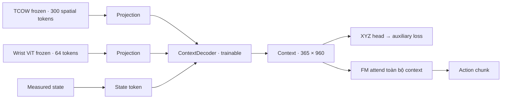

**Loss XYZ sẽ shape đúng context mà FM đọc**, vì gradient cập nhật decoder và các projection, dù TCOW và ViT frozen. XYZ head có thể đơn giản là `Flatten + Linear → 3`; FM vẫn nhận đủ 365 token, không phải vector đã flatten.

Hai chi tiết khi ghép:

- Dùng **spatial features trước pooling của TCOW**; hàm `PointXYZ.hidden()` hiện đã nén xuống 256 chiều.
- Tái sử dụng **ContextDecoder**, giữ FM đã train reach và action EE-delta hiện tại. Không lấy nguyên policy ở nhánh khác vì nó dùng absolute-joint actions.

Cả TCOW và wrist ViT đều frozen nên cache feature được; chỉ train projection, decoder, XYZ head và FM.

Bộ 1 e107 cũng đã xong: phần train head 30 epoch mất **7,5 giây** sau cache; validation macro XYZ **71,6 mm**, còn kém qua shuffle. Đó là kết quả linear probe, chưa phải kiến trúc trên.

---

## 0295 · User · 2026-10-17T20:49:28.251Z

ok đầu tiền là sửa kiến trúc, thứ 2 là thử luôn kiến trúc đó (tạm lấy cam khác cho vào input của wrist) và train context decoder để nó dự đoạn xyz xem chuẩn không

---

## 0296 · Assistant — tiến độ · 2026-10-17T20:49:31.874Z

Mình sẽ ghép kiến trúc mới: TCOW và ViT frozen → `ContextDecoder` → context dùng chung cho XYZ head và FM. Trước mắt mình dùng cam `left` làm đầu vào thay wrist, cache feature rồi chỉ train projection, context decoder và XYZ head để đo độ chính xác định vị; FM sẽ được ghép sẵn nhưng chưa train ở lượt này.

---

## 0297 · Assistant — tiến độ · 2026-10-17T20:51:39.963Z

Cache TCOW của e107 dùng lại được nguyên vẹn, nên không phải chạy lại bước mất 16 phút. Mình sẽ dùng đúng phần dữ liệu số 1 và validation cũ, chỉ bổ sung feature cam `left` cùng joint state đúng frame. XYZ head sẽ đọc context sau decoder; mình cũng sẽ kiểm tra đổi point prompt có làm dự đoán đổi đúng vật không.

---

## 0298 · Assistant — tiến độ · 2026-10-17T20:56:21.842Z

Phần kiến trúc đã ghép xong: context giữ đủ 365 token cho FM đọc, XYZ head nằm trên chính context đó, và gradient checkpointing đã tắt. Lượt XYZ sẽ giữ FM, TCOW và ViT nguyên trọng số. Mình đang kiểm tra gradient và VRAM trước khi chạy train chính.

---

## 0299 · Assistant — tiến độ · 2026-10-17T20:59:49.038Z

Preflight đã qua: XYZ loss truyền gradient tới toàn bộ decoder/projection, còn TCOW, ViT và FM giữ nguyên trọng số. FM cũng đọc được đủ 365 context token qua 8 bộ K/V. Batch 128 vừa VRAM, peak khoảng 17,3 GiB; mình sẽ chạy 30 epoch, ước khoảng 18 phút, rồi test XYZ trên hoán vị và layout chưa thấy.

---

## 0300 · Assistant — tiến độ · 2026-10-17T21:02:45.958Z

Đã qua 3 epoch, khoảng 36 giây/epoch. Validation macro XYZ giảm từ khoảng 120 mm xuống 68 mm; lỗi ở đoạn shuffle vẫn khoảng 120 mm, nên hiện chưa thể coi tracking là chính xác. Mình sẽ chạy đủ 30 epoch rồi đo trên tập chưa thấy và kiểm tra đổi prompt.

---

## 0301 · Assistant — tiến độ · 2026-10-17T21:05:09.935Z

Sau 7 epoch, validation macro còn khoảng 51 mm. Pha vật lộ rõ xuống khoảng 22 mm, nâng vật khoảng 15 mm; hai pha shuffle/post-shuffle vẫn gần 100 mm. Decoder đang cải thiện, nhưng khả năng nhớ đúng vật qua che khuất vẫn là điểm cần xem tiếp.

---

## 0302 · Assistant — tiến độ · 2026-10-17T21:06:33.155Z

Validation đang dao động quanh 49–50 mm ở epoch 8–9. Đoạn vật lộ rõ và nâng vật đã tốt hơn nhiều, còn shuffle vẫn là phần khó nhất. Mình đang giữ checkpoint tốt nhất theo validation, thay vì mặc định dùng epoch cuối.

---

## 0303 · Assistant — tiến độ · 2026-10-17T21:07:31.471Z

Đã xong 12/30 epoch. Validation chưa vượt checkpoint tốt nhất ở epoch 8; mình giữ nguyên cấu hình để hoàn tất lượt thử, rồi dùng checkpoint đó kiểm tra tập chưa thấy và khả năng phân biệt 4 point prompt.

---

## 0304 · Assistant — tiến độ · 2026-10-17T21:08:34.480Z

Epoch 13 có best mới: validation macro khoảng 45 mm, pha nâng vật khoảng 11 mm. Tuy nhiên post-shuffle vẫn khoảng 100 mm, nên mình vẫn chờ kiểm tra đổi prompt và tập held-out trước khi đánh giá độ chuẩn.

---

## 0305 · Assistant — tiến độ · 2026-10-17T21:10:06.442Z

Đã qua nửa lượt train. Median lỗi validation còn khoảng 19 mm, nhưng trung bình theo pha vẫn khoảng 45 mm do post-shuffle còn sai khoảng 100 mm. Mình sẽ báo riêng từng pha để các đoạn dễ không che mất lỗi tracking này.

---

## 0306 · Assistant — tiến độ · 2026-10-17T21:11:42.198Z

Epoch 17 có best mới, macro khoảng 44 mm. Lỗi nâng vật đã quanh 10 mm, còn post-shuffle vẫn lớn. Mình đã chuẩn bị thêm kiểm tra prediction từ ảnh gốc so với prediction từ cache để loại trừ lỗi lệch đầu vào khi test.

---

## 0307 · Assistant — tiến độ · 2026-10-17T21:13:07.243Z

Đã xong 20/30 epoch, best validation macro hiện khoảng 43 mm. Loss train vẫn giảm nhưng post-shuffle gần như chưa cải thiện; kết quả cuối sẽ cần phân biệt rõ độ khớp train với khả năng theo đúng vật ở cảnh mới.

---

## 0308 · Assistant — tiến độ · 2026-10-17T21:14:16.162Z

Epoch 22 đạt macro khoảng 41 mm, median khoảng 16 mm; 32% điểm validation nằm trong 10 mm. Mình sẽ dùng checkpoint tốt nhất sau đủ 30 epoch để chạy một lượt test riêng trên hoán vị mới, layout mới và cả hai cùng mới.

---

## 0309 · Assistant — tiến độ · 2026-10-17T21:16:00.092Z

Còn 5 epoch nữa. Checkpoint tốt nhất hiện ở epoch 23; mình sẽ dùng nó nếu các epoch sau không cải thiện validation. Sau train, lượt test sẽ chạy từ ảnh gốc và measured state để kiểm tra cả đường inference mới.

---

## 0310 · Assistant — tiến độ · 2026-10-17T21:17:18.556Z

Epoch 27 đạt best mới, macro khoảng 39,5 mm. Shuffle đã giảm còn khoảng 56 mm, nhưng post-shuffle vẫn gần 99 mm. Còn vài epoch cuối, sau đó mình sẽ có số test và kết quả đổi prompt để kết luận rõ hơn.

---

## 0311 · Assistant — tiến độ · 2026-10-17T21:19:08.436Z

Train đã xong 30 epoch, best ở epoch 27. Checkpoint này đạt lỗi train trung bình 3,85 mm nhưng validation 41,6 mm; probe chọn đúng vật sau shuffle chỉ khoảng 28%, gần mức ngẫu nhiên 25%.

Đường ảnh gốc và cache cho prediction lệch tối đa 0,22 mm, nên lỗi hiện tại không phải do lệch cache. Lượt test 96 episode chưa thấy đang chạy nốt.

---

## 0312 · Assistant — tiến độ · 2026-10-17T21:20:30.308Z

Test đã xong: trên 96 episode chưa thấy, lỗi XYZ trung bình 53,7 mm, median 19,0 mm; 31,9% điểm nằm trong 10 mm. Khi nâng vật lỗi khoảng 8,5 mm, nhưng trong/sau shuffle vẫn gần 100 mm.

Đổi prompt làm prediction thay đổi rõ, song thường chưa khớp đúng vật mục tiêu. Mình đang ghi báo cáo và hình GT–prediction; kết luận hiện tại là decoder khớp train tốt nhưng chưa generalize tracking qua shuffle.

---

## 0313 · User · 2026-10-17T21:21:08.828Z

cho t xem video

---

## 0314 · Assistant — tiến độ · 2026-10-17T21:21:14.103Z

Mình sẽ xuất video tracking GT và prediction từ checkpoint tốt nhất e108, có cả cảnh validation và cảnh chưa thấy. Video dùng top view cùng cam `left` thay wrist, hiển thị rõ điểm chấm ban đầu, tâm vật thật và tâm dự đoán.

---

## 0315 · Assistant — tiến độ · 2026-10-17T21:23:07.221Z

Mình sẽ xuất ba clip: train, validation và test mới cả thứ tự lẫn vị trí. Mỗi clip có tâm GT màu xanh, dự đoán màu hồng và cam phụ bên cạnh để nhìn rõ mô hình lệch ở đoạn nào.


---

## 0316 · Assistant — tiến độ · 2026-10-17T21:25:16.134Z

Clip train và validation đã xong, đang xuất clip test. Video có top view, cam phụ, điểm chấm ban đầu và lỗi XYZ theo từng thời điểm; chuyển động tay là demo ghi sẵn, còn tâm dự đoán được tính mới từ checkpoint e108.


---

## 0317 · Assistant · 2026-10-17T21:26:01.747Z

[▶ Video tổng hợp train → validation → test (71 giây)](/workspace/robotics_assets/experiments/e108_context/videos/comparison.mp4)

Xem riêng: [Train](/workspace/robotics_assets/experiments/e108_context/videos/train.mp4) · [Validation](/workspace/robotics_assets/experiments/e108_context/videos/validation.mp4) · [Test mới cả layout và thứ tự](/workspace/robotics_assets/experiments/e108_context/videos/test_unseen.mp4).

**Xanh = tâm GT, hồng = prediction, cam = điểm chấm ban đầu.** Dùng best e108, epoch 27 / step 2457. Có thể thấy prediction lệch rõ khi vật bị che sau shuffle.

Đây là video tracking trên demo ghi sẵn; FM chưa điều khiển robot.

---

## 0318 · User · 2026-10-17T21:29:00.078Z

thấy ọk đấy, train y hệt, nối thêm FM reach vào, stride 10 cho decoder và projection, stride như cũ khi train FM. không cần cache nếu quá lớn

---

## 0319 · Assistant — tiến độ · 2026-10-17T21:29:04.424Z

Mình sẽ nối FM từ checkpoint reach vào decoder hiện tại: train decoder/projection ở stride 10, và train thêm FM ở đoạn có expert action với stride 3 như trước. Mình sẽ kiểm tra cách chia batch và VRAM rồi chạy thử trước khi mở lượt train chính.


---

## 0320 · User · 2026-10-17T21:29:12.894Z

à train full data

---

## 0321 · Assistant — tiến độ · 2026-10-17T21:29:16.689Z

Ừ, mình sẽ dùng toàn bộ 2.048 episode train, không chia part nữa. Giữ TCOW và ViT frozen, khởi tạo decoder/projection từ best e108 và FM từ checkpoint reach; vẫn dùng cam `left` thay wrist như lượt vừa rồi.


---

## 0322 · Assistant — câu hỏi · 2026-10-17T21:29:35.033Z

Ở đoạn expert stride 3, loss FM có cập nhật luôn decoder/projection không? Mình đang hiểu giống lịch cũ: đoạn shuffle stride 10 chỉ train XYZ, đến expert stride 3 thì train chung decoder/projection + FM với loss FM + XYZ.

- Đúng, expert stride 3 train chung như cũ
- Decoder/projection chỉ update stride 10; FM update stride 3

---

## 0323 · User · 2026-10-17T21:30:06.724Z

<send_user_message_question_reply>
[{"answer":"Đúng, expert stride 3 train chung như cũ","question":"Ở đoạn expert stride 3, loss FM có cập nhật luôn decoder/projection không? Mình đang hiểu giống lịch cũ: đoạn shuffle stride 10 chỉ train XYZ, đến expert stride 3 thì train chung decoder/projection + FM với loss FM + XYZ.","questionItemId":"[\"request_user_input_async\",\"call_cf1a84b235ea4715ad51481371318b53\",0]"}]
</send_user_message_question_reply>

---

## 0324 · Assistant — tiến độ · 2026-10-17T21:31:10.456Z

Chốt lịch đó nhé: shuffle stride 10 train XYZ; expert stride 3 train chung decoder/projection và FM với `loss FM + loss XYZ`.

Full data có khoảng 296 nghìn clip mỗi epoch. Cache toàn bộ top token sẽ hơn 127 GiB, vượt giới hạn RAM container, nên mình sẽ chỉ giữ feature của từng nhóm cảnh trong GPU rồi giải phóng. Mình đang đo tốc độ để báo ETA thực tế.


---

## 0325 · Assistant — tiến độ · 2026-10-17T21:35:11.332Z

Lịch full data đã được cài xong. Ở batch shuffle, mình khóa cả state encoder thuộc FM để loss XYZ chỉ cập nhật decoder/projection/head; ở batch expert thì mở FM để train chung. Batch 64 đang được kiểm tra VRAM và gradient, log vẫn ở `ssh_tmux:1`.


---

## 0326 · Assistant — tiến độ · 2026-10-17T21:36:50.513Z

Preflight đã qua: gradient từ loss FM đi tới decoder/projection, TCOW/ViT không đổi, và FM không bị update ở batch shuffle kể cả khi optimizer đã có momentum. Batch 64 dùng đỉnh 11,4 GiB; mình đang thử batch 128 để tận dụng VRAM hơn.

Đo sơ bộ thì full data sẽ khoảng **8 giờ/epoch**, phần lớn thời gian là chạy TCOW frozen. Budget 30 epoch như e108 sẽ vào khoảng **10 ngày** nếu không giữ cache toàn bộ.


---

## 0327 · Assistant — tiến độ · 2026-10-17T21:38:57.482Z

Batch 128 đã qua preflight, đỉnh **19,8 GiB VRAM**. Mình đã khởi chạy lượt chính `e109_joint` trên toàn bộ data: 30 epoch, **2.752 updates/epoch**. Log ghi riêng loss FM, loss XYZ và lỗi tâm vật; mình đang kiểm tra nhóm cảnh đầu tiên chạy ổn rồi sẽ để nó tiếp tục.


---

## 0328 · Assistant — tiến độ · 2026-10-17T21:40:05.732Z

Action labels đã khớp từng giá trị với pipeline cũ, gồm cả mask cuối chunk. Lượt chính đã xác nhận dùng đủ 2.048 episode; đang xử lý nhóm cảnh đầu tiên, sau đó sẽ lưu checkpoint để có thể resume.


---

## 0329 · Assistant · 2026-10-17T21:40:59.767Z

Đã chạy **e109_joint trên đủ 2.048 episode**, nhóm đầu đã train xong và lưu checkpoint.

- Shuffle stride **10**: train decoder/projection + XYZ.
- Expert stride **3**: train chung với FM reach, loss `FM + XYZ`.
- TCOW/ViT frozen; batch **128**, đỉnh **19,8 GiB VRAM**.
- Budget **30 epoch**; dự kiến **7–8 giờ/epoch**, khoảng **9–10 ngày** vì phải chạy lại TCOW mỗi epoch.

Log đang ở **`ssh_tmux:1`**. [Cấu hình và trạng thái](/workspace/robotics_assets/experiments/e109_joint/train/README.md).

---

## 0330 · User · 2026-10-18T04:43:55.491Z

xong 1 epoch chua, co ckpt chua

---

## 0331 · Assistant — tiến độ · 2026-10-18T04:43:59.943Z

Mình kiểm tra tiến độ và checkpoint mới nhất của e109 nhé.


---

## 0332 · Assistant · 2026-10-18T04:44:17.129Z

**Chưa hết epoch 1, đã xong khoảng 98%** — 502/512 nhóm cảnh, còn khoảng **8 phút**. Train vẫn chạy bình thường.

Đã có checkpoint:

- [best.pt](/workspace/robotics_assets/experiments/e109_joint/train/best.pt): **step 2635**, validation FM loss **0,0263**.
- [latest.pt](/workspace/robotics_assets/experiments/e109_joint/train/latest.pt): **step 2688**, có optimizer/RNG để resume.

Chưa test rollout gắp vật.

---

## 0333 · User · 2026-10-18T04:53:57.226Z

xong, ket qua val nhu nai

---

## 0334 · Assistant — tiến độ · 2026-10-18T04:54:00.842Z

Mình kiểm tra validation ở cuối epoch 1 và checkpoint tốt nhất nhé.


---

## 0335 · Assistant · 2026-10-18T04:54:09.743Z

**Xong epoch 1**, hiện đang train epoch 2. Best theo val FM là **step 2752**, đúng cuối epoch 1.

| Validation | Trước train | Hết epoch 1 |
|---|---:|---:|
| FM loss ↓ | 2,6512 | **0,0251** |
| XYZ mean ↓ | 42,5 mm | **53,4 mm** |
| XYZ median ↓ | 16,6 mm | **33,9 mm** |
| Tỷ lệ trong 10 mm ↑ | 30,4% | **12,0%** |

Lỗi XYZ cuối epoch: shuffle **88,5 mm**, sau shuffle **90,5 mm**, khi nâng vật **16,5 mm**.

**FM loss giảm mạnh, nhưng định vị XYZ đang kém hơn lúc khởi tạo.** Chưa có rollout nên chưa kết luận gắp tốt. [Best checkpoint](/workspace/robotics_assets/experiments/e109_joint/train/best.pt).

---

## 0336 · User · 2026-10-18T04:54:52.765Z

rollout thu xem, tao video nua

---

## 0337 · Assistant — tiến độ · 2026-10-18T04:54:55.943Z

Mình sẽ rollout best checkpoint e109 với K10, cho policy tự mở cover rồi gắp/nâng vật, và xuất video. Mình giữ lượt train đang chạy, kiểm tra VRAM để chạy test song song nếu đủ.


---

## 0338 · Assistant — tiến độ · 2026-10-18T04:56:07.209Z

VRAM hiện không đủ để chạy song song an toàn. Mình sẽ tạm dừng train ở checkpoint đã lưu, test K10 trên **16 ca gồm train, thứ tự mới, vị trí mới và cả hai mới**, rồi tự resume train. Mỗi nhóm có đủ bốn vật mục tiêu; video sẽ có cả top view và cam `left`.


---

## 0339 · Assistant — tiến độ · 2026-10-18T04:57:49.918Z

Mã rollout đã nhận đúng hai camera và dùng cùng controller IK với lượt trước. Mình đang đợi checkpoint kế tiếp để giảm phần train phải chạy lại; test sẽ bắt đầu từ sau shuffle, toàn bộ bước mở cover và gắp vật do FM điều khiển.


---

## 0340 · Assistant — tiến độ · 2026-10-18T04:59:50.329Z

Đã kiểm tra trạng thái robot lúc bắt đầu rollout: khớp với dữ liệu ở cả bốn nhóm, và lịch sử ảnh chỉ chứa phần trước khi policy điều khiển. Train đang ở nhóm 10 của epoch 2; lưu xong checkpoint này là mình chuyển GPU sang test.


---

## 0341 · Assistant — tiến độ · 2026-10-18T05:02:20.283Z

Rollout đang dùng best **step 2752**. Bốn ca train đã mô phỏng xong, đang xuất video; tiếp theo là các ca chưa thấy. Checkpoint resume đã được giữ ở **step 2805**, không mất update train nào.


---

## 0342 · Assistant — tiến độ · 2026-10-18T05:03:20.174Z

Bốn ca train đầu tiên đều timeout, chưa đặt được cover ra khỏi vùng gắp nên chưa gắp được vật. [Video ca train đầu tiên](/workspace/robotics_assets/experiments/e109_joint/test_k10/g000_p00_t0.mp4) đã xem được; mình đang chạy các nhóm chưa thấy để hoàn tất 16 ca.


---

## 0343 · Assistant — tiến độ · 2026-10-18T05:05:17.476Z

Đã xong **8/16 ca, hiện 0 thành công**; các ca đều timeout ở bước xử lý cover. Mình tiếp tục hai nhóm còn lại và ghép video bốn nhóm để xem cạnh nhau.


---

## 0344 · Assistant — tiến độ · 2026-10-18T05:07:21.063Z

Đã xong **12/16 ca, vẫn chưa có ca thành công**. Đang chạy nhóm mới cả vị trí lẫn thứ tự; video đã có top/left view và tâm GT–prediction để thấy robot lệch ở bước nào.


---

## 0345 · Assistant — tiến độ · 2026-10-18T05:09:04.627Z

Test đã xong: **0/16 thành công, cả 16 đều timeout**, chưa hoàn tất bước mở/đặt cover. Video tổng hợp đã xuất và kiểm tra đủ frame. Mình đang xác nhận train đã resume đúng checkpoint trước khi gửi kết quả.


---

## 0346 · Assistant — tiến độ · 2026-10-18T05:09:52.271Z

Mình sửa lại phần cover: **2/16 ca đã mở và đặt được cover**, nhưng chưa ca nào gắp/nâng vật thành công. Train đã resume đúng **epoch 2, nhóm 11, step 2805**; mình đang ghi kết quả và link video vào báo cáo.


---

## 0347 · Assistant · 2026-10-18T05:10:21.463Z

[▶ Video tổng hợp 4 nhóm](/workspace/robotics_assets/experiments/e109_joint/test_k10/comparison.mp4)

Xem riêng: [Train](/workspace/robotics_assets/experiments/e109_joint/test_k10/g000_p00_t0.mp4) · [Mới cả vị trí và thứ tự](/workspace/robotics_assets/experiments/e109_joint/test_k10/g036_p01_t0.mp4).

Best **step 2752**, H25/K10: **0/16 ca thành công**, tất cả timeout. **2 ca đặt được cover**, nhưng chưa ca nào gắp/nâng vật đạt tiêu chí.

Video có top/left view và tâm GT–prediction. Train đã **resume epoch 2** trong `ssh_tmux:1`.

---

## 0348 · User · 2026-10-18T05:18:18.268Z

train them chac chan thanh cong thoi, nhung ma lau phet, train tcow stride 1 (i mean freeze tcow, train decoder vs projection) train 20% bo du lieu thi mat bao lau va cache bao nhieu ram (gia su train 10 epoch)

---

## 0349 · Assistant — tiến độ · 2026-10-18T05:18:26.143Z

Mình sẽ tính riêng cho TCOW/ViT frozen, chỉ train decoder/projection và head XYZ: lấy 20% dữ liệu, stride 1, chạy 10 epoch. Mình kiểm tra số frame và tốc độ đã đo để ước lượng cả thời gian lẫn RAM cache.


---

## 0350 · Assistant · 2026-10-18T05:19:45.333Z

Nếu lấy **part1 cũ ≈20%: 412 episode**, gồm cả shuffle + expert, stride 1 sẽ có **259.573 mẫu**. TCOW/ViT/FM frozen, chỉ train decoder/projection + head XYZ.

| Cache FP16 | RAM |
|---|---:|
| TCOW: 300×768 token/mẫu | **111,4 GiB** |
| ViT cam phụ | **15,7 GiB** nếu loại phần trùng |
| Tổng feature | **≈127 GiB**, hoặc **135 GiB** theo format cache hiện tại |

Với **batch 128, 10 epoch = 20.280 updates**, ước lượng từ tốc độ đã đo:

- **Cache một lần:** khoảng **6 giờ**; train thêm **2–3 giờ** → tổng **8–10 giờ**.
- **Không giữ cache giữa các epoch:** phải chạy lại TCOW mỗi lượt → khoảng **60–70 giờ** cho 10 epoch.

Container hiện giới hạn **120,7 GiB RAM**, nên **không đủ cache toàn bộ FP16** này, kể cả chưa tính bộ nhớ chạy chương trình. Các con số trên là ngoại suy, chưa benchmark trực tiếp stride 1.

---

## 0351 · User · 2026-10-18T05:22:14.932Z

vl =)), dien that, 5% bo du lieu stride 1 thi sao

---

## 0352 · Assistant — tiến độ · 2026-10-18T05:22:18.961Z

Mình tính lại với 5% số cảnh, vẫn giữ đủ bốn vật mục tiêu trong mỗi cảnh, stride 1 và 10 epoch nhé.


---

## 0353 · Assistant · 2026-10-18T05:22:31.301Z

**5% thì vừa RAM rồi =))**

Lấy **26 cảnh × 4 vật = 104 episode**, stride 1 có khoảng **65.584 mẫu**:

- **Cache:** khoảng **32–34 GiB RAM**; nên chừa tổng **40–45 GiB** cho chương trình.
- **Tạo cache một lần:** khoảng **1,4–1,7 giờ**.
- **Train 10 epoch**, batch 128: **5.130 updates**, khoảng **35–45 phút**.
- **Tổng:** khoảng **2–2,5 giờ**, khi dùng GPU riêng.

Vẫn tính cả shuffle + expert, chỉ train decoder/projection + XYZ; TCOW, ViT và FM frozen. Đây là ước lượng từ tốc độ hiện tại.

---

## 0354 · User · 2026-10-18T05:23:15.155Z

djt =)), t nen tim kien truc tracking khac khong, m survey thu xem

---

## 0355 · Assistant — tiến độ · 2026-10-18T05:23:19.547Z

Mình sẽ survey các kiến trúc tracking dùng được với một điểm chấm ban đầu và phải nhớ vật qua đoạn bị che/shuffle. Mình sẽ đối chiếu tốc độ, cách xử lý lịch sử ảnh và khả năng đưa feature sang decoder/FM với pipeline hiện tại.


---

## 0356 · Assistant — tiến độ · 2026-10-18T05:24:13.806Z

Có một điểm đáng chú ý: bản hiện tại chạy lại cả clip 30 frame cho mỗi mẫu, nên tốn nhiều tính toán lặp dù TCOW đã freeze. Các tracker có memory cập nhật từng frame đáng khảo sát hơn. Nhưng cần kiểm tra riêng khả năng theo vật nằm dưới cover — tracker giỏi tìm lại vật khi nó xuất hiện chưa chắc định vị được vật suốt lúc bị che.


---

## 0357 · Assistant — tiến độ · 2026-10-18T05:25:20.435Z

Có một kết quả rất sát bài của mình: demo chính thức **TAPNext++ cũng không theo đúng quả bóng khi nó ở dưới cốc**, mà chỉ tìm lại được sau khi mở cốc. Vì vậy mình nghiêng về **Track-On2/Track-On-R để thử tốc độ và feature**, còn TAPNext++ là baseline đối chiếu; chưa có cơ sở nói đổi sang tracker nào là giải được shuffle.


---

## 0358 · Assistant — tiến độ · 2026-10-18T05:27:05.712Z

Mình chốt hai hướng đáng thử nhất: **Track-On2 bản DINOv2** và **TAPNext++**. Track-On2 có sẵn query embedding theo vật, khá thuận để nối sang context decoder của mình.

RAM cache còn phụ thuộc thứ mình giữ lại: nếu vẫn cache toàn bộ spatial token thì đổi tracker chưa chắc giảm nhiều. Dùng query token của tracker sẽ nhẹ hơn, nhưng đó là thay đổi representation cần ablation riêng.


---

## 0359 · Assistant · 2026-10-18T05:28:40.987Z

**Có, đáng thử tracker có memory cập nhật từng frame. Mình ưu tiên Track-On2 bản DINOv2.** Pipeline hiện tại chạy lại cả prefix 30 frame cho mỗi mẫu nên rất tốn, dù TCOW frozen.

| Kiến trúc | Điểm đáng dùng | Hạn chế với bài của mình |
|---|---|---|
| **[Track-On2 / Track-On-R](https://github.com/gorkaydemir/track_on)** | Chạy từng frame, có memory và query embedding theo vật; thuận nối sang decoder/FM | Chưa chứng minh theo được vật dưới cover của mình |
| **[TAPNext++](https://tap-next-plus-plus.github.io/)** | Recurrent transformer, nhớ dài, tìm lại vật sau occlusion | **Demo chính thức cũng thất bại khi bóng nằm dưới cốc**, chỉ tìm lại sau khi mở |
| **[Online BootsTAPIR](https://github.com/google-deepmind/tapnet)** | Causal, có PyTorch và dự đoán visibility/uncertainty | Cần test riêng đoạn bị che hoàn toàn |
| **[CoTracker3 online](https://github.com/facebookresearch/co-tracker)** | Theo nhiều điểm đồng thời, baseline tốt | Xử lý theo cửa sổ; phải kiểm soát latency và tránh dùng frame tương lai |
| **[SAM2/3](https://github.com/facebookresearch/sam3)** | Hợp để theo mask vật/cover đang thấy | Mask không trực tiếp cho vị trí vật nằm bên dưới |

**RAM còn phụ thuộc representation.** Track-On2 có query feature **256D**: cache một token/mẫu cho bộ 5% chỉ khoảng **32 MiB**, so với **28 GiB** spatial token TCOW. Đây chỉ là cache tracking; cam phụ vẫn khoảng **4–6 GiB**. Đổi lại, FM nhận ít thông tin toàn cảnh hơn — cần ablation, không thể mặc định chất lượng tương đương.

Mình đề xuất **test pretrained Track-On2 và TAPNext++ trên video shuffle trước**, đo đúng khả năng xác định vật **trước khi mở cover**, rồi mới train head/decoder. Chưa nên tốn thêm nhiều giờ chỉ dựa trên FPS công bố.

Đã lưu [survey chi tiết, sơ đồ và nguồn](/workspace/arm-manipulation/docs/research/tracking_architecture_survey.md). E109 vẫn đang train.

---

## 0360 · User · 2026-10-18T05:34:29.329Z

ok, thử track on latest đi, tải ckpt pretraied về train trên data của mình (đầu tiên trên decoder, projection trước)

---

## 0361 · Assistant — tiến độ · 2026-10-18T05:34:32.821Z

Mình sẽ dùng bản Track-On mới nhất, tải checkpoint pretrained và kiểm tra cách lấy query feature để nối sang pipeline của mình. Lượt đầu sẽ freeze tracker, chỉ train projection + context decoder + head XYZ trên dữ liệu shuffle.


---

## 0362 · Assistant — câu hỏi · 2026-10-18T05:34:34.315Z

Mình hiểu lượt thử Track-On này dùng cấu hình vừa bàn: 5% dữ liệu (104 episode, đủ bốn mục tiêu/cảnh), stride 1, train 10 epoch. Đúng chứ?

- Đúng, 5% / stride 1 / 10 epoch
- Dùng full data

---

## 0363 · User · 2026-10-18T05:34:52.367Z

<send_user_message_question_reply>
[{"answer":"Dùng full data","question":"Mình hiểu lượt thử Track-On này dùng cấu hình vừa bàn: 5% dữ liệu (104 episode, đủ bốn mục tiêu/cảnh), stride 1, train 10 epoch. Đúng chứ?","questionItemId":"[\"request_user_input_async\",\"call_eea9f8a3f0bd418ea5434a7e5003552f\",0]"}]
</send_user_message_question_reply>

---

## 0364 · Assistant — tiến độ · 2026-10-18T05:35:07.823Z

Ừ, dùng **full data**, stride 1, 10 epoch. Mình sẽ cache query feature của tracker frozen để các epoch sau chỉ chạy projection/decoder/head XYZ; phần cam phụ vẫn giữ như pipeline trước.


---

## 0365 · Assistant — tiến độ · 2026-10-18T05:35:45.427Z

Bản mới nhất là **Track-On-R**, dùng backbone DINOv3. Checkpoint tracker được công khai, nhưng weight DINOv3 cần quyền truy cập riêng; máy hiện chưa có HF credential và tải từ nguồn chính thức trả về 401. Mình vẫn tiếp tục tải checkpoint Track-On-R và chuẩn bị phần tích hợp. [Nguồn chính thức](https://github.com/gorkaydemir/track_on).


---

## 0366 · Assistant — câu hỏi · 2026-10-18T05:35:46.733Z

Track-On-R mới nhất cần weight DINOv3 có quyền truy cập. Bạn muốn cấu hình HF credential trên máy/đưa đường dẫn weight DINOv3 đã tải, hay dùng Track-On2 bản DINOv2 công khai? Không cần gửi token vào chat.

- Giữ latest; tôi cấp quyền/đường dẫn DINOv3
- Dùng Track-On2 DINOv2 công khai

---

## 0367 · User · 2026-10-18T05:36:03.878Z

<send_user_message_question_reply>
[{"answer":"Giữ latest; tôi cấp quyền/đường dẫn DINOv3","question":"Track-On-R mới nhất cần weight DINOv3 có quyền truy cập. Bạn muốn cấu hình HF credential trên máy/đưa đường dẫn weight DINOv3 đã tải, hay dùng Track-On2 bản DINOv2 công khai? Không cần gửi token vào chat.","questionItemId":"[\"request_user_input_async\",\"call_1fca24b042b64768b05ad49385fffd23\",0]"}]
</send_user_message_question_reply>

---

## 0368 · Assistant — câu hỏi · 2026-10-18T05:36:10.470Z

Bạn cho mình đường dẫn thư mục/weight DINOv3 đã tải, hoặc báo khi đã cấu hình HF credential có quyền truy cập trên máy nhé. Mình tiếp tục dựng môi trường và pipeline full-data trong lúc chờ.

---

## 0369 · Assistant — tiến độ · 2026-10-18T05:38:20.967Z

Mình giữ Track-On-R mới nhất. Trong lúc chờ đường dẫn/quyền DINOv3, mình chuẩn bị checkpoint tracker và pipeline full data; lượt đầu vẫn freeze tracker, chỉ train projection, context decoder và head XYZ.


---

## 0370 · Assistant — tiến độ · 2026-10-18T05:39:18.347Z

Checkpoint Track-On-R công khai đã tải xong; mình đang build CUDA operator mà bản này cần. Với full data stride 1, feature query khá nhỏ nhưng feature camera phụ khoảng 78 GiB. Mình sẽ dùng lại feature của các frame chung giữa bốn target để tránh nhân bản cache, rồi đo tốc độ thực tế trước khi chạy dài.


---

## 0371 · User · 2026-10-18T05:39:30.562Z

<send_user_message_question_reply>
[{"answer":"xong","question":"Bạn cho mình đường dẫn thư mục/weight DINOv3 đã tải, hoặc báo khi đã cấu hình HF credential có quyền truy cập trên máy nhé. Mình tiếp tục dựng môi trường và pipeline full-data trong lúc chờ.","questionItemId":"[\"request_user_input_async\",\"call_401f7179aa8c454282242fe53ca983e0\",0]"}]
</send_user_message_question_reply>

---

## 0372 · Assistant — tiến độ · 2026-10-18T05:39:57.460Z

Máy đã nhận credential và truy cập được DINOv3 rồi; mình đang tải weight chính thức. Mình sẽ giữ cách dùng một điểm prompt cho mỗi vật, với memory riêng cho từng lượt track, để cache không vô tình đưa thông tin của các target khác vào đầu vào.


---

## 0373 · Assistant — tiến độ · 2026-10-18T05:42:38.020Z

Mình đã nối query feature của Track-On vào kiến trúc context: 1 token target + 64 token camera phụ + 1 token state, rồi qua 4 block decoder và head XYZ. Phần train dùng loss XYZ để cập nhật cả decoder/projection; tracker và FM vẫn freeze. Tiếp theo mình kiểm tra gradient, VRAM và tốc độ streaming trên dữ liệu thật.


---

## 0374 · Assistant — tiến độ · 2026-10-18T05:45:18.279Z

Kiểm tra kiến trúc đã qua: loss XYZ truyền gradient tới toàn bộ phần trainable, FM không nhận gradient, và giao diện context → FM vẫn xuất action H25 đúng shape. Full cache đã tính chính xác là 78,54 GiB RAM. Mình đang chọn batch theo VRAM; batch 1.536 vượt bộ nhớ nên đang thử mức thấp hơn.


---

## 0375 · Assistant — tiến độ · 2026-10-18T05:48:18.014Z

Batch 1.280 đã chạy được 3 bước forward/backward, dùng đỉnh 19,46 GiB và không bật gradient checkpointing. Đây mới là phép đo bộ nhớ trên token giả. Sau khi build xong, pipeline sẽ đối chiếu output streaming với predictor gốc, chạy preflight dữ liệu thật, rồi mới bắt đầu lượt full data.


---

## 0376 · Assistant — tiến độ · 2026-10-18T05:49:57.409Z

CUDA operator đã build xong. Mình đang chạy kiểm tra Track-On trên video thật, đối chiếu từng frame với predictor chính thức trước khi cache toàn bộ dữ liệu.


---

## 0377 · Assistant — tiến độ · 2026-10-18T05:50:45.148Z

Output vị trí và hidden feature đã khớp chính xác với predictor gốc trên 12 frame liên tiếp. Tốc độ streaming khoảng 19 FPS trên RTX 3090. Vì full data stride 1 có gần 1,3 triệu lượt cập nhật query, bước cache ban đầu vẫn sẽ mất nhiều giờ; mình đang đo trọn một context và các đoạn expert để ước tính sát hơn.


---

## 0378 · User · 2026-10-18T05:52:06.351Z

79 gb sao đủ, thôi thử stride 10 đi, cache lên ram

---

## 0379 · Assistant — tiến độ · 2026-10-18T05:52:20.600Z

Ừ, mình đổi sang stride 10 và cache feature trong RAM. Tracker cũng sẽ cập nhật mỗi 10 frame để giảm thời gian cache; vẫn giữ frame đầu để nhận prompt và frame cuối mỗi đoạn.


---

## 0380 · Assistant — tiến độ · 2026-10-18T05:53:33.899Z

Stride 10 giảm cache còn **8,17 GiB RAM**, với **134.726 mẫu từ đủ 2.048 episode**. Mình đã dừng lượt cache stride 1 và chạy lại preflight theo cấu hình mới. Với batch 1.280, mỗi epoch sẽ có 106 update; budget vẫn là 10 epoch.


---

## 0381 · Assistant — tiến độ · 2026-10-18T05:54:50.724Z

Preflight dữ liệu thật đã qua 8 update, dùng đỉnh 19,34 GiB; các module frozen giữ nguyên weight. Lượt **full data, stride 10** đã bắt đầu cache trong `ssh_tmux:1`. Mình đang lấy tốc độ vài nhóm đầu để báo thời gian cache và train 10 epoch.


---

## 0382 · Assistant · 2026-10-18T05:56:07.306Z

Đã chạy **full data, stride 10**, cache trong **CPU RAM: 8,17 GiB**.

- Freeze tracker/ViT/FM; train projection + context decoder + XYZ.
- **10 epoch**, batch **1.280**.
- Preflight qua 8 update, đỉnh VRAM **19,34 GiB**.
- Đang cache tại `ssh_tmux:1`: ước tính **~1,9 giờ**. Sau cache, train 10 epoch khoảng **13–15 phút**.

[Code, kiến trúc và cấu hình](/workspace/arm-manipulation/docs/research/e110_trackon.md).

---

## 0383 · User · 2026-10-18T06:59:49.188Z

đang có gì trên folder mà nặng thế

---

## 0384 · Assistant — tiến độ · 2026-10-18T06:59:53.942Z

Mình kiểm tra dung lượng từng thư mục để chỉ ra phần nào đang chiếm nhiều nhất.


---

## 0385 · Assistant · 2026-10-18T07:00:32.662Z

Nặng nhất là **cache cũ E102: riêng `features.npy` đã 27 GB**.

| Thư mục | Dung lượng |
|---|---:|
| E102 — cache, data, checkpoint | **32 GB** |
| Dataset reach + shuffle | 16 GB |
| Môi trường Python `.venv` | 7,5 GB |
| E103 | 6,1 GB |
| Các model lưu riêng | 5,9 GB |
| E109 | 5 GB |
| E110 hiện tại | 1,5 GB |

Ổ đang dùng **78/100 GB**. E110 có **1,4 GB checkpoint preflight**; cache feature 8,17 GiB của lượt chính nằm trong RAM.

Nếu dọn dung lượng, ưu tiên [cache E102](/workspace/robotics_assets/experiments/e102_top/cache): tái tạo được, giải phóng khoảng **27 GB** và không ảnh hưởng lượt E110 đang chạy.

---

## 0386 · User · 2026-10-18T07:02:46.385Z

mấy cái preflight làm xong thì bỏ đi, feature xoá nốt

---

## 0387 · Assistant — tiến độ · 2026-10-18T07:02:51.004Z

Mình sẽ xoá các thư mục preflight đã xong của E110 và cache feature cũ E102, rồi kiểm tra lại dung lượng. Lượt train E110 đang chạy vẫn giữ nguyên.


---

## 0388 · Assistant · 2026-10-18T07:03:43.186Z

Đã xoá các preflight E109/E110 và feature cache cũ E102, giải phóng **27,7 GiB**. Ổ còn trống **51 GB**.

E110 vẫn cache bình thường. Từ sau preflight xong sẽ tự dọn, chỉ giữ ghi chú kết quả kiểm tra.

---

## 0389 · User · 2026-10-18T07:04:05.031Z

vẫn nặng nhỉ, lúc chưa làm gì có 32gb thôi

---

## 0390 · Assistant — tiến độ · 2026-10-18T07:04:10.494Z

Mình kiểm tra tiếp các checkpoint trùng và phần phát sinh khi cài Track-On để đối chiếu với mốc 32 GB.


---

## 0391 · Assistant · 2026-10-18T07:05:07.601Z

Phần nặng còn lại là **checkpoint: tổng khoảng 18,3 GiB**:

| Nhóm | Dung lượng |
|---|---:|
| E102 + hai lượt E103 | 8,9 GiB |
| Hai lượt E109 | 4,4 GiB |
| FM reach + tracker cũ | 5,0 GiB |

Đang giữ nhiều bản `best`, `final`, `latest`; `latest` thường kèm **optimizer để resume**, nên nặng hơn.

E110 hiện chỉ có **~46 MB artifact trên đĩa**, cache vẫn nằm trong RAM. Phần có thể dọn tiếp là các checkpoint `latest/final` của những lượt cũ không cần resume, giữ lại `best`.

---

## 0392 · User · 2026-10-18T08:02:28.176Z

train xong, kêt quả như nào

---

## 0393 · Assistant — tiến độ · 2026-10-18T08:02:33.383Z

Mình kiểm tra checkpoint và kết quả validation của lượt E110, gồm sai số XYZ theo từng giai đoạn và khả năng phân biệt target sau shuffle.


---

## 0394 · Assistant · 2026-10-18T08:03:16.532Z

Xong **10 epoch / 1.060 update**; train mất **13,6 phút**, chưa tính cache. Best ở **epoch 10**.

Validation **32 episode / 184 điểm**:

| Chỉ số | Kết quả |
|---|---:|
| Sai số XYZ trung bình | **38,17 mm** |
| Trung vị | **16,06 mm** |
| Trong ngưỡng 10 mm | **31,0%** |
| Khi đang shuffle | 83,41 mm |
| Sau shuffle | **38,97 mm** |
| Khi vật đã lộ | 13,77 mm |
| Khi nâng vật | 7,56 mm |

Điểm đáng chú ý: **chọn đúng target sau shuffle đạt 23/32 = 71,9%**, so với TCOW trước là **28,1%**. Tuy nhiên lượt này dùng full data, TCOW trước dùng subset nên chưa tách riêng được hiệu quả của kiến trúc.

Khả năng phân biệt target khá hơn, nhưng lúc shuffle vẫn sai lớn. Đây mới là validation XYZ; **chưa test held-out riêng hay train FM để rollout gắp**.

[Checkpoint best](/workspace/robotics_assets/experiments/e110_trackon/train/best.pt)

---

## 0395 · User · 2026-10-18T08:03:39.561Z

resume lên 100 epoch đi

---

## 0396 · Assistant — tiến độ · 2026-10-18T08:03:44.059Z

Mình sẽ resume từ checkpoint cuối lên **tổng 100 epoch**, giữ cấu hình stride 10 và full data, đồng thời kiểm tra phần optimizer và cache để tiếp tục đúng lượt train.


---

## 0397 · Assistant — tiến độ · 2026-10-18T08:05:19.715Z

Checkpoint epoch 10 có đủ optimizer và RNG để resume. Feature Track-On đã lưu trên đĩa nên mình sẽ dùng lại, chỉ dựng lại cache camera phụ trong RAM. Lượt tiếp tục sẽ giữ LR cuối checkpoint: `1e-5` cho decoder/projection và `1e-6` cho head XYZ.


---

## 0398 · Assistant — tiến độ · 2026-10-18T08:08:41.567Z

Đã kiểm tra đủ 2.080 stream query lưu sẵn; toàn bộ nhãn XYZ và normalization khớp checkpoint. Cache camera phụ đang dựng lại, ước tính khoảng 7–8 phút. Sau đó lượt train sẽ tiếp tục từ epoch 11 đến 100, thêm 9.540 update, khoảng 2 giờ.


---

## 0399 · Assistant — tiến độ · 2026-10-18T08:10:02.033Z

Kiểm tra resume trên dữ liệu thật đã qua: optimizer moments khớp checkpoint và bộ đếm tăng đúng từ step 1.060 lên 1.061. Tiến trình chính đang dựng cache camera phụ, còn khoảng 5 phút; phần Track-On được dùng lại từ cache đã lưu.


---

## 0400 · Assistant · 2026-10-18T08:10:10.712Z

Đã khởi chạy lên **tổng 100 epoch**, thêm 90 epoch từ checkpoint epoch 10.

- Giữ optimizer/RNG và LR đã lưu; kiểm tra resume đã qua.
- Dùng lại feature Track-On, dựng cache camera phụ trong RAM còn khoảng **5 phút**.
- Sau đó tự train tiếp, ước tính **~2 giờ**, log tại `ssh_tmux:1`.

[Kết quả lượt tiếp tục](/workspace/robotics_assets/experiments/e110_trackon/train_2)

---

## 0401 · User · 2026-10-18T10:24:58.075Z

train xong, cho t xem vai video , test di

---

## 0402 · Assistant — tiến độ · 2026-10-18T10:25:04.428Z

Mình sẽ kiểm tra checkpoint sau 100 epoch, chạy test XYZ trên các nhóm hoán vị/vị trí chưa thấy và tạo video so sánh tâm vật GT với dự đoán.


---

## 0403 · Assistant — tiến độ · 2026-10-18T10:26:29.619Z

Train đã đủ 100 epoch. Best ở **epoch 79**, validation mean giảm từ **38,17 xuống 21,89 mm**. Mình sẽ test best trên 96 episode chưa dùng để chọn checkpoint, đồng thời so với bản 10 epoch trên cùng dữ liệu. Video sẽ hiện tâm GT và dự đoán của cả hai bản.


---

## 0404 · Assistant — tiến độ · 2026-10-18T10:30:49.820Z

Test đang chạy trên đủ **32 ca hoán vị mới, 32 ca vị trí mới và 32 ca mới cả hai**. Mình giữ 5 video cố định gồm train, validation và từng nhóm test; mỗi video đặt bản 10 epoch cạnh bản best sau 100 epoch, cùng tâm GT để dễ nhìn phần cải thiện và lỗi còn lại.


---

## 0405 · Assistant — tiến độ · 2026-10-18T10:32:35.527Z

Đã xử lý hơn nửa dữ liệu test, còn khoảng 3 phút để chạy hết lịch sử tracking. Cả hai checkpoint dùng chung feature đầu vào, nên so sánh sẽ phản ánh phần decoder/projection/XYZ học thêm. Sau đó mình sẽ xuất video và kiểm tra từng file có phát đủ frame.


---

## 0406 · Assistant — tiến độ · 2026-10-18T10:34:49.993Z

Ảnh preview ở trên là ca validation cố định sau shuffle: sai số giảm từ **84,5 mm xuống 8,6 mm**. Test 96 episode còn chưa đầy một phút xử lý tracking, rồi mình sẽ tổng hợp kết quả và xuất video.


---

## 0407 · Assistant — tiến độ · 2026-10-18T10:36:32.849Z

Test xong: mean giảm **41,03 → 33,51 mm**, median **15,75 → 8,50 mm**. Tuy nhiên vẫn có ca nhầm vật sau shuffle; mean riêng giai đoạn này tăng **56,53 → 60,99 mm**. Mình đang xuất các video cố định và sẽ thêm một video ca lỗi nặng nhất để thấy rõ giới hạn.


---

## 0408 · Assistant · 2026-10-18T10:39:21.174Z

Đã test **96 episode / 540 điểm**, dùng best **epoch 79** của lượt 100 epoch.

**Video:** [Tổng hợp 2 phút](/workspace/robotics_assets/experiments/e110_trackon/test_xyz/videos/comparison.mp4) · [Train](/workspace/robotics_assets/experiments/e110_trackon/test_xyz/videos/train.mp4) · [Validation](/workspace/robotics_assets/experiments/e110_trackon/test_xyz/videos/validation.mp4)

- [Hoán vị mới](/workspace/robotics_assets/experiments/e110_trackon/test_xyz/videos/test_composition.mp4)
- [Vị trí mới](/workspace/robotics_assets/experiments/e110_trackon/test_xyz/videos/test_spatial.mp4)
- [Mới cả hai](/workspace/robotics_assets/experiments/e110_trackon/test_xyz/videos/test_combined.mp4)
- **[Ca lỗi: nhầm vật sau shuffle](/workspace/robotics_assets/experiments/e110_trackon/test_xyz/failure/worst_post_shuffle.mp4)**

Trái: **10 epoch**, phải: **best sau 100 epoch**; GT xanh lá.

| Chỉ số test | 10 epoch | Best |
|---|---:|---:|
| Mean XYZ | 41,03 mm | **33,51 mm** |
| Median | 15,75 mm | **8,50 mm** |
| Trong ngưỡng 10 mm | 35,6% | **56,5%** |
| Đúng target sau shuffle | 64,6% | **70,8%** |

Có cải thiện, nhưng vẫn nhầm vật: mean riêng sau shuffle tăng **56,53 → 60,99 mm**, ca nặng nhất lệch **251 mm**.

Video là **tracking XYZ trên demo ghi sẵn**, chưa phải FM điều khiển robot.

---

## 0409 · User · 2026-10-18T11:05:15.888Z

train trackon có lâu không

---

## 0410 · Assistant — tiến độ · 2026-10-18T11:06:04.162Z

Hiện Track-On đang freeze; 100 epoch vừa rồi chỉ train decoder/projection/XYZ. Mình sẽ đo nhanh forward/backward của chính tracker trên RTX 3090 để ước lượng thời gian nếu fine-tune nó.


---

## 0411 · Assistant · 2026-10-18T11:12:48.379Z

**Khá lâu nếu fine-tune chính tracker.** Mình vừa đo trên RTX 3090, train adapter + query/memory decoder, giữ DINOv3 freeze:

- **0,42 giây / 4 frame**, đỉnh **9 GB VRAM**, không gradient checkpointing.
- Full data stride 10: ước khoảng **4 giờ/epoch**, **40 giờ/10 epoch**.
- Nếu dùng **5% data**: khoảng **12 phút/epoch**.

Đây là mốc đo trên clip ngắn; lịch train giữ memory xuyên shuffle hoặc dùng cửa sổ chồng lấn có thể tốn hơn.

Mình nghiêng về **thử 5% data, freeze DINOv3 trước**, rồi kiểm tra xem lỗi nhầm vật có giảm không.

---

## 0412 · User · 2026-10-18T11:19:04.544Z

thôi xem như đây là điểm cải thiện, tiếp theo là đóng băng ckpt vừa train rồi train end to end trackon -> decoder -> FM (có cả cam phụ và joint)

---

## 0413 · Assistant — tiến độ · 2026-10-18T11:19:08.846Z

Mình hiểu là giữ Track-On freeze, lấy decoder/projection vừa train làm khởi tạo, rồi nối với FM từ weight reach. Đoạn shuffle tiếp tục loss XYZ; đoạn expert train chung decoder/projection + FM, với cam phụ và joint như trước.


---

## 0414 · Assistant — câu hỏi · 2026-10-18T11:19:10.611Z

“Đóng băng ckpt vừa train” ở đây bạn muốn freeze toàn bộ decoder/projection/XYZ của checkpoint best epoch 79 và chỉ train FM, hay chỉ freeze Track-On/ViT, còn decoder/projection + FM train chung?

- Chỉ freeze Track-On/ViT; train chung decoder/projection + FM
- Freeze cả checkpoint XYZ; chỉ train FM

---

## 0415 · User · 2026-10-18T11:21:35.636Z

<send_user_message_question_reply>
[{"answer":"Chỉ freeze Track-On/ViT; train chung decoder/projection + FM","question":"“Đóng băng ckpt vừa train” ở đây bạn muốn freeze toàn bộ decoder/projection/XYZ của checkpoint best epoch 79 và chỉ train FM, hay chỉ freeze Track-On/ViT, còn decoder/projection + FM train chung?","questionItemId":"[\"request_user_input_async\",\"call_e2bca4deb14c4ec99e728423bb328f87\",0]"}]
</send_user_message_question_reply>

---

## 0416 · Assistant — tiến độ · 2026-10-18T11:23:39.737Z

Rõ rồi: freeze Track-On và ViT cam phụ; decoder/projection lấy từ checkpoint best epoch 79 rồi train chung với FM khởi tạo từ weight reach. Mình giữ full data, đoạn shuffle stride 10 học XYZ, đoạn expert stride 3 học FM + XYZ, có cả cam phụ và joint.


---

## 0417 · Assistant — tiến độ · 2026-10-18T11:24:31.273Z

Cache XYZ cũ chỉ có stride 10, nên mình sẽ tạo feature đúng từng frame expert stride 3 cho lượt BC này. Track-On/ViT đều freeze nên chỉ cần encode một lần, giữ feature trong RAM rồi dùng lại qua các epoch. Cam phụ vẫn là cam trái thay cho wrist như lượt trước; mình đặt ngân sách ban đầu 30 epoch.


---

## 0418 · Assistant — tiến độ · 2026-10-18T11:27:03.858Z

Mình đã nối phần loss BC với context 66 token và giữ nhãn action H25 như FM reach: delta vị trí, rotation tương đối và lệnh kẹp. Bước kiểm tra tiếp theo sẽ xác nhận loss FM truyền gradient qua decoder/projection, cả hai camera và state; đồng thời kiểm tra FM không cập nhật ở đoạn shuffle bị mask action.


---

## 0419 · Assistant — tiến độ · 2026-10-18T11:31:31.686Z

Nhãn action và mask đã khớp bit-for-bit với pipeline cũ, kể cả horizon bị cắt ở cuối episode. Full data có 296.122 mẫu/epoch; cache dự kiến chiếm 23,31 GiB RAM. Mình đang đo batch và VRAM trước khi chạy lượt chính.


---

## 0420 · Assistant — tiến độ · 2026-10-18T11:36:10.690Z

Kiểm tra đã pass: batch 512 dùng tối đa 19,79 GiB VRAM; loss FM truyền gradient qua cả hai nhánh camera, joint encoder và decoder. FM cũng giữ nguyên weight ở batch shuffle sau khi đã có optimizer momentum.

Mình sẽ chạy `e111_bc`: full data, 30 epoch, tối đa batch 512. Encode feature dự kiến mất khoảng 4–5 giờ một lần; sau đó các epoch dùng cache RAM. Log hiển thị trực tiếp ở `ssh_tmux:1`.


---

## 0421 · Assistant · 2026-10-18T11:37:34.702Z

Đã chạy **e111_bc** trong `ssh_tmux:1`:

- **Freeze Track-On/ViT**; train chung decoder/projection + FM.
- Decoder từ **best epoch 79**; FM từ weight reach **step 115.000**.
- Có cam phụ trái và joint; loss **FM + XYZ**, mỗi hệ số 1.
- **Full data, 30 epoch**, shuffle stride 10, expert stride 3; batch tối đa 512.

Preflight pass, peak **19,79 GiB VRAM**. Hiện đang encode cache một lần vào **23,31 GiB RAM**, ETA khoảng **4,6 giờ**, sau đó tự chuyển sang train.

[Sơ đồ và cấu hình](/workspace/arm-manipulation/docs/research/e111_README.md).

---

## 0422 · User · 2026-10-18T11:38:53.574Z

có cache không

---

## 0423 · Assistant · 2026-10-18T11:38:57.919Z

Có. Vì **Track-On và ViT đều freeze**, mình cache output của chúng một lần:

- Feature hai camera giữ trong **RAM ~23,31 GiB**, dùng lại qua mọi epoch.
- Query Track-On nhỏ được lưu thêm xuống disk để resume.
- **Decoder/projection + FM vẫn forward/backward mỗi batch**, không cache context.

Hiện đang tạo cache.

---

## 0424 · User · 2026-10-18T11:39:35.252Z

cache mất hẳn 4 tiếng ?, bao nhiêu gb vậy

---

## 0425 · Assistant · 2026-10-18T11:39:51.710Z

Ừ, **ETA ban đầu ~4,6 giờ** để chạy Track-On/ViT trên **251.904 frame**, khoảng 15 frame/s. Thời gian chủ yếu ở forward model.

- **RAM:** ~23,31 GiB ≈ **25 GB**, chủ yếu feature cam phụ.
- **Disk:** khoảng **150 MB** query Track-On; không lưu feature cam phụ xuống disk.

Encode **một lần**, rồi cả 30 epoch dùng lại cache này.

---

## 0426 · User · 2026-10-18T11:40:37.206Z

sau đó train nhanh không

---

## 0427 · Assistant · 2026-10-18T11:40:52.215Z

Có, sau cache chỉ còn forward/backward **decoder/projection + FM**, không chạy lại Track-On/ViT.

Từ preflight, mình ước tính **8–15 phút/epoch**, tức **4–7,5 giờ cho 30 epoch**, chưa tính thời gian cache. Đây là ước tính; tốc độ chính xác sẽ có khi train epoch đầu.

---

## 0428 · User · 2026-10-18T11:43:08.499Z

ok, t biết chắc chắn nó sẽ gắp thành công 70% unseen permutation, shuffle các thứ, rốt cuộc t đã làm được gì sau khi xong project này, có novelty gì không, đóng góp gì không

---

## 0429 · Assistant — tiến độ · 2026-10-18T11:43:11.830Z

Mình sẽ đối chiếu với nghiên cứu liên quan để tách rõ giá trị kỹ thuật của pipeline và phần nào có thể thành đóng góp nghiên cứu. Mốc 70% hiện vẫn là giả thuyết, cần rollout xác nhận.


---

## 0430 · Assistant — tiến độ · 2026-10-18T11:44:02.550Z

Điểm mạnh đã có bằng chứng là thí nghiệm transfer FM: cùng 10 epoch và cùng bộ test, weight reach đạt 118/128 lần gắp thành công, FM khởi tạo ngẫu nhiên đạt 80/128. Các công trình trước đã dùng point tracking cho manipulation; hướng riêng đáng kiểm chứng của mình là kết hợp motor prior này với trí nhớ mục tiêu qua shuffle và latent được giám sát hình học.


---

## 0431 · Assistant · 2026-10-18T11:44:52.739Z

**Có đóng góp. Theo mình, phần đáng giá nhất là một pipeline có bằng chứng thực nghiệm về cách chuyển kỹ năng reach thành manipulation có điều kiện theo mục tiêu.** Novelty nghiên cứu còn cần được xác lập bằng so sánh, dù rollout sau này đạt 70%.

Sau project, mày có bốn thứ cụ thể:

1. **Một quy trình tạo motor experience có hệ thống:** voxelize workspace khả thi → IK/planning → kiểm chứng động lực học → dữ liệu trajectory. Nó tạo được dữ liệu reach phủ workspace mà không cần thu từng demonstration thủ công.

2. **Bằng chứng reach pretraining giúp học gắp vật.** Đây đang là kết quả mạnh nhất: cùng cấu hình, dữ liệu và 10 epoch, FM pretrained đạt **118/128 = 92,19%**, FM random đạt **80/128 = 62,5%**, chênh **29,69 điểm phần trăm**. Kết luận đúng phạm vi là lợi ích trong cùng ngân sách downstream đã thử; hiện mới một seed. [Thí nghiệm đối chứng](/workspace/arm-manipulation/docs/research/e104_scratch.md).

3. **Một kết quả rõ về geometric supervision:** loss action đơn thuần từng khiến policy gần như bỏ qua target; thêm XYZ auxiliary làm khả năng đọc ra đúng slot ở hoán vị mới tăng từ **27,34% lên 99,90%** trong probe. Điều này cho thấy loss phụ có thể giúp latent giữ thông tin mục tiêu cần cho điều khiển. XYZ là supervision lúc train; policy không nhận GT XYZ khi chạy. [Báo cáo](/workspace/arm-manipulation/docs/research/REPORT.md:602).

4. **Nếu lượt shuffle thành công:** một hệ nhận điểm chỉ mục tiêu ban đầu, duy trì thông tin qua che khuất/đảo vị trí, rồi điều khiển mở cover và gắp đúng vật. Đây là năng lực manipulation dưới **partial observability**, vượt thêm một bước so với gắp các vật đang nhìn thấy.

Về novelty, cần nhìn thẳng vào những gì đã có: point-guided policy đã xuất hiện trong [P3-PO](https://point-priors.github.io/); kết nối point trajectories với hành động có [Track2Act](https://arxiv.org/abs/2405.01527); tracking qua containment/occlusion có [TCOW](https://tcow.cs.columbia.edu/). Bài toán manipulation cần trí nhớ cũng đã có benchmark như [MIKASA-Robo](https://sites.google.com/view/memorybenchrobots/). **Thêm XYZ auxiliary cũng có tiền lệ**, chẳng hạn trong visuomotor control của [Zhu và cộng sự](https://www.cs.utexas.edu/~yukez/publications/papers/zhu-phd-dissertaion.pdf).

Vì vậy, hướng đóng góp nghiên cứu mình thấy hợp lý nhất là:

> **Kết hợp motor prior học từ reach với biểu diễn mục tiêu có trí nhớ và giám sát hình học để học manipulation qua che khuất; định lượng vai trò của từng thành phần đối với generalization.**

Để câu đó có sức nặng, lượt shuffle cần những đối chứng sát nhất:

- **Có/không memory:** tracker nhớ lịch sử so với reset memory trước khi hành động.
- **Có/không reach pretraining**, cùng ngân sách downstream.
- **Có/không XYZ auxiliary**, cùng kiến trúc.
- Test đổi prompt trong cùng cảnh; xác nhận cam phụ không vô tình nhìn lộ thông tin đang muốn kiểm tra trí nhớ.

**Nếu đạt 70% trên held-out thật, đó là kết quả hệ thống đáng kể.** Sức nặng nghiên cứu nằm ở việc chứng minh *vì sao đạt được mức đó*, baseline đạt bao nhiêu và lợi ích có lặp lại qua nhiều seed. Hiện project đã có một kết quả transfer khá rõ; phần memory-to-action đang là cơ hội để phát triển thành câu chuyện nghiên cứu hoàn chỉnh.

---

## 0432 · User · 2026-10-18T17:22:41.800Z

test epoch 10 xem , vài video thôi

---

## 0433 · User · 2026-10-18T17:25:05.834Z

tiếp

---

## 0434 · Assistant — tiến độ · 2026-10-18T17:25:09.764Z

Mình kiểm tra checkpoint epoch 10 rồi rollout vài cảnh train và hoán vị mới, xuất video để xem robot mở cover và gắp vật thế nào.


---

## 0435 · Assistant — tiến độ · 2026-10-18T17:25:34.292Z

Train đã sang epoch 11; checkpoint epoch 10 không được giữ riêng và `latest` đã bị thay thế. Mình sẽ test bản best gần mốc đó: **step 10.600, tương đương 10,35 epoch**, và ghi đúng checkpoint trên video. Mình chọn 4 cảnh cố định: train, hoán vị mới, vị trí mới và cả hai mới.


---

## 0436 · Assistant — tiến độ · 2026-10-18T17:26:41.378Z

Đã nạp checkpoint và bắt đầu rollout. Mỗi cảnh sẽ xem lại đoạn shuffle để khởi tạo trí nhớ Track-On, rồi FM tự điều khiển toàn bộ phần mở cover và gắp vật, với H25/K10. Train chính vẫn chạy song song.


---

## 0437 · Assistant — tiến độ · 2026-10-18T17:27:58.539Z

Cảnh train đầu tiên đã mở và đặt cover đúng chỗ, nhưng chưa gắp/nâng được vật trong 36 giây. Mình đang chạy nốt 3 cảnh mới; video có cả top view, cam phụ và tâm vật GT/predict để xem rõ robot lệch ở đâu.


---

## 0438 · Assistant — tiến độ · 2026-10-18T17:29:07.910Z

Đã xuất video cảnh train và hoán vị mới; đang chạy tiếp hai cảnh đổi vị trí spawn. Mình sẽ ghép cả 4 vào một video so sánh và kiểm tra file trước khi gửi.


---

## 0439 · Assistant — tiến độ · 2026-10-18T17:30:20.448Z

Ở cảnh hoán vị mới, robot nhấc nhầm cover nên cũng chưa hoàn thành. Hai video đầu đã kiểm tra đủ 900 frame mỗi video. Cảnh đổi vị trí vừa chạy xong; còn cảnh kết hợp cả hai thay đổi.


---

## 0440 · Assistant — tiến độ · 2026-10-18T17:31:25.531Z

Cảnh vị trí mới cũng đặt được cover, nhưng chưa gắp được vật. Cảnh cuối sắp xong; kết quả hiện tại cho thấy cần tách khả năng mở cover khỏi khả năng định vị và gắp, thay vì suy từ loss validation thấp.


---

## 0441 · Assistant · 2026-10-18T17:32:17.401Z

[**Xem video so sánh 4 cảnh**](/workspace/robotics_assets/experiments/e111_bc/test_k10/comparison.mp4)

Video riêng: [Train](/workspace/robotics_assets/experiments/e111_bc/test_k10/g000_p00_t0.mp4) · [Hoán vị mới](/workspace/robotics_assets/experiments/e111_bc/test_k10/g000_p01_t0.mp4) · [Vị trí mới](/workspace/robotics_assets/experiments/e111_bc/test_k10/g036_p00_t0.mp4) · [Cả hai mới](/workspace/robotics_assets/experiments/e111_bc/test_k10/g036_p01_t0.mp4).

Dùng **step 10.600 ≈ 10,35 epoch** vì checkpoint đúng epoch 10 đã bị thay thế.

**Kết quả 0/4:** train và vị trí mới mở/đặt cover đúng nhưng chưa gắp được vật; hai cảnh hoán vị mới nhấc nhầm cover. Đây chỉ là 4 cảnh minh hoạ. Train chính vẫn tiếp tục.

---

## 0442 · User · 2026-10-18T17:36:08.680Z

hmm, trackon2 này tệ quá

---

## 0443 · Assistant · 2026-10-18T17:36:21.030Z

**Kết quả hiện tại tệ thật, nhưng chưa thể quy hết cho Track-On.** Có hai vấn đề khác nhau:

- **Mất đúng danh tính vật:** e110 trước khi nối FM vẫn sai **28/96 mục tiêu sau shuffle**. Tracker/representation hiện tại chưa đủ chắc khi vật bị che.
- **Context thay đổi khi train BC:** Track-On freeze hoàn toàn, còn decoder/projection được cập nhật. Hai cảnh mở đúng cover nhưng không gắp được cho thấy phần định vị hoặc điều khiển phía sau cũng có vấn đề.

Điểm cần kiểm tra là **cùng một chuỗi feature Track-On, decoder e110 trước BC và decoder hiện tại dự đoán khác nhau thế nào**. Nếu e110 đúng mà bản hiện tại sai, nguyên nhân nằm ở bước train chung; nếu cả hai cùng bám nhầm vật, mới nghiêng mạnh về tracker.

Mình cũng cần sửa nhận định trước: **chưa có cơ sở để kỳ vọng chắc chắn 70%**. Kết quả XYZ trên video expert chưa đảm bảo rollout gắp thành công.

---

## 0444 · User · 2026-10-18T17:42:33.321Z

't thấy nó track toạ độ tệ nên làm arm gắp ngu theo

---

## 0445 · Assistant · 2026-10-18T17:42:41.113Z

Ừ, **video cho thấy định vị đang sai rõ**, nên nhận xét của mày có cơ sở:

- Cảnh train: sai tâm trung bình **61 mm**, cuối video khoảng **109 mm** — quá lệch để gắp.
- Hai cảnh hoán vị mới: sai trung bình khoảng **200 mm**, robot nhấc nhầm cover.

Trong kiến trúc hiện tại, **XYZ head và FM đọc chung context**. Toạ độ dự đoán không được đưa trực tiếp vào FM, nhưng sai số XYZ lớn là dấu hiệu context đang biểu diễn sai vị trí hoặc danh tính mục tiêu; FM dùng context đó nên hành động cũng dễ sai theo.

**Phải làm định vị ổn trước.** Chỉ tiếp tục train action chưa có cơ sở để kỳ vọng sẽ giải quyết được lỗi này.

---

## 0446 · User · 2026-10-18T17:44:25.098Z

t thấy nó có 1 cái bias là dự đoán toạ độ là tâm của EE, đang dự đoán đúng tự nhiên lệch :)?

---

## 0447 · Assistant — tiến độ · 2026-10-18T17:44:29.156Z

Mình sẽ kiểm tra trace xem tâm dự đoán có bị kéo về EE khi tay di chuyển không, đặc biệt ở những đoạn đang đúng rồi lệch. Mình cũng sẽ kiểm tra đường input joint và nhãn XYZ để tìm khả năng học shortcut.


---

## 0448 · Assistant — tiến độ · 2026-10-18T17:45:10.662Z

Trace cho thấy dự đoán bị kéo về phía EE ở một số đoạn, rõ nhất ở cảnh “cả hai mới”, nhưng chưa phải tất cả các cảnh. Mình sẽ probe trực tiếp: giữ nguyên feature ảnh và Track-On, chỉ đổi joint state. Nếu XYZ đổi mạnh theo EE dù hình ảnh giữ nguyên, đó là bằng chứng decoder đang dựa vào joint để suy vị trí vật.


---

## 0449 · Assistant — tiến độ · 2026-10-18T17:46:37.039Z

Code đang lấy nhãn XYZ của đúng object, không lấy tọa độ EE làm nhãn. Nhưng joint đi vào decoder trước XYZ head, nên vẫn có đường để model học shortcut này. Probe sẽ so cả decoder trước và sau BC trên cùng feature để xem bias đã có từ trước hay tăng lên khi train chung với FM.


---

## 0450 · Assistant — tiến độ · 2026-10-18T17:48:11.542Z

Mình đang tái dựng đúng các frame rollout, đồng thời lấy cả điểm 2D gốc của Track-On. Cách này sẽ tách được hai trường hợp: tracker bám sang tay/kẹp, hoặc tracker còn giữ mục tiêu nhưng decoder XYZ bị joint state kéo lệch.


---

## 0451 · Assistant — tiến độ · 2026-10-18T17:49:33.541Z

Ở hai cảnh đầu, giữ nguyên feature ảnh mà đổi riêng joint làm XYZ dịch trung bình khoảng **30–49 mm**. Vậy joint đang ảnh hưởng đáng kể đến định vị. Tuy nhiên, hướng dịch chưa bám rõ theo hướng EE, nên chưa đủ để kết luận model “copy tọa độ EE”; mình đang kiểm tra nốt và đối chiếu điểm 2D gốc.


---

## 0452 · Assistant — tiến độ · 2026-10-18T17:51:27.923Z

Bias này đã có dấu hiệu từ trước BC: đổi joint làm XYZ dịch khoảng **25–43 mm** ở decoder e110; sau BC, hai cảnh đã kiểm tra dịch khoảng **30–49 mm**. Mình cũng phát hiện batch encode ViT có thể làm kết quả BF16 lệch vài mm, nên đang chạy lại đúng batch 1 như rollout để chốt số liệu.


---

## 0453 · Assistant — tiến độ · 2026-10-18T17:53:03.088Z

Phần tái dựng có sai khác số học: ở cảnh vị trí mới, lệch trung bình **0,56 mm** so với prediction đã lưu, lớn nhất **4,77 mm**. Mình sẽ ghi rõ giới hạn đó trong báo cáo probe; mức lệch này nhỏ hơn nhiều so với ảnh hưởng 30–50 mm khi đổi joint. Nhãn object và frame-0 prompt vẫn đang khớp.


---

## 0454 · Assistant — tiến độ · 2026-10-18T17:54:19.219Z

Có một ví dụ rõ ở giây 20: vật vẫn nằm trên bàn, tâm cao **15,9 mm**, nhưng model dự đoán **116,5 mm**. Giữ nguyên feature ảnh và Track-On, chỉ thay joint bằng trạng thái ban đầu thì dự đoán xuống **22,1 mm**.

Đây là bằng chứng định vị đang phụ thuộc mạnh vào trạng thái tay. Nó phù hợp với giả thuyết model suy rằng vật đã được nâng theo kẹp, dù rollout thực tế gắp hụt.


---

## 0455 · Assistant · 2026-10-18T17:55:04.292Z

**Mày nhìn đúng một lỗi thật: model có lúc dự đoán vật đã được nâng theo tay dù thực tế gắp hụt.** Mình vừa probe xác nhận ảnh hưởng của joint.

Ví dụ tại **giây 20**, cảnh vị trí mới:

| | Tâm vật Z |
|---|---:|
| GT: vật vẫn trên bàn | **15,9 mm** |
| Model dự đoán | **116,5 mm** |
| Giữ nguyên feature ảnh/Track-On, chỉ thay joint bằng trạng thái ban đầu | **22,1 mm** |

Trên cả 4 cảnh, đổi riêng joint làm XYZ dịch trung bình **42 mm**. Nhãn train đã kiểm tra: đúng tọa độ object.

Điều này **phù hợp với shortcut từ trạng thái tay/giai đoạn gắp**, chưa chứng minh nó copy nguyên tọa độ EE. Model có thể học từ expert thành công rằng “tay nâng lên thì vật đi theo”, rồi suy sai khi rollout gắp hụt.

[Biểu đồ probe](/workspace/robotics_assets/experiments/e111_bc/probe_ee_4/height_bias.png).

Hướng sửa đáng thử là **để nhánh định vị XYZ chỉ đọc visual context, rồi đưa joint vào nhánh điều kiện của FM**.

---

## 0456 · User · 2026-10-18T18:00:44.829Z

hmm, train trackon2 (freeze DINO) trên 20% data stride 1 có lâu không

---

## 0457 · Assistant — tiến độ · 2026-10-18T18:00:47.782Z

Mình sẽ tính theo số frame thực tế của 20% data và benchmark train tracker đã đo, với DINO freeze. Mình tách thời gian forward/backward khỏi phần đọc dữ liệu để ước lượng rõ hơn.


---

## 0458 · Assistant · 2026-10-18T18:01:12.158Z

**Khá lâu: ước tính khoảng 7,4 giờ/epoch** trên RTX 3090, theo benchmark tracker đã đo với **DINO freeze**.

20% data ≈ **408 episode / 102 context**, stride 1 có khoảng **257.000 frame theo từng target**.

| Ngân sách | Forward/backward ước tính |
|---|---:|
| 1 epoch | **7,4 giờ** |
| 10 epoch | **74 giờ ≈ 3 ngày** |

Chưa tính đọc data và validation. Benchmark cũ chỉ dùng **clip 4 frame**, nên train với memory dài để học qua che khuất có thể khác đáng kể; đây là mốc sơ bộ.

**Freeze DINO vẫn tốn forward nếu chưa cache feature DINO.** Cache query đang có không dùng thay được, vì lần này chính tracker tạo query sẽ được cập nhật. Có thể cache riêng DINO để giảm thời gian, nhưng cần đo dung lượng và tốc độ trước.

---

## 0459 · User · 2026-10-18T18:02:59.909Z

overhead ở đâu lớn thế

---

## 0460 · Assistant — tiến độ · 2026-10-18T18:03:14.284Z

Mốc 7,4 giờ chủ yếu là chi phí tính toán từ benchmark cũ, chưa phải overhead đọc data. Mình kiểm tra lại đường forward để chỉ rõ khoản nào đang bị tính vào đó và giới hạn của phép ngoại suy.


---

## 0461 · Assistant · 2026-10-18T18:04:02.525Z

**7,4 giờ là compute forward/backward, chưa cộng overhead đọc data.** Benchmark cũ tốn **0,416 giây/4 frame**, rồi nhân với ~257.000 frame.

Chi phí nằm ở:

- **401 point** mỗi stream: 1 target + 400 support, cùng memory 72 frame.
- Attention với feature ảnh, cập nhật memory, correlation đa tỉ lệ và rerank **16 ứng viên/point**.
- **DINO freeze weight nhưng vẫn phải backward xuyên qua nó**, vì ViT-Adapter trainable được chèn giữa các block DINO. Freeze weight không đồng nghĩa toàn bộ DINO chạy `no_grad`.

**Tao sửa lại ý cache trước đó:** khi vẫn train adapter xen trong DINO, không thể cache output DINO cố định như một backbone độc lập. Muốn cache cả phần visual thì phải freeze thêm adapter.

Mốc này còn dùng **batch 1, clip 4 frame**, chưa tối ưu throughput. Chưa profile từng module nên chưa thể nói chính xác phần nào chiếm bao nhiêu %, và **7,4 giờ chưa phải tốc độ tối ưu đã chốt**.

---

## 0462 · User · 2026-10-18T18:05:10.974Z

m survey có model nào tracking realtime không

---

## 0463 · Assistant — tiến độ · 2026-10-18T18:05:15.899Z

Mình sẽ tìm các tracker chạy online/realtime, ưu tiên loại nhớ được qua che khuất và có checkpoint/code để thử trên dữ liệu shuffle của mình. Mình sẽ phân biệt tốc độ tác giả công bố với tốc độ có thể đạt trên RTX 3090.


---

## 0464 · Assistant — tiến độ · 2026-10-18T18:05:50.537Z

Có hai lựa chọn đáng chú ý: **LiteTracker** công bố latency p95 khoảng **29,7 ms trên RTX 3090**, còn **TAPNext++** xử lý từng frame với state recurrent và công bố khoảng **5,2 ms trên H100**. Mình đang kiểm tra checkpoint, code và khả năng giữ đúng vật khi bị che; FPS cao chưa đảm bảo giải được shuffle.


---

## 0465 · Assistant · 2026-10-18T18:07:14.794Z

**Có. Hai lựa chọn đáng thử nhất là LiteTracker và TAPNext++.** Mình đã xem paper, checkpoint và code chính thức.

| Model | Tốc độ tác giả công bố | Nhận xét cho project |
|---|---|---|
| **LiteTracker** | **29,67 ms/frame p95 trên RTX 3090**, 1.024 điểm | Xử lý từng frame, tái sử dụng feature quá khứ; dùng checkpoint CoTracker3 có sẵn. Đây là số đo gần phần cứng mình nhất. [Code](https://github.com/ImFusionGmbH/lite-tracker) |
| **TAPNext++** | **5,18 ms/frame trên H100**, 256 điểm | Recurrent, truyền state qua từng frame; có checkpoint PyTorch. Ưu tiên cho tracking dài và tìm lại vật sau che khuất. [Paper](https://tap-next-plus-plus.github.io/static/papers/paper.pdf) |
| **Online TAPIR / BootsTAPIR** | TAPIR công bố khoảng **40 FPS**, 256 điểm, ảnh 256² | Có bản causal và checkpoint; đáng dùng làm baseline. Con số này không phải benchmark BootsTAPIR trên 3090. [Nguồn](https://deepmind-tapir.github.io/) |

**Tao ưu tiên thử LiteTracker trước trên 3090, rồi TAPNext++ để đối chiếu.** LiteTracker có đường fine-tune qua code CoTracker3; TAPNext++ hiện thuận tiện hơn cho pretrained inference, chưa có recipe fine-tune đầy đủ tương đương trong README chính thức. [Training code](https://github.com/facebookresearch/co-tracker#training), [TAP repository](https://github.com/google-deepmind/tapnet).

Điểm cần lưu ý cho shuffle: **TAPNext++ vẫn thất bại khi bóng nằm dưới cốc trong chính demo của tác giả**, rồi tìm lại được sau khi mở cốc. Nên phải test giữ đúng danh tính **trước lúc mở cover**, bên cạnh FPS. [Demo cups-and-balls](https://tap-next-plus-plus.github.io/).

Đã lưu [survey đầy đủ](/workspace/arm-manipulation/docs/research/realtime_tracking_survey.md). Chưa benchmark các model này trên máy mình.

---

## 0466 · User · 2026-10-18T18:17:38.618Z

sao t thấy mấy cái này còn thua tcow =))

---

## 0467 · Assistant · 2026-10-18T18:17:57.032Z

=)) **TCOW có thiết kế sát bài shuffle của mình hơn thật.**

TCOW học theo dõi **vật, vật che khuất và vật chứa**. Khi mục tiêu biến mất, nó còn biểu diễn quan hệ “vật đang ở dưới/trong cái gì”. Đây chính là thông tin cần để chọn đúng cover. [TCOW](https://tcow.cs.columbia.edu/).

Các point tracker chủ yếu học **điểm ảnh ở đâu, có nhìn thấy không và tìm lại thế nào**. Giỏi tìm lại vật sau khi mở cover vẫn chưa đủ để biết phải mở cover nào. TAPNext++ cũng thể hiện giới hạn này trong demo cup game.

Nhưng mình **chưa có đối chứng công bằng để kết luận TCOW thắng**: lượt TCOW trước dùng subset/cấu hình khác, và mình lấy hidden để học XYZ, chưa tận dụng trực tiếp các mask target–occluder–container gốc.

**Đáng làm nhất là chạy nguyên bản TCOW trên cùng vài clip shuffle**, xem nó giữ đúng cover chứa mục tiêu đến đâu, rồi so với point tracker. FPS và điểm benchmark TAP chưa phản ánh hết năng lực cần cho bài này.

---

## 0468 · User · 2026-10-18T18:18:59.458Z

t thấy mấy cái point tracker kia track rất nhiều điểm, t đâu cần nhiều vậy

---

## 0469 · Assistant · 2026-10-18T18:19:16.862Z

**Đúng, mình chỉ cần 1 điểm mục tiêu.** Cấu hình hiện tại đang chạy **1 target + 400 support point**, mình giữ theo demo gốc của Track-On.

400 điểm phụ giúp model lấy thông tin chuyển động và tương tác giữa các điểm, nhưng **chưa có bằng chứng bài của mình cần nhiều đến vậy**. Chúng vẫn tốn attention, memory và reranking dù mình chỉ lấy output của một target.

Nên benchmark lại:

- **1 điểm**, không support.
- **1 + 16 support**.
- **1 + 64 support**.
- So với **401 điểm** hiện tại, cả tốc độ lẫn khả năng nhớ đúng vật qua shuffle.

**Mốc 7,4 giờ trước chỉ áp dụng cấu hình 401 điểm**, không thể dùng để kết luận chi phí train một điểm. Giảm query có thể tiết kiệm đáng kể, nhưng không tuyến tính 401 lần vì phần xử lý ảnh vẫn phải chạy.

---

## 0470 · User · 2026-10-18T18:22:39.899Z

t thấy tư duy tcow rất hay, nhưng chạy 30 frame thì rất nặng, có kiến trúc nào dùng kiểu memory track qua occlusion 1 điểm không, hay track object gì đại loại thế

---

## 0471 · Assistant — tiến độ · 2026-10-18T18:22:44.458Z

Mình sẽ tìm các kiến trúc giữ memory qua từng frame, ưu tiên loại biểu diễn cả vật và quan hệ với vật che/chứa như TCOW. Mục tiêu là giữ đúng danh tính qua shuffle mà không phải chạy lại clip 30 frame mỗi bước.


---

## 0472 · Assistant — tiến độ · 2026-10-18T18:23:45.534Z

Có một nhánh sát ý mày hơn: **OPNet** giữ LSTM để quyết định “giờ phải theo dõi vật hay cái chứa nó”, còn **PermaTrack/RAM** dùng memory recurrent để dự đoán cả vật đang khuất. Mình cũng tìm thấy **iSEE**, tách memory danh tính và vị trí để vật mất khỏi ảnh vẫn giữ được slot.


---

## 0473 · Assistant · 2026-10-18T18:25:19.676Z

**Có. Hướng sát ý mày nhất là memory ở mức object, giữ cả danh tính và quan hệ với cover.** Có vài kiến trúc đáng xem:

| Kiến trúc | Memory hoạt động thế nào? | Độ hợp bài |
|---|---|---|
| **OPNet** | Hai LSTM: một cái quyết định **“đang cần theo dõi vật nào/container nào?”**, cái còn lại dự đoán vị trí target | **Sát ý tưởng TCOW nhất**, có nghiên cứu vật bị chứa và mang đi. Tuy nhiên bản gốc nhận detection/box, cần thay phần perception. [Paper](https://www.ecva.net/papers/eccv_2020/papers_ECCV/papers/123610035.pdf) |
| **PermaTrack / RAM** | Encoder từng frame → **ConvGRU memory** → vị trí/visibility, gồm cả vật đang khuất | Không cần chạy lại clip 30 frame; có code, nhưng cần thích nghi với cảnh shuffle. [Code](https://github.com/TRI-ML/permatrack), [RAM](https://github.com/TRI-ML/RAM) |
| **iSEE** | Tách **appearance memory** và **position memory**: giữ danh tính khi bị che, tiếp tục cập nhật vị trí | Rất đúng hướng object permanence; có code/weight, nhưng chưa xác minh tốc độ streaming trên 3090. [Nguồn](https://insait-institute.github.io/iSEE/) |

**Với project này, tao nghiêng về một kiến trúc lấy cảm hứng từ OPNet**, dùng image encoder hiện đại:

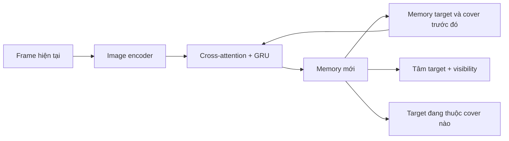

Chỉ cần **một target output**, nhưng bên trong có thể giữ **1 target slot + 2 cover slot**. Khi vật bị che, giữ appearance của nó và cập nhật vị trí dựa vào cover đang mang nó; khi lộ ra, dùng ảnh để sửa lại. Đây là **thiết kế đề xuất**, chưa phải kết quả đã chứng minh.

Lúc chạy, mỗi frame chỉ encode một lần rồi cập nhật memory. Lúc train vẫn phải học trên chuỗi đủ dài qua reveal → che → shuffle → mở cover; **không phải bỏ lịch sử, mà nén lịch sử vào state**.

Tao thấy hướng này hợp yêu cầu của mày hơn việc chỉ tìm một point tracker nhiều FPS. [Đã lưu survey chi tiết](/workspace/arm-manipulation/docs/research/object_memory_tracking_survey.md).

---

## 0474 · User · 2026-10-18T18:30:43.082Z

test iSEE trên video của mình đi (giữ nguyên ckpt gốc) chưa cần fientune

---

## 0475 · Assistant — tiến độ · 2026-10-18T18:30:46.933Z

Mình sẽ chạy iSEE bằng checkpoint gốc trên vài video shuffle của mình, giữ nguyên weight và chưa nối FM. Mình sẽ xuất video các object slot, đánh dấu slot ứng với vật được chấm ở frame đầu để xem nó giữ danh tính qua che khuất thế nào.


---

## 0476 · Assistant — tiến độ · 2026-10-18T18:32:33.209Z

Đã lấy được checkpoint iSEE gốc. Mình dùng bản LA-CATER camera cố định vì gần với cảnh top của mình, chạy 4 clip quen/chưa thấy thứ tự/chưa thấy vị trí/cả hai. iSEE tự tách object slot; điểm chấm đầu video chỉ dùng để chọn một slot rồi theo cố định suốt clip.


---

## 0477 · Assistant — tiến độ · 2026-10-18T18:33:19.235Z

Có một lỗi tương thích ở bản `timm` đang cài: nó làm thiếu 5 patch token khi chạy DINO không positional embedding. Mình đang dùng riêng đúng phiên bản mà iSEE công bố để giữ nguyên model và weight; môi trường train cũ không bị đổi.


---

## 0478 · Assistant — tiến độ · 2026-10-18T18:34:42.571Z

Đã bắt đầu chạy, log đang hiện ở window 1 của `ssh_tmux`. Mỗi clip dùng đủ frame gốc, gồm cả shuffle và đoạn expert mở cover/gắp; video sẽ có tâm GT màu xanh, tâm dự đoán màu hồng và các slot bên cạnh để nhìn rõ có giữ đúng vật hay không.


---

## 0479 · Assistant — tiến độ · 2026-10-18T18:35:54.872Z

Clip đầu đã xong: iSEE có gom được vùng vật đỏ lúc đầu, nhưng cùng slot đó cũng chứa các vùng khác. Qua shuffle, slot bị chuyển sang cover rồi robot, nên chưa giữ được danh tính vật trong cảnh này. Mình đang kiểm tra nốt ba clip còn lại.


---

## 0480 · Assistant — tiến độ · 2026-10-18T18:37:24.725Z

Cả ba clip đã kiểm tra đều chưa giữ vật ổn định; có clip slot đã lẫn với nền ngay từ đầu. Phần chạy model khá nhẹ trên 3090: khoảng 0,7 GB VRAM, DINO + slot/TEN/walker mất khoảng 8–10 giây cho một clip hơn 20 giây. Đây là đo trên video theo batch, chưa phải benchmark streaming.


---

## 0481 · Assistant · 2026-10-18T18:38:13.155Z

Đã test **iSEE checkpoint gốc LA-CATER static**, không fine-tune; xác nhận weight giữ nguyên.

- [Cảnh quen](/workspace/robotics_assets/experiments/e112_isee/test/train.mp4)
- [Thứ tự shuffle mới](/workspace/robotics_assets/experiments/e112_isee/test/unseen_order.mp4)
- [Vị trí mới](/workspace/robotics_assets/experiments/e112_isee/test/unseen_layout.mp4)
- [Cả vị trí và thứ tự mới](/workspace/robotics_assets/experiments/e112_isee/test/unseen_both.mp4)

**Zero-shot chưa ổn:** slot ban đầu thường gom nhiều vùng; qua shuffle có lúc bám sang cover hoặc robot, rồi mất danh tính vật.

Video: **GT xanh, dự đoán hồng**, bên phải là các slot. Điểm đầu chỉ chọn một slot cố định; iSEE nhận RGB. Robot chạy theo video expert ghi sẵn.

[Cấu hình và kết quả chi tiết](/workspace/arm-manipulation/docs/research/e112_README.md).

---

## 0482 · User · 2026-10-18T18:40:59.130Z

input của model đó là gì

---

## 0483 · Assistant · 2026-10-18T18:41:04.048Z

**iSEE gốc nhận chuỗi ảnh RGB**, trong lượt test này là video từ **camera top**:

`RGB từng frame → DINOv2 frozen → patch features → cập nhật object slots + memory → mask và vị trí 2D của các slot`

- Ảnh top được crop **320×240**, rồi resize **518×518** và normalize ImageNet.
- Model tự tìm **11 object slots**, cập nhật chúng qua thời gian.
- **Không nhận** task ID, joint, depth, tọa độ GT hay điểm prompt.

Điểm chấm ban đầu mình dùng **ở ngoài model** để chọn slot chứa pixel đó, rồi theo cố định slot ấy. Vì vậy, lượt vừa rồi chưa giống TCOW nhận trực tiếp `ảnh + điểm prompt` để biết phải nhớ vật nào.

---

## 0484 · User · 2026-10-18T18:41:45.031Z

ủa là sao, sao lại 11 object slot

---

## 0485 · Assistant · 2026-10-18T18:41:55.821Z

**11 là số “ô nhớ vật thể” cố định của checkpoint LA-CATER gốc**, được đặt khi train, không phải model đếm được 11 vật trong video của mình.

Mỗi slot lưu **đặc trưng ngoại hình + vị trí**. Các slot cạnh tranh để giải thích những vùng khác nhau trong ảnh:

```text
Ảnh → patch features → 11 slots cập nhật qua thời gian
                         ↓
                  mask + vị trí từng slot
```

Lý tưởng là mỗi slot bám một vật. Nhưng **không bảo đảm 1 slot = 1 vật**: một slot có thể gom nhiều vật, một vật bị chia thành nhiều slot, hoặc slot bám nền/robot — đúng như video vừa rồi.

Mình giữ **11** để chạy đúng cấu hình checkpoint gốc. Điểm chấm chỉ chọn một trong 11 slot sau khi model xử lý frame đầu.

**Mình cần nói rõ hơn từ đầu: iSEE gốc là model tự khám phá và nhớ nhiều object, chưa phải tracker nhận prompt để chuyên theo một vật như TCOW.**

---

## 0486 · User · 2026-10-18T18:43:55.307Z

t xem demo của nó thấy khoanh vùng object cần track mà

---

## 0487 · Assistant — tiến độ · 2026-10-18T18:43:57.521Z

Mình sẽ kiểm tra lại demo và code gốc để xác định vùng khoanh đó có được đưa vào model hay chỉ dùng để chọn slot cần theo dõi.


---

## 0488 · Assistant · 2026-10-18T18:44:18.817Z

**Đúng, demo có khoanh vật cần theo dõi. Mình giải thích thiếu bước chọn target.**

Trong demo, **vùng trắng là GT của vật**, vùng xanh là **slot đang bám vật đó**; khi bị che, họ vẽ vùng của slot tại vị trí dự đoán. Đây là phần hiển thị kết quả. [Chú thích demo gốc](https://insait-institute.github.io/iSEE/#examples).

Trong code đánh giá, họ dùng **mask GT lúc vật còn thấy được để chọn slot tương ứng trước khi bị che**. Sau đó theo slot ấy qua occlusion; vùng khoanh không được feed vào backbone/corrector như prompt của TCOW. [Code chọn slot](https://github.com/insait-institute/iSEE/blob/main/isee/eval/lacater.py).

**Lượt mình vừa chạy chọn slot bằng một pixel ở frame đầu**, nên khác cách chọn target của họ và dễ chọn phải slot lẫn nền. Ngoài ra, evaluation gốc dùng readout vị trí được hiệu chuẩn, còn mình dùng pose head có sẵn.

Vì vậy, kết quả vừa rồi cho thấy **cấu hình zero-shot mình thử chưa ổn**, chưa đủ để kết luận riêng phần memory của iSEE kém.

---

## 0489 · User · 2026-10-18T18:47:33.341Z

nghĩa là mỗi frame phải cung cấp GT của object à

---

## 0490 · Assistant · 2026-10-18T18:47:38.199Z

**Không, khi chạy tracking không cần cung cấp GT mỗi frame.**

Có hai phần riêng:

- **Model iSEE:** chỉ nhận RGB và cập nhật các slot qua thời gian.
- **Đánh giá trong paper:** dùng GT để chọn slot đang bám đúng vật trước mỗi đoạn occlusion, rồi theo cố định slot đó khi vật bị che. GT các frame sau dùng để chấm kết quả.

Với ứng dụng của mình, có thể **chọn target một lần lúc đầu bằng điểm hoặc vùng khoanh**, chọn slot tương ứng rồi chạy tiếp bằng RGB. Nhưng iSEE gốc chưa dùng vùng khoanh để ép slot biểu diễn đúng vật; nếu slot ban đầu đã gom nhiều vật thì việc chọn target vẫn không sạch như TCOW.

---

## 0491 · User · 2026-10-18T18:49:25.964Z

bài đó train kiểu gì

---

## 0492 · Assistant — tiến độ · 2026-10-18T18:49:28.573Z

Mình sẽ đọc phần loss và lịch train trong paper/code gốc để nói rõ slot và walker được học như thế nào.


---

## 0493 · Assistant · 2026-10-18T18:50:00.995Z

**iSEE học từ video bằng self-supervision, gồm hai lượt train: học object slots trước, rồi học walker để theo vị trí khi vật bị che. Không dùng GT mask, tọa độ hay object ID để tính hai loss này.**

**1. Học tự tách vật và giữ danh tính giữa các frame**

```text
RGB → DINOv2 frozen → features → object slots → decoder → features tái tạo
                                  ↑
                          slots từ frame trước
```

Họ freeze DINOv2, train projection, slot attention, predictor và decoder bằng:

\[
L = L_{\text{feature reconstruction}} + 0.5L_{\text{contrastive}}
\]

- **Reconstruction:** các slot phải cùng tái tạo được feature DINO của ảnh. Mask của từng slot xuất hiện từ cách decoder phân chia việc tái tạo ảnh.
- **Contrastive:** appearance của slot số \(k\) ở frame sau phải giống chính slot \(k\) ở frame trước hơn những slot khác. Chỉ số slot cung cấp positive pair, không cần nhãn danh tính vật.
- Slot tách thành **60 chiều appearance + 4 chiều position**; contrastive chỉ tác động lên appearance. [Code loss gốc](https://github.com/insait-institute/iSEE/blob/main/isee/train/encoder.py).

**2. Thêm cơ chế giữ memory — TEN, không cần train**

TEN theo dõi attention của từng slot. Khi bằng chứng về vật giảm mạnh, nó **ngừng cập nhật appearance**, giữ lại ngoại hình đã nhớ. Khi vật xuất hiện lại, nó cho cập nhật tiếp. Đây là quy tắc dựa trên attention và ngưỡng, không phải một mạng được supervised bằng visibility GT. [Paper, phần 3.2](https://arxiv.org/html/2610.01201v1#S3.SS2).

**3. Freeze encoder, train walker bằng sự tái xuất hiện**

```text
Thấy vật → bị che → walker đi qua đoạn che → vật xuất hiện lại
                                                ↓
                                  vị trí slot làm pseudo-target
```

Walker học để phân bố vị trí sau đoạn che khớp với **vị trí do encoder dự đoán khi vật xuất hiện lại**, qua loss negative log-likelihood. Họ bổ sung các đoạn giả lập trạng thái bị che trên những track đang nhìn rõ. **Không cần biết GT vị trí ở từng frame bị che.** [Code train walker](https://github.com/insait-institute/iSEE/blob/main/isee/train/walker.py).

Với bản LA-CATER static vừa thử: encoder train **100.000 steps, batch 32, clip 8 frame, stride 2**; walker train riêng **2.000 steps, batch 16**, trên 1.900 video và giữ 100 video validation. [Cấu hình gốc](https://github.com/insait-institute/iSEE/blob/main/configs/lacater_static.yaml).

Cách học này phụ thuộc vào việc **slot nhận lại đúng vật sau che khuất**; nếu nhận nhầm, pseudo-target của walker cũng có thể sai.

---

## 0494 · User · 2026-10-18T18:54:33.345Z

nêu vấn đề của mình và yêu cầu kiến trúc để t survey

---

## 0495 · Assistant · 2026-10-18T18:55:04.963Z

Có thể dùng nguyên brief này để survey:

**Bài toán**

Robot cần theo dõi **một vật được người dùng chọn bằng một điểm trên ảnh đầu tiên**, nhớ vật đó qua quá trình che khuất và shuffle, rồi mở đúng cover để gắp vật.

Cảnh có **4 vật và 2 cover** trên bàn. Trong quá trình shuffle, vật có thể bị che hoàn toàn trong nhiều giây và di chuyển cùng cover. Cần giữ đúng danh tính khi vật xuất hiện lại, kể cả với **thứ tự shuffle và vị trí ban đầu chưa thấy khi train**.

**Input và output mong muốn**

| | Yêu cầu |
|---|---|
| Khởi tạo | Ảnh RGB camera top + một điểm chọn vật; có thể cân nhắc box/mask ở frame đầu |
| Mỗi bước | Frame RGB mới + memory từ bước trước |
| Output tracking | Vị trí 2D dự đoán, trạng thái visibility và latent biểu diễn vật được chọn |
| Output downstream | Latent dùng để dự đoán XYZ và điều kiện hóa policy điều khiển robot |
| Khi chạy | Không cung cấp GT mask, tọa độ hoặc object ID mỗi frame |

**Yêu cầu đối với kiến trúc tracking**

1. **Ràng buộc rõ target từ prompt.** Điểm chọn phải giúp khởi tạo representation của đúng vật. Cách tự phân slot rồi chọn slot chứa pixel có thể gặp vấn đề khi một slot gom nhiều vật hoặc nền.

2. **Memory qua full occlusion.** Giữ được danh tính khi không còn pixel nào của vật; theo được quan hệ với cover đang chứa/che vật và nhận lại đúng vật sau khi mở cover.

3. **Cập nhật tuần tự, chi phí ổn định.** Ưu tiên dạng:
   ```text
   frame hiện tại + target memory → target representation mới + memory mới
   ```
   Tránh phải chạy lại toàn bộ lịch sử hoặc một clip khoảng 30 frame ở mỗi bước.

4. **Tập trung vào một target.** Không cần xử lý hàng trăm điểm. Tuy nhiên, model có thể lưu thêm thông tin về cover và distractor để suy luận target đang ở đâu.

5. **Có latent dùng được cho manipulation.** Cần truy cập hidden features/tokens, không chỉ API trả tọa độ. Policy FM sẽ attend vào context tạo từ các feature này.

6. **Biểu diễn độ bất định khi bị che.** Có thể trả visibility/confidence hoặc phân bố vị trí; khi quan sát không đủ để xác định duy nhất vị trí, cần tránh dự đoán quá tự tin.

**Cách ghép vào pipeline hiện tại**

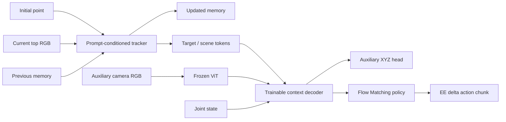

Tracker cần giữ được representation của vật từ thị giác; khi đánh giá phải kiểm tra **XYZ có bị dự đoán theo chuyển động của EE/joint thay vì vật hay không**.

**Điều kiện train và đánh giá**

- Có dữ liệu mô phỏng: RGB, target XYZ, visibility/mask và expert actions; **có thể dùng supervision**, không bắt buộc self-supervised.
- Ưu tiên pretrained model, freeze backbone trước và fine-tune phần memory/decoder khi cần.
- Phần cứng: **RTX 3090, 24 GB VRAM**. Mục tiêu xử lý gần tốc độ camera **25 Hz**, cần đo latency thực tế với một target.
- Đánh giá riêng: giữ danh tính sau occlusion, sai số vị trí lúc bị che/sau tái xuất hiện, unseen permutation/layout, VRAM và tốc độ.

Câu hỏi survey chính bằng tiếng Anh:

> **Which prompt-conditioned, streaming object trackers support persistent memory through long full occlusion and containment, expose target-centric latent features for robot manipulation, and can run efficiently for a single target on an RTX 3090?**

---

## 0496 · User · 2026-10-18T18:56:37.923Z

ờm không, t nghĩ nên nhận query là mask thì dễ hơn 1 điểm, trackon2 input output gốc là gì

---

## 0497 · Assistant — tiến độ · 2026-10-18T18:56:40.473Z

Mình sẽ kiểm tra input/output gốc của Track-On2, tách rõ khỏi phần XYZ head và decoder mình đã ghép thêm.


---

## 0498 · Assistant · 2026-10-18T18:57:02.764Z

Ừ, mình đổi yêu cầu thành **mask của vật ở frame đầu**. Mask mô tả rõ toàn vùng target hơn một điểm.

**Track-On2 gốc là point tracker**, có input/output như sau:

| | Dữ liệu |
|---|---|
| Input ảnh | Video RGB `[1, T, 3, H, W]`, giá trị 0–255 |
| Input query | `[1, N, 3]`, mỗi query là **`(frame bắt đầu, x, y)`** |
| Output trajectory | `[1, T, N, 2]`: tọa độ **pixel `(x, y)`** của từng điểm qua các frame |
| Output visibility | `[1, T, N]`: từng điểm đang nhìn thấy hay bị che |

Nó hỗ trợ chạy **từng frame**, dùng memory nội bộ; query chỉ cần đưa vào khi khởi tạo điểm. [API gốc](https://github.com/gorkaydemir/track_on#-demo).

```text
RGB hiện tại + point query ban đầu + memory
                 ↓
      vị trí 2D + visibility + memory mới
```

**Nó không nhận mask query và không xuất object mask hay XYZ.** Phần context decoder, camera phụ, joint và XYZ head trong thí nghiệm của mình là phần ghép thêm.

Nếu lấy vài điểm bên trong mask rồi đưa vào Track-On2, model vẫn đang track **các điểm riêng lẻ**. Muốn mask thực sự khởi tạo representation của **cả vật**, cần kiến trúc có cơ chế encode mask vào target memory.

---

## 0499 · User · 2026-10-18T18:59:55.196Z

bài của mình khá đặc biệt là nhận 1 object mà t nghĩ mask cung cấp nhiều thông tin hơn, nhưng sau đó phải đoán tâm xyz =)), khá khó

---

## 0500 · Assistant · 2026-10-18T19:00:13.448Z

Ừ, bài của mình là **mask-conditioned object tracking + 3D state estimation qua occlusion**. Mask giúp xác định *vật nào*, còn XYZ yêu cầu model hiểu *vật đang ở đâu trong không gian*.

Có ba phần khó khác nhau:

- **Khởi tạo:** mask cho toàn bộ vùng vật, giúp lấy appearance, hình dạng và phạm vi của target. Nhưng tâm mask 2D không nhất thiết là hình chiếu của tâm vật 3D.
- **Khi nhìn thấy:** suy ra XYZ từ ảnh. Camera top và mặt bàn giúp ràng buộc vị trí; lúc vật được nâng lên, độ cao khó suy ra hơn.
- **Khi bị che:** XYZ trở thành **ước lượng trạng thái từ memory và chuyển động của cover**, không còn là đo trực tiếp từ ảnh. Có tình huống quan sát không đủ để biết chính xác.

Có thể formulate kiến trúc theo đúng vai trò đó:

```text
RGB đầu + target mask → target memory ban đầu

RGB hiện tại + memory trước
             ↓
      target representation
         ├─ XYZ + độ bất định
         └─ context cho FM
```

**Không bắt buộc phải predict mask mỗi frame.** Mask chỉ cần khởi tạo đúng target; hidden state sau đó được train để giữ danh tính và chứa thông tin phục vụ dự đoán XYZ.

Với dữ liệu sim của mình, GT XYZ có thể supervise trực tiếp representation này, kể cả đoạn bị che. Điều cần kiểm tra riêng là model có theo **vật/cover** thật không, hay học shortcut từ vị trí tay robot như lượt trước.

---

## 0501 · User · 2026-10-18T19:06:32.547Z

t có cách rồi lại cho vật xuất hiện ở tất cả voxel trong workspace và dự đoán toạ độ, khi đó bài toán rút gọn thành nhớ vật ở đâu, một khi đã biết vật ở đâu thì việc đoán toạ độ là chuyện nhỏ

---

## 0502 · Assistant · 2026-10-18T19:06:52.393Z

**Đúng, cách này tách bài toán thành học hình học trước, học memory sau**, tương tự cách mình đã pretrain FM bằng reach:

```text
FM:          tọa độ 3D → trajectory
Localization: ảnh + target mask → tọa độ 3D
```

Cho vật xuất hiện khắp workspace sẽ giúp model học ánh xạ từ **vị trí, kích thước, hình dạng trong ảnh sang XYZ**. Sau đó train qua shuffle để memory duy trì representation của đúng vật và cập nhật vị trí khi bị che; XYZ head đã có nền tảng hình học.

Mình sẽ formulate thành hai giai đoạn:

1. **Visible localization pretraining:** vật ở các voxel, đa dạng object/rotation/background; dùng mask chọn target và supervise XYZ.
2. **Occlusion-memory training:** chỉ cung cấp mask lúc đầu, chạy chuỗi che/shuffle/mở cover; tiếp tục giữ loss XYZ để memory chứa thông tin vị trí.

Có ba chi tiết cần làm đúng:

- **Jitter trong voxel**, train hồi quy XYZ liên tục để tránh chỉ nhớ tâm lưới.
- **Phủ cả độ cao**, gồm trạng thái trên bàn và được nâng lên.
- Giai đoạn hai **không cấp mask GT hiện tại**; model phải tự duy trì target từ mask ban đầu.

Phần còn khó là **cập nhật vật đã đi đâu dưới cover**, nhưng đúng như m nói: nếu representation đã xác định được vị trí vật, việc đọc nó thành XYZ sẽ nhẹ hơn nhiều. Đây là một giả thuyết pretraining rất rõ để kiểm chứng.

---

## 0503 · User · 2026-10-18T19:09:16.500Z

giải bài toán đoán toạ độ trước thì input cần là gì trước khi train 1 model nhỉ

---

## 0504 · Assistant · 2026-10-18T19:09:34.961Z

Ở bước **học định vị khi vật đang nhìn rõ**, input tối thiểu là **một ảnh RGB toàn cảnh + mask của vật cần dự đoán**, cùng thời điểm.

| Thành phần | Dữ liệu |
|---|---|
| RGB | Ảnh camera top `[3, H, W]` |
| Target mask | Mask nhị phân `[1, H, W]`, cùng hệ tọa độ với RGB |
| Nhãn để tính loss | Tâm vật `[x, y, z]` trong hệ tọa độ robot base |

```text
RGB toàn cảnh + target mask → model → XYZ
                                     ↕ loss
                                XYZ GT từ sim
```

**Giữ vị trí tuyệt đối của vật trong ảnh.** Nếu chỉ crop sát vật rồi resize mà bỏ tọa độ crop, model sẽ mất thông tin quan trọng để suy ra vị trí trong workspace.

Với camera top cố định, có thể bắt đầu bằng **RGB + mask**, cho vật xuất hiện ở nhiều XYZ để kiểm tra model học hình học đến đâu. Nếu dùng RGB-D, thêm **depth map đã căn chỉnh với RGB** sẽ cung cấp thông tin khoảng cách trực tiếp hơn. Khi đổi camera hoặc góc đặt, cần xử lý thêm calibration.

Ở giai đoạn này, mỗi sample là một bài định vị độc lập nên dùng mask của **ảnh hiện tại**. Sang giai đoạn memory, mask chỉ được cấp ở frame đầu; những frame sau phải dựa vào ảnh và trạng thái đã nhớ.

---

## 0505 · User · 2026-10-18T19:11:20.301Z

tối thiểu 2 cam mới có triangular mà tính toạ độ chứ

---

## 0506 · Assistant · 2026-10-18T19:11:37.296Z

**Đúng, nếu muốn suy ra XYZ bằng triangulation thì cần ít nhất hai góc nhìn đã calibration**, thấy cùng một điểm 3D. Mình nói thiếu ở trên: **một RGB + mask có thể học hồi quy dựa trên prior**, nhưng không xác định duy nhất XYZ bất kỳ trong workspace. Một camera có depth thì là trường hợp khác.

Vậy bài pretrain của mình nên dùng:

| Input | Vai trò |
|---|---|
| RGB top + RGB side, đồng bộ | Hai góc nhìn để định vị |
| Mask target trên hai view | Xác định cùng vật cần dự đoán |
| Intrinsics/extrinsics | Quan hệ hình học giữa camera và robot |
| XYZ GT từ sim | Nhãn supervise tâm vật |

```text
Hai view + target masks + camera geometry → model → tâm XYZ
```

Có một điểm cần phân biệt: **tâm của hai mask không chắc là hình chiếu của cùng một điểm 3D**, nên triangulate trực tiếp hai tâm mask có thể lệch tâm vật. Model cần học từ hình dạng/feature đa góc nhìn, hoặc tìm correspondence phù hợp rồi suy ra tâm.

Với mục tiêu phủ các voxel **cả theo chiều cao**, dùng top + side là cấu hình hợp lý hơn đề xuất RGB một cam vừa rồi.

---

## 0507 · User · 2026-10-18T19:13:49.154Z

trong data hiện tại có mask của 3 cam không

---

## 0508 · Assistant — tiến độ · 2026-10-18T19:13:51.281Z

Mình sẽ kiểm tra trực tiếp các file mask và thứ tự camera trong bộ dữ liệu hiện tại.


---

## 0509 · Assistant · 2026-10-18T19:14:06.967Z

**Có, bộ `shuffle_pick_multiview` hiện tại có mask đồng bộ của cả 3 camera: `top`, `left`, `right`**, độ phân giải gốc **320×320**.

Trong mỗi `masks.npz` có:

- **`instance`**: mask phần nhìn thấy của từng vật, dạng `[T, 3, 320, 320]`. Lấy target bằng `instance == target_id + 1`.
- **Amodal mask**: toàn hình chiếu của vật, kể cả phần bị che. Đoạn shuffle lưu trong `amodal_packed`; đoạn expert lưu target ở channel 0 của `tcow_packed`.
- **`occlusion_fraction`**: mức che khuất theo từng camera.

Vậy có thể lấy ngay **RGB + visible target mask từ 2 hoặc 3 cam** để thử bài định vị. Amodal mask nên dùng làm supervision; mask đầu vào thực tế lấy phần nhìn thấy.

Camera parameters nằm trong `scene.xml`, hiện chưa được export riêng thành intrinsics/extrinsics. [Code render và lưu mask](/workspace/arm-manipulation/OATFlow/data_tools/render_shuffle.py:150).

---

## 0510 · User · 2026-10-18T19:18:20.067Z

ok, train 1 model vit encode 2 cam , nhận 2 rgb + 2 mask rồi freeze vit train decoder nhận hidden của vit predict xyz, trong workspace có code tạo voxel 2 * 2, m thử tính xem có bao nhiêu sample dữ liệu và train bao lâu hết đống đấy

---

## 0511 · Assistant — tiến độ · 2026-10-18T19:18:23.071Z

Mình sẽ tìm lại bộ voxel 2 cm và code camera hiện có, rồi benchmark ViT frozen + decoder XYZ với hai view. Mình hiểu lượt này là ước tính số sample, thời gian tạo data và thời gian train trước khi chạy toàn bộ.


---

## 0512 · Assistant — tiến độ · 2026-10-18T19:19:07.793Z

Lưới cũ có **32.017 tâm voxel đã xác nhận reach được**. Với 4 vật, mỗi vật đặt một lần ở mỗi tâm là **128.068 sample**, mỗi sample gồm hai RGB và hai mask. Mình đang kiểm tra thêm bao nhiêu voxel nằm trong góc nhìn của cả top + left; vùng reach được rộng hơn vùng hai camera cùng quan sát.


---

## 0513 · User · 2026-10-18T19:20:25.929Z

cần gì 4 vật, 1 vật là được mà nhỉ

---

## 0514 · Assistant — tiến độ · 2026-10-18T19:20:33.700Z

Đúng, **một vật là đủ cho lượt pretrain tọa độ này**. Mình sẽ dùng một cube đặt lần lượt ở các voxel; số sample cơ sở là **32.017**, không nhân 4 nữa. Benchmark sẽ dùng một vật trong cảnh và mask của nó ở hai view.


---

## 0515 · Assistant — tiến độ · 2026-10-18T19:21:40.874Z

Một vật thì chi phí khá nhẹ. Có điểm cần lưu ý: với camera hiện tại, chỉ **15.848/32.017 voxel** chứa trọn cube trong cả top + left; bỏ vị trí xuyên robot/bàn còn **15.603**. Mình đã đo tốc độ render và train decoder, đang đo thêm chi phí chuyển feature từ RAM lên GPU để ước lượng sát hơn.


---

## 0516 · Assistant · 2026-10-18T19:23:25.085Z

**Đúng, một vật là đủ.** Mình đã đổi sang một cube và benchmark thực tế trên RTX 3090.

- Toàn lưới reach: **32.017 sample** nếu mỗi voxel một pose.
- Với **top + left hiện tại**: **15.603 vị trí** chứa trọn cube trong cả hai ảnh và không xuyên robot/bàn. Còn phải lọc che khuất khi render đầy đủ.

Model đã dựng: **ViT-B/16 frozen dùng chung cho hai cam → 800 patch tokens + hai mask → decoder 4 lớp → XYZ**, khoảng **10 triệu tham số trainable**.

Ước tính với **15.603 sample**, cache feature lên RAM, batch 128:

| Hạng mục | Ước tính |
|---|---:|
| Render + encode một lần | ~4 phút, chưa tính lưu/đọc file |
| RAM feature + mask | ~21 GiB |
| Train 1 epoch | ~20–30 giây |
| 10 epoch | ~3–5 phút |
| 100 epoch | ~33–50 phút |
| VRAM khi train từ RAM | ~3 GB |

Đây là ngoại suy từ **256 sample đã render và benchmark forward/backward**; chưa train full hay đo chất lượng. Nếu phủ đủ 32.017 voxel thì chi phí khoảng gấp đôi, đồng thời cần xử lý vùng camera chưa nhìn tới.

[Chi tiết benchmark](/workspace/arm-manipulation/docs/research/e113_README.md).

---

## 0517 · User · 2026-10-18T19:24:31.481Z

ok, train 15k voxel 10 epoch xem sao

---

## 0518 · Assistant — tiến độ · 2026-10-18T19:24:35.005Z

Mình sẽ tạo data từ khoảng 15k voxel đã lọc và train decoder XYZ trong 10 epoch, giữ ViT frozen. Mình sẽ chia train/val/test theo voxel, log loss và sai số mm ra window 1 của `ssh_tmux`, rồi kiểm tra checkpoint tốt nhất.


---

## 0519 · Assistant — tiến độ · 2026-10-18T19:27:31.231Z

Đã bắt đầu chạy trong `ssh_tmux:1`. Cấu hình giữ như benchmark: một cube, top + left, ViT-B/16 frozen, decoder 4 lớp, batch 128. Đang render RGB và mask cho từng voxel; feature ViT sẽ cache trong RAM, còn checkpoint chỉ lưu phần trainable.


---

## 0520 · Assistant — tiến độ · 2026-10-18T19:28:34.698Z

Đang render khoảng 100 voxel/giây, gần mức ước tính. Các vị trí đều là pose tĩnh để học hình học XYZ; robot giữ ở home và không có rollout vật lý. Voxel nào không thấy đủ vật ở cả hai camera sẽ được loại trước khi chia dữ liệu.


---

## 0521 · Assistant — tiến độ · 2026-10-18T19:30:01.727Z

Render gần xong. Có một số voxel bị robot che khiến mask còn quá ít pixel ở một trong hai view; mình đang loại chúng đúng theo tiêu chí đã đặt. Vì vậy số sample cuối sẽ thấp hơn 15.603 một chút, rồi mới chia 80/10/10.


---

## 0522 · Assistant — tiến độ · 2026-10-18T19:30:57.922Z

Data chốt còn **15.466 voxel**: **12.372 train / 1.547 val / 1.547 test**. Kiểm tra tọa độ, mask và split đã qua; không có voxel trùng giữa các split. Đang cache ViT vào RAM, sau đó train đúng 10 epoch.


---

## 0523 · Assistant — tiến độ · 2026-10-18T19:33:02.577Z

Đã có checkpoint. Validation giảm từ **213,8 mm ở epoch 1** xuống **38,0 mm ở epoch 4**. Train hiện mất khoảng **12 giây/epoch**, nhanh hơn benchmark; mình sẽ chạy đủ 10 epoch rồi test checkpoint tốt nhất trên 1.547 voxel held-out.


---

## 0524 · Assistant — tiến độ · 2026-10-18T19:34:41.683Z

Train đã đủ **10 epoch**, validation tốt nhất là **20,36 mm** ở epoch 10. Kiểm tra cuối phát hiện dự đoán từ cache và từ RGB chạy lại lệch quá ngưỡng 1 mm mình đặt; mình đang kiểm tra nguồn chênh lệch này trước khi chốt kết quả test. Checkpoint đã lưu đầy đủ.


---

## 0525 · Assistant — tiến độ · 2026-10-18T19:36:23.221Z

Đã xác định chênh lệch nằm ở kiểu số của feature: cache dùng FP16, còn đường RGB trực tiếp giữ dtype đầu ra ViT. Mình đã thống nhất FP16 tại đầu ra ViT để khớp với lúc train, giữ nguyên checkpoint và đang chạy lại kiểm tra/test.


---

## 0526 · Assistant — tiến độ · 2026-10-18T19:38:27.595Z

Kiểm tra đã khớp: sau khi thống nhất FP16, chạy RGB trực tiếp và qua cache cho cùng dự đoán; kết quả test cũ cũng được tái lập, không đổi checkpoint. Test đạt **20,71 mm sai số trung bình**, trung vị **18,20 mm**. Model đã học được vị trí khá thô, nhưng chưa đạt độ chính xác vài mm.


---

## 0527 · Assistant · 2026-10-18T19:39:05.207Z

Đã train đủ **10 epoch / 970 updates**, ViT giữ frozen.

Data: **15.466 voxel**, chia **12.372 train / 1.547 val / 1.547 test**.

Checkpoint tốt nhất ở **epoch 10**:

| Sai số XYZ trung bình | Kết quả |
|---|---:|
| Train | 19,82 mm |
| Validation | 20,36 mm |
| Test | **20,71 mm** |

Test có trung vị **18,20 mm**, chỉ **14,0%** mẫu dưới 10 mm. Model đã học được định vị thô, **chưa đạt độ chính xác vài mm**.

Riêng train + validation mất **2 phút 13 giây**. Đã kiểm tra ViT không đổi và inference trực tiếp khớp với cache.

[Checkpoint best](/workspace/robotics_assets/experiments/e113_voxel/train/best.pt) · [Learning curve](/workspace/robotics_assets/experiments/e113_voxel/train/learning_curve.png) · [Ảnh test GT/predict](/workspace/robotics_assets/experiments/e113_voxel/train/test_examples.png)

---

## 0528 · User · 2026-10-18T19:42:28.604Z

resume 100 epoch đi

---

## 0529 · Assistant — tiến độ · 2026-10-18T19:42:32.408Z

Mình sẽ resume từ `latest.pt` epoch 10 lên **tổng 100 epoch**, giữ nguyên split, cấu hình và optimizer state. Feature ViT sẽ được cache lại vào RAM; log tiếp tục ở `ssh_tmux:1`. Xong mình sẽ test checkpoint tốt nhất.


---

## 0530 · Assistant — tiến độ · 2026-10-18T19:43:57.994Z

Đã bắt đầu resume, dùng lại toàn bộ data và split cũ. Cache lại ViT mất khoảng 1,5 phút; 90 epoch còn lại dự kiến khoảng 20 phút. Kết quả epoch 10 được giữ riêng để so sánh.


---

## 0531 · Assistant — tiến độ · 2026-10-18T19:45:04.025Z

Cache đã gần xong. Trước khi cập nhật epoch 11, mình sẽ kiểm tra model, optimizer và validation có khớp với checkpoint epoch 10; bước này xác nhận đây là resume thật, không phải train lại từ đầu.


---

## 0532 · Assistant — tiến độ · 2026-10-18T19:45:56.357Z

Resume đã qua kiểm tra: optimizer tiếp tục từ **step 970**, split và normalization giữ nguyên, validation trước update khớp chính xác **20,357 mm**. Hiện đang ở epoch 13.


---

## 0533 · Assistant — tiến độ · 2026-10-18T19:47:06.499Z

Đến epoch 19; validation tốt nhất hiện là **14,85 mm ở epoch 18**, giảm từ 20,36 mm của checkpoint cũ. Mình tiếp tục lịch 100 epoch với cùng learning rate.


---

## 0534 · Assistant — tiến độ · 2026-10-18T19:48:22.545Z

Epoch 24: validation tốt nhất xuống **12,45 mm ở epoch 23**. Checkpoint best đang được chọn theo validation; tập test sẽ được đánh giá sau khi đủ 100 epoch.


---

## 0535 · Assistant — tiến độ · 2026-10-18T19:49:22.176Z

Đang ở epoch 29. Validation có dao động nhẹ; best hiện là **12,18 mm ở epoch 27**. Lịch train và cấu hình vẫn giữ nguyên.


---

## 0536 · Assistant — tiến độ · 2026-10-18T19:50:27.827Z

Đến epoch 34, validation tốt nhất là **11,27 mm ở epoch 33**. Loss train vẫn giảm; chưa có dấu hiệu lỗi số học trong lượt resume.


---

## 0537 · Assistant — tiến độ · 2026-10-18T19:51:33.838Z

Đang ở epoch 39. Best vẫn là **11,27 mm**; vài epoch gần đây validation dao động khoảng 12–14 mm. Mình tiếp tục đủ 100 epoch như yêu cầu.


---

## 0538 · Assistant — tiến độ · 2026-10-18T19:52:34.264Z

Best validation đã xuống **10,18 mm ở epoch 39**. Hiện đã xong epoch 43; kết quả vẫn được lưu ở `e113_voxel/resume100`.


---

## 0539 · Assistant — tiến độ · 2026-10-18T19:53:33.140Z

Gần nửa chặng: epoch 48. Validation tốt nhất đã xuống dưới 1 cm, **9,89 mm ở epoch 44**.


---

## 0540 · Assistant — tiến độ · 2026-10-18T19:54:41.334Z

Đang ở epoch 52. Checkpoint tốt nhất hiện có **58,5% mẫu validation dưới 10 mm**, **15,1% dưới 5 mm**; sai số trung bình là 9,89 mm.


---

## 0541 · Assistant — tiến độ · 2026-10-18T19:55:39.868Z

Epoch 58: best validation cải thiện tiếp còn **9,03 mm ở epoch 54**. Các epoch gần đây vẫn dao động, nên best checkpoint được giữ riêng với latest.


---

## 0542 · Assistant — tiến độ · 2026-10-18T19:56:44.259Z

Đang ở epoch 62; best validation đã xuống **8,26 mm ở epoch 59**. Còn khoảng 8 phút cho phần train còn lại theo tốc độ hiện tại.


---

## 0543 · Assistant — tiến độ · 2026-10-18T19:57:45.937Z

Epoch 67: best validation chưa đổi, vẫn **8,26 mm**. Một số batch train đã xuống khoảng 6–7 mm, nhưng validation còn dao động; mình sẽ dùng checkpoint có validation tốt nhất để test cuối.


---

## 0544 · Assistant — tiến độ · 2026-10-18T19:58:50.834Z

Đã qua epoch 71. Best validation mới là **7,91 mm ở epoch 70**, tiếp tục cải thiện so với mốc 10 epoch.


---

## 0545 · Assistant — tiến độ · 2026-10-18T19:59:58.223Z

Epoch 76, best validation **7,61 mm ở epoch 75**. Còn khoảng 5 phút train trước phần test cuối.


---

## 0546 · Assistant — tiến độ · 2026-10-18T20:01:04.736Z

Đang ở epoch 81. Best vẫn là **7,61 mm**; validation vài epoch gần nhất khoảng 8–9 mm. Kết quả bắt đầu cải thiện chậm hơn giai đoạn đầu.


---

## 0547 · Assistant — tiến độ · 2026-10-18T20:02:16.458Z

Epoch 86, chưa có checkpoint vượt mốc **7,61 mm ở epoch 75**. Mình vẫn giữ best này để test nếu các epoch cuối không tốt hơn.


---

## 0548 · Assistant — tiến độ · 2026-10-18T20:03:23.041Z

Đã tới epoch 92, còn khoảng 2 phút train. Sau epoch 100 mình sẽ test best checkpoint và so sánh trực tiếp với kết quả 10 epoch trên cùng tập voxel.


---

## 0549 · Assistant — tiến độ · 2026-10-18T20:04:29.352Z

Các epoch cuối có cải thiện thêm: best validation hiện là **7,22 mm ở epoch 95**. Đang hoàn tất epoch 96, gần xong lượt 100 epoch.


---

## 0550 · Assistant — tiến độ · 2026-10-18T20:05:54.213Z

Đã đủ **100 epoch / 9.700 updates**. Best ở **epoch 95**; test đạt **7,34 mm**, so với 20,71 mm lúc 10 epoch. **79,1%** mẫu test nằm trong 10 mm. Kiểm tra ViT frozen và đối chiếu inference trực tiếp/cache đều qua; mình đang lưu biểu đồ so sánh.


---

## 0551 · User · 2026-10-19T03:53:31.135Z

tiep

---

## 0552 · Assistant · 2026-10-19T03:53:47.191Z

Đã hoàn tất **100 epoch / 9.700 updates**. Best checkpoint ở **epoch 95**.

Trên cùng **1.547 voxel test**:

| Chỉ số | 10 epoch | Sau 100 epoch |
|---|---:|---:|
| Sai số XYZ trung bình | 20,71 mm | **7,34 mm** |
| Trung vị | 18,20 mm | **6,83 mm** |
| Sai số ≤5 mm | 1,8% | **28,1%** |
| Sai số ≤10 mm | 14,0% | **79,1%** |

Sai số trung bình giảm **64,5%**. ViT vẫn frozen; inference trực tiếp và qua cache khớp nhau.

[Checkpoint best](/workspace/robotics_assets/experiments/e113_voxel/resume100/best.pt) · [Biểu đồ so sánh](/workspace/robotics_assets/experiments/e113_voxel/resume100/comparison.png) · [Ảnh test GT/predict](/workspace/robotics_assets/experiments/e113_voxel/resume100/test_examples.png)

Đây là định vị vật đang thấy với mask, cùng cube và camera; chưa phải tracking qua che khuất.

---

## 0553 · User · 2026-10-19T04:12:54.858Z

phụ thuộc vào toạ độ 3D này khó phết, có cách nào approximate vị trí vật không(hay thậm chí là geometry của vật), vì hiện tại ước tính toạ độ chuẩn thì mới gắp chuẩn mà còn chưa chắc chuẩn vì FM có sai số

---

## 0554 · Assistant — tiến độ · 2026-10-19T04:12:59.040Z

Mình sẽ tìm các hướng dùng vùng gắp hoặc biểu diễn hình học, đồng thời kiểm tra cách FM hiện tại biểu diễn action để xem có thể giảm phụ thuộc vào XYZ chính xác như thế nào.


---

## 0555 · Assistant · 2026-10-19T04:15:13.313Z

Có. **Mình nghĩ nên biểu diễn “vùng vật chiếm chỗ / vùng có thể gắp”, rồi dùng quan sát để chỉnh lúc tiếp cận.** Tâm XYZ chính xác vẫn chưa đủ: còn hướng kẹp, độ mở, điểm tiếp xúc và sai số thực thi.

Có một điểm cần làm rõ: **pipeline Track-On → decoder → FM của mình hiện tại cho FM attend trực tiếp vào context; XYZ chỉ là head phụ**, chưa truyền ba số XYZ dự đoán vào FM. Vì vậy nó chưa bị buộc phải đi qua bottleneck tọa độ. Xem [implementation](/workspace/arm-manipulation/OATFlow/shuffle_bc/trackon_model.py:33).

**Với dữ liệu hai camera + hai mask đang có, có một hướng hình học rất hợp: visual hull.**

Thay vì train mạng đoán tâm:

1. Dùng calibration để chiếu mỗi vị trí 3D lên hai ảnh.
2. Giữ những vị trí chiếu vào bên trong mask của vật ở **cả hai camera**.
3. Những voxel còn lại tạo thành một **khối bao xấp xỉ vật**.

Đây là nguyên lý giao các khối chiếu ngược từ silhouette, có thể dựng hình học mà không cần correspondence giữa từng pixel hay supervision XYZ. [Visual hull reconstruction](https://journals.ametsoc.org/view/journals/atot/34/3/jtech-d-16-0099.1.xml).

Từ khối đó có thể lấy vị trí thô, kích thước, hướng chính hoặc đưa thẳng các voxel/geometry token vào decoder. **Hai view chỉ cho hình bao tương đối**, có thể bị phình và không khôi phục được mọi chỗ lõm; mask bị tay che cũng cần xử lý visibility, tránh cắt mất phần vật đang bị khuất. Grid 2 cm phù hợp tìm vùng ban đầu; quanh vật nên refine xuống vài mm nếu muốn dùng để chọn grasp.

Nếu bổ sung depth thì trực tiếp hơn: **mask + depth → point cloud cục bộ → các grasp candidate**, gồm vị trí, hướng và độ mở kẹp. Không cần khôi phục toàn bộ mesh hay xác định tâm vật trước. Contact-GraspNet là ví dụ dự đoán phân bố grasp từ point cloud, dùng segmentation để lọc grasp đúng vật. [Code và mô tả input](https://github.com/NVlabs/contact_graspnet).

**Nhưng đổi representation chưa xử lý được sai số của FM; cần feedback lúc gắp.** Mình đề xuất cho bài của mình:

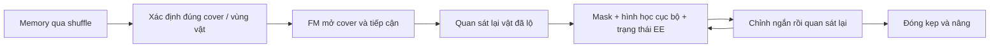

Lúc bị che, chỉ cần nhớ đúng vật đang ở vùng nào. Khi mở cover xong, dùng ảnh mới để tinh chỉnh tương quan **kẹp–vật**, thay vì tiếp tục tin hoàn toàn vào vị trí đã nhớ. Image-based visual servoing dùng sai lệch đặc trưng trên ảnh để chỉnh tiếp cận; đã có nghiên cứu dùng RGB cho giai đoạn cuối khi depth không còn hợp lệ. [Bài nghiên cứu](https://arxiv.org/abs/2001.05650).

Với model hiện tại, mình nghiêng về **giữ geometry/spatial tokens cho FM + train khả năng sửa sai bằng quan sát mới**. Gần vật có thể giảm K10 xuống K1–K3, nhưng cần demo có lệch vị trí và động tác sửa; chỉ replan nhanh hơn chưa đảm bảo sửa được bias. Visual hull là baseline đáng thử trước để biết hai mask hiện tại thực sự cung cấp hình học chính xác tới đâu, trước khi tiếp tục ép mạng hồi quy XYZ.

---

## 0556 · User · 2026-10-19T05:55:25.126Z

ơ t có ý này, dùng 1 cam train tcow dự đoán mỗi target mask cho ngon đi, sau đó lắp thẳng hidden tcow, joint state embedding, cam phụ embedding cho FM , bỏ decoder đi, t thấy lợi bất cập hại, t giả định là mask supervision cũng giúp FM localize và grasp tốt hơn xyz supervision, vì mask thì tcow làm tốt rồi, định vị mask tương tự định vị xyz, trước hết finetune tcownguyên gốc (bỏ 2 head thừa đi)

---

## 0557 · Assistant — tiến độ · 2026-10-19T05:55:28.355Z

Mình sẽ kiểm tra TCOW gốc và dữ liệu mask hiện có, rồi dựng lượt fine-tune một camera chỉ giữ target-mask head. Hướng nối hidden TCOW, joint embedding và cam phụ thẳng vào FM mình ghi lại cho bước sau; lượt này sẽ kiểm tra chất lượng mask trước.

---

## 0558 · Assistant — tiến độ · 2026-10-19T05:55:53.774Z

Dữ liệu shuffle có sẵn amodal target mask cho cả đoạn vật bị che và đoạn mở cover/gắp, nên dùng được trực tiếp. Mình sẽ dùng mask của vật ở frame đầu làm prompt, các frame sau chỉ nhận RGB và phải tự dự đoán mask. Hai output occluder/container sẽ được bỏ; mask supervision có giúp grasp hơn XYZ hay không vẫn là giả thuyết cần so sánh sau.

---

## 0559 · Assistant — tiến độ · 2026-10-19T05:57:58.377Z

Mình đã khôi phục đúng weight của target-mask head từ checkpoint TCOW gốc, nên cả backbone và head đều có pretrained initialization. Lượt đầu sẽ dùng đủ 2.048 episode train: mỗi epoch lấy một clip causal 30 frame cho mỗi episode, đổi điểm kết thúc qua các epoch để phủ reveal, shuffle, bị che và gắp. Mình đang đo tốc độ/VRAM trước khi chạy 10 epoch.

---

## 0560 · Assistant — tiến độ · 2026-10-19T06:00:08.752Z

Phần fine-tune đã được tách riêng: top RGB + mask prompt → TCOW → target mask, không còn XYZ hay context decoder. Mình giữ loss target-mask của TCOW, có tăng trọng số cho đoạn bị che để model học nhớ vật qua shuffle. Trước khi chạy, mình đang đối chiếu output với code gốc và kiểm tra frame tương lai không lọt vào dự đoán quá khứ.

---

## 0561 · Assistant — tiến độ · 2026-10-19T06:01:45.014Z

Preflight đã qua: output mask khớp code gốc trong sai số số học, loss khớp, và không thấy rò rỉ frame tương lai. Batch 4 dùng khoảng **18,5 GiB VRAM**, chạy **0,88 giây/update** — khoảng **8 phút/epoch**, chưa tính cache và validation. Mình bắt đầu lượt 10 epoch; RGB và mask nén sẽ nằm trong RAM, không tạo feature cache trên đĩa.

---

## 0562 · User · 2026-10-19T06:02:13.899Z

ủa train hết mà cache được à

---

## 0563 · Assistant — tiến độ · 2026-10-19T06:02:28.279Z

Cache được vì mình chỉ cache **RGB uint8 và mask nén vào RAM**, không cache hidden feature. Mỗi batch vẫn chạy forward/backward qua toàn bộ TCOW và cập nhật weight.

Riêng train khoảng **61,4 GiB RGB + 7,8 GiB mask**, máy có khoảng **120,7 GiB RAM**. Chỉ khi freeze TCOW mới cache feature để bỏ qua forward được.

---

## 0564 · Assistant · 2026-10-19T06:02:59.888Z

Được, vì đang cache **dữ liệu đầu vào**, không phải feature:

`RAM: RGB + mask → TCOW forward → mask loss → backward toàn bộ TCOW`

Weight thay đổi thì hidden được tính lại mỗi batch. Cache này chỉ tránh đọc đĩa/giải mã video, **không giảm phần tính toán TCOW**.

Ước tính train chiếm **69,2 GiB RAM**. Nếu cache hidden để bỏ qua forward TCOW thì mới phải freeze nó.

---

## 0565 · User · 2026-10-19T06:25:59.737Z

tiếp tục

---

## 0566 · Assistant — tiến độ · 2026-10-19T06:26:02.722Z

Mình kiểm tra tiến độ e114, loss và checkpoint hiện có rồi tiếp tục theo dõi lượt fine-tune mask.

---

## 0567 · Assistant — tiến độ · 2026-10-19T06:26:32.483Z

Lượt trước đã dừng ở **66% nạp cache**, trước khi chạy update đầu tiên, nên chưa có checkpoint train. Log không có traceback và cửa sổ tmux cũ cũng đã mất; mình chưa xác định được nguyên nhân. Mình sẽ chạy lại cùng cấu hình trong thư mục mới, giữ log cũ và theo dõi RAM khi nạp dữ liệu.

---

## 0568 · Assistant — tiến độ · 2026-10-19T06:28:38.491Z

Lượt mới đã nạp khoảng **27%**, process đang dùng **20 GiB RAM** và chưa ghi nhận lỗi cấp phát bộ nhớ. Mình đã thêm số lượng segment và RAM thực dùng vào `progress.json`, đồng thời giữ cửa sổ `ssh_tmux:1` nếu process thoát để còn xem nguyên nhân.

---

## 0569 · Assistant — tiến độ · 2026-10-19T06:29:43.262Z

RAM đang tăng đúng theo lượng dữ liệu đã nạp, hiện khoảng **30,5 GiB** và vẫn còn dư nhiều so với giới hạn máy. Cache còn phải giải mã video và giải nén mask NPZ nên thời gian chuẩn bị biến động; mốc khoảng 8 phút/epoch trước đó chỉ tính phần train.

---

## 0570 · Assistant — tiến độ · 2026-10-19T06:31:21.551Z

Mình thấy phần nạp cache đang chậm bất thường dù RAM còn dư: đo nhanh cho thấy phần lớn CPU đang chạy trong kernel, chưa phải tính toán TCOW. Mình đang kiểm tra cơ chế cấp phát huge page của NumPy để xử lý phần overhead này trước khi chạy tiếp.

---

## 0571 · Assistant — tiến độ · 2026-10-19T06:32:40.875Z

Đã đo được overhead ở bước cấp phát huge page: đọc cùng 2 segment mất **4,70 giây** khi bật và **1,34 giây** khi tắt cho NumPy. Mình sẽ nạp lại với tùy chọn này tắt; dữ liệu, model và cấu hình train giữ nguyên. Lượt hiện tại vẫn chưa chạy update nào nên không mất tiến độ học.

---

## 0572 · Assistant — tiến độ · 2026-10-19T06:34:15.023Z

Lượt nạp mới đang chạy khoảng **7 segment/giây**, đã qua 480 segment; RAM process khoảng **14 GiB**. Mình sẽ theo dõi qua mốc từng bị chậm và kiểm tra đến khi có loss train thực tế.

---

## 0573 · Assistant — tiến độ · 2026-10-19T06:35:21.577Z

Cache đã tới **38%**, khoảng **27 GiB RAM**. Chưa có lỗi cấp phát; tốc độ đang ổn định.

---

## 0574 · Assistant — tiến độ · 2026-10-19T06:36:27.011Z

Đã vượt **40 GiB RAM** mà tốc độ vẫn giữ khoảng **7,2 segment/giây**, không dùng swap. Tình trạng chậm sau mốc khoảng 32 GiB ở lượt trước chưa xuất hiện lại.

---

## 0575 · Assistant — tiến độ · 2026-10-19T06:37:40.897Z

Cache đã qua **76%**, vượt mốc lượt cũ bị dừng; process dùng khoảng **54,6 GiB RAM** và vẫn giữ tốc độ. Sau khi nạp xong, job sẽ đo baseline checkpoint gốc rồi bắt đầu fine-tune.

---

## 0576 · Assistant — tiến độ · 2026-10-19T06:38:46.578Z

Đã nạp **97%**, process dùng khoảng **68,6 GiB RAM**, chưa có lỗi cấp phát. Mình đang chờ baseline và những update đầu để xác nhận trainer chạy bình thường.

---

## 0577 · Assistant — tiến độ · 2026-10-19T06:39:54.622Z

Đã nạp xong cache và **bắt đầu train thật**, hiện qua hơn 20 update. Tốc độ khoảng **0,92 giây/update**, VRAM **18,5 GiB**; cache train + val chiếm khoảng **70,2 GiB RAM**.

Baseline checkpoint gốc trên tập val này: **IoU vật lộ 74,6%**, còn các probe vật bị che qua shuffle là **0%**. Đây là mốc để so với kết quả sau fine-tune.

---

## 0578 · Assistant · 2026-10-19T06:40:16.811Z

Đã tiếp tục e114 trong `ssh_tmux:1`, hiện **epoch 1/10, step 50/5.120**.

- Full 2.048 episode, fine-tune toàn bộ TCOW + target-mask head.
- Đã xử lý overhead huge page; cache hoàn tất.
- Khoảng **8 phút/epoch**, VRAM **18,5 GiB**.

Loss đang log trực tiếp và lưu tại [train_3.log](/workspace/robotics_assets/experiments/e114_mask/train_3.log).

---

## 0579 · User · 2026-10-19T08:08:58.167Z

done, test và cho t xem vài video

---

## 0580 · Assistant — tiến độ · 2026-10-19T08:09:02.218Z

Mình sẽ kiểm tra checkpoint tốt nhất, test mask trên các nhóm held-out rồi tạo vài video có GT và prediction để xem khả năng nhớ vật qua shuffle.

---

## 0581 · Assistant — tiến độ · 2026-10-19T08:10:13.773Z

Train đã xong **10 epoch**; best là **epoch 9, step 4.608**. Test probe đã lưu cho kết quả mean IoU **83,2% ở hoán vị mới**, **76,2% ở layout mới**, và **75,6% khi cả hai đều mới**.

Mình đang tạo video so sánh **GT / checkpoint gốc / sau fine-tune**, có cả một case khó để xem model lệch ở đâu. Đây là test tracking mask trên video expert, chưa phải FM điều khiển robot.

---

## 0582 · Assistant — tiến độ · 2026-10-19T08:13:17.325Z

Mình chọn 4 video cố định: train tham chiếu, hoán vị mới, layout mới, và cả hai cùng mới; thêm một video có điểm mask khi bị che thấp nhất trong nhóm test. Mỗi video có toàn cảnh và vùng phóng to quanh vật, so sánh GT, TCOW gốc và bản fine-tune.

---

## 0583 · Assistant — tiến độ · 2026-10-19T08:14:48.247Z

Video train đã có: [xem so sánh GT / TCOW gốc / fine-tune](/workspace/robotics_assets/experiments/e114_mask/test_videos/train.mp4). Trong toàn video này, IoU lúc vật bị che tăng từ **9,5% lên 78,5%**. Mình cũng đã chạy lại validation của best checkpoint và khớp chính xác kết quả đã lưu.

---

## 0584 · Assistant — tiến độ · 2026-10-19T08:16:13.404Z

Video [hoán vị chưa thấy](/workspace/robotics_assets/experiments/e114_mask/test_videos/unseen_permutation.mp4) đã xong. Trong riêng clip này, IoU khi bị che tăng từ **8,8% lên 80,8%**. Mình đang hoàn tất hai video còn lại và kiểm tra giải mã toàn bộ MP4.

---

## 0585 · Assistant — tiến độ · 2026-10-19T08:17:21.439Z

Ở clip layout mới, mask còn lệch vị trí khi vật nằm dưới cover; tại frame mở cover, prediction đã bám lại đúng vật khá sát. Chất lượng qua occlusion đã cải thiện, nhưng vẫn chưa ổn định ở mọi case. Các video và số liệu giữ nguyên những đoạn lệch này.

---

## 0586 · Assistant · 2026-10-19T08:19:08.184Z

Đã test **best epoch 9, step 4.608**. Video có 3 cột: **GT xanh → TCOW gốc cam → fine-tune hồng**.

- [Hoán vị mới](/workspace/robotics_assets/experiments/e114_mask/test_videos/unseen_permutation.mp4)
- [Layout mới](/workspace/robotics_assets/experiments/e114_mask/test_videos/unseen_layout.mp4)
- [Cả layout và hoán vị mới](/workspace/robotics_assets/experiments/e114_mask/test_videos/both_unseen.mp4)
- [Case khó, mask còn lệch](/workspace/robotics_assets/experiments/e114_mask/test_videos/hard_case.mp4)
- [Train tham chiếu](/workspace/robotics_assets/experiments/e114_mask/test_videos/train.mp4)

IoU trên các probe test:

| Nhóm | Episode | Mean IoU | Khi bị che |
|---|---:|---:|---:|
| Hoán vị mới | 64 | 83,2% | 79,7% |
| Layout mới | 32 | 76,2% | 67,8% |
| Cả hai mới | 64 | 75,6% | 66,9% |

Mask cải thiện rõ, nhưng vẫn có đoạn lệch dưới cover ở layout mới. **Đây là tracking trên video expert, chưa phải kết quả FM gắp vật.**

[Code và lệnh chạy test](/workspace/arm-manipulation/docs/research/e114_test_README.md).

---

## 0587 · User · 2026-10-19T08:19:45.653Z

nhưng nó có track đúng 100% case dưới cover nào không

---

## 0588 · Assistant — tiến độ · 2026-10-19T08:19:48.832Z

Mình sẽ đo riêng tỷ lệ chọn đúng cover sau shuffle, tách khỏi IoU của mask. Mình sẽ đối chiếu vùng mask dự đoán với hai cover trên toàn bộ 160 episode test đã dùng, để xem có đạt 100% không.

---

## 0589 · Assistant — tiến độ · 2026-10-19T08:23:20.771Z

ใน 160 case เดิม mask หลัง shuffle ยัง overlap กับ target ทุก case แม้ IoU บางอันต่ำ จึงอาจเป็นแค่ตำแหน่งคลาดใน cover เดิมได้ ผมจะวัด cover ให้ตรงคำถาม และตรวจเพิ่มครบ **1.408 held-out episode** แทนการสรุปจาก subset อย่างเดียว.

---

## 0590 · Assistant — tiến độ · 2026-10-19T08:23:20.784Z

Mình gõ nhầm ngôn ngữ. Ý là: trong 160 case cũ, mask sau shuffle vẫn overlap với target ở mọi case, nên IoU thấp có thể chỉ là lệch vị trí trong cùng cover. Mình sẽ đo trực tiếp cover và kiểm tra thêm đủ **1.408 episode held-out** để trả lời chắc hơn.

---

## 0591 · Assistant — tiến độ · 2026-10-19T08:24:24.457Z

Metric này chỉ yêu cầu phần lớn mask dự đoán nằm trong đúng cover, không yêu cầu khớp biên vật. Mình đang đo cả **cuối shuffle** và **các mốc giữa lúc shuffle**; mask rỗng hoặc nằm mơ hồ giữa hai cover sẽ không được tính là đúng.

---

## 0592 · Assistant — tiến độ · 2026-10-19T08:26:40.907Z

**Đúng: cả 160/160 case đã test trước đó đều xác định đúng cover sau shuffle.** Theo phép đối chiếu mask với 4 vật, cả 160 cũng vẫn gần đúng vật được hỏi.

Ở lượt kiểm tra mở rộng, hiện **960/960 case sau shuffle** đúng cover. Mình đang chạy nốt toàn bộ held-out và các mốc đang shuffle.

---

## 0593 · Assistant — tiến độ · 2026-10-19T08:28:08.794Z

Đã xong toàn bộ kiểm tra **sau shuffle: 1.408/1.408 case đúng cover — 100%**:

- Hoán vị mới: **1.024/1.024**
- Layout mới: **256/256**
- Cả hai mới: **128/128**

Mình đang chạy nốt các mốc giữa lúc shuffle để xem có nhầm tạm thời rồi hồi phục không.

---

## 0594 · Assistant — tiến độ · 2026-10-19T08:29:42.077Z

Có một điểm cần tách rõ: **cuối shuffle vẫn đúng 100%**, nhưng vừa thấy **2 mốc giữa lúc shuffle chọn nhầm cover**, sau đó hồi phục đúng ở cuối. Vì vậy chưa thể gọi là track đúng cover 100% xuyên suốt quá trình. Mình đang đếm nốt các mốc còn lại.

---

## 0595 · Assistant · 2026-10-19T08:32:19.812Z

**Ở cuối shuffle: đúng cover 100% trên toàn bộ 1.408 case held-out.**

- Hoán vị mới: **1.024/1.024**
- Layout mới: **256/256**
- Cả hai mới: **128/128**

**Trong lúc shuffle:** đúng **2.942/2.944 mốc = 99,93%**. Có 2 lần nhầm cover trong cùng một scene, sau đó đều hồi phục đúng ở cuối.

Vì vậy, chưa phải tracking đúng 100% mọi thời điểm. IoU thấp vẫn có thể chỉ là mask lệch trong **đúng cover**.

[Chi tiết phép đo](/workspace/arm-manipulation/docs/research/e114_cover_README.md).

---

## 0596 · User · 2026-10-19T08:39:15.827Z

rồi freeze đống đó, ném hidden tcow + joint state embedding,cam phụ embedding vào FM pretrained reach, rồi train FM, vì chỉ có joint encoder và FM train nên cache đưuocj cam phụ và tcow hidden, train FM thì chỉ trên expert traj còn tcow vẫn phải lấy history từ context

---

## 0597 · Assistant — tiến độ · 2026-10-19T08:39:22.271Z

Mình sẽ dựng lượt BC theo cấu hình này: freeze TCOW mask vừa train và ViT cam phụ, cache hidden của hai nhánh ảnh; chỉ train joint encoder và FM khởi tạo từ checkpoint reach. FM chỉ nhận loss trên đoạn expert, còn hidden TCOW ở mỗi thời điểm expert vẫn dùng history từ đầu context shuffle. Mình sẽ kiểm tra cách ghép token và dung lượng cache trước khi chạy.

---

## 0598 · Assistant — tiến độ · 2026-10-19T08:44:19.537Z

Có 234.434 expert chunk ở stride 3. Giữ đủ **300 token TCOW + 64 token cam phụ** bằng FP16 sẽ cần khoảng **122 GiB**, vượt RAM máy. Mình sẽ thử cache TCOW bằng int8 có scale, giữ nguyên số token, và kiểm tra sai số trước khi dùng.

Để đúng yêu cầu chỉ train FM và joint encoder, mình dùng padding cố định từ hidden 768 lên context 960; các K/V projection sẵn có của FM sẽ học cách đọc chúng. Không thêm context decoder hay XYZ head.

---

## 0599 · Assistant — tiến độ · 2026-10-19T08:50:12.888Z

Mình sẽ giữ đúng cách lấy history đã test ở e114: mỗi chunk expert dùng 30 frame từ frame đầu context đến frame expert hiện tại, cùng mask prompt ở frame đầu. Lượt đầu mình đặt **10 epoch**; ở epoch 1, job sẽ cache rồi train theo từng nhóm scene để có loss và checkpoint sớm. Từ epoch 2 sẽ chỉ đọc feature cache trong RAM.

---

## 0600 · Assistant — tiến độ · 2026-10-19T08:54:45.057Z

Code đã tách phần cache ảnh khỏi dữ liệu BC. TCOW/ViT được freeze, cache chỉ lưu embedding hiện tại đã chứa history; joint encoder vẫn chạy theo joint đo tại mỗi chunk expert. Mình đang preflight để kiểm tra history, action label, sai số cache int8, gradient và batch vừa VRAM trước khi chạy lượt chính.

---

## 0601 · Assistant — tiến độ · 2026-10-19T08:57:57.026Z

Phần encode TCOW đo được khoảng **13 chunk/giây**, nên lượt cache đầy đủ đầu tiên sẽ mất khoảng **5 giờ**. Freeze giúp các epoch sau bỏ qua forward TCOW.

Preflight cũng phát hiện cache int8 với một scale cho mỗi 64 chiều có sai số latent khoảng **1,37%**, vượt ngưỡng mình đặt. Mình đang tăng số scale để giảm sai số; cache vẫn nằm trong RAM.

---

## 0602 · Assistant — tiến độ · 2026-10-19T09:04:49.770Z

Đã chạy E115 và có những update FM đầu tiên. TCOW + ViT cam phụ đều freeze; FM nhận đủ 300 token TCOW, 64 token cam phụ và 1 token joint, không qua context decoder hay head XYZ.

Batch 256 chạy khoảng 0,58 giây/update, dùng khoảng 15 GiB VRAM. Cache RAM dự kiến 78,4 GiB; history đã kiểm tra khớp với lúc train TCOW, còn loss FM chỉ tính trên đoạn expert.

---

## 0603 · Assistant — tiến độ · 2026-10-19T09:06:11.592Z

Đã có `best.pt` và `latest.pt`; checkpoint resume đã kiểm tra có đủ optimizer, RNG và thứ tự dữ liệu. Cache vẫn đang chạy song song với train từng nhóm expert.

Ước tính hiện tại: lượt đầu gồm cache + train khoảng 6–7 giờ; từ epoch 2 khoảng 8–10 phút/epoch. Mình đặt lượt đầu 10 epoch. Để vừa RAM, hidden TCOW được lưu int8 theo block, giữ nguyên toàn bộ token; kiểm tra trước chạy cho sai lệch latent khoảng 0,74%.

---

## 0604 · Assistant · 2026-10-19T09:06:20.721Z

Đã chạy **E115**, full data, trước mắt **10 epoch**, trong `ssh_tmux:1`.

`TCOW hidden + cam phụ ViT tokens + joint embedding → FM khởi tạo từ reach`

- Freeze toàn bộ TCOW và ViT; chỉ train joint encoder + FM.
- Bỏ context decoder và XYZ loss.
- TCOW vẫn xem history từ đầu context đến frame hiện tại; **loss FM chỉ trên expert**, stride 3.
- Cache RAM khoảng **78,4 GiB**, giữ đủ 300 token TCOW; dùng int8, sai lệch latent kiểm tra khoảng 0,74%.
- Batch 256, khoảng **0,55 giây/update**. Đã có update thật và `best.pt`/`latest.pt`.

Ước tính lượt đầu cache + train **6–7 giờ**, các epoch sau **8–10 phút/epoch**. Chưa có kết quả rollout.

Code, cấu hình và sơ đồ đã ghi trong [E115 README](/workspace/arm-manipulation/docs/research/e115_README.md).

---

## 0605 · User · 2026-10-19T11:31:05.943Z

thôi hỏng rồi, t biết vì sao tcow có occluder và container rồi, vì nó giúp track target khi container di chuyển, bỏ đi có ổn không nhỉ

---

## 0606 · Assistant — tiến độ · 2026-10-19T11:31:11.279Z

Mình kiểm tra lại đường đi của hai head đó: chúng có thể giúp backbone học quan hệ che khuất/containment qua loss phụ, hoặc được dùng trực tiếp để cập nhật tracking. Hai trường hợp này ảnh hưởng khác nhau khi bỏ head.

---

## 0607 · Assistant · 2026-10-19T11:31:48.049Z

**Chưa thể kết luận hỏng. Bạn đúng về vai trò của occluder/container, nhưng cần phân biệt bỏ output head với bỏ supervision khi train.**

TCOW học đồng thời:
- **Target:** vật cần theo dõi ở đâu.
- **Occluder:** vật nào đang che nó.
- **Container:** vật nào đang chứa nó.

Hai nhiệm vụ sau giúp backbone học quan hệ giữa target và vật xung quanh, rất phù hợp với cảnh cover di chuyển. [TCOW chính thức](https://tcow.cs.columbia.edu/).

Tuy nhiên, mình kiểm tra code gốc: **cả ba mask được đọc song song từ cùng hidden; mask container/occluder không được feed ngược vào tracker để cập nhật target.** Vì vậy, giữ nguyên backbone rồi bỏ hai output đó ở inference sẽ không làm thay đổi hidden hay target mask. [Code gốc](https://github.com/basilevh/tcow/blob/main/model/mask_tracker.py).

Điểm đáng cân nhắc nằm ở **E114 đã fine-tune cả backbone nhưng chỉ giữ target loss**. Như vậy:
- Kiến thức occlusion/containment từ pretrained vẫn là điểm khởi tạo.
- Trong fine-tune, không còn hai loss bảo toàn và thích nghi kiến thức ấy; có thể bị suy giảm. Chưa có ablation để biết mức ảnh hưởng.

Trước đó mình gọi hai head là “thừa” thì không chuẩn: **bỏ khỏi inference được; bỏ loss lúc fine-tune là một lựa chọn cần kiểm chứng.**

Dù vậy, checkpoint hiện tại đã chọn đúng cover **1.408/1.408 case sau shuffle**, và **2.942/2.944 probe giữa shuffle**. Nó vẫn học được việc theo target dưới cover; chưa có bằng chứng lượt này hỏng.

Mình nghiêng về **giữ đủ ba loss khi fine-tune TCOW, sau đó freeze và chỉ đưa hidden sang FM**. E115 hiện tại vẫn đáng giữ làm baseline target-only; thêm lại hai head vào backbone đang freeze sẽ không tự cải thiện hidden.

---

## 0608 · User · 2026-10-19T11:35:54.822Z

nó không trực tiếp feed vào nhưng supervision thêm mask cũng ảnh hướng latent đúng không, t nghĩ nó cũng ảnh hưởng việc track target chứ ?

---

## 0609 · Assistant · 2026-10-19T11:36:02.064Z

**Đúng, nó ảnh hưởng cả latent lẫn khả năng track target.** Cả ba loss đều backprop qua backbone chung:

\[
\nabla_\theta L
= \nabla_\theta L_{\text{target}}
+ \lambda_o\nabla_\theta L_{\text{occluder}}
+ \lambda_c\nabla_\theta L_{\text{container}}
\]

Để dự đoán đúng container/occluder **của target được query**, hidden phải biểu diễn cả quan hệ giữa chúng. Ví dụ: target biến mất dưới cover A, rồi A di chuyển — supervision này tạo thêm áp lực học việc giữ liên kết target–A qua thời gian. Target loss cũng có thể dạy điều đó, nhưng tín hiệu gián tiếp hơn.

Vì vậy, bỏ hai loss khi fine-tune có thể làm latent mất bớt cấu trúc hữu ích, ảnh hưởng target tracking và cả FM nhận hidden sau đó. **Không có feedback trực tiếp không có nghĩa là không ảnh hưởng tracking.** Mình đã nhấn mạnh chuyện đường forward quá mức.

Kết quả chọn đúng cover hiện tại cho thấy target-only vẫn hoạt động trên các probe đã test; nó chưa chứng minh latent tốt ngang bản train đủ ba loss. Với bài toán của mình, **giữ đủ ba supervision khi fine-tune TCOW là lựa chọn có cơ sở hơn**; khi freeze để train FM thì chỉ cần lấy hidden.

---

## 0610 · User · 2026-10-19T11:39:43.675Z

tại sao tcow track tốt, vì nó cứ lấy lại frame đầu và 30 frame suốt lịch sử à, nhược điểm của nó là nặng đúng không

---

## 0611 · Assistant · 2026-10-19T11:39:59.000Z

**Đúng với pipeline hiện tại:** mỗi lần cần hidden mới, mình lấy **frame đầu + các frame rải đều trong lịch sử + frame hiện tại**, tổng cộng 30 frame, rồi chạy lại TCOW trên clip đó.

Nó track tốt nhờ kết hợp:

- **Mốc nhận dạng cố định:** frame đầu có query mask, giúp giữ thông tin “đang theo vật nào”, giảm drift.
- **Quan sát diễn biến:** các frame trung gian cho thấy vật chui vào cover nào, cover di chuyển ra sao và vật xuất hiện lại ở đâu.
- **Pretraining phù hợp:** TCOW được học tracking qua occlusion/containment. Chỉ đưa 30 frame cho một encoder thông thường chưa chắc làm được tương tự.

Có thể hiểu nó đang **đọc lại một bản tóm tắt lịch sử bằng ảnh**, thay vì chỉ nhớ bằng một hidden state cập nhật từng frame. Frame đầu có mask; các frame sau chỉ có RGB, không được cung cấp lại GT mask.

**Nhược điểm lớn đúng là chi phí tính toán:** bản mình đang dùng phải xử lý lại 30 frame qua backbone 12 block mỗi lần dự đoán. Freeze giúp bỏ backward và cho phép cache lúc train FM, nhưng khi robot chạy trên ảnh mới thì vẫn phải encode lại.

Ngoài ra còn một nhược điểm: **video càng dài, 30 frame càng thưa**. Những chuyển động nhanh hoặc thời điểm đổi quan hệ target–cover có thể lọt giữa các frame được lấy mẫu.

Vì vậy, TCOW hiện tại đổi chi phí tính toán lấy khả năng nhìn lại lịch sử; kiến trúc memory cập nhật từng frame có thể nhanh hơn, nhưng phải giải quyết việc giữ đúng danh tính và tránh drift trong memory.

---

## 0612 · User · 2026-10-19T16:09:34.938Z

train xong

---

## 0613 · Assistant — tiến độ · 2026-10-19T16:09:38.065Z

Mình kiểm tra E115 đã chạy đủ epoch chưa, rồi xem loss train/validation và checkpoint tốt nhất.

---

## 0614 · Assistant · 2026-10-19T16:10:19.152Z

**E115 đã xong đủ 10 epoch**, 9.268 updates, full data.

| Epoch | Train loss | Val loss |
|---|---:|---:|
| 1 | 0,18402 | 0,03311 |
| 5 | 0,01156 | 0,01398 |
| **10 — best** | **0,00814** | **0,00914** |

- Tổng thời gian **7 giờ 2 phút**; lượt đầu cache + train **5 giờ 48 phút**, các epoch sau khoảng **8,2 phút/epoch**.
- TCOW và ViT giữ nguyên weight đúng như yêu cầu.
- [Best checkpoint](/workspace/robotics_assets/experiments/e115_direct/train/best.pt): **epoch 10, step 9.268**.

Loss giảm tốt, nhưng **chưa rollout nên chưa biết tỷ lệ mở cover/gắp thành công**. Đã cập nhật [báo cáo E115](/workspace/arm-manipulation/docs/research/e115_README.md).

---

## 0615 · User · 2026-10-19T16:17:40.981Z

rollout đi

---

## 0616 · Assistant — tiến độ · 2026-10-19T16:17:43.660Z

Mình rollout checkpoint best E115 trên vài cảnh train, hoán vị mới và vị trí mới, rồi xuất video để xem mở cover và gắp vật thế nào.

---

## 0617 · Assistant — tiến độ · 2026-10-19T16:18:01.445Z

Mình dùng H25/K10 như các lượt trước: dự đoán 25 action, thực thi 10 rồi quan sát lại. Bốn cảnh sẽ giữ cùng target đỏ để so sánh train / hoán vị mới / bố trí mới / cả hai mới. Video sẽ có top view, cam phụ và mask TCOW để phân biệt lỗi tracking với lỗi điều khiển.

---

## 0618 · Assistant — tiến độ · 2026-10-19T16:20:23.116Z

Cảnh train đã xong: robot mở và đặt đúng cover, nhưng chưa nâng được vật — hết 900 frame, vật chỉ nhấc lên tối đa khoảng 6 mm. Mình đang chạy tiếp ba cảnh còn lại; video có mask overlay để xem target còn được bám đúng khi gắp hụt không.

---

## 0619 · Assistant — tiến độ · 2026-10-19T16:21:11.821Z

Hai cảnh đầu đều chưa gắp thành công. Ở cảnh train, mask cuối vẫn bám vật đỏ nhưng tay robot đã lệch khỏi vật; ít nhất ở đoạn cuối này, tracking đúng chưa đủ để FM điều khiển gắp đúng. Cảnh hoán vị mới cũng đã nâng cover lên, nhưng chưa hoàn tất thao tác.

---

## 0620 · Assistant — tiến độ · 2026-10-19T16:22:30.349Z

Xong bốn cảnh: **1 cảnh thành công**, chính là cảnh cả hoán vị lẫn bố trí đều mới. Robot đặt đúng cover rồi nâng vật đỏ khoảng 11,7 cm. Ba cảnh còn lại timeout; riêng cảnh bố trí mới mở nhầm cover. Mình đang chốt video và ghi kết quả vào báo cáo.

---

## 0621 · Assistant · 2026-10-19T16:23:03.281Z

Đã rollout **best epoch 10**, H25/K10, 10 flow steps. **1/4 cảnh thành công**:

| Cảnh — video | Kết quả |
|---|---|
| [Train](/workspace/robotics_assets/experiments/e115_direct/test_k10/g000_p00_t0.mp4) | Đặt đúng cover, gắp hụt |
| [Hoán vị mới](/workspace/robotics_assets/experiments/e115_direct/test_k10/g000_p01_t0.mp4) | Nâng đúng cover, chưa hoàn tất |
| [Bố trí mới](/workspace/robotics_assets/experiments/e115_direct/test_k10/g036_p00_t0.mp4) | Mở nhầm cover |
| [Cả hai mới](/workspace/robotics_assets/experiments/e115_direct/test_k10/g036_p01_t0.mp4) | **Thành công**, nâng vật 11,7 cm trong 13,5 giây |

**[Video so sánh 4 cảnh](/workspace/robotics_assets/experiments/e115_direct/test_k10/comparison.mp4)** — có mask TCOW, top view và cam phụ.

Ở ảnh cuối cảnh train và cảnh mở nhầm cover, mask vẫn nằm gần đúng target nhưng hành động sai. Vì vậy chưa thể quy lỗi hoàn toàn cho tracking. Đây là bốn demo cùng target đỏ, chưa đủ để ước lượng tỷ lệ thành công chung.

---

## 0622 · User · 2026-10-19T16:59:25.755Z

còn cache không, còn train được không, loss còn giảm được không

---

## 0623 · Assistant — tiến độ · 2026-10-19T16:59:33.334Z

Mình kiểm tra cache RAM còn sống không, checkpoint có resume được không và xu hướng loss ở các epoch cuối.

---

## 0624 · Assistant · 2026-10-19T16:59:50.729Z

- **Cache feature không còn:** cache chỉ nằm trong RAM, process train kết thúc thì được giải phóng; không có bản lưu trên disk.
- **Train tiếp được:** `latest.pt` có đủ weight, optimizer và RNG, resume đúng từ **epoch 11**. Phải build lại cache khoảng **5–6 giờ**, sau đó khoảng **8,2 phút/epoch**.
- **Loss có khả năng giảm tiếp:** chưa thấy plateau rõ.

| Epoch | Train loss | Val loss |
|---|---:|---:|
| 7 | 0,00962 | 0,01091 |
| 8 | 0,00890 | 0,01096 |
| 9 | 0,00849 | 0,01322 |
| 10 | **0,00814** | **0,00914** |

Epoch 10 vẫn đạt val tốt nhất. **Train thêm có cơ sở, nhưng loss giảm chưa bảo đảm rollout gắp tốt hơn.**

Nếu chạy tiếp, mình nên lưu cache ra disk hoặc giữ process sống sau khi hết ngân sách epoch, để tránh mất thêm 5–6 giờ mỗi lần resume.

---

## 0625 · User · 2026-10-19T17:00:32.415Z

có tốt hơn xyz supervision không

---

## 0626 · Assistant — tiến độ · 2026-10-19T17:00:36.823Z

Mình đối chiếu với các lượt dùng XYZ supervision trước để xem kết quả nào so sánh được, vì tracker và kiến trúc nối vào FM cũng đã thay đổi.

---

## 0627 · Assistant · 2026-10-19T17:00:50.539Z

**Chưa đủ bằng chứng để nói mask supervision tốt hơn XYZ supervision.**

| Thí nghiệm | Bài toán | Kết quả |
|---|---|---|
| E103 — XYZ auxiliary | Gắp vật lộ rõ, không cover/shuffle | **118/128 thành công** |
| E111 — XYZ auxiliary | Shuffle → mở cover → gắp | **0/4 demo** |
| E115 — mask supervision | Shuffle → mở cover → gắp | **1/4 demo** |

E115 có tín hiệu tốt hơn E111 trên bốn cảnh đó, nhưng **đã đổi cả tracker, prompt và kiến trúc nối vào FM**, nên chưa thể quy cải thiện cho mask loss.

Điểm hiện tại cho thấy là: **TCOW định vị target khá tốt bằng mask, nhưng FM chưa chuyển thông tin đó thành hành động ổn định**. Mask đúng mà mở nhầm cover vẫn xảy ra.

Muốn so sánh riêng supervision, cần giữ cùng TCOW, cùng cách nối FM, data và ngân sách train; chỉ thay **mask loss / XYZ loss / cả hai**, rồi test cùng một bộ rollout đủ lớn. E103 cũng cho thấy XYZ supervision vẫn có thể rất hiệu quả trên bài toán phù hợp.

---

## 0628 · User · 2026-10-19T17:04:06.511Z

định vị tốt nhưng FM chưa tận dụng được ?, tại sao nhỉ, rõ ràng mask bên kia, hay train chưa đủ

---

## 0629 · Assistant — tiến độ · 2026-10-19T17:04:24.014Z

Có thể train chưa đủ, nhưng “mask đúng” chưa có nghĩa FM đã học cách đọc hidden đó — FM hiện không nhận trực tiếp mask. Mình probe nhanh: giữ nguyên ảnh, joint và noise, chỉ đổi query giữa bốn vật, rồi xem trajectory FM có đổi đúng theo target không.

---

## 0630 · Assistant — tiến độ · 2026-10-19T17:05:43.251Z

Bốn target trong mỗi cảnh có cùng ảnh và joint ban đầu, nên phép đổi query này kiểm tra được FM có thực sự phân biệt target hay không. Mình đang so trajectory với demo expert cho hai cover; hai vật nằm chung một cover vốn sẽ có đoạn mở cover giống nhau.

---

## 0631 · Assistant — tiến độ · 2026-10-19T17:06:08.139Z

Có một chi tiết cần sửa trong phép kiểm tra: các video được nén riêng nên pixel đầu có thể khác nhẹ dù trạng thái vật lý giống hệt nhau. Mình dùng một ảnh chung cho cả bốn query; như vậy khác biệt đầu ra sẽ đến từ query, không lẫn sai khác ảnh.

---

## 0632 · Assistant — tiến độ · 2026-10-19T17:06:46.309Z

Probe cho thấy FM **có dùng query, nhưng chưa nhất quán**: dùng đúng query thì sai số trajectory trung bình khoảng 8,4 mm; đổi sang query của vật dưới cover kia thì tăng lên 16,7 mm.

Có ví dụ khá rõ: ở cảnh train, mask của vật xanh lá đạt IoU 94,5%, nhưng trajectory đầu của FM lại gần demo mở cover sai ở cả bốn noise seed. Vậy không thể chỉ giải thích các lỗi bằng việc TCOW track sai; cách FM đọc hidden vẫn còn vấn đề.

---

## 0633 · Assistant · 2026-10-19T17:07:14.798Z

**Có thể chưa đủ train. Probe vừa chạy cho thấy FM đã dùng target, nhưng dùng chưa ổn định.**

Giữ nguyên ảnh, joint và noise, chỉ đổi query:

- Query đúng: sai số trajectory trung bình **8,4 mm** so với expert.
- Query của vật dưới cover kia: sai số tăng lên **16,7 mm**.

Vậy FM không bỏ qua query. Nhưng có trường hợp **mask xanh lá đạt IoU 94,5%, còn trajectory FM lại nghiêng về cover sai ở cả bốn noise seed**.

Lý do “mask rõ ràng bên kia” chưa đủ là hai đường đọc latent khác nhau:

```text
TCOW hidden → mask head đã được train → mask mình nhìn thấy
            → FM học từ action loss → trajectory
```

**FM không nhận mask đang hiển thị.** Nó phải tự học cách tìm thông tin target trong 300 hidden token, liên hệ với hình học robot rồi chọn hành động. Weight reach cung cấp khả năng điều khiển, nhưng chưa cung cấp cách đọc hidden TCOW. TCOW đang freeze nên toàn bộ việc thích nghi này nằm ở FM.

Mình nghiêng về **train thêm cùng kiến trúc trước khi thay đổi lớn**, vì epoch 10 vẫn có val loss tốt nhất. Nhưng cần theo dõi thêm phép probe chọn đúng cover và rollout: nếu loss tiếp tục giảm mà vẫn nhầm cover, khi đó mới có bằng chứng mạnh hơn rằng cách nối conditioning cần sửa.

[Chi tiết probe](/workspace/arm-manipulation/docs/research/e115_query_README.md).

---

## 0634 · User · 2026-10-19T17:12:38.356Z

ok, lại cache và resume, train thêm 30 epoch

---

## 0635 · Assistant — tiến độ · 2026-10-19T17:12:42.354Z

Mình sẽ build lại cache rồi resume từ epoch 11, train thêm 30 epoch — tổng cộng 40 epoch. Lần này mình sẽ giữ cache sau khi train xong để có thể train tiếp mà không phải encode lại.

---

## 0636 · User · 2026-10-19T17:12:57.508Z

đủ bộ nhớ đâu mà giữ cache

---

## 0637 · Assistant — tiến độ · 2026-10-19T17:13:20.341Z

Đúng, disk chỉ còn khoảng 35 GiB, không đủ lưu cache 78 GiB. RAM vẫn đủ cho cache trong lúc train như lượt trước. Mình sẽ chỉ giữ cache trong lượt train thêm 30 epoch rồi giải phóng, bỏ ý giữ thường trực sau khi xong.

---

## 0638 · Assistant — tiến độ · 2026-10-19T17:14:17.699Z

Đã kiểm tra resume: weight và optimizer khôi phục khớp checkpoint, bắt đầu từ epoch 11, LR vẫn là `2e-5`, không chạy lại warmup. Lượt 30 epoch bổ sung đã khởi động trong `ssh_tmux:1`.

Ước tính tổng khoảng 9–10 giờ: 5–6 giờ build cache RAM, rồi khoảng 4,1 giờ train.

---

## 0639 · Assistant · 2026-10-19T17:15:41.807Z

Đã khởi động trong **`ssh_tmux:1`**:

- Build lại cache RAM, rồi train **epoch 11–40** — thêm đúng 30 epoch.
- Khôi phục nguyên weight, optimizer và RNG; giữ cấu hình cũ.
- Ước tính **9–10 giờ tổng cộng**.
- Cache chỉ giữ trong RAM lúc chạy, **giải phóng sau khi xong**, không lưu xuống disk.

Log: [train_2.log](/workspace/robotics_assets/experiments/e115_direct/train_2.log).

---

## 0640 · User · 2026-10-20T03:46:32.589Z

xong, test

---

## 0641 · Assistant — tiến độ · 2026-10-20T03:46:35.868Z

Mình kiểm tra lượt train 40 epoch đã hoàn tất, rồi rollout checkpoint best trên cùng bốn cảnh trước và xuất video để so sánh.

---

## 0642 · Assistant — tiến độ · 2026-10-20T03:47:06.669Z

Đã train đủ 40 epoch. Checkpoint tốt nhất nằm ở **epoch 32, step 29.420**, val loss **0,00538**; epoch 40 có val loss 0,00650. Mình test bản best, giữ nguyên bốn cảnh, H25/K10 và noise seed như lượt epoch 10.

---

## 0643 · Assistant — tiến độ · 2026-10-20T03:48:10.936Z

Hai cảnh đầu — train và hoán vị mới — đã **mở đúng cover và gắp thành công**, hoàn tất trong khoảng 13 giây. Cả hai đều thất bại ở epoch 10, nên train thêm đã cải thiện rõ hai cảnh này. Mình đang chạy tiếp hai cảnh có bố trí mới.

---

## 0644 · Assistant — tiến độ · 2026-10-20T03:49:22.158Z

Cảnh bố trí mới vẫn thất bại: robot chưa mở được cover cần thiết và chưa nâng vật. Mình đang chờ cảnh cuối; hiện kết quả là hai thành công, một thất bại. Val loss giảm chưa giải quyết được hết các lỗi rollout.

---

## 0645 · Assistant — tiến độ · 2026-10-20T03:49:52.233Z

Xong: bản best mới đạt **2/4**, so với **1/4** trước đó. Train và hoán vị mới chuyển từ thất bại sang thành công; nhưng cảnh cả hai yếu tố đều mới lại chuyển từ thành công sang gắp hụt. Mình đang ghép video trước/sau và kiểm tra hai lượt dùng cùng trạng thái khởi đầu.

---

## 0646 · Assistant · 2026-10-20T03:50:56.457Z

Test xong **best epoch 32**, sau lượt train đủ 40 epoch: **2/4 thành công**, trước đó 1/4.

| Cảnh — video | Epoch 10 | Best mới |
|---|---|---|
| [Train](/workspace/robotics_assets/experiments/e115_direct/test_k10_2/g000_p00_t0.mp4) | Thất bại | **Thành công** |
| [Hoán vị mới](/workspace/robotics_assets/experiments/e115_direct/test_k10_2/g000_p01_t0.mp4) | Thất bại | **Thành công** |
| [Bố trí mới](/workspace/robotics_assets/experiments/e115_direct/test_k10_2/g036_p00_t0.mp4) | Thất bại | Chưa mở được cover |
| [Cả hai mới](/workspace/robotics_assets/experiments/e115_direct/test_k10_2/g036_p01_t0.mp4) | Thành công | Mở đúng cover nhưng gắp hụt |

**[Video 4 cảnh hiện tại](/workspace/robotics_assets/experiments/e115_direct/test_k10_2/comparison.mp4)** · **[So sánh trước/sau — trái epoch 10, phải epoch 32](/workspace/robotics_assets/experiments/e115_direct/test_k10_2/epoch10_vs32.mp4)**

Đã kiểm tra cùng trạng thái khởi đầu, prompt, noise và H25/K10. Train thêm giúp hai cảnh nhưng cũng có một cảnh giảm chất lượng; bốn demo chưa đủ kết luận tỷ lệ thành công chung.

---

## 0647 · User · 2026-10-20T03:54:23.214Z

test full trên bộ test đi

---

## 0648 · Assistant — tiến độ · 2026-10-20T03:54:25.995Z

Mình sẽ test toàn bộ các split held-out của bộ shuffle, gồm mọi target, bằng checkpoint best epoch 32. Giữ H25/K10, 10 flow steps và noise seed 0 như lượt vừa rồi; mình kiểm tra số case và thời gian dự kiến trước khi chạy.

---

## 0649 · Assistant — tiến độ · 2026-10-20T03:55:25.315Z

Bộ test đầy đủ có **1.408 episode**: 1.024 hoán vị mới, 256 bố trí mới và 128 cả hai mới, đủ bốn target. Mình sẽ lưu kết quả và trajectory cho mọi case, cùng 12 video được chọn sẵn. Bỏ render cam phụ ở các frame không dùng để suy luận sẽ tiết kiệm thời gian; mình kiểm tra cách này có giữ nguyên rollout trước khi chạy toàn bộ.

---

## 0650 · Assistant — tiến độ · 2026-10-20T03:57:50.861Z

Preflight cho cùng kết quả thành công ở case đầu, nhưng trajectory chưa khớp hoàn toàn với lượt trước. Mình sẽ giữ nguyên cả lịch render cam phụ để kiểm tra lại; full test chỉ bỏ bước xuất video ở phần lớn case, nhằm giữ protocol nhất quán.

---

## 0651 · Assistant — tiến độ · 2026-10-20T03:59:18.848Z

Đã kiểm tra xong: giữ nguyên lịch render thì cả case thành công và case timeout đều tái lập **khớp từng giá trị trajectory** với lượt trước. Mình bắt đầu full test 1.408 case, dự kiến khoảng **8–12 giờ**. Kết quả sẽ được lưu sau từng episode để có thể tiếp tục nếu process bị ngắt.

---

## 0652 · User · 2026-10-20T03:59:37.333Z

gì lâu vậy má

---

## 0653 · Assistant — tiến độ · 2026-10-20T04:00:07.968Z

Vì đây là **1.408 rollout vật lý**, mỗi case khoảng 12–30 giây, nên chạy tuần tự sẽ mất nhiều giờ. Mình đang kiểm tra chạy nhiều process song song để rút thời gian, vẫn giữ nguyên case, checkpoint và noise seed.

---

## 0654 · User · 2026-10-20T04:00:32.392Z

không cần ghi video đâu

---

## 0655 · Assistant — tiến độ · 2026-10-20T04:01:09.926Z

Ừ, mình bỏ toàn bộ phần xuất video. Mình cũng sẽ chuyển sang nhiều process rollout song song; kết quả đã hoàn tất được giữ lại, không chạy lại từ đầu.

---

## 0656 · Assistant — tiến độ · 2026-10-20T04:03:03.643Z

Đã tắt xuất video và đang kiểm tra 4 process song song. GPU hiện dùng khoảng 8,5 GiB và đạt 100% tải. Mình đang đối chiếu trajectory để chắc việc chạy song song không làm đổi kết quả.

---

## 0657 · Assistant — tiến độ · 2026-10-20T04:04:02.459Z

4 process chạy song song đã tái lập đúng cả bốn trajectory tham chiếu. Benchmark cho tốc độ tổng khoảng **gấp đôi** chạy tuần tự; mình chuyển full test sang cách này, không xuất video, dự kiến còn khoảng **4–6 giờ**. Ba case đã hoàn tất sẽ được giữ lại.

---

## 0658 · Assistant · 2026-10-20T04:05:29.309Z

Đã bỏ hoàn toàn video, chỉ lưu kết quả và trajectory.

Full test **1.408 case** đang chạy bằng **4 process song song**, nhanh hơn khoảng 2×; dự kiến **4–6 giờ**. Giữ lại 3 case đã hoàn tất.

Log trực tiếp ở `ssh_tmux:1` và [test_full_2.log](/workspace/robotics_assets/experiments/e115_direct/test_full_2.log).

---

## 0659 · User · 2026-10-20T04:06:00.177Z

vẫn lâu nhỉ, do encode tcow à

---

## 0660 · Assistant — tiến độ · 2026-10-20T04:06:04.703Z

Có thể TCOW chiếm phần lớn thời gian, nhưng rollout còn phải render hai cam, chạy FM và IK/mô phỏng. Mình đo từng phần trên một case ngắn để biết bottleneck thực sự.

---

## 0661 · Assistant — tiến độ · 2026-10-20T04:08:07.009Z

Đo dưới tải hiện tại, mỗi lần replan mất khoảng **312 ms cho TCOW**, **210 ms cho FM 10 bước**, và **20 ms cho ViT cam phụ**. TCOW là phần lớn nhất của forward model, nhưng FM cũng tốn đáng kể; mình đang đo nốt render và IK/mô phỏng để tách hai phần này.

---

## 0662 · Assistant · 2026-10-20T04:08:38.893Z

**Đúng, TCOW là phần nặng nhất, nhưng FM cũng tốn đáng kể.** Mình vừa đo khi full test đang chạy:

| Mỗi lần replan | Thời gian |
|---|---:|
| TCOW encode clip 30 frame | ~312 ms |
| FM chạy 10 bước denoise | ~210 ms |
| ViT cam phụ | ~20 ms |

Các số này có cả thời gian tranh GPU với những worker khác. Render, IK và physics đo riêng thêm khoảng **88 ms cho mỗi 10 frame điều khiển**.

Một case timeout 900 frame cần **90 lần encode lại clip 30 frame**. Freeze vẫn phải chạy đủ forward; cache train không dùng lại được vì ảnh rollout phụ thuộc hành động robot vừa thực hiện.

Full test vẫn chạy, ETA hiện khoảng **4,3 giờ**.

---

## 0663 · User · 2026-10-20T04:24:08.421Z

timeout hoi lau, 1 clip success thanh cong trung binh bao nhieu frame

---

## 0664 · Assistant — tiến độ · 2026-10-20T04:24:11.232Z

Mình tính trên các rollout đã thành công trong lượt full test đang chạy, rồi so với timeout 900 frame.

---

## 0665 · Assistant · 2026-10-20T04:24:22.644Z

Hiện đã chạy **127 case**, có **46 case thành công**:

- Trung bình **331 frame ≈ 13,2 giây**.
- Trung vị **326 frame**.
- Khoảng **306–364 frame**; chưa có success nào vượt 364 frame.

Timeout **900 frame** khá dư so với mẫu hiện tại. **450 frame (18 giây)** là mức đáng thử để rút thời gian, nhưng có thể bỏ lỡ những case phục hồi muộn chưa gặp. Lượt đang chạy vẫn giữ timeout 900.

---

## 0666 · User · 2026-10-20T04:24:42.234Z

cho 400frame thoi

---

## 0667 · Assistant — tiến độ · 2026-10-20T04:24:44.642Z

Mình đổi timeout xuống **400 frame (16 giây)**, giữ các case đã hoàn tất và tiếp tục phần còn lại. Kết quả cũ sẽ được tính lại tại mốc 400 frame để toàn bộ bộ test dùng cùng một tiêu chí.

---

## 0668 · Assistant — tiến độ · 2026-10-20T04:26:47.858Z

Đã giữ lại **130 case hoàn tất**. Mình đang cắt và chấm lại trace ở frame 400, kể cả trạng thái đặt cover, để không trộn kết quả timeout 900 với 400. Các case đang chạy dở sẽ chạy lại với giới hạn mới.

---

## 0669 · Assistant — tiến độ · 2026-10-20T04:28:39.918Z

Đã kiểm tra: 400 frame đầu của rollout mới khớp hoàn toàn với trace cũ. Cả **47 success đã có** đều hoàn tất trước mốc này nên được giữ nguyên. Lượt test 400 frame đang khởi động lại với 4 process, không xuất video; ước tính phần còn lại khoảng **2–3 giờ**.

---

## 0670 · Assistant · 2026-10-20T04:29:08.743Z

Đã đổi sang **400 frame/case (16 giây)**, tiếp tục chạy **4 process, không video**.

Giữ lại 130 case đã hoàn tất và chấm lại đúng tại mốc 400; cả 47 success vẫn được giữ nguyên. Phần còn lại dự kiến **2–3 giờ**.

---

## 0671 · User · 2026-10-20T04:32:38.757Z

tu subset hien tai uoc tinh duoc success rate ch7a

---

## 0672 · Assistant — tiến độ · 2026-10-20T04:32:41.692Z

Mình xem số case đã xong ở mốc 400 frame và tỷ lệ theo từng split, từng target để ước tính cho đỡ lệch.

---

## 0673 · Assistant · 2026-10-20T04:32:57.587Z

Có, nhưng mới là **ước tính thô**. Hiện đã thành công **68/176 case = 38,6%** ở timeout 400 frame.

| Split | Thành công | Tỷ lệ |
|---|---:|---:|
| Hoán vị mới | 30/59 | **50,8%** |
| Bố trí mới | 17/59 | **28,8%** |
| Cả hai mới | 21/58 | **36,2%** |

Nếu các tỷ lệ này giữ nguyên, tính theo số lượng từng split trong full test thì dự kiến khoảng **45,5% tổng thể**. Con số cao hơn 38,6% vì full test có nhiều case hoán vị mới hơn.

Tuy nhiên, mẫu hiện tại mới phủ vài layout đầu, chưa phải mẫu ngẫu nhiên. **Tạm lấy khoảng 45% để hình dung, chưa chốt được.**

---

## 0674 · User · 2026-10-20T04:53:42.121Z

estimate lai di

---

## 0675 · Assistant — tiến độ · 2026-10-20T04:53:45.643Z

Mình lấy số liệu mới nhất và tính lại theo tỷ trọng từng split trong full test.

---

## 0676 · Assistant · 2026-10-20T04:53:53.589Z

Ước tính mới: **khoảng 44,2% toàn bộ test**, gần mức 45,5% trước đó.

| Split | Thành công | Tỷ lệ |
|---|---:|---:|
| Hoán vị mới | 70/148 | **47,3%** |
| Bố trí mới | 55/147 | **37,4%** |
| Cả hai mới — đã test hết | 42/128 | **32,8%** |

Thực tế hiện đạt **167/423 = 39,5%**. Ước tính 44,2% đã tính lại theo tỷ trọng từng split trong full test; hai split chưa xong vẫn có thể thay đổi.

Còn khoảng **84 phút** theo tốc độ hiện tại.

---

## 0677 · User · 2026-10-20T04:55:24.601Z

ti le cac loai failure

---

## 0678 · Assistant — tiến độ · 2026-10-20T04:55:27.051Z

Mình thống kê lý do thất bại hiện có, rồi tách timeout thành chưa đặt xong cover và đã đặt cover nhưng chưa gắp thành công.

---

## 0679 · Assistant · 2026-10-20T04:55:43.774Z

Trong **443 case đã chạy**: 175 thành công, **268 thất bại**.

| Loại failure | Số case | % trong số failure |
|---|---:|---:|
| Đã đặt đúng cover, nhưng chưa gắp/nâng target đạt chuẩn | 185 | **69,0%** |
| Chưa đặt xong đúng cover trước frame 400 | 83 | **31,0%** |
| Gắp nhầm vật | 0 | **0%** |

Như vậy phần lớn thất bại nằm ở **đoạn gắp/nâng sau khi đã xử lý cover**.

Có thêm 7 case làm cover còn lại dịch chuyển quá 15 mm; chúng nằm trong hai nhóm timeout trên, không tính riêng. Đây vẫn là thống kê tạm thời.

---

## 0680 · User · 2026-10-20T04:56:32.337Z

co bias success ve vat mau nao khong

---

## 0681 · Assistant — tiến độ · 2026-10-20T04:56:34.679Z

Mình tách success rate theo màu và theo split để xem màu nào tốt hơn, tránh nhầm do số case mỗi nhóm khác nhau.

---

## 0682 · Assistant · 2026-10-20T04:56:51.301Z

**Có dấu hiệu target đỏ khó hơn**, trên 455 case đã chạy:

| Target | Thành công | Tỷ lệ |
|---|---:|---:|
| Đỏ | 35/114 | **30,7%** |
| Xanh dương | 49/114 | **43,0%** |
| Xanh lá | 51/114 | **44,7%** |
| Vàng | 44/113 | **38,9%** |

Đỏ thấp nhất ở **cả ba split**, không chỉ ở tỷ lệ tổng. Xanh lá cao hơn đỏ khoảng **14 điểm phần trăm**.

Tuy nhiên, đây mới là chênh lệch theo target; chưa tách được ảnh hưởng của **màu** khỏi **vị trí vật, cover và layout**. Chờ full test sẽ rõ hơn mức chênh lệch này có giữ ổn định không.

---

## 0683 · User · 2026-10-20T05:27:24.311Z

esstimate

---

## 0684 · Assistant — tiến độ · 2026-10-20T05:27:28.235Z

Mình cập nhật số liệu và ước tính mới nhất.

---

## 0685 · Assistant · 2026-10-20T05:27:43.166Z

Ước tính mới: **khoảng 41,3% toàn bộ test**.

| Split | Thành công / đã test | Tỷ lệ |
|---|---:|---:|
| Hoán vị mới — đang chạy | 198/432 | **45,8%** |
| Bố trí mới — đã xong | 70/256 | **27,3%** |
| Cả hai mới — đã xong | 42/128 | **32,8%** |

Thực tế hiện đạt **310/816 = 38,0%**. Dự phóng 41,3% giả sử phần hoán vị mới còn lại giữ tỷ lệ hiện tại.

Còn khoảng **51 phút**.

---

## 0686 · User · 2026-10-20T06:44:52.082Z

vậy là có kết luận rồi, mask supervision không hiệu quả cho FM reach của t, có loại supervision nào vừa dễ track lại vừa giúp FM reach hiệu quả không (kiểu từ 1 toạ độ 3D chuyển sang kiểu data tương đương có thể thu trong thực tế, xong supervise data đó, sau đó infer và đo sai số trên toạ độ thực tế)

---

## 0687 · Assistant — tiến độ · 2026-10-20T06:45:12.656Z

Mình sẽ tìm các hướng supervision có thể thu ngoài đời và quy về XYZ để đo sai số. Mình cũng muốn tách hai câu hỏi: tín hiệu nào giúp định vị tốt, và cách nào đưa tín hiệu đó về dạng conditioning mà FM đã học ở task reach.

---

## 0688 · User · 2026-10-20T06:46:55.171Z

tiếp

---

## 0689 · User · 2026-10-20T06:47:00.048Z

tiếp

---

## 0690 · User · 2026-10-20T06:47:15.193Z

tiếp

---

## 0691 · Assistant — tiến độ · 2026-10-20T06:47:20.290Z

Mình đang chốt hướng dùng heatmap điểm trên hai camera: có thể gán nhãn trên ảnh rồi triangulate về XYZ để kiểm tra. Điểm cần làm rõ là chọn cùng một điểm vật lý ở hai view, và đưa kết quả vào đúng dạng goal conditioning mà FM đã học khi train reach.


---

## 0692 · Assistant · 2026-10-20T06:48:03.583Z

**Có. Mình ưu tiên supervision bằng heatmap của một keypoint trên hai camera đã calibration.** Nó có thể gán nhãn trên ảnh thật, giữ được tính không gian như mask, và chuyển về XYZ để đo sai số bằng mm.

Nhưng kết luận hiện tại nên hẹp hơn: **mask-supervised TCOW → hidden đóng băng → FM trực tiếp chưa đạt hiệu quả mong muốn.** Chưa đủ để kết luận mask supervision vô dụng. Probe trước đó cho thấy TCOW xác định đúng vật nhưng FM vẫn có thể chọn quỹ đạo sai — vấn đề còn nằm ở cách FM đọc thông tin đó.

**1. Thay XYZ bằng tín hiệu nào?**

Với cùng một điểm vật lý \(X\), hai camera nhìn thấy hai điểm:

\[
X=(x,y,z)
\;\longleftrightarrow\;
\big[(u_1,v_1),(u_2,v_2)\big]
\]

Chiều ngược dùng triangulation, khi biết calibration và hai view có hình học phù hợp. Thay vì regress bốn số trực tiếp, model dự đoán **hai heatmap xác suất vị trí điểm**.

| Supervision | Thu ngoài thực tế | Khôi phục XYZ |
|---|---|---|
| Hai heatmap keypoint | Đánh dấu cùng một điểm trên hai ảnh đồng bộ | Triangulation |
| Một heatmap + depth tại điểm | RGB-D, điểm nằm trên bề mặt nhìn thấy | Back-project qua camera |
| Một heatmap + mặt phẳng/chiều cao đã biết | Camera top, vật nằm trên bàn | Giao tia nhìn với mặt phẳng |

Với bài hiện tại, mình chọn **hai heatmap** vì còn có quá trình nâng vật khỏi bàn. Hướng dùng heatmap nhiều view để suy ra vị trí 3D đã có trong RVT; RVT dùng các view ảo dựng từ dữ liệu 3D, nên không hoàn toàn giống đề xuất hai camera RGB này. [RVT](https://robotic-view-transformer.github.io/)

**2. Điểm đó phải được định nghĩa đúng.**

Không nên lấy **tâm mask ở từng camera** rồi triangulate: hai tâm silhouette có thể không phải hình chiếu của cùng một điểm 3D.

Nên chọn một keypoint nhất quán, chẳng hạn tâm mặt trên của khối, hoặc một điểm gắn với vị trí gắp. Ngoài đời có thể annotate điểm nhìn thấy; tâm bên trong vật thì cần pose/hình học để tạo nhãn. Các công trình affordance keypoint cũng dùng những điểm có ý nghĩa thao tác rồi chuyển sang thông tin 3D phục vụ robot. [AffKpNet](https://github.com/ivalab/AffKpNet)

**Mask vẫn có thể làm prompt để chọn vật.** Đầu ra supervised chuyển thành heatmap keypoint; không nhất thiết phải bỏ mask input.

**3. Quan trọng nhất: nối lại đúng interface của FM reach.**

Code hiện tại của FM reach nhận **một goal token từ `xyz_encoder` và một joint-state token**. Đây là interface mà nó đã học. [ReachPolicy](/workspace/arm-manipulation/OATFlow/reach/model.py:16)

Mình đề xuất baseline:

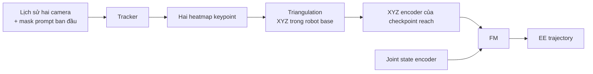

**Đây là đề xuất cho hệ của mình, chưa phải kết quả đã kiểm chứng.** Ưu điểm là biết rõ lỗi nằm ở đâu: tracking, reconstruction 3D, hay điều khiển. Supervise heatmap rồi lại đưa hidden tùy ý vào FM vẫn chưa bảo đảm tận dụng được kiến thức reach.

Khi vật bị che hoàn toàn, hai camera cũng không đo được vị trí hiện tại: tracker phải suy luận từ history/chuyển động cover. Nhãn lúc bị che cần sim hoặc hệ đo bổ sung; không lấy depth của cover làm depth vật.

**4. Thí nghiệm nên làm trước**

Freeze FM reach và so sánh trên cùng các đích:

- **GT XYZ → FM:** mức hiệu quả khi định vị đúng.
- **Hai keypoint GT → triangulation → FM:** kiểm tra calibration và định nghĩa keypoint.
- **Hai heatmap predict → triangulation → FM:** đo phần suy giảm do perception.

Báo cáo sai số XYZ median/P90, tỷ lệ dưới 5/10 mm, tách visible/occluded; sau đó đo sai số EE và reach success. Ngoài đời cần XYZ tham chiếu độc lập, ví dụ vị trí đặt vật đã đo hoặc hệ marker đã calibration.

**Đây là hướng mình chọn tiếp: mask prompt để biết “vật nào”, multiview keypoint supervision để biết “ở đâu”, rồi dùng lại goal encoder của FM.** Bước này kiểm chứng transfer reach rõ ràng; mở cover và gắp vẫn cần BC học chuỗi thao tác tương ứng.

---

## 0693 · User · 2026-10-20T06:52:24.699Z

dùng RGB-D có ngon hơn không

---

## 0694 · Assistant — tiến độ · 2026-10-20T06:52:30.099Z

Mình sẽ kiểm tra lợi thế của RGB-D cho bài gắp này, nhất là độ chính xác khi vật lộ ra và khả năng theo dõi lúc nằm dưới cover.


---

## 0695 · Assistant · 2026-10-20T06:53:04.108Z

**Có — với bài của m, RGB-D là hướng đáng thử hơn để định vị lúc vật lộ ra.** Nó giúp biến mask đang track được thành thông tin hình học có đơn vị mét, nên có thể tận dụng lại FM reach rõ ràng hơn. Nhưng nó **không giải quyết việc nhớ vật dưới cover**.

Lợi thế lớn là: **m có thể dùng ngay mask TCOW đang dự đoán tốt**, chưa cần train thêm model regress XYZ:

```text
RGB history + mask prompt → TCOW → target mask
                                      +
                               Depth hiện tại
                                      ↓
                          Point cloud của target
                                      ↓
                       Ước lượng điểm gắp trong robot base
                                      ↓
                          XYZ encoder gốc → FM reach
```

Với depth đã align với RGB, mỗi pixel hợp lệ trong mask có thể back-project thành điểm 3D:

\[
X_{\text{camera}}=D(u,v)K^{-1}[u,v,1]^T
\]

Sau đó dùng camera extrinsics để đổi sang robot base. Đây là phép biến đổi hình học; model không phải tự học toàn bộ ánh xạ ảnh → tọa độ. RGB/depth alignment vẫn cần xử lý vùng che khuất và biên vật cẩn thận. [Tài liệu RealSense](https://dev.realsenseai.com/docs/projection-texture-mapping-and-occlusion-with-intel-realsense-depth-cameras/)

Có ba điểm cần phân biệt:

| Tình huống | RGB-D giúp được gì? |
|---|---|
| Vật lộ ra | Đo trực tiếp hình học bề mặt để định vị/gắp |
| Vật bị cover che kín | Đo được cover; vị trí vật vẫn phải suy luận từ history |
| Tay che vật khi tiếp cận | Cần giữ ước lượng trước đó hoặc bổ sung view khác |

**Không nên lấy trung bình point cloud rồi gọi đó là tâm vật.** Nó chỉ là tâm phần bề mặt nhìn thấy, thay đổi theo góc camera. Với các khối hiện tại, có thể fit mặt trên/hình học đơn giản rồi suy ra điểm gắp và offset của EE. Depth cũng không tự cung cấp hướng kẹp hoặc chuỗi thao tác mở cover.

Về supervision, RGB-D cho m hai lựa chọn:

- **Có RGB-D khi chạy thật:** supervise mask/keypoint; lấy depth đo được để dựng geometry. Không cần bắt mạng dự đoán lại depth có sẵn.
- **Chỉ dùng RGB khi chạy thật:** dùng RGB-D lúc thu data để tạo nhãn depth/XYZ cho mạng. Khi inference, vẫn phải đánh giá sai số depth mà mạng dự đoán.

**Mình đề xuất baseline đầu tiên: giữ TCOW, dùng predicted mask + depth để tính điểm gắp, rồi đưa qua XYZ encoder gốc của FM.** So sánh lần lượt GT mask + depth, predicted mask + depth, và GT goal XYZ trên cùng cảnh. Như vậy biết ngay mask đang có đủ tốt hay chưa và FM mất bao nhiêu hiệu quả do lỗi geometry.

Đừng mặc định depth camera đạt chính xác vài mm ở mọi vị trí: sai số phụ thuộc khoảng cách, vật liệu, calibration và vùng biên; cần đo trong workspace thực tế. [Hướng dẫn kiểm tra độ chính xác depth](https://support.realsenseai.com/hc/en-us/articles/360059129453-Depth-accuracy-for-Intel-RealSense-D400-Series-Cameras)

**Vậy mask supervision có thể vẫn hữu ích: RGB-D bổ sung phép chuyển mask → geometry → goal mà cấu hình đưa hidden thẳng vào FM hiện tại chưa có.**

---

## 0696 · User · 2026-10-20T06:57:22.979Z

m thử visualize thành video point cloud của vật từ output tcow bắt đầy từ lúc shuffle đi, lúc bị che thì nên suy ra point cloud như nào

---

## 0697 · Assistant — tiến độ · 2026-10-20T06:57:27.806Z

Mình sẽ tìm rollout và output TCOW hiện có để dựng video point cloud từ lúc bắt đầu shuffle. Khi vật bị che, mình sẽ tách phần bề mặt đo được bằng depth khỏi phần hình học suy ra từ lịch sử, để tránh lấy nhầm mặt cover thành vật.


---

## 0698 · Assistant — tiến độ · 2026-10-20T06:58:18.211Z

Có sẵn mask TCOW dự đoán theo lịch sử nhân quả cho các video test, nên không cần chạy lại tracker. Mình sẽ dựng depth từ trạng thái mô phỏng đã lưu và làm hai clip: hoán vị mới và cả vị trí lẫn hoán vị mới.

Phần bị che sẽ dùng một baseline đơn giản: giữ bề mặt vật quan sát được lúc đầu, rồi dịch nó theo vị trí mask amodal trên mặt phẳng bàn. Phần này sẽ có màu riêng và ghi rõ là ước lượng; depth hiện tại dưới mask có thể thuộc cover.


---

## 0699 · Assistant — tiến độ · 2026-10-20T07:00:45.124Z

Video sẽ đối chiếu hai cách: lấy thẳng `mask × depth` và giữ bề mặt vật từ lúc còn nhìn thấy để ước lượng khi bị che. Mình dùng màu của vật ở frame đầu để lọc điểm depth thuộc vật; cách lọc này phù hợp với các khối màu hiện tại, chưa phải giải pháp tổng quát.

Phần ước lượng giả định vật trượt trên bàn, không đổi độ cao hay xoay. Nó không tái tạo được hình học chưa từng nhìn thấy.


---

## 0700 · Assistant — tiến độ · 2026-10-20T07:02:18.563Z

Hai clip cho thấy rõ lỗi của cách lấy thẳng `mask × depth`: khi vật bị che, cloud nhảy lên mặt cover, lệch khoảng 48 mm theo trung vị. Baseline giữ bề mặt ban đầu và dịch theo mask giảm sai số tham chiếu ở đoạn bị che xuống khoảng 1,2 mm và 6,2 mm trong hai clip này.

Đây là depth mô phỏng lý tưởng, với giả định vật nằm trên bàn; chưa phải độ chính xác của RGB-D ngoài đời. Mình đang kiểm tra video và thêm ô phóng to để nhìn cloud rõ hơn.


---

## 0701 · Assistant · 2026-10-20T07:03:39.364Z

Đã dựng hai video, **từ lúc vật còn lộ → đậy cover → shuffle → mở cover → gắp**:

- [Video: hoán vị mới — vật xanh dương]( /workspace/robotics_assets/experiments/e114_mask/test_pointcloud/unseen_permutation.mp4)
- [Video: vị trí và hoán vị đều mới — vật vàng](/workspace/robotics_assets/experiments/e114_mask/test_pointcloud/both_unseen.mp4)

Trong video:

- **Hồng:** lấy thẳng `mask TCOW × depth hiện tại`. Khi bị che, cloud nhảy lên mặt cover.
- **Xanh cyan:** bề mặt vật đo được từ depth, có lọc theo màu vật ở frame đầu.
- **Cam:** bề mặt được **suy ra từ memory**, không phải đo được xuyên cover.

**Lúc bị che, baseline mình vừa làm hoạt động như sau:**

1. Lưu point cloud bề mặt vật khi còn nhìn thấy.
2. Lấy tâm mask amodal TCOW đang dự đoán.
3. Chiếu tia camera qua điểm đó xuống mặt phẳng ở độ cao bề mặt ban đầu.
4. Dịch cloud đã lưu tới vị trí mới. Khi vật xuất hiện lại, cập nhật bằng depth thật.

TCOW chỉ cung cấp mask; phần suy ra cloud là code hình học thêm vào. **Không dùng GT vị trí hay mask các frame sau để ước lượng.**

Trong hai clip này, sai số trung vị ở đoạn bị che so với điểm tham chiếu trên bề mặt:

| Cách dựng cloud | Hoán vị mới | Cả hai đều mới |
|---|---:|---:|
| Mask × depth trực tiếp | 48,6 mm | 48,2 mm |
| Memory + mặt phẳng | 1,2 mm | 6,2 mm |

**Giới hạn:** đây là depth mô phỏng lý tưởng và giả định vật trượt trên bàn, giữ độ cao/hướng. Cloud chỉ chứa bề mặt từng nhìn thấy. Nếu vật xoay hoặc được nâng khi đang bị che, cần ước lượng chuyển động 3D — chẳng hạn theo chuyển động cover, với giả định vật đi cùng cover.

[Code](/workspace/arm-manipulation/OATFlow/tracking/pointcloud_video.py) · [Cấu hình, cách chạy và giới hạn](/workspace/arm-manipulation/docs/research/e114_pointcloud_README.md). Đã kiểm tra giải mã đủ cả hai video.

---

## 0702 · User · 2026-10-20T07:09:21.712Z

đổi góc khác đi

---

## 0703 · Assistant — tiến độ · 2026-10-20T07:09:30.819Z

Mình đổi góc nhìn point cloud sang góc nghiêng thấp từ phía đối diện, để thấy rõ chênh lệch độ cao giữa vật và cover.


---

## 0704 · Assistant · 2026-10-20T07:11:24.088Z

Đã đổi point cloud sang **góc nghiêng thấp 18°, nhìn từ phía đối diện**:

- [Video vật xanh dương](/workspace/robotics_assets/experiments/e114_mask/test_pointcloud_2/unseen_permutation.mp4)
- [Video vật vàng](/workspace/robotics_assets/experiments/e114_mask/test_pointcloud_2/both_unseen.mp4)

Góc này thấy rõ độ cao của cloud trên cover so với cloud vật bên dưới hơn.

---

## 0705 · User · 2026-10-20T07:12:43.244Z

ý t là góc cam

---

## 0706 · Assistant — tiến độ · 2026-10-20T07:13:07.433Z

À, mình hiểu nhầm. Mình sẽ đổi khung RGB sang **cam_left nhìn nghiêng cảnh robot**, rồi chiếu cloud lên góc cam này. Cloud vẫn lấy từ TCOW + depth cam top như bản trước.


---

## 0707 · User · 2026-10-20T07:14:15.499Z

ô, cam top lấy point cloud không đẹp, cam nhìn chính diện chéo từ trên xuống đi

---

## 0708 · Assistant — tiến độ · 2026-10-20T07:14:44.579Z

Đúng, cần đổi **camera nguồn RGB-D** thì mới lấy được cả mặt trên và mặt bên của vật. Mình sẽ đặt camera phía trước, nhìn chéo xuống khoảng 45°, rồi chạy TCOW trên video góc mới và dựng lại cloud từ depth tương ứng.

Mình giữ checkpoint hiện tại để thử trước; vì TCOW được fine-tune bằng cam top nên sẽ kiểm tra cả chất lượng tracking ở góc mới.


---

## 0709 · Assistant — tiến độ · 2026-10-20T07:15:36.495Z

Mình đang đổi cả RGB đầu vào TCOW lẫn depth sang camera mới, không chỉ đổi góc hiển thị. Mỗi clip sẽ được prompt bằng mask nhìn thấy ở frame đầu của góc mới; sau đó TCOW phải tự theo dõi qua shuffle.


---

## 0710 · Assistant — tiến độ · 2026-10-20T07:17:30.650Z

Góc mới đã thấy rõ cả mặt trên và mặt trước của các khối. Mình đang dựng lại hai clip từ lúc bắt đầu, rồi chạy checkpoint TCOW cũ trên góc này. Video sẽ cho thấy cả trường hợp mask bị lệch do đổi camera, nếu có.


---

## 0711 · Assistant — tiến độ · 2026-10-20T07:18:34.239Z

Clip đầu đã xong: cloud ở góc mới có thêm mặt bên của vật. Tuy nhiên, TCOW train bằng cam top bị lệch nhiều hơn khi vật bị che ở góc này; mình giữ nguyên kết quả để video phản ánh đúng checkpoint đang có.


---

## 0712 · Assistant · 2026-10-20T07:19:51.398Z

Đã đổi **camera nguồn RGB-D sang phía trước, nhìn chéo xuống khoảng 46°**, và chạy lại TCOW trên góc mới:

- [Video vật xanh dương](/workspace/robotics_assets/experiments/e114_mask/test_pointcloud_3/unseen_permutation.mp4)
- [Video vật vàng](/workspace/robotics_assets/experiments/e114_mask/test_pointcloud_3/both_unseen.mp4)

Cloud giờ có **cả mặt trên và mặt bên**. Giữ nguyên checkpoint nên clip xanh bị lệch tracking khi che; clip vàng ổn hơn. Cả hai video đã kiểm tra đầy đủ.

---

## 0713 · User · 2026-10-20T07:22:28.734Z

góc point cloud phải giống góc cam chứ, bỏ cái naive đi,

---

## 0714 · Assistant — tiến độ · 2026-10-20T07:22:33.309Z

Mình sẽ đặt góc nhìn point cloud trùng với camera RGB và bỏ khung “naive”, chỉ giữ RGB + mask và cloud đo được/ước lượng cạnh nhau.


---

## 0715 · Assistant — tiến độ · 2026-10-20T07:24:41.375Z

Hai khung giờ dùng đúng cùng vị trí camera, phối cảnh và vùng crop, nên vị trí vật sẽ khớp nhau. Mình đang xuất lại video từ mask và cloud đã lưu; màu cam vẫn đánh dấu phần hình học suy ra khi bị che.


---

## 0716 · Assistant · 2026-10-20T07:26:12.102Z

Đã sửa: **point cloud dùng đúng góc và phối cảnh của camera RGB**, bỏ hẳn khung naive.

- [Video vật xanh dương](/workspace/robotics_assets/experiments/e114_mask/test_pointcloud_4/unseen_permutation.mp4)
- [Video vật vàng](/workspace/robotics_assets/experiments/e114_mask/test_pointcloud_4/both_unseen.mp4)

Xanh cyan là bề mặt đo được; cam là phần suy ra khi bị che.

---

## 0717 · User · 2026-10-20T07:27:26.391Z

ý là robot với bàn khó nhìn vl, có thể visualize màu theo độ sâu không

---

## 0718 · Assistant — tiến độ · 2026-10-20T07:27:34.061Z

Mình sẽ tô màu phần scene cloud theo khoảng cách tới camera để robot, bàn và cover dễ phân biệt hơn; vật cần track vẫn dùng cyan/cam cho phần đo được và phần suy ra.


---

## 0719 · Assistant — tiến độ · 2026-10-20T07:29:38.785Z

Bản mới dùng màu nóng cho điểm gần camera, màu lạnh cho điểm xa, với thang cố định 0,5–1,25 m để màu không nhảy giữa các frame. Robot và mặt bàn đã rõ hơn; mình đang xuất nốt hai video.


---

## 0720 · Assistant — tiến độ · 2026-10-20T07:31:00.441Z

Clip xanh đã xuất và kiểm tra xong. Clip vàng đang chạy với cùng thang màu; các mask và cloud vật vẫn lấy nguyên từ kết quả trước.


---

## 0721 · Assistant · 2026-10-20T07:31:54.355Z

Đã tô màu theo độ sâu: **gần camera màu nóng, xa màu lạnh**, có thanh màu theo mét và tăng mật độ điểm cho dễ nhìn robot/bàn.

- [Video vật xanh dương](/workspace/robotics_assets/experiments/e114_mask/test_pointcloud_5/unseen_permutation.mp4)
- [Video vật vàng](/workspace/robotics_assets/experiments/e114_mask/test_pointcloud_5/both_unseen.mp4)

Vật cần track vẫn dùng cyan/cam để phân biệt phần đo được và phần suy ra.

---

## 0722 · User · 2026-10-20T07:32:48.877Z

sao nhìn nó cứ lưới lưới nhỉ

---

## 0723 · Assistant · 2026-10-20T07:33:09.008Z

Do cách mình vẽ: **lấy một điểm mỗi 2 pixel depth**, rồi phóng ảnh lên 2,1 lần → các chấm cách nhau khoảng **4,2 pixel**, nên thấy lưới đều.

Depth mô phỏng rất sạch, mặt bàn phẳng nên lưới càng rõ. **Đó là lưới lấy mẫu của ảnh, không phải voxel của workspace.**

Muốn nhìn mượt hơn thì lấy đủ pixel và vẽ các điểm phủ kín nhau bằng *point splatting*. Vẫn là point cloud, chỉ đổi cách hiển thị.

---

## 0724 · User · 2026-10-20T07:33:39.843Z

m vẽ nguyên depth gốc còn nhìn dễ hơn đấy

---

## 0725 · Assistant — tiến độ · 2026-10-20T07:33:46.829Z

Ừ, mình sẽ thay khung chấm bằng depth map gốc tô màu liên tục, giữ cùng góc camera và thang màu cố định.


---

## 0726 · Assistant · 2026-10-20T07:36:03.579Z

Đã đổi sang **depth map gốc tô màu liên tục**, hết lưới chấm:

- [Video vật xanh dương](/workspace/robotics_assets/experiments/e114_mask/test_pointcloud_6/unseen_permutation.mp4)
- [Video vật vàng](/workspace/robotics_assets/experiments/e114_mask/test_pointcloud_6/both_unseen.mp4)

Bên trái RGB + mask TCOW, bên phải depth trực tiếp từ camera.

---

## 0727 · User · 2026-10-20T07:36:44.532Z

thế thì mất point cloud của vật cần track :)

---

## 0728 · Assistant — tiến độ · 2026-10-20T07:36:49.928Z

Đúng, mình bỏ quá tay. Mình sẽ giữ depth map liền để nhìn rõ robot/bàn, rồi vẽ lại cloud của vật lên trên: cyan khi đo được, cam khi suy ra dưới cover.


---

## 0729 · Assistant — tiến độ · 2026-10-20T07:38:29.048Z

Cloud vật đã hiện lại trên nền depth liền, có viền trắng để dễ thấy khi trùng màu cover. Phần cam vẫn được vẽ xuyên cover và ghi rõ là ước lượng từ lịch sử.


---

## 0730 · Assistant · 2026-10-20T07:38:56.396Z

Đã ghép lại **nền depth liền + point cloud riêng của vật**, cùng góc camera:

- [Video vật xanh dương](/workspace/robotics_assets/experiments/e114_mask/test_pointcloud_7/unseen_permutation.mp4)
- [Video vật vàng](/workspace/robotics_assets/experiments/e114_mask/test_pointcloud_7/both_unseen.mp4)

Cloud có viền trắng; cyan là đo được, cam là suy ra khi bị che.

---

## 0731 · User · 2026-10-20T16:56:46.181Z

nếu thu data depth thì tốn dung lượng không

---

## 0732 · Assistant — tiến độ · 2026-10-20T16:57:01.744Z

Mình sẽ tính dung lượng theo độ phân giải và số frame của bộ data hiện tại, cho cả depth 16-bit và float32.


---

## 0733 · Assistant · 2026-10-20T16:57:29.158Z

**Có, nếu lưu depth thô thì khá tốn.** Với một camera, depth **16-bit, 25 FPS**:

| Độ phân giải | Mỗi giây | Mỗi giờ |
|---|---:|---:|
| 320×320 | 5,12 MB | 18,4 GB |
| 640×480 | 15,36 MB | 55,3 GB |

Theo số frame của **bộ data hiện tại**, một camera 320×320, chưa nén và context chỉ lưu một lần:

| Phần data | Depth 16-bit |
|---|---:|
| Train | **174 GB** |
| Toàn bộ train/val/test | **317 GB** |
| Train, chỉ lưu stride 3 | **58 GB** |

Float32 sẽ **gấp đôi**; hai camera cũng gấp đôi.

Nên lưu **depth uint16 có đơn vị rõ ràng**, dùng PNG 16-bit hoặc nén lossless theo chunk. Dung lượng sẽ giảm, nhưng mức giảm phụ thuộc nhiễu của camera thật — chưa nên lấy depth mô phỏng quá sạch để ước tính.

Đồng thời lưu **depth scale, camera intrinsics và extrinsics**. Đừng chỉ lưu video depth tô màu như bản demo: nó không giữ đủ giá trị đo để khôi phục XYZ chính xác.

---

## 0734 · User · 2026-10-20T17:58:26.287Z

sao không nén được như ảnh à

---

## 0735 · Assistant · 2026-10-20T17:58:44.568Z

**Nén được chứ, giống ảnh luôn.** Các số 174/317 GB mình vừa đưa là **dung lượng thô**, chưa phải dung lượng lưu thực tế.

Khác biệt là:

- **RGB** thường nén mất dữ liệu bằng JPEG/H.264; sai vài mức màu vẫn nhìn đẹp.
- **Depth** chứa khoảng cách. Nén làm sai giá trị hoặc nhòe biên vật thì XYZ khôi phục cũng sai.

Vì vậy có thể lưu **PNG 16-bit**, hoặc nén lossless cả chuỗi bằng codec phù hợp để tận dụng các frame gần giống nhau. Không cần lưu thô.

Depth mô phỏng sạch, nhiều mặt phẳng có thể nén tốt; camera thật có nhiễu nên tỷ lệ khác. **Phải nén thử vài đoạn mới tính được số GB thực tế**, chứ lấy dung lượng thô để kết luận quá nặng là chưa đủ.

---

## 0736 · User · 2026-10-20T18:00:07.448Z

nén thử 1 video xem không xem loss bao nhiêu

---

## 0737 · Assistant — tiến độ · 2026-10-20T18:00:10.623Z

Mình sẽ thử trên một clip góc cam trước: xuất depth gốc, nén lossless rồi giải mã để đo dung lượng và sai số từng pixel. Mình sẽ đo riêng sai số khi chuyển depth float32 sang 16-bit để không lẫn với sai số do codec.


---

## 0738 · Assistant — tiến độ · 2026-10-20T18:01:31.442Z

Mình đang so FFV1 16-bit với chuỗi PNG 16-bit trên clip 621 frame. Có hai mức lưu khoảng cách: 0,1 mm và 1 mm. Cả hai codec sẽ được giải mã và kiểm tra toàn bộ pixel; sai số so với float32 sẽ được báo riêng.


---

## 0739 · Assistant · 2026-10-20T18:02:25.517Z

Đã nén thử **clip 24,84 giây, 621 frame, depth 320×240**:

| Cách lưu | Dung lượng | Sai số depth trung bình / tối đa |
|---|---:|---:|
| Float32 thô | 190,77 MB | 0 |
| **Float32 + zlib** | **12,64 MB** | **0 — giữ nguyên từng bit** |
| PNG 16-bit, đơn vị 0,1 mm | 4,70 MB | 0,025 / 0,050 mm |
| **FFV1 16-bit, đơn vị 0,1 mm** | **3,17 MB** | **0,025 / 0,050 mm** |
| FFV1 16-bit, đơn vị 1 mm | 2,22 MB | 0,257 / 0,500 mm |

**Codec FFV1 và PNG không gây thêm sai số nào** sau giải mã. Sai số trong bảng đến từ chuyển float32 sang đơn vị 0,1 hoặc 1 mm.

Bản FFV1 0,1 mm giảm **30 lần** so với uint16 thô. Sai số XYZ sau back-project tối đa **0,058 mm**.

Có một chi tiết: bản uint16 đặt khoảng 3,28% pixel nền xa hơn 6,55 m thành invalid; bản float32 + zlib giữ cả những pixel đó.

Đây là depth mô phỏng sạch, nên camera thật có nhiễu có thể nén kém hơn.

[File depth FFV1 0,1 mm](/workspace/robotics_assets/experiments/e114_mask/test_depth_compress/depth_uint16_0p1mm.mkv) · [Kết quả chi tiết](/workspace/robotics_assets/experiments/e114_mask/test_depth_compress/results.json)

---

## 0740 · User · 2026-10-20T18:22:30.343Z

visualize bản unit16

---

## 0741 · Assistant — tiến độ · 2026-10-20T18:22:46.602Z

Mình sẽ giải mã bản FFV1 uint16 đơn vị 0,1 mm để xuất video xem được, đặt cạnh RGB và giữ cloud của vật như bản trước. Pixel invalid sẽ có nền tối.


---

## 0742 · Assistant · 2026-10-20T18:24:22.818Z

[Video uint16 sau giải mã FFV1](/workspace/robotics_assets/experiments/e114_mask/test_depth_compress/view_uint16/unseen_permutation.mp4)

Depth lấy từ **file nén 3,17 MB, đơn vị 0,1 mm**, đã tô màu để xem. Bên trái RGB + mask; bên phải depth giải mã, kèm cloud vật giữ từ bản trước.

---

## 0743 · User · 2026-10-20T18:25:31.978Z

thấy cũng ok mà, nén thêm có sao không

---

## 0744 · Assistant · 2026-10-20T18:25:58.356Z

**Nén thêm được. Bản đơn vị 1 mm mình đã thử rồi:**

| Đơn vị depth | Dung lượng | Sai số depth tối đa | Sai số XYZ tối đa |
|---|---:|---:|---:|
| 0,1 mm | 3,17 MB | 0,050 mm | 0,058 mm |
| **1 mm** | **2,22 MB** | **0,500 mm** | **0,587 mm** |

Giảm thêm **30% dung lượng**. Codec vẫn lossless; sai số đến từ làm tròn khoảng cách.

**Mức 1 mm đáng thử cho data train của mình.** Tuy nhiên, nhìn video đẹp chưa chứng minh grasp không bị ảnh hưởng — mình chưa rollout với depth đã lượng tử hóa.

Nếu muốn nén mạnh hơn nữa, nên thử **2 mm** rồi đo XYZ của vật. Lên 5 mm thì riêng làm tròn đã có thể lệch depth 2,5 mm, bắt đầu đáng kể với bài gắp chính xác.

---

## 0745 · User · 2026-10-20T18:26:53.449Z

vật to thế lệch 1mm vẫn ok

---

## 0746 · Assistant · 2026-10-20T18:27:04.113Z

Ừ, với kích thước các khối hiện tại thì **depth đơn vị 1 mm hợp lý**. Làm tròn ở mức này chỉ gây sai số depth tối đa **0,5 mm**, XYZ tối đa khoảng **0,59 mm** trong clip đã đo.

Vậy chọn **uint16, 1 mm/unit + FFV1 lossless** cho dữ liệu này: clip 24,84 giây còn **2,22 MB**, tương đương khoảng **0,32 GB/giờ/camera** nếu nén tương tự. Tracking đúng vật qua cover đáng tập trung hơn phần sai số lượng tử hóa này.

---

## 0747 · User · 2026-10-20T18:29:47.704Z

thử 2mm visualzie, còn bao nhiêu dung lượng

---

## 0748 · Assistant — tiến độ · 2026-10-20T18:29:50.612Z

Mình sẽ nén clip đó ở mức 2 mm/unit, đo dung lượng và sai số rồi xuất video từ file đã giải mã. Video vẫn giữ nền depth liền và cloud của vật.


---

## 0749 · Assistant — tiến độ · 2026-10-20T18:31:28.896Z

Bản 2 mm còn **1,89 MB**, nhỏ hơn bản 1 mm khoảng **15%**. Codec giải mã đúng toàn bộ giá trị uint16; phần làm tròn gây sai số depth trung bình 0,51 mm, tối đa khoảng 1 mm. Video giải mã đang xuất nốt.


---

## 0750 · Assistant · 2026-10-20T18:32:03.036Z

[Video depth 2 mm/unit](/workspace/robotics_assets/experiments/e114_mask/test_depth_compress_2/view_uint16/unseen_permutation.mp4)

Clip 24,84 giây còn **1,89 MB**:

- Nhỏ hơn bản 1 mm **15%**, bản 0,1 mm **40%**.
- Sai số depth trung bình **0,51 mm**, tối đa **1 mm**.
- Sai số XYZ tối đa **1,17 mm**; codec không gây thêm loss.

Video dùng depth giải mã từ file 2 mm; cloud vật giữ từ lượt tracking trước.

---

## 0751 · User · 2026-10-20T18:34:22.211Z

dataset tăng bao nhiêu gb

---

## 0752 · Assistant — tiến độ · 2026-10-20T18:34:33.970Z

Mình sẽ tính theo tổng số frame của dataset và dung lượng bản 2 mm vừa đo, với phần context dùng chung chỉ lưu depth một lần.


---

## 0753 · Assistant · 2026-10-20T18:34:41.209Z

Ước tính thêm **4,7 GB cho toàn bộ dataset**, nếu lưu depth **một camera, 320×240, 2 mm/unit + FFV1** như clip vừa thử.

- Chỉ phần train: **+2,6 GB**.
- Cả 3 camera: khoảng **+14,1 GB** cho toàn bộ dataset.

Đã tính context dùng chung chỉ lưu một lần. Đây là ngoại suy từ một clip, chưa phải dung lượng sau khi nén toàn bộ.

---

## 0754 · User · 2026-10-20T18:36:04.630Z

depth có tính là pointcloud không

---

## 0755 · Assistant · 2026-10-20T18:36:18.410Z

**Depth có thể coi là cách lưu gọn một point cloud có cấu trúc**, nếu đi kèm calibration của camera.

- **Depth map:** mỗi pixel lưu một khoảng cách \(D\).
- **Point cloud:** mỗi điểm lưu tọa độ \((X,Y,Z)\).

Biết camera intrinsics thì chuyển từng pixel depth thành điểm 3D:

\[
X=\frac{(u-c_x)D}{f_x},\qquad
Y=\frac{(v-c_y)D}{f_y},\qquad Z=D
\]

Thêm extrinsics để chuyển sang hệ tọa độ robot.

**Vì vậy mình chỉ cần lưu depth + calibration, rồi dựng point cloud lúc dùng**, không cần lưu cả hai. Depth uint16 tốn 2 byte/pixel; XYZ float32 tốn 12 byte/điểm trước nén.

Hai lưu ý cho bài mình:

- Depth chỉ dựng được **bề mặt nhìn thấy**; cloud vật dưới cover vẫn phải suy ra từ memory.
- **2 mm/unit** là bước lượng tử hóa độ sâu, không phải kích thước voxel hay khoảng cách ngang giữa các điểm.

---

## 0756 · User · 2026-10-20T18:38:12.951Z

tạo lại bộ data thôi, nhưng mà t thấy khi sáo trộn hộp các vật không bị ra khỏi vị trí ban đầu à, kiểu không có dynamic giữa hộp và vật ấy

---

## 0757 · Assistant — tiến độ · 2026-10-20T18:38:16.183Z

Mình sẽ kiểm tra cách code hiện tại di chuyển hộp và vật trong đoạn shuffle. Mình cũng sẽ chuẩn bị cách thu depth 2 mm cho bộ mới, rồi chốt lại cách mô phỏng tương tác hộp–vật trước khi chạy sinh data.


---

## 0758 · Assistant — tiến độ · 2026-10-20T18:38:24.596Z

Bạn nhận xét đúng: đoạn shuffle hiện tại gán thẳng vị trí vật theo độ dịch chuyển của hộp và chỉ gọi `mj_forward`, không chạy bước vật lý. Vì vậy vật giữ nguyên vị trí tương đối với hộp. Đoạn mở hộp và gắp phía sau mới chạy dynamics.

Bộ mới cần để vật tự do, chỉ điều khiển hộp và chạy MuJoCo để vật bị đẩy, trượt hoặc xoay do tiếp xúc.


---

## 0759 · Assistant — câu hỏi · 2026-10-20T18:38:26.380Z

Mình đề xuất bộ mới dùng shuffle có tiếp xúc vật lý thật, hộp di chuyển bằng điều khiển bên ngoài; giữ 4 vật/2 hộp, expert mở hộp rồi gắp, chia train/test như cũ. Thêm RGB-D góc trước chéo xuống, depth uint16 2 mm/unit + FFV1, kèm mask và calibration. Đúng phạm vi bạn muốn chứ?

- Đúng, dùng cấu hình đó
- Giữ cam top cho TCOW, thêm RGB-D góc trước

---

## 0760 · User · 2026-10-20T18:39:18.202Z

<send_user_message_question_reply>
[{"answer":"Đúng, dùng cấu hình đó","question":"Mình đề xuất bộ mới dùng shuffle có tiếp xúc vật lý thật, hộp di chuyển bằng điều khiển bên ngoài; giữ 4 vật/2 hộp, expert mở hộp rồi gắp, chia train/test như cũ. Thêm RGB-D góc trước chéo xuống, depth uint16 2 mm/unit + FFV1, kèm mask và calibration. Đúng phạm vi bạn muốn chứ?","questionItemId":"[\"request_user_input_async\",\"call_aa0d808910544767bf57ad8f9384e474\",0]"}]
</send_user_message_question_reply>

---

## 0761 · Assistant — tiến độ · 2026-10-20T18:39:26.429Z

Mình sẽ làm bộ mới riêng, giữ bộ cũ để đối chiếu. Trước lượt full, mình sẽ chạy vài cảnh để kiểm tra có tiếp xúc hộp–vật, vị trí tương đối của vật thực sự thay đổi, rồi expert vẫn mở hộp và gắp được. Sau đó mới thu toàn bộ với RGB-D góc trước và depth 2 mm.


---

## 0762 · User · 2026-10-20T18:40:01.604Z

bỏ 2 cam chéo và cam top, thay bằng 1 trước chéo , 1 cam wrist

---

## 0763 · Assistant — tiến độ · 2026-10-20T18:40:12.652Z

Mình cập nhật bộ mới còn đúng **hai camera**: camera trước nhìn chéo xuống thu RGB-D, camera wrist gắn trên tay thu RGB. Bỏ top và hai camera chéo cũ. Calibration của wrist sẽ được lưu theo từng frame vì camera di chuyển cùng robot.


---

## 0764 · Assistant — tiến độ · 2026-10-20T18:41:54.016Z

Bản shuffle thử nghiệm đã có tiếp xúc thật: sau shuffle, các vật đổi vị trí tương đối với hộp khoảng **2,6–8,4 cm** trong cảnh vừa chạy. Điều này cũng làm expert cũ khó gắp hơn vì hai vật có thể dồn sát nhau; mình đang chỉnh cách chọn hướng gắp và kiểm tra lại trước khi sinh full.


---

## 0765 · User · 2026-10-20T18:42:26.328Z

thu depth và calib cả 2 cam

---

## 0766 · Assistant — tiến độ · 2026-10-20T18:42:40.267Z

Được, cả **cam trước và cam wrist đều thu RGB + depth 2 mm**. Mỗi cam sẽ có intrinsics, depth scale và extrinsics đồng bộ với từng frame; extrinsics của wrist thay đổi theo chuyển động tay.


---

## 0767 · Assistant — tiến độ · 2026-10-20T18:46:09.235Z

Pilot đang kiểm tra bốn loại cảnh: train, hoán vị mới, layout mới và cả hai mới. Hai luồng depth sẽ được nén lossless ở đơn vị 2 mm, có mask và calibration đồng bộ theo frame. Bộ mới cũng sẽ lưu trạng thái điều khiển hộp để replay và kiểm tra đoạn shuffle.


---

## 0768 · Assistant — tiến độ · 2026-10-20T18:50:15.955Z

Pilot hiện đã tạo được **16/16 expert demo thành công**. Replay lại cả shuffle lẫn expert khớp chính xác trạng thái đã lưu; depth ở hai cam cũng giải mã đúng từng pixel. Mình đang xem clip hai góc cam và kiểm tra thêm tiếp xúc hộp–vật trước lượt full.


---

## 0769 · Assistant — tiến độ · 2026-10-20T18:53:00.909Z

Đã bắt đầu lượt full: **928 context và 3.712 expert demo**, với RGB-D và calibration ở cả cam trước lẫn wrist. Pipeline sẽ tự chạy tiếp render và audit sau khi sinh quỹ đạo. Ước tính từ pilot, bộ mới chiếm khoảng **24 GB**; bộ cũ vẫn được giữ nguyên.


---

## 0770 · Assistant · 2026-10-20T18:56:12.024Z

Đang tạo bộ mới với **cả cam trước và cam wrist đều có RGB + depth uint16 2 mm + calibration theo từng frame**.

Shuffle mới có tiếp xúc vật lý: vật trượt/xoay tương đối với hộp. Pilot **16/16 demo thành công**, replay khớp chính xác và depth giải mã không mất dữ liệu.

- [Video pilot train](/workspace/robotics_assets/experiments/e116_dynamic/preview/train.mp4)
- [Video pilot layout + hoán vị mới](/workspace/robotics_assets/experiments/e116_dynamic/preview/combined.mp4)

Lượt full **928 context / 3.712 demo đang chạy**, dự kiến khoảng **24 GB**. Bộ cũ vẫn giữ nguyên. Phần hộp trong suốt trong video chỉ dùng để kiểm tra dynamics; dữ liệu thật vẫn dùng hộp đục.

---

## 0771 · User · 2026-10-20T18:58:38.909Z

render cam wrist không real rồi,khi quá gần nó sẽ mất ảnh

---

## 0772 · Assistant — tiến độ · 2026-10-20T18:58:43.543Z

Đúng, mô phỏng hiện đang cho ảnh lý tưởng ở cự ly rất gần. Mình sẽ kiểm tra vị trí gắn cam wrist, clipping và dải đo depth; tạm giữ bước render full để sửa trước khi xuất ảnh. Phần sinh quỹ đạo vật lý vẫn có thể tiếp tục.


---

## 0773 · Assistant — câu hỏi · 2026-10-20T19:00:03.785Z

Cam wrist thực tế bạn định dùng là mẫu nào, hoặc muốn khoảng cách đo depth tối thiểu bao nhiêu? Mình cần thông số này để mô phỏng vùng mù khi gắp sát vật; RGB và depth sẽ xử lý riêng.

---

## 0774 · Assistant — tiến độ · 2026-10-20T19:00:31.464Z

Tìm ra một lỗi cụ thể: MuJoCo đang đặt near clipping ở **8 cm**, nên vật sát cam có thể bị cắt khỏi ảnh và lộ nền phía sau. Mình sẽ sửa lỗi này trước. Còn vùng mù depth ở cự ly gần cần mô phỏng riêng theo cảm biến thực; RGB cũng không nhất thiết mất cùng depth.

---

## 0775 · User · 2026-10-20T19:00:54.427Z

<send_user_message_question_reply>
[{"answer":"t dùng eyefish cam, không rõ mẫu nào, m tìm mấy mẫu phổ biến người ta hay dùng đi","question":"Cam wrist thực tế bạn định dùng là mẫu nào, hoặc muốn khoảng cách đo depth tối thiểu bao nhiêu? Mình cần thông số này để mô phỏng vùng mù khi gắp sát vật; RGB và depth sẽ xử lý riêng.","questionItemId":"[\"request_user_input_async\",\"call_28e445294f8d41f5b5f60069d14e6d87\",0]"}]
</send_user_message_question_reply>

---

## 0776 · Assistant — tiến độ · 2026-10-20T19:01:10.560Z

À, fisheye thì còn khác cả mô hình chiếu: cam wrist hiện tại đang là pinhole. Mình sẽ tra vài mẫu dùng cho robot, xem góc nhìn, khả năng lấy nét gần và có depth thật hay chỉ RGB, rồi chọn cấu hình mô phỏng có căn cứ.

---

## 0777 · Assistant — tiến độ · 2026-10-20T19:02:23.611Z

Có mẫu tham khảo đúng kiểu wrist fisheye: UMI dùng GoPro HERO9; Arducam cũng có camera USB fisheye 175° nhỏ gọn. Nhưng các mẫu này chỉ có RGB. Nếu cần depth sát vật, D405 phù hợp hơn với dải chuẩn 7–50 cm, dù góc nhìn hẹp hơn fisheye.

Mình đã sửa clipping và kiểm tra lại RGB/depth: ở một frame sát hộp, ảnh cũ nhìn xuyên qua bề mặt bị cắt; ảnh sửa bị hộp che kín đúng hình học. Full render đang được giữ lại, còn sinh quỹ đạo vẫn chạy.

---

## 0778 · Assistant · 2026-10-20T19:03:07.263Z

**Fisheye thường chỉ có RGB; không mặc định đo được depth.** Mấy mẫu đáng tham khảo:

| Mẫu | Đặc điểm | Hợp với bài mình? |
|---|---|---|
| **[Arducam B0261 IMX291](https://www.arducam.com/arducam-fisheye-low-light-usb-camera-for-computer-2mp-1080p-imx291-wide-angle-mini-h-264-uvc-video-camera-board-with-microphone.html)** | USB, fisheye **175° đường chéo**, RGB, chỉnh nét tay | Gần kiểu cam fisheye nhỏ gắn wrist; cần đo khoảng lấy nét gần thực tế |
| **[GoPro HERO9 — UMI](https://umi-gripper.github.io/umi.pdf)** | UMI dùng trực tiếp làm cam wrist | Có tiền lệ trong manipulation; không có depth trực tiếp |
| **[RealSense D405](https://www.realsenseai.com/product-family/d405-series/)** | RGB-D, góc **87° × 58°**, dải lý tưởng **7–50 cm** | Mình nghiêng về mẫu này nếu cần depth khi gắp sát |
| **[OAK-D Pro W](https://checkout.luxonis.com/products/oak-d-pro-w)** | Bản OV9782 rộng **150° đường chéo**, stereo depth; Min-Z khoảng **20 cm** khi dùng extended disparity | Góc rộng nhưng khoảng đo gần chưa hợp vị trí wrist hiện tại |

**Nếu giữ cam fisheye một mắt của bạn, depth wrist trong sim chỉ nên xem là GT**, chưa phải input có sẵn ngoài thực tế. Nếu cần RGB-D thật ở wrist, D405 là mốc tham khảo phù hợp hơn.

Ngoài ra mình đã sửa lỗi render: near clipping cũ **8 cm** làm bề mặt gần biến mất, thấy xuyên xuống vật phía sau. Đã kiểm tra lại bốn frame, RGB và depth encode/decode đều qua. [Ảnh so sánh trước/sau](/workspace/robotics_assets/experiments/e116_dynamic/preview/wrist_clipping.png).

Sinh quỹ đạo vẫn chạy; full render đang giữ lại. **Fisheye và giới hạn cảm biến thực chưa được áp dụng**, vì chưa xác định cấu hình camera.

---

## 0779 · User · 2026-10-20T19:11:36.739Z

thôi bỏ depth wrist đi thì dùng cam nào, visualize thì lật ngược ảnh wrist lại cho dễ nhìn

---

## 0780 · Assistant — tiến độ · 2026-10-20T19:11:39.269Z

Bỏ depth wrist thì mình nghiêng về Arducam B0261 fisheye 175° làm mẫu tham khảo. Mình sẽ giữ RGB wrist, bỏ xuất depth wrist và xoay riêng ảnh wrist trong bản visualize 180° cho dễ nhìn.

---

## 0781 · Assistant — tiến độ · 2026-10-20T19:12:41.821Z

Mình sẽ dùng mô hình fisheye 175° tham chiếu Arducam cho wrist, đồng bộ cả RGB và mask. Vì chưa có calibration cam thật, đây là mô hình chiếu giả lập. Cấu hình mới là **front RGB-D + wrist RGB**; ảnh wrist chỉ xoay 180° khi xem, dữ liệu gốc và calibration giữ cùng hệ ảnh.

---

## 0782 · Assistant — tiến độ · 2026-10-20T19:14:58.022Z

Đã bỏ depth wrist khỏi bộ xuất dữ liệu và thêm phép xoay 180° vào viewer. Mình đang kiểm tra phép chiếu fisheye với mask và calibration, rồi sẽ xuất lại video mẫu bằng cấu hình mới.

---

## 0783 · Assistant — tiến độ · 2026-10-20T19:18:24.549Z

Bản fisheye đã qua kiểm tra hình học: 576 tia nhìn khớp mask trong sai số biên 1 pixel. Lượt xuất thử 2 context và 8 đoạn expert cũng đã render xong, chỉ có depth front. Mình đang kiểm tra replay và hoàn tất hai video mẫu với wrist đã xoay.

---

## 0784 · Assistant · 2026-10-20T19:19:46.091Z

Mình chọn **[Arducam B0261 IMX291](https://docs.arducam.com/UVC-Camera/USB2-UVC-Camera-Kit/Specs-and-Selection-Guide/)** làm tham chiếu: USB, fisheye **175° đường chéo**, chỉnh nét tay.

Đã đổi sang **front RGB-D + wrist RGB**, bỏ depth wrist. Visualize đã xoay wrist **180°**, đồng bộ cả ảnh và mask.

- [Video train](/workspace/robotics_assets/experiments/e116_dynamic/preview_rgb/train.mp4)
- [Video hoán vị test](/workspace/robotics_assets/experiments/e116_dynamic/preview_rgb/composition.mp4)

Kiểm tra 8 demo đã qua; pipeline full tiếp tục chạy. Fisheye hiện là mô hình giả lập, chưa phải calibration cam thật của bạn.

---

## 0785 · User · 2026-10-20T19:30:34.010Z

thử làm y hệt nhưng thay bằng object tròn đi, 1 video thôi

---

## 0786 · Assistant — tiến độ · 2026-10-20T19:30:37.666Z

Mình sẽ làm một cảnh tương tự với 4 vật hình cầu giữ nguyên màu, chạy shuffle rồi mở hộp và gắp, xuất một video với wrist đã xoay như bản vừa rồi.

---

## 0787 · Assistant — tiến độ · 2026-10-20T19:32:27.894Z

Vật cầu lăn khác rõ: ở lượt đầu, một quả đã thoát khỏi hộp trong lúc shuffle. Mình đang giữ nguyên thông số vật lý và thử lại đường shuffle theo cơ chế retry của bộ hiện tại, rồi xuất đúng một video.

---

## 0788 · Assistant — tiến độ · 2026-10-20T19:33:10.586Z

Đã có lượt hoàn chỉnh: robot mở hộp rồi gắp quả đỏ, nâng khoảng 11,8 cm và giữ được tiếp xúc hai má kẹp. Các quả cầu có dịch chuyển tương đối với hộp trong shuffle. Video đang render với front RGB-D và wrist fisheye xoay 180°.

---

## 0789 · Assistant · 2026-10-20T19:34:24.228Z

[Video 4 vật hình cầu — shuffle, mở hộp và gắp quả đỏ](/workspace/robotics_assets/experiments/e116_dynamic/test_sphere/preview/sphere.mp4)

Đã chạy lại vật lý với cầu đường kính **32 mm**. Video dài **24 giây**, wrist xoay 180°; robot gắp và nâng quả đỏ khoảng **11,8 cm**.

---

## 0790 · User · 2026-10-21T00:14:38.521Z

dataset xong roi a

---

## 0791 · Assistant — tiến độ · 2026-10-21T00:14:41.461Z

Mình kiểm tra tiến độ và kết quả audit của bộ full nhé.

---

## 0792 · Assistant — tiến độ · 2026-10-21T00:14:55.356Z

**Chưa xong.** Đã lưu được **38/40 layout**, nhưng job dừng vì một layout sinh ngẫu nhiên làm hai hộp chồng nhau. Bước render ảnh/depth và audit chưa chạy. Mình sẽ sửa chỗ retry này rồi resume từ phần còn thiếu.

---

## 0793 · Assistant · 2026-10-21T00:16:11.757Z

**Chưa xong.** Đã lưu **880/928 context, 3.520/3.712 demo** — khoảng 95% phần quỹ đạo.

Job cũ dừng vì lỗi retry khi sinh layout. Mình đã sửa, kiểm tra và **resume 2 layout còn thiếu**; hiện đang chạy tiếp trong `ssh_tmux:e116_full`.

Sau đó còn **render RGB/depth và audit toàn bộ** mới hoàn tất dataset.

---

## 0794 · User · 2026-10-21T00:31:51.488Z

co 1 bo data pick dung khong

---

## 0795 · Assistant — tiến độ · 2026-10-21T00:31:53.415Z

Mình kiểm tra lại các bộ pick đang có và trạng thái của chúng.

---

## 0796 · Assistant · 2026-10-21T00:32:07.014Z

Đúng, có bộ **pick riêng đã hoàn tất**: [e102_top/data](/workspace/robotics_assets/experiments/e102_top/data).

- **4 vật lộ rõ**, robot bắt đầu từ home, gắp/nâng vật được chỉ định.
- Chỉ **cam top RGB**, không shuffle hay mở hộp.
- **3.712 demo**, đã chia train/val/test theo hoán vị và vị trí mới, audit đã qua.

Đây là bộ dùng cho **E103 với loss phụ XYZ**, đạt **118/128 rollout thành công sau 10 epoch**.

---

## 0797 · User · 2026-10-21T00:32:40.698Z

layout moi co khac biet nhieu khong

---

## 0798 · Assistant — tiến độ · 2026-10-21T00:32:42.812Z

Mình kiểm tra lại khoảng cách giữa layout train và test, kèm ảnh mẫu để xem khác nhau đến mức nào.

---

## 0799 · Assistant · 2026-10-21T00:33:02.727Z

**Khác ở mức vừa phải, vẫn quanh 4 vùng spawn cố định.**

- Có **32 layout train, 4 layout test**; test lấy mẫu trong cùng phạm vi với train.
- So với layout train gần nhất, khoảng cách XY **trung bình trên 4 slot** là **1,56–2,42 cm**, trung bình **1,88 cm**. Vật rộng **3,2 cm**.
- Mỗi slot được random quanh vị trí gốc: tối đa khoảng **±2,4 cm theo X, ±5,1 cm theo Y**, kèm góc xoay ngẫu nhiên.

Vậy kết quả hiện tại cho thấy khả năng xử lý **vị trí và hoán vị mới trong vùng đã học**; chưa chứng minh gắp được ở vị trí tùy ý trên toàn bàn.


---

## 0800 · User · 2026-10-21T00:33:39.865Z

random manh bon duoc khong

---

## 0801 · Assistant — tiến độ · 2026-10-21T00:33:43.012Z

Được. Mình sẽ tăng random để 4 vật phân bố tự do trên vùng bàn robot gắp tới được, bỏ cách chia 4 vùng spawn cố định. Mình sẽ chạy thử vài cảnh và kiểm tra expert gắp được trước khi sinh bộ lớn.

---

## 0802 · Assistant — câu hỏi · 2026-10-21T00:34:12.034Z

Mình đang thử tăng random cho bộ pick: 4 khối vuông, cam top, bắt đầu từ home như E102/E103. Bạn muốn chỉ xem bản thử trước hay thu luôn bộ mới đủ 40 layout/3.712 demo sau khi kiểm tra expert?

- Thu luôn bộ mới sau khi bản thử đạt
- Chỉ làm bản thử và hình so sánh

---

## 0803 · User · 2026-10-21T00:35:30.404Z

<send_user_message_question_reply>
[{"answer":"Chỉ làm bản thử và hình so sánh","question":"Mình đang thử tăng random cho bộ pick: 4 khối vuông, cam top, bắt đầu từ home như E102/E103. Bạn muốn chỉ xem bản thử trước hay thu luôn bộ mới đủ 40 layout/3.712 demo sau khi kiểm tra expert?","questionItemId":"[\"request_user_input_async\",\"call_cd26dfbe6f314360b9240a991788342e\",0]"}]
</send_user_message_question_reply>

---

## 0804 · Assistant — tiến độ · 2026-10-21T00:35:57.717Z

Mình chỉ làm bản thử và hình so sánh. Vùng đề xuất mới là **48 × 32 cm**, bốn vị trí được lấy mẫu tự do thay vì quanh bốn tâm cố định; mình đang kiểm tra expert để xem phần nào của vùng đó thực sự gắp được.

---

## 0805 · Assistant — tiến độ · 2026-10-21T00:37:43.635Z

Hai layout thử đã có đủ **16 demo gắp hợp lệ**, và cả bốn vật đều nhìn thấy từ cam top. Chúng cách layout train cũ gần nhất khoảng **7,1 cm và 9,9 cm** theo trung bình vị trí bốn vật — rộng hơn rõ so với mức 1,9 cm trước đó.

Vùng đề xuất rộng cũng làm 59 layout bị loại vì vật quá gần nhau, IK không tới hoặc gắp không đạt. Vì vậy mình sẽ ghi rõ phần đề xuất và các cảnh thực sự đã kiểm tra trong hình so sánh.

---

## 0806 · Assistant · 2026-10-21T00:38:58.682Z

Đã thử random tự do trong vùng **48 × 32 cm**, bỏ bốn tâm spawn cố định.

- **2 layout, 16 demo** đã kiểm tra gắp/nâng hợp lệ; cả bốn vật đều nhìn thấy.
- Hai layout cách train cũ gần nhất **7,1 và 9,9 cm**, tính trung bình trên bốn vật; bộ cũ khoảng **1,9 cm**.
- Có **59 layout đề xuất bị loại**, nên khi thu thật cần lọc vùng gắp khả thi.

**Hàng trên: cũ. Hàng dưới: bản random mạnh hơn.**


[Biểu đồ vị trí spawn](/workspace/robotics_assets/experiments/e117_wide/samples/spawn_positions.png) · [Cấu hình và kiểm tra](/workspace/arm-manipulation/docs/research/e117_README.md)

---

## 0807 · User · 2026-10-21T00:42:12.196Z

render vài sample bằng cấu hình cam, .. như bên trên

---

## 0808 · Assistant — tiến độ · 2026-10-21T00:42:14.829Z

Mình sẽ render các cảnh random rộng vừa thử bằng **cam trước RGB-D + cam wrist fisheye RGB**, xoay wrist 180° khi xem như bản trên.

---

## 0809 · Assistant — tiến độ · 2026-10-21T00:43:15.055Z

Mình dùng lại hai layout đã kiểm tra và render 4 demo gắp với các mục tiêu khác nhau. Mỗi sample sẽ có front RGB, wrist RGB và depth front; góc đặt cam và độ rộng fisheye giữ như bản shuffle.

---

## 0810 · Assistant · 2026-10-21T00:45:02.381Z

Đã render **4 sample** bằng đúng cấu hình: **front RGB-D + wrist fisheye RGB**, wrist xoay 180° khi xem.

[Video 4 lượt gắp — 23 giây](/workspace/robotics_assets/experiments/e117_wide/camera_samples/samples.mp4) · [Ảnh tổng hợp 4 sample](/workspace/robotics_assets/experiments/e117_wide/camera_samples/initial_samples.png)


---

## 0811 · User · 2026-10-21T00:47:33.810Z

ngon, render full đi, xoá bộ cũ

---

## 0812 · Assistant — tiến độ · 2026-10-21T00:47:36.983Z

Mình sẽ thu và render full bộ pick random rộng với **cam trước RGB-D + wrist fisheye RGB**. Mình sẽ thay bộ pick E102 cũ; xóa dữ liệu cũ sau khi bộ mới render và audit đạt để tránh mất bộ đang dùng giữa chừng.

---

## 0813 · User · 2026-10-21T00:48:36.530Z

dừng e116 full đi, cái đấy làm sau

---

## 0814 · Assistant — tiến độ · 2026-10-21T00:48:45.081Z

Mình dừng E116 full ngay và giữ các đoạn đã render để resume sau. Mình tiếp tục làm bộ pick random rộng E117.

---

## 0815 · Assistant — tiến độ · 2026-10-21T00:50:37.960Z

E116 đã dừng và giữ lại **304 đoạn render hoàn tất** để resume sau. Giờ GPU dành cho E117; bộ pick mới sẽ có **40 layout, 3.712 demo**, cùng cấu hình cam vừa xem. Việc xóa data/cache pick E102 cũ sẽ chạy sau audit của bộ mới.

---

## 0816 · Assistant — tiến độ · 2026-10-21T00:52:41.801Z

Mình đã chuẩn bị pipeline xuất RGB hai cam, depth front, mask và calibration theo từng frame, có thể resume từng episode. Mình đang kiểm tra một lượt nhỏ từ đầu đến cuối, gồm cả điều kiện chặn xóa bộ cũ nếu audit chưa đạt.

---

## 0817 · Assistant — tiến độ · 2026-10-21T00:54:31.743Z

Bản kiểm tra đã qua cả **16 demo**: RGB/depth đọc lại đủ frame, depth nén không mất giá trị uint16, calibration/mask khớp và replay vật lý đạt. Mình bắt đầu lượt full; pipeline sẽ chạy tiếp render → audit → xóa data/cache E102 cũ nếu mọi kiểm tra đều đạt.

---

## 0818 · Assistant · 2026-10-21T00:55:31.071Z

Đã dừng **E116 full**, giữ lại 304 đoạn đã render để resume sau.

**E117 full đang chạy** trong `ssh_tmux:e117_full`: hiện đã thu 8/40 layout, 768 demo. Pipeline sẽ tự chạy tiếp render → audit → **xóa data/cache pick E102 cũ khi bộ mới đạt**.

---

## 0819 · User · 2026-10-21T02:49:42.307Z

xong chưa

---

## 0820 · Assistant — tiến độ · 2026-10-21T02:49:46.410Z

Mình kiểm tra tiến độ E117, kết quả audit và việc xóa bộ pick cũ nhé.

---

## 0821 · Assistant · 2026-10-21T02:51:15.738Z

**Xong E117 rồi nhé.**

- **40 layout, 3.712 demo, 536.888 frame**, khoảng **5,73 GB**.
- Cam trước **RGB-D**, cam wrist **fisheye RGB**, đủ mask và calibration.
- Audit đạt; toàn bộ demo expert qua kiểm tra gắp/nâng ổn định.
- Đã **xóa data/cache pick E102 cũ**, giữ checkpoint và kết quả.

Bộ mới: [pick_wide_rgbd](/workspace/robotics_assets/datasets/pick_wide_rgbd). Báo cáo đã cập nhật; **E116 vẫn tạm dừng**.

---

## 0822 · User · 2026-10-21T02:53:50.168Z

có 1 experiment train trên data pick cũ là cái nào

---

## 0823 · Assistant — tiến độ · 2026-10-21T02:53:51.924Z

Mình tra lại các experiment dùng bộ pick E102 cũ nhé.

---

## 0824 · Assistant · 2026-10-21T02:53:58.931Z

Cái thành công tốt là **E103 (`e103_center`)**: ViT frozen + FM khởi tạo từ weight train task reach, thêm **loss phụ dự đoán tâm XYZ** để shape latent.

Train **10 epoch** trên bộ pick cũ, rollout K10 đạt **118/128 = 92,2%**; riêng hoán vị chưa thấy đạt **32/32**.

Artifact: [e103_center](/workspace/robotics_assets/experiments/e103_center), checkpoint lượt 10 epoch nằm trong `train_2`.

Cùng bộ data còn **E102** (không loss XYZ) và **E104** (FM khởi tạo ngẫu nhiên, đạt 62,5%).

---

## 0825 · User · 2026-10-21T02:54:54.987Z

có cái nào train reach không

---

## 0826 · Assistant — tiến độ · 2026-10-21T02:54:57.622Z

Mình tra experiment và checkpoint train reach nhé.

---

## 0827 · Assistant · 2026-10-21T02:55:05.643Z

Có, **E88 (`e88_joint/resume120k`)** là experiment train **FM cho task reach**:

- **Input:** tọa độ đích XYZ + trạng thái khớp.
- **Output:** chunk trajectory EE delta, thực thi qua IK.
- Train tổng **120.000 step**, checkpoint best ở **115.000 step**.

Checkpoint còn tại [reach_joint_delta_ee/best.pt](/workspace/robotics_assets/models/reach_joint_delta_ee/best.pt). Chính weight này dùng khởi tạo FM cho **E102/E103**.

Chi tiết: [E88 training](/workspace/arm-manipulation/docs/research/e88_joint_resume120k.md).

---

## 0828 · User · 2026-10-21T02:56:33.442Z

còn code train reach không

---

## 0829 · Assistant — tiến độ · 2026-10-21T02:56:35.557Z

Mình kiểm tra code train reach hiện còn ở đâu và lệnh chạy nhé.

---

## 0830 · Assistant · 2026-10-21T02:56:42.183Z

**Còn nhé**, trong [OATFlow/reach](/workspace/arm-manipulation/OATFlow/reach):

- [train.py](/workspace/arm-manipulation/OATFlow/reach/train.py): code train tiếp FM reach.
- [model.py](/workspace/arm-manipulation/OATFlow/reach/model.py), [flow.py](/workspace/arm-manipulation/OATFlow/reach/flow.py): kiến trúc và flow matching.
- Dataset voxel và checkpoint vẫn còn.

Ví dụ chạy từ thư mục repo:

```bash
.venv/bin/python -m OATFlow.reach.train \
  --updates 1000 --output /workspace/checkpoints/reach_resume
```

Bản hiện tại **resume từ step 120.000**, khôi phục optimizer/RNG/sampler; chưa có chế độ train từ đầu hay tự chọn best theo validation.

---

## 0831 · User · 2026-10-21T02:58:37.040Z

t muốn train từ đầu y hệt reach (full budget) nhưng thay input xyz bằng point cloud của voxel đó (mà nên lấy full point cloud hay point cloud từ 1 cam trước nhỉ)

---

## 0832 · Assistant — tiến độ · 2026-10-21T02:58:39.904Z

Mình sẽ kiểm tra lại cấu hình reach gốc để dựng lượt train từ đầu cùng budget, chỉ thay biểu diễn đích bằng point cloud. Mình nghiêng về point cloud nhìn từ một cam trước vì gần với dữ liệu RGB-D thực tế; cần chốt cách biểu diễn voxel để đám điểm vẫn mang thông tin vị trí đích.

---

## 0833 · Assistant — câu hỏi · 2026-10-21T02:58:45.652Z

“Point cloud của voxel” mình hiểu là đặt một khối lập phương cạnh 2 cm tại tâm voxel, lấy phần bề mặt nhìn thấy từ cam trước rồi back-project về hệ tọa độ robot; đích reach vẫn là tâm voxel. Bạn muốn biểu diễn như vậy hay dùng point cloud của vật thật đặt tại mỗi voxel?

- Khối voxel 2 cm, một cam trước
- Vật thật tại mỗi voxel
- Full bề mặt khối voxel 2 cm

---

## 0834 · Assistant — tiến độ · 2026-10-21T02:59:03.044Z

Reach gốc dùng **120.000 updates, batch 256**: warmup/cosine trong 60.000 bước đầu, rồi giữ LR \(2×10^{-5}\) đến hết. Mình sẽ giữ split theo voxel, trajectory, action label và lịch này; FM cùng point-cloud encoder đều khởi tạo mới.

Mình đề xuất cloud từ **một cam trước**, chỉ gồm bề mặt voxel nhìn thấy, giữ tọa độ trong hệ robot. Không trừ tâm riêng từng cloud vì sẽ làm mất vị trí đích. Đây cũng là hướng input được dùng trong [DP3](https://3d-diffusion-policy.github.io/), nhưng hiệu quả với FM hiện tại vẫn phải đo.

---

## 0835 · User · 2026-10-21T02:59:20.010Z

<send_user_message_question_reply>
[{"answer":"Khối voxel 2 cm, một cam trước","question":"“Point cloud của voxel” mình hiểu là đặt một khối lập phương cạnh 2 cm tại tâm voxel, lấy phần bề mặt nhìn thấy từ cam trước rồi back-project về hệ tọa độ robot; đích reach vẫn là tâm voxel. Bạn muốn biểu diễn như vậy hay dùng point cloud của vật thật đặt tại mỗi voxel?","questionItemId":"[\"request_user_input_async\",\"call_3d1d649df13443bc944fa3b2ba35cd7b\",0]"}]
</send_user_message_question_reply>

---

## 0836 · Assistant — tiến độ · 2026-10-21T02:59:34.266Z

Đã chốt **khối voxel 2 cm, một cam trước**. Mình sẽ tạo depth của phần bề mặt nhìn thấy rồi back-project về hệ robot, lấy 128 điểm cho mỗi voxel và dùng encoder nhỏ tạo goal token cho FM.

Cloud sẽ được tạo cho từng voxel một lần nên cache nhỏ. Lượt này dùng voxel cô lập, chỉ xét phần khuất do chính khối; chưa thêm che khuất bởi robot hay vật khác, để giữ nguyên đủ các đích reach của thí nghiệm gốc.

---

## 0837 · User · 2026-10-21T03:00:13.671Z

point cloud lấy từ cam depth được khôgn

---

## 0838 · Assistant — tiến độ · 2026-10-21T03:00:18.844Z

Được, **cam depth + calibration là đủ để tạo point cloud**, không cần RGB nếu đã có mask chọn vùng target.

Với mỗi pixel trong mask:
\[
X=(u-c_x)D/f_x,\quad Y=(v-c_y)D/f_y,\quad Z=D
\]
rồi dùng ngoại chuẩn để đổi từ hệ camera sang hệ robot.

Mình sẽ dùng đúng đường này cho thí nghiệm: **depth của voxel → mask → back-project → point cloud → encoder → FM**. Tâm XYZ chỉ dùng làm đích đánh giá, không đưa trực tiếp vào policy. Lưu ý cloud chỉ có bề mặt cam nhìn thấy; tâm của tập điểm đó thường lệch khỏi tâm khối, nên model vẫn phải học reach vào tâm voxel.

---

## 0839 · Assistant — tiến độ · 2026-10-21T03:02:31.781Z

Mình đang nối pipeline depth vào FM, giữ nguyên action label và lịch train reach gốc. Cloud cho toàn bộ 32.017 đích chỉ khoảng **49 MB**.

Mình sẽ kiểm tra back-projection với depth MuJoCo, kiểm tra encoder giữ được vị trí tuyệt đối, rồi chạy thử batch 256 để đo tốc độ trước khi khởi động full budget.

---

## 0840 · Assistant — tiến độ · 2026-10-21T03:04:54.888Z

Thử batch 256 đã chạy được: khoảng **0,215 giây/update**, peak **5,33 GiB VRAM**. Full 120.000 bước ước tính **7,2 giờ cho phần train**, chưa tính validation và lưu checkpoint.

Kiểm tra cho thấy encoder không phụ thuộc thứ tự điểm, vẫn nhạy với dịch chuyển vị trí và gradient đi tới cả encoder lẫn FM. Mình đang hoàn tất kiểm tra depth và resume checkpoint trước khi chạy chính.

---

## 0841 · Assistant — tiến độ · 2026-10-21T03:07:34.308Z

Depth export đã qua kiểm tra trên 64 đích bằng ray-caster MuJoCo; sai số nằm trong mức lượng tử hóa depth 2 mm. Kiểm tra lưu rồi resume cũng cho kết quả khớp từng bit.

Mình đã khởi động **E118** trong `ssh_tmux:e118`, từ đầu với budget **120.000 updates**. Đang kiểm tra log và checkpoint đầu tiên để xác nhận lượt chính chạy ổn.

---

## 0842 · Assistant · 2026-10-21T03:08:28.345Z

**Được**, chỉ cần **depth + mask target + calibration** để back-project thành point cloud trong hệ robot; không cần RGB.

Mình đã chạy **E118**:

- Depth voxel 2 cm → **128 điểm** → point encoder → FM.
- Train từ đầu **120.000 updates, batch 256**, cùng data/split và lịch LR của reach.
- Đã có checkpoint **step 100**; khoảng **5,33 GiB VRAM**.
- Ước tính **8–9 giờ train**, cộng thời gian validation.

Hiện dùng depth mô phỏng lý tưởng của voxel cô lập, chưa thêm noise hay che khuất bởi robot. Cấu hình: [E118](/workspace/arm-manipulation/docs/research/e118_cloud_README.md).

---

## 0843 · User · 2026-10-21T03:29:59.747Z

point encoder là gì, nặng không , cần thiết không

---

## 0844 · Assistant · 2026-10-21T03:30:14.824Z

**Point encoder là mạng nhỏ biến tập điểm thành một goal token để FM đọc.** Hiện mình dùng kiểu PointNet đơn giản:

```text
128 điểm XYZ
 → MLP dùng chung cho từng điểm: 3 → 64 → 128 → 256
 → max pooling trên các điểm
 → Linear 256 → 960
 → goal token cho FM
```

**Rất nhẹ:** khoảng **288 nghìn tham số**, chỉ **0,27% toàn bộ policy**. Phần lớn VRAM và tính toán vẫn nằm ở FM. Pooling giúp đổi thứ tự các điểm mà output vẫn giống nhau.

**Cần một cách đưa point cloud vào FM, nhưng không bắt buộc dùng encoder này.** Có thể đưa từng điểm thành token để FM attend trực tiếp, hoặc lấy trung bình điểm rồi qua MLP.

Mình chọn encoder nhỏ vì muốn giữ FM giống reach gốc: **một goal token + một state token**. Lấy trung bình đơn thuần sẽ mất hình dạng, và tâm bề mặt nhìn thấy thường lệch khỏi tâm voxel. Encoder có cơ hội học phần lệch đó; hiệu quả thực tế vẫn cần xem kết quả E118.

---

## 0845 · User · 2026-10-21T06:23:40.394Z

m visualize vùng voxel train và voxel test được không

---

## 0846 · Assistant — tiến độ · 2026-10-21T06:23:44.341Z

Mình sẽ vẽ phân bố voxel train/val/test quanh robot, kèm các lát cắt để nhìn rõ cách chia split trong workspace.

---

## 0847 · Assistant — tiến độ · 2026-10-21T06:24:44.837Z

Split hiện tại chia theo **từng voxel**: train và test đan xen trong cùng workspace, không tách thành hai vùng riêng. Mình sẽ dùng model robot thật để vẽ các tập này, rồi thêm lát cắt 2 cm để thấy rõ những voxel được giữ lại cho test.

---

## 0848 · Assistant · 2026-10-21T06:26:43.619Z

Đây nhé: **xanh dương = train (25.613), xanh lá = val (3.202), cam = test (3.202)**.


Các lát cắt nhìn rõ hơn:


**Test đan xen với train trong cùng workspace**; 99,88% voxel test có voxel train cách **2 cm**. Vì vậy split hiện tại chủ yếu đo khả năng **nội suy tới đích chưa thấy**, chưa kiểm tra một vùng workspace hoàn toàn mới.

[Bộ hình, SVG và viewer 3D](/workspace/robotics_assets/experiments/e118_cloud/voxel_split/README.md).

---

## 0849 · User · 2026-10-21T06:56:38.487Z

trong bai pick minh random vat nhu nao, trong dataset cu va dataset moi

---

## 0850 · Assistant — tiến độ · 2026-10-21T06:56:44.463Z

Mình đối chiếu cấu hình sinh bộ pick cũ và mới để nói chính xác phạm vi random và cách chia train/test nhé.

---

## 0851 · Assistant · 2026-10-21T06:56:58.272Z

**Bộ cũ random quanh 4 vị trí cố định; bộ mới random tự do trên một vùng bàn rộng hơn.**

| | Pick cũ — E102/E103 | Pick mới — E117 |
|---|---|---|
| Vị trí | 4 tâm danh định, xếp gần thành hàng | Bốc ngẫu nhiên 4 điểm XY trong hình chữ nhật |
| Phạm vi | Quanh mỗi tâm: X ±1,8 cm, Y ±4,5 cm, cộng jitter XY ±0,6 cm | **X: 30–78 cm; Y: −42 đến −10 cm**, theo hệ world |
| Khoảng cách giữa tâm vật | Tối thiểu **5,5 cm** | Tối thiểu **5,5 cm** |
| Góc xoay | Mỗi vật random yaw −180° đến 180° | Tương tự |
| Màu/vị trí | Hoán vị 4 màu vào 4 slot | Sắp 4 điểm theo X để định nghĩa slot, rồi hoán vị màu |

Cả hai đều dùng **4 khối vuông cạnh 3,2 cm**, tay bắt đầu ở home. Mỗi layout giữ nguyên vị trí/góc xoay khi đổi hoán vị màu và chọn vật cần gắp.

Cách chia cũng giống nhau:

- **32 layout train, 4 val, 4 test**, cùng phân bố random.
- **16 hoán vị thấy khi train, 8 hoán vị giữ lại**.
- Test riêng: **hoán vị mới**, **layout mới**, và **cả hai mới**.

**Bộ mới random vị trí mạnh hơn, nhưng vẫn chỉ có 40 layout được giữ cố định**, không random lại mỗi epoch. Cả hai bộ đều loại cả layout nếu expert không gắp được một case, nên dữ liệu đã được lọc theo khả năng của expert.

---

## 0852 · User · 2026-10-21T08:17:23.433Z

rollout thử tbest ckpt và víualize t xem

---

## 0853 · Assistant — tiến độ · 2026-10-21T08:17:27.875Z

Mình sẽ lấy checkpoint best hiện tại của E118, rollout vài đích test chưa thấy và làm video để xem robot reach so với đích voxel.

---

## 0854 · Assistant — tiến độ · 2026-10-21T08:18:07.602Z

Best hiện tại là **step 75.000**; lượt train chính đã qua khoảng **91.000/120.000 bước** và vẫn đang chạy. Mình sẽ cố định bản best này, test 16 đích held-out và làm video cho 6 đích chọn trước khi xem kết quả, để có cả những case chưa tốt nếu xuất hiện.

---

## 0855 · Assistant — tiến độ · 2026-10-21T08:20:23.419Z

16 đích test đã rollout xong: **6/16 đạt ngưỡng 5 mm**, **13/16 đạt 10 mm**, sai số cuối trung vị **5,18 mm**, không ghi nhận va chạm theo tiêu chí test. Video đang render; 6 case chọn trước có cả case đạt và chưa đạt. Đây là reach rồi đóng kẹp trong không khí, chưa phải gắp vật.

---

## 0856 · Assistant — tiến độ · 2026-10-21T08:21:33.681Z

Mình đang tăng ánh sáng và chỉnh góc nhìn gần robot/đích hơn cho video. Kết quả rollout giữ nguyên; phần này chỉ render lại các trạng thái đã lưu.

---

## 0857 · Assistant · 2026-10-21T08:22:48.570Z

Đã rollout **E118 best step 75.000**, H25/K15.

**[▶ Video tổng hợp 6 case](/workspace/robotics_assets/experiments/e118_cloud/test_k15/overview.mp4)** · [Case đạt 2,59 mm](/workspace/robotics_assets/experiments/e118_cloud/test_k15/case_03.mp4) · [Case lệch 10,23 mm](/workspace/robotics_assets/experiments/e118_cloud/test_k15/case_05.mp4)

Trên **16 đích test**:

- Đạt **5 mm: 6/16**; **10 mm: 13/16**.
- Sai số cuối trung vị **5,18 mm**.
- Không ghi nhận va chạm.

Đây là **reach và đóng kẹp trong không khí**, chưa phải gắp vật. Train chính vẫn tiếp tục.

---

## 0858 · User · 2026-10-21T09:40:07.203Z

best đang là ckpt mấy

---

## 0859 · Assistant — tiến độ · 2026-10-21T09:40:11.189Z

Mình kiểm tra checkpoint best mới nhất nhé.

---

## 0860 · Assistant · 2026-10-21T09:40:17.814Z

Best E118 hiện là **step 115.000** — [best.pt](/workspace/robotics_assets/experiments/e118_cloud/train/best.pt).

Validation 32 đích: **13/32 đạt 5 mm (40,6%)**, sai số cuối trung vị **5,57 mm**.

Train đang ở **115.400/120.000 bước**. Video vừa xem dùng best cũ **75.000**.

---

## 0861 · User · 2026-10-21T10:06:57.336Z

kết quả cuối cùng như nào

---

## 0862 · Assistant — tiến độ · 2026-10-21T10:07:00.105Z

Mình kiểm tra lượt train đã hoàn tất chưa và kết quả test cuối của checkpoint được chọn nhé.

---

## 0863 · Assistant · 2026-10-21T10:07:41.944Z

**E118 đã train xong 120.000 bước; best cũng là step 120.000.** Mất khoảng **6,8 giờ**, tương đương 18,6 lượt qua data.

Test đủ **128 đích held-out**, H25/K15:

| Chỉ số | Noise 0 | Noise 1 |
|---|---:|---:|
| Thành công ≤1 mm | 2,3% | 2,3% |
| Thành công ≤5 mm | **42,2%** | **49,2%** |
| Thành công ≤10 mm | **80,5%** | **85,9%** |
| Sai số cuối trung vị | 5,51 mm | 4,97 mm |
| Có va chạm | 7,0% | 4,7% |

**Model đã học reach từ point cloud, nhưng độ chính xác vẫn kém input XYZ.** Trên cùng 32 đích validation và cùng evaluator: cloud đạt **14/32**, XYZ đạt **21/32** ở ngưỡng 5 mm.

Đây vẫn là reach + đóng kẹp trong không khí. Video trước dùng **75k**, chưa phải checkpoint cuối.

[Kết quả đầy đủ](/workspace/robotics_assets/experiments/e118_cloud/train/summary.json).

---

## 0864 · User · 2026-10-21T10:09:11.827Z

show bảng so sánh point cloud vs xyz xem

---

## 0865 · Assistant — tiến độ · 2026-10-21T10:09:16.577Z

Mình đối chiếu kết quả cuối của hai model và tách rõ phần nào dùng cùng evaluator nhé.

---

## 0866 · Assistant · 2026-10-21T10:09:37.834Z

Cả hai **train từ đầu 120.000 updates, batch 256**, cùng data/split reach, H25/K15. Best: **XYZ 115k**, **point cloud 120k**.

Trên **128 đích test**; mỗi ô ghi **noise seed 0 / seed 1**:

| Chỉ số | XYZ trực tiếp | Point cloud |
|---|---:|---:|
| Success ≤1 mm | 3,9% / 1,6% | 2,3% / 2,3% |
| Success ≤5 mm | **53,9% / 63,3%** | 42,2% / 49,2% |
| Success ≤10 mm | **83,6% / 88,3%** | 80,5% / 85,9% |
| Sai số cuối trung vị | **4,62 / 4,20 mm** | 5,51 / 4,97 mm |
| Có va chạm | **5,5% / 3,1%** | 7,0% / 4,7% |

Bảng test trên mang tính **tham chiếu**, vì XYZ dùng evaluator lịch sử. Với **cùng evaluator, cùng 32 đích validation, noise 0**:

| Chỉ số | XYZ | Point cloud |
|---|---:|---:|
| Success ≤5 mm | **21/32 — 65,6%** | 14/32 — 43,8% |
| Success ≤10 mm | 26/32 — 81,3% | **27/32 — 84,4%** |
| Sai số cuối trung vị | **3,91 mm** | 5,59 mm |

**Point cloud giữ được khả năng reach ở mức khoảng 1 cm, nhưng precision ở mức 5 mm còn thua XYZ trong lượt thử này.**

---

## 0867 · User · 2026-10-21T10:09:59.953Z

vẫn ok mà

---

## 0868 · Assistant · 2026-10-21T10:10:06.122Z

Ừ, **kết quả này vẫn ổn**: input là bề mặt nhìn thấy từ một cam depth, lượng tử hóa 2 mm, mà vẫn đạt **80–86% ở ngưỡng 10 mm**.

Nó cho thấy có thể **học reach trực tiếp từ point cloud mà không cần thêm bước dự đoán tâm XYZ**. Đây là bước tiến phù hợp với hướng RGB-D thực tế của mình.

Bước cần kiểm chứng tiếp là transfer sang pick: sai số reach khoảng 5 mm có đủ để gắp hay không còn phụ thuộc hình dạng vật, hướng tiếp cận và độ mở kẹp.

---

## 0869 · User · 2026-10-21T10:13:28.674Z

bộ data pick chia được ra bao nhiêu phần đều nhau, t muốn train subset và test phần lớn còn lại

---

## 0870 · Assistant — tiến độ · 2026-10-21T10:13:31.576Z

Mình sẽ kiểm tra số layout, hoán vị và demo của bộ pick mới để tính các cách chia subset cân bằng. Mình sẽ chia theo layout để train và test không dùng lại cùng cảnh.

---

## 0871 · Assistant · 2026-10-21T10:14:03.621Z

**Bộ pick mới chia được rất đều theo layout.** Hiện có **2.048 demo train = 32 layout × 16 hoán vị × 4 target**.

| Chia tập train thành | Layout/phần | Demo/phần |
|---|---:|---:|
| 4 phần | 8 | 512 |
| **8 phần** | **4** | **256** |
| 16 phần | 2 | 128 |
| 32 phần | 1 | 64 |

Mỗi phần đều đủ **4 màu, 4 target và 16 hoán vị đã thấy**. Đều theo số demo; số frame sẽ khác nhẹ.

**Mình đề xuất chia 8 phần, lấy 1 phần train — 256 demo.** Giữ 256 demo validation riêng, rồi test phần lớn còn lại:

| Nhóm test | Số demo |
|---|---:|
| Layout mới, hoán vị đã thấy | 2.048 |
| Layout đã train, hoán vị mới | 128 |
| Cả layout và hoán vị đều mới | 1.024 |
| **Tổng test** | **3.200** |

Như vậy **train 6,9% toàn bộ dataset, test 86,2%**, và vẫn phân biệt được lỗi do đổi bố trí hay đổi hoán vị màu. Nếu muốn subset bớt khắc nghiệt thì chọn **512 demo/8 layout**.

---

## 0872 · User · 2026-10-21T10:19:38.560Z

chia 8 phần, finetune vit freeze, -> FM initialized bằng ckpt vừa train, target quẻy decoder kiểu e103 center ấy, thay mỗi supervision hidden bằng pointcloud thôi

---

## 0873 · Assistant — tiến độ · 2026-10-21T10:19:44.714Z

Mình hiểu là lấy **1/8 tập train — 4 layout, 256 demo**, freeze ViT và khởi tạo FM từ **E118 best 120k**. Phần visual conditioning dùng target-query decoder như E103; thay loss phụ XYZ trên hidden bằng loss dự đoán point cloud của target.

Mình sẽ đối chiếu code E103 và dữ liệu RGB-D trước. Có một điểm cần chốt: hidden sẽ đi thẳng thành context cho FM như E103, hay point cloud dự đoán sẽ đi qua point encoder của E118.

---

## 0874 · Assistant — tiến độ · 2026-10-21T10:20:16.698Z

Ý “thay mỗi supervision hidden” đã rõ: mình giữ **hidden → goal projection → FM** như E103; **point cloud chỉ là head phụ để shape hidden**, không làm đầu vào trung gian bắt buộc cho FM.

Mình sẽ dùng RGB cam trước, freeze ViT, loss phụ Chamfer cho tập điểm không có thứ tự, trọng số **1** như loss XYZ cũ. Giữ ngân sách **10 epoch**, chọn một phần 256 demo; validation riêng và giữ 3.200 demo còn lại cho test.

---

## 0875 · Assistant — tiến độ · 2026-10-21T10:25:17.206Z

Đã chốt phần train gồm **layout 0, 8, 10, 11**: **256 demo, 37.536 frame train**, tương ứng **2.940 updates cho 10 epoch**.

Feature ViT cần khoảng **3,62 GiB**; mình sẽ cache trong RAM để train nhanh. Point-cloud label lấy từ **depth + mask target + calibration của cam trước**. Khi target bị che hoàn toàn, chỉ mask loss cloud; loss action vẫn train bình thường.

---

## 0876 · User · 2026-10-21T10:27:01.496Z

làm gì có đoạn nào bị che vật nhỉ

---

## 0877 · Assistant — tiến độ · 2026-10-21T10:27:10.680Z

Đúng, **bộ pick này không có cover hay đoạn che vật chủ đích**. Mình nói chưa rõ: lúc tiếp cận/gắp, tay hoặc kẹp có thể chắn bớt vật trong cam trước. Mình đang kiểm tra số pixel thực tế; chỉ khi không còn đủ điểm depth của target mới bỏ loss cloud ở frame đó, không loại đoạn trajectory nào.

---

## 0878 · Assistant — tiến độ · 2026-10-21T10:29:47.410Z

Mình vẫn giữ toàn bộ frame expert, không cắt đoạn gắp nào. Cache đang chạy được hơn một nửa; xong bước này sẽ có số frame cụ thể không đủ điểm depth để trả lời chuyện bị tay che bằng dữ liệu, thay vì giả định.

---

## 0879 · Assistant — tiến độ · 2026-10-21T10:31:03.138Z

Bạn đúng: mình đã đếm xong, **37.536/37.536 frame train và 2.048/2.048 frame val đều đủ điểm cloud**. **Không có frame nào bị bỏ loss cloud** trong lượt này.

E119 đã bắt đầu train; kiểm tra cho thấy ViT frozen đúng, FM khớp toàn bộ weight E118 120k, và loss cloud cập nhật đúng nhánh hidden của decoder.

---

## 0880 · Assistant · 2026-10-21T10:32:23.566Z

Đúng, **bộ pick không có đoạn che vật bằng cover**. Mình đã kiểm tra:

- **37.536/37.536 frame train** có cloud hợp lệ.
- **2.048/2.048 frame val** cũng vậy.
- **Không frame nào bị bỏ loss cloud.**

E119 đang train, đã qua khoảng **1,9/10 epoch**. Xong sẽ tự test **3.200 demo còn lại**.

---

## 0881 · User · 2026-10-21T10:38:09.451Z

render test k10 1 video xem

---

## 0882 · Assistant — tiến độ · 2026-10-21T10:38:13.360Z

Mình sẽ kiểm tra tiến độ test K10 của E119, lấy một case đã rollout và render video từ trạng thái lưu để bạn xem.

---

## 0883 · Assistant — tiến độ · 2026-10-21T10:38:57.630Z

E119 đã xong 10 epoch; test K10 đang dùng **checkpoint final step 2.940**. Mình lấy case test đầu tiên — **gắp vật đỏ, hoán vị chưa thấy** — để render. Case này bị timeout; video sẽ có góc cam trước và góc tổng quan để nhìn chuyển động rõ hơn.

---

## 0884 · Assistant · 2026-10-21T10:40:10.275Z

[▶ Xem video test K10 — E119](/workspace/robotics_assets/experiments/e119_pick/test_k10/video_1/rollout.mp4)

Case đầu tiên: **vật đỏ, hoán vị chưa thấy**, checkpoint final **2.940**. Kết quả **timeout, chưa gắp thành công**.

**Cam:** target thật · **Xanh cyan:** cloud dự đoán · **Xanh lá:** đường đi EE. Test toàn bộ vẫn đang chạy.

---

## 0885 · User · 2026-10-21T10:40:58.829Z

train ít data 8 lần thì phải lặp nhiều gấp 8 lần chứ

---

## 0886 · Assistant — tiến độ · 2026-10-21T10:41:03.943Z

Đúng, mình đã đặt sai budget so sánh: 10 epoch trên 1/8 data chỉ cho khoảng 1/8 số updates. Giữ lượng tối ưu tương đương thì phải train **80 epoch tổng**, tức thêm 70 epoch từ checkpoint hiện tại.

Mình sẽ dừng lượt test 10 epoch, giữ các kết quả đã có, rồi resume đầy đủ weight, optimizer và RNG lên 80 epoch; sau đó test lại.

---

## 0887 · User · 2026-10-21T10:42:49.512Z

ơ khoan, point cloud mình feed vào được mà =)), ném chung nó vào hidden của vit luôn

---

## 0888 · Assistant — tiến độ · 2026-10-21T10:43:05.177Z

Đúng, **point cloud là observation lấy được từ RGB-D**, nên có thể đưa thẳng vào policy. Mình chưa launch lượt 80 epoch; sẽ đổi sang **token point cloud + token ViT → target-query decoder → context cho FM**. Như vậy geometry có đường trực tiếp vào action.

Cần phân biệt cloud toàn cảnh với cloud riêng target, vì cloud riêng target đòi hỏi thêm mask ở lúc chạy thật.

---

## 0889 · Assistant — câu hỏi · 2026-10-21T10:43:06.543Z

Bạn muốn feed point cloud nào cùng token ViT: toàn cảnh từ depth cam trước để query decoder tự chọn target, hay cloud riêng vật cần gắp đã có mask?

- Cloud toàn cảnh từ depth
- Cloud target đã có mask

---

## 0890 · User · 2026-10-21T10:43:24.154Z

<send_user_message_question_reply>
[{"answer":"Cloud toàn cảnh từ depth","question":"Bạn muốn feed point cloud nào cùng token ViT: toàn cảnh từ depth cam trước để query decoder tự chọn target, hay cloud riêng vật cần gắp đã có mask?","questionItemId":"[\"request_user_input_async\",\"call_452f631bb9cc49e797d7676a5b92efeb\",0]"}]
</send_user_message_question_reply>

---

## 0891 · Assistant — tiến độ · 2026-10-21T10:45:33.037Z

Chốt **cloud toàn cảnh từ depth**, không dùng mask target để tạo input. Mình sẽ lấy **512 điểm trong workspace**, ghép token của chúng với **64 token ViT**, rồi cho target-query decoder chọn thông tin cần để điều khiển FM.

Head phụ cloud target vẫn giữ để dạy query chọn đúng vật. Đây là kiến trúc mới, nên mình sẽ chạy **E120 từ weight E118**, cùng subset 256 demo và budget **80 epoch**; E119 được giữ nguyên làm đối chứng.

---

## 0892 · User · 2026-10-21T10:49:03.167Z

512 điểm có thưa quá không, hay chỉ lấy point cloud của object thôi ?

---

## 0893 · Assistant — tiến độ · 2026-10-21T10:49:25.490Z

**512 điểm cho cả cảnh có thể lãng phí vào bàn/robot; 512 điểm chỉ phủ các vật thì hợp lý hơn nhiều.** Với 4 vật, trung bình khoảng 128 điểm/vật, gần mật độ E118 dùng cho một voxel.

Mình nghiêng về cloud của **tất cả các vật**, rồi để target-query decoder chọn vật theo RGB và task ID. Nếu đưa cloud riêng target thì bài toán định vị được hỗ trợ thêm bởi mask target, và lúc chạy thật cũng cần mask đó.

---

## 0894 · Assistant — câu hỏi · 2026-10-21T10:49:26.665Z

“Point cloud của object” bạn muốn cloud của tất cả các vật để query tự chọn, hay chỉ cloud của đúng target đã có mask? Mình chưa launch E120 trong lúc chốt input này.

- Cloud tất cả các vật
- Cloud riêng target
- Giữ scene cloud, tăng số điểm

---

## 0895 · User · 2026-10-21T10:51:16.213Z

<send_user_message_question_reply>
[{"answer":"lý tưởng là cloud của target (nhờ vào mask) chứ full cloud thì có to quá không, hay ném nguyên cái depthmap vào","question":"“Point cloud của object” bạn muốn cloud của tất cả các vật để query tự chọn, hay chỉ cloud của đúng target đã có mask? Mình chưa launch E120 trong lúc chốt input này.","questionItemId":"[\"request_user_input_async\",\"call_3cdf75644f594c09a2b53213e4961348\",0]"}]
</send_user_message_question_reply>

---

## 0896 · Assistant — tiến độ · 2026-10-21T10:51:24.145Z

Cloud riêng target hợp với FM vừa train hơn, vì vẫn là các điểm XYZ trong hệ tọa độ robot. Mình kiểm tra mật độ trên depth thật để so sánh với cloud toàn cảnh và cách đưa thẳng depth map vào.


---

## 0897 · Assistant · 2026-10-21T10:51:49.583Z

**Cloud riêng target qua mask hợp nhất với FM vừa train.** Full cloud không quá lớn nếu lấy mẫu; vấn đề là phân bổ điểm cho đúng vật.

Mình kiểm tra depth của bộ pick:
- Target có **103–460 pixel depth hợp lệ**, trung vị **240 pixel/frame**.
- Ở một frame home, lấy **512 điểm toàn cảnh sau lọc workspace** còn khoảng **95–130 điểm/vật**.

Vậy **128–256 điểm cho riêng target đã hợp lý**; lấy 512 thường phải lặp lại điểm, không thêm chi tiết.

Đưa nguyên depth map cũng được. Ảnh 320×240 chỉ khoảng **150 KiB ở uint16**. Nhưng cần encoder depth: chia patch 16×16 thì có 300 token, nên không nhất thiết nặng. Đổi lại, phải học cách biến depth và calibration thành thông tin hình học; cloud XYZ tận dụng trực tiếp point encoder đã học trong bài reach.

Mình nghiêng về luồng này:

```text
Depth + target mask + calibration
                ↓ back-project
      256 điểm XYZ trong hệ robot
                ↓ point encoder từ checkpoint reach
RGB → frozen ViT → ghép token → target-query decoder → FM
```

Mask giúp chọn vật, còn depth cung cấp vị trí. **Nếu dùng mask GT để thử trước, kết quả sẽ đo khả năng điều khiển khi segmentation đúng**; muốn chạy thực tế thì thay bằng mask do model dự đoán.

---

## 0898 · User · 2026-10-21T10:53:21.405Z

đưa depthmap camẻa calib với rgb là đủ thông tin cho point cloud mà

---

## 0899 · Assistant · 2026-10-21T10:53:33.847Z

Đúng, **RGB + depth + calibration đã đủ để dựng point cloud có màu**. Mình đã nhấn mạnh quá mức chuyện cần cloud riêng target.

Với depth đã căn chỉnh với RGB:

\[
p_{\text{robot}}=R\left(zK^{-1}[u,v,1]^T\right)+t
\]

\(K\) là intrinsics, \(R,t\) là extrinsics camera → robot. Đây là phép biến đổi xác định, **không cần học**.

Có hai cách đưa cùng thông tin đó vào policy:

- **Encode trực tiếp RGB + depth, kèm calibration:** model tự học quan hệ pixel–hình học.
- **Back-project trước, rồi encode XYZ cùng RGB:** cung cấp sẵn hình học và tận dụng point encoder từ checkpoint reach.

**Mask không bắt buộc**; nó chỉ giúp chọn target trước. Không có mask thì target-query decoder chọn vật từ toàn cảnh theo task ID.

Với pipeline hiện tại, mình nghiêng về **nhận RGB–depth–calib, back-project ngay trong preprocessing rồi ghép token hình học với token ViT**. Không cần lưu thêm point cloud, cũng không cần GT mask.

---

## 0900 · User · 2026-10-21T10:54:07.275Z

backproject là ra point cloud à

---

## 0901 · Assistant · 2026-10-21T10:54:11.421Z

Đúng, **back-project depth map là tạo point cloud**.

Mỗi pixel \((u,v)\) có depth \(z\), dùng thông số camera để tính điểm 3D:

\[
X=(u-c_x)z/f_x,\qquad Y=(v-c_y)z/f_y,\qquad Z=z
\]

Gom các điểm đó lại → point cloud trong hệ camera. Dùng extrinsics để chuyển sang hệ robot; lấy màu ở pixel RGB tương ứng → point cloud có màu.

Ảnh depth 320×240 cho tối đa **76.800 điểm**, rồi có thể lọc và lấy mẫu xuống. Đây là phép tính hình học, không cần neural network.

---

## 0902 · User · 2026-10-21T10:54:21.613Z

point cloud bắt buộc point encoder à

---

## 0903 · Assistant · 2026-10-21T10:54:28.094Z

**Không bắt buộc có point encoder riêng**, nhưng cần biến dữ liệu thành dạng FM nhận được.

Có vài cách:

- **MLP từng điểm XYZ → token:** đơn giản, chính là point encoder nhẹ đang dùng; không cần PointNet hay mạng lớn.
- **Giữ cấu trúc ảnh:** ghép RGB với XYZ của từng pixel thành ảnh 6 kênh, rồi patch embedding → token. Không cần module xử lý point cloud riêng.
- **Depth encoder:** encode depth map thành token rồi ghép với token RGB.

Với ý tưởng của m, **RGB + XYZ map → patch token** khá tự nhiên: giữ quan hệ giữa màu và vị trí, query decoder chọn target. Tuy nhiên, cách này không dùng trực tiếp được weight point encoder đã train ở bài reach; phần FM vẫn dùng được.

---

## 0904 · User · 2026-10-21T10:54:55.207Z

thế sao không lấy full resolution point cloud :)

---

## 0905 · Assistant · 2026-10-21T10:55:10.399Z

**Lấy full resolution được chứ.** 512 điểm là lựa chọn tiết kiệm tính toán; mình chưa có bằng chứng nó tối ưu cho bài này.

Depth 320×240 tạo tối đa **76.800 điểm**. Chi phí tăng khi biến mỗi điểm thành token:

- XYZ float32: khoảng **0,88 MiB/frame**.
- 76.800 token × 256 chiều, FP16: **37,5 MiB/frame**; batch 128 riêng tensor đó đã **4,69 GiB**, chưa tính activation và gradient.

Query decoder cross-attend đến toàn bộ điểm vẫn làm được; với số query cố định, chi phí tăng tuyến tính theo số điểm.

Một cách hợp lý là **giữ full-resolution XYZ map căn chỉnh với RGB, rồi dùng patch embedding để tạo token**. Encoder vẫn nhận toàn bộ pixel, thay vì bỏ phần lớn điểm bằng random sampling. Đổi lại, các pixel được gộp thành patch, nên không còn mỗi điểm một token.

Vậy cần phân biệt: **giữ đầy đủ dữ liệu đầu vào hoàn toàn được; giữ từng pixel thành một token riêng mới tốn.**

---

## 0906 · User · 2026-10-21T10:55:47.839Z

ủa nó chỉ là 1 kênh nữa sao nặng thế

---

## 0907 · Assistant · 2026-10-21T10:55:58.463Z

**Đúng, depth chỉ thêm 1 kênh nên không nặng như mình vừa nói.** Mình đã tính theo cách biến **mỗi pixel thành một token riêng**, khác với ý m.

- RGB: **3 kênh**.
- RGB-D: **4 kênh**.
- Nếu back-project thành XYZ map rồi ghép RGB: **6 kênh**.

Nếu vẫn chia patch như ViT thì **số token giữ nguyên**; chỉ phần embedding đầu vào tăng chút tính toán. Không xuất hiện 76.800 token.

Với **ViT đang freeze**, có thể dùng:

```text
RGB   → frozen ViT ────────────┐
                              ├→ ghép feature cùng vị trí → query decoder → FM
Depth → patch embedding nhỏ ──┘
```

Nếu muốn cung cấp sẵn hình học trong hệ robot, thay depth bằng **XYZ map tính từ depth + calibration**. Vẫn giữ full resolution đầu vào, không cần random sampling xuống 512 điểm.

---

## 0908 · User · 2026-10-21T10:56:28.775Z

ừ thế làm kiểu nào ok nhất, 6 kênh à hay depth và patch embedding

---

## 0909 · Assistant · 2026-10-21T10:56:45.348Z

Mình chọn **RGB qua ViT freeze, còn depth → XYZ map → patch embedding riêng**.

Về thông tin thì là **6 kênh RGB + XYZ**, nhưng xử lý bằng hai nhánh để giữ nguyên ViT pretrained:

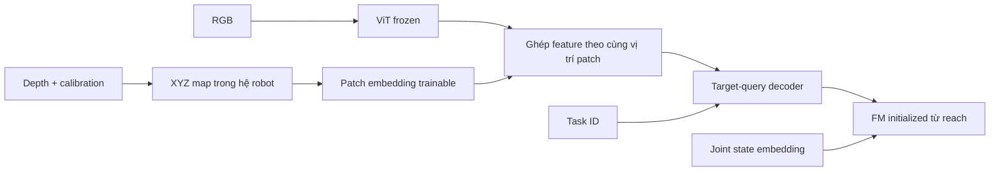

Lý do chọn **XYZ thay vì depth thô**: XYZ đã biểu diễn vị trí trong hệ robot, phù hợp với kiến thức reach của FM. Model không phải học lại phép chuyển pixel + depth + calibration thành tọa độ.

Nhánh XYZ nhận **toàn bộ ảnh**, chia patch cùng cách với RGB rồi ghép feature tương ứng. Số token sau ghép giữ nguyên, không cần lấy mẫu 512 điểm.

Đây là lựa chọn hợp lý nhất để thử trước cho pipeline hiện tại; hiệu quả hơn depth thô đến đâu vẫn cần đo bằng rollout.

---

## 0910 · User · 2026-10-21T10:57:07.256Z

bình thường lấy đâu xyz

---

## 0911 · Assistant · 2026-10-21T10:57:13.822Z

**XYZ tính từ depth camera và calibration**, không lấy từ ground truth của simulator.

Với mỗi pixel \((u,v)\), camera đo depth \(z\):

\[
X=(u-c_x)z/f_x,\quad Y=(v-c_y)z/f_y,\quad Z=z
\]

Sau đó dùng vị trí/hướng camera so với robot để chuyển XYZ sang **hệ tọa độ robot**.

Ngoài thực tế cần:

- **Depth camera** cung cấp depth và intrinsics.
- **Calibration camera–robot** cung cấp phép biến đổi giữa hai hệ tọa độ.

Mỗi pixel depth thành một bộ XYZ, nên ảnh depth **H×W×1** thành XYZ map **H×W×3**. Đây vẫn là dữ liệu cảm biến, có sai số depth và calibration; không phải tọa độ vật được cung cấp sẵn.

---

## 0912 · User · 2026-10-21T10:57:18.554Z

ok làm đi

---

## 0913 · Assistant — tiến độ · 2026-10-21T10:57:22.092Z

Mình sẽ đổi sang hai nhánh: RGB qua ViT freeze, depth + calibration thành XYZ map rồi qua patch embedding trainable, ghép feature theo vị trí trước target-query decoder. Mình sẽ giữ split 1/8 dữ liệu, ngân sách 80 epoch và FM từ checkpoint reach, rồi kiểm tra pipeline trước khi chạy.


---

## 0914 · Assistant — tiến độ · 2026-10-21T10:57:54.932Z

Có một chi tiết cần giữ đúng: ViT hiện gộp đặc trưng về lưới 8×8. Mình sẽ cho XYZ map đi qua patch embedding rồi gộp về đúng lưới đó để ghép với RGB. Toàn bộ pixel depth vẫn được dùng ở đầu vào; ViT giữ nguyên weight, còn nhánh XYZ, decoder và FM được train.


---

## 0915 · Assistant — tiến độ · 2026-10-21T11:01:37.979Z

Bản mới đã chạy qua dữ liệu thật: RGB và XYZ ghép thành 64 token cùng vị trí, đầu ra hữu hạn và ViT vẫn freeze. Mình sẽ cache RGB feature vào VRAM, depth uint16 vào RAM; XYZ tính theo từng batch nên không cần lưu thêm cloud lớn xuống ổ.


---

## 0916 · Assistant — tiến độ · 2026-10-21T11:03:04.165Z

Kiểm tra online đã qua: depth render lúc rollout khớp từng pixel với frame dữ liệu tương ứng, calibration cũng khớp. Chuỗi RGB-D → policy → IK chạy được cả 4 target. Mình đang chốt kiểm tra gradient và đo tốc độ batch 128 trước lượt train chính 80 epoch.


---

## 0917 · Assistant — tiến độ · 2026-10-21T11:04:29.574Z

Cache đã hơn nửa, tốc độ khoảng 390 frame/giây; dự kiến tổng khoảng 2 phút. Mình giữ loss phụ point cloud trọng số 1 như lượt trước, nên thay đổi lần này là thêm nhánh geometry vào input.


---

## 0918 · Assistant — tiến độ · 2026-10-21T11:05:22.792Z

Đã encode xong toàn bộ 39.584 frame train/validation trong khoảng 2 phút. Phần còn lại là kiểm tra label có giữ nguyên như E119 không và chạy batch 128 để đo VRAM/thời gian; rollout kiểm tra camera đã đạt khớp depth từng pixel.


---

## 0919 · Assistant — tiến độ · 2026-10-21T11:06:00.953Z

Đã bắt đầu train E120. Các kiểm tra đều qua: label giữ nguyên như E119, FM chuyển weight chính xác và gradient đi vào nhánh XYZ/decoder/FM. Batch 128 đo khoảng 0,13 giây/update, VRAM lúc train khoảng 7,5 GiB. Ước tính 80 epoch khoảng 1 giờ, gồm validation và lưu checkpoint; sau đó tự test K10.


---

## 0920 · Assistant · 2026-10-21T11:06:41.786Z

Đã triển khai và đang train **E120**, log ở **tmux `ssh_tmux`, window 1**.

- RGB → **ViT freeze**; depth + calib → **XYZ map full resolution → patch embedding trainable**.
- Ghép feature theo vị trí → query decoder → FM từ **E118 reach step 120k**.
- Giữ subset **1/8**, train **80 epoch**, batch 128; loss **FM + cloud auxiliary ×1**.
- Đã qua kiểm tra geometry/gradient/rollout và có **checkpoint 250**.
- VRAM khoảng **7,5 GiB**, dự kiến khoảng **1 giờ train**, sau đó tự test **K10 trên 3.200 episode**.

Kiến trúc và cấu hình: [E120 README](/workspace/arm-manipulation/docs/research/e120_README.md). Chưa có kết quả success rate.

---

## 0921 · User · 2026-10-21T12:09:35.452Z

có vài kết quả rồi đấy, render vài video thành công và thất bại

---

## 0922 · Assistant — tiến độ · 2026-10-21T12:09:41.231Z

Mình sẽ xem các rollout đã test, chọn vài ca thành công và thất bại rồi render từ trajectory đã lưu, kèm target và kết quả từng ca.


---

## 0923 · Assistant — tiến độ · 2026-10-21T12:10:15.761Z

Đã có ca thành công ở cả ba nhóm: hoán vị mới, layout mới và cả hai cùng mới. Mình sẽ render 3 ca thành công + 3 ca timeout, mỗi nhóm một cặp. Full test vẫn đang chạy, nên các clip này chỉ minh họa hành vi, chưa phải kết quả tổng kết.


---

## 0924 · Assistant · 2026-10-21T12:12:20.203Z

Đã render **3 ca thành công + 3 ca timeout**, checkpoint **23.520, đủ 80 epoch**, test **K10**. Mỗi video có góc front và góc chéo.

| Nhóm test | Thành công | Thất bại |
|---|---|---|
| Hoán vị mới | [▶ Đỏ, 5 giây](/workspace/robotics_assets/experiments/e120_fusion/test_k10/videos_1/success_composition.mp4) | [▶ Xanh dương, timeout](/workspace/robotics_assets/experiments/e120_fusion/test_k10/videos_1/failure_composition.mp4) |
| Layout mới | [▶ Xanh dương, 6 giây](/workspace/robotics_assets/experiments/e120_fusion/test_k10/videos_1/success_spatial.mp4) | [▶ Đỏ, timeout](/workspace/robotics_assets/experiments/e120_fusion/test_k10/videos_1/failure_spatial.mp4) |
| Layout + hoán vị mới | [▶ Vàng, 8 giây](/workspace/robotics_assets/experiments/e120_fusion/test_k10/videos_1/success_combined.mp4) | [▶ Đỏ, timeout](/workspace/robotics_assets/experiments/e120_fusion/test_k10/videos_1/failure_combined.mp4) |

Đây là clip chọn theo kết quả để xem hành vi; **full test vẫn đang chạy**.

---

## 0925 · User · 2026-10-21T12:15:27.732Z

ơ không visualize point cloud à, t mới biết nó sai ở đâu

---

## 0926 · Assistant — tiến độ · 2026-10-21T12:15:31.538Z

Đúng, các clip vừa rồi thiếu phần geometry nên khó biết lỗi ở định vị hay điều khiển. Mình sẽ render lại với cloud toàn cảnh từ depth, cloud riêng target từ depth + mask GT để đối chiếu, và cloud target do head phụ dự đoán. Cả ba sẽ dùng cùng frame và calibration với policy.


---

## 0927 · Assistant — tiến độ · 2026-10-21T12:16:52.428Z

Mình sẽ thêm cả góc cloud 3D và phần phóng to target để thấy sai lệch, không chỉ chấm điểm lên RGB. Video sẽ hiện khoảng cách giữa cloud dự đoán với bề mặt GT và với EE; như vậy mình có thể kiểm tra nghi ngờ cloud bị kéo về đầu kẹp.


---

## 0928 · Assistant — tiến độ · 2026-10-21T12:18:16.840Z

Bản mới đang render lại đúng 6 ca cũ. Mỗi clip có RGB kèm cloud, cloud toàn cảnh 3D, vùng phóng to target và các sai số theo frame. Trajectory giữ nguyên; cloud dự đoán được tính lại ở các frame replan K10 để chẩn đoán.


---

## 0929 · Assistant — tiến độ · 2026-10-21T12:19:17.787Z

Đã thấy một dấu hiệu ở ca timeout hoán vị mới: cloud dự đoán lúc bắt đầu khá sát GT, Chamfer khoảng **2,3 mm**, nhưng cuối rollout tăng lên khoảng **41 mm**. Video mới sẽ cho thấy cả giai đoạn cloud còn đúng lẫn lúc nó trôi, để xem chuyển động sai bắt đầu từ đâu.


---

## 0930 · Assistant · 2026-10-21T12:20:22.199Z

Đã render lại với **cam: cloud GT target**, **cyan: cloud dự đoán**, kèm cloud toàn cảnh 3D, zoom target và sai số.

| Nhóm | Thành công | Thất bại |
|---|---|---|
| Hoán vị mới | [▶ Video](/workspace/robotics_assets/experiments/e120_fusion/test_k10/cloud_1/success_composition.mp4) | [▶ Video](/workspace/robotics_assets/experiments/e120_fusion/test_k10/cloud_1/failure_composition.mp4) |
| Layout mới | [▶ Video](/workspace/robotics_assets/experiments/e120_fusion/test_k10/cloud_1/success_spatial.mp4) | [▶ Video](/workspace/robotics_assets/experiments/e120_fusion/test_k10/cloud_1/failure_spatial.mp4) |
| Cả hai mới | [▶ Video](/workspace/robotics_assets/experiments/e120_fusion/test_k10/cloud_1/success_combined.mp4) | [▶ Video](/workspace/robotics_assets/experiments/e120_fusion/test_k10/cloud_1/failure_combined.mp4) |

Ca fail hoán vị mới: cloud ban đầu khá đúng (**Chamfer 2,3 mm**), cuối clip trôi lên **41,3 mm**. Ca fail layout mới đã lệch khoảng **59 mm ngay từ đầu** — hai kiểu lỗi khác nhau.

---

## 0931 · User · 2026-10-21T12:23:47.498Z

m thử feed thẳng point cloud của từng object xong test vài episode + render

---

## 0932 · Assistant — tiến độ · 2026-10-21T12:23:51.829Z

Mình sẽ thử thay cloud target do head phụ dự đoán bằng cloud GT của đúng vật, lấy từ depth + mask. Mình cần kiểm tra chỗ nối vào FM trước để đưa cloud vào đúng nhánh đã học ở bài reach, rồi test vài episode và render kèm cloud.


---

## 0933 · User · 2026-10-21T12:24:25.533Z

y t la feed thang vao FM qua kien truc FM reach

---

## 0934 · Assistant — tiến độ · 2026-10-21T12:24:43.024Z

À đúng, mình hiểu rồi: dùng nguyên **point encoder → goal projection → FM của checkpoint E118 reach**, feed cloud riêng từng vật vào đó, bỏ nhánh ViT/query decoder của E120. Mình sẽ thử 8 episode trên 2 layout, đủ 4 vật, rồi render cloud và chuyển động. Vì checkpoint này chỉ học reach + đóng kẹp, mình sẽ báo riêng sai số reach và tiếp xúc/gắp, không thêm động tác nâng bằng script.


---

## 0935 · Assistant — tiến độ · 2026-10-21T12:25:51.263Z

Mình sẽ giữ cloud ở frame đầu làm goal cố định, đúng cách FM reach đã được train. Mỗi lần chọn một vật, đưa toàn bộ điểm depth hợp lệ trong mask của vật đó vào point encoder; chỉ thêm điểm lặp để batch được, không bỏ bớt điểm. Không dùng weight E120 hay train thêm.


---

## 0936 · Assistant — tiến độ · 2026-10-21T12:29:20.765Z

8 episode đã chạy xong qua nguyên checkpoint E118: **0/8 tới trong 10 mm ở cuối rollout**, sai số cuối trung vị **60,6 mm**, chưa có ca kẹp được hai phía. Video đang render, có hiện chính cloud được feed vào FM. Kết quả này mới cho thấy transfer trực tiếp chưa đạt; vật 32 mm trên bàn khác với voxel 20 mm trong bài reach.


---

## 0937 · Assistant · 2026-10-21T12:30:36.815Z

Đã test nguyên **E118 reach step 120k**:

`Cloud vật → point encoder → maxpool → goal projection → FM`

Không dùng nhánh E120, không train thêm. **8 episode / 2 layout / đủ 4 vật**:

- **0/8** có sai số cuối dưới 10 mm.
- Sai số cuối trung vị **60,6 mm**.
- Chưa có ca kẹp hai phía.

Video, mỗi bản gồm 4 target theo thứ tự đỏ–xanh dương–xanh lá–vàng:

- [▶ Layout 0](/workspace/robotics_assets/experiments/e118_cloud/test_pick_k10/g000_p01_overview.mp4)
- [▶ Layout 1](/workspace/robotics_assets/experiments/e118_cloud/test_pick_k10/g001_p00_overview.mp4)
- [▶ Xem riêng vật đỏ, rõ cloud hơn](/workspace/robotics_assets/experiments/e118_cloud/test_pick_k10/g000_p01_t0.mp4)

**Cloud cyan chính là input FM**, giữ cố định từ frame đầu. Đây là thử transfer trực tiếp từ voxel 20 mm sang vật 32 mm trên bàn; chưa thể quy lỗi riêng cho encoder hay FM.

---

## 0938 · User · 2026-10-21T12:41:24.943Z

o, the la no chua genralize voi point cloud to a

---

## 0939 · Assistant · 2026-10-21T12:41:42.984Z

**Có dấu hiệu vậy, nhưng chưa kết luận riêng do cloud to hơn được.** Lượt vừa rồi đồng thời đổi:

- Voxel **20 mm → vật 32 mm**.
- Góc nhìn và phần bề mặt nhìn thấy.
- Reach trong không khí → có vật/bàn cản chuyển động.

Point encoder **MLP + maxpool chỉ bất biến với thứ tự điểm**, không tự bất biến với kích thước hay góc nhìn.

Muốn xác nhận, cần test **cùng đích held-out, cùng camera, cùng môi trường reach**, chỉ đổi cạnh voxel **20 → 32 → 48 mm**. Nếu sai số tăng theo kích thước thì mới xác định được lỗi generalize này.

---

## 0940 · User · 2026-10-21T12:42:11.971Z

goc nhin khac gi

---

## 0941 · Assistant — tiến độ · 2026-10-21T12:42:15.094Z

Mình sẽ đối chiếu camera tạo cloud của E118 với camera front trong bộ pick để nói chính xác chúng khác nhau thế nào.


---

## 0942 · Assistant · 2026-10-21T12:42:36.099Z

Mình kiểm tra lại thì **camera E118 và camera pick khác thật**:

| | E118 reach | Bộ pick |
|---|---:|---:|
| Độ cao camera | 95 cm | 60 cm |
| Khoảng lùi theo trục Y so với base | 120 cm | 72,4 cm |
| Góc chúc xuống | 30,3° | 46,3° |
| FOV dọc | 70° | 42,7° |
| Độ phân giải | 640×480 | 320×240 |

Cả hai cloud đều đã chuyển về **hệ tọa độ robot**, nên không có chuyện đổi hệ tọa độ. Nhưng đây là **cloud phần bề mặt nhìn thấy**: đổi camera làm đổi các mặt được lấy điểm và mật độ điểm, dù vẫn cùng một vật.

E118 trước đó chỉ train với **một camera cố định**, chưa random góc nhìn. Vì vậy lượt vừa rồi chưa tách được ảnh hưởng của **kích thước vật** khỏi **bề mặt cloud nhìn thấy**.

---

## 0943 · User · 2026-10-21T12:44:48.661Z

m thu render 1 episode ve gi9ng reach roi test lai, xem co robust voi kich thuoc point cloud khong

---

## 0944 · Assistant — tiến độ · 2026-10-21T12:44:52.783Z

Mình sẽ dựng cloud bằng đúng camera của E118, giữ nguyên vị trí đích và checkpoint reach. Trên cùng một episode, mình sẽ thử voxel 20, 32 và 48 mm để chỉ thay kích thước, rồi rollout và render so sánh.


---

## 0945 · Assistant — tiến độ · 2026-10-21T12:45:46.675Z

Để tách đúng ảnh hưởng của kích thước, lượt này dùng **một đích held-out trong môi trường reach gốc**, không có vật/bàn cản như lượt pick vừa rồi. Ba kích thước dùng chung camera, trạng thái home, 128 điểm, noise và H25/K15; mình cũng kiểm tra cloud 20 mm dựng lại có khớp cloud E118 đã lưu không.


---

## 0946 · Assistant — tiến độ · 2026-10-21T12:47:46.726Z

Cloud 20 mm dựng lại đã khớp **từng giá trị** với cloud E118 gốc. Ba rollout đang chạy với cùng noise ở mỗi lần replan; như vậy có thể đối chiếu kích thước mà không lẫn thay đổi camera hay checkpoint.


---

## 0947 · Assistant — tiến độ · 2026-10-21T12:49:36.229Z

Kết quả ở đích này: cloud **20 mm → sai số cuối 6,2 mm**, **32 mm → 10,3 mm**, **48 mm → 15,8 mm**; cả ba không va chạm. Có giảm độ chính xác khi tăng kích thước, nhưng đây mới là một đích với một noise seed. Mình đang hoàn tất video đặt ba lượt cạnh nhau.


---

## 0948 · Assistant · 2026-10-21T12:50:29.306Z

[▶ Video so sánh 20 / 32 / 48 mm, có cloud đầu vào](/workspace/robotics_assets/experiments/e118_cloud/test_size_k15/comparison.mp4)

Đã dùng **đúng camera và môi trường reach gốc**, cùng đích, home, 128 điểm và noise; chỉ đổi kích thước voxel. Cloud 20 mm khớp từng giá trị với bản E118 đã lưu.

| Cạnh voxel | Sai số EE cuối |
|---|---:|
| 20 mm | **6,17 mm** |
| 32 mm | **10,29 mm** |
| 48 mm | **15,85 mm** |

Cả ba không va chạm. **Ở ca này, tăng kích thước làm giảm độ chính xác**, nhưng một đích/một seed chưa đủ kết luận mức robust toàn bộ.

---

## 0949 · User · 2026-10-21T12:53:18.382Z

um, cubg kho de tu cloud suy ra tam

---

## 0950 · Assistant · 2026-10-21T12:53:40.290Z

Ừ, **cloud chỉ chứa bề mặt nhìn thấy thì tâm hình học không được cung cấp trực tiếp**. Lấy trung bình các điểm sẽ lệch về phía camera; phần phía sau bị khuất thì chưa biết.

Riêng khối lập phương vẫn có thể fit hình học để suy tâm. Nhưng E118 chỉ học cube **20 mm, một camera cố định**, nên có thể đã học cách bù một khoảng cố định từ bề mặt vào tâm, thay vì hiểu kích thước vật.

**Sai số EE vừa đo cũng chưa chứng minh lỗi nằm ở suy tâm**, vì còn cả FM sinh trajectory phía sau encoder.

Với bài gắp, mình nghĩ mục tiêu phù hợp hơn là **vị trí/pose đặt kẹp theo expert**, thay vì ép model suy tâm hình học của vật. Tâm vật và vị trí EE cần đến cũng không nhất thiết trùng nhau.

---

## 0951 · User · 2026-10-21T12:54:26.501Z

<user_shell_command>
<command>
ls
</command>
<result>
Exit code: 0
Duration: 0.0541 seconds
Output:
AGENTS.md
CLAUDE.md
TODO.md
arm-manipulation
iSEE
isee_setup
node_modules
package-lock.json
package.json
robotics_assets
upload_manifest.json

</result>
</user_shell_command>

---

## 0952 · User · 2026-10-21T12:54:36.911Z

ls ro

---

## 0953 · Assistant · 2026-10-21T12:54:44.082Z

```text
robotics_assets/
├── README.md
├── catalog.json
├── datasets/
├── experiments/
├── metadata/
├── models/
├── pretrained/
└── robot/
```

---

## 0954 · User · 2026-10-21T12:55:15.140Z

<user_shell_command>
<command>
ls robotics-assets/experiments
</command>
<result>
Exit code: 2
Duration: 0.0341 seconds
Output:
ls: cannot access 'robotics-assets/experiments': No such file or directory

</result>
</user_shell_command>

---

## 0955 · User · 2026-10-21T12:55:46.618Z

<user_shell_command>
<command>
ls robotics_assets/experiments
</command>
<result>
Exit code: 0
Duration: 0.0306 seconds
Output:
e102_top
e103_center
e111_bc
e112_isee
e113_voxel
e114_mask
e115_direct
e116_dynamic
e117_wide
e118_cloud
e119_pick
e120_fusion

</result>
</user_shell_command>

---

## 0956 · User · 2026-10-21T12:56:24.600Z

e120 fusion fail predict point cloud du no kha straight forward?

---

## 0957 · Assistant — tiến độ · 2026-10-21T12:56:43.770Z

Đúng, khi đã có depth và calibration thì hình học đã có sẵn; phần cần học chủ yếu là chọn đúng vật và giữ thông tin đó qua latent. Mình sẽ xem lại train/validation và nhánh ghép feature của E120 để phân biệt lỗi chọn vật, nén feature hay overfit.


---

## 0958 · Assistant · 2026-10-21T12:57:19.555Z

**Đúng, với RGB-D + calibration thì XYZ đã có sẵn. E120 đang làm bài toán vòng vèo hơn cần thiết:** nén toàn cảnh vào latent 256D, rồi bắt head sinh lại 128 điểm XYZ.

Log cho thấy **overfit rõ**:

| Chamfer | Sai số |
|---|---:|
| Train, trung bình 100 batch cuối | **2,15 mm** |
| Validation tốt nhất | **21,95 mm** |
| Validation cuối 80 epoch | **28,39 mm** |

Nó học được trên train, nhưng generalize kém. Checkpoint đang rollout là **final 80 epoch**; checkpoint tốt nhất theo FM validation ở khoảng **4,25 epoch**.

Ngoài ra, cả RGB và XYZ bị gộp xuống **8×8 token**. Một token tương ứng khoảng 40×40 pixel, trong khi vật chỉ rộng khoảng 10–20 pixel. Việc nén làm mất thông tin định vị là **giả thuyết cần kiểm tra**, chưa phải kết luận đã chứng minh.

Cách trực tiếp hơn là:

**Query → mask target → lấy XYZ tại các pixel trong mask → cloud target.**

Model chỉ học **chọn đúng vật**; tọa độ điểm lấy thẳng từ depth. Với dữ liệu hiện tại, mình nghiêng về cách này hơn việc sinh lại cloud bằng head hồi quy.

---

## 0959 · User · 2026-10-21T13:06:53.752Z

nhung t khong muon input xyz raw vao FM, t muon no end to end de FM tan dung katent

---

## 0960 · Assistant · 2026-10-21T13:07:24.009Z

Đúng, **m muốn supervision hình học để shape latent, rồi FM học tận dụng latent đó**. Đề xuất mask → cloud → FM vừa rồi lệch ý này.

**E120 hiện đã feed latent vào FM**, không feed cloud dự đoán:

```text
RGB → frozen ViT ─┐
                 ├→ fusion → query decoder → hidden h → FM → action
Depth → encoder ─┘                              │
                                               └→ cloud head → auxiliary loss
```

Loss FM cập nhật ngược qua decoder/fusion/geometry encoder; loss cloud buộc `h` chứa thông tin định vị. Cloud head chỉ dùng để supervise và chẩn đoán.

Vậy nên **giữ nguyên nguyên tắc này**. Điều cần kiểm tra là:

- **Overfit:** train cloud ~2 mm nhưng validation ~28 mm.
- **Nén không gian:** thử giữ 400 patch token thay vì gộp xuống 64.
- **Checkpoint:** đánh giá best validation trước khi kết luận từ final 80 epoch.

Head cloud vẫn nên gắn trực tiếp vào `h`. Dự đoán cloud đúng chưa bảo đảm FM dùng tốt, nhưng nó cho mình một phép kiểm tra rõ về thông tin hình học trong latent.

---

## 0961 · User · 2026-10-21T13:14:14.095Z

ủa ai mượn m nén

---

## 0962 · Assistant — tiến độ · 2026-10-21T13:14:18.393Z

Không ai yêu cầu. Mình đã tự giữ bước pooling 20×20 → 8×8 từ code cũ; đó là quyết định của mình. Mình sẽ bỏ pooling ở cả RGB và XYZ, giữ đủ 400 patch token, rồi chạy lại cùng split và ngân sách 80 epoch.


---

## 0963 · Assistant — tiến độ · 2026-10-21T13:16:18.759Z

Bản sửa giữ lưới 20×20: cả 400 patch RGB và 400 patch XYZ được ghép theo vị trí, rồi query decoder đọc đủ 400 token. Feature cache sẽ khoảng 22,7 GiB, nên mình để trong RAM và chuyển từng batch lên GPU; không ghi cache feature xuống ổ.


---

## 0964 · Assistant — tiến độ · 2026-10-21T13:17:47.130Z

Mình đã bỏ pooling ở cả hai nhánh. Nhưng lúc kiểm tra, GPU trên máy bị mất khỏi driver: `nvidia-smi` báo “No devices were found”, nên lượt train mới chưa chạy được. Mình đang kiểm tra bản sửa bằng CPU và sẽ để lượt E121 chờ GPU hoạt động lại.


---

## 0965 · Assistant — tiến độ · 2026-10-21T13:19:59.178Z

Kiểm tra CPU đã qua: đủ **400 token ở mỗi nhánh**, loss backprop được vào geometry encoder, decoder và FM; ViT vẫn freeze. Các weight khởi tạo dùng chung cũng khớp E120. GPU vẫn chưa truy cập được, và full test E120 đã bị ngắt ở 2.464/3.200 ca; mình sẽ giữ kết quả đã lưu để resume.


---

## 0966 · Assistant · 2026-10-21T13:20:49.879Z

Không ai yêu cầu. **Mình tự giữ pooling từ code cũ. Xin lỗi.**

Đã sửa thành **E121**: giữ đủ **400 patch token**, bỏ pooling ở cả RGB và XYZ; vẫn dùng latent → FM và cloud auxiliary loss. Kiểm tra forward/backward trên CPU đã qua.

**Chưa train lại vì GPU hiện không truy cập được.** Đã queue ở `ssh_tmux`, window 1, tự chạy khi GPU hoạt động lại.

[Kiến trúc và cấu hình E121](/workspace/arm-manipulation/docs/research/e121_README.md)

---

## 0967 · User · 2026-10-21T13:34:33.659Z

đang có gì nặng để t xoá bớt rồi chuyển server khác

---

## 0968 · User · 2026-10-21T13:38:00.601Z

thôi ngon rồi, train tiếp

---

## 0969 · Assistant — tiến độ · 2026-10-21T13:38:05.073Z

Mình sẽ kiểm tra GPU và các job đang chờ, rồi tiếp tục E121 từ trạng thái hiện có.


---

## 0970 · Assistant — tiến độ · 2026-10-21T13:39:00.213Z

GPU đã chạy được CUDA bình thường. E121 chưa có checkpoint nên mình đã bắt đầu lượt 80 epoch với đủ 400 patch token, không pooling. Mình cũng đã resume full test E120 từ 2.464 ca đã lưu.


---

## 0971 · Assistant — tiến độ · 2026-10-21T13:40:19.945Z

Cache E121 đã khoảng 40%, tốc độ gần 220 frame/giây; dự kiến tổng khoảng 3 phút. GPU đang ổn định. Sau cache sẽ chạy kiểm tra batch 128 rồi bắt đầu cập nhật weight.


---

## 0972 · Assistant — tiến độ · 2026-10-21T13:41:28.564Z

Cache đã hơn 75%, vẫn nằm trong RAM; không phát sinh file feature lớn trên ổ. Full test E120 cũng đang chạy tiếp bình thường. Mình sẽ đợi E121 qua kiểm tra GPU và lưu checkpoint đầu tiên rồi báo lại.


---

## 0973 · Assistant — tiến độ · 2026-10-21T13:43:02.841Z

E121 đã qua kiểm tra GPU batch 128 và bắt đầu train, có checkpoint đầu tiên. Decoder nhận đủ 400 token; loss giảm trong các batch đầu. Tốc độ lượt chính hiện khoảng 0,2 giây/update, ước tính 80 epoch khoảng 1–1,5 giờ.


---

## 0974 · Assistant · 2026-10-21T13:43:39.182Z

Đang train **E121** ở `ssh_tmux`, **window 1**, đã có **checkpoint 250**.

- Giữ đủ **400 patch token**, không pooling.
- **80 epoch, batch 128**, cache trong RAM.
- Dự kiến khoảng **1–1,5 giờ**.

Full test E120 cũng đã resume từ 2.464 ca đã lưu.

---

## 0975 · User · 2026-10-21T14:11:03.184Z

ket qua kha thi hon khong

---

## 0976 · Assistant — tiến độ · 2026-10-21T14:11:06.379Z

Mình sẽ đối chiếu validation của E121 với E120 ở cùng số bước, rồi xem đã có rollout nào đủ để đánh giá chưa.


---

## 0977 · Assistant · 2026-10-21T14:12:13.686Z

**Chưa thể nói tốt hơn: FM loss giảm, nhưng dự đoán cloud trên validation tệ hơn.**

So cùng **7.750 step, khoảng 26 epoch**:

| Validation | E120 — 64 token | E121 — 400 token |
|---|---:|---:|
| FM loss ↓ | 0,0580 | **0,0459** |
| Cloud Chamfer ↓ | **22,9 mm** | 47,2 mm |

E121 trên train chỉ khoảng **3 mm**, nhưng validation khoảng **47 mm** → vẫn **overfit mạnh**. Bỏ pooling chưa giải quyết được generalization.

E121 hiện khoảng **27/80 epoch**, chưa có rollout nên chưa biết gắp tốt hơn không. Baseline E120 đã test full: **443/3.200 thành công, 13,84%**.

---

## 0978 · User · 2026-10-21T14:18:52.282Z

sao no ovefit the nhi

---

## 0979 · Assistant — tiến độ · 2026-10-21T14:19:24.563Z

Mình nghi nguyên nhân lớn nhất là 256 demo chỉ đến từ 4 layout: nhiều frame lặp lại cùng các vị trí spawn. Mình sẽ đếm vị trí thực trong dữ liệu để kiểm tra, rồi đối chiếu với thời điểm validation bắt đầu xấu đi.


---

## 0980 · User · 2026-10-21T14:20:22.552Z

a, the thi train full data voi cung budgeg di

---

## 0981 · User · 2026-10-21T14:22:02.029Z

lai den van de pointcloud generalization =)), nhung t nghi cai nay de giai quyet hon

---

## 0982 · Assistant — tiến độ · 2026-10-21T14:22:10.795Z

Ừ, vì có RGB-D và calibration nên mình có thể kiểm tra riêng phần chọn vật và phần điều khiển. Mình sẽ đổi sang full 32 layout/2.048 demo, giữ đủ 400 token và ngân sách **23.520 updates, batch 128** — khoảng **10,2 epoch** trên full data. Phần test sẽ dùng split held-out gốc, loại các demo nay được đưa vào train.


---

## 0983 · User · 2026-10-21T14:24:35.434Z

o the tai sao khong custom vit de nhan them 1 kenh

---

## 0984 · Assistant — tiến độ · 2026-10-21T14:24:38.447Z

Được chứ. Mình sẽ kiểm tra nhánh RGB-D hiện tại để nói rõ chỗ cần sửa, nhất là việc thêm kênh depth trong khi ViT đang freeze.

---

## 0985 · Assistant — tiến độ · 2026-10-21T14:24:58.178Z

Có thể sửa patch embedding của ViT từ **3 → 4 kênh**, nhận `[R,G,B,depth]`, giữ weight RGB pretrained và khởi tạo weight depth mới. Depth khi đó đi qua toàn bộ attention của ViT để học cùng RGB.

Nhưng với cấu hình **ViT freeze** hiện tại, phải cho phần patch embedding mới học và truyền gradient qua encoder đã freeze; vì vậy không cache cố định hidden ViT như đang làm được. Nếu giữ camera cố định thì depth có thể đủ; nếu đổi góc cam, cần thêm calibration hoặc dùng **6 kênh RGB + XYZ trong hệ robot** để biểu diễn hình học rõ hơn.

Hiện code đang cho RGB và XYZ đi hai nhánh rồi ghép từng patch trước query decoder. ViT 4/6 kênh là một phương án khác đáng thử, nhưng chưa có bằng chứng nó giải quyết generalization tốt hơn. Mình giữ kiến trúc hiện tại cho lượt full-data cùng budget bạn vừa yêu cầu, để đo riêng ảnh hưởng của độ đa dạng dữ liệu.

---

## 0986 · Assistant — tiến độ · 2026-10-21T14:25:59.064Z

Mình đã dừng E121 ở checkpoint lưu gần nhất **step 12.000** và giữ lại best **step 2.750**. Lượt full-data sẽ khởi tạo lại từ FM reach; cùng **23.520 updates**, thay vì tiếp tục từ weights đã overfit trên subset.

Cache 400 token cho full data cần khoảng **212 GiB RAM** gồm RGB feature và depth. Máy hiện còn khoảng **236 GiB khả dụng**; mình đang sửa bước kiểm tra cache để tránh tạo thêm một mảng tạm quá lớn.

---

## 0987 · Assistant — tiến độ · 2026-10-21T14:28:45.711Z

Preflight batch 128 đã chạy đúng, nhưng lúc cấp phát thì RAM khả dụng giảm còn khoảng **214 GiB**, không đủ giữ cache thô kèm bộ nhớ làm việc. Mình đã thử nén lossless depth trong RAM: 128 frame giảm **19,66 MB → 0,90 MB**, giải nén khôi phục bit-exact. Mình dùng cách này cho lượt full-data; input và số token giữ nguyên.

---

## 0988 · Assistant · 2026-10-21T14:30:33.204Z

**Được, custom ViT nhận 4 kênh RGB-D hoàn toàn hợp lý.** Sửa patch embedding từ 3→4 kênh, copy weight RGB pretrained, khởi tạo weight depth bằng 0 rồi train patch embedding.

Có thể freeze transformer, nhưng vẫn phải truyền gradient qua nó để học embedding mới; lúc đó **không cache cố định hidden ViT được nữa**. Mình chọn hai nhánh hiện tại để tận dụng ViT RGB frozen và cache, chứ ViT không có hạn chế chỉ nhận RGB.

Cách 4 kênh cho RGB–depth tương tác ngay trong attention đáng thử, nhưng chưa thể kết luận generalize tốt hơn.

Lượt [E122 full-data](/workspace/arm-manipulation/docs/research/e122_README.md) đã qua preflight batch 128, đang cache; sau đó tự train **23.520 updates** rồi test.

---

## 0989 · User · 2026-10-21T16:46:30.369Z

t bảo m train full data xong chưa

---

## 0990 · Assistant — tiến độ · 2026-10-21T16:46:34.493Z

Mình kiểm tra tiến độ full-data E122 ngay.

---

## 0991 · Assistant — tiến độ · 2026-10-21T16:46:50.706Z

**Chưa xong.** Job đã dừng lúc cache ở khoảng 9.904/296.688 frame vì kiểm tra phát hiện point-cloud label lệch hình học tại một frame của `g001/p00/t3`. Chưa chạy update train nào, nên chưa có checkpoint E122.

Mình đang kiểm tra frame lỗi và sửa để chạy lại full-data.

---

## 0992 · Assistant — tiến độ · 2026-10-21T16:48:40.561Z

Đã xác định được lỗi: một pixel depth lạc làm điểm label nằm cách tâm vật gần **40 mm**, trong khi khối chỉ rộng 32 mm. Bộ lọc mới loại pixel depth đột biến khi tạo label; đã kiểm tra lại toàn bộ episode lỗi và giữ nguyên depth đầu vào của policy.

Mình chạy lại full-data, giữ kiến trúc và budget **23.520 updates**.

---

## 0993 · Assistant · 2026-10-21T16:50:27.337Z

**Chưa xong, chưa có checkpoint full-data.** Job trước lỗi khi cache; mình đã sửa và chạy lại, hiện cache được **14.605/296.688 frame (~5%)**, đã vượt đoạn từng gây lỗi.

E122 dùng đủ **2.048 demo**, giữ **23.520 updates**. Cache còn khoảng **22 phút**, sau đó mới bắt đầu train.

---

## 0994 · User · 2026-10-21T17:20:01.405Z

chưa thấy train

---

## 0995 · Assistant — tiến độ · 2026-10-21T17:20:04.605Z

Mình kiểm tra job ngay, xem đang cache hay lại bị dừng trước khi train.

---

## 0996 · Assistant — tiến độ · 2026-10-21T17:21:15.631Z

Đúng, job lại chết trước khi train do hết RAM. Mình đã đọc nhầm RAM của host: container thực tế chỉ được dùng **120,7 GiB**, nên cache feature 169,8 GiB không thể chứa được.

Mình sửa sang cache ảnh RGB uint8 khoảng **63,7 GiB**, rồi chạy ViT frozen trong từng batch. Giữ kiến trúc và full data; lần này mình sẽ kiểm tra đến khi có update train và checkpoint thật.

---

## 0997 · Assistant — tiến độ · 2026-10-21T17:22:49.099Z

Đã xác nhận container chạm đúng giới hạn RAM và bị OOM kill. Bản sửa đọc giới hạn cgroup, dùng cache ảnh uint8 và encode ViT online; tổng RAM dự kiến khoảng **80 GiB**, nằm trong mức 120,7 GiB được cấp.

Mình đang khởi động lại và sẽ theo dõi qua bước cache đến checkpoint đầu tiên.

---

## 0998 · Assistant — tiến độ · 2026-10-21T17:25:23.898Z

Preflight mới đã chạy đúng cả ViT online + FM, khoảng **0,46 giây/update**; 23.520 updates dự kiến khoảng **3 giờ cộng overhead**.

Cache ảnh đang chạy khoảng 440 frame/giây, RAM container mới dùng **14 GiB**. Mình tiếp tục chờ đến lúc train thực sự bắt đầu.

---

## 0999 · Assistant — tiến độ · 2026-10-21T17:27:00.341Z

Cache đã đạt **80.028/296.688 frame (27%)**, RAM dùng **24,8/120,7 GiB**. Job vẫn chạy ổn, chưa vào train; còn khoảng 8 phút cache theo tốc độ hiện tại.

---

## 1000 · Assistant — tiến độ · 2026-10-21T17:28:11.949Z

Đã cache **37%**, RAM **32,3 GiB** và không có OOM mới. Các kiểm tra hình học của label vẫn đang qua; mình giữ nguyên job để chạy tiếp.

---

## 1001 · Assistant — tiến độ · 2026-10-21T17:29:37.895Z

Cache đã qua **50%**, RAM **41,4 GiB**. Tốc độ hiện tại còn khoảng **5 phút rưỡi**; sau đó sẽ tạo label thống kê và vào vòng train.

---

## 1002 · Assistant — tiến độ · 2026-10-21T17:30:42.543Z

Đã đạt **60% cache**, RAM **47,7 GiB**. Bộ train vẫn đủ **2.048 demo**, bốn target cân bằng 512 demo mỗi loại; bước cache không giảm dữ liệu.

---

## 1003 · Assistant — tiến độ · 2026-10-21T17:31:43.762Z

Cache đã đạt **69%**, vượt mốc lần trước bị OOM. RAM hiện **54,3 GiB**, còn dư nhiều so với giới hạn; khoảng 3–4 phút nữa sẽ xong cache.

---

## 1004 · Assistant — tiến độ · 2026-10-21T17:32:59.481Z

Đã cache **80%**, còn khoảng **2 phút** theo tiến độ hiện tại. RAM **61,9 GiB**; chưa có lỗi mới.

---

## 1005 · Assistant — tiến độ · 2026-10-21T17:34:09.597Z

Cache đã đạt **92%**, còn khoảng một phút. RAM đang dùng **69,5 GiB**; mình sẽ kiểm tra checkpoint ngay khi vòng train chạy.

---

## 1006 · Assistant — tiến độ · 2026-10-21T17:35:34.350Z

Cache đã đạt **99,8%**, RAM **75,1/120,7 GiB**. Đang xử lý nốt các frame validation; sau đó ghi thống kê label và bắt đầu train.

---

## 1007 · Assistant — tiến độ · 2026-10-21T17:36:19.410Z

**Đã vào train thật rồi**, hiện đã qua step 70 và có checkpoint đầu tiên. Cache full data hoàn tất, các kiểm tra label đã qua; RAM hiện khoảng **76 GiB**.

Mình kiểm tra lại checkpoint rồi cập nhật trạng thái run.

---

## 1008 · Assistant · 2026-10-21T17:36:48.193Z

**Đã train thật rồi**, đã qua **step 100/23.520**, dùng đủ **2.048 demo**, batch 128.

Đã lưu [checkpoint đầu tiên, step 1](/workspace/robotics_assets/experiments/e122_full/train/latest.pt). Job chạy ở **`ssh_tmux:1`**, RAM khoảng **76,6/120,7 GiB**.

Còn khoảng **3 giờ train**, sau đó tự test K10.

---

## 1009 · User · 2026-10-21T17:38:40.094Z

tinh ra bat no fuse point cloud voi rgb predict point cloud cua object kho phet, hay la t lam kieu predict mask cua object roi nhan voi depth feed hidden + point cloud * mask vaof point encoder roif feed cho FM

---

## 1010 · Assistant · 2026-10-21T17:39:36.514Z

Ừ, **mask + depth là hướng đáng thử**: mạng chỉ cần chọn đúng pixel của vật, còn hình học 3D lấy trực tiếp từ depth và calibration, thay vì phải sinh lại point cloud từ latent.

Mình đề xuất luồng này:

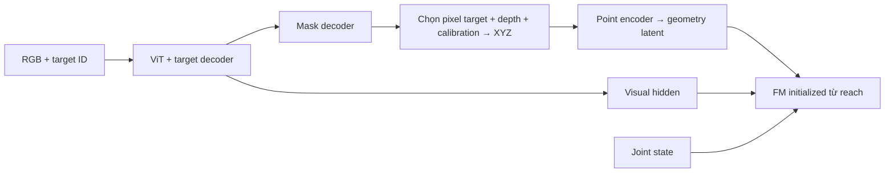

**Point encoder nhận cloud của target; visual hidden làm context riêng cho FM** là cách ghép đơn giản nhất. Nếu muốn fuse ngay trong point encoder, có thể gắn feature RGB tương ứng vào từng điểm `[xyz, f_rgb]`.

Có mấy điểm cần làm đúng:

- **Chọn các điểm trong mask**, tránh nhân rồi để hàng nghìn điểm `[0,0,0]` lọt vào encoder.
- Mask cần đủ nét; mask chỉ upsample từ lưới patch thô dễ dính bàn hoặc tay.
- Train bằng **FM loss + mask BCE/Dice**, dùng cả mask dự đoán khi train BC để FM quen sai số thực tế.
- Point encoder cũng cần finetune: E118 trước đó đã cho thấy nhạy với kích thước/góc nhìn cloud.

Hard mask sẽ chặn gradient FM qua bước chọn điểm; mask loss vẫn huấn luyện nhánh segmentation, còn visual hidden vẫn nhận gradient từ FM.

---

## 1011 · User · 2026-10-22T01:02:11.807Z

vl kết quả tốt phết

---

## 1012 · Assistant — tiến độ · 2026-10-22T01:02:18.838Z

Để mình đọc số liệu E122, so với baseline trên cùng bộ test xem cải thiện được bao nhiêu =))

---

## 1013 · Assistant · 2026-10-22T01:03:06.571Z

Ừ =)) **E122 đạt 73,0% — 1.028/1.408 episode test**, dùng checkpoint final step 23.520.

| Nhóm test | Success |
|---|---:|
| Hoán vị mới | **68,3%** |
| Vị trí mới | **85,2%** |
| Cả hai mới | **86,7%** |

Cloud validation Chamfer còn **3,39 mm**. Không có lượt gắp nhầm vật; 380 thất bại đều timeout.

Baseline E120 trên cùng 1.408 case chỉ **13,9%**, nhưng khác cả số token nên chưa tách riêng được tác động của data. Dù vậy, kết quả này **ủng hộ mạnh việc thiếu đa dạng layout là vấn đề lớn trước đó**; fusion RGB–XYZ dự đoán cloud vẫn làm được khá tốt.

Đã cập nhật [báo cáo E122](/workspace/arm-manipulation/docs/research/e122_README.md).

---

## 1014 · User · 2026-10-22T01:23:41.297Z

ch  t xem video fail lẫn success

---

## 1015 · Assistant — tiến độ · 2026-10-22T01:23:43.535Z

Mình sẽ chọn vài lượt thành công và thất bại của E122, render video kèm point cloud dự đoán để dễ nhìn chỗ sai.

---

## 1016 · Assistant — tiến độ · 2026-10-22T01:25:15.157Z

Mình chọn **3 success và 3 timeout**, mỗi nhóm test một cặp. Video sẽ có góc nhìn robot, ảnh camera đầu vào và cloud GT/predict. Mình dùng lại quỹ đạo test đã lưu để giữ đúng kết quả đã đo.

---

## 1017 · Assistant — tiến độ · 2026-10-22T01:26:40.191Z

Đã xong **5/6 video**, đang render clip timeout cuối. Phần cloud dùng **cam = GT**, **xanh cyan = dự đoán** để đối chiếu với chuyển động tay.

---

## 1018 · Assistant · 2026-10-22T01:28:03.667Z

Mỗi nhóm một video success và một fail:

| Test | Success | Fail |
|---|---|---|
| Hoán vị mới | [▶ Xem](/workspace/robotics_assets/experiments/e122_full/test_k10/videos_1/success_composition.mp4) | [▶ Xem](/workspace/robotics_assets/experiments/e122_full/test_k10/videos_1/failure_composition.mp4) |
| Vị trí mới | [▶ Xem](/workspace/robotics_assets/experiments/e122_full/test_k10/videos_1/success_spatial.mp4) | [▶ Xem](/workspace/robotics_assets/experiments/e122_full/test_k10/videos_1/failure_spatial.mp4) |
| Cả hai mới | [▶ Xem](/workspace/robotics_assets/experiments/e122_full/test_k10/videos_1/success_combined.mp4) | [▶ Xem](/workspace/robotics_assets/experiments/e122_full/test_k10/videos_1/failure_combined.mp4) |

**Cam = cloud GT; cyan = cloud dự đoán**, cập nhật mỗi 10 frame theo K10. Video có cả góc nhìn robot và zoom point cloud.

---

## 1019 · User · 2026-10-22T01:39:15.828Z

từ vit và task decoder có output ra mask ngon không nhỉ

---

## 1020 · Assistant · 2026-10-22T01:39:42.667Z

**Có khả năng tốt**, nhưng cần thêm mask decoder và train bằng mask GT; hidden hiện tại chưa được supervise để xuất mask.

Cách hợp lý là:

```text
400 spatial tokens ViT/fusion + target-query hidden
                    ↓
          mask decoder + upsampling
                    ↓
        visible target mask 240×320
```

**Không nên chỉ lấy hidden 256D rồi MLP ra cả ảnh mask.** Mask decoder nên đọc cả các token không gian để giữ vị trí và hình dạng vật.

Có hai chỗ cần chú ý:

- Patch ViT là **16×16 pixel**, khá thô với vật nhỏ. Nên thêm nhánh RGB convolution nhẹ ở độ phân giải cao để làm nét biên khi upsample.
- Cần dự đoán **visible mask**: phần vật đang nhìn thấy. Nếu mask phủ cả phần bị tay che, depth ở đó sẽ thuộc về tay và tạo cloud sai.

Có thể giữ **ViT frozen**, train task decoder + mask decoder bằng BCE/Dice. Khi đánh giá, ngoài IoU nên đo luôn **precision của mask và Chamfer của cloud sau back-project** — vài pixel dính bàn/tay cũng có thể gây sai số lớn.

---

## 1021 · User · 2026-10-22T06:22:57.419Z

thử chạy k8 xem

---

## 1022 · Assistant — tiến độ · 2026-10-22T06:23:02.249Z

Mình sẽ test E122 với **K8**, giữ checkpoint final và các cấu hình còn lại như lượt K10 để so sánh trực tiếp.

---

## 1023 · Assistant — tiến độ · 2026-10-22T06:24:06.279Z

K8 sẽ thực thi **8 action rồi lập kế hoạch lại**; H25 và 10 bước giải FM giữ nguyên. Mình dùng đúng **1.408 episode held-out** và checkpoint step 23.520 của lượt K10.

---

## 1024 · Assistant — tiến độ · 2026-10-22T06:26:27.227Z

Lượt khởi động gặp lỗi trùng tên biến khi thêm tham số K8. Mình đã sửa và chạy lại; chưa có episode nào được tính vào kết quả.

---

## 1025 · Assistant · 2026-10-22T06:28:41.595Z

Đang chạy **K8**, đã xong **96/1.408 episode**.

Giữ checkpoint final **23.520**, H25, Euler10 và budget 300 frame như K10. Còn khoảng **25–30 phút**; chạy xong sẽ tự lưu bảng so sánh với K10 (**73,0% success**).

---

## 1026 · User · 2026-10-22T06:49:28.447Z

kết quả đểu rồi, test k15

---

## 1027 · Assistant — tiến độ · 2026-10-22T06:49:33.769Z

Mình sẽ test **K15**, giữ checkpoint final và cùng 1.408 episode để so với K10 và K8.

---

## 1028 · Assistant — tiến độ · 2026-10-22T06:51:13.752Z

K8 đã dừng ở **1.120/1.408 case**. Riêng nhóm hoán vị mới đã test đủ: **57,4%**, thấp hơn **68,3% của K10**.

Mình giữ lại kết quả dở dang đó và chạy K15 trên toàn bộ bộ test.

---

## 1029 · Assistant · 2026-10-22T06:53:49.630Z

Đang chạy **K15**. Trên **64 case đầu, cùng episode**:

- **K15:** 57/64 — **89,1%**
- **K10:** 49/64 — **76,6%**

Đây mới là kết quả đầu lượt, chưa đại diện toàn bộ test. Mình để chạy đủ **1.408 case**, còn khoảng **20–25 phút**.

---

## 1030 · User · 2026-10-22T07:13:30.633Z

xong

---

## 1031 · Assistant — tiến độ · 2026-10-22T07:13:34.008Z

Mình kiểm tra kết quả K15 và bảng so sánh với K10 ngay.

---

## 1032 · Assistant · 2026-10-22T07:14:06.693Z

**Xong. K15 đạt 81,25% — 1.144/1.408 case**, hơn K10 **116 lượt thành công (+8,24 điểm %)**.

| Nhóm test | K10 | K15 |
|---|---:|---:|
| Hoán vị mới | 68,26% | **79,20%** |
| Vị trí mới | 85,16% | **85,94%** |
| Cả hai mới | 86,72% | **88,28%** |

Cùng checkpoint final **23.520**, H25 và seed 0. Còn **264 timeout**, không gắp nhầm vật.

[Bảng so sánh đầy đủ](/workspace/robotics_assets/experiments/e122_full/test_k15/comparison_k10.json).

---

## 1033 · User · 2026-10-22T07:15:07.155Z

t muốn xem vài video thất bại

---

## 1034 · Assistant — tiến độ · 2026-10-22T07:15:12.378Z

Mình sẽ render vài lượt thất bại của **K15**, kèm cloud GT và dự đoán để xem robot sai ở đâu.

---

## 1035 · Assistant — tiến độ · 2026-10-22T07:17:00.205Z

Mình chọn **3 clip timeout K15**, mỗi nhóm test một clip. Video sẽ hiển thị cả tuổi của dự đoán cloud, vì K15 giữ dự đoán trong 15 frame giữa hai lần lập kế hoạch.

---

## 1036 · Assistant — tiến độ · 2026-10-22T07:19:12.375Z

CUDA hiện không khởi tạo được, nhưng MuJoCo vẫn render hình bình thường. Mình sẽ dùng CPU để tính phần cloud chẩn đoán và tiếp tục xuất video từ quỹ đạo K15 đã lưu. Phần cloud tái tính sẽ được ghi rõ là chạy FP32 trên CPU.

---

## 1037 · User · 2026-10-22T07:20:46.383Z

<user_shell_command>
<command>
nvidia-smi
</command>
<result>
Exit code: 0
Duration: 0.1252 seconds
Output:
Thu Oct 22 07:20:42 2026       
+-----------------------------------------------------------------------------------------+
| NVIDIA-SMI 580.95.05              Driver Version: 580.95.05      CUDA Version: 13.0     |
+-----------------------------------------+------------------------+----------------------+
| GPU  Name                 Persistence-M | Bus-Id          Disp.A | Volatile Uncorr. ECC |
| Fan  Temp   Perf          Pwr:Usage/Cap |           Memory-Usage | GPU-Util  Compute M. |
|                                         |                        |               MIG M. |
|=========================================+========================+======================|
|   0  NVIDIA GeForce RTX 3090        On  |   00000000:44:00.0 Off |                  N/A |
| 30%   22C    P8             23W /  225W |       0MiB /  24576MiB |      0%      Default |
|                                         |                        |                  N/A |
+-----------------------------------------+------------------------+----------------------+

+-----------------------------------------------------------------------------------------+
| Processes:                                                                              |
|  GPU   GI   CI              PID   Type   Process name                        GPU Memory |
|        ID   ID                                                               Usage      |
|=========================================================================================|
|  No running processes found                                                             |
+-----------------------------------------------------------------------------------------+

</result>
</user_shell_command>

---

## 1038 · User · 2026-10-22T07:20:46.387Z

vẫn ok mà

---

## 1039 · Assistant — tiến độ · 2026-10-22T07:20:55.612Z

`nvidia-smi` vẫn thấy card, nhưng lúc nãy PyTorch bị lỗi khi tạo CUDA context. Mình thử lại bằng phép tính CUDA thật để kiểm tra; phần render video vẫn tiếp tục xử lý.

---

## 1040 · Assistant — tiến độ · 2026-10-22T07:21:42.770Z

Mình vừa thử trong môi trường dự án: `torch.ones(..., device='cuda')` vẫn báo **CUDA unknown error**, dù `nvidia-smi` hoạt động.

Lệnh chạy lại video vừa bị gửi vào Python console. Mình chuyển job sang một window tmux mới để chạy riêng phần render.

---

## 1041 · User · 2026-10-22T07:22:52.239Z

(base) nguyenduchuyiu@MacBook-Pro-cua-Huy SWE % cat ~/.ssh/id_ed25519
[PRIVATE SSH KEY REMOVED], key của máy t up lên github qua ssh đi

---

## 1042 · Assistant — tiến độ · 2026-10-22T07:23:43.204Z

Mình kiểm tra remote và trạng thái repo trước. Bạn vừa dán **private SSH key** vào chat; key này nên được thay mới, và GitHub chỉ cần public key.

---

## 1043 · Assistant — câu hỏi · 2026-10-22T07:23:44.005Z

Bạn muốn mình push code dự án arm-manipulation lên GitHub bằng SSH, hay thêm public key của máy Mac vào tài khoản GitHub?

- Push code dự án lên GitHub
- Thêm public key vào GitHub

---

## 1044 · Assistant — tiến độ · 2026-10-22T07:26:48.249Z

Remote hiện là `nguyenduchuyiu/arm-manipulation`, nhánh `main`, với 169 file đã stage sẵn. Mình hiểu yêu cầu là push phần code này. Kiểm tra cú pháp 144 file Python đã qua; chưa thấy private key hoặc token trong phần staged.

Ba video fail K15 cũng đã render và kiểm tra xong.

---

## 1045 · User · 2026-10-22T07:27:21.222Z

<send_user_message_question_reply>
[{"answer":"Push code dự án lên GitHub","question":"Bạn muốn mình push code dự án arm-manipulation lên GitHub bằng SSH, hay thêm public key của máy Mac vào tài khoản GitHub?","questionItemId":"[\"request_user_input_async\",\"call_250588e743a844ff93f6709a12b769b6\",0]"}]
</send_user_message_question_reply>

---

## 1046 · Assistant — tiến độ · 2026-10-22T07:28:22.700Z

Rõ rồi. Mình sẽ commit phần đã stage và push nhánh `main` qua SSH. Key sẽ chỉ được dùng tạm trong bộ nhớ của tiến trình xác thực.

---

## 1047 · Assistant — tiến độ · 2026-10-22T07:29:58.195Z

Key xác thực hợp lệ. Mình đang kiểm tra quyền truy cập GitHub và lịch sử remote trước khi commit, rồi sẽ push bình thường lên `main`.

---

## 1048 · Assistant — tiến độ · 2026-10-22T07:30:23.752Z

SSH đã đăng nhập đúng tài khoản của bạn. Remote có thêm 6 commit so với bản trên máy này; mình sẽ gộp các thay đổi đó trước khi push để giữ cả hai phía.

---

## 1049 · Assistant · 2026-10-22T07:31:08.537Z

Đã push code lên [GitHub, nhánh `main`](https://github.com/nguyenduchuyiu/arm-manipulation), commit `f463888`.

Đã gộp 6 commit trên remote, kiểm tra cú pháp 178 file Python và xác nhận remote khớp local. Working tree sạch.

**Nên thu hồi key đã dán vào chat và tạo key mới.** Key vừa dùng chỉ nằm tạm trong RAM, không được ghi vào repo.

---

## 1050 · User · 2026-10-22T07:56:25.506Z

t nhớ là có code băm thành 50 hz trong repo này

---

## 1051 · Assistant — tiến độ · 2026-10-22T07:56:28.883Z

Mình tìm đoạn chuyển lệnh sang 50 Hz và xem hiện nó được dùng ở đâu.

---

## 1052 · Assistant · 2026-10-22T07:56:39.530Z

Có, bạn nhớ đúng. Cả hai đoạn đều đã push lên GitHub:

- [environment/control.py](/workspace/arm-manipulation/OATFlow/environment/control.py:7): `step_joint_waypoint()` nội suy waypoint **25 Hz → lệnh joint 50 Hz**, có hỗ trợ chạy theo đồng hồ thực.
- [simulation/control.py](/workspace/arm-manipulation/OATFlow/simulation/control.py:4): bản gọn đang dùng trong rollout E122, chèn midpoint `(lệnh trước + lệnh mới)/2`, rồi tới lệnh mới; mỗi bước chạy physics 20 ms.

Tức là **50 Hz ở tầng điều khiển**, còn waypoint của policy vẫn là 25 Hz; FM được gọi lại theo K.

---

## 1053 · User · 2026-10-22T07:57:13.676Z

policy có băm thành 50hz trước khi gửi đi không

---

## 1054 · Assistant · 2026-10-22T07:57:22.658Z

**Có, pipeline rollout hiện tại nội suy thành 50 Hz trước khi gửi vào MuJoCo:**

`FM → waypoint 25 Hz → IK ra joint → nội suy 50 Hz → gửi lệnh`

Mỗi khoảng **40 ms** được chia thành hai lệnh, mỗi lệnh giữ **20 ms**:

1. Trung điểm giữa lệnh trước và lệnh mới.
2. Lệnh mới.

Đoạn này nằm ngoài mạng policy. **K15 vẫn là gọi FM mỗi 15 waypoint**, còn tầng điều khiển gửi lệnh ở 50 Hz.

---

## 1055 · User · 2026-10-22T08:04:26.702Z

m thử test ở ngoài vùng xy không được train (diện tích không train xem sao)

---

## 1056 · Assistant — tiến độ · 2026-10-22T08:04:29.227Z

Mình sẽ kiểm tra vùng XY đã dùng để train, rồi tạo một bài test ở ngoài vùng đó nhưng vẫn nằm trong workspace robot với checkpoint hiện tại.

---

## 1057 · Assistant — tiến độ · 2026-10-22T08:04:48.688Z

Vùng spawn khi train là **X = 0,30–0,78 m; Y = −0,42 đến −0,10 m**. Mình sẽ thử target vượt từng cạnh của vùng này và chạy thêm các case đối chứng bên trong.

CUDA trên máy hiện vẫn lỗi khi tạo tensor, nên lượt thử nhỏ này sẽ chạy CPU; mình giữ K15 và cùng cấu hình cho cả hai nhóm để so sánh.

---

## 1058 · Assistant — tiến độ · 2026-10-22T08:06:43.842Z

Mình đã chuẩn bị **16 case ngoài vùng, cách biên 3 cm**, và **16 case đối chứng cách biên 3 cm về phía trong**, phủ cả bốn cạnh và bốn màu. Mỗi cặp giữ nguyên các vật còn lại; mình sẽ kiểm tra expert gắp được và target còn nhìn rõ trước khi chạy policy, để tránh tính vị trí bất khả thi thành lỗi của mô hình.

---

## 1059 · Assistant — tiến độ · 2026-10-22T08:07:19.640Z

Có một giới hạn camera: target ở phía **Y < −0,42 m** ra khỏi ảnh của cam trước, nên chưa thể dùng phía đó để đo khả năng gắp ngoài vùng một cách công bằng. Mình sẽ chạy ba cạnh còn lại và ghi riêng cạnh bị loại. Kiểm tra dữ liệu thật cũng cho thấy các layout train sau lọc expert chỉ xuống tới khoảng **Y = −0,346 m**.

---

## 1060 · Assistant — tiến độ · 2026-10-22T08:08:38.950Z

Phía Y gần robot cũng không qua được expert gốc trong các vị trí đã thử. Vì vậy mình chốt lượt đầu ở **hai phía X = 0,27 m và X = 0,81 m**: 8 case ngoài vùng và 8 đối chứng bên trong, đủ bốn màu. Các case này đã qua kiểm tra gắp vật lý và đang chạy checkpoint E122 với K15.

---

## 1061 · Assistant — tiến độ · 2026-10-22T08:10:15.032Z

Cả **16/16 case** đều được expert gắp thành công trước khi test policy. Ảnh đầu vào cũng xác nhận target ngoài vùng vẫn nhìn rõ. Rollout đang chạy; mình sẽ so trực tiếp với 8 case đối chứng cùng lượt CPU, vì kết quả này không hoàn toàn tương đương lượt CUDA BF16 trước đó.

---

## 1062 · Assistant — tiến độ · 2026-10-22T08:11:17.773Z

Đã xong phía **X thấp**: ngoài vùng **0/4**, đối chứng bên trong **2/4** thành công. Phía **X cao** đang chạy; chưa đủ để kết luận cho toàn bộ lượt thử.

---

## 1063 · Assistant — tiến độ · 2026-10-22T08:12:05.275Z

Những case ngoài vùng đã chạy đều hết 300 frame mà chưa gắp thành công. Ở phía X thấp, sai số IK tối đa chỉ khoảng **0,04 mm** so với đích policy yêu cầu, nên lỗi ở các case này không phải do IK không theo được lệnh. Mình đang chờ hết phía X cao để chốt bảng.

---

## 1064 · Assistant — tiến độ · 2026-10-22T08:13:32.652Z

Lượt thử xong: **ngoài vùng 0/8**, đối chứng sát biên bên trong **2/8**. Như vậy vùng sát biên cũng đang khó, nên mình chưa quy toàn bộ mức giảm cho việc vượt biên. Mình kiểm tra thêm vài episode cũ trên CPU để xem khác biệt cách chạy có ảnh hưởng lớn không.

---

## 1065 · Assistant · 2026-10-22T08:15:36.397Z

Đã test **E122 step 23.520, K15**, đưa target ra ngoài biên train **3 cm**:

| Vị trí X ngoài / trong biên | Ngoài vùng | Đối chứng trong vùng |
|---|---:|---:|
| 0,27 / 0,33 m | 0/4 | 2/4 |
| 0,81 / 0,75 m | 0/4 | 0/4 |
| **Tổng** | **0/8** | **2/8** |

Tất cả 16 case đều **target nhìn rõ, expert gắp thành công**. Policy thất bại do timeout; IK vẫn theo đích yêu cầu với sai số dưới 0,044 mm.

**Pilot này chưa cho thấy khả năng gắp vượt miền train pick; ngay sát biên bên trong cũng yếu.** Chỉ thử hai cạnh X; hai cạnh Y bị loại do camera hoặc expert không đạt.

Chạy **CPU FP32 vì CUDA đang lỗi**. Kiểm tra lại 4 episode cũ được 2/4, so với CUDA trước đó 3/4, nên chưa so trực tiếp với mốc 81,25%.

[Bản đồ train/test và kết quả](/workspace/robotics_assets/experiments/e122_full/test_xy/xy_results.png) · [Ảnh các cặp ngoài/trong vùng](/workspace/robotics_assets/experiments/e122_full/test_xy/initial_samples.png)

---

## 1066 · User · 2026-10-22T08:32:05.647Z

t xem video fail bên ngoài

---

## 1067 · Assistant — tiến độ · 2026-10-22T08:32:10.145Z

Mình sẽ render vài case thất bại ở cả hai phía ngoài vùng train, từ đúng các trajectory vừa test.

---

## 1068 · Assistant — tiến độ · 2026-10-22T08:33:14.650Z

Mình chọn hai case gắp vật xanh dương: **X = 0,27 m** và **X = 0,81 m**. Video sẽ có góc camera đầu vào, góc chéo nhìn robot và point cloud GT/predict để bạn xem nó lệch ở đâu.

---

## 1069 · Assistant · 2026-10-22T08:34:29.593Z

Hai video fail ngoài vùng train **X ∈ [0,30; 0,78] m**, mỗi video 12 giây:

- [Phía X thấp — target tại 0,27 m](/workspace/robotics_assets/experiments/e122_full/test_xy/videos_1/fail_x_low.mp4)
- [Phía X cao — target tại 0,81 m](/workspace/robotics_assets/experiments/e122_full/test_xy/videos_1/fail_x_high.mp4)

Có góc camera, góc chéo robot và point cloud: **cam = GT, cyan = predict**. Đây là replay đúng trajectory đã test.

---

## 1070 · User · 2026-10-22T08:40:13.095Z

ừ thế nó gắp ổn nhưng task conditioned point cloud chưa ổn

---

## 1071 · Assistant · 2026-10-22T08:40:31.289Z

Ừ, **video gợi ý phần định vị target khi ra ngoài miền train đang yếu**: tay vẫn thực hiện chuỗi tiếp cận → đóng kẹp → nâng, nhưng điểm gắp bị lệch.

Có một điểm cần nhớ: **FM nhận hidden dùng chung với head point cloud**, không nhận trực tiếp cloud dự đoán. Cloud sai cho thấy latent chưa biểu diễn vị trí tốt; chưa đủ để khẳng định riêng kỹ năng gắp của FM đã ổn ngoài vùng.

Giả thuyết hợp lý hiện tại là **conditioning chưa generalize vị trí tốt**. Muốn chốt, cần thử cùng các vị trí đó với thông tin target chính xác để tách lỗi định vị khỏi lỗi điều khiển.

---

## 1072 · User · 2026-10-22T08:45:42.368Z

hmm sao nhỉ, nén point cloud vào latent làm mất thông tin à, làm thế nào để gắn thông tin ngữ nghĩa với thông tin vị trí, cộng residual có hiệu quả không, hay output mask rồi nhân với point cloud tại đó ?

---

## 1073 · Assistant — tiến độ · 2026-10-22T08:46:20.008Z

Mình sẽ đối chiếu lại đường RGB–XYZ–latent hiện tại và vài kiến trúc liên quan, để phân biệt lỗi do nén với lỗi do model phải tự hồi quy hình học.

---

## 1074 · User · 2026-10-22T08:47:05.994Z

vần đề hiện tại vẫn là conditioning yếu giữa point cloud và object, thay vì conditioned yếu traj với object thì t train voxelized workspace traj trên nhiều point cloud, chuyển vấn đề conditioning à

---

## 1075 · Assistant — tiến độ · 2026-10-22T08:48:59.010Z

Đúng, ý tưởng đó chuyển phần khó sang việc nối “vật nào” với “hình học nào”. Mình vừa thấy một chi tiết quan trọng trong code: E122 lấy weight FM từ E118, nhưng không dùng lại point encoder đã train cùng nó; visual latent đang học cách điều kiện hóa FM qua một đường mới.

---

## 1076 · Assistant · 2026-10-22T08:49:46.422Z

**Đúng, bạn đang chuyển phần khó sang ánh xạ “quan sát + task → hình học của target”.** Reach pretraining học trước cách điều khiển theo hình học đó. Đây là cách phân rã có ích, nhưng mắt xích định vị vẫn phải đủ chính xác. Chọn đúng vật mà dự đoán cloud lệch cũng thuộc lỗi này.

Có một chi tiết quan trọng: **E122 chỉ lấy weight FM từ E118; point encoder và goal projection của E118 không được dùng lại.** Visual decoder tạo latent mới để điều kiện hóa FM. Loss phụ giúp latent chứa thông tin cloud, nhưng chưa ràng buộc latent ấy giống biểu diễn hình học mà FM từng được train cùng. Vì vậy, chưa thể quy lỗi đơn thuần cho việc nén.

Mình nghiêng về hướng **predict mask rồi lấy hình học đo được từ depth**:

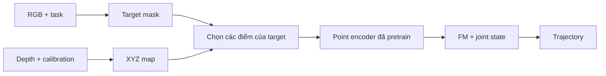

Ở đây, model học **pixel nào thuộc vật cần gắp**; vị trí các điểm được lấy bằng back-projection. Nó giảm nhu cầu tự hồi quy cả vị trí lẫn hình dạng cloud từ một latent.

**Residual hợp lý hơn khi đã có nhánh hình học này:**

\[
z_{\text{goal}}=E_{\text{point}}(P_{\text{target}})
+\alpha\,\Delta z_{\text{semantic}}
\]

Khởi tạo nhánh residual nhỏ để điều kiện hình học đã học đóng vai trò chính. Chỉ cộng hai latent hiện tại chưa bảo đảm ngữ nghĩa được gắn đúng vị trí. Một hướng khác là giữ các token có tọa độ 3D và cho action attend bằng vị trí tương đối, như [3D FlowMatch Actor](https://3d-flow-actor.github.io/).

Hai lưu ý khi làm:

- Mask dùng để **chọn điểm hoặc làm trọng số attention**. Nhân soft mask trực tiếp vào XYZ sẽ kéo tọa độ về gốc.
- Point encoder/FM reach vẫn cần được train với cloud đa dạng kích thước và góc nhìn; cloud của khối voxel 2 cm chưa bảo đảm chuyển tốt sang vật thật.

---

## 1077 · User · 2026-10-22T09:04:06.710Z

không dùng mỗi point được , point chỉ dùng để định vị contact region, còn behavior cloning vẫn cần hidden của RGB, t chỉ cần point chính xác hơn thôi, hay làm 1 nhánh song song để dự đoán mask rồi nhân vào tìm point, ném tất cả vào FM (hay là cross attention, fusse với hidden rgb trước )

---

## 1078 · Assistant — tiến độ · 2026-10-22T09:04:43.548Z

Mình hiểu: giữ RGB hidden để học hành vi, thêm nhánh mask–depth để cung cấp vị trí chính xác hơn. Mình kiểm tra cách FM hiện nhận context để chọn chỗ ghép hai nhánh này.

---

## 1079 · Assistant · 2026-10-22T09:06:43.213Z

Đúng, **giữ RGB hidden cho behavior cloning; nhánh hình học chỉ giúp FM biết bề mặt target nằm ở đâu**. Nhánh mask song song là hướng mình chọn cho lượt tiếp theo.

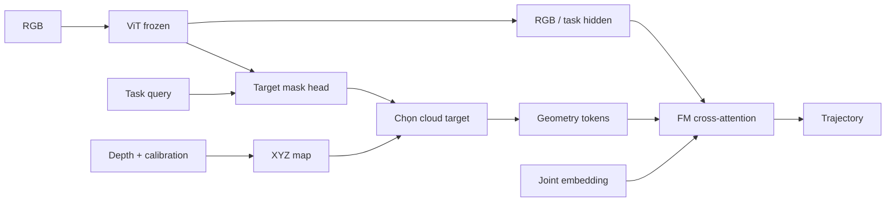

**Mình ưu tiên cho FM attend trực tiếp hai nhánh trước**, với context:

\[
C=[H_{\text{RGB/task}};\ H_{\text{geometry}};\ H_{\text{joint}}]
\]

FM hiện đã có cross-attention và code nhận được số context token thay đổi. Như vậy có thể giữ nhánh RGB hiện tại, thêm thông tin hình học đo từ depth, rồi kiểm tra lợi ích trước khi thêm một decoder fusion nữa.

Để gắn ngữ nghĩa với vị trí chặt hơn, mỗi điểm có sẵn pixel tương ứng. Có thể ghép ngay:

\[
g_i=\mathrm{MLP}\big[\mathrm{Embed}(XYZ_i),\ F_{\mathrm{RGB}}(u_i,v_i)\big]
\]

**Correspondence này có từ camera**, nên không cần bắt một cross-attention mới tự tìm điểm 3D nào ứng với feature ảnh nào. FM vẫn nhận RGB context toàn cảnh để học hành vi và tương tác.

Về supervision, thay nhánh *hồi quy cloud* bằng **mask loss**, rồi lấy cloud từ depth tại mask. Hai điểm cần làm đúng:

- Giữ nguyên XYZ; mask dùng để chọn hoặc gán trọng số điểm. Hard selection sẽ ngắt gradient BC qua thao tác chọn, nên mask vẫn cần supervision riêng; soft gating cho phép gradient đi qua.
- Mask cung cấp **bề mặt nhìn thấy của target**, chưa phải contact region chính xác. FM dùng RGB + geometry để chọn chỗ tiếp xúc; sai số mask biên và depth vẫn cần kiểm tra.

Residual có thể thêm sau. Với mục tiêu hiện tại, **nhánh mask → geometry riêng + FM cross-attention** là thay đổi dễ kiểm chứng nhất.

---

## 1080 · User · 2026-10-22T09:11:54.062Z

ô làm vẽ lại kiến trúc t xem

---

## 1081 · User · 2026-10-22T09:12:05.062Z

kiến trúc mới

---

## 1082 · Assistant · 2026-10-22T09:12:44.861Z

**Kiến trúc mới: RGB giữ thông tin để học hành vi; mask + depth cung cấp hình học target. Hai nhánh gặp nhau tại cross-attention của FM.**

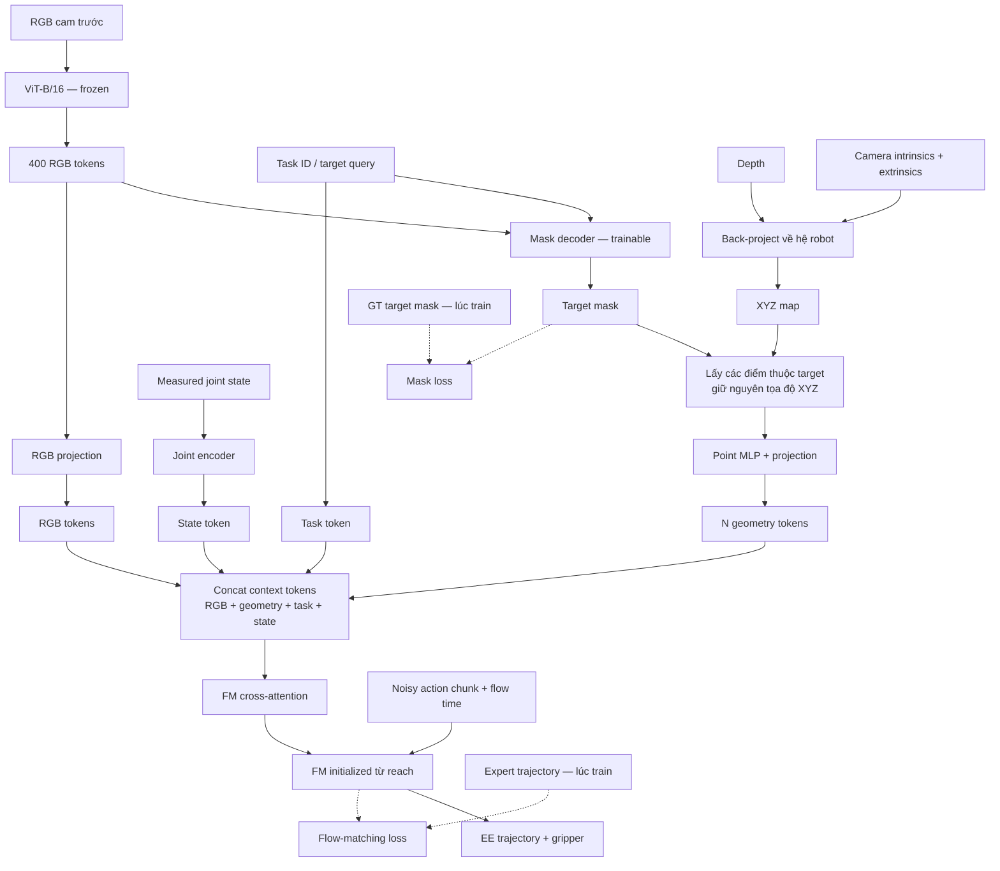

Các điểm chính:

- **RGB tokens đi thẳng tới FM**, giữ thông tin vật, bàn và trạng thái tương tác.
- **Cloud lấy từ depth tại mask**, thay cho head tự hồi quy tọa độ cloud.
- **Giữ nhiều geometry tokens**, mỗi token gắn với một điểm 3D; không gom cả hai nhánh thành một vector chung trước FM.
- FM dùng cross-attention để kết hợp hình học với RGB theo từng bước dự đoán action.

ViT freeze; **mask decoder, point encoder, các projection, joint encoder và FM được train**. Loss là \(L_{\mathrm{FM}}+\lambda L_{\mathrm{mask}}\), với mask loss dùng BCE + Dice.

Đây là sơ đồ đề xuất, chưa sửa vào pipeline.

---

## 1083 · User · 2026-10-22T09:31:24.343Z

trước tiền thì tải mobileSAM về, train 1 learnd task prompt và mask decoder để xem segment chuẩn theo task id không, test luôn trên data của mình

---

## 1084 · Assistant — tiến độ · 2026-10-22T09:31:27.713Z

Mình sẽ tải MobileSAM pretrained, giữ image encoder frozen rồi train task prompt và mask decoder theo task ID trên dữ liệu pick hiện tại. Sau đó mình sẽ test cả vị trí và hoán vị held-out, kèm ảnh mask dự đoán để kiểm tra nó có chọn đúng vật không.

---

## 1085 · Assistant — tiến độ · 2026-10-22T09:32:21.821Z

Dữ liệu đã có instance mask cho cả bốn màu, nên có thể train chỉ bằng **RGB + task ID**, không cần đưa GT point hay box vào model. CUDA hiện vẫn lỗi; mình đang đo tốc độ CPU và sẽ cache embedding của encoder frozen để phần train prompt/decoder không phải encode ảnh lặp lại.

---

## 1086 · Assistant — tiến độ · 2026-10-22T09:36:09.547Z

MobileSAM đã tải và chạy được. Lượt đầu mình kiểm tra đúng khả năng chọn vật theo task: dùng frame đầu của **toàn bộ 2.048 episode train**, phủ 32 layout, 16 hoán vị và 4 màu. Test sẽ gồm toàn bộ held-out ở frame đầu, thêm ảnh lúc tay tiếp cận vật và các case ngoài vùng X vừa thử. Đây là lượt kiểm tra segmentation ban đầu, chưa train toàn bộ frame của trajectory.

---

## 1087 · Assistant — tiến độ · 2026-10-22T09:38:55.492Z

Bản decoder đã qua kiểm tra: output khớp với decoder MobileSAM gốc khi dùng cùng embedding và prompt. Cấu hình này có khoảng **3,64 triệu tham số trainable**; trên CPU, một update batch 8 mất khoảng 0,56 giây. Mình sẽ chạy 5 epoch trước, chọn checkpoint theo validation rồi test held-out.

---

## 1088 · Assistant — tiến độ · 2026-10-22T09:41:58.493Z

Cache đang chạy, khoảng 3 ảnh/giây. Mỗi cảnh chỉ cần encode một lần rồi dùng cho cả bốn task ID; bộ train/val dự kiến chiếm khoảng **1,3 GiB RAM**. Các query cùng cảnh cũng đã qua kiểm tra trạng thái vật lý ban đầu giống hệt nhau.

---

## 1089 · Assistant — tiến độ · 2026-10-22T09:43:35.702Z

Cache train đã gần xong. Bài test sẽ giữ nguyên một ảnh và lần lượt đổi bốn task ID, rồi đo IoU và confusion giữa các màu. Cách này sẽ cho thấy model có thực sự dùng task prompt để chọn vật hay chỉ segment một vật nổi bật trong ảnh.

---

## 1090 · Assistant — tiến độ · 2026-10-22T09:45:33.203Z

Đã bắt đầu train. Gradient đi vào task prompt và mask decoder, còn image encoder được giữ frozen đúng cấu hình. Loss ban đầu giảm từ khoảng **6,4 xuống 0,66** sau 75 update; mình sẽ dùng validation IoU và độ đúng màu để xem phần giảm đó đã đến từ việc hiểu task hay mới chỉ học foreground.

---

## 1091 · Assistant — tiến độ · 2026-10-22T09:47:57.384Z

Epoch 1 đã xong: validation **IoU 25,1%**, chọn đúng màu **29,3%**. Kết quả này cho thấy model mới chủ yếu học foreground, chưa dùng task prompt tốt. Mình tiếp tục đủ 5 epoch để xem các prompt có tách được bốn màu không.

---

## 1092 · Assistant — tiến độ · 2026-10-22T09:49:48.534Z

Đã có checkpoint sau epoch 1, và epoch 2 đang chạy. Model vẫn còn khá yếu ở việc chọn riêng từng màu; mình giữ cấu hình cố định cho lượt này và sẽ chỉ dùng validation để chọn best, rồi mới mở kết quả test.

---

## 1093 · Assistant — tiến độ · 2026-10-22T09:51:03.104Z

Epoch 2 đã cải thiện: validation **IoU 34,5%**, chọn đúng màu **51,2%**. Task prompt bắt đầu phân biệt được vật thay vì chỉ dự đoán foreground chung; hiện đang sang epoch 3.

---

## 1094 · Assistant — tiến độ · 2026-10-22T09:52:48.213Z

Đã qua hơn nửa ngân sách train. IoU trên các batch hiện quanh **0,4–0,45**, cao hơn giai đoạn chỉ học foreground. Sau khi train xong, mình sẽ kiểm tra riêng các mask ngoài vùng X và lúc tay áp sát vật.

---

## 1095 · Assistant — tiến độ · 2026-10-22T09:54:53.450Z

Validation sau epoch 3 đạt **IoU 38,9%**, chọn đúng màu **59,4%**. Mô hình có học theo task, nhưng chất lượng hiện tại vẫn chưa đủ để coi mask là nguồn point cloud đáng tin cậy. Mình đang chạy hai epoch cuối của lượt thử.

---

## 1096 · Assistant — tiến độ · 2026-10-22T09:56:48.765Z

Epoch 4 đạt validation **IoU 43,9%**, chọn đúng màu **66,8%**. Đang chạy epoch cuối. Kết quả cải thiện đều, nhưng mình vẫn cần xem ảnh mask để phân biệt lỗi biên mask với lỗi chọn nhầm vật.

---

## 1097 · Assistant — tiến độ · 2026-10-22T09:57:47.796Z

Ảnh validation cho thấy một lỗi cụ thể: có query chọn được target nhưng mask vẫn dính sang một phần các vật khác. Vì vậy IoU thấp không chỉ do biên mask; nhánh task-conditioned mask vẫn còn cần tách target rõ hơn. Mình sẽ giữ cả ảnh mẫu và ảnh tệ nhất trong kết quả test.

---

## 1098 · Assistant — tiến độ · 2026-10-22T09:59:45.350Z

Đã train xong **5 epoch / 1.280 update**. Best là epoch 5: validation **IoU 49,3%**, chọn đúng màu **78,1%**. Mình đang test toàn bộ 1.408 query held-out, rồi kiểm tra thêm target đang được tay thao tác và target nằm ngoài vùng X.

---

## 1099 · Assistant — tiến độ · 2026-10-22T10:02:01.318Z

Test held-out ở frame đầu đã xong: **IoU 52,4%**, chọn đúng vật **77,8%** trên 1.408 query. Nhầm nhiều nhất là giữa xanh lá và xanh dương; ảnh test cũng cho thấy một số mask còn dính nhiều vật. Mình đang hoàn tất kiểm tra lúc tay áp sát vật và ngoài vùng X.

---

## 1100 · Assistant — tiến độ · 2026-10-22T10:03:45.046Z

Các test đã xong. Với riêng vật đang được tay thao tác, chọn đúng vật chỉ **37,5%**; tám target ngoài vùng X đạt **50%**. Lượt 5 epoch này chưa đủ chuẩn để đưa mask sang nhánh point cloud. Mình đang chốt báo cáo và ảnh lỗi để bạn xem rõ từng trường hợp.

---

## 1101 · Assistant · 2026-10-22T10:04:32.301Z

Đã tải [MobileSAM chính thức](https://github.com/ChaoningZhang/MobileSAM), train **E123 trong 5 epoch**: freeze image encoder, train task prompt + mask decoder, chỉ nhận **RGB + task ID**.

Train dùng frame đầu của toàn bộ **2.048 episode**, chưa dùng toàn trajectory.

| Test | Số query | Mask IoU | Chọn đúng vật |
|---|---:|---:|---:|
| Held-out frame đầu | 1.408 | **52,4%** | **77,8%** |
| Vật đang được tay thao tác | 72 | 26,8% | 37,5% |
| Target ngoài vùng X | 8 | 30,1% | 50,0% |

**Có học theo task nhưng chưa đủ chuẩn:** mask còn dính sang vật khác, đặc biệt nhầm xanh lá–xanh dương. Validation vẫn cải thiện qua từng epoch, nên chưa thể kết luận đã hội tụ.

[Ảnh đổi bốn task trên cùng RGB](/workspace/robotics_assets/experiments/e123_mask/test/home/samples.png) · [Các case tệ nhất](/workspace/robotics_assets/experiments/e123_mask/test/home/worst.png) · [Ảnh khi tay tiếp cận/gắp](/workspace/robotics_assets/experiments/e123_mask/test/dynamic/samples.png)

[Checkpoint best — epoch 5](/workspace/robotics_assets/experiments/e123_mask/best.pt) · [Code và cách chạy](/workspace/arm-manipulation/OATFlow/task_mask/README.md)

---

## 1102 · User · 2026-10-22T10:05:49.394Z

train full data chưa

---

## 1103 · Assistant · 2026-10-22T10:05:57.639Z

**Chưa full frame.** Đã dùng toàn bộ **2.048 episode train**, nhưng mỗi episode chỉ lấy **frame đầu**, train 5 epoch.

Các frame lúc tiếp cận, đóng kẹp và nâng vật **mới dùng để test**, chưa đưa vào train. Vì vậy kết quả khi tay thao tác thấp chưa đủ để đánh giá kiến trúc.

---

## 1104 · User · 2026-10-22T10:08:17.745Z

gpu dùng được chưa

---

## 1105 · Assistant — tiến độ · 2026-10-22T10:08:21.694Z

Mình kiểm tra lại cả CUDA tạo tensor và chạy phép tính trên GPU.

---

## 1106 · Assistant · 2026-10-22T10:08:33.544Z

**Chưa dùng được để train.** `nvidia-smi` vẫn nhận RTX 3090, VRAM trống, nhưng PyTorch vẫn lỗi **`CUDA unknown error`** ngay khi tạo tensor trên GPU.

---

## 1107 · User · 2026-10-22T10:09:38.512Z

xuất lịch sử trò chuyện này ra 1 file, tìm các file dung lượng lớn

---

## 1108 · Assistant — tiến độ · 2026-10-22T10:09:43.376Z

Mình sẽ xuất phần lịch sử trò chuyện đang có vào file, đồng thời quét các file và thư mục lớn trong workspace. Mình sẽ che private SSH key đã xuất hiện trong chat và chỉ liệt kê dung lượng, chưa xóa gì.

---

## 1109 · Assistant — tiến độ · 2026-10-22T10:11:14.301Z

Mình tìm được log đầy đủ của đúng phiên chat này, nên có thể xuất nguyên các tin nhắn người dùng và trả lời hiển thị. Workspace hiện khoảng **69,3 GiB**; lớn nhất là dữ liệu RGB voxel và các checkpoint. Một số checkpoint là hard link dùng chung dung lượng, mình sẽ ghi rõ để tránh tính trùng.

---

