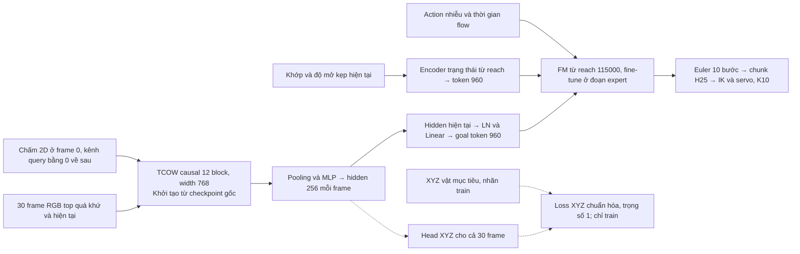

# e105_tcow — từ chuỗi shuffle đến mở cover và gắp/nâng

Trạng thái: preflight và kiểm tra sampler đã qua; lượt chính `train_2` bắt đầu
1epoch đầy đủ. `train` cũ dừng sau1update theo yêu cầu đổi sampler, không resume.
Chưa có kết quả rollout của policy học được.

Chỉ dùng camera top của shuffle_pick_multiview gốc. Mỗi shared context được xem
với4điểm chấm mục tiêu tương ứng4vật. Thứ tự train: xáo trộn các shared context;
trong mỗi context, chạy endpoint quá khứ stride10 theo thời gian trước, rồi
endpoint expert stride3 theo thời gian. Batch thực4, không tích lũy gradient.

Phần trước expert: action mask hoàn toànfalse, chỉ TCOW/pooling/headXYZ nhận
loss. Không forward FM/goal projection, gradient của chúng làNone nên AdamW
không cập nhật kể cả weight decay/momentum. Phần expert: train end-to-end
TCOW+projection+FM+XYZ với L=L_FM+1*L_XYZ. LossXYZ là MSE normalized của tọa độ
vật được hỏi trên30frame quá khứ/hiện tại. Không cần mask head/loss/files.

Khởi tạo TCOW từ checkpoint chính thức gốc RGB+kênh query, không dùng tracker
e100/e101 đã fine-tune. TCOW causal12block,width768; spatial pooling768D+patchXY2
qua LN770/Linear256/GELU thành hidden256. HeadLinear3 nhận supervisionXYZ;
nhánh LN256/Linear960 tạo goal token cho FM. Tọa độ GT lẫn XYZ dự đoán đều không
được feed vào FM. Joints đo được và jaw tạo state token thứ hai.

Trước expert, endpoint stride10 chỉ cập nhật TCOW/pooling/headXYZ; FM và goal
projection được bỏ qua. Tới đoạn expert, endpoint stride3 cập nhật end-to-end
bằng `L_FM + 1*L_XYZ`. Hai chế độ diễn ra trong mỗi shared context.

FM16layer khởi tạo nguyên trạng từ reach best115000; oracleXYZ encoder được thay
bằng projection thị giác.226812594tham số; mọi module trainable khi đến đoạn
expert. Khớp chính xác toàn bộ tensor TCOW backbone và185tensor FM lúc khởi tạo.
Autograd chứng minh lossFM đi về query channel TCOW/projection và không phụ thuộc
tham số headXYZ đầu ra. Trọng số FM/goal giữ nguyên bit-exact qua optimizer step
chỉ TCOW, kể cả sau batch expert đã tạo momentum.

Query là chấm2D bán kính3pixel tại frame0, các frame sau kênh query bằng0.
Top320square crop rows40:280 thành240x320, không resize méo ảnh. Cache RGB context
là hợp stride3/stride10/framecuối; expert stride3/framecuối. Mỗi clip30frame lấy
đều theo raw time từ frame0 đến hiện tại, chọn frame cache gần nhất ở quá khứ;
luôn có frame0 và endpoint, không nhìn RGB tương lai. Không cache feature TCOW.

2048episode/512shared context:61688clip TCOW-only và234434clip expert,
tổng296122clip/epoch.15422batch context+58808batch expert=74230updates/epoch.
73838batch đủ4mẫu, còn lại130batch1/146batch2/116batch3 do ranh giới context.
Audit sampler xác nhận mỗi endpoint đi đúng1lần, context trước expert và không
trộn hai chế độ trong batch. Chi tiết: `schedule.json` cạnh artifacts.

BF16, không gradient checkpointing, AdamW(.9,.95),wd1e-4,clip1;100warmup updates
rồi constantLR: TCOW1e-5/FM2e-5/newheads1e-4. Normalization action/state giữ từ
reach; XYZ chỉ fit train, stdfloor10mm. ActionH25 tại25Hz: đo tương lai deltaXYZ3
và relative rotation6D6 so với anchor cố định của chunk, cộng jaw command tuyệt
đối1; padding terminal có mask. Không dùng GT objectID/slot/permutation/layout
làm policy input. XYZ và camera rig chỉ phục vụ supervision/click annotation.

Preflight6 chạy24updates trên4train/4valepisode, đủ cả hai chế độ và kiểm tra
mask sau expert momentum. Median TCOW-only0.880s/batch, joint0.967s/batch;
ước lượng thuần train19.57h, cộng loading/validation/checkpoint thành20–22h cho
1epoch trên RTX3090. Peak allocated VRAM19.88GiB. Đây là ước lượng ngắn trước
run, không phải walltime một epoch đã đo xong. `epoch_estimate.json` lưu cách tính.
Nine point-tracker tests pass; controller measured-EE mở cover/gắp4/4, không phải
thành công của policy học được.

Validation32episode/64fixed expert chunk, noise/time seed105000, chọn best bằng
lossFM. Sau1epoch test `train_2/final.pt` trên128case:32train/32composition/
32spatial/32combined, H25/K10/Euler10/seed0/900frame,25Hzpolicy/50Hzservo/500Hzphysics.
Chỉ replay state ban đầu ngay sau shuffle; robot tự mở/đặt cover và gắp/nâng.
Không mở cover hộ, reset home hay thêm liftIK. Full success yêu cầu cover đúng
đã đặt trong dropzone, vật đúng nâng>4cm với bilateral contacts10frame, cover kia
dịchXY<=15mm; nâng nhầm vật fail. Chưa có learned-test success rate.

Kết quả policy để trống, chờ train và test hoàn tất:

| Cấu hình | Train /32 | Hoán vị mới /32 | Vị trí mới /32 | Cả hai mới /32 | Tổng /128 |
|---|---:|---:|---:|---:|---:|
| TCOW gốc + FM reach + loss XYZ, 1 epoch, K10 | | | | | |

Code `OATFlow/shuffle_bc`; artifact
`/workspace/robotics_assets/experiments/e105_tcow`. Live `ssh_tmux:1`,
`logs/train_2.log`, sau đó tự chạy `logs/test_k10.log`. Source snapshot mới
`source_2`; config/README thật cạnh `train_2`. Các preflight1–5 dùng sampler cũ;
chỉ preflight6 kiểm tra cấu hình context/expert hiện tại.

## Stopped for staged tracker training

Stopped on user request at logged step38455 (0.5181 epoch). Resumable latest38250 and best36000 are retained. The interim best36000 test was also stopped: 0/48 completed cases, not a128-case result. All completed rollouts timed out. No final.pt or one-epoch result exists. Next: TCOW-only XYZ pretraining, then frozen-feature FM training as a separate stage.
