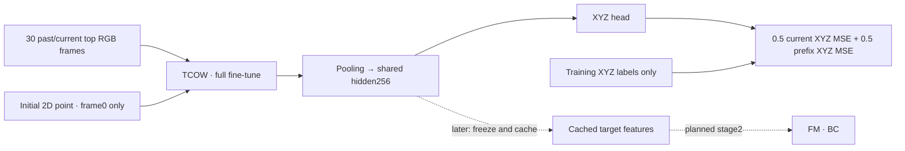

# e106_track — tracker first, then frozen features

Status: main TCOW-only one-epoch run started, after an actual GPU preflight. e105 end-to-end training and its interim best36000 rollout test were stopped on user request. e105 stopped at logged38455 (0.5179 epoch); resumable latest38250 and best36000 are retained. Interim rollout results are incomplete:0/48 completed, alltimeouts, out of128planned.

Stage one trains the native causal TCOW point-query backbone and pooled XYZ head. Initialize from original official TCOW RGB/query weights, with new random pooling/XYZ layers, seed106. Do not initialize from e100/e101/e105 fine-tuned weights. No FM is instantiated or trained. Once tracking quality is established, a separate stage can freeze TCOW and cache its shared hidden256 features for fast FM behavior cloning; that stage has not run.



Main data: all2,048 training target-query episodes /512shared contexts from shuffle_pick_multiview, top camera only. Context and expert RGB/endpoints both use stride10 plus their terminal frame. This gives61,688context +73,038expert =134,726clips, including terminal XYZ labels even where no next action exists. Every clip is sampled once per shuffled epoch. Batch4 gives33,682updates, retaining the last2-sample batch. No action labels, masks or target IDs enter training.

Each clip has30frames from raw-time frame0 through the current endpoint, using nearest available past cached RGB. Always include the current endpoint and initial frame; the radius3dot appears only atframe0. Crop320square to rows40:280, yielding240x320. Raw RGB is cached in host RAM; tracker features are recomputed while weights train. Camera calibration serves only the offline initial click annotation, not model observations. The trained head predicts base-frame XYZ.

All121,751,048parameters are trainable. BF16, AdamW(.9,.95),wd1e-4,clip1; TCOW backboneLR1e-5/new headLR1e-4,100warmup updates then constant. No gradient checkpointing or gradient accumulation. XYZ mean/std are fit only on sampled training labels with10mm std floor. Loss:0.5normalized current-frame MSE+0.5normalized30-frame prefix MSE, so late motion/lifting is not diluted entirely by the long floor-level prefix.

Validation:32held-out validation query episodes (layouts32/33,permutations0/9/16/18). Evaluate fixed visible/shuffle/post-shuffle/exposed/lift endpoints; exposed means the first available cached endpoint at/after t_obj. Select best by the equal-weight mean of the five phase mean3Derrors inmm. Validate initially, atstep1, every500steps and completion. Report per-phase metrics. Held-out tracker tests, GT/prediction demo videos from this model, and action-policy tests have not run.

GPU preflight: batch4 passed8updates with all model parameters receiving finite gradients and nonzero query-channel gradient. Median0.883s/update, peak allocated18.607GiB/reserved19.559GiB. Batch5 exceeded24GB during backward; no checkpoint or result is claimed for that run. Initial compute-only estimate is8.26h/epoch; allow validation/checkpoint/cache overhead. Replace this estimate with main-run timing after enough updates.

Nine existing point-query/causality/gradient/crop tests passed after the loader gained a stride argument (default3 remains unchanged). The full run audits every endpoint exactly once and keeps the small final batch. Best/latest/final checkpoints are tracker-only; latest includes optimizer, CPU/CUDA/NumPy RNG, shuffled order and cursor for resume. Saves use a temporary file and atomic rename.

Artifacts: `/workspace/robotics_assets/experiments/e106_track` (`preflight`, `preflight_2`, `train`, `source`, `logs`). Exact runtime settings/hashes: `train/config.json`; normalization is stored in tracker buffers. Live main output: tmux `ssh_tmux:1` (e106), tee to `logs/train.log`. Loss/current XYZ error/VRAM/timing are logged each update and printed every10updates. No H/K or action noise applies in this tracker-only stage.

```bash
.venv/bin/python -u -m OATFlow.tracking.pretrain_xyz --epochs 1 --batch 4 \
  --output /workspace/robotics_assets/experiments/e106_track/train
```

Results: pending. This experiment does not populate the earlier one-epoch end-to-end result table in the slides.

Stopped on user request near step907 (last logged906); latest resumable and best at500 remain intact. Superseded by e107_linear frozen-backbone linear probe.
