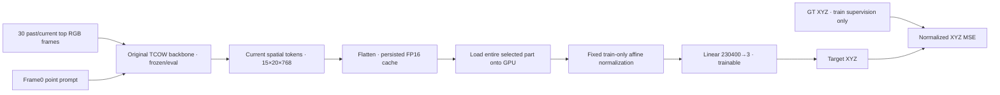

# e107_linear — can a frozen TCOW representation linearly decode target XYZ?

The user requested a simpler head after questioning the attention-pooling design. Stop e106 full-backbone fine-tuning and start a clean probe from original TCOW weights. Keep all train episodes; current train input/endpoint stride25 was requested after the first stride10 cache ETA. Validation stays stride10 to preserve its exact inputs/endpoints. This is not a matched single-variable comparison: initialization/training budget/loss also differ from the interrupted e106.

The fixed normalization and coordinate denormalization fold into a single affine raw-feature head for inference. No trainable attention, spatial pooling, segmentation decoder or FM is used. Learnable parameter count:691,203. A grid preserves spatial order; all frames still pass through TCOW to encode target identity/history before current tokens are cached.

Current main data: part1 of five context-disjoint partitions,412train query episodes/103contexts/11,568stride25endpoints plus terminal frames; same32validation episodes/184phase endpoints as e106, retaining validation stride10. All32train layouts/all16train permutations/all4targets remain represented in every part. Partition sizes412/412/408/408/408episodes and endpoint counts11,568/11,558/11,491/11,444/11,519. Seed107shuffles contexts per layout and round-robin assigns with layout offset; four target queries of each context stay together. Union is exactly all2,048train episodes; pairwise contexts and episodes are disjoint. Parent partitions.json contains the membership audit.

Part1cache is ~4.96GiB and persists to disk as FP16NPY, unlike earlier full-data RAM-only attempts. Partial extraction files are incomplete until cache completion metadata is written. User subsequently requested loading the cache onto GPU: after releasing TCOW, the entire selected train/validation feature cache and all train targets are copied to CUDA once; CUDA permutation/batch indexing avoids host feature transfers during head epochs. gpu_cache.json verifies actual residency/load time/VRAM. Expect ~16minutes one-time backbone inference per part at prior measured speed; all five still require roughly the full total extraction time. GPU-resident head epochs reuse cache. Current budget30head epochs ×46updates,batch256,train-part-normalized currentXYZ MSE,AdamW LR1e-3 with warmup/cosine. Only part1 launched; parts2–5 not queued. Source weights/hashes, actual timing and tests are recorded beside artifacts. See [artifact README template](e107_README.md).

e106 stopped by user request near step907; last logged906, resumable latest and best at500. Its best validation macro phase error at500 was54.40mm; this is an interrupted early run, not a converged baseline. Its checkpoints remain intact.

Artifacts: `/workspace/robotics_assets/experiments/e107_linear/`. Current run:train_3,logs/train_3.log,`--part 1`; interrupted full-data stride10/25attempts:train/train_2(no head updates/checkpoints). Status/results: cache running, head results pending. Separate unseen-order/layout/both tracker evaluation and action-policy evaluation have not been run.

Historical stride10 attempt: main run launched in tmux ssh_tmux:1, with tee log logs/train.log. Existing9point/causality tests pass. Cache batch32 preflight passed (9.47GiB peak allocated); batch64 failed CUDA OOM before head training, recorded separately in preflight_2. Main cache batch32, head batch256. Initial cache speed estimate~0.08s/endpoint (~3hours once); actual estimate will use live progress.

Historical stride10 cache check: 480/134726endpoints, 0.0811s/endpoint, ETA~3.02h remaining for cache only. GPU peak allocated9.48GiB; allocator-reserved/device memory higher. Source snapshot hashes verified. No head loss/result yet while caching.

User requested stride25: restarted into fresh train_2. All57,580endpoints were counted from segment labels; reveal/shuffle/hold remain represented in every train episode. All2,048episodes retained. Config and exact source snapshot verified; validation remains184points at stride10. Expected cache~75–80minutes based on previous measured0.081s/clip; live estimate follows in train_2/progress.json. No architecture/optimizer/head-epoch change.

Five-part split audit passed: exact full train union, pairwise-disjoint contexts, all32layouts/16seen permutations and balanced4targets per part. Disk-cache preflight_3 passed. GPU-resident preflight_4 passed3epochs/6updates; train/val cache confirmed cuda:0, persisted feature/XYZ arrays decoded finite with matching lengths, folded readout equivalence passed. Main train_3 --part1launched with same GPU-cache implementation; 30epochs×46updates after extraction. No main head result yet.

Part1 result: completed30epochs/1380updates/347040samples; best epoch28, step1288. Train cache950.72s; all train/val features loaded on cuda:0 (5.055GiB allocated), transfer1.046s; head training phase7.520s. Validation184endpoints: macro phase mean71.563mm, micro mean78.308mm, median83.346mm. Phase mean mm: {"exposed": 29.11992645263672, "lift": 19.418102264404297, "post_shuffle": 109.735595703125, "shuffle": 123.27581024169922, "visible": 76.26419067382812}. This is a frozen original-TCOW linear probe on part1, not the proposed context-decoder/wrist policy. Parts2–5 not run; no action-policy or held-out tracker test. Artifacts train_3/summary.json, best_validation.json, best.pt, train_features.npy and train_xyz.npy.
