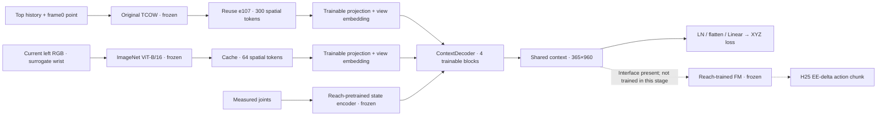

# e108_context — frozen visual encoders, shared context and XYZ supervision

User requested implementing the existing OATFlow ContextDecoder with TCOW hidden/spatial features, wrist-camera tokens and measured-state token, an XYZ auxiliary readout on its output, and FM attending to the same full context. First train the context decoder on XYZ; temporarily use camera left as the wrist input. No FM behavior-cloning training is requested for this stage.

TCOW current tokens already encode the causal30frame prefix. Use `PointXYZ.features()[:, -1]`, not the existing256Dpooled `hidden()`. No learned pooling compresses TCOW before the shared decoder. The decoder preserves all365tokens for FM. Gradient from XYZ goes through the XYZ head,full context decoder and projections; it does not update either frozen visual encoder. The state encoder and full FM are frozen during this localization stage. Shared ContextDecoder's optional checkpointing is explicitly disabled, preserving the user's preference.

Reuse e107 part1cache:412query episodes/103contexts/11,568stride25points, not the full2,048episode dataset. Same32validation episodes/184phase points at stride10. RGB-left and measured joint state are aligned to each cached top endpoint's original context/expert frame; GT XYZ is used only for labels/alignment verification. Current left-view RGB320square ->frozenViT ->64spatial tokens. This is a surrogate camera experiment, not a real wrist-mounted view. Cache and all training arrays reside on GPU during optimization.

Model preserves the reach checkpoint11500010DEE-delta action FM and buffers, replacing only its old numeric XYZ conditioning branch with shared visual context. The ContextDecoder is reused from OATFlow/policy/model.py; the absolute-joint policy from that branch is not reused. New trainable context/readout is initialized with seed108; no e105/e106/e107learned weights initialize it.

Planned30epochs with batch chosen by real VRAM; LR1e-4context/projections,1e-5XYZ head,AdamW(.9,.95),wd1e-4,clip1,warmup50/cosine. Main objective is normalized currentXYZ MSE. Best selection by macro mean of five validation phases. Actual preflight/timing/config and eventual validation/generalization results are recorded beside artifacts. Target-swap probe measures whether the point-conditioned TCOW branch changes prediction consistently for the four target choices in the same scene, rather than relying only on the second view or arm state.

Artifacts: `/workspace/robotics_assets/experiments/e108_context/`. Status: training and held-out XYZ evaluation complete. [Detailed template](e108_README.md). No action-control success result.

Cache completed38.60s with top tokens reused;10unit tests passed. Batch64preflight passed12.20GiB/0.198s per update; batch128passed17.30GiB/0.383s per update, selected for main. All trainable gradients finite/nonzero, frozen weights unchanged, FM action-loss gradient reaches context; no checkpointing. Main30epochs×91updates=2,730updates,batch128; estimated~17.5minutes update time plus evaluation/checkpoint overhead. Main followed automatically by96episode held-out XYZ test using best validation checkpoint. Live ssh_tmux:1,logs/train.log then logs/test_xyz.log.

Completed 30 epochs / 2,730 updates / 347,040 samples in 1,098s (18.3min), batch128, peak17.30GiB. Best validation checkpoint is epoch27 / step2457 (`train/best.pt`); every TCOW, ViT and FM weight remained unchanged. The full training cache was on GPU. Other four train parts were not used.

| Evaluation | Points | Mean XYZ error | Median | Within10mm |
|---|---:|---:|---:|---:|
| Part1 train fit | 11,568 | 3.85mm | 2.79mm | 95.1% |
| Validation | 184 | 41.64mm | 16.64mm | 29.9% |
| Held-out: new order | 172 | 52.09mm | 13.28mm | 43.0% |
| Held-out: new layout | 176 | 52.23mm | 20.81mm | 27.8% |
| Held-out: both | 192 | 56.38mm | 22.56mm | 25.5% |
| All held-out | 540 | 53.66mm | 19.04mm | 31.9% |

Held-out set:96 episodes,32 per group, fixed e105 case identities. Metrics use stride10 causal top history and fixed phase endpoints; phase counts differ, so overall mean and equal-phase macro mean differ (held-out macro48.14mm). Held-out phase means: visible18.16mm, shuffle97.85mm, post-shuffle99.80mm, exposed16.41mm, lift8.49mm. Train fit is strong but generalization through shuffle is poor; this does not establish that freezing TCOW is the cause.

Target-binding probe: eight validation contexts × four queries, holding left RGB and joint state identical. Post-shuffle nearest-object accuracy28.1% (chance25%). Swapping target-conditioned TCOW features changes predictions by115.65mm on average: the network responds to the prompt, but often binds to the wrong object after shuffle. Mean distance to initial target143.80mm versus final target98.64mm does not support a simple initial-position-memory explanation. The swapped accuracy is a reordering of the same cases, not an independent result.

Eight-point raw-image/cache parity: mean prediction difference0.043mm, maximum0.222mm; joints exact, top features exact. This supports input alignment, not tracking accuracy. Quantitative artifacts: `train/summary.json`, `train/target_probe.json`, `train/post_shuffle_diagnostic.json`, `test_xyz/summary.json`, `test_xyz/online_cache_parity.json`; plots in `xyz_diagnostics.png/.svg/.pdf`. Recorded train/validation/both-unseen videos: `videos/comparison.mp4` and individual MP4s; stride3 online inference held causally at25FPS, not action-policy rollouts.
