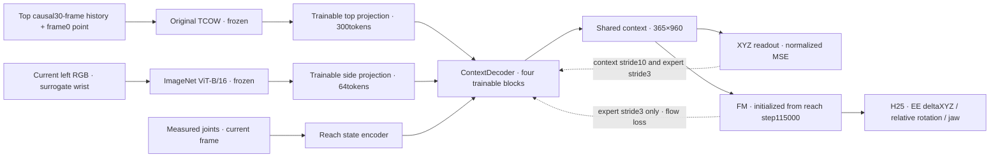

# e109 — full-data shared-context behavior cloning

Status: implementation and GPU preflight. User approved the original temporal schedule: context/shuffle stride10 trains XYZ only; expert stride3 jointly trains decoder/projections and FM with FM+XYZ loss. Use every one of the2,048train query episodes, without the five-part split. The TCOW and ViT encoders remain frozen.

Initialize decoder, visual projections, view embeddings, XYZ head and XYZ normalization from e108 best epoch27/step2457. FM and its state encoder are initially bit-identical to reach115000. Unlike e108, FM is now trained on expert actions. During context-only updates, explicitly freeze all FM parameters including the state encoder; AdamW must leave them unchanged even after earlier expert momentum. The state token still uses actual measured joints, not zeros, throughout context and expert segments.

One complete epoch:61,688context clips +234,434expert clips =296,122. Shuffle512shared contexts each epoch, then chronological context-only clips followed by chronological expert clips within each context; four target queries retained. Expert actionless terminal excluded, context terminal retained. Thirty raw-time-uniform causal top samples; context RGB union(stride3,stride10,terminal), expert RGB stride3+terminal. Action targets are the same fixed-anchor10DEE-delta formulation as e105, H25 at25Hz; current XYZ MSE follows e108 rather than supervising all30prefix frames. Both loss weights1.

Budget30epochs; actual physical batch selected by GPU preflight, no gradient accumulation/checkpointing. AdamW(.9,.95),wd1e-4,clip1,100update warmup then constant LR: context/projections1e-4,XYZhead1e-5,FM2e-5. Keep e108's train-only XYZ statistics so the warm-started readout remains calibrated; preserve reach action/state normalization.

Full top-feature FP16 cache would be127.08GiB before side tokens and labels, exceeding the120.74GiB container memory limit. Disk free space is about13GiB. Decode one shared context/four expert episodes, compute frozen features in microbatches, retain only that group's GPU tokens, train its two phases and discard. This avoids a large persistent cache, at the cost of re-running frozen vision each epoch. Actual timing includes this encoding and will be measured, not extrapolated from e108's cached head updates.

Validation uses the same32episodes/184XYZphase endpoints and64deterministic expert chunks. Fixed FM noise/time seed109000; select best by validation flow loss and report XYZ separately. The small validation cache remains on GPU. Checkpoints exclude frozen vision; latest includes optimizer/RNG/context permutation and next group cursor, allowing exact boundary resumption. Full action rollouts are not run yet; no success result. [Detailed setup](e109_README.md). Artifacts: `/workspace/robotics_assets/experiments/e109_joint/`, live logs `ssh_tmux:1`.

Status: main training launched. Batch128 passed GPU preflight:19.810GiB peak; batch64 also passed11.414GiB. All action/context-gradient, FM masking after momentum and frozen-vision checks passed. Ten existing unit tests pass; RGB/query/action/mask/prefix XYZ match old e105 batching bit-for-bit at four representative points including a masked terminal horizon. See preflight_4,preflight_5 and label_checks.json.

Actual main: full2,048query episodes/512contexts/296,122points per epoch; physical batch128;2,752updates per epoch;30epochs/82,560updates/8,883,660samples planned. Save latest at the first group, every10groups and epoch end. Losses printed at each phase transition and every10updates. No persistent full-data feature cache. Initial measured extrapolation~8h/epoch/~10days total, dominated by re-encoding original frozen TCOW. Main measurements in train/timing.json supersede this estimate. Live ssh_tmux:1; logs/train.log. Full-policy test not run.

Main first group completed and checkpoint verified: epoch1/step5, latest.pt includes optimizer/RNG/512-context order with next_group1; frozen vision omitted. First expert update FMloss0.9101,XYZloss0.1269; peak19.80GiB. Validation after group1 FMloss2.5197,XYZmean41.15mm; these early values are not final results. Initial measured main extrapolation6.77h/epoch before periodic validation/checkpoint overhead, so allow7–8h/epoch (~9–10days for30epochs); estimate remains provisional. Main continues in ssh_tmux:1; train/progress.json, train/timing.json and logs/train.log are live.

Epoch1 completed at step2752. Fixed validation: FMloss0.025109 versus initial2.65120; XYZ mean53.40mm versus initial42.50mm, median33.89mm versus16.64mm, within10mm11.96% versus30.43%. Post-shuffle90.54mm, shuffle88.50mm, lift16.54mm. FM loss improves strongly while XYZ generalization degrades; action performance cannot be inferred from this loss alone.

User requested actual rollout and videos. First smoke test uses16fixed cases (four target queries for the first standard context in each of train/new-order/new-layout/both), H25/K10/Euler10,noise0,budget900frames. Policy controls opening/depositing cover and target pick from recorded post-shuffle state, with live top/left images and measured joints; no expert future. Test checkpoint is copied and hashed before loading. Training is temporarily stopped at a recent saved boundary to free VRAM, then automatically resumes with optimizer/RNG/sampler into train_2. [Rollout settings](e109_rollout_README.md); results pending in test_k10.

Temporarily stopped for requested rollout after epoch2/group10 checkpoint step2805; interrupted while encoding group11 before any further optimizer update. No completed updates lost. Test16cases in test_k10; automatic resume to train_2 from latest.pt with optimizer/RNG/context cursor and original30epoch total budget.

Completed rollout: frozen snapshot epoch1/step2752, H25/K10/Euler10,noise0,900frames.16cases: train0/4,new order0/4,new layout0/4,both0/4; all timeout, selected cover deposited2/16, no target bilateral lift. This is a small one-context-per-group smoke test, not the full128case benchmark. Validation FMloss0.0251 does not establish successful closed-loop manipulation. Actual17MP4s (16cases +comparison) fully decoded;900frames per case/comparison,25FPS. Runtime459.24s,peak allocated2.544GiB.

Videos: [four-group preview](/workspace/robotics_assets/experiments/e109_joint/test_k10/comparison.mp4), [train](/workspace/robotics_assets/experiments/e109_joint/test_k10/g000_p00_t0.mp4), [new order](/workspace/robotics_assets/experiments/e109_joint/test_k10/g000_p01_t0.mp4), [new layout](/workspace/robotics_assets/experiments/e109_joint/test_k10/g036_p00_t0.mp4), [both unseen](/workspace/robotics_assets/experiments/e109_joint/test_k10/g036_p01_t0.mp4). All target-specific clips named by case IDs in results.jsonl.

Implementation: OATFlow/shuffle_bc/evaluate_context_bc.py. Run from the repo with MUJOCO_GL=egl .venv/bin/python -m OATFlow.shuffle_bc.evaluate_context_bc --checkpoint <saved best.pt> --output <fresh output>. Exact checkpoint/cases/settings: config.json; trajectories and per-replan XYZ predictions in NPZ.

Current training run: train_2, resumed after requested test from train/latest.pt epoch2/step2805/next_group10. Same batch128,30total epochs, optimizer/RNG/sampler restored; first resumed group11 is g019/p00. Test complete at test_k10: best2752,0/16task successes,2/16correct cover deposits,16timeouts; all17videos decoded. Train remains active in ssh_tmux:1, logs/train_2.log.
