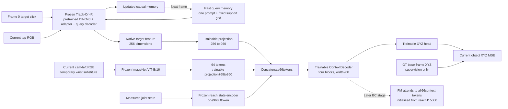

# e110: Track-On-R with a shared visual context

Replace the expensive repeated TCOW video-prefix encoding with a frozen online tracker. The tracker sees one initial click and maintains causal query memory. Its native target embedding supplies the target-conditioned input to the same kind of observation decoder used in e108. This changes the visual representation from300denseTCOWtokens to one native256Dquery token; it is a new experiment, not a drop-in speed claim.

First stage freezes every pretrained perception/FM module. XYZ gradients shape the projection and shared context decoder. The native tracker decoder is separate and remains frozen. Caching is valid only while the tracker stays frozen.

Full-data budget, provenance, input/label separation, precision, memory handling and validation protocol: [experiment README](e110_README.md). Code: OATFlow/shuffle_bc/trackon.py, trackon_model.py and train_trackon_xyz.py. Runtime config.json records actual settings. Results: pending.

Preflight completed so far: ContextDecoder unit check; two-token-batch XYZ gradients finite/nonzero for all trainable parameters and absent for FM;66token context produces eight FM K/V sets and finite H25x10 action tensor. Synthetic activation-memory probe: batch1280, three AdamW updates, peak19.46GiB, steady update0.68–0.70s. Batch1536OOM. Synthetic timing excludes CPU feature gathering/copy and is not an accuracy result. Full data at batch1280has1,010updates per epoch,10,100total. Native predictor parity and real-data preflight still pending dependency compilation. See e110_batch_check.json.

User changed the run to stride10and CPU RAM caching before any optimization updates. Stop the stride1preflight_2 at cache stage; retain it as an interrupted preparation attempt. Final full-data schedule has134,726query endpoints and88,460unique side frames; all feature/state/label/index tensors total8.1685GiB CPU RAM. Tracker itself updates every10frames plus segment terminals; the initial click still refers to frame0. At batch1280there are106updates/epoch,1,060updates across10epochs. Real-data preflight retry: preflight_3. Previous stride1counts/timings describe the canceled configuration only.

Stride10real-data preflight_3passed8updates on4train/4val episodes. Unchanged frozen tracker/ViT/FM hashes; finite nonzero gradients for all trainable context/projection/readout parameters, no gradients for FM. Peak19.337GiB; steady update mean0.754s including CPU feature gathering/transfers. Initial context/FM interface check produced66tokens,8K/V sets,H25x10actions. Native position and target hidden match official Predictor exactly on12sampled frames. These are correctness/memory checks, not full-data accuracy results. Full-data train run is active at cache stage in ssh_tmux:1; cache completion automatically starts10epochs. Training-only extrapolation~13.3min plus validation/checkpoint writes; cache timing reported separately.

Early measured full-cache estimate after5shared contexts: approximately1.9hours; all10training epochs approximately13–15minutes after caching, plus validation/checkpoint I/O. Estimates will update with observed progress.

## Completed main run

Full2,048train episodes, stride10,134,726points per epoch;10epochs/1,060updates/1,347,260samples, batch1280. Optimization completed in813.14s (13.55min), excluding initial cache. Peak19.338GiB; all frozen weights unchanged. Best checkpoint: epoch10,step1060, train/best.pt.

Validation32episodes/184fixed phase points: mean38.17mm,median16.06mm,p90 117.87mm,macro phase31.38mm;30.98%within10mm,61.41%within20mm. Phase means: visible13.20mm,shuffle83.41mm,post-shuffle38.97mm,exposed13.77mm,lift7.56mm. Post-shuffle nearest-target accuracy23/32=71.875% on8contexts, versus chance25%; frozen side/state inputs verified identical across the four prompt choices. Swapped-query accuracy is the same reordered cases, not independent evidence.

E108TCOW validation mean41.64mm/median16.64mm/within10mm29.9%, post-shuffle nearest-target accuracy9/32=28.1%. E110uses full data/stride10/10epochs versus E108one412episode part/stride25/30epochs; architecture, token count and training budget differ. The target-binding improvement is encouraging but this comparison does not isolate the tracker effect. Shuffle mean error still83mm and p90~118mm. E110has no96episode held-out evaluation, no FM behavior-cloning updates, and no manipulation rollouts. XYZ validation does not establish manipulation success. Last epochs improved; additional training is not guaranteed to improve held-out accuracy. Exact results: train/summary.json,best_validation.json,target_probe.json,validation.jsonl.

## Resume to100total epochs

User requested extending the completed10epoch run to100total epochs. Added --resume and --epochs to the same trainer. Source train/latest.pt: epoch10,step1060,samples1,347,260; restore context/projection/readout, all49AdamW states/step counters and NumPy/Torch/CUDA RNG. Continue at saved LR1e-5context/projection and1e-6XYZ (constant, original cosine already reached its floor). New run train_2 targets10,600total updates/13,472,600total samples, adding90epochs/9,540updates. Full data,stride10,batch1280,frozen modules/XYZ-only loss unchanged.

Reuse compact persisted native query streams; rebuild only CPU-RAM cam-left features (~8.17GiB total arrays). All2,080train/val query archives were checked for exact stride10raw-frame indices/shapes/finite values. Independently re-read all134,726train XYZ targets and verified exact saved labels and XYZ mean/std. At launch, side-cache reconstruction measured~7–8min; optimization estimate~2h after caching. Initial restored validation/optimizer/RNG checks and first real update remain required before reporting active optimization. Exact continuation protocol: e110_resume_README.md; run in ssh_tmux:1, train_2.log.

Independent resume verification passed on4real frame0queries: every AdamW exp_avg/exp_avg_sq matches source checkpoint bit-exact, all49steps restored at1060and advanced to1061after one finite-gradient update, frozen FM gradients absent. Check executed in a separate process and saved no model weights; original checkpoint unchanged. Exact check: optimizer_check.json / docs/research/e110_resume_check.json. Main remains at side-cache reconstruction; its own initial validation parity/resume_checks.json are required before updates.

## Completed100epoch training

The continuation finished at epoch100/step10,600/13,472,600samples. Additional90epochs/9,540updates took7,341.11s (122.35min), excluding side-cache reconstruction. All frozen weights unchanged; peak19.334GiB. Best validation checkpoint is epoch79/step8374. On184validation points: mean21.89mm,median11.21mm,p90 23.35mm,44.57%within10mm,82.61%within20mm; macro19.64mm. Phase means: visible12.77mm,shuffle36.88mm,post-shuffle29.81mm,exposed12.68mm,lift6.07mm. Post-shuffle nearest-target binding29/32=90.625%.

Fixed held-out evaluation now running on96episodes/540phase endpoints, using selected79epoch checkpoint as primary and original10epoch checkpoint as a fixed baseline. Both use identical freshly recomputed frozen features; compare full XYZ trajectories in five fixed train/val/new-order/new-layout/both videos. Recorded expert motion only; no action control. Test results pending. Protocol: e110_test_README.md, code evaluate_trackon_xyz.py, artifacts e110_trackon/test_xyz.

## Held-out XYZ test after100epochs

Primary checkpoint selected before this test on validation: epoch79/step8374. Fixed baseline: epoch10/step1060. Tested96held-out episodes/24shared contexts/540fixed phase endpoints (32new-order,32new-layout,32both), identical frozen features and measured states for both readouts. Initial click is the only GT-derived policy input; current XYZ is supervision/overlay only. Frozen perception hashes unchanged. Recomputed selected-checkpoint validation case matched stored predictions within0.214mm on6points (mean0.117mm). Native feature extraction323.06s; no action control.

| Metric | 10epochs | Best after100epochs (79) |
|---|---:|---:|
| Mean XYZ error |41.03mm|33.51mm|
| Median |15.75mm|8.50mm|
| P90 |124.63mm|115.40mm|
| Within10mm |35.56%|56.48%|
| Within20mm |57.59%|75.74%|
| Shuffle mean |88.01mm|62.98mm|
| Post-shuffle mean |56.53mm|60.99mm|
| Post-shuffle nearest-target binding |62/96=64.58%|68/96=70.83%|

By-split mean errors: new-order45.07to39.62mm (172points), new-layout32.94to29.38mm (176points), both44.83to31.82mm (192points). Selected79epoch post-shuffle binding is19/32=59.38% new-order,23/32=71.88% new-layout,26/32=81.25% both. These case sets differ; the both condition being numerically higher is not evidence that combined novelty is easier in general.

Extra training improves median/threshold rates and overall/shuffle mean error, but does not solve hidden-object identity. Mean post-shuffle error worsens even while nearest-target binding improves: among correct bindings mean error27.21to11.35mm; among wrong bindings109.98to181.56mm. Selected79epoch model still has28/96wrong post-shuffle bindings. New-order post-shuffle mean80.90mm and overall new-orderP90201.95mm indicate severe outliers. This is recorded XYZ inference; manipulation success remains untested.

Five video cases were fixed before looking at results: train g000/p00/t0, validation g032/p00/t0, new-order g000/p01/t0, new-layout g036/p00/t0, both g036/p01/t0. Left panel10epochs/orange; right selected79epoch/pink;GTgreen. Camera-left is a static wrist substitute. Predictions update at stride10plus terminals and are held causally at25FPS, with prediction age displayed. Fixed videos total2,996frames/119.84s; every individual and comparison.mp4 fully decoded. Also render a clearly labeled diagnostic video of the largest selected-checkpoint post-shuffle error: g039/p08/t0,251.30mm. This diagnostic does not change metrics/checkpoint selection. Dense video-hold errors are distinct from fixed-endpoint test metrics. Temporary native features removed; compact prediction trajectories retained. Artifacts: e110_trackon/test_xyz/summary.json and videos/, failure/.

Measured native tracker training cost on RTX3090: adapter/FPN/query-memory/reranking/prediction modules trainable (23,439,003parameters), DINOv3weights frozen. Batch1,T4,N401,M72,input384x512,FP16autocast/GradScaler,no gradient checkpointing. Steady full forward/backward/AdamW median0.4162s per4frames (0.1041s/frame), peak8.96GiB. Native target-only2Dpoint+visibility objective. Frozen DINOv3gradients absent and adapter interaction gradients verified. No production weights or features saved; temporary script removed after measurement.

Simple once-per-frame extrapolation for134,726stride10samples: 3.89hours/pass, 38.9hours for10passes. A5%subset is~11.7minutes/pass. These exclude I/O,validation,wrist/context/FM, and do not define a proper long-occlusion training schedule: the probe reset memory on independent4frame clips. Overlapping windows or longer clips change compute/memory. Full DINOv3fine-tuning was not benchmarked. Exact protocol: docs/research/e110_bench_README.md; raw measured JSON:e110_trackon_timing.json; log:e110_trackon/bench.log.
