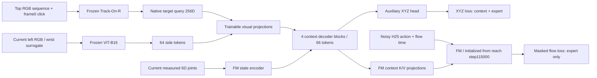

# e111_bc — frozen Track-On, joint context decoder and FM

Status: prepared; full-data BC requested. Initialize visual projections, view embeddings, four context blocks, XYZ head and XYZ normalization exactly from e110 best epoch79/step8374. Initialize the complete FM and state encoder exactly from reach step115000. Freeze the entire official Track-On-R/DINOv3 and side-camera ImageNet ViT-B16. Train context/projections/XYZ and FM jointly on expert actions. Camera left is a static surrogate for wrist, not a physical wrist camera.

Full original shuffle-pick-multiview train split: 2,048 target episodes /512 shared contexts /32 layouts /16 seen permutations /4 targets. Context stride10 including terminal:61,688 endpoints. Expert stride3 excluding invalid terminal:234,434 endpoints. Total296,122 endpoints per epoch. Shuffle the shared-context order each epoch; within each context, process chronological shuffle XYZ batches, then chronological expert FM+XYZ batches. Initial budget30 epochs. Batch selected with GPU preflight; no gradient checkpointing or accumulation. Source files, exact batch, updates, hashes and timing in config.json/progress.json/timing.json.

Track-On receives top cropped RGB and one frame0 center click plus its fixed20x20 support grid; independent memory per target, capacity72. It processes every sampled frame causally, context stride10+terminal, expert stride3+terminal. Recompute the denser expert features once, without interpolating old stride10 queries. Keep deduplicated side-camera64x768 FP16 tokens and top256D FP16 queries in CPU RAM; persist only compact native query vectors for restart, not dense side features. No perception re-encoding per training epoch. Raw RGB bounded to the current segment. Six measured joint positions come from the exact current RGB frame. Only the initial click uses GT geometry as prompt; current XYZ/action labels are loss targets, never observations.

AdamW(.9,.95), weight_decay1e-4, clip1; context1e-4, XYZ head1e-5, FM2e-5;100-update warmup then constant; BF16 training. Loss=normalized current XYZ MSE(weight1) + expert-only masked normalized FM velocity MSE(weight1). Weights1+1 do not imply equal gradient magnitudes. All FM parameters, including joint encoder, are frozen with grad=None on context-only batches so AdamW momentum/decay cannot change them. Preserve e110 train-only XYZ normalization and original reach action/state normalization. H25/25Hz, fixed current EE anchor: future deltaXYZ3 / relative rotation6D / absolute jaw1. Mask padded future action steps.

Validation:32 fixed held-out episodes;184 fixed XYZ phase endpoints and64 expert action chunks(seed105000). Native val tracker runs expert stride3 plus the exact XYZ evaluation frames, all causal; its update schedule therefore differs from e110 stride10. Fixed FM noise/time seed109000; best checkpoint by FM validation loss. Initial validation recorded. latest.pt contains optimizer/RNG, context order and exact next batch for resume; best.pt/final.pt contain full trained context+FM excluding frozen perception weights. Atomic checkpoint writes. Save latest after first update, every100 updates and epoch end; validate every100 updates and epoch end. Closed-loop manipulation tests not run; results pending.

Launch: `.venv/bin/python -m OATFlow.shuffle_bc.train_trackon_bc --output /workspace/robotics_assets/experiments/e111_bc/train --batch <measured> --epochs 30`. Live stdout/stderr and saved log in ssh_tmux:1. Experiment notes: docs/research/e111_bc.md.

Preflight passed: physical maximum batch512, peak19.793GiB including optimizer state; explicit full512 stress batches exceed actual group expert batch447–465. Actual full run: maximum batch512,1,024updates/epoch (512shuffle +512expert),30epochs/30,720updates/8,883,660samples. Context groups contain68–180shuffle and447–465expert endpoints, so each phase fits in one batch. Deduplicated RAM cache23.311GiB for249,856side frames, plus0.015GiB validation. Action/mask labels bit-exact against old e105 batching at5representative points; native context queries bit-exact against e110 on4targets/124frames. Verified finite nonzero action gradients through both visual projections, context and state; XYZ head outside action path; no FM update on masked context after AdamW momentum; frozen vision unchanged; finite H25 inference. Checkpoint model roundtrip exact, all optimizer states saved, epoch resume cursor verified. Canonical evidence: e111_preflight_checks.json,e111_label_checks.json,e111_native_checks.json,e111_data_plan.json. Completed preflight folders/checkpoints/features/logs removed. A snapshot-path error before the first preflight was corrected before any optimization.

Main launch uses `--batch 512 --epochs 30`. Status: starting one-time frozen-feature cache, optimization not yet started. Initial cache estimate4–5hours based on the small preflight; actual progress ETA supersedes it. Training results pending.
