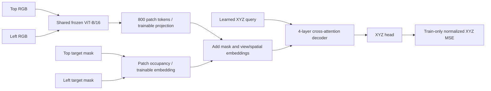

# e113 — Single-object, two-view voxel XYZ, 10 epochs

Follow-up: [resume to100total epochs](e113_resume_README.md) is complete;
best epoch95 reaches7.345mm mean test error on the identical held-out voxels.
The10-epoch results/checkpoints below remain preserved.

Status: complete. Trained exactly10epochs/970updates; best epoch10.

Data: one 32mm RedCube, yaw0, one pose per accepted 2cm reach voxel within
both original top and left camera frusta, with target-vs-robot/table collision
checks. Start from15,603 candidate positions; rendering additionally requires
at least16 visible target pixels in each view. Fixed home robot, all other
objects/covers parked away. Cube positions above the table are static renders,
not dynamically supported poses. RGB and visible masks are synchronized320square.
Labels are the cube body center in robot-base meters, checked against MuJoCo FK.
No jitter, shape/color/background randomization, temporal tracking or occlusion
memory in this first localization run. Split80/10/10 by unique voxel, seed113;
normalization uses training XYZ only. Exact accepted/rejected voxel IDs and
split indices are saved. The held-out task is interpolation among voxel centers
with the same cube, scene and cameras, not object/camera generalization.

Inputs: RGB[top,left] + visible binary target masks[top,left] at the current
frame. Shared frozen ImageNet ViT-B/16, weights
`/workspace/robotics_assets/pretrained/vision/vit_b_16-c867db91.pth`, all400patch
tokens/view. Mask patch occupancy is embedded separately, then added to visual
projection and view/spatial embeddings. Decoder4layers, width384,6heads,
MLP1536, one learned query attending to all800tokens, XYZ head. All10,073,475
parameters after ViT train from scratch. Calibration is archived; camera
geometry is implicit in fixed learned view embeddings. No joint, FM or actions.

Training: exactly10epochs, batch128 including final partial batch, AdamW
lr1e-4/weight_decay.01, constant learning rate, normalized XYZ MSE, BF16/TF32,
no gradient checkpointing. ViT frozen/eval throughout; feature cache FP16 in
host RAM only, not persisted to disk. RGB and packed masks are retained as a
reusable dataset at `robotics_assets/datasets/voxel_xyz_two_view`.

Validate every epoch in physical mm; choose best mean Euclidean validation
error. Save best/latest with decoder weights, train-only statistics and frozen
encoder reference/hash; latest also contains optimizer state. Test the selected
best checkpoint once on untouched test voxels. Report mean/median/p90/p95 XYZ
error, per-axis MAE, and fractions within1/5/10mm. Verify cached vs online RGB
prediction parity, frozen-encoder integrity and image/label alignment.
This does not evaluate tracking, shuffle memory or grasp success. Epochs needed
for convergence are not assumed. H/K/flow/noise/frame budget do not apply.

Run from project root:
```
MUJOCO_GL=egl PYOPENGL_PLATFORM=egl .venv/bin/python -u -m OATFlow.localization.train_two_view --output /workspace/robotics_assets/experiments/e113_voxel/train
```

Exact settings/status: config.json, progress.json, metrics.jsonl, summary.json.
Log streamed to tmux `ssh_tmux:1` and `e113_voxel/train.log`.



## Completed run

Rendering retained15,466unique voxels and rejected137for insufficient visible
target pixels. Train/val/test=12,372/1,547/1,547, disjoint by voxel ID. FK/grid
label alignment independently audited: max discrepancy2.95e-8m. RGB-mask
alignment checked on128view pairs:99.71% of masked pixels match target red.

| Best epoch10 / step970 | Train | Validation | Test |
|---|---:|---:|---:|
| Mean Euclidean XYZ error | 19.818mm | 20.357mm | 20.711mm |
| Median error | 17.848mm | 17.973mm | 18.195mm |
| P90 error | 33.781mm | 35.303mm | 36.026mm |
| Error <=5mm | 2.61% | 2.13% | 1.81% |
| Error <=10mm | 16.10% | 16.35% | 14.03% |

Test per-axis MAE XYZ=11.927/9.453/9.946mm. Validation mean error fell from
213.785mm at epoch1 to20.357mm at epoch10. Train and held-out errors are close;
this run learns coarse localization but does not establish millimeter accuracy.
These are held-out centers of the same fixed cube/camera scene, not unseen
objects, camera geometries, off-grid positions, occlusion memory or grasping.

Actual times: render164.8s, frozen encoder cache88.8s, training plus epoch
validation/checkpoint work132.6s (training updates ~12s/epoch). RAM tensors:
17.70GiB feature cache +2.95GiB masks. No features were written to disk. Raw
RGB and bitpacked masks are retained under the dataset directory. Last partial
train batch has84samples; every training sample is used once each epoch.

## Final inference verification

The first completion check correctly caught a precision mismatch: the frozen
ViT returns FP32 hidden states even under BF16 autocast, while all training
features had been stored as FP16. Sending raw online features directly through
the decoder produced up to1.406mm discrepancy on8checked samples. The fix is
an FP16 cast at the frozen encoder output, matching the actual training cache.
No learned weight or optimizer update changed after epoch10. Original training
sources and corrected inference sources are both archived beside the checkpoint.

After the fix, online/cache max difference on the8samples=0.000mm. The entire
1,547-sample original cached test was replayed with0.000mm prediction difference.
Frozen encoder tensor/file hashes and checkpoint file hashes verified unchanged.
The verification rebuild took100.5s; its reported1.145GiB peak CUDA allocation
is evaluation memory, not training memory. Both temporary RAM caches were
released at process exit. No persistent feature cache or preflight checkpoint.

Artifacts: `/workspace/robotics_assets/experiments/e113_voxel/train`.
`best.pt` and `latest.pt` both reference epoch10/step970; latest contains optimizer
and RNG state. Metrics: `summary.json`, `history.json`, `metrics.jsonl`,
`test_predictions.npz`, `data_audit.json`. Visuals: `learning_curve.png/.pdf`,
`train_examples.png`, `test_examples.png`; examples span sorted errors from best
to worst, not random examples. Dataset provenance/calibration in dataset config.

Evaluation without further training:
```
MUJOCO_GL=egl PYOPENGL_PLATFORM=egl .venv/bin/python -u -m OATFlow.localization.evaluate_two_view --run /workspace/robotics_assets/experiments/e113_voxel/train
```

Encoder state SHA256:
`be365450e27d8db73355cba83efdbe5b86f517cd086c04dc7dff4614af46c4f7`.
Best checkpoint SHA256:
`bd0f1dd101e6cd708f9280734f93335f6c5c2638fd35948333248d9c0f4f4e83`.
