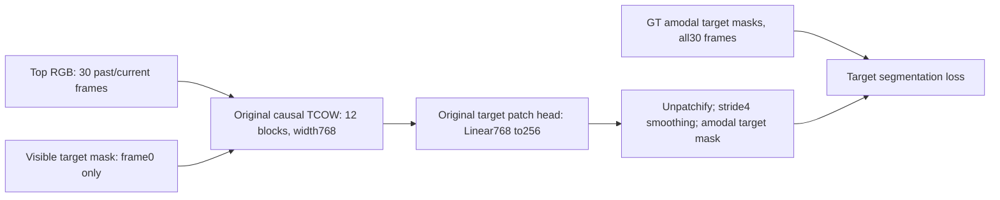
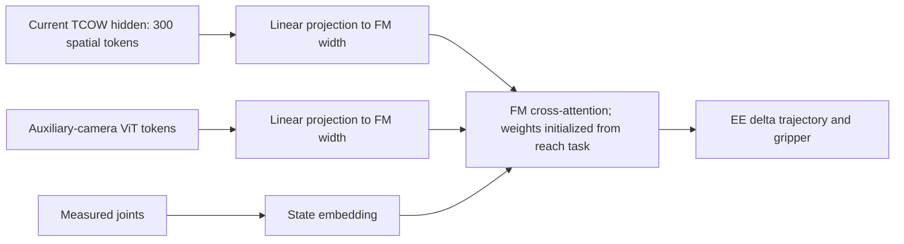

# e114: Native TCOW target-mask fine-tuning

Status: complete. Full10epochs/5120updates finished; best epoch9/step4608. Held-out endpoint tests and all five qualitative videos complete under test_videos.

Preflight: original forward mask-logit maximum difference5.34e-5 in FP32;
future-frame perturbation changes prefix logits by exactly0; target loss matches
upstream exactly on a controlled test. All121747456parameters trainable;
mask head and query-channel convolution receive gradients. Batch4 measured
0.882seconds/update and18.53GiB peak allocated VRAM. Estimated512updates take
7.53minutes of training per epoch, excluding validation/checkpointing/cache.
Full train RAM cache planned61.39GiB uint8RGB +7.78GiB packed labels/visibility,
plus validation/test data and process overhead. This is raw data, not features.
Preflight weights and cache are discarded; the main run starts from official
weights. Checks and timings: e114_preflight_checks.json/e114_preflight_summary.json.

The aim is to learn target identity and amodal spatial extent through shuffle and
robot occlusion without forcing hidden features to regress a precise XYZ center.
This is a hypothesis about useful policy features, not evidence of improved grasping.

Initialization: original official TCOW checkpoint, source
https://tcow.cs.columbia.edu/models/tcow_pretrained.zip and
https://github.com/basilevh/tcow. The exact pretrained RGB/query backbone is retained;
the original `tracker_post_linear` target output rows0:256 are recovered and retained.
Occluder/container output rows and the unused flag head are removed. There is no
XYZ head, attention pooling, context decoder, auxiliary camera, state input, or FM
in this training stage. All backbone and target-mask parameters are trainable.
The local SDPA backbone implements the original causal TimeSformer computation.
Preflight checks compare it against the official forward equations.

Data: shuffle_pick_multiview, full2048train episodes across32layouts and16seen
permutations, all4targets. Each epoch visits every episode once with a freshly
sampled causal prefix endpoint (reveal15%, shuffle35%, hidden hold20%, expert30%).
The30clip frames are uniformly sampled over the prefix, with frame0 retained;
no future frame enters an earlier prediction. This is2048clips/epoch, not the
296122overlapping endpoint clips/epoch used by the older BC experiment.
Ten epochs are the initial experiment budget. At batch4 this is512updates/epoch
and5120updates total. Raw top RGB is cached in host RAM at stride3 plus terminal
frames, shared context cached once; masks remain packed in RAM. No hidden-feature
cache can be reused while TCOW is fine-tuned. Source320x320 images and masks are
cropped to rows40:280, giving the original240x320 input.

Only the first visible object mask is a policy input. GT masks at every other
frame are labels only. Target output is the amodal silhouette even when covered,
not an empty visible mask, cover mask, or relevance mask. Stored instance IDs are
used only to extract the initial prompt and training-loss visibility weights.
No target ID, XYZ, joints, or simulator state is input to the model.

The original TCOW target loss settings are retained:0.2weighted BCE +0.4bootstrapped
BCE +0.4soft Jaccard; class balancing floor0.05, occluded-frame weight5,
occluded-target-pixel weight2, nearby negative weight3, query-frame weight0.2.
Bootstrap top fraction max(0.15,1-8.5training_progress). The upstream query-frame
downweight indexing is corrected to apply to every example; binary dilation
computes the same positive support as upstream Gaussian-blur hard negatives.
The occluder/container loss branches are removed with their output channels.

AdamW, backbone LR1e-5, mask-head LR1e-4,50update linear warmup then constantLR,
weight decay1e-4, gradient clipping0.3, seed114, BF16 autocast, FP32 optimizer,
no gradient checkpointing. Actual batch, timing and VRAM: config.json/progress.json.
Best checkpoint maximizes validation mean endpoint IoU. Validation uses a fixed
32episode subset: layouts32/33, seen permutations0/9/16/18, all4targets.
Final evaluation uses64unseen-permutation,32unseen-layout,64combined episodes
from the existing held-out subset, at visible/shuffle/post_shuffle/exposed/lift
probes. These are subset evaluation results, not full held-out split results.
Report all/hidden/visible and phase-wise IoU at threshold0.5. Initial checkpoint
baseline is evaluated identically before fine-tuning. No action rollout; H/K,
flow steps and action noise seed are not applicable.

Exact run metadata: config.json, splits.json, cache.json, baseline.json,
metrics.jsonl, progress.json, best_validation.json and summary.json.
best.pt retains model weights; latest.pt additionally retains optimizer/RNG state.

Planned subsequent policy (not implemented or trained by this run):

Mask head is an auxiliary training readout; FM receives the spatial hidden tokens
directly, without the previous context decoder or a predicted XYZ bottleneck.
One-camera masks supervise image-plane extent and permanence; they do not by
themselves guarantee metric depth or successful grasping.

## Completed training and endpoint tests

Training finished10epochs/5120updates with full2048episodes, one causal30frame
clip per episode per epoch. Best validation checkpoint is epoch9/step4608,
meanIoU0.755267 over184probes/32episodes, up from0.388981 before fine-tuning.
Best validation visibleIoU0.850711; hiddenIoU0.651146 (baseline hidden0).
Epoch10validation0.742369 is lower than epoch9; videos/test use best, not latest.
Actual training+validation4821.45s (80.36min), cache358.53s (5.98min),
steady0.90175s/update, peak allocated VRAM18.533GiB. Cache train+val RGB62.343GiB
and packed masks7.897GiB; no persistent features.

| Held-out subset | Episodes | Endpoint probes | Mean IoU | Hidden IoU | Exposed IoU |
|---|---:|---:|---:|---:|---:|
| Unseen permutation |64|384|83.17%|79.67%|90.75%|
| Unseen layout |32|184|76.23%|67.76%|86.69%|
| Both unseen |64|384|75.63%|66.87%|87.30%|

These are amodal segmentation IoUs on fixed phase probes in subsets of the
held-out splits, not grasp success rates. Only the initial visible target mask
is input. All later GT masks, IDs and occlusion states are supervision/metrics.
There is no XYZ readout, joint input, auxiliary camera, context decoder or FM
in the tracker experiment. These results do not yet compare downstream FM
performance under mask versus XYZ supervision.

Original interrupted attempts: train stopped during cache at1688/2560segments,
zero updates, cause unconfirmed after services/tmux restarted. train_2 was
intentionally stopped at zero updates after profiling NumPy huge-page allocation
overhead (same two segments4.696s enabled vs1.338s disabled; kernel CPU3.658s
vs0.261s). train_3 disables NUMPY_MADVISE_HUGEPAGE only for the process; no
kernel-global setting changed. Cache loading remained near7.2segments/s beyond
40GiB RSS without swap or allocation failures. Exact allocator evidence:
e114_allocator_check.json. No preflight weights were used by the main run.

Checkpoint/model/splits: /workspace/robotics_assets/experiments/e114_mask/train_3.
Qualitative test protocol: e114_test_README.md. Five full-trajectory videos compare
GT, original checkpoint and fine-tuned checkpoint; one case is deliberately the
lowest hidden-probe IoU example among64combined test episodes. No action rollout.

Video verification: five individual MP4s and comparison.mp4 fully decoded,2948frames total/117.92s; selected checkpoint file unchanged, original validation mean reproduced exactly. Dense selected-video metrics and qualitative limitations: e114_test_README.md/e114_video_results.json.
