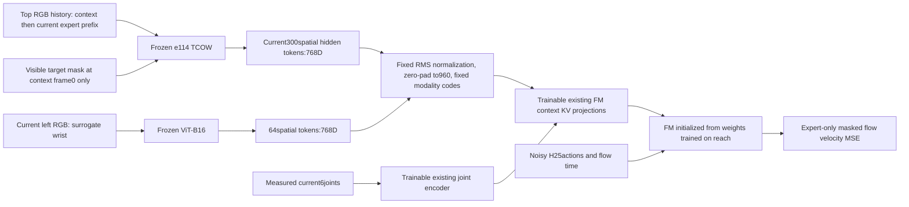

# e115: Frozen mask-trained TCOW directly conditions FM

Status: completed all 10 full-data epochs, 9,268 updates and 2,344,340 expert
chunks; process exited successfully. Best and resumable latest are both epoch
10 / step 9,268. Four fixed closed-loop K10 diagnostics are complete: one
success (both-unseen case), three timeouts. Details: e115_rollout_README.md.

Continuation: all30additional epochs (11–40) completed with the same configuration
and optimizer/RNG in `train_2`. New best: epoch32/step29420, validation0.00537529;
latest: epoch40/step36748. RAM cache released after exit. Matched four-case
best-checkpoint rollout completed2/4successes in `test_k10_2` (two gains, one
regression compared with epoch10). Details: e115_resume_README.md
and e115_rollout_2_README.md.

Full held-out test active: all1408episodes, four independent processes, no video
export as requested. Fixed epoch32best, H25/K10/Euler10/noise0/900frames. Three
committed cases initially imported from the interrupted sequential run.
User subsequently reduced the horizon from900to400frames after130completed
episodes. All130traces are clipped/physically re-scored at400and imported into
`test_full_3`; remaining1278episodes continue with4workers and no videos. Active
log `test_full_3.log`; full results pending. See e115_400_README.md.

Freeze the e114 target-mask TCOW and an ImageNet auxiliary-camera ViT. Train only
FM and its existing measured-joint encoder, initialized from the FM weights
trained on the reach task. Remove the context decoder, learned visual projections
and XYZ auxiliary readout/loss. No further TCOW/mask fine-tuning occurs here.



Sources: TCOW `/workspace/robotics_assets/experiments/e114_mask/train_3/best.pt`,
epoch9/step4608; FM `/workspace/robotics_assets/models/reach_joint_delta_ee/best.pt`,
step115000; auxiliary ViT-B16 ImageNet weights in pretrained/vision. Full source
hashes and frozen-module fingerprints are recorded beside the run. The mask head
is frozen and unused by the policy. Camera left is fixed, not an actual moving
wrist camera. The auxiliary ViT uses the existing fixed20x20to8x8pooling; TCOW
retains all300spatial tokens without pooling.

Only `flow.*` parameters train, including existing `proprio`, `state_proj` and
eight `context_projections`. Frozen vision produces768Dtokens; a parameter-free
per-token RMS normalization, zero padding to960D and fixed modality codes adapt
them to existing FM projections. This preserves all768feature coordinates and
introduces no learned visual projection or attention/context decoder. FM attends
to365tokens (300top +64auxiliary +1state). It does not receive predicted masks,
predicted XYZ, task IDs or simulator object state.

Training uses all2048query episodes/512shared shuffle contexts. Only expert
trajectory starts at stride3are training examples:234434chunks/epoch. Context
frames never create an action-loss example. Each expert feature is nevertheless
computed from the same30frame causal history as e114: concatenate context and
expert cached frames at stride3plus segment terminals, uniformly sample the
past/current prefix with frame0retained. Initial visible mask is the only query;
later GT masks are not model inputs. No change to tracker sampling cadence or
context truncation is made for cache speed.

Actions: H25at25Hz, measured future EE deltaXYZ and relative rotation6D anchored
at current measured EE pose, plus absolute jaw command. Padding masked after the
last valid transition. Measured current joints only. Reach state/action statistics
are retained exactly; jaw normalization is -1-2physical/.0255. Expert-only FM
velocity MSE, no mask/XYZ auxiliary loss. AdamW(.9,.95),LR2e-5,100update warmup,
weight decay1e-4, gradient clip1, BF16, no gradient checkpointing. Initial budget
10epochs; batch/encoding batch are chosen by measured RTX3090preflight.

Full top FP16cache100.61GiB plus side FP16cache21.46GiB exceeds available RAM.
Cache all300TCOW tokens as symmetric int8with one FP16scale per16feature block;
cache auxiliary tokens as FP16. No spatial/token compression. Online policy
encoding must apply the identical quantize/dequantize and FP16boundaries to avoid
train/evaluation mismatch. Raw/quantized latent error, mask-readout difference and
online/cache parity are measured before launch. Approximate train-cache size
78.3GiB including action/state labels, plus small validation cache. Cache stays
in host RAM, not disk; images are decoded one shared context/expert episode at a
time and released. All native current embeddings are recomputed while building
the cache; cached context KV is not used because FM projections train.

Epoch1visits shuffled shared-context groups, builds each group's frozen feature
cache and immediately trains its expert chunks. This provides early losses and
checkpoints while remaining vision is encoded. From epoch2all expert chunks are
globally shuffled and training reads only RAM features. Each epoch visits every
expert chunk once. Vision never changes during this first cache/training pass.
Resumable latest is saved after the first group, every16groups, then every256FM
updates and at each epoch. If the process restarts, frozen features must be
rebuilt; saved optimizer/RNG/order avoid repeating completed FM updates.

Validation: fixed32held-out episodes,8uniform expert stride3starts per episode,
256chunks; fixed flow noise/time seed115000and evaluation batch32. Select best
by masked FM loss. Source TCOW was selected on validation before this experiment;
held-out manipulation tests remain untouched. No rollout or success claim yet;
H/K/flow sampling/noise/frame budget for action rollout are not applicable here.
Preflight finite H25sampling is a shape/numerical check, not task success.

Code: OATFlow/shuffle_bc/{direct_model.py,direct_data.py,train_direct.py}.
Actual command, batch, measured time/VRAM, quantization checks and progress are
recorded in run metadata/preflight_summary.json. Fresh output directories only.

## Measured preflight

FM batch256,0.5442s/update,15.718GiB peak allocated VRAM with frozen vision
resident. Encoding batch4was fastest among4/16/32/64:13.54chunks/s; larger
batches did not improve throughput. The full exact-history TCOW pass is about
5hours before I/O/training overhead. Subsequent FM-only epochs are about8.3min
(916updates/234434chunks), based on measured batch256speed. First epoch updates
are grouped by context, so its update count can differ while sample count stays
identical. First epoch includes the one-time native encoding cost.

All104814314trainable parameters are under flow.*, including the existing joint
encoder; frozen vision fingerprints unchanged after optimizer updates. Source
FM weights and normalizers matched step115000exactly. All expert action labels
and masks matched the prior BC label builder bit-for-bit. Top history/query
matched native e114 clips bit-for-bit at first/middle/last expert endpoints.
Both image branches receive action gradients at their cached-feature boundary;
no frozen-encoder gradient is created. H25sampling finite, shape1x25x10.

The initial64feature scale-block quantization was rejected: about1.37%relative
latent RMSE on four spread expert samples exceeded the1%threshold. With16feature
blocks:0.7355%relative latent RMSE,99.861%binary-mask agreement IoU with the
unquantized readout,0.2597%relative FM velocity RMSE on the preflight batch.
These are numerical comparisons, not segmentation ground-truth accuracy or
manipulation success. Online/cache codes, scales and FP16auxiliary features
matched exactly. Preflight weights/cache are discarded; main initializes afresh.

Actual command:

```bash
NUMPY_MADVISE_HUGEPAGE=0 .venv/bin/python -u -m OATFlow.shuffle_bc.train_direct --epochs 10 --batch 256 --encoding-batch 4 --output /workspace/robotics_assets/experiments/e115_direct/train
```

Tmux ssh_tmux:1(e115); stdout+stderr mirrored to train.log. Live FM loss in
progress.json/metrics.jsonl; frozen-image cache count/ETA in cache_progress.json.
Latest retains optimizer/RNG/cursors. Resume with --resume <latest.pt>, same
batch/encoding settings, desired TOTAL epochs, and a fresh output directory.
Raw feature cache must rebuild after process restart; completed FM updates are
not repeated. Source mask and reach checkpoints are never overwritten.

## Main-run startup evidence

First group: 459 expert chunks, two updates at batch cap 256. The first full
batch took 0.578 s and peak allocated VRAM was 14.965 GiB. Fixed validation flow
loss changed from 1.76873769 before training to 1.76415732 after these two
updates; this is only a startup check, not evidence of manipulation success.
Frozen vision fingerprints were checked unchanged after this first group.
Initial group wall time was 44.51 s, including encoding, FM, validation and
checkpoint writes. Early extrapolation puts the first cache/training epoch at
roughly 6–7 hours; subsequent cached epochs are estimated at 8–10 minutes each.
These timings remain estimates until the first full pass finishes.

Main artifacts: `train/{config.json,progress.json,cache_progress.json,metrics.jsonl,
validation.jsonl,initial_validation.json,best.pt,latest.pt}` beneath
`/workspace/robotics_assets/experiments/e115_direct/`. Parent `run.sh` starts the
command above and tees output to `train.log`. Checkpoints contain the trainable
policy; immutable frozen source paths/hashes are recorded in their configuration.

## Completed training

Total elapsed time after initial validation: 25,334.52 s (7 h 2 min 15 s).
The first cache/training pass took 20,879.83 s (5 h 48 min); subsequent epochs
were approximately 8.2 minutes each. Median optimizer update: 0.5281 s; peak
allocated GPU memory: 15.780 GiB. Frozen vision fingerprints remained unchanged.
All 234,434 expert chunks were visited exactly once in each of the 10 epochs.
RAM feature caches were released on normal process exit.

| Epoch | Mean training flow loss | Fixed validation flow loss |
|---|---:|---:|
| 1 | 0.184020 | 0.033112 |
| 2 | 0.021567 | 0.026774 |
| 3 | 0.015511 | 0.017192 |
| 4 | 0.012853 | 0.015959 |
| 5 | 0.011560 | 0.013981 |
| 6 | 0.010373 | 0.012298 |
| 7 | 0.009622 | 0.010908 |
| 8 | 0.008902 | 0.010965 |
| 9 | 0.008488 | 0.013221 |
| 10 | 0.008145 | 0.009139 |

Training means weight each update by its number of chunks; validation uses the
fixed masked-action evaluation protocol above. Best validation is at epoch 10,
compared with 1.768738 before training. Validation briefly worsens at epochs
8–9 and improves at epoch 10. These flow losses are not a grasp success rate.
Best/latest checkpoint metadata and finite parameters were checked after exit.
Machine-readable results: local `e115_results.json`, artifact `summary.json`.
