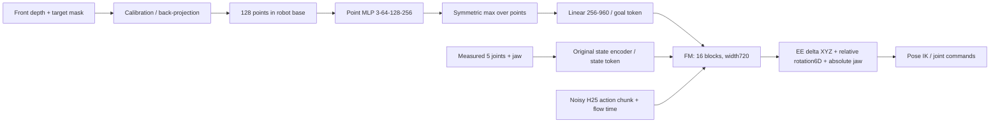

# E118: single-depth-camera target-cloud reach

Status: COMPLETE. Trained120000updates; validation-selected best step120000. Full final testing complete. User requested scratch training with
full reach budget, replacing target XYZ with a 2 cm voxel's front-camera cloud.

Input: 128 points in robot-base metres from an isolated axis-aligned 2 cm cube.
Render optical-axis depth with analytic pinhole ray/box intersections, quantize to
uint16 2 mm/unit, select target pixels, back-project using K and camera extrinsics.
Fixed wide front camera at base+[0,-1.2,0.95] m looking at base+[0,0,0.25] m;
640x480, vertical FOV70deg. All original goal cubes must fit the frustum and yield
nonempty depth. Uniform random pixel selection, replacement only below128points;
deterministic seed118. No per-cloud centering, no RGB, no explicit center XYZ input.
Cloud generator knows the simulated cube pose to render; the policy receives only
back-projected depth points. No robot/table/distractor occlusion or depth noise;
self-occlusion and 2 mm depth quantization are included. This is not recorded real
RGB-D or a tracker evaluation. Known identical voxel shape simplifies localization;
transfer to variable-sized objects/partial masks remains untested.

All learned parameters initialized randomly, seed0. No reach/pretrained model or
optimizer weights loaded. Reuse only original train-only normalization and fixed
voxel-disjoint split/evaluation arrays from reach_joint_delta_ee. All point encoder,
state encoder, context K/V and FM weights train. No XYZ auxiliary head/loss.

Data: reach_voxel_grid/ee_delta_25hz_h25_s2, unchanged32,017trajectories and
2,065,104chunks. Train25,613goals/1,651,684chunks; val3,202/206,772;
test3,202/206,648. Same original H25 at25Hz, anchor stride2, measured joint input6,
10D measured future EE delta / anchor-relative rotation6D / absolute jaw output,
padding-masked flow loss. Input/output jaw fixed-range scaling, others same E88
train-only statistics. Global XYZ normalization is applied to points, preserving
absolute target location. Original source action/state arrays remain unchanged.

Budget:120,000optimizer updates, batch256, ~18.60train passes. BF16autocast,
FP32weights/labels, fusedAdamW beta0.9/0.95, weight_decay1e-4, clip1.
Warmup100updates to2e-4, cosine to2e-5 at60,000, then constant2e-5 to120,000.
Same two context tokens (goal/state) and original16layer720wide action FM.
No gradient checkpointing. Cloud cache ~49MB; no per-frame vision cache needed.
Data arrays memory mapped. Cache cloud once per goal; reuse across its trajectory.

Validation every5,000: same2,048chunks and32goals, H25/K15/Euler10, noise0,
300policy frames,25Hzactions/50Hzmidpointservo/500Hzphysics, unchanged PoseIK.
Original historical evaluator was removed during cleanup; this evaluator is
reconstructed and its exact success rule is explicit: every final25frames must
have EE error below threshold, jaw within1mm of closed, EE finite-difference speed
below10mm/s; no penetration>0.2mm at any physics substep. Do not claim byte-identical
success semantics to historical E88. Best by stable5mm success then median final
error. Retain latest resumable model/optimizer/RNG/sampler, selected best, hardlinked
final; save latest at100 and every1,000. Preserve previous latest via atomic writes.

After120k, selected best is tested on same3,202initial held-out chunks,8,192expert
chunks,128held-out goals/noise0and1,32train goals,128recorded-EE oracle cases.
No learned success claimed until evaluations finish. No videos planned in main run;
physical qpos/EE/commands saved to support later rendering.

Artifacts: /workspace/robotics_assets/experiments/e118_cloud.
Main train directory created by trainer, not before. Log full.log, tmux ssh_tmux:e118.
Code: OATFlow/reach/{pointcloud,cloud_data,cloud_eval,cloud_train}.py.
Exact config/hashes/progress/metrics: train/{config,progress}.json and metrics.jsonl.
Preflight uses disposable weights only; heavy artifacts removed after checks retained.
E116 remains paused. Existing E88/E103 checkpoints untouched.

Preflight PASSED: actual20 scratch B256 updates, ~0.2148s/update, peak5.33GiB,
all learned parameters receive gradients, point-order invariant conditioning,
absolute-position sensitivity and bit-exact two-step versus save/resume update.
Two physical recorded-EE oracle cases passed1mm/no collisions. Disposable weights
removed; results retained in preflight_summary.json and resume_check.json.

Depth audit: all32,017cubes fully in camera frustum and nonempty;15..77unique depth
pixels (median39), expanded by sampling with replacement to128points. Cache49.18MB.
On64independent fixed/random goals, MuJoCo CPU rays confirm exported quantized
depth within0.9975mm. GPU rasterization differs by one boundary pixel in total and
up to1.764mm in depth on common pixels (grazing edges); analytic ideal pinhole depth
is used for training. Audit:depth_audit.json; samples:cloud_samples.png.
Estimated training-only7.16h on RTX3090; validation/checkpoint overhead additional.
Original XYZ checkpoint evaluation on same rebuilt32goal validation protocol is
running separately during startup. This reference does not initialize E118.

Main launch verified: checkpoint step100 restores all AdamW steps100;25,600samples,
105,102,634trainable parameters, no original XYZ encoder or pretrained weight source.
First100update mean loss0.833686,0.2491s/update including startup/reference contention,
5.326GiB peak. First-block estimate8.30h training-only; later rate may change.
Latest progress:train/progress.json, loss log:train/metrics.jsonl;stdout tee full.log.
OriginalXYZbest115k on reconstructed32goal protocol:5mm success21/32(65.625%),
median3.915mm,collision2/32. This is the reference policy, not E118 performance.
E118's first learned physical validation is planned at5,000updates; no success result yet.
Reference details:reference_xyz_validation.json/.npz. Startup:startup_checks.json.

Actual voxel split visualization completed: voxel_split/voxel_split_3d.png and
voxel_split_3d_faint.png (real arm mesh/2cm cubes), voxel_slices.png/.svg, offline
interactive index.html, exact centers/labels split.npz. Verified disjoint/complete
25613train+3202val+3202test. 3198/3202test goals(99.875%) have a training center
20mm away; maximum nearest-training distance34.641mm. This is random voxel holdout
within the same feasible volume, not a separate unseen workspace region. Viewer
counts and opacity/robot/context controls tested in Chromium CPU rendering.
Verification:voxel_split/{verification,viewer_checks}.json; code:visualize_split.py.

Final results verified:120,000updates,30,720,000samples,18.599train passes.
Training including periodic validation/checkpointing24,507.93s(6.81h), excluding
subsequent final held-out evaluation. Best selected on32validation goals:step120000,
14/32stable5mm,median5.588mm; val flowloss0.006568. Best/latest/final retained.

Full128held-out goals, H25/K15/Euler10/300frames:
| Metric | Noise0 | Noise1 |
|---|---:|---:|
| Stable1mm |3/128(2.34%)|3/128(2.34%)|
| Stable2mm |12/128(9.38%)|6/128(4.69%)|
| Stable5mm |54/128(42.19%)|63/128(49.22%)|
| Stable10mm |103/128(80.47%)|110/128(85.94%)|
| Stable20mm |117/128(91.41%)|121/128(94.53%)|
| Final median mm |5.508|4.967|
| Final mean mm |8.906|6.874|
| Collisions |9/128(7.03%)|6/128(4.69%)|

Across two noises on the SAME128goals:117/256stable5mm(45.70%),213/256stable10mm
(83.20%); these are256rollouts, not256independent goals. Train32goals:17/32stable5mm,
30/32stable10mm,median4.794mm,zero collisions. Recorded-EE poseIK oracle:128/128
at1mm,median0.023mm,zero collisions. Held-out8192expert-state chunks: mean EE delta
error1.388/1.426mm,rotation0.471/0.486deg; initial3202chunks8.342/8.538mm EE delta.

Under the same reconstructed32goal validation protocol, originalXYZbest115k gives
21/32stable5mm versus cloudbest120k14/32. This fixed-run comparison indicates the
cloud policy has not matched XYZ precision; no multi-seed training conclusion.
Historical E88 full-test rates use its former evaluator and are reference only;
do not present them as an isolated controlled full-test ablation.

Final artifacts:train/summary.json,test_rollout_n0.json/.npz,test_rollout_n1.json/.npz,
train_rollout.json/.npz,oracle_EE_IK.json/.npz. Previous videos test_k15 use75k,
not the final120k policy. No new final-checkpoint videos rendered in this status check.
