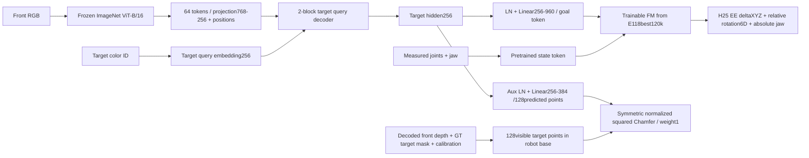

# E119: one-eighth wide-pick data, frozen ViT and cloud-auxiliary visual FM

Status: RUNNING in ssh_tmux:e119; main training verified after successful data/CUDA/online preflights. User requested eight balanced data parts, train one part with
frozen ViT, FM initialized from E118best, E103-style target query decoder, replacing
hidden XYZ supervision with target point-cloud supervision only.

Partition seed119 shuffles32original training layouts into8parts of4layouts.
Selected part1 layouts[0,8,11,10]:256demos,64per target,16seen permutations.
37,536stride1action-valid frames. Keep all4validation layouts/256demos separate.
Test all3200remaining demos:2048new-layout/seen-permutation,128seen-layout/new-
permutation,1024new-layout/new-permutation. No frame-wise random split or expert
queries from held-out permutations enter training. All8part manifests retained.

Native front RGB240x320 only, padded40pixels above/below with ImageNet mean color
before frozen ImageNet ViT-B/16 at320square.64pooled768Dtokens. Wrist RGB is not
used in this E103-style one-camera experiment. Target color ID and measured5arm
joints+right jaw are policy inputs. Depth, masks and XYZ labels are never inputs.

The predicted point cloud is ONLY auxiliary; it is not fed through E118's point
encoder and is not a bottleneck before FM. Original E103 hidden->goal->FM route
retained. Copy entire flow module (all state/context/action parameters and buffers)
strictly from E118best120000. E118point encoder is deliberately unused because
visual hidden replaces its goal token. New visual/query/goal/cloud head initialized
fresh; no E103trained weights loaded. ViT frozen/eval/no-grad. All remaining
parameters including FM train. New optimizer, no reach optimizer moments.

Cloud labels: actual uint16front depth2mm/unit, one-pixel-eroded visible GT instance
mask, native per-frame calibration; back-project to base frame, sample128points
with replacement only if needed. At least8valid pixels. Reject depth pixels farther than60mm from the target-mask
median depth (32mm cube diagonal55.5mm), using no GT center. Current visible target
surface is the label, including during grasp/lift; no amodal completion or XYZ
center target is substituted. Missing/fully occluded target masks out cloud loss
only. Independent local-box geometry audit checks calibration; it does not filter
points or enter policy. Object cube side32mm, not the reach's20mm voxel marker.
Global cloud mean/std fit on valid TRAIN clouds only; do not subtract each cloud's
centroid. Chamfer is unordered and symmetric,0.5*(two mean squared nearest-point
distances) on normalized coordinates. Head:LN256+Linear256to384, reshaped128x3.
L=L_FM+1.0*L_cloud. Log both losses and physical cloud Chamfer in millimetres.
Aux gradients reach head/visual/query/decoder, not downstream goal/FM directly;
FM action gradients train entire visual conditioning and FM.

Training:10exact epochs,37,536chunks,batch128,294updates/epoch including partial
32sample last batch,2940updates total,375,360samples. Seed102; FM LR2e-5,newvisual/
head1e-4,warmup100then constant; fusedAdamW(.9,.95),wd1e-4,clip1,BF16. Same E103
H25/25Hz,stride1,10DEE chunk-anchor deltaXYZ/relative rotation6D/absolute jaw, masked
terminal padding; E118action/state normalization preserved. Frozen features cached
once in RAM then placed in GPU RAM for optimization (~3.62GiB incl validation).
No persistent feature dump. Cloud/action labels and exact alignment metadata saved.

Validate512fixed chunks sampled from8fixed frames/validation episode; fixed flow
noise/time seed102000. Select best ONLY by FM action loss, retain final exact10epoch
checkpoint separately. Cloud validation is reported but does not select checkpoints.
Save resumable latest model/AdamW/RNG/sampler and final hardlink, selected best.
Preflight must verify exact FM transfer, frozen ViT, auxiliary gradient routing,
cloud point-order invariance, current-frame geometry alignment and real B128step.
Discard preflight updated weights; initialize main run afresh.

After training, auto-test FINAL exact10epoch checkpoint on all3200test episodes,
H25/K10/Euler10,noise0,300policy frames,25Hzwaypoints/50Hzmidpointservo/500Hzphysics,
unchanged bounded poseIK. Correct target lift>4cm with bilateral jaw contact for10
consecutive frames; any distractor lift>4cm fails. Native front RGB online, same
letterboxing/frozen ViT; onlyRGB,targetID,joints. No videos in full test; save
per-case results and physical qpos/commands for later rendering. No test results
select hyperparameters/checkpoints. No learned pick success claimed yet.

Artifacts:/workspace/robotics_assets/experiments/e119_pick; trainer creates train/
and evaluator creates test_k10. Tmux ssh_tmux:e119, log train.log then test_k10.log.
Code:OATFlow/top_pick/{cloud,cloud_data,cloud_train,cloud_evaluate}.py.
Run:python -m OATFlow.top_pick.cloud_train then MUJOCO_GL=egl python -m
OATFlow.top_pick.cloud_evaluate. Use .venv and stream tee logs. Original datasets,
E118/E103 checkpoints untouched; E116 remains paused.

Initial cache attempt stopped on a geometry audit: one erroneous pixel at204mm
depth inside a target mask whose actual depth is~742mm (g000/p00/t2frame112).
Add robust60mm median-depth outlier filtering before point sampling; preserve
failed log. Retry preparation with the exact same partition; no optimizer updates
had run. This is a depth artifact, not a cover/shuffle segment.

Preparation completed:4layouts[0,8,10,11],256train/256val/3200test demos, all8parts
saved and balanced.37,536train+2,048validation cache endpoints, features3.624GiB
in GPU RAM. Cache export109.65s; no disk feature dump. All depth-cloud geometry
checks passed after median-depth artifact filtering. ALL37,536train frames and
ALL2,048sampled validation frames have valid clouds:zero auxiliary masks disabled.
There is no cover/shuffle occlusion segment; the missing-cloud condition is inactive
on this subset. Earlier language about fully occluded targets was conditional,
not a finding about this data.

Preflight PASSED: all flow tensors exactly E118best120k, frozen ViT checksum,
auxiliary gradient routing, unordered cloud-loss invariance, combined FM gradient,
real B128AdamW update. Disposable preflight weights discarded. Peak8.58GiB including
full feature cache. Main initialized afresh. Online front RGB/frozen ViT/decoder/FM/
PoseIK300frame wiring passed all4color queries at earlystep250; this is not an
accuracy result. Temporary physical preflight traces removed; summary retained in
online_preflight.json. Main already passedstep550(~1.87epochs), first50-block losses
FM~0.0236/cloud~0.0628; peak7.37GiB in normal training. Main progresses independently;
see train/progress.json for current status. Full final-checkpoint test automatically
queued after training; no learned full-test result yet. Protocol:e119_test_README.md.
