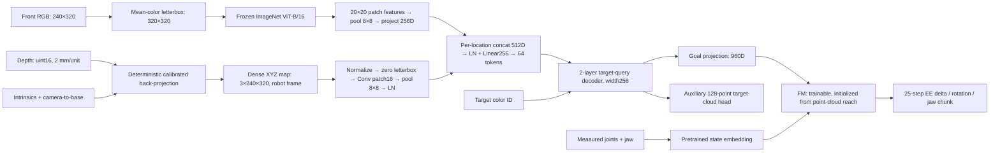

# E120 — Dense RGB–geometry fusion for subset picking

Status: training and full3200episode evaluation COMPLETE.

The policy receives the entire front RGB image, synchronized depth and camera
calibration. Deterministic back-projection converts depth into an XYZ map in the
robot base frame. A trainable patch embedding processes all XYZ pixels; its spatial
features fuse with frozen RGB ViT features before the target-query decoder. This
replaces the unlaunched 512-point scene-token proposal. No target mask or simulator
object pose enters the policy.



RGB and XYZ use exactly the same 40-pixel top/bottom letterbox, 16-pixel patch grid
and adaptive 8×8 pooling. Thus the query decoder still receives 64 fused spatial
tokens. Every valid input depth pixel contributes before pooling: no random point
sampling, workspace crop or object-mask selection. Invalid depth and padding map
to zero normalized XYZ. Metric geometry is computed in FP32, without TF32 matrix
multiplication; trainable networks use BF16. Normalization uses the E118 reach
training-coordinate statistics, with no per-frame centering.

## Data and budget

- Dataset: `/workspace/robotics_assets/datasets/pick_wide_rgbd` (E117).
- Same E119 partition seed119, part1 of8: layouts0/8/10/11, 256 demonstrations,
  37,536 stride1 training chunks; 64 demonstrations per target color.
- Validation: original four validation layouts, 256 demonstrations; cache eight
  fixed endpoints per episode (2,048), score on the same fixed512 chunks as E119.
- Test: all3,200 remaining episodes: spatial2,048, unseen permutation128,
  combined1,024. No train/test episode overlap; splitting is by layout/permutation.
- Home-start pick task, four32mm cubes; no shuffle or covers in these trajectories.
- **80 epochs**, 23,520 updates, 3,002,880 training samples, batch128. This corrects
  the earlier10epoch subset budget: approximately the update budget of10epochs on
  the full original training set (23,020updates), not an exact sample-count match.
- AdamW betas(.9,.95), weight decay1e-4, clip1; FM LR2e-5, remaining trainable
  modules LR1e-4, 100step linear warmup, constant afterward; seed102.

## Initialization, loss and cache

FM/state encoder: **E118 best checkpoint step120,000**, trained from scratch on
voxel reach using single-camera visible voxel clouds. Source:
`/workspace/robotics_assets/experiments/e118_cloud/train/best.pt`.
All `flow.*` weights/buffers transfer strictly. The E118 point MLP is **not used**:
the new XYZ patch embedding is freshly initialized. RGB uses frozen ImageNet
ViT-B/16 (`vit_b_16-c867db91.pth`); no E119 learned weights are loaded.

Train XYZ patch embedding, geometry LayerNorm, fusion, RGB projection, target
embedding/position/query decoder, goal projection, auxiliary cloud head and entire
FM/state path. Only ViT is frozen/eval/no-grad. Main training starts with fresh
weights and optimizer after preflight updates are discarded.

Loss: `L = L_FM + 1.0 * L_cloud`. Auxiliary head attaches to the decoder hidden
before goal projection and predicts128 unordered target-surface points. Labels
are identical to E119: decoded front depth, eroded target instance mask,
calibration, median±60mm depth-outlier rejection; symmetric squared Chamfer in
global train-only normalized coordinates. GT masks are **labels only**. Geometry
input depends solely on the complete depth image and camera calibration.

Cache RGB features FP16 in GPU RAM during training (~3.624GiB). Cache raw uint16
depth (~5.66GiB) and calibration in CPU RAM; compute dense XYZ on demand per batch.
Do not persist per-frame RGB/depth/XYZ feature caches to disk. Small action/cloud
labels and reproducibility metadata remain beside the checkpoints.

## Verification and evaluation

Preparation verifies bit-identical E119 action/cloud labels, exact FM transfer,
NumPy vs GPU back-projection, sensitivity to calibration translation, gradient
routing, frozen ViT integrity, actual B128 update timing/VRAM, and four short
online RGB-D → policy → IK rollouts. Temporary online traces are deleted; retained
JSON summaries are verification, not accuracy results.

Planned automatic final checkpoint evaluation: all3,200 held-out episodes,
H25/K10, Euler10 flow steps, noise seed0, 300frame budget at25Hz; servo50Hz,
physics500Hz. Correct-object lift >4cm, bilateral jaw contact for10 consecutive
frames; lifting another object fails. No videos during full evaluation.
Best checkpoint is selected by fixed validation FM loss; full evaluation uses
the final exact80epoch checkpoint, with no test-based selection.

E119 has only10epochs and therefore is not a matched-budget architecture ablation.
Results and success rate: **pending**.

Commands (from repository root, `MUJOCO_GL=egl`):

```bash
.venv/bin/python -u -m OATFlow.top_pick.fusion_train
.venv/bin/python -u -m OATFlow.top_pick.fusion_evaluate
```

Artifacts: `e120_fusion/cache_config.json`, `label_alignment.json`, `preflight.json`,
`online_preflight.json`; exact train configuration and metrics in `train/config.json`,
`train/metrics.jsonl`, `train/validation.jsonl`. Final rollout configuration/results
will be under `test_k10/`.

Preparation check: four actual online20frame H25/K10 rollouts passed; front calibration matches stored dataset and initial quantized online depth is pixel-exact (0 mismatch). An initial partial RAM cache was discarded before training to include this explicit camera-parity check in the main preflight. No optimizer training checkpoint existed; temporary traces/cache removed.

Launch verification: main training running in tmux `ssh_tmux:1` (`e120`). Cache complete in 118.83s; RGB 3.624GiB in GPU RAM, raw depth 5.663GiB in CPU RAM, calibration 3.96MB. All E119 action/cloud labels are bit-exact. B128 preflight and four online20frame rollouts passed; initial online quantized depth is pixel-exact to stored data. Preflight 0.1290s/update; preflight peak 9.69GiB, normal main peak 7.51GiB. Main verified at step250, epoch0.853; learned rollout result remains pending. Estimated roughly one hour for80epochs including validation/checkpoint overhead, not a guarantee. Logs stream to tmux and `train.log`; full final3200episode K10 evaluation is queued automatically.

Full final23520 K10 test complete:443/3200successes (13.84%); exact per-group results:test_k10/summary.json.
