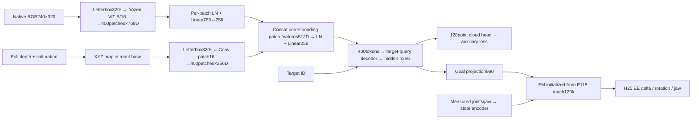

# E121 — Retain every RGB/XYZ spatial patch

Status: interrupted for full-data revision; checkpoints retained.

Correction requested by the user: E120 inherited an additional20×20→8×8 adaptive
average pooling step in both RGB and geometry branches. This was an implementation
choice by the assistant, not requested by the user. E121 removes that pooling in
both branches. Preserve all400native spatial patch tokens through fusion and into
the target-query decoder. Existing channel projections and the user-approved
single-query latent→FM architecture remain the same.



Only frozen ViT RGB encoding is cached. XYZ patch embedding/fusion/query decoder,
position embedding/visual and goal projections, cloud head and the complete FM
state/action path train jointly. No raw point set is passed directly to FM; the
cloud head supervises the same hidden latent that conditions FM. GT masks are
auxiliary labels only. No input point sampling, target pose or instance mask.

## Matched experiment configuration

- E117 `pick_wide_rgbd`; exactly E119/E120 part1/8, seed119, layouts0/8/10/11,
  256expert demos,37,536stride1training chunks,64demos per color.
- Four original validation layouts/256demos, cache2,048fixed endpoints and score
  the same512fixed validation chunks. Test3,200remaining episodes: spatial2,048,
  composition128,combined1,024. Home-start four-cube pick task; no shuffle/covers.
- Fresh training, **80epochs/23,520updates**,3,002,880samples,B128,seed102.
- Frozen ImageNet ViT-B/16; strictly initialize whole FM/state buffers from
  E118best120k point-cloud reach; no learned E120/E119 weight. Shared initial
  module values follow E120; the new400position embeddings use fixed seed121.
- Train all other modules, same AdamW(.9,.95),wd1e-4,clip1,BF16;
  FM LR2e-5,other LR1e-4,warmup100 then constant.
- Loss `L_FM + 1.0*L_cloud`: same target-query hidden→128×3head and globally
  normalized symmetric squared Chamfer. Same visible target depth/mask/calibration
  labels,1pixel erosion,60mm median band,minimum8pixels. Verify labels bit-exact.
- Keep native240×320→320square with40px top/bottom padding and patch16.
  **No adaptive pooling in RGB encoding or geometry tokens.** Both stay20×20.
  Corresponding feature channels fuse at each location, yielding400decoder memory
  tokens. RGB768→256channel projection and one target-query output remain explicit.

## Cache and checks

39,584FP16RGB feature frames×400×768 =22.65GiB in **CPU RAM**. Raw uint16 depth
5.66GiB and calibration3.96MB also remain in CPU RAM. Copy each B128feature/depth
batch to GPU, then compute XYZ/geometry features. No persistent RGB/depth/XYZ
feature cache. Disk retains source dataset, action/cloud labels and checkpoints.

Verification: original E118 FM transfer, unchanged frozen ViT,400geometry/fused
tokens, NumPy vs GPU geometry, auxiliary/action gradient routing, actual B128
update timing/VRAM, and four short online RGB-D→policy→IK rollouts with camera/depth
parity. Preflight optimizer updates are discarded before fresh main training.
Temporary online traces are deleted after their JSON verification summary.

## Evaluation

Save best by fixed validation FM loss and final exact80epochs. Automatic matched
evaluation uses final checkpoint on all3,200held-out episodes,H25/K10,Euler10,
noise0,300frame budget at25Hz (servo50Hz/physics500Hz), no videos during full test.
Correct-object lift>4cm and bilateral jaw contacts for10consecutive frames;
wrong-object lift fails. Best is also retained for later validation-selected
rollout comparisons; no result or superiority claimed before evaluation.

E120 showed overfit (final train cloud2.15mm vs validation28.39mm); removing pooling
is a controlled representation change, not a guaranteed cure for overfit.

```bash
MUJOCO_GL=egl .venv/bin/python -u -m OATFlow.top_pick.patch_train
MUJOCO_GL=egl .venv/bin/python -u -m OATFlow.top_pick.patch_evaluate
```

Artifacts: `e121_patches/cache_config.json`, `label_alignment.json`, `preflight.json`,
`online_preflight.json`, `train/config.json`, `train/metrics.jsonl`,
`train/validation.jsonl`. Exact evaluation configuration will be `test_k10/config.json`.

CPU verification passed with two actual RGB-D frames: RGB[2,400,768],XYZ[2,400,256],hidden[2,256]; finite forward and loss, gradients to geometry/query/FΜ/position, frozen ViT unchanged. Shared initial values match E120 except new400position shape. Applying the old pooling to full RGB tokens reproduces E120 features. CUDA B128/online preflight cannot run: NVML cannot access GPU44:00.0 and CUDA initialization fails. Queue in ssh_tmux:1 waits for NVML plus a real CUDA operation, then runs the planned fresh80epoch pipeline automatically. Queue log: `/workspace/robotics_assets/metadata/e121.log`. Exact CPU verification: `e121_verification.json`.

GPU-restored launch verification: cache complete in212.34s, RGB22.650GiB and depth5.663GiB CPU RAM. B128 GPU preflight passed with400fused tokens,0.1378s/core update,peak6.53GiB; online camera/depth parity and four short rollouts passed. Main verified at step200; resumable checkpoint1 has matching optimizer steps and400positions. Main peak4.34GiB excluding other processes. Main steady update currently~0.2s; budget80epochs estimated1–1.5hours including validation/checkpoint overhead. No learned accuracy result yet. Log:`/workspace/robotics_assets/metadata/e121.log`,tmux`ssh_tmux:1`.

Interim matched-step review at7750updates (~26.36epochs): E120 validation FM0.057975/cloud22.924mm; E121 FM0.045929/cloud47.183mm. E121 best FM so far0.020430 at2750 versus E120best0.022049; E121 train cloud~3mm while current validation~47mm. More spatial patches have not improved cloud generalization in this run; no E121 rollout result yet. Continue authorized80epoch budget; do not infer grasp success from FM loss.

Data diversity audit:256train demos comprise4layouts×16permutations×4queries, with only16distinct initial target spawn positions at0.1mm precision. This does not mean all moving-object coordinates are limited to16values. Stride1 clips and80epoch repetitions add correlated observations without new spawn layouts. Validation has4different layouts/16different initial positions. This provides a concrete shortcut/memorization opportunity; representation compression was not the only issue. E121 best FM2750(~9.35epochs),latest10250(~34.87epochs)FM0.05569/cloud48.65mm; overfit persists. Audit:e121_patches/data_diversity.json.

E121 interrupted by user full-data revision at latest saved step12000 (40.818414 subset epochs). Best checkpoint2750 retained; no final checkpoint or E121 rollout. Next run E122 starts fresh on full original training split with23520updates.
