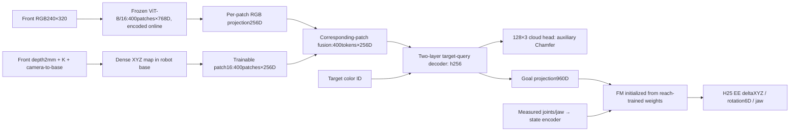

# E122 — Full-data RGB/XYZ patch fusion

Status: COMPLETE — full-data training and all1408held-out K10rollouts finished.

Train the E121400patch architecture on the original full E117training split,
with the same23,520optimizer-update/B128budget. Start fresh from reach-trained
E118best120k FM and ImageNet ViT; no learned E119/E120/E121weight transfer.



Keep all20×20native patches in both branches after40pixel top/bottom padding.
Retain RGB768→256/fused512→256channel projections and the single target-query
latent. GT masks supply cloud labels only; no raw target cloud/XYZ enters FM.

## Training

- Dataset: E117 `pick_wide_rgbd`,32training layouts0–31,2,048expert demos,
  16seen permutations×4queries/layout;512demos/color. Four32mmcubes with random
  XY/yaw, home-start pick; no shuffle/covers segment. Stride1=294,640chunks.
- Validation: original4layouts32–35/256demos,2,048fixed endpoints, same512fixed
  validation chunks. No test episode enters training.
- Budget:23,520updates,B128,10full epochs plus500updates=3,010,400samples,
  10.217214effective epochs.2,302updates/full epoch, last batch112.
- Initialization: entire FM/state path and normalization from
  `e118_cloud/train/best.pt` step120000. Original point MLP unused. Frozen
  ImageNet ViT-B/16 in eval/no-grad, encoded online for each batch. All geometry,
  fusion/query/projection/cloud modules and FM/state train jointly. Fresh AdamW,
  seeds102/121, beta(.9,.95),wd1e-4,clip1,BF16; FM LR2e-5,others1e-4,
  100update warmup then constant.
- Loss: FM +1.0cloud auxiliary;128visible target-surface points from eroded
  instance mask + front depth/calibration, globally full-train-only normalized
  symmetric squared Chamfer at query hidden. Report unsquared Chamfer in mm.
  Minimum8pixels,1pixel erosion,60mm median-depth band. Additionally reject
  pixels differing by>10mm from3×3local depth median to remove raster spikes.
  Policy input depth is unchanged; GT3Dpose is used only in independent geometry
  assertions. Missing cloud labels mask only auxiliary loss.
- Geometry input normalization remains E118global train-only mean/std.

## Cache and actual resource limit

Container cgroupv1 limit is129,642,790,912bytes (~120.74GiB), despite host251GiB.
The earlier169.77GiB frozen-feature cache was OOM-killed before training.
Current explicit plan: native decoded uint8RGB296688×3×240×320=63.662GiB,
plus per-frame lossless-zlib uint16depth (~2GiB sample estimate;reserve8GiB),
labels/clouds/calibration and8GiBworking headroom. No disk feature cache.
Encode frozen ViT online per batch, retain400tokens, cast through FP16 as in the
old feature-cache path; training costs more GPU compute but fits container RAM.
Guard uses min(host MemAvailable,cgroup limit minus current usage).

Before full cache, run real B128preflight including online RGB encoding/depth
decoding, transferred FM, geometry and gradient/frozen-ViT checks. Discard all
preflight updates. Preserve bit-exact old-subset action/state/target/frame sampling
labels and report changed cloud frames due explicit raster-spike cleanup.

## Test

Save best by fixed validation FM loss, resumable latest and final23520.
Automatic rollout uses final on original1,408held-out episodes:composition1,024,
spatial256,combined128. Exclude1,792old-subset test demos now in training.
H25/K10/Euler10,noise0,300frames,25Hz; servo50Hz/physics500Hz. Correct-target
lift>4cm and bilateral contact for10consecutive frames; wrong-object lift fails.
Save traces/metrics, no videos. Results pending.

E120comparison on these same cases:196/1408=13.9205%,composition189/1024,
spatial4/256,combined3/128. Architecture also differs from E120. E122also adds
raster-spike label cleanup relative to E121; not a purely data-size-only ablation.

```bash
MUJOCO_GL=egl .venv/bin/python -u -m OATFlow.top_pick.full_train
MUJOCO_GL=egl .venv/bin/python -u -m OATFlow.top_pick.full_evaluate
```

Artifacts: `memory_plan.json`, `preflight.json`, `cache_config.json`,
`label_alignment.json`, `train/config.json`, `train/progress.json`,
`train/validation.jsonl`, `test_k10/config.json`. Preparation failures and fix:
`e122_preparation.json`, `e122_depth_fix.json` in local research docs.
Live log:`/workspace/robotics_assets/metadata/e122.log`;tmux`ssh_tmux:1`.

Verified current launch: end-to-end B128update including online ViT and depth decode0.45985s,peak6.532GiB. Cache plan80.116GiB versus115.515GiBcontainer-available; cap120.739GiB. Native-cache throughput~440frames/s. Main23520updates estimated3.0hours before validation/checkpoint overhead; estimate differs from the earlier cached-feature plan.

Actual main launch verified at step100/23520; latest checkpoint step1 with matching optimizer counters,400position tokens and294640full training indices. Native RGB cache63.662GiB + lossless depth1.864GiB,all296688frames complete in707.23s. Container usage76.70GiB under120.739GiBcap. Steady~0.48s/update; around3.1hours plus periodic validation/checkpoint overhead. Verification:launch_verification.json. Automatic1408case final K10test remains queued.

E122 TRAIN AND FULL TEST COMPLETE. Final23520updates/10.217214effective epochs,
3,010,400samples; training11277.68s(3.133h), full1408case test1421.39s(23.69min).
H25/K10/Euler10/noise0/300frames, original held-out paths verified unique and
strictly disjoint from training. Final-checkpoint successes1028/1408=73.0114%:
composition699/1024=68.2617%,spatial218/256=85.1563%,combined111/128=86.7188%.
Failures380timeouts,zero wrong-object lifts. Colors:Blue260/352,Green262/352,
Red259/352,Yellow247/352 (70.17–74.43%).

Matched E120original1408case baseline196/1408=13.9205%; improvement59.0909percentage
points. E120also used64pooled tokens, so this is not a pure data-size-only rollout
ablation. E121400token subset run had no rollout. Overlap audit now confirms
all39584old-subset/validation action AND cloud labels bit-exact despite the extra
cleanup rule (changed cloud frames0). Final E122validation cloud Chamfer3.3935mm
versus E121subset's48.65mm at10250; same fixed validation frames but full-train
normalization changes. This supports layout-diversity shortage as an important
previous limitation; it does not prove every architectural choice optimal.

Final validation FM0.0146143,cloud squared normalized loss0.00370209; best-FM
checkpoint12250 had0.0104041 and cloud3.4533mm. Best-cloud validation3.2446mm at20750.
Only final23520 was rolled out here; best12250 remains untested. Cloud Chamfer is
visible-surface distance, not 3Dobject-center error. Current task is home-start
four-cube picking without shuffle/occlusion. Verification:train/verification.json
and test_k10/config.json,summary.json,results.jsonl.
