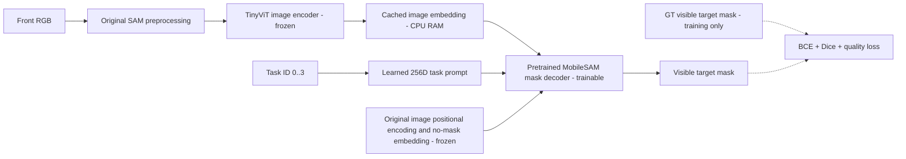

# E123 — task-conditioned MobileSAM visible segmentation

Status: COMPLETE.

Question: can a learned task-ID prompt select the correct cube with a pretrained MobileSAM encoder kept frozen? This experiment contains no FM, behavior-cloning actions or temporal tracking. Input is native front RGB and target ID only. No point/box/mask/3D position is supplied at inference.

Data: original E117 pick_wide_rgbd/E122 splits. Train all2048training episode queries at frame0 (32layouts x16seen permutations x4target IDs); validation256queries (4new layouts x16seen permutations x4IDs); test1408queries (composition1024,spatial256,combined128). Query order is Red0,Blue1,Green2,Yellow3. At home, a canonical RGB/instance map from target0 is shared by its four task queries; initial qpos/qvel/ctrl are checked bit-exact across all four training episodes. This uses all training scenes and task queries, not every frame of each trajectory.

Architecture: official MobileSAM TinyViT, original1024-long-side preprocessing and single-mask decoder. Four learned256D vectors provide one sparse prompt token per task. Freeze the image encoder and original prompt encoder (positional encoding and dense no-mask embedding); train learned task tokens and the pretrained mask decoder. The three unused multimask readout MLPs are frozen. Adapt decoder batching to paired images/prompts; one-image output was checked against the upstream decoder. Native visible instance mask supervision, no amodal targets.

Initialization: https://github.com/ChaoningZhang/MobileSAM at commit f706ad9c4eb7f219c00d9050e46328518ffb65d2, weights/mobile_sam.pt. Exact checkpoint hash and package source are recorded in config.json. Image encoder6065532params; mask decoder4058340params; active trainable parameters3639940. No earlier project checkpoint is used.

Training: CPU FP32 because CUDA tensor creation currently fails on this instance. Frozen encoder embeddings are cached FP16 in CPU RAM, no disk feature cache. Three encoding workers with8threads each; training16threads. AdamW, batch8,5epochs=1280updates, prompt LR1e-3,decoder LR1e-4,weight decay1e-4,20update linear warmup then constant LR,clip1,seed123. Loss=BCE+softDice+0.1*IoU-quality MSE. Use identical frozen SAM preprocessing for training and testing. Select best checkpoint by highest validation mean IoU, never by test results. Baseline is original pretrained decoder plus the randomly initialized task tokens. Train weights/checkpoints are saved in best.pt/latest.pt/final.pt; optimizer state is retained.

Test: best validation checkpoint; full1408held-out frame0queries. Additional diagnostic tests:72later expert images (first two episodes per split group and target, last approach/engage/lift frame), each queried for all4target IDs=288queries;16retained paired inside/outside-X images, each queried for all4IDs=64queries. XY rendering replays stored initial states with the same front camera; these RGBs are uncompressed, unlike H264dataset RGB. Diagnostic subsets are not full-trajectory population estimates. Test IoU/Dice and identity confusion; mask threshold0.5; visible-target metrics require at least8GTpixels. Identity selection is the largest mask IoU against the four GT instances, with no overlap counted as failure. H/K/flow settings/action representation are not applicable; no grasp rollout.

Artifacts: config.json,pretrained source/hash,split manifests,baseline.json,gradient_check.json,loss.jsonl,history.json,learning_curves.png,best.pt/latest.pt/final.pt,verification.json,test/{home,dynamic,xy}/summary.json and visualizations. RGB and GT masks are not model prompt inputs. Orange=GT visible mask,cyan=predicted mask in figures. Research report: local docs/research/REPORT.md.

Run: .venv/bin/python -u -m OATFlow.task_mask.train in tmux with tee /workspace/robotics_assets/metadata/e123_mask.log. Fresh output:/workspace/robotics_assets/experiments/e123_mask. Re-running requires a fresh experiment path; do not overwrite retained results. Current installed package is an editable checkout under robotics_assets/external/MobileSAM; no upstream source was edited.

Best epoch:5;test summaries:{"home": {"cases": 1408, "visible_cases": 1408, "mean_iou": 0.5243361660005939, "mean_dice": 0.6627702763579393, "identity_accuracy": 0.7784090909090909, "iou_ge_50": 0.4786931818181818, "iou_ge_75": 0.1796875, "low_visibility_cases": 0, "by_group": {"combined": {"visible_cases": 128, "mean_iou": 0.4771308953183272, "mean_dice": 0.6135387256414013, "identity_accuracy": 0.703125, "iou_ge_50": 0.4140625, "iou_ge_75": 0.125}, "composition": {"visible_cases": 1024, "mean_iou": 0.5411874946711801, "mean_dice": 0.6806944702817801, "identity_accuracy": 0.8046875, "iou_ge_50": 0.49609375, "iou_ge_75": 0.197265625}, "spatial": {"visible_cases": 256, "mean_iou": 0.480533486659382, "mean_dice": 0.615689276020845, "identity_accuracy": 0.7109375, "iou_ge_50": 0.44140625, "iou_ge_75": 0.13671875}}, "by_target": {"Red": {"visible_cases": 352, "mean_iou": 0.4945667380480407, "mean_dice": 0.6341514816025493, "identity_accuracy": 0.8409090909090909, "iou_ge_50": 0.46875, "iou_ge_75": 0.13068181818181818}, "Blue": {"visible_cases": 352, "mean_iou": 0.5244805096331258, "mean_dice": 0.6694287152365193, "identity_accuracy": 0.7556818181818182, "iou_ge_50": 0.4772727272727273, "iou_ge_75": 0.13352272727272727}, "Green": {"visible_cases": 352, "mean_iou": 0.3969978962315933, "mean_dice": 0.5561022183556286, "identity_accuracy": 0.5710227272727273, "iou_ge_50": 0.15625, "iou_ge_75": 0.002840909090909091}, "Yellow": {"visible_cases": 352, "mean_iou": 0.6812995200896156, "mean_dice": 0.7913986902370602, "identity_accuracy": 0.9460227272727273, "iou_ge_50": 0.8125, "iou_ge_75": 0.45170454545454547}}, "mask_threshold": 0.5, "visible_metric_min_pixels": 8, "identity_confusion": {"rows": ["Red", "Blue", "Green", "Yellow"], "columns": ["Red", "Blue", "Green", "Yellow", "no_object_overlap"], "counts": [[296, 12, 22, 22, 0], [0, 266, 86, 0, 0], [7, 144, 201, 0, 0], [18, 1, 0, 333, 0]]}}, "dynamic": {"cases": 288, "visible_cases": 288, "mean_iou": 0.3859173703572057, "mean_dice": 0.5111742453752882, "identity_accuracy": 0.6006944444444444, "iou_ge_50": 0.3090277777777778, "iou_ge_75": 0.06944444444444445, "low_visibility_cases": 0, "by_group": {"combined_approach": {"visible_cases": 32, "mean_iou": 0.3676109508093355, "mean_dice": 0.507782613826417, "identity_accuracy": 0.5625, "iou_ge_50": 0.25, "iou_ge_75": 0.0625}, "combined_engage": {"visible_cases": 32, "mean_iou": 0.3001509117256635, "mean_dice": 0.4093613129003749, "identity_accuracy": 0.40625, "iou_ge_50": 0.21875, "iou_ge_75": 0.0625}, "combined_lift": {"visible_cases": 32, "mean_iou": 0.3050094359697677, "mean_dice": 0.42045252287382007, "identity_accuracy": 0.46875, "iou_ge_50": 0.21875, "iou_ge_75": 0.0625}, "composition_approach": {"visible_cases": 32, "mean_iou": 0.5330706085763695, "mean_dice": 0.6707272155129462, "identity_accuracy": 0.8125, "iou_ge_50": 0.46875, "iou_ge_75": 0.15625}, "composition_engage": {"visible_cases": 32, "mean_iou": 0.3727275770307894, "mean_dice": 0.4851445491968062, "identity_accuracy": 0.625, "iou_ge_50": 0.3125, "iou_ge_75": 0.125}, "composition_lift": {"visible_cases": 32, "mean_iou": 0.41904042252176343, "mean_dice": 0.5428634165475519, "identity_accuracy": 0.71875, "iou_ge_50": 0.40625, "iou_ge_75": 0.0}, "spatial_approach": {"visible_cases": 32, "mean_iou": 0.4188980678174341, "mean_dice": 0.5607277670242605, "identity_accuracy": 0.65625, "iou_ge_50": 0.375, "iou_ge_75": 0.03125}, "spatial_engage": {"visible_cases": 32, "mean_iou": 0.39963134698190317, "mean_dice": 0.5251473366691864, "identity_accuracy": 0.5625, "iou_ge_50": 0.3125, "iou_ge_75": 0.09375}, "spatial_lift": {"visible_cases": 32, "mean_iou": 0.3571170117818252, "mean_dice": 0.47836147382623107, "identity_accuracy": 0.59375, "iou_ge_50": 0.21875, "iou_ge_75": 0.03125}}, "by_target": {"Red": {"visible_cases": 72, "mean_iou": 0.2927428235913344, "mean_dice": 0.4151079854720895, "identity_accuracy": 0.5277777777777778, "iou_ge_50": 0.1527777777777778, "iou_ge_75": 0.0}, "Blue": {"visible_cases": 72, "mean_iou": 0.4776656310314284, "mean_dice": 0.6032321179831371, "identity_accuracy": 0.7638888888888888, "iou_ge_50": 0.4722222222222222, "iou_ge_75": 0.1388888888888889}, "Green": {"visible_cases": 72, "mean_iou": 0.3177983127191164, "mean_dice": 0.45317288009631795, "identity_accuracy": 0.375, "iou_ge_50": 0.09722222222222222, "iou_ge_75": 0.0}, "Yellow": {"visible_cases": 72, "mean_iou": 0.45546271408694367, "mean_dice": 0.5731839979496084, "identity_accuracy": 0.7361111111111112, "iou_ge_50": 0.5138888888888888, "iou_ge_75": 0.1388888888888889}}, "mask_threshold": 0.5, "visible_metric_min_pixels": 8, "identity_confusion": {"rows": ["Red", "Blue", "Green", "Yellow"], "columns": ["Red", "Blue", "Green", "Yellow", "no_object_overlap"], "counts": [[38, 6, 16, 12, 0], [2, 55, 13, 2, 0], [2, 43, 27, 0, 0], [18, 0, 1, 53, 0]]}}, "xy": {"cases": 64, "visible_cases": 64, "mean_iou": 0.3472028485633136, "mean_dice": 0.49732040631013735, "identity_accuracy": 0.546875, "iou_ge_50": 0.09375, "iou_ge_75": 0.046875, "low_visibility_cases": 0, "by_group": {"x_high_inside": {"visible_cases": 16, "mean_iou": 0.3487048632866123, "mean_dice": 0.5090045701262185, "identity_accuracy": 0.625, "iou_ge_50": 0.0625, "iou_ge_75": 0.0}, "x_high_outside": {"visible_cases": 16, "mean_iou": 0.3181278875319052, "mean_dice": 0.46743148984751903, "identity_accuracy": 0.4375, "iou_ge_50": 0.0625, "iou_ge_75": 0.0}, "x_low_inside": {"visible_cases": 16, "mean_iou": 0.3795432822776289, "mean_dice": 0.5208468390429623, "identity_accuracy": 0.5625, "iou_ge_50": 0.1875, "iou_ge_75": 0.125}, "x_low_outside": {"visible_cases": 16, "mean_iou": 0.34243536115710804, "mean_dice": 0.49199872622384977, "identity_accuracy": 0.5625, "iou_ge_50": 0.0625, "iou_ge_75": 0.0625}}, "by_target": {"Red": {"visible_cases": 16, "mean_iou": 0.3469658212914607, "mean_dice": 0.4977035325517045, "identity_accuracy": 0.625, "iou_ge_50": 0.125, "iou_ge_75": 0.0}, "Blue": {"visible_cases": 16, "mean_iou": 0.32790336611108306, "mean_dice": 0.47308951597632104, "identity_accuracy": 0.3125, "iou_ge_50": 0.0625, "iou_ge_75": 0.0625}, "Green": {"visible_cases": 16, "mean_iou": 0.3412659677121743, "mean_dice": 0.5004824691420053, "identity_accuracy": 0.5625, "iou_ge_50": 0.0, "iou_ge_75": 0.0}, "Yellow": {"visible_cases": 16, "mean_iou": 0.3726762391385363, "mean_dice": 0.5180061075705185, "identity_accuracy": 0.6875, "iou_ge_50": 0.1875, "iou_ge_75": 0.125}}, "mask_threshold": 0.5, "visible_metric_min_pixels": 8, "identity_confusion": {"rows": ["Red", "Blue", "Green", "Yellow"], "columns": ["Red", "Blue", "Green", "Yellow", "no_object_overlap"], "counts": [[10, 0, 0, 6, 0], [1, 5, 9, 1, 0], [2, 5, 9, 0, 0], [4, 0, 1, 11, 0]]}}}

Focused diagnostic summaries (filters fixed before test; exclude static distractor queries):
{"home": {"cases": 1408, "visible_cases": 1408, "excluded_low_visibility": 0, "mean_iou": 0.5243361660005939, "identity_accuracy": 0.7784090909090909, "mean_precision": 0.6021062076109316, "mean_recall": 0.7872672019976524}, "dynamic_target": {"cases": 72, "visible_cases": 72, "excluded_low_visibility": 0, "mean_iou": 0.26759563408711123, "identity_accuracy": 0.375, "mean_precision": 0.32900658539549554, "mean_recall": 0.40229716113923997}, "dynamic_phases": {"approach": {"cases": 24, "visible_cases": 24, "excluded_low_visibility": 0, "mean_iou": 0.43298773167081234, "identity_accuracy": 0.5416666666666666, "mean_precision": 0.5051572760871778, "mean_recall": 0.6420796333846619}, "engage": {"cases": 24, "visible_cases": 24, "excluded_low_visibility": 0, "mean_iou": 0.2243934255199956, "identity_accuracy": 0.3333333333333333, "mean_precision": 0.2486019753752943, "mean_recall": 0.3429994759311265}, "lift": {"cases": 24, "visible_cases": 24, "excluded_low_visibility": 0, "mean_iou": 0.14540574507052575, "identity_accuracy": 0.25, "mean_precision": 0.23326050472401447, "mean_recall": 0.22181237410193153}}, "xy_original_target": {"inside": {"cases": 8, "visible_cases": 8, "excluded_low_visibility": 0, "mean_iou": 0.3541106641393553, "identity_accuracy": 0.375, "mean_precision": 0.42963836466139005, "mean_recall": 0.6450118481439627}, "outside": {"cases": 8, "visible_cases": 8, "excluded_low_visibility": 0, "mean_iou": 0.3009382993656933, "identity_accuracy": 0.5, "mean_precision": 0.39420553452111745, "mean_recall": 0.644350804674479}}}
Interpretation: after5epochs, learned task prompts affect masks but selection and mask purity remain insufficient for reliable target-cloud extraction. Home-only training does not establish robustness during approach/contact/lift. Validation IoU improved at every epoch; this run does not establish convergence or an architectural limit. No grasp-policy evaluation was performed.
