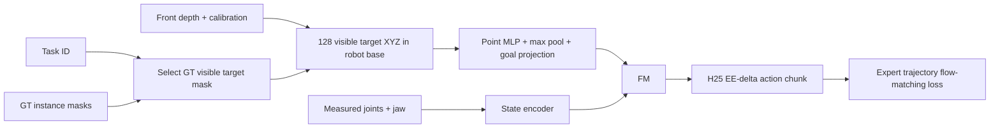

# E131 — full-data BC from GT-visible target point cloud

Status: COMPLETE.

Question: can the reach point-cloud policy learn picking when target localization
is supplied by GT instance segmentation, with no RGB perception bottleneck?
Train on the full original E117 pick split (2048 demos,32layouts), stride1:
294640 expert chunks. Keep256validation demos and1408test demos disjoint.
Reuse existing E122 GT-cloud/action cache after exact extraction/alignment
checks; no RGB features or full depth maps need caching.

Initialize the entire existing PointCloudReach model from E118best120000:
point MLP3/64/128/256, symmetric max pool, Linear256/960, FM and state encoder.
Train all105102634parameters, no frozen modules. Preserve all E118global
XYZ/state/action normalizers; do not subtract each cloud's centroid.
Inputs are target XYZ cloud and six measured joint values only. Task ID
selects the GT target mask externally; no RGB, learned task embedding,
object center, orientation or complete/amodal geometry enters the policy.
The cloud is the partial front-visible object surface at the current frame.

Budget:23520updates,B128 (~10.217full-data epochs), matching E122update budget.
BC only: masked flow-matching velocity MSE; no mask/XYZ/cloud auxiliary loss.
Fresh fusedAdamW beta(.9,.95),wd1e-4,clip1; FM LR2e-5, point/goal LR1e-4,
100update warmup, BF16. H25 actions use anchor EE deltaXYZ, relative rotation6D
and absolute jaw, with the same expert labels and terminal masks as E122.
The same512fixed E122validation chunks and fixed seed102000 noise/time score
validation FM loss. Keep only best weights, resumable latest and final hardlink.

Cache: full GT target clouds and aligned actions/states/masks on GPU, under1GiB.
Every train/validation cloud is valid; minimum94filtered target pixels.
GT preprocessing: erosion1px,2mmdepth,60mmmedian-depth band,10mm3x3local spike
rejection,128random points(replacement only if fewer). Exact cache parity is
checked on4train+4validation episodes before training. Disposable B128training
and four20frame online compatibility checks are recorded, then removed.

Completed final-checkpoint evaluation: full1408heldout,H25/K15/Euler10,
seed0,300frame budget,25Hzpolicy/50Hzservo/500Hzphysics; then the existing16
inside/outside XY controls. GT masks also select target clouds at evaluation:
this is an oracle-segmentation baseline, not autonomous target localization.
No simulator object pose is used to construct policy input. Fewer8valid target
pixels ends that episode explicitly as missing_target_cloud; no hidden-pose
fallback or last-cloud reuse. This behavior is recorded separately from grasp
failure. No new videos requested.

Run training: `MUJOCO_GL=egl .venv/bin/python -u -m OATFlow.top_pick.object_train`.
Resume: add `--resume`. Full test: `MUJOCO_GL=egl .venv/bin/python -u -m
OATFlow.top_pick.object_evaluate`; add `--xy` for16paired boundary controls.
Run each stage in tmux with tee. Output:/workspace/robotics_assets/experiments/e131_object.
Exact config.json, data_verification.json, preflight.json, launch_verification.json,
train/metrics.jsonl,train/validation.jsonl and checkpoint files document the run.

## Final results

Training completed23520updates/3010400samples/10.217214epochs in45.67minutes.
All normalization buffers remained unchanged; BC was the only loss. GPU cache
0.7143GiB and peak allocated memory4.061GiB. Final validation FM loss0.011272;
best validation0.007618 at17250. Rollouts below use final23520, not best17250.
Best17250 has not been rolled out.

| Held-out group | Successes / episodes | E131 success | E122 K15 success |
|---|---:|---:|---:|
| Unseen permutation / composition | 960/1024 | 93.750% | 79.199% |
| New layout / spatial | 245/256 | 95.703% | 85.938% |
| Both / combined | 120/128 | 93.750% | 88.281% |
| Total | 1325/1408 | 94.105% | 81.250% |

Compared with E122 on identical1408paths and matched H/K/flow/seed/frame/rate
settings: +181successes,+12.855percentage points. Paired outcomes:1128both
success,197E131-only success,16E122-only success,67both fail. E131 uses GT
target segmentation, a different visual-conditioning architecture/loss and
the pretrained E118point encoder. This is not a single-module causal ablation.
Failures:82timeouts,1wrong-object lift,0missing-target-cloud failures. Test
time17.08minutes. By target:Red333/352,Blue330/352,Green333/352,Yellow329/352.

Existing XY boundary pilot: inside8/8,outside7/8,total15/16;14.82seconds.
The one outside failure is GreenCube atx_low. Bounds refer to pick finetuning,
not reach pretraining. Eight outside cases provide a small diagnostic only.
Earlier E122XY numbers used CPU FP32; E131uses CUDA BF16, so that historical
XY comparison is not a precision/noise-controlled paired ablation.

All1424case records/traces and checkpoint hashes verified, including success
streaks and cloud-replan counts. Full manifest and main-test protocol match
E122. completion_verification.json, test_k15/comparison_e122.json and both
test verification.json files retain the checks. No new videos were made.

Interpretation: a partial target surface from one front camera is sufficient
for strong BC performance on this fixed-size cube task when GT segmentation
is available. Full geometry completion is not required by this successful
baseline. This does not demonstrate autonomous target localization or general
object-shape manipulation. The policy sees no distractor geometry/RGB, and
the remaining failures have not been causally attributed.

Audit of the single wrong_object failure:g028/p04/t3 targets Yellow. Blue
is disturbed by jaw/gripper-base contact and rises41.33mm, with no bilateral
Blue grasp. Input cloud selection is correct. Thus the recorded label means
non-target lift, not a demonstrated stable wrong-object grasp. No evaluation
result is changed. Replay: test_k15/wrong_1/wrong_object.mp4 (0.4x).
