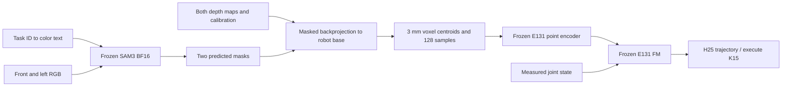

# E133 — SAM3 two-view target clouds with frozen E131

Status: COMPLETE. All 1,818 requested episodes and saved trajectories verified.

## Question and pipeline

Can original text-prompt SAM3 masks replace oracle target masks without retraining the manipulation policy? Task ID chooses one fixed prompt: `red cube`, `blue cube`, `green cube`, `yellow cube`, in dataset target order. Frozen official SAM3 BF16 processes synchronized front/left RGB. Each predicted mask selects optical-Z depth; calibrated backprojection yields robot-base XYZ. Fuse the two clouds with 3 mm voxel centroids, sample 128 points and feed the frozen E131 point encoder and FM with measured six-dimensional joint/jaw state. No RGB latent, raw target center, GT-mask instance selection, temporal cloud replacement or additional training.

## Weights and configuration

- Official `facebook/sam3`, revision `3c879f39826c281e95690f02c7821c4de09afae7`; original BF16 weights, no finetuning. Transformers 5.20.2 runs in isolated `.venv-sam3`; original project environment unchanged.
- E131 `train/final.pt`, step 23,520, SHA256 `2b0849b2df62eb659b962c58e03d34db07c1f33db69b3cbcae4b06fa97d0db79`. All point/goal/state/FM parameters frozen. FP32 source policy weights, BF16 CUDA inference autocast.
- E131 originally initialized from E118 point-cloud reach step120000; all parameters then trained with BC only on 2,048 E117 demos / 32 layouts / 294,640 stride1 chunks, B128, 23,520 updates (~10.217 epochs). Point LR1e-4, FM LR2e-5, AdamW(.9,.95), weight decay1e-4, warmup100, grad clip1. No optimizer, training batch or epochs applies to E133.
- SAM3 image batch2; highest-confidence instance >=0.5, mask probability threshold0.5. Cached text is encoded at its actual batch2 size. Comparison against standard uncached forward passes with max mask-logit difference0.0. An earlier batch1-expanded-text attempt failed the parity check before any policy case completed; no results from that attempt are counted.
- Keep original front camera. Left camera world position [0.00,-0.12,0.60]m, look-at [0.54,-0.12,0.035]m, same FOV as front. Both views320x240, pinhole calibration, ideal optical-Z depth quantized2mm/unit. Camera matrices: `calibration.npz`; original dataset scene unchanged.
- Per-view cleanup matches E131: erosion1px, median-depth band60mm, 3x3 median spike rejection10mm. A view with <8 filtered points contributes nothing, recorded explicitly. Fewer8 fused voxels causes episode failure. Uniform128 samples, replacement only if fewer128; absolute base XYZ retained, no cloud centering or ICP.
- H25/K15, Euler10, noise seed0, 300-frame limit, policy25Hz / servo50Hz / physics500Hz. FM predicts10D EE delta actions, executed through original IK/controller. Success: target lifted>4cm with both jaws for10 consecutive frames. Non-target lift>4cm triggers `wrong_object` even without a bilateral grasp.
- Fixed original manifests and initial states: full heldout1408, original XY16, expanded spatial suite394 (197 matched inside and197 outside cases). No filtering based on SAM3 outcomes. Policy rollout batch32; two-view SAM3 calls per active case at each replan. No evaluation videos or feature caches.

## Verified results

| Evaluation | Frozen E131 + GT front mask | Frozen E131 + SAM3 front/left fusion |
|---|---:|---:|
| Full held-out | 1325/1408 (94.11%) | 1314/1408 (93.32%) |
| Expanded spatial ID controls | 196/197 (99.49%) | 194/197 (98.48%) |
| Expanded spatial OOD | 188/197 (95.43%) | 183/197 (92.89%) |
| Original XY16 | 15/16 (93.75%) | 15/16 (93.75%) |

Full held-out breakdown: composition955/1024, spatial239/256, combined120/128. Failures:91timeouts and3non-target lifts. Expanded spatial suite:16timeouts and1non-target lift across394cases. Original XY:1timeout. No missing-cloud failures across all1,818episodes.

OOD by offset from pick-training XY rectangle:2–4cm66/69 (95.65%),4–6cm63/64 (98.44%),6–8cm54/64 (84.38%). The difficult x_low/y_high corner at6–8cm is6/16, versus8/16 with the original GT-front policy. This selected test suite excludes locations without an accepted physical expert or front-view target visibility; it does not cover the entire surrounding workspace.

Paired heldout outcomes:1301bothsuccess,13SAM3-fusion-onlysuccess,24GT-front-onlysuccess,70bothfail. Paired expanded-suite outcomes:375bothsuccess,2SAM3-fusion-onlysuccess,9GT-front-onlysuccess,8bothfail. Because both mask source and cloud view geometry change, the difference is not an isolated SAM3 segmentation ablation. These are simulation results for the same four cubes/cameras with ideal depth and one action-noise seed.

All1,818saved trajectories were audited for manifest order/uniqueness, finite actions/clouds, observation counts, contact/lift success conditions and unchanged checkpoint/SAM3 hashes: `completion_audit.json`. Four non-target-lift cases have at most one jaw contact on the wrong object; they are not confirmed bilateral wrong-object grasps.

## Diagnostics and timing

E132 original SAM3 pilot:16frontimages x4prompts,63/64correct identities, meanIoU93.017%. The only missed detection is a partially arm-occluded blue cube with29visibleGTpixels. These small pilot numbers are not a segmentation score over the full rollout set.

Original XY failure `x_low/t2/outside`: GreenCube atX0.27m (3cm beyond pick-training minimumX0.30m), same timeout with GT-front input. SAM3 mask meanIoU95.62%front /95.20%left over20replans; input points mean distance0.498mm to the true cube surface, worst replan P95=1.304mm. Target lift9.48mm, no sustained bilateral lift. Diagnostics: `test_xy/failure_diagnostic.json` and `.png`; two-view examples: `SAM3_two_view_samples.png`.

Isolated robot-batch1 latency, RTX3090,3warmups+20calls: SAM3 pair371.5ms, cloud/input9.8ms, point/state conditioning4.6ms, FM10/output167.5ms; total553.4ms, P95=555.7ms. Excludes sensor capture/render, model load, IK and transport. Timers synchronize CUDA; concurrent full rollout was briefly paused and resumed. This is inference latency alone. Sequential infer then K15execute (600ms at25Hz) takes about1.153s before the next inference; overlap requires a separate asynchronous execution design. Exact timings: `test_latency/summary.json`.

Fullheldout runtime6545s, expanded spatial1772s, originalXY87s (~2h20m combined). Runtime includes the brief profiling pause. Average SAM3 pair call during large tests~0.375s. Measured peak allocated GPU memory~3.046GiB including frozen policy in the rollout process.

Geometry preparation used disposable GT-mask probes only: original front RGB/depth parity, GTsurface P95=1.371mm, rigid backprojection roundtrip<1e-6m, synthetic fusion and missing-view checks, four20frame controller compatibility runs. These are not SAM3 rollout results. Temporary probe traces were removed after retaining `preparation_verification.json`.

## Files and rerun

Artifacts: `/workspace/robotics_assets/experiments/e133_fuse`. Each `test_*/` has README/config/results/summary; trajectories preserve actual sampled clouds, packed predicted masks, confidence/view metadata, actions, physical states and contacts. Root config/manifests record hashes. Source: `OATFlow/top_pick/sam3_fusion.py`, `sam3_rollout.py`, `two_view.py`, `OATFlow/task_mask/sam3_runtime.py`.

Completed results are preserved. To validate the existing completion and skip completed suites:
`MUJOCO_GL=egl .venv-sam3/bin/python -u -m OATFlow.top_pick.sam3_fusion run --resume`.
Use a new experiment/output path for a fresh repetition; do not overwrite these results. Long runs use tmux with stdout/stderr tee logs. Main run log: sibling `e133_fuse.log`.

Four selected saved-trace videos rendered and fully decoded: heldout RedCube success, GreenCube OOD6–8cm success, BlueCube OOD6–8cm timeout, YellowCube non-target-lift. Exact saved masks/clouds, two camera views, GT cube diagnostic wireframe,25FPS simulated playback excluding inference waits. Gallery: /workspace/robotics_assets/experiments/e133_fuse/videos; code OATFlow/top_pick/sam3_video.py; details e133_video_README.md. All source hashes and physical object poses verified unchanged.
