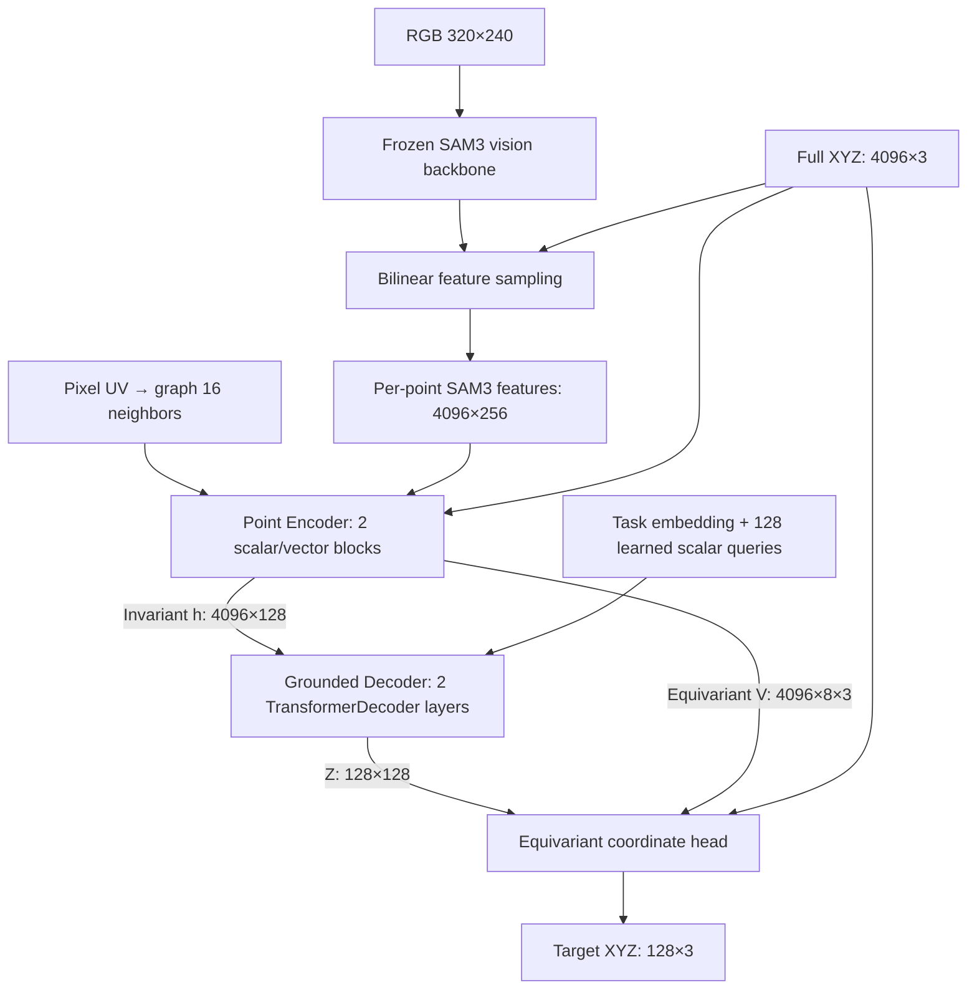

# E175 — Grounding point cloud theo task với SAM3 và kiến trúc SE(3)-equivariant

**Báo cáo kết quả cuối cùng — 28/10/2026.** Model nhận RGB, full-scene point cloud và task ID để tái tạo 128 điểm của vật được chỉ định. Kết quả chính dùng **best checkpoint ở bước 12.000**, chọn bằng validation; lượt train đã hoàn thành đủ 50.000 bước.

Model đạt IID EMD **4,42 mm**, centroid error **2,05 mm**, coverage **91,75%**; giữ equivariance khi đổi hệ tọa độ mà không cần SE(3) augmentation. Test hình dạng target chưa có trong train cho thấy generalization tốt nhất ở trụ, còn các vật nhỏ/cong chịu ảnh hưởng rõ của sampling 4K.

## 1. Data

**Môi trường.** Simulator gồm bốn vật đỏ, xanh dương, xanh lá, vàng; có robot, ghế, thảm, bàn và nền như scene gốc. Camera cố định `cam_front`, RGB/depth **320×240**. Point cloud back-project từ depth sang **robot base frame**, giữ toàn cảnh, không crop target.

**Dữ liệu E157.** Vị trí, orientation và kích thước vật được randomize, có lọc va chạm, xuyên bàn và vật quá ít pixel. Cube gốc được resize vật lý độc lập theo từng trục với hệ số `U(0,6; 1,4)` thành cuboid. RGB, depth và GT được render lại nhất quán. Đây là biến thiên geometry trong dataset, khác với việc scale XYZ nhân tạo trong training.

| Split | Scene | Query = scene × 4 task | Mục đích |
|---|---:|---:|---|
| Train | 1.024 | 4.096 | Học grounding và reconstruction |
| Validation | 128 | 512 | Chọn checkpoint |
| IID | 128 | 512 | Scene mới cùng phân phối |
| Positions | 128 | 512 | Vị trí ngoài miền train |
| Rotations | 128 | 512 | Orientation vật ngoài miền train |
| Sizes | 128 | 512 | Phân phối kích thước khác train |
| Combinations | 128 | 512 | Tổ hợp màu–vị trí bị giữ lại khi train |

Một query gồm:

```text
RGB                 [3, 240, 320]
Full-scene XYZ      [4096, 3]       robot base frame, đơn vị m
Task ID             int            0:red, 1:blue, 2:green, 3:yellow
GT target XYZ       [128, 3]        chỉ dùng supervision/evaluation
```

4.096 input points được lấy mẫu đều từ toàn cảnh **không dùng mask**. GT128 được lấy từ phần bề mặt target nhìn thấy qua camera; dùng replacement nếu không đủ pixel. Nhãn không chứa phần bề mặt bị che khuất.

GT masks, center, size, pose và object tokens **không được đưa vào model**. Camera calibration chỉ phục vụ back-projection và gắn feature với point; encoder/decoder không nhận GT pose hay camera extrinsics làm conditioning.

**Lưu ý split kích thước:** base side của train là 24–50 mm; split sizes dùng 14–22 hoặc 54–68 mm. Sau resize từng trục 0,6–1,4, miền chiều dài vật lý có chồng lấn. Vì vậy sizes là distribution shift có một phần extrapolation, không phải mọi query đều nằm ngoài toàn bộ miền extent của train.

## 2. Kiến trúc cuối cùng

**772.018 tham số trainable.** Point encoder, task embedding, Grounded Decoder và coordinate head đều được train từ đầu. Chỉ pretrained SAM3 frozen; nhánh vision sử dụng có khoảng **454 triệu tham số frozen**. Kiến trúc cuối là custom scalar/vector encoder, không dùng PTv3 hoặc FM.



**SAM3 features.** Dùng `get_vision_features(...).fpn_hidden_states[-2]`, kích thước `[256,72,72]`, trước prompt/mask heads. Processor resize RGB lên 1008×1008 theo cấu hình pretrained. Project từng point vào ảnh rồi bilinear-sample feature 256D. Không text prompt, không SAM3 segmentation mask. SAM3 chạy BF16; sampled features lưu/quantize FP16 rồi cast FP32 trong point encoder.

**Point Encoder.** Hai local scalar/vector message-passing blocks, width 128, tám vector channels. Graph nối 16 hàng xóm gần nhất trong **pixel UV**, không phải 3D kNN. Feature vô hướng dùng visual features, khoảng cách và vector norms; nhánh vector dùng relative XYZ, phép trộn channel và scalar gates. XYZ được trừ mean toàn scene và chia chung một scale 0,1 m, không normalize khác nhau theo từng trục.

**Grounded Decoder.** Hai `TransformerDecoder` layers, bốn attention heads, FFN width 384. Có self-attention giữa 128 queries và cross-attention tới scalar memory `h`. Task embedding điều kiện hóa việc đọc scene, tạo latent `Z ∈ R^(128×128)`. Hai block trong point encoder không phải hai lớp Transformer; hai lớp Transformer nằm ở Grounded Decoder.

**Coordinate head.** Từ `Z`, model tạo attention weights `a_ki` trên các input points và scalar coefficients `b_kc` cho vector channels:

\[
\hat p_k=\bar p+\sum_i a_{ki}(p_i-\bar p)
+s_0\sum_{c=1}^{8} b_{kc}\sum_i a_{ki}V_{ic},\qquad s_0=0.1\text{ m}.
\]

`a` là softmax attention; `b` là output của MLP với tanh. Head trực tiếp đọc XYZ và vector memory, thay vì dùng MLP sinh ba tọa độ theo các trục cố định. Vector offset có thể đưa điểm ra ngoài convex combination của input XYZ.

Với cùng observation và correspondence:

\[
h'=h,\quad V'=RV,\quad
f_\theta(RP+t,F,\mathrm{task},\mathcal G)
=R f_\theta(P,F,\mathrm{task},\mathcal G)+t.
\]

Đây là ràng buộc kiến trúc cho **đổi hệ tọa độ toàn scene**, trong khi RGB/SAM3 features và UV graph vẫn gắn với đúng point. Nó không đảm bảo model tái tạo đúng shape, hoặc tự generalize sang việc xoay riêng vật thật trước camera.

## 3. Training

Chỉ dùng **một loss EMD**: Hungarian matching một-một tối ưu theo khoảng cách Euclidean không bình phương, rồi lấy trung bình khoảng cách các cặp đã match:

\[
\mathcal L=\min_{\pi\in S_{128}}\frac1{128}
\sum_{k=1}^{128}\|\hat p_k-g_{\pi(k)}\|_2.
\]

Không pairwise loss, không FM loss, không GT center/Rg heads. Train trong mét, báo cáo trong mm.

- **50.000 updates**, batch 8 scene × 4 task = 32 query; scene sampling có replacement.
- AdamW, LR cosine **3×10⁻⁴ → 3×10⁻⁵**, warmup 100 bước, weight decay 0,01, gradient clip 1.
- Trainable model/optimizer/loss FP32, TF32 tắt; seed model/data 170.
- **Không rotation, translation hay scaling augmentation khi train E175.** Dataset vẫn chứa các vật có pose/size khác nhau được render thật.
- Validation mỗi 1.000 bước; chọn minimum canonical validation EMD. SE(3) diagnostic không dùng chọn checkpoint.
- Thời gian train khoảng **119,36 phút trên RTX 3090**; benchmark peak allocated VRAM khoảng 5,44 GiB, với SAM3 features đã cache.

| Checkpoint | Train EMD mm | Validation EMD mm | IID EMD mm |
|---|---:|---:|---:|
| **Best 12k** | 3,476 | **4,374** | **4,419** |
| Milestone 18k | 3,094 | 4,427 | 4,451 |
| Last 50k | 2,333 | 4,745 | 4,791 |

Train error tiếp tục giảm nhưng validation/test không cải thiện sau best12k: có dấu hiệu overfit. Không dùng last50k làm kết quả cuối. Đây là một training seed; chưa có thống kê nhiều seed.

## 4. Test và định nghĩa metric

**EMD:** exact Hungarian assignment trên raw XYZ. **Centroid error:** khoảng cách giữa hai mean point cloud. **Directional Chamfer:** tách `pred→GT` và `GT→pred`, dùng khoảng cách Euclidean không bình phương. **Aligned CD:** chỉ trừ centroid riêng của hai cloud, giữ scale và orientation; lấy trung bình hai chiều.

**Robust extent:** `Q95−Q05` trên từng trục; MAE tính cho từng query rồi mới trung bình. **Rg:** RMS distance tới centroid, đo kích thước tổng thể của cloud. Extent/Rg ở đây mô tả bề mặt nhìn thấy, không phải complete object dimensions.

**Coverage @5 mm:** chia visible GT surface thành voxel 4 mm, chọn một GT representative thực trên mỗi voxel, đo tỷ lệ representative cách prediction không quá 5 mm. Không chỉ đo coverage trên GT128.

**Target-selection accuracy:** predicted centroid gần centroid của đúng target nhất trong bốn GT objects. Đây là forced four-way selection, không có ngưỡng khoảng cách; 100% selection không đồng nghĩa reconstruction chính xác. Luôn đọc cùng EMD, centroid và coverage.

### 4.1. Generalization trên cuboid

Best12k, mỗi split 128 scene × 4 task = 512 query:

| Split | EMD mm ↓ | Centroid mm ↓ | Aligned CD mm ↓ | Coverage @5mm % ↑ | Selection % |
|---|---:|---:|---:|---:|---:|
| IID | **4,42** | **2,05** | 2,78 | **91,75** | 100 |
| Vị trí mới | 4,96 | 2,50 | 3,06 | 89,00 | 100 |
| Rotation vật mới | 6,32 | 2,74 | 4,08 | 69,81 | 100 |
| Kích thước khác train | 5,62 | 3,17 | 3,10 | 84,27 | 100 |
| Tổ hợp màu–vị trí mới | 4,60 | 2,20 | 2,85 | 91,14 | 100 |

Orientation vật mới là nhóm yếu nhất: chọn đúng target nhưng coverage/shape còn thiếu. Robust extent MAE XYZ của IID là **2,26 / 1,79 / 1,94 mm**; sizes **3,12 / 2,86 / 2,65 mm**; rotations **4,33 / 3,92 / 5,20 mm**. Rg R² tương ứng **0,954 / 0,954 / 0,808**.

### 4.2. Đổi hệ tọa độ SE(3)

Test bốn global SE(3) views của toàn bộ 128 IID scene: **2.048 query**, 262.144 output points. Cùng phép `P′=RP+t` áp dụng cho scene/GT; RGB/features/UV association giữ nguyên. Rotation là full SO(3), không chỉ yaw. Không cập nhật model trong test.

- EMD **4,4185 → 4,4185 mm**, centroid **2,0467 → 2,0467 mm**.
- Pointwise drift so với `R·prediction+t`: **RMS 0,00118 mm**, max **0,00578 mm**; không matching/alignment để che sai số.

Kết quả phù hợp với equivariance tới sai số FP32. Axis-aligned voxel coverage có thể đổi nhẹ khi quay; pointwise drift và Euclidean metrics là bằng chứng chính.

### 4.3. Feature–XYZ correspondence

Frozen best12k, toàn bộ 128 IID scene ×4 task. Giữ XYZ/task/UV graph của scene nhận B; tráo feature với scene A theo 64 cặp, chạy cả hai chiều.

| Feature đưa vào | EMD mm ↓ | Coverage @5mm % ↑ | Selection % |
|---|---:|---:|---:|
| B, correspondence đúng | **4,42** | **91,75** | **100,00** |
| A, ghép theo point-array index | 410,98 | 0,01 | 24,61 |
| A, ghép theo pixel UV gần nhất | 181,21 | 0,95 | 31,84 |
| B, hoán vị feature giữa point trong cùng scene | 396,58 | 0,09 | 24,41 |

Tráo theo index đồng thời phá UV correspondence do point sampling độc lập. Bản ghép theo pixel kiểm soát phần này: nearest-UV distance trung vị 2 pixel, nhưng vẫn fail mạnh. Mọi query trong hai test khác scene có EMD hơn 2× baseline.

Model cần **visual features gắn đúng với metric points**; chỉ giữ toàn bộ tập feature của scene là chưa đủ. Đây là conflicting-input OOD diagnostic, không phải một bài reconstruction có đáp án vật lý nhất quán. Chưa thể từ test này kết luận semantic/shape/pose đã được disentangle hoặc mọi spatial shortcut đã bị loại bỏ.

### 4.4. Hình dạng target chưa có trong train

Giữ frozen best12k, thay cả bốn cuboid bằng **sphere, ellipsoid, cylinder hoặc capsule** trong simulator, mỗi condition cùng một family. Dùng 128 scene IID gốc, giữ tâm/pose/màu/camera/clutter và đúng 4.096 pixel rays; render lại RGB/depth/GT và tính lại SAM3 features. Tổng cộng **512 scene render mới, 2.048 query mới**, đối chiếu 512 cuboid queries. Các render dùng chung 128 scene nền, không phải 512 scene pose độc lập.

Hình mới nằm trong local bounding box của cuboid cũ. Với half-dimensions `h`: sphere `r=min(h)`; ellipsoid radii `h`; cylinder `r=min(hx,hy)`, half-height `hz`; capsule `r=min(hx,hy,hz/2)`, half-segment `hz−r`. Vì vậy volume, Rg và số pixel khác nhau; không phải thí nghiệm equal-volume/equal-density.

**Kết quả toàn bộ query, không loại outlier:**

| Shape | EMD mm ↓ | Centroid mm ↓ | Coverage @5mm % ↑ | Robust extent MAE X/Y/Z mm ↓ |
|---|---:|---:|---:|---:|
| Cuboid đối chứng | 4,42 | 2,05 | 91,75 | 2,26 / 1,79 / 1,94 |
| Cầu | 5,95 | 4,09 | 80,97 | 3,58 / 4,38 / 3,60 |
| Ellipsoid | 5,25 | 3,13 | 81,73 | 3,34 / 3,43 / 4,07 |
| Trụ | **4,22** | **2,06** | **90,22** | 2,63 / 1,99 / 2,99 |
| Capsule | 8,43 | 6,41 | 79,82 | 4,04 / 8,03 / 5,73 |

Directional Chamfer và size diagnostics trên cùng các query:

| Shape | Pred→GT mm ↓ | GT→pred mm ↓ | Rg MAE mm ↓ | Rg R² ↑ |
|---|---:|---:|---:|---:|
| Cuboid | 2,67 | 2,56 | 0,77 | 0,954 |
| Cầu | 4,12 | 4,27 | 1,25 | −0,586 |
| Ellipsoid | 3,31 | 3,55 | 1,05 | 0,331 |
| Trụ | 2,48 | 2,52 | 0,92 | 0,919 |
| Capsule | 6,24 | 5,79 | 2,34 | −4,443 |

**Ảnh hưởng sampling 4K.** Median input points/target: cuboid 22,5; cầu 7; ellipsoid 11; trụ 14; capsule 5. Cầu/ellipsoid/capsule có **8/2/18 query không còn target point nào trong input**, dù target vẫn thấy trên ảnh. Trụ không có trường hợp này.

Trên nhóm còn ít nhất một target point, EMD của cầu/ellipsoid/trụ/capsule là **4,43 / 4,68 / 4,22 / 4,80 mm**; số query tương ứng **504/510/512/494**. Rg R² của cầu/ellipsoid/capsule tăng lên **0,722 / 0,641 / 0,714**. Điều này cho thấy outlier do thiếu point có ảnh hưởng lớn, nhưng không chứng minh toàn bộ lỗi đều do sampling. Các subset chọn ra vật/visible area khác nhau và không thay thế kết quả toàn bộ query.

Model generalize tốt nhất sang trụ và thích ứng được một phần sang các bề mặt cong khác. Prediction không chỉ duy trì một cuboid cố định, nhưng extent/coverage vẫn giảm, nhất là capsule. EMD nhỏ hơn ở trụ không đủ để tuyên bố tốt hơn cuboid vì kích thước/diện tích bề mặt cũng đổi. Chưa test shape lõm, rỗng, topology mới hay mixed-family scenes.

### 4.5. Đổi camera vật lý — bổ sung sau báo cáo ban đầu

Frozen best12k trên cùng 128 scene IID, giữ nguyên cuboid/robot/clutter. Camera orbit quanh một workspace pivot cố định: yaw ±15°, ±30° hoặc nâng elevation thêm 15°; giữ FOV/intrinsics. RGB, depth, SAM3 features, point sampling và graph UV đều được tính lại. XYZ luôn ở robot base frame ban đầu. GT là visible surface của chính góc mới, không phải GT từ camera cũ.

Camera gốc cũng được lấy mẫu lại bằng cùng pipeline để kiểm soát sampling. Mỗi view có 512 query; tổng 3.072 query, gồm 2.560 ở góc mới. Mọi target đều nhìn thấy và có input point, không có trường hợp thiếu hẳn target như test capsule.

| View | EMD mm ↓ | Centroid mm ↓ | Coverage @5mm % ↑ | Forced selection % |
|---|---:|---:|---:|---:|
| Camera gốc, lấy mẫu lại | 4,42 | 2,05 | 91,49 | 100,00 |
| Yaw −15° | 4,80 | 2,29 | 89,78 | 100,00 |
| Yaw +15° | 4,85 | 2,26 | 88,40 | 100,00 |
| Yaw −30° | 10,55 | 8,15 | 74,38 | 99,41 |
| Yaw +30° | 19,80 | 17,50 | 68,01 | 96,68 |
| Nâng elevation +15° | 5,08 | 2,22 | 84,19 | 100,00 |

Góc ±15° còn tương đối ổn, nhưng ±30° xuất hiện tail lỗi lớn: median EMD khoảng 5,5–5,7 mm trong khi P95 lên 38,54 / 95,03 mm. Trên matched subset có ít nhất 8 target points ở cả hai view, mean EMD vẫn 10,21 / 19,03 mm; không thể quy toàn bộ lỗi cho việc thiếu point.

Lỗi ±30° tập trung ở **task xanh dương**: EMD 26,29 / 63,55 mm; ba màu còn lại khoảng 4,95–5,45 mm. Test này chưa tách được nguyên nhân thuộc SAM3 appearance/context, graph UV hay phần model trainable. Chưa có ablation để quy lỗi cho riêng một thành phần.

**SE(3) coordinate equivariance không đảm bảo viewpoint robustness.** Camera mới tạo observation, visible surface, graph và background composition mới; các input không còn đơn thuần là cùng point set bị rigid-transform. Chi tiết extent/Rg, từng task, tails và raw calibration tại [camera report](e175_camera.md); [viewer sáu góc](http://localhost:17070/e175_camera.html).

## 5. Diễn giải kết quả và giới hạn

1. **Grounding theo màu/task ID hoạt động tốt** trong các split đã thử. Feature shuffle cho thấy đúng correspondence rất quan trọng; chưa có task ngôn ngữ tự do hoặc category grounding ngoài bốn màu.
2. **Đổi hệ tọa độ SE(3) được ràng buộc bởi kiến trúc**, phù hợp với kiểm tra số mà không cần augmentation. Đây không phải bảo đảm physical-pose/shape generalization.
3. **Model dùng được geometry ngoài cuboid family ở một mức độ**, mạnh nhất ở trụ. Chưa đủ để kết luận metric shape grounding hoàn chỉnh hoặc mọi shortcut đã bị loại bỏ.
4. **4K full-scene sampling là một giới hạn quan sát rõ**, đặc biệt khi target nhỏ. Bài toán hiện tại tái tạo phần surface nhìn thấy, không suy ra complete hidden object.
5. Robot/ghế/thảm có mặt trong input, nhưng layout/clutter chủ yếu cố định. Camera OOD đã test năm góc mới: ±15° còn ổn, ±30° có outlier nặng ở task xanh dương. **Chưa chứng minh robustness với camera tùy ý, background mới, robot pose mới, sensor noise hay real-world domain shift.**
6. Kết quả đến từ một training seed, simulator depth lý tưởng và các query chung scene có tương quan. Chưa báo cáo uncertainty/multi-seed significance.

## 6. Kiểm chứng và artifacts

Các kết quả được đọc từ saved raw predictions/GT và cấu hình thực tế; báo cáo này không chạy thêm training hay chọn lại checkpoint bằng test set.

- Full evaluation đã audit ba checkpoint: raw GT, checkpoint/SAM3/graph hashes, metric aggregates, 15.360 Hungarian EMD/centroid queries, 336 visible-surface coverage spot-checks và toàn bộ SE(3) pointwise drifts.
- Baseline feature-swap bit-exact với full IID evaluation. Test shape tái tạo chính xác RGB/depth/masks/XYZ của bốn scene cuboid đối chứng; fresh SAM3 features cũng bit-exact với cache cũ.
- Tất cả 512 render mới qua kiểm tra analytic surface ở độ phân giải một pixel; 2.560 query cuboid/new-shape qua kiểm tra độc lập EMD và robust extent. Prediction hữu hạn; SAM3 weights không đổi.

| Thành phần | Code / cấu hình / raw kết quả |
|---|---|
| Trainable model, train/evaluation | [E175 code](/workspace/robotics_assets/experiments/e175_equiv/code/e175/model.py), [train config](/workspace/robotics_assets/experiments/e175_equiv/train/config.json), [full summary](/workspace/robotics_assets/experiments/e175_equiv/evaluation/summary.json) |
| Data và SAM3 | [Data config](/workspace/robotics_assets/experiments/e157_sim_emd/data_config.json), [feature config](/workspace/robotics_assets/experiments/e157_sim_emd/features/config.json) |
| Feature swap | [Owned test code](/workspace/robotics_assets/experiments/e175_equiv/test_swap/code/run.py), [summary](/workspace/robotics_assets/experiments/e175_equiv/test_swap/results/summary.json) |
| New shapes | [Owned test code](/workspace/robotics_assets/experiments/e175_equiv/test_shapes/code/run.py), [summary + stratified metrics](/workspace/robotics_assets/experiments/e175_equiv/test_shapes/results/summary.json), [audit](/workspace/robotics_assets/experiments/e175_equiv/test_shapes/results/independent_check.json) |
| Physical camera OOD | [Owned test code](/workspace/robotics_assets/experiments/e175_equiv/test_camera/code/run.py), [summary + calibration](/workspace/robotics_assets/experiments/e175_equiv/test_camera/results/summary.json), [audit](/workspace/robotics_assets/experiments/e175_equiv/test_camera/results/independent_check.json) |

Source commits: E175 `552a2a353aaae14f3b2e8faa90fb6a20d5781a41`; feature swap `0212ee7419d261c3958a6f7795409d31a088c1d1`; new shapes `79720c7` (full commit trong config). Best checkpoint SHA256: `aebc05fc6e3afff34d28fd283b12a65e1ca97f82666c6fbcfe5d56affd206a52`.

Model weights: [best12k](/workspace/robotics_assets/experiments/e175_equiv/train/best.pt). Training entrypoint là `python code/run.py train` trong E175; diagnostics là `python code/run.py` trong từng test root, dùng Python `/workspace/arm-manipulation/.venv-concerto/bin/python`. Những scripts này tạo output mới và từ chối thư mục đã tồn tại; không chạy lại lên kết quả hoàn thành. Cấu hình lưu absolute artifact paths, cần đổi root ở một run mới nếu tái lập.

Xem trực quan: [bốn target trên cùng scene 3D](http://localhost:17070/e175_scene3d/), [prediction vs GT](http://localhost:17070/e175.html), [feature swap](http://localhost:17070/e175_swap.html), [hình dạng mới](http://localhost:17070/e175_shapes.html). Viewer dùng server đã forward ở port 17070; hình tĩnh shape tại [shapes.png](/workspace/robotics_assets/experiments/e175_equiv/test_shapes/results/shapes.png). Mọi visualization giữ raw XYZ, không căn GT centroid/scale/rotation.

Chi tiết bổ sung: [full test và extent](e175_full.md), [feature correspondence](e175_swap.md), [new-shape protocol và density analysis](e175_shapes.md).
