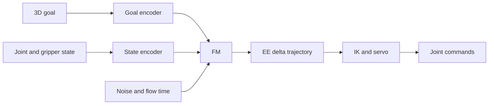
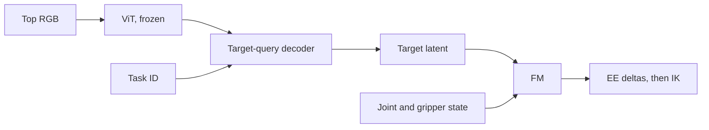
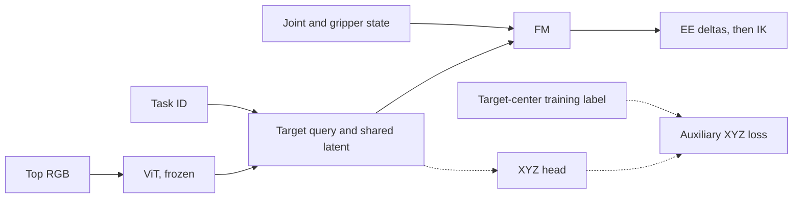
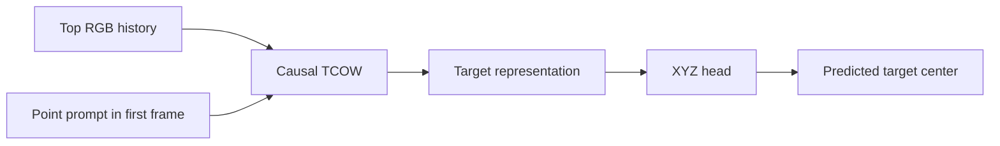
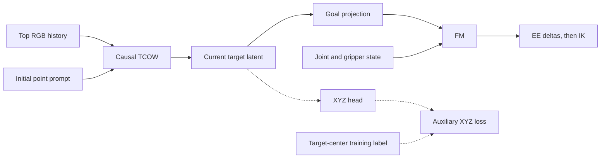

# Editable architecture sketches

These Mermaid diagrams supplement the rendered vector figures. Model blocks are named **FM**; its weight initialization is explained below each relevant diagram.

## Coordinate-conditioned reaching

FM is trained from random weights on validated reaching demonstrations.

## Visual behavior cloning

The FM uses weights trained on reaching; the visual conditioning modules are new. The ViT remains frozen while the conditioning modules and FM are fine-tuned.

## Visual behavior cloning with auxiliary XYZ

XYZ is a training-only loss branch. It does not supply numerical coordinates to FM. The random-weight ablation uses this same topology but initializes FM randomly; action/state normalization is kept fixed.

## Point-prompted TCOW adaptation

TCOW starts from its original official RGB/query-channel weights. The original segmentation outputs are replaced by an object-center head. The deck includes a separately labeled qualitative video from the earlier e100 pilot at step 1,250.

## Joint TCOW and FM

FM uses weights trained on reaching, motivated by the 10-epoch visual BC initialization ablation. During expert segments, TCOW and FM are fine-tuned together. Before expert actions exist, only the tracker/XYZ branch is updated. Final manipulation results remain blank.
