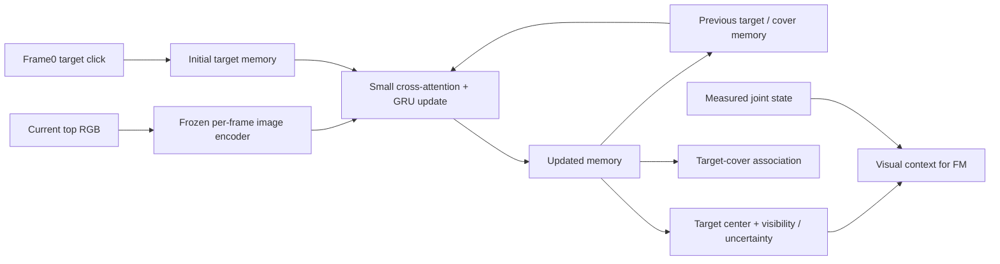

# Recurrent object permanence for point-prompted shuffle tracking

Checked original papers, project pages and public code on2026-10-18. This question concerns persistent hidden-object identity and localization, beyond inference FPS. No new model was installed or trained. Related: [real-time tracker survey](realtime_tracking_survey.md), [TCOW/point-tracker architectural survey](tracking_architecture_survey.md).

## Directly relevant architectures

**OPNet — Learning Object Permanence from Video, ECCV2020.** Detection supplies per-frame object boxes/visibility with stable identities. Two recurrent modules determine which visible object to attend to (including a carrier/container), then infer the target location. This directly addresses visible, occluded, contained and carried targets. The reasoning state can be carried forward instead of recomputing a30frame video transformer. The perception/identity stage remains a dependency; the released CATER setup is not a generic point-prompted raw-RGB tracker. This is the closest conceptual match to explicitly following the correct cover in our shuffle task, not a measured accuracy ranking on our data. [Paper](https://www.ecva.net/papers/eccv_2020/papers_ECCV/papers/123610035.pdf), [official code](https://github.com/ofrikleinfeld/ObjectPermanence).

**PermaTrack — Learning to Track with Object Permanence, ICCV2021.** A frame encoder feeds a2DConvGRU spatial memory. Current detections/locations/visibility come from recurrent state, including learned predictions of fully occluded objects. **RAM, ICML2022** extends this family with a temporal-coherence/random-walk self-supervised objective. These are object/detection systems rather than arbitrary-point trackers; existing street-scene/synthetic weights do not establish transfer to robot cups. The architecture supports per-frame processing, but neither paper supplies an on-box latency/training estimate for our integration. [PermaTrack paper](https://openaccess.thecvf.com/content/ICCV2021/papers/Tokmakov_Learning_To_Track_With_Object_Permanence_ICCV_2021_paper.pdf), [code](https://github.com/TRI-ML/permatrack), [RAM paper](https://proceedings.mlr.press/v162/tokmakov22a.html), [RAM code](https://github.com/TRI-ML/RAM).

**Loci-Looped / object-centric slots.** Loci-Looped maintains object-specific appearance/location representations and fuses predictions with visual evidence; an internal recurrent loop continues hidden-object dynamics. It studies occlusions and sensory interruption, rather than guaranteeing cup-containment reasoning on our scenes. [Project](https://cognitivemodeling.github.io/Loci-Looped/), [paper](https://arxiv.org/abs/2310.10372).

**iSEE — Object Permanence through Self-Supervision, October2026 preprint.** Split an object's appearance and position states. Under low visual evidence the appearance is held while a position walker follows motion in surrounding visual content; reappearance provides learning signal. Public code/configs/checkpoints include LA-CATER hidden/contained/carried evaluation. It is highly relevant conceptually. The current release reads a clip and runs its feature encoder/slot sequence/walker, rather than providing a ready-made single-frame robot interface. Streaming requires exposing all state and verifying timing/causality; the walker code includes next-step feature use when preparing the next slot state. Do not describe it as a verified zero-latency replacement. [Paper](https://arxiv.org/abs/2610.01201), [project](https://insait-institute.github.io/iSEE/), [code](https://github.com/insait-institute/iSEE), [inference entry point](https://github.com/insait-institute/iSEE/blob/main/scripts/infer.py), [walker](https://github.com/insait-institute/iSEE/blob/main/isee/model/walker.py).

iSEE's released default static-camera configuration uses11slots,518square images and a three-walker ensemble. The README reports H200training and batches that exceed48GiB, so its full recipe is not automatically a lightweight choice for our3090. A smaller adaptation must be measured; frozen-backbone feature caching is valid for its explicitly frozen independent DINOv2NoPE encoder. [Official setup/training details](https://raw.githubusercontent.com/insait-institute/iSEE/main/README.md), [static config](https://raw.githubusercontent.com/insait-institute/iSEE/main/configs/lacater_static.yaml).

**Cutie / SAM2 memory segmentation.** These maintain object memories and segment prompted targets frame by frame. They are practical perception components for tracking covers/visible instances; a visible segmentation becoming empty during full occlusion is not an amodal hidden-target position. Additional relation/state reasoning is required for a moving cover carrying the target. [Cutie](https://github.com/hkchengrex/Cutie), [SAM2](https://github.com/facebookresearch/sam2).

## Recommended adaptation for this project

An OPNet-inspired target/cover memory is a useful next architecture to test, with modern image features and a point prompt. This is a proposed design, not an existing downloaded checkpoint or an established performance improvement:

Retain a target identity/appearance state and a few cover/object states rather than a400point support grid. One output target does not imply that visible carrier/occluder information should be discarded. A1target+2cover slot proposal fits the current scene, but the optimal slot count and need for other object slots are experimental choices. A compact recurrent update reads current image tokens and prior state. When hidden, preserve identity while allowing the position distribution to move with the learned target-cover association; once exposed, correct it using visual evidence. A memory that simply freezes all coordinates on disappearance will fail moving-cover shuffle.

Use geometry/visibility and correct-cover association supervision on context frames; train on sequences spanning reveal, occlusion, shuffle and exposure. Existing simulator labels or original TCOW outputs can provide supervisory signals. Distilling TCOW is a proposal and needs a student/teacher comparison; pretrained TCOW's temporal transformer cannot be made recurrent merely by storing its last hidden vector. Keep joints downstream of the spatial target readout to address the e111 state-shortcut confound. This does not imply joints are forbidden in every perception model, only a controlled architectural ablation here.

At inference each new RGB frame is encoded once and recurrent state is updated. Training may still unroll multiple frames for gradients or use truncated BPTT; the gain is incremental image processing and compact temporal computation, not free learning of long histories. No FPS, VRAM or training-time gain is claimed without a benchmark.

Test native tracking first, before FM: cover binding before opening, target localization during hidden motion, post-exposure correction, and confidence under ambiguity. Then compare the proposed recurrent student against original TCOW and Track-On using identical cases/prompts/input cadence. Evaluate visible and hidden phases separately; point/segmentation output and hidden-body-center labels are different targets.
