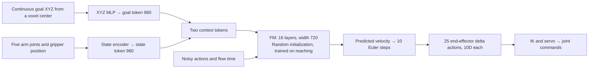
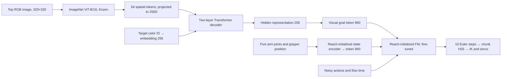
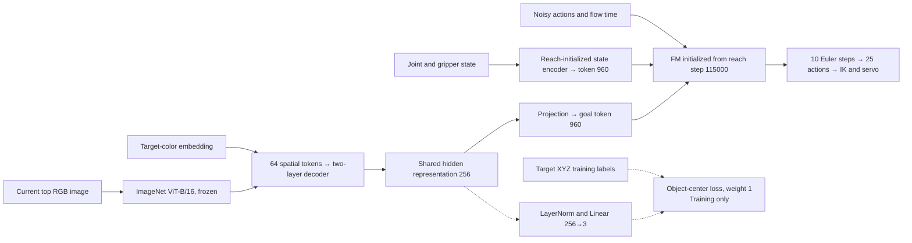
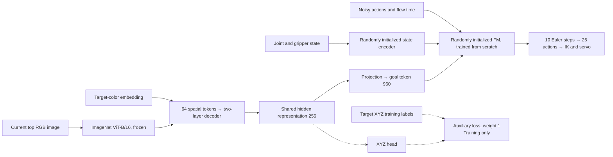
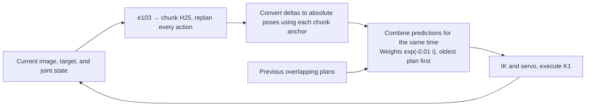
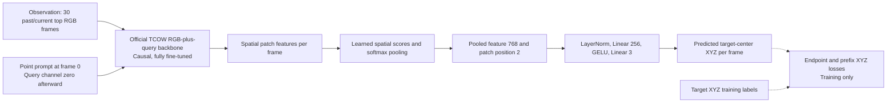
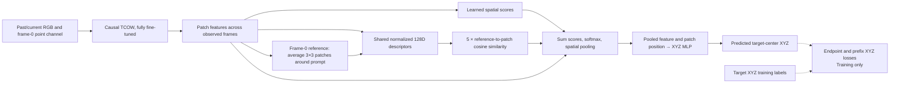
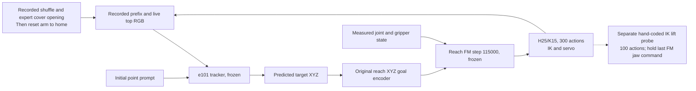
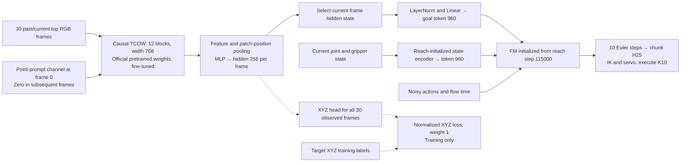

# From Voxelized Workspace Coverage to Goal-Conditioned Robotic Manipulation

Updated October 17, 2026. All experiments use MuJoCo simulation with the same robot and table configuration. Results for e105 are intentionally left blank pending training and evaluation.

The project starts with a question: **which regions of the workspace can the robot reach, and can it learn to generate the required motions from data?** The learned reaching policy is then extended to select and grasp objects from images, followed by tracking an initially specified object through an occlusion-and-shuffle sequence and manipulating the corresponding cover before grasping it.

`Voxelize the workspace → validate goals and trajectories → collect reaching demonstrations → pretrain an action flow model → add image conditioning for grasping → add video conditioning for cover removal and grasping.`

**Problem formulation: voxelized workspace coverage.** Partition the candidate workspace into cubic voxels with side length `Δ = 0.02 m`. Each voxel center defines a candidate end-effector goal. In the robot-base frame:

\[
g_{ijk}=(i\Delta,\;j\Delta,\;(k+\tfrac12)\Delta).
\]

The grid contains **49 × 49 × 30 = 72,030 candidate centers**. X/Y centers range from −0.48 to 0.48 m; Z centers range from 0.01 to 0.59 m. This is a candidate goal set whose physical feasibility must be established.

For each goal `g`, solve for a joint configuration whose end-effector position `p_EE(q)` approaches `g`, subject to joint limits and collision constraints. IK constrains position while leaving orientation free. A valid endpoint alone does not establish that the robot can move there from home, so each candidate also undergoes:

1. IK validation, including endpoint collision checks over gripper opening/closing configurations.
2. Path planning from home: direct joint-space interpolation, followed by RRT-Connect when needed.
3. A dynamics rollout that reaches the goal, closes the gripper over 0.6 s, and holds for 0.5 s.
4. Acceptance checks: arrival/final position error ≤1 mm, drift during closing/holding ≤2 mm, and valid collision checks.

The outcome is **72,030 tested centers → 34,452 valid IK targets → 32,017 trajectories validated in dynamics**. These results validate the tested centers and trajectories; an unsuccessful search is not proof of unreachability. Voxels define coverage, data collection, and dataset splits. The policy receives continuous goal coordinates rather than predicting a voxel class.

**From voxels to motion demonstrations.** For each accepted goal, record measured joint states, measured end-effector poses, and gripper commands along the trajectory. Raw commands are recorded at 50 Hz with physics at 500 Hz, then exported as approximately **2.065 million action chunks with H=25 at 25 Hz**. Goals are split into 25,613 training, 3,202 validation, and 3,202 test trajectories; approximately 1.652 million chunks belong to training. Chunks from the same goal remain within one split.

The reaching policy is `π_reach(A_t | q_t, g)`: generate an action chunk `A_t` from the current state `q_t` and target position `g`. State contains five arm joint positions and gripper opening. Each action has 10 dimensions: end-effector translation XYZ, relative orientation in a 6D rotation representation, and absolute gripper position. Translation and orientation changes use the measured pose at the chunk start as a fixed anchor. Reaching scenes contain only the robot and table; the gripper closes in free space, without object lifting.

**Flow Matching pretraining.** The action flow model has 16 layers with hidden width 720. Goal XYZ and measured joint/gripper state are encoded as two context tokens of width 960. Its action-expert architecture is adapted from SmolVLA, with randomly initialized weights, seed 0, trained on this robot's reaching demonstrations. In this report, *reach-pretrained FM* refers to the resulting model.

For normalized expert actions `a` and Gaussian noise `ε`, construct `a_τ = (1−τ)ε + τa`. Train the network to predict the velocity `a−ε` with a masked mean squared error (MSE), excluding terminal padding. At inference, integrate from Gaussian noise using 10 Euler steps to generate an action chunk. A downstream inverse kinematics (IK) controller converts predicted end-effector poses into joint commands.

Pretraining uses batch size 256, AdamW, BF16, and 100 warmup updates. The learning rate follows cosine decay from `2e-4` to `2e-5` during the first 60,000 updates, then stays at `2e-5` until update 120,000. **The selected checkpoint is step 115,000**, selected using validation reaching performance. It supplies the FM initialization for subsequent manipulation experiments.

**Reach FM evaluation.** The selected step-115,000 checkpoint was evaluated on the same 128 held-out goals with action-noise seeds 0 and 1. These are two inference-noise runs of one trained model. Closed-loop settings are H25/K15, 10 Euler steps, and a 300-action/12 s budget at 25 Hz, with a 50 Hz midpoint servo and 500 Hz physics.

| Metric | Noise seed 0 | Noise seed 1 |
|---|---:|---:|
| Reported reach success, 1 mm tolerance | 5/128 — 3.9% | 2/128 — 1.6% |
| Reported reach success, 5 mm tolerance | 69/128 — 53.9% | 81/128 — 63.3% |
| Reported reach success, 10 mm tolerance | 107/128 — 83.6% | 113/128 — 88.3% |
| Mean final end-effector position error | 8.00 mm | 5.77 mm |
| Median final end-effector position error | 4.62 mm | 4.20 mm |
| Rollouts with collisions | 7/128 — 5.5% | 4/128 — 3.1% |

Offline prediction on 8,192 held-out expert-state chunks has mean end-effector delta errors of 1.35 mm and 1.38 mm for seeds 0 and 1. This is a different evaluation from autonomous closed-loop reaching. As a controller reference, replaying recorded expert end-effector poses through IK succeeds at 1 mm on all 128 goals, with a median final error of 0.0144 mm and no collisions.

Reach pretraining therefore provides an imperfect motion prior: accurate predictions near demonstration states do not imply equally accurate autonomous rollouts. These results concern reaching and gripper closure in free space, rather than object grasping or learned lifting. Sources: [reach evaluation summary](/workspace/robotics_assets/models/reach_joint_delta_ee/summary.json), [detailed experiment](e88_joint_resume120k.md), and [four held-out rollout videos](/workspace/robotics_assets/models/reach_joint_delta_ee/test_video/comparison.mp4).

**Image-conditioned object picking.** The next policy is `π_pick(A_t | I_t, c, q_t)`, conditioned on the current top-view RGB image `I_t`, target color ID `c`, and joint/gripper state `q_t`. Four cubes—red, blue, green, and yellow—are visible on the table, and the arm starts at home. Each episode grasps one target. An *unseen permutation* changes the assignment of colors to spatial slots; it does not refer to a sequence of multiple grasps. Spawn positions are sampled continuously on the table rather than quantized to the reaching grid.

Transfer the entire reach FM, including its state encoder, context/action/time/output projections, and normalization buffers. Replace the goal-XYZ MLP with a **960D visual goal token**. Keeping the action representation and context-token interface allows the learned motion-generation weights to transfer.

An **ImageNet-pretrained, frozen ViT-B/16** encodes the image. A new Transformer decoder with two layers and four attention heads uses a target-color embedding to query 64 spatial image tokens. Its 256D hidden representation is projected to the FM goal token. **e102 is the baseline without an XYZ head or auxiliary loss:**

The entire FM and visual conditioning stack are fine-tuned with a fresh optimizer; ViT remains frozen. Reach pretraining provides motion and gripper-control initialization. Color recognition, target-to-object binding, and physical grasping/lifting are learned during picking fine-tuning.

**Picking data and auxiliary supervision.** Collect 3,712 successful expert picking episodes, including 2,048 training episodes exported into 285,600 training chunks. The dataset uses 40 spatial layouts: 32 training, four validation, and four test layouts. Of the 24 color-to-slot permutations, 16 are seen during training and eight are held out. To improve target localization, e103 adds a `LayerNorm + Linear(256→3)` head that predicts the current target object's center:

`L = L_FM + 1.0 × L_center`

`L_center` is MSE on XYZ normalized using training-set statistics. **XYZ is an auxiliary training label: neither ground-truth coordinates nor the XYZ head's predictions are directly fed into the FM.** The FM receives the shared visual/target embedding and state token. A weight of 1 specifies the loss multiplier; it does not imply equal numerical losses or gradient contributions.

**e103 architecture:** add auxiliary supervision to the shared hidden representation. The 3,000-update and 10-epoch runs use the same architecture.

Fine-tuning uses batch size 128, FM learning rate `2e-5`, new-module learning rate `1e-4`, 100 warmup updates followed by constant learning rates, AdamW, weight decay `1e-4`, gradient clipping at 1, BF16, and seed 102. Ten complete epochs correspond to 22,320 updates and 2,856,000 sample presentations. Validation uses 512 fixed chunks with fixed noise and flow times.

**e104 initialization ablation:** retain e103's architecture and losses, but randomly initialize the entire FM, including its state encoder and projections. ViT remains pretrained/frozen, and action/state normalization is still inherited from reach. This changes initialization rather than network topology:

**Execution and evaluation.** H=25 predicts one second of actions at 25 Hz. K=10 executes 0.4 s before observing the next image and replanning; the servo runs at 50 Hz. All picking evaluations use the same 128 cases and initial states: four groups, each containing two layouts × four permutations × four target colors. These cases are a subset of the collected dataset. Success requires lifting the correct target by more than 4 cm with bilateral jaw contact for 10 consecutive frames. A wrong-object lift or timeout at 300 actions/12 s is a failure.

| Configuration | Train /32 | Unseen permutation /32 | Unseen layout /32 | Both unseen /32 | Total /128 |
|---|---:|---:|---:|---:|---:|
| e102: reach FM, no auxiliary loss; 3,000 updates | 1 | 0 | 0 | 0 | 1 — 0.8% |
| e103: reach FM + object-center loss; 3,000 updates | 5 | 4 | 6 | 7 | 22 — 17.2% |
| Short e103: K1 + temporal ensemble, coefficient 0.01 | 5 | 3 | 0 | 0 | 8 — 6.25% |
| e103: reach FM + object-center loss; 10 epochs, K10 | 32 | 32 | 26 | 28 | **118 — 92.2%** |
| e104: random FM + object-center loss; 10 epochs, K10 | 21 | 21 | 21 | 17 | **80 — 62.5%** |

The two short runs train for approximately 1.34 epochs and evaluate their best validation checkpoints at step 2,500. The two 10-epoch runs both evaluate the **final checkpoint at step 22,320**, without selecting checkpoints by test success.

A conditioning probe keeps images, joint states, and action noise fixed while changing only the target color. e102's predicted actions barely change with the target. Auxiliary object-center supervision substantially improves target-to-location binding: on unseen permutations, a separately fitted linear readout of the goal embedding improves target-slot accuracy from 27.3% to 99.9%. This measures information in the embedding, not grasp success; this probe has not been repeated on the 10-epoch checkpoints.

Temporal ensembling combines overlapping predictions for the same execution time after converting chunk-relative predictions into absolute poses. K1 plus ensembling reduces success from 22 to eight cases. This test uses only the short checkpoint; the 10-epoch version is untested, and the effects of K1 and ensembling have not been separated.

K1 with temporal ensembling keeps e103's network unchanged and modifies execution:

The 10-epoch e103 run has 10 timeouts and no wrong-object lifts. Its 92.2% overall score includes 32 training cases; **held-out performance is 86/96 = 89.6%**. e104 changes only FM initialization to random while preserving the pretrained/frozen ViT. Initializations outside the FM, data, losses, normalization, training schedule, and RNG states were checked against e103. Random FM achieves 62.5%, with 48 timeouts and no wrong-object lifts. At the tested budget and learning rates, reach pretraining improves success by **29.7 percentage points**.

**Standalone point-prompted object tracking: e100 and e101.** Earlier pilots tested whether TCOW could track an object specified by an initial click. The task is to estimate the queried object's 3D center from a top-view observation history and a point prompt: `p_hat_t = f_tracker(I_0:t, P_0)`. Each input contains 30 sampled past/current RGB frames and a separate binary query channel with a radius-three-pixel dot in frame 0 and zeros thereafter. TCOW receives no object/color ID, initial 3D coordinates, joint state, segmentation masks, or camera parameters. XYZ coordinates are training/evaluation labels. The predicted center is amodal: it should remain correct while the object is hidden under a cover.

Both pilots initialize the causal RGB-plus-query backbone from the official TCOW checkpoint and replace its segmentation heads with learned spatial pooling and an XYZ regression head. All parameters are fine-tuned. **e100 uses the point prompt through TCOW's query channel:**

**e101 adds an initial appearance reference.** Average the frame-0 features in a 3×3 patch neighborhood around the point prompt. Project the reference and current patch features through a shared LayerNorm/128D descriptor, normalize them, and add `5 × cosine_similarity` to the learned spatial pooling scores. Only frame 0 defines the reference.

The matched pilots each train for 1,500 updates on **512 of the full 2,048 training query episodes**, using only **eight of 32 training layouts** and 128 shared contexts. Batch size is four/microbatch two, with 32 validation episodes. Both select step 1,250 using mean XYZ error at cover opening, before target grasping. The loss is `0.5 × endpoint XYZ MSE + 0.5 × prefix XYZ MSE`, using training-only normalization. Held-out groups contain 64 unseen-permutation, 32 unseen-layout, and 64 both-unseen episodes.

**Training budget is a pilot, not complete epochs.** The sampler draws a shared context and one prefix endpoint with replacement, using reveal/shuffle/hold/expert-segment probabilities of 0.15/0.35/0.20/0.30. At the evaluated step-1,250 checkpoint, only 5,000 clips have been presented. Replaying the sampler reproduces the saved NumPy RNG state for both models and yields 4,703 distinct query/endpoint clips out of 92,234 eligible clips in the subset: 5.1% endpoint coverage, or 0.054 sample presentations per eligible endpoint. The full 1,500-update run presents 6,000 clips, covering 5,566 distinct endpoints. These are endpoint statistics, not unique-image coverage: each clip also supervises 30 past/current frames. At the evaluated checkpoint, only 129 sampled endpoints fall in target-cube lift/hold phases; cover manipulation accounts for other expert-segment samples. The selected checkpoint therefore has limited spatial diversity and limited training exposure, particularly to target lifting. No full-data, longer-budget tracker comparison has isolated these factors from architecture limitations.

The following values are **mean 3D localization errors in millimeters at sampled evaluation points under this pilot budget**, rather than grasp-success rates:

| Tracker | Test group | Immediately after shuffle | At cover opening | Occluded evaluation points | During lift |
|---|---|---:|---:|---:|---:|
| e100: point query | Unseen permutation | 42.36 | 19.25 | 31.54 | 103.99 |
| e100: point query | Unseen layout | 46.40 | 29.34 | 35.75 | 102.29 |
| e100: point query | Both unseen | 47.69 | 28.75 | 36.52 | 100.68 |
| e101: point + appearance reference | Unseen permutation | 34.93 | 24.80 | 29.20 | 101.46 |
| e101: point + appearance reference | Unseen layout | 34.87 | 34.26 | 32.75 | 95.86 |
| e101: point + appearance reference | Both unseen | 31.53 | 33.84 | 32.33 | 96.03 |

A same-video/four-prompt diagnostic confirms that changing the initial click changes the predicted target. It does not establish reliable identity tracking across all scenes. The appearance reference improves post-shuffle and occluded localization in these tests, but worsens cover-opening error; both variants fail to track the lifted object's height accurately. On the both-unseen group at cover opening, only 7.81% of e100 predictions and 3.13% of e101 predictions lie within 10 mm. **These pilots demonstrate prompt-dependent predictions, but not reliable, grasp-ready 3D tracking at the tested budget. Their results do not establish that TCOW would remain ineffective with full-data training and a larger budget.**

**Explicit-coordinate tracker-to-FM cascade.** A separate inference-only test connects the trained e101 tracker to the original reach FM: predicted XYZ passes through the reach policy's goal encoder. Both models remain frozen. Recorded shuffle and expert cover opening form the prelude; the robot is then reset to home while preserving object states. Live RGB is appended to the history, the tracker updates the goal every 15 actions, and the FM executes H25/K15 for 300 actions. A separate, hand-coded IK lift probe then raises the end effector by 80 mm while retaining the last FM gripper command.

Only GreenCube passes the physical grasp-retention probe among three preselected red/blue/green cases, reaching a 79.67 mm lift; red and blue fail. This small demonstration is not a general success-rate estimate. Cover removal is replayed, and lifting is an explicit IK probe rather than a learned FM skill. This cascade feeds predicted coordinates into FM, whereas **e105 below feeds tracker hidden features into FM and learns the complete manipulation sequence**.

Sources: [e100 point tracker](e100_point.md), [e101 appearance-reference ablation](e101_local.md), [e100 tracking metrics](/workspace/robotics_assets/models/point_tracking/test.json), [e101 tracking metrics](/workspace/robotics_assets/models/point_tracking_local/test.json), and [tracker-to-reach cascade](e101_e2e.md). Videos: [e100 both-unseen tracking](/workspace/robotics_assets/models/point_tracking/test_videos/case_02.mp4), [e101 both-unseen tracking](/workspace/robotics_assets/models/point_tracking_local/test_videos/case_02.mp4), and [GreenCube cascade/probe](/workspace/robotics_assets/models/point_tracking_local/test_e2e/case_03.mp4).

**e105: cover removal and grasping from shuffle video.** This experiment uses the original `shuffle_pick_multiview` dataset with only the top camera. Objects are initially visible, then occluded by covers and shuffled. The robot must retain the target's identity, remove and deposit the appropriate cover, and grasp/lift the target. This task adds occlusion, temporal tracking, and cover manipulation to the visible-object picking setup; its success rates should be reported separately.

The target is specified by **a 2D point prompt with a three-pixel radius on the object in the first frame**, replacing the target-color ID. The policy receives top-view RGB history and the initial point prompt, plus joint/gripper state during action generation. Each clip contains 30 past/current frames, retaining both the first frame and the current endpoint. Images are center-cropped from 320×320 to 240×320. Future images, object masks, and object coordinates are excluded from policy observations.

Replace the frozen ViT and target-query decoder with **a causal TCOW backbone initialized from its original official checkpoint**, including the query-channel weights. TCOW has 12 blocks with width 768. Spatial feature pooling and patch-position pooling feed an MLP that produces a 256D hidden representation per frame. The current frame's hidden representation is projected to a 960D goal token and combined with the state token to condition the reach FM initialized from step 115,000. A new XYZ head supervises the tracker hidden states; its coordinate predictions are not fed into the FM.

Training follows two segments **within each shared context**. This is a segment-dependent update rule within one training run, rather than a separate dataset-wide TCOW pretraining stage:

| Data segment | Endpoint stride | Loss | Updated modules |
|---|---:|---|---|
| Before expert control: reveal, occlusion, shuffle, and hold | 10 | `L_XYZ`; all action labels masked | TCOW, pooling, and XYZ head; FM and goal projection skipped |
| Expert control: cover removal/deposit, then target grasp/lift | 3 | `L_FM + 1.0 × L_XYZ` | End-to-end TCOW, goal projection, state encoder, FM, and XYZ head |

Stride specifies the spacing between training endpoints, while actions remain at 25 Hz with H25. XYZ supervision covers all 30 observed frames. The FM is completely bypassed in pre-expert batches, so its weights and optimizer state are unchanged; AdamW weight decay is also skipped. Shared contexts are shuffled, and the four target queries are paired by time.

The main run targets **one complete epoch** over all 2,048 training episodes: 61,688 TCOW-only clips and 234,434 expert clips, totaling 296,122 clips and 74,230 updates. **Physical batch size is four**, with neither gradient accumulation nor gradient checkpointing. All modules are trainable during expert segments. Training uses AdamW, BF16, and 100 warmup updates; learning rates are `1e-5` for TCOW, `2e-5` for FM, and `1e-4` for new modules. Validation uses 64 fixed expert chunks from 32 episodes.

The planned test uses the final checkpoint and 128 cases evenly divided among training, unseen permutations, unseen layouts, and both unseen. Settings are H25/K10, 10 Euler steps, noise seed 0, and a 900-frame/36 s budget. Only the post-shuffle initial state is restored; all subsequent cover and grasp actions are generated by the policy. Success requires depositing the correct cover in the designated zone, lifting the correct target by more than 4 cm with bilateral jaw contact for 10 consecutive frames, and limiting the other cover's XY displacement to 15 mm. A wrong-object lift is a failure.

**e105 results: intentionally left blank pending training and evaluation.**

| Experiment | Train /32 | Unseen permutation /32 | Unseen layout /32 | Both unseen /32 | Total /128 |
|---|---:|---:|---:|---:|---:|
| e105: official TCOW + reach FM + auxiliary XYZ; cover removal and grasping | | | | | |

**Findings and scope.** Voxelized workspace coverage and physically validated trajectories provide the data for a reach FM, whose learned motion generator transfers to visual conditioning. Object-center supervision improves target binding in the short-run comparison; the auxiliary-supervised model reaches high grasp success after 10 epochs. The random-initialization ablation establishes a benefit from reach pretraining under the tested recipe. In e102–e104, inference uses an image, target-color ID, and joint state without explicit object-coordinate inputs.

These quantitative findings apply to e102–e104; e105 has no reported outcome yet. Evaluation covers one seed, one camera, four known objects, and a subset of layouts within the sampled spatial range. Real-robot transfer, novel objects, and new camera viewpoints remain untested. The point in e105 is an **input prompt**; XYZ remains the auxiliary training target. Replacing XYZ supervision with image-space `(u,v)` annotations, optionally with depth, is a proposed extension. Training an action FM on real data would still require image/state/action demonstrations.

Pretraining sources: [workspace and reaching data](e86_grid.md), [joint-conditioned reach model](e88_joint.md), [continuation to 120,000 updates and selection of step 115,000](e88_joint_resume120k.md), and [reach checkpoint configuration](/workspace/robotics_assets/models/reach_joint_delta_ee/config.json). Picking sources: [e102](e102_top.md), [target-conditioning probe](e102_probe_task.md), [auxiliary center supervision](e103_center.md), [K1 with temporal ensembling](e103_te.md), [10-epoch e103](e103_10ep.md), and [random-FM e104](e104_scratch.md). Metrics: [e103 evaluation](/workspace/robotics_assets/experiments/e103_center/test_k10_2/summary.json) and [e104 evaluation](/workspace/robotics_assets/experiments/e104_scratch/test_k10/summary.json).

e105 sources: [TCOW + FM experiment design](e105_tcow.md), [training configuration](/workspace/robotics_assets/experiments/e105_tcow/train_2/config.json), and [epoch sample/batch counts](/workspace/robotics_assets/experiments/e105_tcow/schedule.json). Per-step losses are stored in `train_2/metrics.jsonl`. The lower pane of `ssh_tmux:1` displays total/FM/XYZ loss and XYZ error every 10 updates or at phase changes, also recorded in `logs/loss_live.log`. Training losses are not rollout results.

Videos: [short versus 10-epoch training](/workspace/robotics_assets/experiments/e103_center/test_k10_2/comparison.mp4) and [pretrained versus random FM](/workspace/robotics_assets/experiments/e104_scratch/test_k10/comparison.mp4). The highest-scoring evaluated checkpoint is [e103 final, step 22,320](/workspace/robotics_assets/experiments/e103_center/train_2/final.pt).
