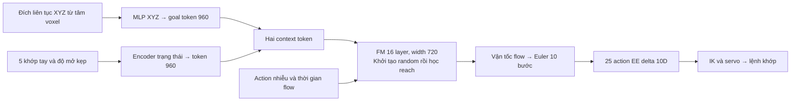
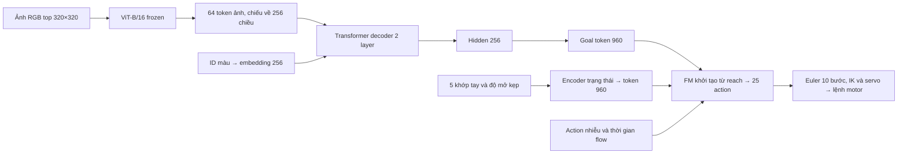
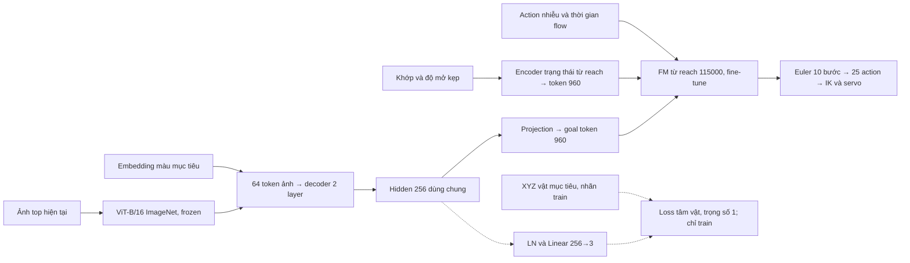
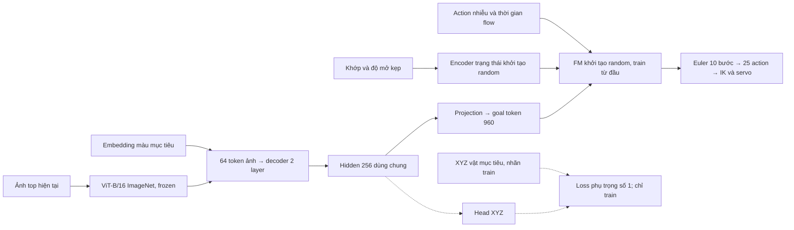
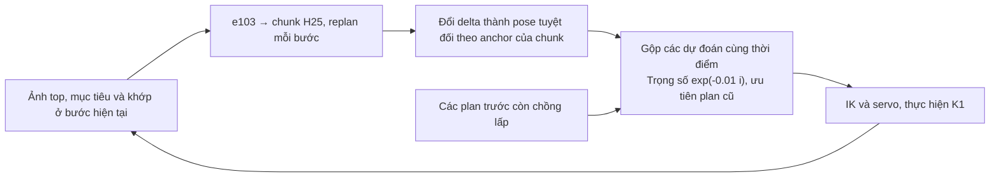
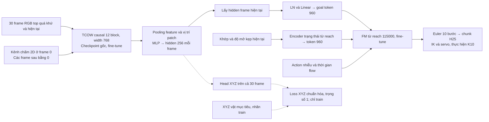

# Từ workspace voxel đến robot gắp vật theo mục tiêu từ ảnh

Archived Vietnamese version. The current report is maintained in English: [From Voxelized Workspace Coverage to Goal-Conditioned Robotic Manipulation](top_pick_report.md).

Báo cáo cập nhật ngày 17/10/2026. Các kết quả dưới đây được thực hiện trong mô phỏng MuJoCo, trên cùng cấu hình robot và bàn.

Dự án bắt đầu từ câu hỏi: **robot có thể đưa đầu kẹp tới những vùng nào trong workspace, và có thể học cách di chuyển tới các đích đó từ dữ liệu hay không?** Sau khi học kỹ năng reach, mở rộng sang nhìn ảnh để gắp đúng vật, rồi sang theo dõi vật qua chuỗi shuffle và tự mở cover trước khi gắp. Toàn bộ hướng tiếp cận là:

`Chia workspace thành voxel → kiểm chứng đích và quỹ đạo → tạo dữ liệu reach → pretrain FM → conditioning ảnh để gắp → conditioning video để mở cover và gắp.`

**Formulation: chia workspace thành voxel.** Voxel là một ô lập phương trong không gian ba chiều. Chia miền khảo sát quanh robot thành lưới có cạnh ô `Δ = 0,02 m`; lấy tâm mỗi ô làm một đích đầu kẹp cần thử. Trong hệ tọa độ robot, quy tắc lấy tâm là:

\[
g_{ijk}=(i\Delta,\;j\Delta,\;(k+\tfrac12)\Delta).
\]

Lưới đã khảo sát có **49 × 49 × 30 = 72.030 tâm**. Tâm X/Y chạy từ −0,48 đến 0,48 m; tâm Z từ 0,01 đến 0,59 m. Đây là miền đích ứng viên, sau đó phải xác định đích nào robot thực hiện được.

Với mỗi tâm `g`, tìm cấu hình khớp sao cho vị trí đầu kẹp `p_EE(q)` gần `g`, đồng thời thỏa giới hạn khớp và kiểm tra va chạm. Bài toán IK chỉ ràng buộc vị trí, để hướng đầu kẹp tự do. Tuy nhiên, nghiệm IK ở đích chưa bảo đảm robot đi được từ home tới đó. Vì vậy, mỗi đích còn phải qua các bước:

1. Tìm cấu hình IK hợp lệ, kiểm tra va chạm ở đích khi mở/đóng kẹp.
2. Lập đường từ home: thử đường trong không gian khớp, dùng RRT-Connect khi cần.
3. Chạy quỹ đạo trong mô phỏng động lực học, tới đích, đóng kẹp trong 0,6 giây và giữ 0,5 giây.
4. Chỉ giữ lượt có sai số tới đích/cuối lượt không quá 1 mm, độ trôi khi đóng/giữ không quá 2 mm và vượt qua kiểm tra va chạm.

Kết quả: **72.030 tâm được thử → 34.452 có nghiệm IK hợp lệ → 32.017 có quỹ đạo được xác nhận bằng mô phỏng vật lý**. Nhãn này xác nhận các tâm và đường đi đã thử; không tìm thấy nghiệm chưa phải chứng minh một vùng hoàn toàn không tới được. Voxel phục vụ bao phủ workspace, sinh đích và chia dữ liệu; model nhận tọa độ đích liên tục, không dự đoán ID voxel.

**Từ voxel sang dữ liệu học chuyển động.** Với mỗi đích được chấp nhận, lưu trạng thái khớp, pose đầu kẹp đo trong mô phỏng và lệnh kẹp dọc quỹ đạo. Dữ liệu gốc ghi ở 50 Hz, physics chạy 500 Hz; sau đó xuất khoảng **2,065 triệu mẫu đoạn hành động H=25 ở 25 Hz**. Các đích được chia riêng thành 25.613 train, 3.202 validation và 3.202 test; khoảng 1,652 triệu đoạn thuộc train. Các đoạn của cùng một đích không bị trộn giữa các tập.

Bài toán học reach được viết thành `π_reach(A_t | q_t, g)`: biết trạng thái hiện tại `q_t` và tọa độ đích `g`, sinh đoạn hành động `A_t`. Trạng thái gồm 5 khớp tay và độ mở kẹp. Mỗi action có 10 chiều: dịch chuyển đầu kẹp XYZ, thay đổi hướng biểu diễn bằng rotation 6D và độ mở kẹp tuyệt đối. Dịch chuyển và hướng tương đối đều lấy mốc tại pose đầu kẹp lúc bắt đầu đoạn. Cảnh reach chỉ có robot và bàn; đóng kẹp trong không khí, chưa có tương tác nâng vật.

**Pretrain Flow Matching.** FM là mạng sinh đoạn hành động, gồm 16 layer, chiều rộng 720. Tọa độ đích và trạng thái khớp được mã hóa thành hai context token 960 chiều. Model được khởi tạo random, seed 0, rồi học trên dữ liệu reach của chính robot.

Gọi `a` là đoạn action expert đã chuẩn hóa và `ε` là nhiễu Gaussian. Tạo `a_t = (1−t)ε + t·a`, rồi train mạng dự đoán vận tốc `a−ε` bằng MSE, có mask bỏ padding. Khi chạy, bắt đầu từ nhiễu và dùng 10 bước tích phân Euler để sinh đoạn action. Bộ giải động học ngược phía sau chuyển pose dự đoán thành lệnh khớp; FM học sinh quỹ đạo từ dữ liệu.

Pretrain dùng batch 256, AdamW, BF16, warmup 100 update; learning rate giảm cosine từ `2e-4` xuống `2e-5` trong 60.000 update đầu, sau đó giữ `2e-5` tới 120.000. **Checkpoint được chọn là step 115.000**, dựa trên độ chính xác tới đích ở validation. Đây là nguồn FM pretrained dùng cho giai đoạn gắp.

Sơ đồ model reach, trước khi thêm thị giác:

**Mở rộng sang gắp vật từ ảnh.** Bài toán tiếp theo là `π_pick(A_t | I_t, c, q_t)`: nhận ảnh RGB từ trên xuống `I_t`, ID màu mục tiêu `c` và trạng thái khớp/kẹp `q_t`, rồi gắp đúng vật. Bàn có bốn khối đỏ, xanh dương, xanh lá và vàng; tay bắt đầu ở home, cả bốn vật nhìn thấy rõ. Mỗi lượt chỉ gắp một vật. “Hoán vị mới” là đổi màu nào nằm ở vị trí nào, không phải đổi thứ tự nhiều lần gắp. Vị trí spawn của bài pick được lấy ngẫu nhiên trên bàn, không bị lượng tử hóa theo lưới reach.

Giữ toàn bộ FM reach, gồm encoder trạng thái khớp và các projection context/action/time/output, cùng chuẩn hóa. Bỏ MLP mã hóa mục tiêu XYZ, thay bằng **goal token thị giác 960 chiều**. Do biểu diễn action và giao diện token giữ nguyên, có thể tái sử dụng trọng số sinh chuyển động đã học.

Ảnh đi qua **ViT-B/16 pretrained trên ImageNet và frozen**. Một Transformer decoder mới, 2 layer và 4 attention head, dùng embedding màu mục tiêu để trích thông tin từ 64 token ảnh. Hidden 256 được chiếu thành goal token cho FM. **e102 là cấu hình cơ sở, chưa có head XYZ hoặc loss phụ:**

Toàn bộ FM tiếp tục được fine-tune cùng decoder thị giác bằng optimizer mới; chỉ ViT giữ frozen. Reach cung cấp khởi tạo cho chuyển động tới đích và mở/đóng kẹp. Nhận biết màu, liên kết mục tiêu với vật trong ảnh và tương tác gắp/nâng được học ở giai đoạn pick.

**Dữ liệu pick và loss phụ.** Tạo riêng 3.712 lượt expert gắp thành công, trong đó 2.048 lượt train, xuất thành 285.600 mẫu. Có 40 bố trí vị trí: 32 train, 4 validation, 4 test. Trong 24 hoán vị bốn màu, train dùng 16 và giữ lại 8. Để giúp decoder liên kết đúng target với vị trí vật, e103 thêm head `LayerNorm + Linear(256→3)` dự đoán tâm XYZ hiện tại của vật mục tiêu:

`L = L_FM + 1.0 × L_center`

`L_center` là MSE trên XYZ chuẩn hóa bằng thống kê tập train. **XYZ chỉ là nhãn loss phụ khi train; tọa độ thật và đầu ra head XYZ đều không được đưa trực tiếp vào FM lúc chạy.** FM vẫn nhận embedding từ ảnh/target và token trạng thái khớp.

**Kiến trúc e103:** bổ sung nhánh supervision vào hidden dùng chung. Bản 3.000 update và bản 10 epoch dùng cùng sơ đồ này.

Fine-tune dùng batch 128, learning rate FM `2e-5`, các phần mới `1e-4`, warmup 100 update rồi giữ nguyên, AdamW, weight decay `1e-4`, gradient clip 1, BF16, seed 102. Đủ 10 epoch tương ứng 22.320 update và 2.856.000 mẫu được sử dụng. Validation dùng 512 mẫu cùng noise/time cố định.

**Đối chứng e104:** giữ cấu trúc và loss của e103, nhưng khởi tạo random toàn bộ FM, bao gồm encoder trạng thái và các projection của nó. ViT vẫn pretrained/frozen; chuẩn hóa action/state vẫn lấy từ reach. Đây là thay đổi khởi tạo, không thêm loại layer mới:

**Cách chạy và đánh giá.** H=25 nghĩa là dự đoán một giây hành động ở 25 Hz. K=10 nghĩa là thực hiện 0,4 giây rồi lấy ảnh mới và dự đoán lại; servo chạy 50 Hz. Các lượt đánh giá dùng cùng 128 ca và trạng thái khởi tạo: bốn nhóm, mỗi nhóm 2 bố trí × 4 hoán vị × 4 màu mục tiêu. Đây là tập con của dữ liệu đã thu. Một ca thành công khi đúng vật được nâng trên 4 cm, tiếp xúc hai má kẹp trong 10 frame liên tiếp. Gắp nhầm vật hoặc hết 300 bước/12 giây đều thất bại.

| Cấu hình | Train /32 | Hoán vị mới /32 | Vị trí mới /32 | Cả hai mới /32 | Tổng /128 |
|---|---:|---:|---:|---:|---:|
| e102: FM reach, không loss phụ; train 3.000 update | 1 | 0 | 0 | 0 | 1 — 0,8% |
| e103: FM reach + loss tâm vật; train 3.000 update | 5 | 4 | 6 | 7 | 22 — 17,2% |
| e103 ngắn: K1 + temporal ensemble 0,01 | 5 | 3 | 0 | 0 | 8 — 6,25% |
| e103: FM reach + loss tâm vật; đủ 10 epoch, K10 | 32 | 32 | 26 | 28 | **118 — 92,2%** |
| e104: FM random + loss tâm vật; đủ 10 epoch, K10 | 21 | 21 | 21 | 17 | **80 — 62,5%** |

Hai run ngắn train khoảng 1,34 epoch, test checkpoint validation tốt nhất ở step 2.500. Hai run 10 epoch đều test **checkpoint cuối step 22.320**, không chọn theo thành công ở test.

Kiểm tra giữ nguyên ảnh, khớp và noise, chỉ đổi màu mục tiêu, cho thấy e102 gần như không đổi action theo target. Thêm loss tâm vật cải thiện rõ liên kết target–vị trí. Trên hoán vị mới, bộ đọc tuyến tính riêng từ goal embedding xác định đúng vị trí mục tiêu tăng từ 27,3% lên 99,9%. Đây là kiểm tra thông tin trong embedding, không phải tỷ lệ gắp; chưa chạy lại probe này trên các bản 10 epoch.

Temporal ensemble trung bình các dự đoán chồng lên cùng thời điểm sau khi đổi về pose tuyệt đối. Kết quả K1 + ensemble giảm từ 22 xuống 8 ca. Thử nghiệm chỉ dùng checkpoint ngắn, chưa đánh giá trên bản 10 epoch và chưa tách K1 khỏi tác động của ensemble.

Thử K1 + temporal ensemble giữ nguyên mạng e103, chỉ đổi luồng thực thi:

e103 đủ 10 epoch có 10 timeout, không gắp nhầm vật. Tổng 92,2% có cả 32 ca train; riêng **96 ca ngoài train đạt 86/96 = 89,6%**. e104 chỉ đổi khởi tạo FM sang random, vẫn dùng ViT pretrained/frozen. Các khởi tạo ngoài FM, dữ liệu, loss, chuẩn hóa, lịch train và RNG được kiểm tra khớp với e103. Random FM đạt 62,5%, có 48 timeout và không gắp nhầm vật; trong cùng budget và learning rate, FM reach pretrained tốt hơn **29,7 điểm phần trăm**.

**e105: học mở cover và gắp từ video shuffle.** Thí nghiệm tiếp theo dùng trực tiếp bộ `shuffle_pick_multiview`, chỉ camera top. Vật được nhìn thấy lúc đầu, sau đó bị cover che và đổi vị trí; robot phải nhớ đúng vật để mở và đặt cover tương ứng xuống, rồi gắp/nâng vật. Đây là bài khó hơn pick với cả bốn vật lộ rõ; tỷ lệ thành công của hai bài cần được đọc riêng.

Mục tiêu được chỉ bằng **một chấm 2D bán kính 3 pixel trên vật ở frame đầu**, thay cho ID màu. Policy nhận lịch sử RGB top và chấm ban đầu; tới đoạn điều khiển còn nhận trạng thái khớp/kẹp. Mỗi clip gồm 30 frame quá khứ/hiện tại, luôn giữ frame đầu và endpoint; ảnh 320×320 được crop về 240×320. Không dùng ảnh tương lai, mask vật hay tọa độ vật làm đầu vào policy.

Thay ViT frozen và query decoder bằng **TCOW causal khởi tạo từ checkpoint chính thức gốc**, gồm cả kênh query. TCOW có 12 block, width 768; pooling feature không gian và vị trí patch qua MLP tạo hidden 256 cho mỗi frame. Hidden ở frame hiện tại chiếu thành goal token 960, ghép với state token để condition FM reach step 115.000. Head XYZ mới đặt trên hidden tracker để nhận loss phụ; đầu ra tọa độ không đi vào FM.

Trong **mỗi shared context**, train tuần tự theo hai đoạn sau; đây là hai chế độ cập nhật trong cùng lượt train, không phải pretrain TCOW trên toàn bộ tập rồi mới chuyển sang FM:

| Đoạn dữ liệu | Stride endpoint | Loss | Module được cập nhật |
|---|---:|---|---|
| Trước expert: reveal, che vật, shuffle và chờ | 10 | `L_XYZ`; toàn bộ action bị mask | TCOW, pooling và head XYZ; FM và goal projection không cập nhật |
| Expert: mở/đặt cover rồi gắp/nâng vật | 3 | `L_FM + 1.0 × L_XYZ` | End-to-end TCOW, goal projection, encoder trạng thái, FM và head XYZ |

Stride ở đây là khoảng cách giữa các endpoint dùng để train, không đổi tần số action 25 Hz hay horizon H25. Loss XYZ giám sát cả 30 frame quan sát. FM được bỏ qua hoàn toàn ở batch trước expert, nên cả trọng số lẫn momentum/weight decay của FM không bị cập nhật bởi đoạn không có demo hành động. Các shared context được xáo trộn; bốn query mục tiêu được ghép theo thời điểm.

Lượt chính dự kiến **1 epoch**, dùng toàn bộ 2.048 episode train: 61.688 clip chỉ TCOW và 234.434 clip expert, tổng 296.122 clip / 74.230 update. **Batch thực 4**, không tích lũy gradient, không gradient checkpointing; mọi module đều trainable khi đến đoạn expert. AdamW, BF16, warmup 100 update; learning rate TCOW `1e-5`, FM `2e-5`, phần mới `1e-4`. Validation dùng 64 expert chunk cố định từ 32 episode.

Test dự kiến dùng checkpoint cuối epoch, 128 ca chia đều train/hoán vị mới/vị trí mới/cả hai mới, H25/K10, Euler 10 bước, noise seed 0 và tối đa 900 frame/36 giây. Chỉ khôi phục trạng thái ngay sau shuffle; mọi thao tác mở cover và gắp tiếp theo do policy sinh ra. Thành công đòi hỏi đặt đúng cover vào vùng quy định, nâng đúng vật trên 4 cm với tiếp xúc hai má kẹp trong 10 frame liên tiếp, và cover còn lại dịch chuyển XY không quá 15 mm. Gắp nhầm vật là thất bại.

**Kết quả e105 để trống, chờ hoàn tất train và test:**

| Thí nghiệm | Train /32 | Hoán vị mới /32 | Vị trí mới /32 | Cả hai mới /32 | Tổng /128 |
|---|---:|---:|---:|---:|---:|
| e105: TCOW gốc + FM reach + loss XYZ, mở cover rồi gắp | | | | | |

**Kết luận.** Cách xây dựng bắt đầu từ bao phủ workspace bằng voxel và kiểm chứng quỹ đạo, dùng dữ liệu đó học một FM reach, rồi chuyển kỹ năng sinh chuyển động sang conditioning thị giác. Loss tâm vật cải thiện khả năng liên kết mục tiêu với vị trí trong đối chứng ngắn; bản có loss phụ train đủ 10 epoch đạt tỷ lệ gắp cao. Đối chứng FM random xác nhận lợi ích của pretrain reach trong cấu hình đã thử. Ở e102–e104, policy chạy bằng ảnh, ID màu và trạng thái khớp, không cần tọa độ vật làm đầu vào trực tiếp.

Các kết luận định lượng trên áp dụng cho e102–e104; e105 chưa có kết quả để kết luận. Phạm vi kiểm chứng hiện là một seed, một camera, bốn vật đã biết và một tập con bố trí trong cùng miền lấy mẫu. Chưa có đánh giá trên robot thật, vật mới hoặc góc nhìn mới. Chấm 2D ở e105 là **prompt đầu vào**; XYZ vẫn là nhãn loss phụ. Ý tưởng thay supervision XYZ bằng điểm ảnh `(u,v)` và có thể thêm depth mới là đề xuất; train bằng dữ liệu thật vẫn cần demo ảnh/trạng thái/action cho FM.

Nguồn pretrain: [dữ liệu reach](e86_grid.md), [model reach đầu vào khớp](e88_joint.md), [train tiếp đến 120.000 update và chọn best 115.000](e88_joint_resume120k.md), [cấu hình checkpoint reach](/workspace/robotics_assets/models/reach_joint_delta_ee/config.json). Số liệu pick: [e102](e102_top.md), [kiểm tra target](e102_probe_task.md), [loss phụ](e103_center.md), [K1 + ensemble](e103_te.md), [e103 10 epoch](e103_10ep.md), [e104 random FM](e104_scratch.md). [Kết quả e103](/workspace/robotics_assets/experiments/e103_center/test_k10_2/summary.json), [kết quả e104](/workspace/robotics_assets/experiments/e104_scratch/test_k10/summary.json).

Nguồn e105: [thiết kế TCOW + FM](e105_tcow.md), [cấu hình lượt train](/workspace/robotics_assets/experiments/e105_tcow/train_2/config.json), [số mẫu và batch mỗi epoch](/workspace/robotics_assets/experiments/e105_tcow/schedule.json). Loss từng step lưu trong `train_2/metrics.jsonl`; pane dưới của `ssh_tmux:1` hiển thị tổng loss, FM, XYZ và sai số XYZ mỗi 10 step hoặc khi đổi chế độ train, đồng thời ghi `logs/loss_live.log`. Loss đang train chưa phải kết quả rollout.

Video: [bản ngắn so với đủ 10 epoch](/workspace/robotics_assets/experiments/e103_center/test_k10_2/comparison.mp4); [FM pretrained so với random](/workspace/robotics_assets/experiments/e104_scratch/test_k10/comparison.mp4). Checkpoint đang cho kết quả cao nhất trong các bản đã test: [e103 final step 22.320](/workspace/robotics_assets/experiments/e103_center/train_2/final.pt).
