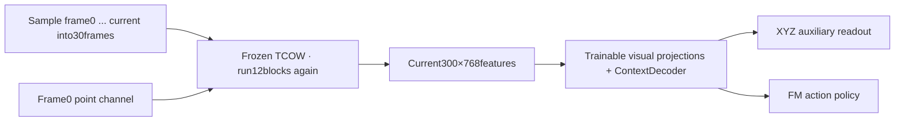
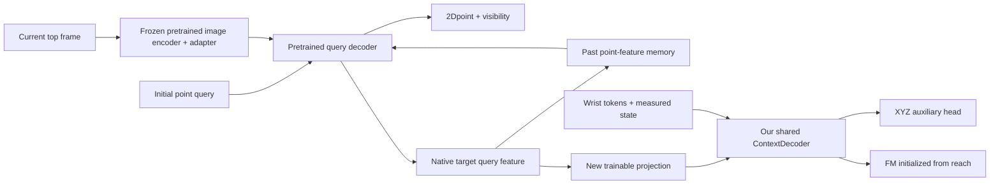
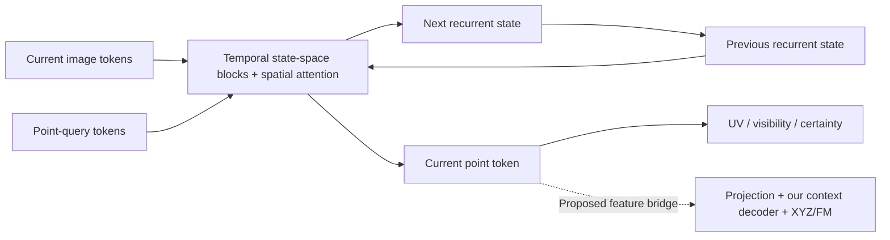

# Tracking architecture survey for point-conditioned shuffle manipulation

Follow-up: [Real-time tracking survey](realtime_tracking_survey.md) adds LiteTracker with RTX3090latency evidence, detailed TAPNext++ streaming/window timing, training-code availability and current e111 integration concerns. Installation/status statements below describe the earlier survey stage.

Surveyed on 2026-10-18 using original project pages, papers and official implementations. This is a literature/code survey, not a benchmark on our RTX3090 or shuffle dataset. No new model was installed and e109 training was not changed.

The strongest candidates to evaluate first are **Track-On2 (DINOv2 checkpoint)** and **TAPNext++**. Both support causal frame-by-frame processing. The main unresolved requirement is predicting the target's location/identity **while hidden inside or under a moving cover**, rather than only detecting it again after exposure.

## What costs time in our implementation

`OATFlow/tracking/point.py:PointXYZ.features()` embeds all30sampled RGB/query frames and runs all12space/time blocks for every endpoint. `OATFlow/shuffle_bc/data.py:clip()` rebuilds the prefix from frame0 to the current frame, sampling in raw time. The history sampling changes with the endpoint, so the current code has no persistent temporal state that can simply be reused between endpoints. The tracker is frozen, but freezing removes backward computation, not repeated forward computation. These are findings from our local source, not a benchmark of the original TCOW release.

Our cache retains300×768FP16current tokens for each labeled query/endpoint. With the5%example (104query episodes/65,584stride1points), that is28.15GiB for TCOW alone. The four goals sharing a context do not share these target-conditioned features. Current e109 instead recomputes/discards group features each epoch, explaining the repeated frozen-vision cost.

The original TCOW predicts target, occluder and container masks and specifically studies containment/object permanence, including cup games. Our current pipeline uses its RGB/query backbone with a new XYZ readout; it does not run those original three segmentation outputs. Poor XYZ/readout results therefore do not establish that the original complete TCOW model cannot solve these scenes. Its expected object-mask query also differs from our small point prompt. [TCOW project](https://tcow.cs.columbia.edu/), [official implementation](https://github.com/basilevh/tcow).

## Candidate comparison

| Candidate | Temporal computation and memory | Output / integration | Assessment for this task |
|---|---|---|---|
| Track-On2 / Track-On-R | Current-frame encoder, query decoder and finite point-feature memory; no future frames or temporal windows | Point coordinates/visibility; native query feature available before its output heads | Best first integration candidate; containment accuracy remains unproven |
| TAPNext++ | Recurrent video transformer with temporal state-space blocks and spatial attention; one-frame online update | Point position, visibility and coordinate logits; internal point tokens can be exposed | Strong second candidate, with unusually relevant documented cup-game failure |
| Online BootsTAPIR | Per-frame feature matching and causal temporal refinement | Coordinates, occlusion/uncertainty and causal context | Practical causal baseline with released PyTorch implementation |
| CoTracker3 online | Sliding windows, iterative joint point refinement and carried tracking state | Coordinates/visibility; uses support tracks when configured | Useful comparison, but window scheduling/latency must be handled explicitly |
| TAPTRv3 | DETR-style point queries, visibility-aware attention to past features and contextual cross-attention | Point query representation and trajectories | Relevant memory design; attention over past features is not constant-size recurrent state |
| SAM2.1 / SAM3.1 | Segmentation with temporal object memory; SAM3.1 shares memory across objects | Object masks and object features, not native amodal point trajectories | Useful for visible objects/covers, not the first replacement for hidden-object localization |

**Track-On2 / Track-On-R.** The official `track-on2` branch provides DINOv2 and DINOv3 variants, pretrained weights and a `forward_frame` API. The DINOv2 adapter explicitly freezes the underlying DINO weights; adapter/FPN/query-decoder components are separate. `track_frame` returns `(p, v_logit, q_new)`, with a256Dquery feature under `test_dinov2.yaml`, making a policy bridge straightforward. Latest Track-On-R uses the Track-On2 architecture with verifier-guided real-video adaptation; its DINOv3 backbone requires separate access. Start with the DINOv2 branch to avoid that dependency. MMCV deformable-attention operators still need a compatible build. [Official DINOv2 branch](https://github.com/gorkaydemir/track_on/tree/track-on2), [model source](https://github.com/gorkaydemir/track_on/blob/track-on2/model/trackon.py), [Track-On-R](https://kuis-ai.github.io/track_on_r/).

This diagram is a proposed policy integration, not a trained experiment. For a frozen tracker, its native query decoder is frozen too; only our separate context module/projections/readout train. The public prediction wrapper discards `q_new`, so a small explicit interface change is needed to expose it. Feeding a learned query feature into FM does not require feeding predicted coordinates as the policy's conditioning.

**TAPNext++.** The official PyTorch implementation combines recurrent temporal state-space processing with spatial ViT blocks, including image and point-query tokens. Its per-frame demo passes `tracking_state` between calls. Default width is768, and point tokens exist directly before position/visibility heads; exposing them requires a small interface addition. Its updated checkpoint was trained on1024frame sequences and occluded-point positions with reduced loss weight. Crucially, the project's cups-and-balls example explicitly fails to track the hidden ball, despite recovering it after the cup is lifted. Faster inference and re-detection therefore cannot be equated with solving our shuffle task. [Project and cup-game example](https://tap-next-plus-plus.github.io/), [official model](https://github.com/google-deepmind/tapnet/blob/main/tapnet/tapnext/tapnext_torch.py), [per-frame demo](https://github.com/google-deepmind/tapnet/blob/main/colabs/torch_tapnextpp_demo.ipynb).

**Online BootsTAPIR and CoTracker3.** The TAP repository provides causal BootsTAPIR in PyTorch and separates feature extraction from query tracking; use its causal context rather than its whole-video path. CoTracker3's official online predictor defaults to window length16 and step8. Its online interface consumes overlapping chunks; this is not the same API as a single-frame recurrent update. A robot benchmark must time when each output becomes available and must not use an offline trajectory or later-frame revision as a current observation. [Official TAP repository](https://github.com/google-deepmind/tapnet), [CoTracker3 code](https://github.com/facebookresearch/co-tracker), [online predictor](https://github.com/facebookresearch/co-tracker/blob/main/cotracker/predictor.py).

**TAPTRv3 and segmentation alternatives.** TAPTRv3 adds visibility-aware temporal attention, spatial context and global matching after detected cuts; its official v3 code is released on a dedicated branch. It is worth studying, but is not automatically cheaper than a bounded-memory model. SAM2/3 track segmentations; a visible-mask centroid is not a hidden object's center. SAM3.1 improves shared multi-object tracking, but its concept/segmentation capabilities alone do not supply containment reasoning. SAM-style models could track a cover or supply visible-object segmentation for a combined system. [TAPTR official repository](https://github.com/IDEA-Research/TAPTR), [SAM2](https://github.com/facebookresearch/sam2), [SAM3/3.1](https://github.com/facebookresearch/sam3).

## Speed, cache and the representation choice

Reported inference FPS is not a training-time estimate. Published tests differ in GPU, image resolution, query count, precision and frame/window scheduling. In particular TAPNext++'s headline562FPS uses window mode on H100; it is not a3090single-frame measurement. Track-On2's project reports over30FPS/0.52GB for256points at its chosen memory length, but that is not an on-box measurement here. No alternative tracker has been benchmarked on our instance. [TAPNext++ efficiency context](https://tap-next-plus-plus.github.io/), [Track-On2 efficiency context](https://kuis-ai.github.io/track_on2/).

Streaming reduces repeated computation over history. It does **not** by itself reduce an all-frame dense feature cache. TAPNext, for example, has8×8patches by default, producing1024image tokens at256square; caching every dense output could exceed our current300token representation. The memory benefit below comes from retaining native **target query features**, a deliberate change in what the policy receives.

Illustrative FP16cache sizes for65,584query endpoints, excluding all wrist features, metadata, model weights, runtime memory and gradients:

| Retained feature per endpoint | Cache |
|---|---:|
| Our current300×768spatial tokens | 28.15GiB |
| One native768Dpoint token | 96.07MiB |
| One native256Dpoint token | 32.02MiB |
| Sixteen768Dpoint tokens | 1.50GiB |

These are tensor-size calculations, not quality claims. One point token carries less scene information than300spatial tokens. If broad top-view context is important for cover handling, keep current-frame dense image tokens as a second branch, or test multiple support queries. That increases memory again; it must be an ablation, not an implicit compression change. Wrist tokens alone still cost about4–6GiB for the5%example.

The live recurrent state is also separate from the cached point outputs. Freeze the **entire tracker** to cache query outputs once and shuffle them during training of our context decoder. If its own query decoder/memory is fine-tuned, those cached outputs become stale; train that component sequentially and cache only the frozen image-encoder computation where valid. A new point-token bridge changes context length and the flatten-based XYZ head; it is not a direct resume of the365token e109model.

All listed TAP trackers primarily output2Dcoordinates/visibility. Robot-base metricXYZ still requires learned supervision, calibrated depth/multiview geometry, or another3Dhead. During total occlusion, depth observes the cover surface rather than the hidden object; temporal memory and target–cover association remain necessary. This is task analysis, not a claim that a particular method has solved it.

## Recommended evaluation before further training

First compare frozen Track-On2-DINOv2, TAPNext++ and a causal BootsTAPIR baseline on recorded train/held-out shuffle clips. Use the identical frame0point, stream all frames in order, reset memory between videos and avoid future frames. Evaluate at least visible, fully occluded, post-shuffle and re-exposed phases separately. Measure target identity/cover association **before opening** and re-detection **after opening**, not only a single visible-point score.

For pixel-error metrics, a clicked surface landmark and the projected3Dbody center are different targets once objects rotate. Use the corresponding physical landmark GT where available; otherwise evaluate instance identity/association separately and reserve object-center XYZ metrics for the learned XYZ head. GT labels/masks must remain scoring-only.

Record latency median/p95, peak VRAM, image resolution, actual point/support count and any output delay on the3090. Only if a candidate passes hidden-object binding and speed should we train a new projection/context/XYZ bridge, then FM. The existing0/16e109rollout result also includes failures in cover grasp/deposit and action generation; replacing the tracker alone is not a demonstrated remedy.
