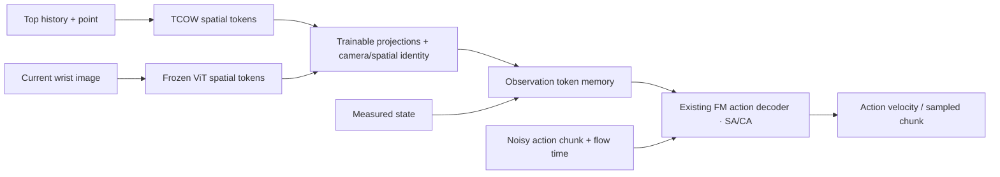
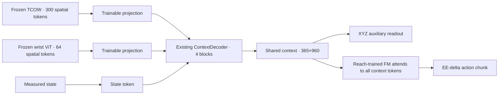

# Decoder roles in visuomotor policies

Survey checked 2026-10-17 against original papers and official implementations. Scope: representative original ACT, Diffusion Policy, Octo, OpenVLA, pi0 and SmolVLA architectures, rather than every subsequent variant. Architecture descriptions are literature findings; proposed changes to our policy below are hypotheses, not experimental results.

"Decoder" can refer to a dense visual output head, a module reading observation tokens, a language-model stack, or the network predicting actions. A separate observation-fusion TransformerDecoder is not a universal requirement.

| Architecture | Observation processing | Action decoding and role of attention |
|---|---|---|
| ACT | CNN spatial features from cameras, robot state and a CVAE latent enter a transformer encoder. | Learned action-position queries cross-attend to encoder memory in a transformer decoder, then a linear head predicts the action chunk. The decoder is the action generator, not a separate visual summarizer before another policy. [Official model](https://github.com/tonyzhaozh/act/blob/main/detr/models/detr_vae.py), [transformer](https://github.com/tonyzhaozh/act/blob/main/detr/models/transformer.py). |
| Diffusion Policy, CNN | Encoded observation features condition a temporal action denoiser. | A conditional1D U-Net denoises an action sequence, using FiLM conditioning. The U-Net has convolutional down/up paths; this is not a TransformerDecoder consuming visual tokens. [Paper, Fig.2 / Sec.3.1](https://diffusion-policy.cs.columbia.edu/diffusion_policy_ijrr.pdf). |
| Diffusion Policy, Transformer | Observation embeddings supply condition memory. | Noisy action embeddings query memory through transformer decoder cross-attention during iterative denoising. The official implementation also exposes an encoder-only configuration, so the class name alone does not establish the selected attention pattern. [Official implementation](https://github.com/real-stanford/diffusion_policy/blob/main/diffusion_policy/model/diffusion/transformer_for_diffusion.py). |
| Octo | Task/camera/history tokens enter a block-masked transformer with learned readout tokens. | Readout embeddings condition a lightweight diffusion action head. The official DiffusionActionHead uses a residual MLP, with mean pooling or optional multihead attention pooling. A separate encoder-decoder TransformerDecoder is not required. [Paper, Sec.2.1](https://octo-models.github.io/paper.pdf), [official heads](https://github.com/octo-models/octo/blob/main/octo/model/components/action_heads.py). |
| OpenVLA, original | DINOv2/SigLIP image patch features are fused and projected into Llama2's token space. | A decoder-only language backbone predicts discrete action tokens, subsequently mapped to continuous robot commands. The LLM decoder performs action generation; it is not an extra visual readout decoder before FM. The two visual backbones do not mean two camera views. [Official architecture](https://openvla.github.io/). |
| pi0, original | Image/language tokens use VLM weights; robot-state/noisy-action tokens use action-expert weights. | A joint transformer with two parameter sets exchanges information through block-masked attention and predicts continuous flow fields. The paper explicitly distinguishes this from its pi0-small baseline's conventional encoder-decoder cross-attention. [Paper, AppendixB–C](https://www.physicalintelligence.company/download/pi0.pdf). |
| SmolVLA | A pretrained VLM processes the visual/language/state prefix. | The flow-matching action expert alternates cross-attention to VLM features and action self-attention. The VLM does observation processing, while the expert is the action-decoding stage. This does not imply a further standalone fusion decoder must be added. [Official description](https://huggingface.co/blog/smolvla), [paper](https://arxiv.org/abs/2506.01844). |

Our current implementation has to be described by its actual attention pattern:

- `OATFlow/reach/flow.py`:16action blocks alternate8self-attention and8cross-attention blocks. In e105 this is already an action decoder. Its weights came from reach training; borrowing SmolVLA architecture does not mean loading SmolVLA learned action weights, and our attention implementation is not identical in every detail.
- `OATFlow/shuffle_bc/model.py`:e105 compresses target-conditioned TCOW spatial features through learned pooling/MLP to one256D hidden vector, projects it into one960D goal token, and pairs it with one state token. It has no independent visual TransformerDecoder before the existing action decoder.
- `OATFlow/top_pick/model.py`:e103 does have a two-layer query TransformerDecoder producing a target-conditioned visual latent before FM.
- Other repository branches are different: `OATFlow/prior/model.py` uses a class named ContextDecoder, implemented in `OATFlow/policy/model.py` as four bidirectional observation self-attention blocks. Structurally this is observation contextualization, not an action-query cross-attention decoder. It is not the e105 pipeline.

The relevant experiment is therefore how observation information reaches the action decoder, not whether a module is called "decoder". One possible wrist extension projects TCOW spatial tokens and frozen wrist-ViT tokens into the existing FM context space, adds camera/spatial identity, and lets FM cross-attend to their concatenation alongside measured state. This tests richer observation access without an additional fusion transformer. A second arm of the ablation inserts a small observation-fusion/readout transformer before the same FM. Both should retain matched data, training budget, reach initialization and evaluation cases; changing memory length from the reach policy's two tokens is itself a transfer change.

This is a proposal only. It does not establish that denser tokens outperform the existing single goal token or that additional fusion is unnecessary for this task. An XYZ auxiliary readout can remain on observation features outside the noisy-action generation stream; if a learned fusion module is inserted, attaching XYZ to its shared observation output supervises that fusion as well. The surveyed architectures do not by themselves settle the best auxiliary-loss location. No training configuration was changed for this survey.

## User-proposed reuse of OATFlow ContextDecoder

The user proposed frozen TCOW features + frozen wrist-ViT tokens + measured-state token -> existing ContextDecoder -> shared context, with an auxiliary XYZ head on that context and the reach-trained FM attending to all context tokens. Source inspection confirms this is structurally compatible: `OATFlow/policy/model.py:ContextDecoder` has four bidirectional observation-attention blocks of width960, defaults to365tokens, preserves token count, and can invoke the eight K/V projections used by `OATFlow/reach/flow.py`. This has now been implemented and trained for XYZ only in [e108](e108_context.md), using cam-left as a surrogate wrist. The FM interface was checked; action-policy training remains unrun. Train error is low but tracking through unseen shuffle remains poor.

Using all current TCOW spatial features gives300×768tokens, projected to960; wrist uses64×768tokens projected to960; measured state adds one960Dtoken. Camera/position information distinguishes token provenance. The365×960output remains a token sequence for FM cross-attention. A simple auxiliary readout can flatten the context into a Linear(350400,3), rather than collapsing the FM's context into one token. Auxiliary gradients update decoder/projections/readout; FM gradients update decoder/projections/FM. Frozen TCOW and wrist ViT remain unchanged and their features can be cached.

In the current tracker API, use `PointXYZ.features(... )[:, -1]` for spatial tokens; `PointXYZ.hidden()` already applies learned pooling and returns a256Dvector. Reuse the context module only: the separate PriorPolicy branch uses6Dabsolute-joint actions, whereas e108 retains the reach-trained10DEE-delta FM and its normalization. The context module now has an explicit gradient-checkpointing flag, disabled in e108 as requested.

